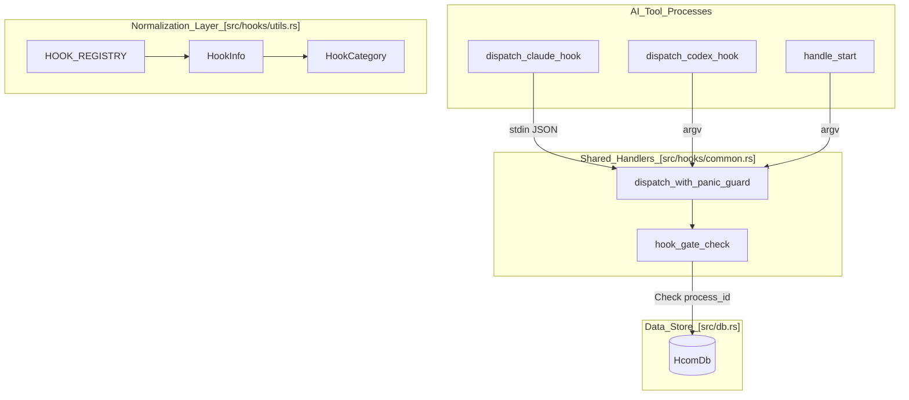
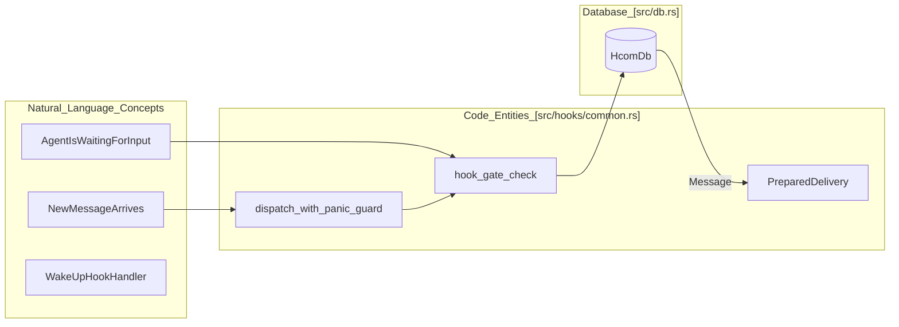
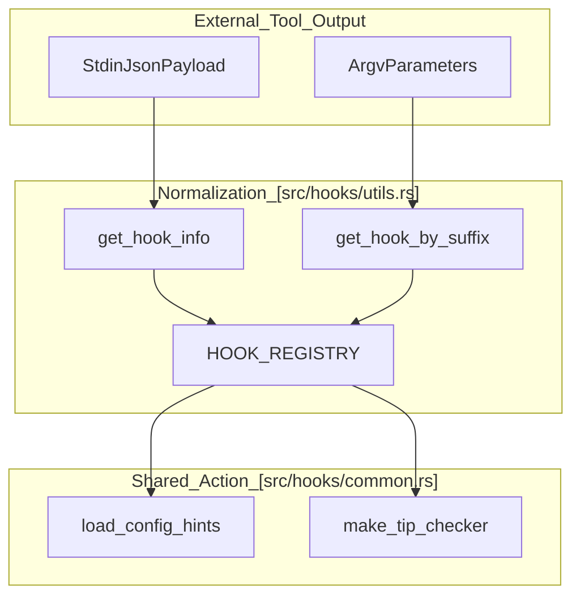

<!-- source: DeepWiki mcp.deepwiki.com · repo aannoo/hcom · page 7.1 Hook System Overview · fetched 2026-10-27 -->

# Hook System Overview

Relevant source files

The following files were used as context for generating this wiki page:

- [src/hooks/claude.rs](src/hooks/claude.rs)
- [src/hooks/common.rs](src/hooks/common.rs)
- [src/hooks/omp/plugin.rs](src/hooks/omp/plugin.rs)
- [src/hooks/runtime.rs](src/hooks/runtime.rs)
- [src/hooks/utils.rs](src/hooks/utils.rs)

## Purpose and Scope

The hook system is the core integration layer that allows `hcom` to intercept and inject messages into AI tool sessions. It provides a unified infrastructure for different AI tools (Claude, Gemini, Codex, OpenCode, Antigravity, etc.) to communicate with the `hcom` database and PTY delivery mechanisms. Hooks enable lifecycle tracking, status updates, and message polling during idle periods.

Sources: [src/hooks/common.rs:1-22](), [src/hooks/utils.rs:1-4]()

---

## Hook Architecture Overview

Hooks are configuration-based callbacks invoked by AI tools at specific lifecycle points. `hcom` provides a normalized dispatcher that routes these tool-specific invocations to shared handlers.

### Hook Dispatcher Architecture

Sources: [src/hooks/claude.rs:93-147](), [src/hooks/common.rs:27-44](), [src/hooks/common.rs:123-127](), [src/hooks/utils.rs:19-41]()

---

## Hook Types and Payloads

`hcom` normalizes tool-specific hook data into structured inputs. Depending on the tool and event type, hooks receive payloads either via `stdin` JSON or via command-line arguments (`argv`).

### Hook Categories and Registry

The single source of truth for hook classification is defined in [src/hooks/utils.rs:1-4](). It defines `HookCategory` [src/hooks/utils.rs:19-26]() to distinguish between input mechanisms:
- **`HookCategory::Stdin`**: Hooks that receive a JSON payload via standard input (e.g., Claude, Gemini, Antigravity).
- **`HookCategory::Argv`**: Hooks that receive parameters via command-line arguments (e.g., Codex, OpenCode).
- **`HookCategory::Blocking`**: Hooks that can block for extended periods, such as idle polling loops (`Stop` / `poll`).

### Hook Exit Codes

The hook process communicates its decision back to the host tool using standardized exit codes [src/hooks/utils.rs:8-16]():
- `EXIT_ALLOW` (`0`): Hook allowed the operation [src/hooks/utils.rs:9-10]().
- `EXIT_ERROR` (`1`): Internal hook error encountered [src/hooks/utils.rs:11-13]().
- `EXIT_BLOCK` (`2`): Hook blocked the operation or delivered a message payload [src/hooks/utils.rs:14-16]().

Sources: [src/hooks/claude.rs:32-45](), [src/hooks/utils.rs:1-118]()

---

## Shared Hook Infrastructure (`hooks/common.rs`)

The `src/hooks/common.rs` module provides robust primitives used across all tool adapters:
- **`dispatch_with_panic_guard`**: Catches panics in handler closures (`std::panic::catch_unwind`), logs errors, and returns fallback values to prevent host process crashes [src/hooks/common.rs:27-44]().
- **`hook_gate_check`**: Evaluates whether hooks should proceed or skip execution by ensuring `ctx.process_id` is present [src/hooks/common.rs:123-127]().
- **`SAFE_HCOM_COMMANDS`**: A static slice of read-only and administrative commands (`send`, `list`, `events`, `listen`, `config`, etc.) that agents can execute without requiring user approval prompts [src/hooks/common.rs:52-72]().
- **`PreparedDelivery`**: Encapsulates formatted messages and delivery state before cursors are advanced [src/hooks/common.rs:185-189]().

Sources: [src/hooks/common.rs:27-127](), [src/hooks/common.rs:185-189]()

---

## Hook Installation, Gate Checks, and Verification

Per-run tool integrations manage runtime injection via adapters defined in [src/hooks/runtime.rs:101-125]() and tool-specific files such as [src/hooks/omp/plugin.rs:8-14](). 

### Runtime Injection and Cleanup
- **`PerRunAdapter`**: Defines `prepare`, `cleanup_legacy`, and `ensure_permissions` routines [src/hooks/runtime.rs:102-116]().
- **Legacy Cleanup**: `cleanup_legacy_per_run` removes hcom-owned legacy plugin files from effective tool config dirs based on ownership markers without disrupting user extensions [src/hooks/omp/plugin.rs:82-85](), [src/hooks/omp/plugin.rs:157-161]().
- **Managed Argument Stripping**: Functions like `strip_managed_extension_args` clean replayed argument vectors so stale paths are not loaded alongside freshly injected ones [src/hooks/omp/plugin.rs:98-155]().

Sources: [src/hooks/omp/plugin.rs:8-161](), [src/hooks/runtime.rs:1-157]()

---

## Natural Language to Code Entity Space

### Polling and Delivery Logic
This diagram bridges the conceptual idle polling state with the underlying code entities in `hooks/common.rs` and `db.rs`.

Sources: [src/hooks/common.rs:27-44](), [src/hooks/common.rs:123-127](), [src/hooks/common.rs:185-189]()

### Hook Lifecycle and Payload Processing
This diagram associates external tool events with internal payload normalization and configuration lookup utilities.

Sources: [src/hooks/common.rs:157-180](), [src/hooks/utils.rs:45-146]()

---

