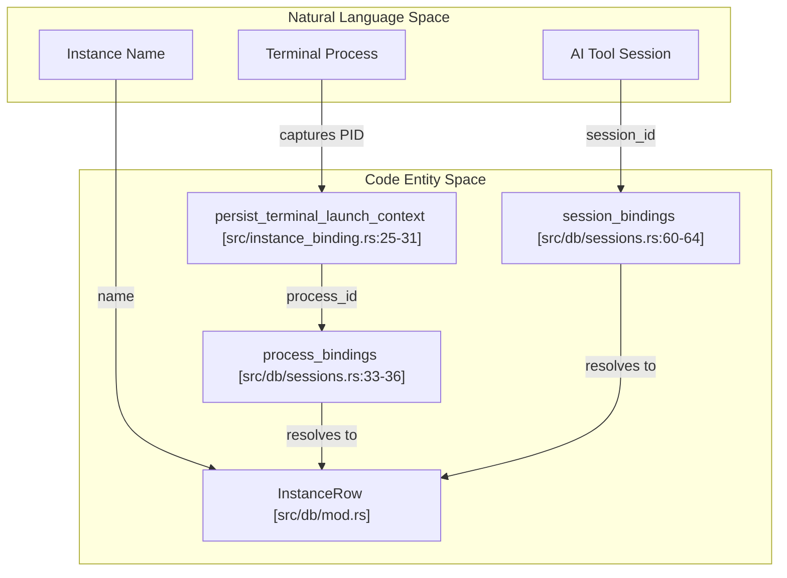
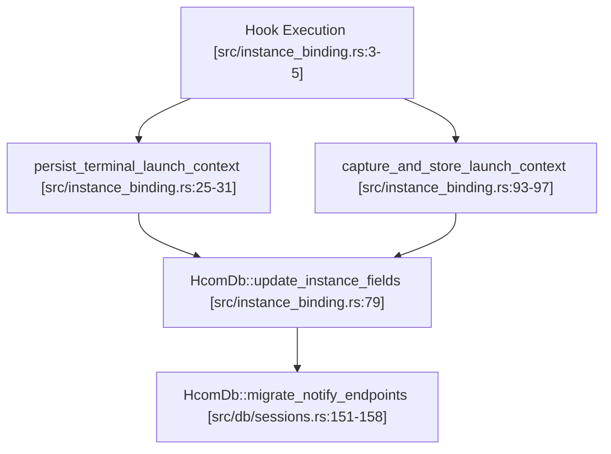

<!-- source: DeepWiki mcp.deepwiki.com · repo aannoo/hcom · page 7.2 Identity and Session Binding · fetched 2026-10-27 -->

# Identity and Session Binding

Relevant source files

The following files were used as context for generating this wiki page:

- [src/claude_actor.rs](src/claude_actor.rs)
- [src/commands/list.rs](src/commands/list.rs)
- [src/commands/stop.rs](src/commands/stop.rs)
- [src/db/claude_actors.rs](src/db/claude_actors.rs)
- [src/db/events.rs](src/db/events.rs)
- [src/db/sessions.rs](src/db/sessions.rs)
- [src/identity.rs](src/identity.rs)
- [src/instance_binding.rs](src/instance_binding.rs)
- [src/pidtrack.rs](src/pidtrack.rs)

## Purpose and Scope

This document details the multi-tier identity architecture in `hcom`, which binds ephemeral terminal processes and AI tool sessions to persistent instance records. It covers the relationships between `process_id`, `session_id`, and `instance_name`, the execution flow of session binding, actor capability tokens (`src/claude_actor.rs`), nested-agent identity scrubbing, and instance rebind/merge scenarios [src/instance_binding.rs:1-6](), [src/identity.rs:1-2](), [src/claude_actor.rs:1-7]().

**Related pages:**
- For hook system entry points and plugin detection, see [7.1]()
- For instance lifecycle states and status tracking, see [4.3]()
- For database schema overview, see [4.2]()

---

## Three-Tier Identity Architecture

`hcom` tracks instances across restarts, crashes, and process reconnections using three distinct identifiers that map runtime execution contexts to database-backed instance rows [src/instance_binding.rs:1-5](), [src/identity.rs:1-2]():

| Identity Level | Code Representation | Scope & Persistence | Primary Role |
|---|---|---|---|
| `process_id` | `process_id` in `launch_context` or `process_bindings` table [src/instance_binding.rs:41-43](), [src/db/sessions.rs:33-36]() | PTY Wrapper Process lifetime | Maps underlying terminal process to an instance via `process_bindings`. |
| `session_id` | `session_id` field in `instances` table [src/db/claude_actors.rs:93-97]() | AI Tool Plugin session lifetime | Canonical session identity for plugin-backed tools (Claude, Pi, Omp). |
| `instance_name` | `name` field in `instances` table [src/db/claude_actors.rs:115-118]() | Survives restarts (Persistent) | Human/user-facing canonical name (e.g., `luna`, `nova`). |

### Diagram: Natural Language Space to Code Entity Space (Identity Mapping)

**Sources:** [src/instance_binding.rs:25-54](), [src/db/sessions.rs:33-64]()

---

## Process and Session Binding Flow

When an AI tool session starts via hooks, the system binds the runtime `session_id` and `process_id` to an instance record. The module `src/instance_binding.rs` owns the hook-facing identity handshake, including launch metadata capture and placeholder-to-canonical binding [src/instance_binding.rs:1-5]().

Terminal launch context is persisted via `persist_terminal_launch_context()`, which records terminal presets and process identifiers without clobbering existing launch context JSON fields [src/instance_binding.rs:25-88](). Similarly, `capture_and_store_launch_context()` snapshots the active git branch, TTY, and environment variables while preserving critical identifiers like `pane_id` and `process_id` [src/instance_binding.rs:93-142]().

### Diagram: Code Entity Flow for Session Binding and Context Persistence

**Sources:** [src/instance_binding.rs:25-142](), [src/db/sessions.rs:151-178]()

---

## Actor Tokens and Verified Capabilities

For tool invocations where security and precise actor attribution are critical (such as Claude Code's `PreToolUse` shell hook), `hcom` uses opaque, database-backed capability tokens [src/db/claude_actors.rs:1-15](), [src/claude_actor.rs:1-7]().

### Key Mechanisms
- **Capability Issuance**: `issue_claude_actor_capability()` generates a secure token tied to a `session_id`, `tool_use_id`, and `agent_id` with a 1-hour time-to-live (TTL) [src/db/claude_actors.rs:13-24]().
- **Environment Export**: The hook exports the token via `HCOM_CLAUDE_ACTOR` and session via `HCOM_CLAUDE_ACTOR_SESSION` [src/claude_actor.rs:13-14]().
- **Validation**: `resolve_env_actor()` validates the token against the database, ensuring that CLI commands run by the agent are strictly verified against its parent or subagent identity [src/claude_actor.rs:31-55](). If tokens are missing (e.g., human-driven `! command` runs), it gracefully falls back to ordinary resolution [src/claude_actor.rs:24-30]().

**Sources:** [src/db/claude_actors.rs:13-150](), [src/claude_actor.rs:13-72]()

---

## Nested-Agent Scrubbing and Merge/Switch Scenarios

When an agent spawns a nested subprocess that also invokes `hcom`, the nested agent must not inherit the parent's runtime identity. 

### Identity and Endpoint Migration
When instances rebind or adopt sessions, endpoint states must be cleanly transferred. `HcomDb::migrate_notify_endpoints()` performs a per-kind merge with source-wins semantics on conflict, ensuring authoritative PTY and inject ports from newly launched or rebinding processes overwrite stale records without losing target-only kinds like `plugin` [src/db/sessions.rs:151-158]().

### Rebind and Actor State Management
- **Rebinding (`--as`)**: Allows an active PTY session to adopt a different instance name. Root actor state and capabilities are transferred via `rebind_claude_root_actor_state()` [src/db/claude_actors.rs:185-196]().
- **Validation Constraints**: `ensure_explicit_matches()` ensures that explicit command-line identity flags do not conflict with a verified Claude actor token [src/claude_actor.rs:58-72]().

**Sources:** [src/db/sessions.rs:151-178](), [src/db/claude_actors.rs:185-196](), [src/claude_actor.rs:58-72]()

---

## Key Functions and Implementation Reference

| Function / Struct | File Path | Role |
|---|---|---|
| `persist_terminal_launch_context` | [src/instance_binding.rs:25-31]() | Persists late-bound terminal metadata (`pane_id`, `process_id`) without clobbering fields. |
| `capture_and_store_launch_context` | [src/instance_binding.rs:93-97]() | Captures git branch, TTY, and environment snapshot for an instance. |
| `migrate_notify_endpoints` | [src/db/sessions.rs:151-158]() | Migrates notify endpoints between instances with source-wins conflict resolution. |
| `issue_claude_actor_capability` | [src/db/claude_actors.rs:13-21]() | Issues and persists ephemeral actor capability tokens for Claude shell tool uses. |
| `resolve_env_actor` | [src/claude_actor.rs:31-34]() | Validates environment-passed capability tokens to identify the acting agent. |
| `ensure_explicit_matches` | [src/claude_actor.rs:58-62]() | Rejects explicit identities that conflict with a verified Claude actor. |

**Sources:** [src/instance_binding.rs:25-97](), [src/db/sessions.rs:151-158](), [src/db/claude_actors.rs:13-21](), [src/claude_actor.rs:31-62]()

---

