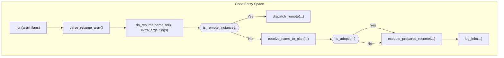
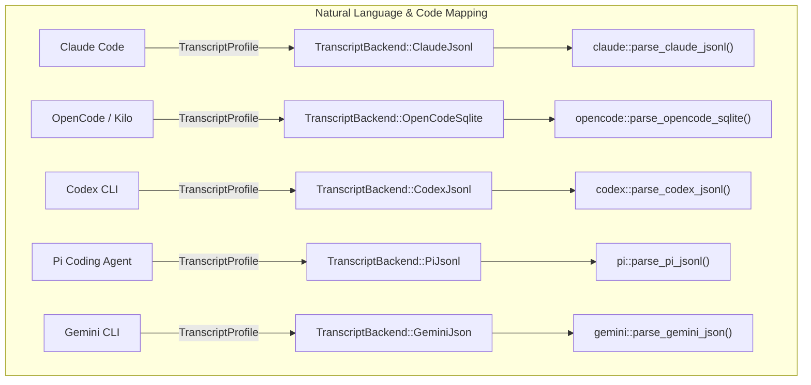
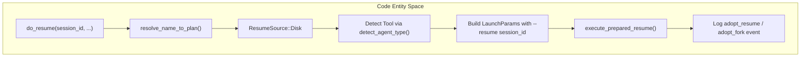

<!-- source: DeepWiki mcp.deepwiki.com · repo aannoo/hcom · page 7.6 Session Resume, Fork and Adoption · fetched 2026-10-27 -->

# Session Resume, Fork and Adoption

Relevant source files

The following files were used as context for generating this wiki page:

- [src/commands/launch.rs](src/commands/launch.rs)
- [src/commands/resume.rs](src/commands/resume.rs)
- [src/launcher.rs](src/launcher.rs)
- [src/transcript/claude.rs](src/transcript/claude.rs)
- [src/transcript/codex.rs](src/transcript/codex.rs)
- [src/transcript/copilot.rs](src/transcript/copilot.rs)
- [src/transcript/cursor.rs](src/transcript/cursor.rs)
- [src/transcript/gemini.rs](src/transcript/gemini.rs)
- [src/transcript/grok.rs](src/transcript/grok.rs)
- [src/transcript/kimi.rs](src/transcript/kimi.rs)
- [src/transcript/mod.rs](src/transcript/mod.rs)
- [src/transcript/opencode.rs](src/transcript/opencode.rs)
- [src/transcript/pi.rs](src/transcript/pi.rs)
- [src/transcript/shared.rs](src/transcript/shared.rs)

## Purpose and Scope

This page documents the internal mechanics of session management in `hcom`, specifically focusing on the resume and fork pipeline, thread and rollout lineage resolution, multi-tool transcript parsing architectures, and the adoption mechanism for foreign on-disk sessions. 

Sources: [src/commands/resume.rs:1-208](), [src/transcript/mod.rs:1-127]()

---

## 1. Resume and Fork Pipeline

The resume and fork subsystem is responsible for restoring stopped instances or branching active sessions into new execution contexts. The core entry point for these operations is `do_resume()`, which accepts an instance name or session identifier, determines whether the target is tracked locally or remotely, and dispatches a relaunch command [src/commands/resume.rs:74-208]().

### The `ResumeSource` Abstraction

Before planning a relaunch, `hcom` classifies the target using the `ResumeSource` enum [src/commands/resume.rs:26-35]():
* `ResumeSource::Instance { name }`: Resumes or forks an existing `hcom`-tracked instance (whether currently active or stopped).
* `ResumeSource::Disk { session_id, tool, cwd_hint }`: Adopts a foreign, untracked session directly from its on-disk transcript logs.

### Execution Flow

*Sources: [src/commands/resume.rs:74-208]()*

Sources: [src/commands/resume.rs:26-208]()

---

## 2. Thread-Name Resolution and Lineage

When agents are forked or resumed, maintaining transcript continuity requires resolving parent-child lineage. Certain AI tools (such as Codex) do not duplicate entire history files upon forking; instead, they reference a parent rollout and an ordinal cutoff [src/transcript/codex.rs:39-48]().

### Codex Rollout Lineage Resolution

The Codex transcript parser (`src/transcript/codex.rs`) resolves inherited context by tracing `session_meta` records recursively up to `MAX_FORK_DEPTH` [src/transcript/codex.rs:34-97]():
1. **`read_codex_rollout_entries`**: Loads the target rollout and prepends inherited entries from ancestor sessions [src/transcript/codex.rs:43-48]().
2. **`fork_reference`**: Inspects a rollout's `session_meta` payload for `forked_from_id` and `forked_from_ordinal_exclusive` fields [src/transcript/codex.rs:89-97]().
3. **`find_sibling_rollout`**: Locates parent rollouts across dated directory trees (`sessions/**/rollout-*-{id}.jsonl`) [src/transcript/codex.rs:99-107]().

Sources: [src/transcript/codex.rs:34-107]()

---

## 3. Transcript Parsing Architecture per Tool

To support resumption, forking, and querying across distinct AI agents, `hcom` decouples canonical tool identity from backend parser implementations via the `TranscriptBackend` and `TranscriptProfile` registry [src/transcript/mod.rs:33-127]().

*Sources: [src/transcript/mod.rs:33-127](), [src/transcript/claude.rs:39](), [src/transcript/codex.rs:111](), [src/transcript/gemini.rs:40](), [src/transcript/opencode.rs:172](), [src/transcript/pi.rs:67]()*

### Backend Parser Overview

* **Claude (`claude::parse_claude_jsonl`)**: Parses JSONL files, filtering out meta entries, compaction summaries, and sidechains while indexing assistant tool uses [src/transcript/claude.rs:39-142]().
* **Codex (`codex::parse_codex_jsonl`)**: Reconstructs sessions from rollout files, mapping function call outputs back to call IDs across both older response formats and newer event messages [src/transcript/codex.rs:111-136]().
* **Gemini (`gemini::parse_gemini_json`)**: Handles single-object JSON message trees and JSONL fallbacks, mapping user/model turns and tool calls [src/transcript/gemini.rs:40-70]().
* **OpenCode / Kilo (`opencode::parse_opencode_sqlite`)**: Queries underlying SQLite databases (`message` and `part` tables) using `session_id` parameters [src/transcript/opencode.rs:172-184]().
* **Pi (`pi::parse_pi_jsonl`)**: Normalizes JSONL logs by mapping assistant `toolCall` arguments to subsequent `toolResult` blocks [src/transcript/pi.rs:67-124]().

Sources: [src/transcript/mod.rs:33-127](), [src/transcript/claude.rs:39-142](), [src/transcript/codex.rs:111-136](), [src/transcript/gemini.rs:40-70](), [src/transcript/opencode.rs:172-184](), [src/transcript/pi.rs:67-124]()

---

## 4. Adoption of Foreign On-Disk Sessions

When a user wishes to bring an unmanaged, on-disk session under `hcom` control without an existing database record, `hcom` performs an **adoption** workflow using `ResumeSource::Disk` [src/commands/resume.rs:29-34]().

### Adoption Data Flow

*Sources: [src/commands/resume.rs:29-34](), [src/commands/resume.rs:179-206]()*

1. **Discovery**: The user supplies a session ID or transcript path. `hcom` identifies the tool type using transcript path heuristics (`detect_agent_type`) [src/commands/transcript.rs:197-200]().
2. **Plan Generation**: A `PreparedResume` context is built without a prior `instances` row, mapping the foreign session ID to the tool's resume flag (e.g., `--resume <session_id>`).
3. **Execution**: The underlying process launcher starts the agent with the restored session state, registering it as a tracked instance in `HcomDb` upon startup [src/commands/resume.rs:191-207]().

Sources: [src/commands/resume.rs:26-208](), [src/commands/transcript.rs:197-200]()

---

