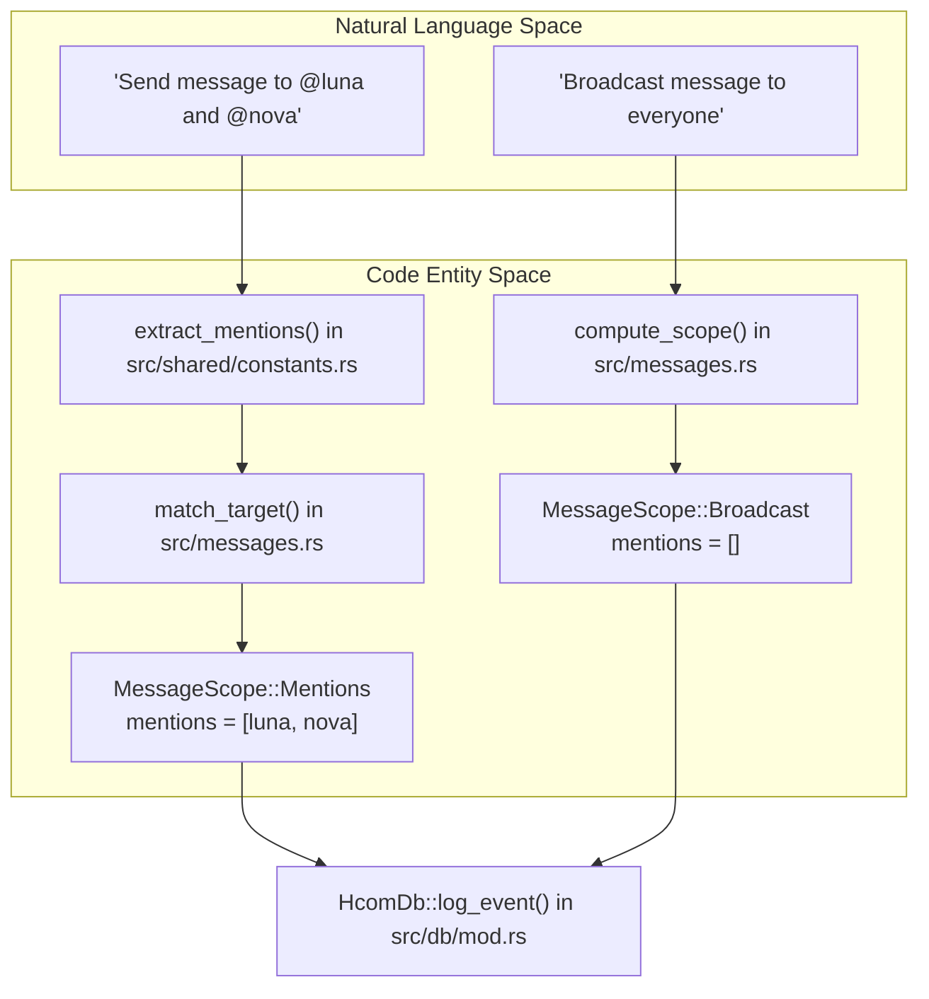
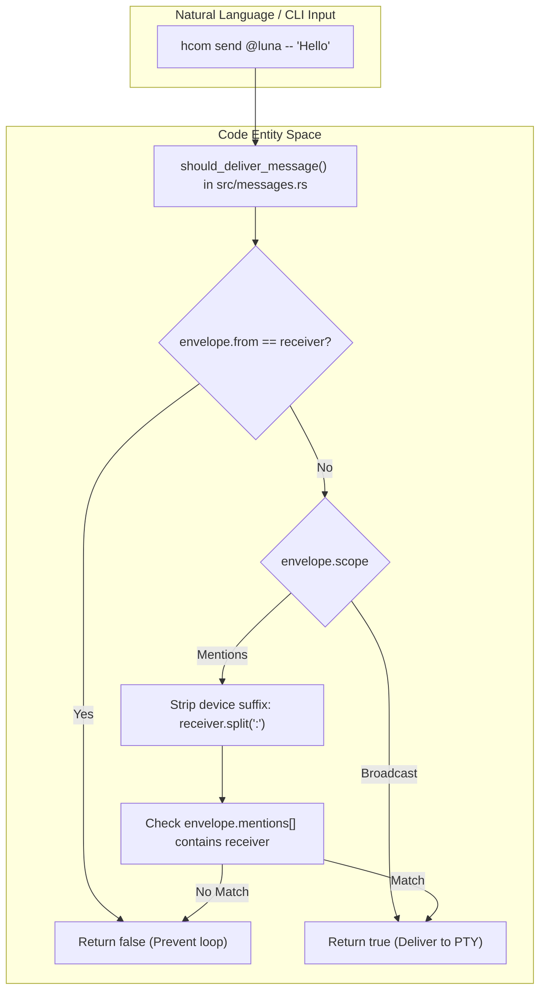

<!-- source: DeepWiki mcp.deepwiki.com · repo aannoo/hcom · page 8.1 Message Scopes and Delivery Logic · fetched 2026-10-27 -->

# Message Scopes and Delivery Logic

<details>
<summary>Relevant source files</summary>

The following files were used as context for generating this wiki page:

- [src/bootstrap.rs](src/bootstrap.rs)
- [src/commands/events.rs](src/commands/events.rs)
- [src/commands/send.rs](src/commands/send.rs)
- [src/messages.rs](src/messages.rs)
- [src/shared/constants.rs](src/shared/constants.rs)
- [src/shared/mod.rs](src/shared/mod.rs)

</details>


This page details how `hcom` routes messages between agents and the human operator using message scopes, mention parsing, `@instance` addressing, and cross-device routing. It covers the core delivery matching logic that determines which instances receive each message event.

---

## Overview

Every message event processed by `hcom` contains a **scope** field that dictates its visibility and delivery rules:
- `broadcast`: Delivered to all active instances across the system except the sender [src/messages.rs:16-17]().
- `mentions`: Delivered exclusively to instances explicitly matched by `@mentions` in the message payload [src/messages.rs:17-18]().

`hcom` uses a pull-based delivery model where messages are committed as JSON objects in the SQLite `events` table, and agent PTY wrapper delivery loops poll for unread messages matching their scope and recipient criteria [src/messages.rs:16-27](). The database records targeted recipient lists in the `delivered_to` JSON array.

Sources: [src/messages.rs:13-27]()

---

## Broadcast vs. Mentions Scope

Message scopes are parsed and validated during command execution. The `MessageScope` enum defines the two valid scopes [src/messages.rs:14-18]():

```rust
pub enum MessageScope {
    Broadcast,
    Mentions,
}
```

### Broadcast Scope
When no `@mention` targets are provided in the command or message body, `compute_scope()` assigns `MessageScope::Broadcast` [src/messages.rs:16-17](). Broadcast messages act as system-wide notifications, reaching all active instances.

### Mentions Scope
When one or more `@mention` patterns are detected, `MessageScope::Mentions` is assigned [src/messages.rs:17-18](). The `MENTION_PATTERN` regex (`src/shared/constants.rs`) identifies valid target strings while ignoring email addresses, file paths, and identifiers containing underscores [src/shared/constants.rs:35-44]().

Sources: [src/messages.rs:13-27](), [src/shared/constants.rs:35-44]()

---

## Scope Resolution and `@instance` Addressing

The command pipeline translates natural language mentions into structured database entries. The diagram below maps natural language message targets to code entities in the message processing module.

### Natural Language to Code Entity Mapping: Scope Resolution

Sources: [src/messages.rs:179-255](), [src/shared/constants.rs:35-44]()

### Target Matching Rules
The `match_target` function resolves recipient names against active instance records using the following precedence:
1. **Full Name Match**: Matches exact `{tag}-{name}` strings [src/messages.rs:115-121]().
2. **Base Name Match**: Matches the 4-letter CVCV instance name (e.g., `luna`) [src/messages.rs:179-203]().
3. **Tag Prefix Match**: Matches tag prefixes (e.g., `@api-` matches all instances with tag `api`) [src/messages.rs:206-218]().
4. **Underscore Blocking**: Mentions avoid matching instances containing underscores to prevent accidental wildcard delivery (e.g., `@luna` will not match `luna_worker_1`) [src/messages.rs:211-231]().

Sources: [src/messages.rs:115-231]()

---

## Delivery Matching: `should_deliver_message`

When an agent checks for unread mail via `get_unread_messages()`, each candidate message event passes through `should_deliver_message()` to determine if it belongs in the agent's PTY input stream [src/messages.rs:260-303]().

### Delivery Decision Flow

Sources: [src/messages.rs:260-303]()

### Evaluation Criteria Matrix

| Condition | Outcome | Implementation Detail |
|-----------|---------|---|
| `envelope.from == receiver` | Skipped | Prevents agents from processing their own outbound messages [src/messages.rs:271-273]() |
| `scope == Broadcast` | Delivered | Evaluates to true for all active instances except the sender [src/messages.rs:278-280]() |
| `scope == Mentions` | Filtered | Evaluates to true if receiver base name matches the `mentions` array [src/messages.rs:284-295]() |

Sources: [src/messages.rs:260-303]()

---

## Cross-Device Routing and Device Suffixes

In multi-device deployments coordinated via the MQTT relay, instance addresses can include a device suffix separated by a colon (`name:DEVICE_ID`) [src/messages.rs:196-203]().

- **Local Address**: `@luna` resolves to local instances matching `luna`.
- **Remote Address**: `@luna:BOXE` targets instance `luna` specifically on the remote device identifier `BOXE`.

The `match_target` implementation strips device suffixes for base name comparisons while retaining them for explicit cross-device routing [src/messages.rs:196-203](). The bootstrap prompt informs agents of remote addressing conventions via `RELAY_NOTICE` [src/bootstrap.rs:98-99]().

Sources: [src/messages.rs:179-203](), [src/bootstrap.rs:98-99]()

---

## `delivered_to` Tracking

The SQLite event ledger tracks delivery state using the `delivered_to` JSON array embedded in the event `data` column [src/db/mod.rs:60-72](). 

When a message is dispatched, the database evaluates active instances and records their names in `delivered_to`. The `events_v` database view extracts this array for efficient querying, display formatting, and unread metrics [src/db/mod.rs:354-382]().

Sources: [src/db/mod.rs:60-382]()

---

## Code Entity Map

| Concept | Code Entity | Location |
|---------|-------------|----------|
| Scope Enum | `MessageScope` | [src/messages.rs:14-18]() |
| Scope Computation | `compute_scope` | [src/messages.rs:230-255]() |
| Target Resolution | `match_target` | [src/messages.rs:179-228]() |
| Delivery Filtering | `should_deliver_message` | [src/messages.rs:260-303]() |
| Mention Extraction | `extract_mentions` | [src/shared/constants.rs:35-44]() |
| Message Validation | `validate_message` | [src/messages.rs:127-151]() |

Sources: [src/messages.rs:14-303](), [src/shared/constants.rs:35-44]()

---

