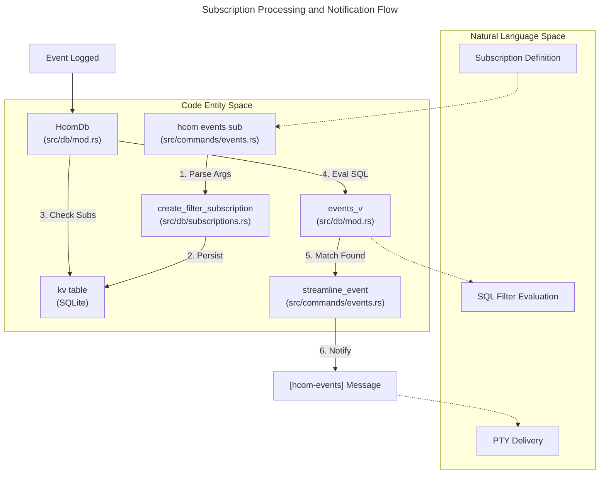
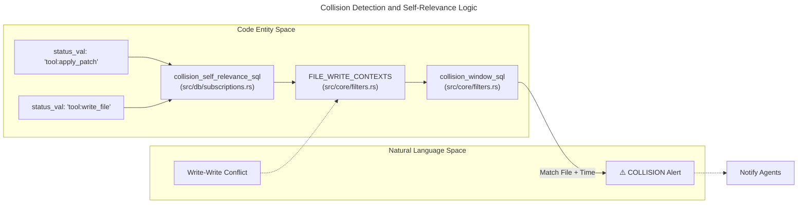

<!-- source: DeepWiki mcp.deepwiki.com · repo aannoo/hcom · page 8.2 Event Subscriptions · fetched 2026-10-27 -->

# Event Subscriptions

<details>
<summary>Relevant source files</summary>

The following files were used as context for generating this wiki page:

- [src/cli_context.rs](src/cli_context.rs)
- [src/commands/listen.rs](src/commands/listen.rs)
- [src/core/filters.rs](src/core/filters.rs)
- [src/db/reqwatch_policy.rs](src/db/reqwatch_policy.rs)
- [src/db/subscriptions.rs](src/db/subscriptions.rs)
- [src/hooks/family.rs](src/hooks/family.rs)

</details>


This page details the implementation of event subscriptions in `hcom`, covering SQL-based filtering via the `events_v` view, persistent versus one-shot (`--once`) subscription semantics, request-watch policies, cancellation logic, and collision detection.

---

## Architecture Overview

Event subscriptions provide event-driven push notifications for agent workflows. When events matching a subscription's filter are recorded, the system dispatches a notification via the `[hcom-events]` virtual sender. Subscriptions are stored as key-value pairs with the prefix `events_sub:` in the SQLite `kv` table [src/db/subscriptions.rs:3-6](). Evaluation happens synchronously when events are logged, requiring no background daemon.

### Subscription Processing Flow

**Diagram: Subscription processing and notification flow**

Sources: [src/commands/events.rs:60-61](), [src/commands/events.rs:118-121](), [src/db/subscriptions.rs:1-22](), [src/db/subscriptions.rs:61-68]()

---

## SQL Filters and events_v View

Subscriptions evaluate queries against the `events_v` SQLite view, which flattens JSON event payloads into queryable columns [src/commands/events.rs:178-180]().

### Composable Filter Flags

The `hcom events sub` command uses `EventFilterArgs` to map CLI flags into SQL WHERE clauses [src/commands/events.rs:89-91](). Filter flags can be constructed via raw SQL strings or composable flags [src/db/subscriptions.rs:69-72]():

```bash
# Subscribe using raw SQL
hcom events sub "type = 'message' AND instance = 'luna'"

# Subscribe using composable flags
hcom events sub --agent luna --type message
```

The function `build_sql_from_flags` in `src/core/filters.rs` constructs these SQL clauses during subscription creation [src/db/subscriptions.rs:69-72]().

Sources: [src/commands/events.rs:178-185](), [src/db/subscriptions.rs:69-84](), [src/core/filters.rs:1-8]()

---

## Subscription Modes

### Persistent vs. One-shot (`--once`)

Subscriptions are stored with metadata controlling their lifecycle:
*   **Persistent**: Maintained in the `kv` table until explicitly removed. Suitable for long-running monitors.
*   **One-shot (`--once`)**: Automatically purged after the first matching event fires. This behavior is governed by the `once` boolean property in the subscription record [src/db/subscriptions.rs:117-117]().

### Subscription Management Options
*   **`--for`**: Allows an agent or coordinator to create a subscription on behalf of another instance [src/commands/events.rs:75-76]().
*   **`--on-hit`**: Attaches an automated message (`on_hit_text`) to be dispatched immediately when the subscription fires [src/commands/events.rs:81-82](), [src/db/subscriptions.rs:119-122]().

Sources: [src/commands/events.rs:69-82](), [src/db/subscriptions.rs:110-122]()

---

## Specialized Subscriptions

### Collision Detection

Collision detection tracks "write-write" conflicts where multiple agents modify the same resource within a temporal window. File-write tool contexts are defined centrally in `FILE_WRITE_CONTEXTS` [src/db/subscriptions.rs:31-31]().

**Diagram: Collision detection and self-relevance logic**


The system appends a self-relevance predicate via `collision_self_relevance_sql` to ensure agents receive conflict notifications pertinent to their activity [src/db/subscriptions.rs:86-89](), using temporal windows calculated by `collision_window_sql` [src/core/filters.rs:59-65]().

Sources: [src/db/subscriptions.rs:86-89](), [src/core/filters.rs:59-65](), [src/db/subscriptions.rs:31-31]()

### Request-Watch Pattern

Request-watches (`reqwatch-*`) monitor whether an agent goes idle or stops without responding to an expected message [src/db/subscriptions.rs:20-22]().
1.  **Existence Check**: `reqwatch_reply_exists` verifies if a response has been registered for the specific `request_id` [src/db/subscriptions.rs:194-196]().
2.  **Policy Gating**: Tool-specific rules (such as Antigravity's idle grace period `AGY_REQWATCH_IDLE_GRACE_SEC`) defer abandonment alerts [src/db/reqwatch_policy.rs:8]().
3.  **Decision Function**: `reqwatch_notify_decision` evaluates the tool state and event type, returning a `ReqwatchNotifyDecision` of `Proceed`, `Defer`, or `Skip` [src/db/reqwatch_policy.rs:29-35]().

Sources: [src/db/subscriptions.rs:181-205](), [src/db/reqwatch_policy.rs:1-65]()

---

## Implementation Details

### Event Streamlining

To keep token overhead minimal for LLM consumption, `streamline_event` strips non-essential metadata before delivering subscription matches [src/commands/events.rs:118-121](). This removes universal bloat fields (`sender_kind`, `scope`, `delivered_to`) [src/commands/events.rs:126-128](), truncates status detail strings unless specific filters are enabled [src/commands/events.rs:141-152](), and normalizes ISO timestamps [src/commands/events.rs:163-164]().

Sources: [src/commands/events.rs:118-173]()

### Thread Membership & Cancellation

Internal delivery-only rows manage thread participation using stable IDs generated by `thread_membership_sub_id` [src/db/subscriptions.rs:17-18](), [src/db/subscriptions.rs:44-52](). When an instance stops, cleanup logic purges any associated watches and persistent subscriptions to prevent orphaned records in the `kv` store.

Sources: [src/db/subscriptions.rs:17-18](), [src/db/subscriptions.rs:44-52](), [src/db/subscriptions.rs:223-230]()

---

