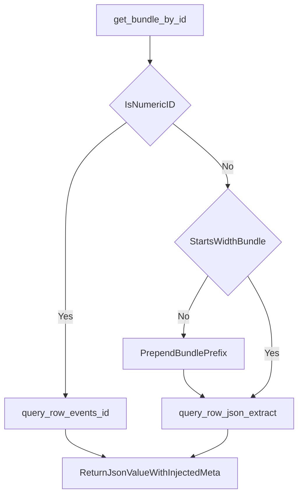
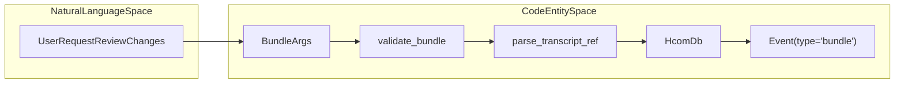

<!-- source: DeepWiki mcp.deepwiki.com · repo aannoo/hcom · page 8.3 Bundles and Context Sharing · fetched 2026-10-27 -->

# Bundles and Context Sharing

<details>
<summary>Relevant source files</summary>

The following files were used as context for generating this wiki page:

- [src/commands/bundle.rs](src/commands/bundle.rs)
- [src/commands/help.rs](src/commands/help.rs)
- [src/commands/transcript.rs](src/commands/transcript.rs)
- [src/core/bundles.rs](src/core/bundles.rs)

</details>


## Purpose and Scope

Bundles are structured context packages that allow agents to share conversation history, event logs, and file metadata in a referenceable format. They solve the problem of context handoffs between agents by packaging relevant information into a single unit that can be attached to messages and retrieved later.

This page covers the bundle data model, the validation logic in `src/core/bundles.rs`, the preparation workflow, the distinction between inline and explicit bundles, and the technical implementation of detail levels (normal, full, detailed) as managed by the `hcom bundle` command suite.

Sources: `[src/commands/bundle.rs:1-5]()`, `[src/core/bundles.rs:1-5]()`

---

## Bundle Structure and Data Model

A bundle is stored as an event of type `bundle` in the SQLite database `[src/commands/bundle.rs:128-129]()`. It contains a `refs` object that points to three types of context:

| Context Type | Description | Format |
|--------------|-------------|--------|
| **Events** | Event IDs or ranges from the event log | `["123", "124-130"]` |
| **Files** | File paths in the workspace | `["src/auth.py", "tests/test_auth.py"]` |
| **Transcript** | Conversation ranges with detail levels | `[{"range": "10-15", "detail": "normal"}]` |

### Bundle Event Data Structure
The `data` column in the `events` table for a bundle follows a schema validated by `validate_bundle` `[src/core/bundles.rs:105-146]()`. It often includes a random `bundle_id` prefix generated via `generate_bundle_id` `[src/core/bundles.rs:36-40]()`.

```json
{
  "bundle_id": "bundle:abc12345",
  "title": "Auth module review",
  "description": "Implementation complete, ready for review",
  "refs": {
    "events": ["123", "124-130"],
    "files": ["src/auth.py", "tests/test_auth.py"],
    "transcript": [
      {"range": "10-15", "detail": "normal"},
      {"range": "20", "detail": "full"}
    ]
  },
  "extends": "bundle:xyz789",
  "created_by": "luna"
}
```

Sources: `[src/commands/bundle.rs:128-129]()`, `[src/core/bundles.rs:36-40]`, `[src/core/bundles.rs:105-146]()`

---

## Bundle Types: Inline vs. Explicit

Hcom supports two ways of creating bundles:

### 1. Explicit Bundles
Created via the `hcom bundle create` command `[src/commands/bundle.rs:89-118]()`. These are standalone events that can be listed, searched, and referenced by multiple messages.

### 2. Inline Bundles
Created as part of a `hcom send` command using bundle flags (e.g., `--title`, `--events`, `--files`). If these flags are present, `hcom send` automatically creates a bundle event before delivering the message.

Sources: `[src/commands/bundle.rs:89-118]()`, `[src/core/bundles.rs:1-5]()`

---

## Bundle Lifecycle and Preparation

### Preparation Workflow
The `hcom bundle prepare` command assists agents by scanning recent activity to suggest a bundle structure. It analyzes transcript exchanges and events to identify relevant context `[src/commands/bundle.rs:72-86]()`.

### Validation and Normalization
Before a bundle is persisted, it undergoes strict validation in `src/core/bundles.rs`:
- **Size Estimation:** To prevent massive context dumps, bundles are limited to an estimated 15,000 lines of output `[src/core/bundles.rs:101-102]`, `[src/core/bundles.rs:139-145]()`.
- **Transcript Normalization:** String-based transcript refs (e.g., `"3-14:normal"`) are parsed into structured objects via `parse_transcript_ref` `[src/core/bundles.rs:53-99]()`.
- **Required Fields:** Title, description, and refs are mandatory when creating a bundle `[src/core/bundles.rs:111-120]()`.

### Detail Levels
Transcript references support three levels of granularity. These are used during the expansion of a bundle via `hcom bundle cat`.

| Level | Content Included |
| :--- | :--- |
| `normal` | Standard user prompt and assistant response. |
| `full` | Complete assistant response without truncation. |
| `detailed` | Includes internal metadata, tool calls, and hidden thought blocks. |

Sources: `[src/commands/bundle.rs:72-86]`, `[src/core/bundles.rs:53-99]`, `[src/core/bundles.rs:111-120]`, `[src/core/bundles.rs:139-145]()`

---

## Technical Implementation

### Database Interaction
Bundles are queried from the `events` table using the `get_bundle_by_id` function `[src/commands/bundle.rs:124-175]()`. This function attempts a numeric lookup on the `id` column first `[src/commands/bundle.rs:126-144]()`, then falls back to a `LIKE` search on the `bundle_id` field within the JSON `data` column using the `json_extract` SQLite function `[src/commands/bundle.rs:146-175]()`.

Title: "Bundle Identification and Retrieval Flow"

Sources: `[src/commands/bundle.rs:124-175]()`

### Bundle Chaining (Lineage)
The `hcom bundle chain` command allows traversing the history of context. It recursively follows the `extends` field in the bundle JSON to find parent bundles, effectively creating a linked list of context events `[src/commands/bundle.rs:64-69]()`.

Title: "Natural Language Intent to Bundle Context Flow"

Sources: `[src/commands/bundle.rs:33-70]`, `[src/core/bundles.rs:53-146]()`

---

## Command Reference Summary

The `BundleArgs` struct uses manual routing to support both explicit subcommands and implicit "show" behavior `[src/commands/bundle.rs:33-39]()`.

| Command | Argument Struct | Description |
| :--- | :--- | :--- |
| `hcom bundle list` | `BundleListArgs` | Lists recent bundles with metadata, supports `--json` and `--last` `[src/commands/bundle.rs:41-47]()`. |
| `hcom bundle show` | `BundleShowArgs` | Displays raw JSON metadata of a specific bundle by ID or prefix `[src/commands/bundle.rs:49-55]()`. |
| `hcom bundle cat` | `BundleCatArgs` | Expands all references (files, transcript, events) into a readable stream `[src/commands/bundle.rs:57-61]()`. |
| `hcom bundle chain` | `BundleChainArgs` | Walks the `extends` pointers to show context lineage `[src/commands/bundle.rs:63-69]()`. |
| `hcom bundle prepare` | `BundlePrepareArgs` | Scans history to suggest a new bundle for a target agent `[src/commands/bundle.rs:71-86]()`. |
| `hcom bundle create` | `BundleCreateArgs` | Persists a new bundle event with provided refs and metadata `[src/commands/bundle.rs:88-118]()`. |

Sources: `[src/commands/bundle.rs:33-118]()`

---

