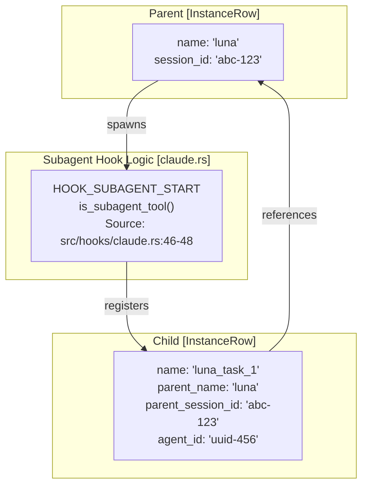
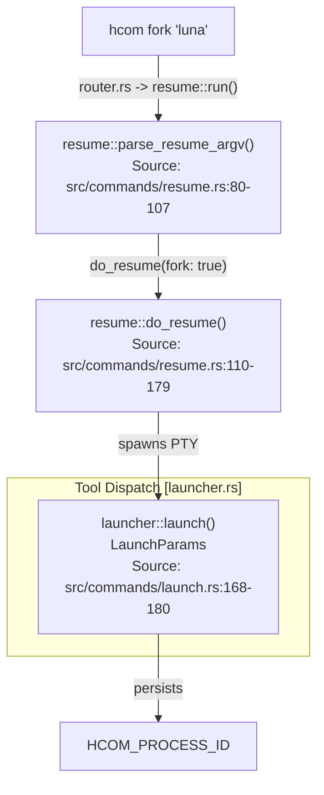

<!-- source: DeepWiki mcp.deepwiki.com · repo aannoo/hcom · page 8.4 Instance Forking and Subagents · fetched 2026-10-27 -->

# Instance Forking and Subagents

Relevant source files

The following files were used as context for generating this wiki page:

- [src/commands/launch.rs](src/commands/launch.rs)
- [src/commands/resume.rs](src/commands/resume.rs)
- [src/hooks/claude.rs](src/hooks/claude.rs)
- [src/hooks/common.rs](src/hooks/common.rs)
- [src/launcher.rs](src/launcher.rs)

## Purpose and Scope
This page documents parent-child instance relationships in `hcom`. It covers the technical implementation, data structures, database schema, and execution flows for instance forking (`hcom fork`) and tool-driven subagents (such as Claude Code tasks), detailing how names, sessions, and running tasks are tracked.

Related pages: [4.3 Instance Lifecycle Management](), [4.4 Message Routing and Delivery](), [5.1 Launch and Instance Management]().

---

## Overview

`hcom` tracks parent-child relationships through specific database fields in the `instances` table and specialized CLI routing for the `fork` command.

| Mechanism | Parent-Child Link | Lifecycle | Use Case |
| :--- | :--- | :--- | :--- |
| **Forking** | Peer-to-Peer | Persistent, diverges from original | Clone session for parallel exploration |
| **Subagents** | `parent_session_id`, `parent_name`, `agent_id` | Ephemeral, tied to parent task | Delegated sub-tasks via Task tool |

**Key Distinction**: Forks create independent peer instances with new names via the `fork` command [src/commands/resume.rs:73-115](). Subagents create child instances with structured naming (`{parent}_{type}_{n}`) and automatic lifecycle management linked to the parent's `running_tasks` state [src/hooks/claude.rs:39-48]().

Sources: [src/commands/resume.rs:70-115](), [src/hooks/claude.rs:39-48]()

---

## Database Schema and Detection Logic

### instances Table Fields for Relationships

The `instances` table stores the relational metadata required to link subagents to their parents and capture the environment context of the launch.

| Field | Type | Description |
| :--- | :--- | :--- |
| `name` | TEXT PRIMARY KEY | Instance name (e.g., `luna`, `luna_task_1`). |
| `session_id` | TEXT UNIQUE | Tool-specific session ID. |
| `parent_session_id` | TEXT | Parent's session_id (NULL for root instances). |
| `parent_name` | TEXT | Parent's instance name (NULL for root instances). |
| `agent_id` | TEXT | Tool-provided agent UUID (for Task subagents). |
| `idle_since` | TEXT | Tracking for subagent cleanup/stale detection. |

### Relationship Detection

The system uses specific logic to determine relationship status and context:
*   **Subagent Identification**: Tools like Claude use the `agent_id` field to distinguish subagents from the root session [src/hooks/claude.rs:70-75]().
*   **Tool-Specific Subagents**: `hcom` recognizes specific tool names as subagent-capable, specifically "Agent" and "Task" tools in the Claude ecosystem [src/hooks/claude.rs:46-48]().
*   **Recursive Detection**: The `child_visibly_invokes_hcom` logic detects if a subagent is attempting to use `hcom` commands, allowing the system to attribute the action to the correct actor even within wrapped shell tools [src/hooks/claude.rs:66-82]().

Sources: [src/hooks/claude.rs:46-82]()

---

## Task Tool Subagents

### Subagent Architecture

When an AI tool (like Claude Code) invokes a "Task" or "Delegate" tool, it spawns a child process. `hcom` tracks these as subagents. Claude specifically triggers these via hooks like `HOOK_SUBAGENT_START` and `HOOK_SUBAGENT_STOP` [src/hooks/claude.rs:40-41]().

Title: Subagent Lifecycle Data Flow

Sources: [src/hooks/claude.rs:40-48]()

### Lifecycle and Binding

Subagents are bound to their parent's session via `parent_session_id`. When a subagent starts, `hcom` performs a session binding that links the new process to the hierarchical tree. This binding is handled by session and process tracking mechanisms in `common.rs` and tool hook adapters [src/hooks/common.rs:1-22]().

Sources: [src/hooks/common.rs:1-22](), [src/hooks/claude.rs:40-48]()

---

## Session Forking

### Fork Command Logic

The `hcom fork <name>` command (alias `hcom f`) allows a user to clone an existing session. It is implemented by parsing arguments via `parse_resume_argv` and calling `do_resume` with the `fork` parameter set to `true` [src/commands/resume.rs:73-115]().

**Key Implementation Steps**:
1.  **Entry Point**: `src/commands/resume.rs` parses the resume/fork arguments and routes the CLI call to `do_resume` [src/commands/resume.rs:73-115]().
2.  **Logic Inheritance**: Forking leverages the same workflow as `resume`, but initializes a new session context rather than attaching to the prior session ID [src/commands/resume.rs:110-204]().

### Fork Implementation Flow

Title: Fork Execution Pipeline

Sources: [src/commands/resume.rs:73-179](), [src/commands/launch.rs:168-180]()

---

## Direct Unread Messaging

To prevent broadcasting messages from waking dormant subagents that haven't been specifically addressed, `hcom` validates direct unread state. This ensures that subagents only transition from idle to active when a message is directed specifically at them, maintaining efficient resource usage in multi-agent environments.

Sources: [src/hooks/common.rs:76-127]()

---

