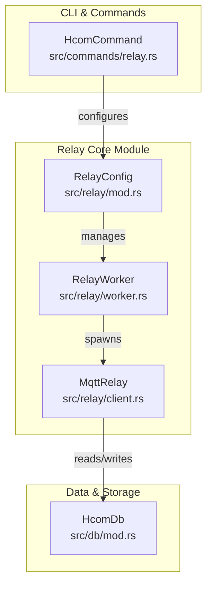
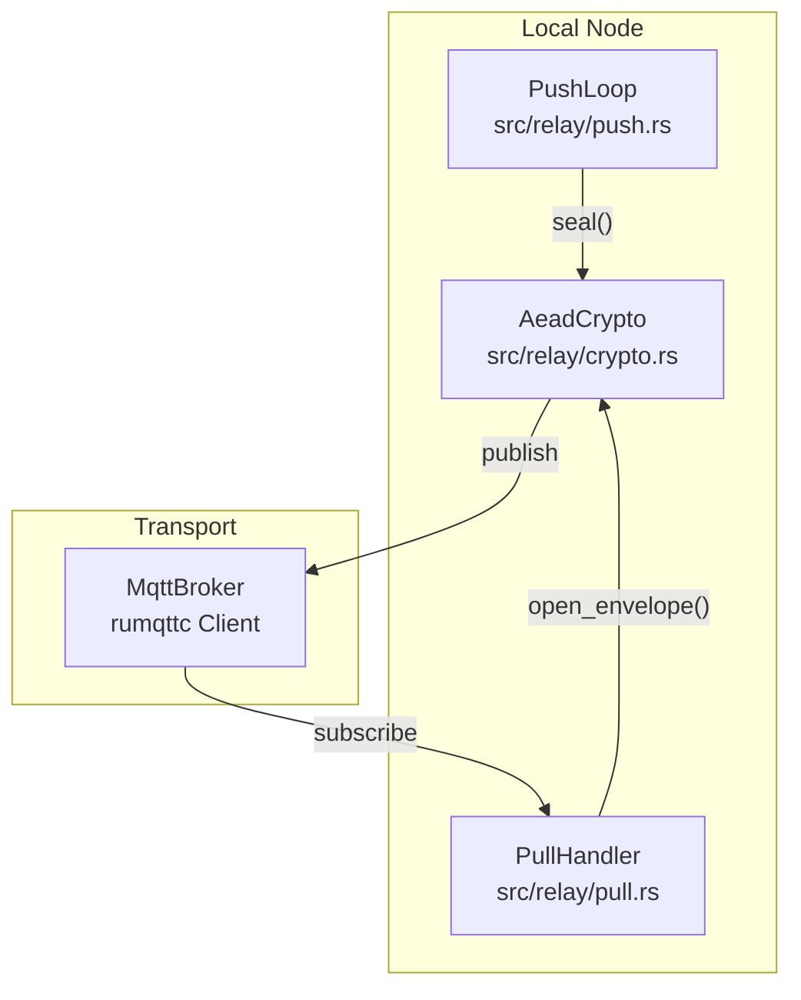

<!-- source: DeepWiki mcp.deepwiki.com · repo aannoo/hcom · page 9 Cross-Device Synchronization · fetched 2026-10-27 -->

# Cross-Device Synchronization

Relevant source files

The following files were used as context for generating this wiki page:

- [src/commands/relay.rs](src/commands/relay.rs)
- [src/relay/client.rs](src/relay/client.rs)
- [src/relay/mod.rs](src/relay/mod.rs)
- [src/relay/pull.rs](src/relay/pull.rs)
- [src/relay/push.rs](src/relay/push.rs)
- [src/relay/worker.rs](src/relay/worker.rs)

This document provides a high-level overview of the MQTT-based relay system in `hcom`, which enables multi-device agent collaboration by synchronizing events, states, and messages across separate machines. 

The relay system operates as a background bridge between the local SQLite database (`HcomDb`) and a shared MQTT message broker, allowing agents across different hosts to communicate seamlessly.

---

## Overview and Big Picture

The cross-device synchronization subsystem allows agents running on isolated physical or virtual machines to form a collaborative mesh. By publishing local events and subscribing to remote state topics via MQTT, `hcom` unifies multi-device workflows.

Key aspects of the synchronization layer include:
- **Mesh Formation**: Devices join a common relay group using a shared authentication token [src/commands/relay.rs:55-79]().
- **Secure Communication**: All synchronized messages and state transitions are end-to-end encrypted using a Pre-Shared Key (PSK) [src/relay/mod.rs:68-91]().
- **Decentralized Coordination**: The background worker process (`relay-worker`) runs independently of active CLI sessions to ensure remote commands and status updates are reliably delivered [src/relay/worker.rs:1-8]().

For detailed configuration steps, operational commands, and remote instance addressing, see [Relay Setup and Operations](#9.2). For technical deep dives into the MQTT protocol, topic structures, crypto handling, and daemon lifecycle, see [Relay Architecture](#9.1).

Sources: [src/commands/relay.rs:55-79](), [src/relay/mod.rs:68-91](), [src/relay/worker.rs:1-8]()

---

## System Architecture and Code Entities

The relay architecture bridges user commands, SQLite storage, and network transport through well-defined Rust modules. The components collaborate to maintain consistent state across all connected devices.

**Figure 1: Relay Subsystem Components and Code Entities**

The entry point for relay CLI interactions is defined in `src/commands/relay.rs`, while the foundational definitions, broker URLs, and token parsers reside in `src/relay/mod.rs` [src/commands/relay.rs:1-19](), [src/relay/mod.rs:1-35](). Background execution and PID file tracking are managed by `src/relay/worker.rs` [src/relay/worker.rs:100-117]().

Sources: [src/commands/relay.rs:1-19](), [src/relay/mod.rs:1-35](), [src/relay/worker.rs:100-117]()

---

## Data Flow and Synchronization Protocol

Synchronization relies on a continuous push/pull cycle mediated by an MQTT broker. Local database events are sealed, batched, and pushed to device-specific retained topics, while remote state updates are pulled, decrypted, and imported into the local database.

**Figure 2: Relay Push and Pull Data Flow Entities**

The push loop (`src/relay/push.rs`) collects local events, packs them into bounded payloads, and encrypts them via `src/relay/crypto.rs` [src/relay/push.rs:1-10](), [src/relay/crypto.rs:1-15](). Conversely, incoming packets are processed, verified against replay attacks (`src/relay/replay.rs`), and applied to local SQLite records by `src/relay/pull.rs` [src/relay/pull.rs:1-10](), [src/relay/replay.rs:1-15]().

For detailed specifications on topic hierarchies, custom TLS root stores, backfill mechanics, and sync protocols, see [Relay Architecture](#9.1). For operational guidelines and RPC control handlers, see [Relay Setup and Operations](#9.2).

Sources: [src/relay/push.rs:1-10](), [src/relay/crypto.rs:1-15](), [src/relay/pull.rs:1-10](), [src/relay/replay.rs:1-15]()

---

