# Page: Overview

# Overview

<details>
<summary>Relevant source files</summary>

The following files were used as context for generating this wiki page:

- [Cargo.lock](Cargo.lock)
- [Cargo.toml](Cargo.toml)
- [README.md](README.md)
- [pyproject.toml](pyproject.toml)
- [src/commands/start.rs](src/commands/start.rs)
- [src/instance_names.rs](src/instance_names.rs)
- [src/instances.rs](src/instances.rs)
- [src/main.rs](src/main.rs)

</details>


## Purpose and Scope

`hcom` is a multi-agent communication system designed to bridge isolation between AI agents running in separate terminal sessions [README.md:7-12](). Its core purpose is to enable AI tools—such as **Claude Code**, **Gemini CLI**, **Codex**, **OpenCode**, **Kilo Code**, **Pi**, **Oh My Pi**, **Antigravity**, **Cursor**, **Kimi**, and **Copilot**—to message, watch, and spawn each other across different terminals, turning standalone CLI tools into a collaborative network [README.md:9-12](), [Cargo.toml:6-6]().

The system provides a shared coordination layer implemented in Rust [Cargo.toml:1-15]() and distributed via Python wheels using `maturin` [pyproject.toml:1-8]() that allows agents to:
- **Exchange messages** with specific intents (`request`, `inform`, `ack`), threads, and `@mentions` for direct addressing [README.md:92-92]().
- **Monitor activity** including file edits, command history, and status states (`listening`, `active`, `blocked`) to prevent collisions [README.md:94-96]().
- **Orchestrate workflows** by spawning, forking, or resuming other agents in new terminal panes [README.md:98-98]().
- **Share context** via structured bundles containing transcripts and event history for seamless handoffs [README.md:94-98]().

Sources: [README.md:7-12](), [Cargo.toml:1-15](), [pyproject.toml:1-8]()

---

## System Architecture

`hcom` is structured around binary entry points [Cargo.toml:12-15](), command routers [src/main.rs:98-98](), instance lifecycles [src/instances.rs:1-52](), and pseudo-terminal (PTY) wrappers [src/main.rs:105-194](). It functions by wrapping AI tool processes and intercepting activity through a system of local hooks [README.md:102-110]().

### High-Level Entity Map
The following diagram maps the conceptual components of `hcom` to their specific implementations in the codebase, bridging natural concepts to code entities.

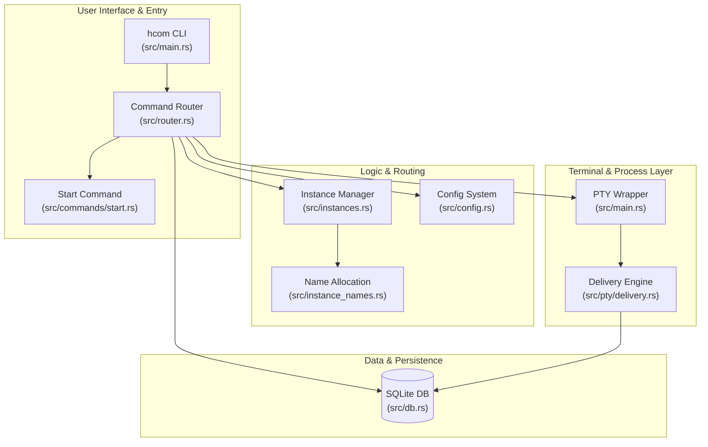
Title: High-Level Code Entity Architecture
Sources: [Cargo.toml:12-15](), [src/main.rs:47-194](), [src/commands/start.rs:32-44](), [src/instances.rs:1-19]()

---

## Core Mechanisms

### 1. Hook-Based Integration
`hcom` uses tool-specific hooks to record activity to a local SQLite database [README.md:102-105](). These hooks trigger on session events (such as tool execution or turns) [README.md:110-114](). This allows agents to receive messages mid-turn (injected between tool calls) or wake idle agents immediately [README.md:92-92]().

### 2. PTY Wrapping and Screen Capture
When an agent is launched via `hcom <tool>`, it runs inside a real pseudo-terminal managed via `nix` (on Unix) or `portable-pty` (on Windows), parsed via `vt100` [Cargo.toml:18-19](), [Cargo.toml:52-72](). This enables:
- **Live Screen Inspection:** Accessing terminal screen buffer state [README.md:94-94]().
- **Status Management:** Updating and displaying the agent's current state in terminal titles or logs [src/instances.rs:26-52]().
- **Input Injection:** Injecting text directly into the active agent PTY STDIN [README.md:92-98]().

### 3. SQLite Event Storage
The local database stores every status change, file edit, and message event [README.md:102-105](). This persistent log allows agents to subscribe to events, query transcripts, and detect file modification collisions [README.md:94-96]().

Sources: [README.md:102-114](), [Cargo.toml:18-72](), [src/instances.rs:26-52]()

---

## Data Flow: Message Delivery

The sequence diagram below illustrates the path of a message from one agent to another, bridging the "Natural Language Space" of user prompts to the "Code Entity Space" of delivery functions.

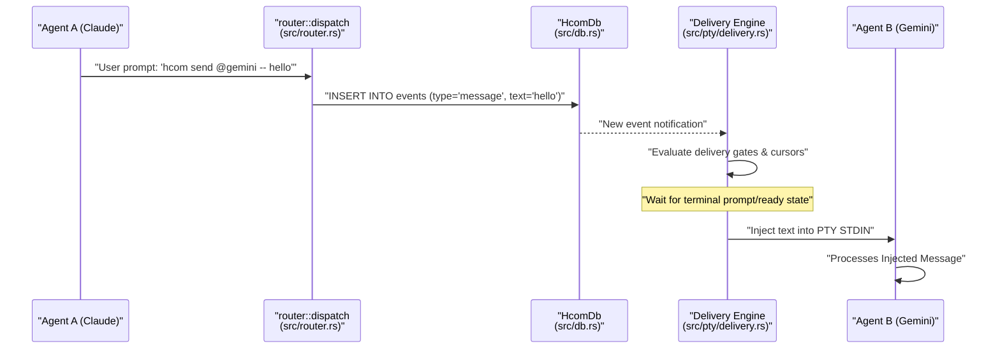
Title: Message Delivery Data Flow
Sources: [README.md:92-100](), [src/main.rs:47-99](), [Cargo.toml:18-19]()

---

## Key Components

| Component | File / Path | Description |
| :--- | :--- | :--- |
| **CLI Entry** | `src/main.rs` | Main binary entry point, panic handlers, and PTY runner dispatch [src/main.rs:47-194]() |
| **Command Start** | `src/commands/start.rs` | Handles session start, orphan recovery, and identity re-binding [src/commands/start.rs:32-151]() |
| **Instance Management** | `src/instances.rs` | Classification predicates (`is_subagent_instance`, `is_remote_instance`) and position updates [src/instances.rs:1-52]() |
| **Name Allocation** | `src/instance_names.rs` | 4-letter CVCV pattern generation, scoring, and duplicate avoidance [src/instance_names.rs:53-183]() |
| **Database** | `src/db.rs` | Manages `rusqlite` connections and SQL schema for events and instances [Cargo.toml:22-22]() |

Sources: [src/main.rs:47-194](), [src/commands/start.rs:32-151](), [src/instances.rs:1-52](), [src/instance_names.rs:53-183](), [Cargo.toml:22-22]()

---

## Multi-Agent Capabilities

`hcom` enables complex orchestration topologies beyond simple 1-to-1 chats:
- **Forking:** Cloning an existing agent's process/session state to explore parallel solution paths [README.md:98-98]().
- **Relay (Cross-Device):** Connecting agents across separate machines via end-to-end encrypted MQTT topics (`chacha20poly1305`) [README.md:131-160](), [Cargo.toml:44-44]().
- **TUI Dashboard:** A real-time terminal UI (`ratatui`) to monitor active agents, view transcripts, and inspect live statuses [README.md:82-86](), [Cargo.toml:28-32]().
- **Identity Management:** Every instance maintains a unique name generated via `allocate_name` [src/instance_names.rs:158-164](), session binding, and status managed via lifecycle hooks [src/commands/start.rs:175-177]().

Sources: [README.md:82-160](), [Cargo.toml:28-44](), [src/instance_names.rs:158-164](), [src/commands/start.rs:175-177]()

---

# Page: Getting Started

# Getting Started

<details>
<summary>Relevant source files</summary>

The following files were used as context for generating this wiki page:

- [.github/build-setup.yml](.github/build-setup.yml)
- [.github/workflows/build-wheels.yml](.github/workflows/build-wheels.yml)
- [.github/workflows/publish-pypi.yml](.github/workflows/publish-pypi.yml)
- [.github/workflows/release.yml](.github/workflows/release.yml)
- [Cargo.lock](Cargo.lock)
- [Cargo.toml](Cargo.toml)
- [README.md](README.md)
- [install.sh](install.sh)
- [pyproject.toml](pyproject.toml)

</details>


This page guides you through installation methods and provides a quick start example for launching agents and sending messages. `hcom` is a single Rust binary [README.md:13-13]() that enables AI agents to message, watch, and spawn each other across terminal panes.

## Installation Methods

### Method 1: Curl Installer (Recommended)
The recommended way to install `hcom` on macOS, Linux, and WSL is via the shell installer script. This script handles platform detection, including specific logic for Android (Termux) environments.

```bash
# macOS, Linux, Android (Termux), and WSL
curl -fsSL https://github.com/aannoo/hcom/releases/latest/download/hcom-installer.sh | sh
```

For Windows users using PowerShell:
```powershell
# Windows (native, Powershell)
irm https://github.com/aannoo/hcom/releases/latest/download/hcom-installer.ps1 | iex
```

Sources: [README.md:41-49](), [install.sh:1-18]()

---

### Method 2: Python Package (pip / uv)
`hcom` is distributed as a Python package built with `maturin` [pyproject.toml:1-3](). This installs the Rust binary into your Python environment's script path.

```bash
uv tool install hcom  # or: pip install hcom
```

The package includes pre-built wheels for multiple targets, including `x86_64` and `aarch64` for Linux (GNU/musl), macOS, Windows, and Android [.github/workflows/build-wheels.yml:16-37](), [.github/workflows/build-wheels.yml:59-92]().

Sources: [README.md:27-31](), [pyproject.toml:1-3](), [.github/workflows/build-wheels.yml:16-92]()

---

### Method 3: Homebrew (macOS)
```bash
brew install aannoo/hcom/hcom
```

Sources: [README.md:33-37]()

---

### Method 4: From Source
Building from source requires the Rust toolchain (version 1.89+) [Cargo.toml:10-10]().

```bash
git clone https://github.com/aannoo/hcom.git
cd hcom
cargo build --release
```

The build process produces a single binary named `hcom` [Cargo.toml:12-14]().

Sources: [Cargo.toml:1-14]()

---

## Quick Start

To start a multi-agent session, launch two agents in separate terminals.

### 1. Launch Agents
In **Terminal 1**, launch Claude:
```bash
hcom claude
```

In **Terminal 2**, launch Codex:
```bash
hcom codex
```

The entry point and command router handle CLI arguments, resolve the tool configuration, and delegate to the launcher system [src/main.rs:1-14]() (referencing Cargo binary setup [Cargo.toml:12-14]()).

### 2. Send a Message
In a third terminal (or from within an agent's prompt), send a message:
```bash
hcom send @claude "What is the status of the refactor?" --intent "request-update"
```

### Agent Launch Flow (Natural Language to Code Entity Space)

The following diagram illustrates the sequence from the natural language intent through the CLI entry point to a running agent wrapped in a PTY session, mapping user actions to specific code entities.

Title: Agent Launch Execution Sequence
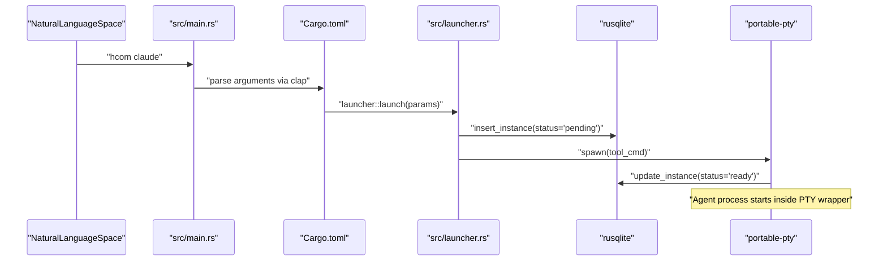
Sources: [Cargo.toml:12-17](), [.github/workflows/build-wheels.yml:16-52]()

---

## Messaging Architecture

`hcom` uses a local SQLite database to store events and messages [README.md:113-119](). Agents receive messages through "hooks" that poll the database and inject text into the agent's PTY [README.md:113-119]().

### Message Delivery Data Flow

This diagram shows how a message travels from the `hcom send` command to the target agent's terminal screen using the `vt100` parser for screen state management [Cargo.toml:18-18]().

Title: Message Delivery Pipeline from Natural Language to PTY Injection
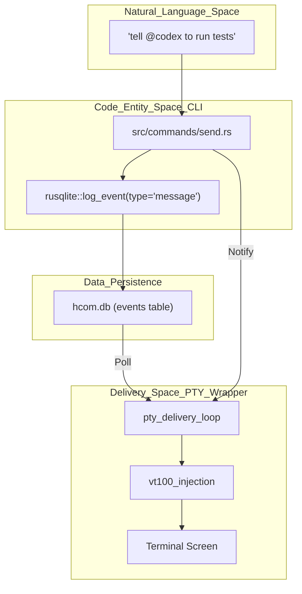
Sources: [README.md:113-119](), [Cargo.toml:18-22]()

---

## Verification Commands

| Command | Purpose |
| :--- | :--- |
| `hcom list` | Show all active agent instances and their status [README.md:186-187] |
| `hcom` | Open the TUI dashboard to monitor agents [README.md:97-102] |
| `hcom config terminal --info` | View current configuration and terminal settings [README.md:163-166] |
| `hcom update` | Check for and install the latest version [README.md:51-53] |

Sources: [README.md:51-187]()

---

# Page: Core Concepts

# Core Concepts

<details>
<summary>Relevant source files</summary>

The following files were used as context for generating this wiki page:

- [src/commands/events.rs](src/commands/events.rs)
- [src/commands/start.rs](src/commands/start.rs)
- [src/instance_names.rs](src/instance_names.rs)
- [src/instances.rs](src/instances.rs)
- [src/main.rs](src/main.rs)
- [src/messages.rs](src/messages.rs)
- [src/shared/constants.rs](src/shared/constants.rs)
- [src/shared/mod.rs](src/shared/mod.rs)

</details>


This page explains the fundamental concepts underlying `hcom`: instances, sessions, events, messages, status states, and the lifecycle of an agent from launch to termination.

For detailed technical dives into these topics, refer to the child pages:
- [Instances, Names and Identity](#3.1) — Detail instance records, name generation, process/session bindings, identity resolution, and nested-agent scrubbing.
- [Events, Messages and Notifications](#3.2) — Explain event types (message/status/life), message envelopes, cursors/waterlines, and the local notify/wake mechanism.

---

## The Database Hub

`hcom` uses a SQLite database as the single source of truth for all coordination across agents and terminals [src/instances.rs:1-6](). The database stores instance metadata, process bindings, and an append-only event log that allows PTY wrappers, CLI commands, and hooks to synchronize asynchronously.

Diagram: Database and Instance Store Architecture
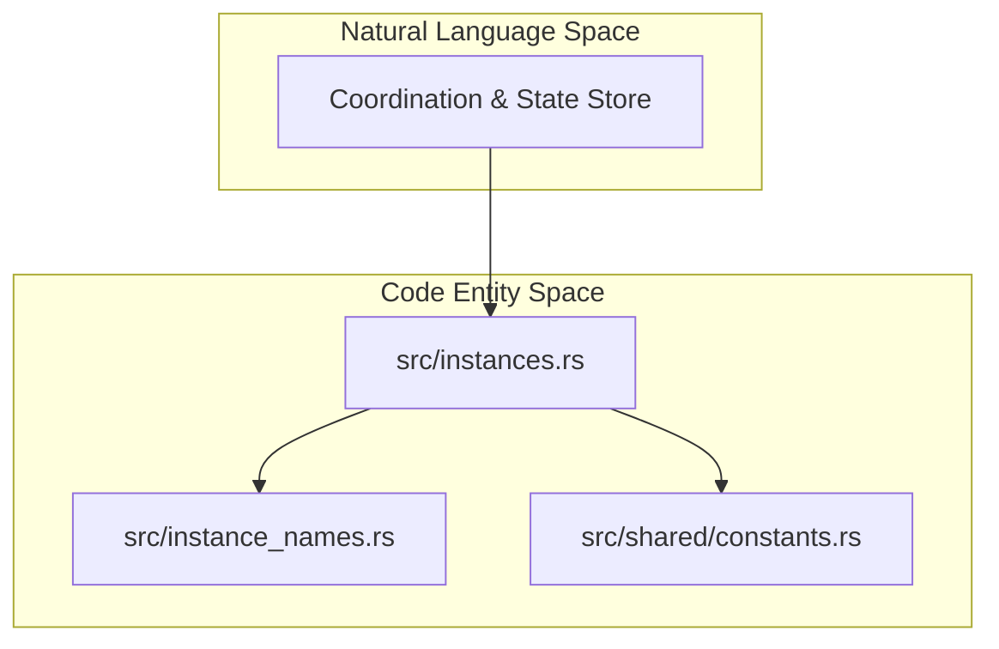
Sources: [src/instances.rs:1-6](), [src/instance_names.rs:7-12](), [src/shared/constants.rs:1-5]()

---

## Instances and Identity

An **instance** represents a managed participant, such as an AI agent (`Tool` variants like Claude, Gemini, Codex) or an external process [src/main.rs:174-183](). Instances are identified by unique names generated dynamically from curated pools (e.g., CVCV patterns in `instance_names.rs`) while avoiding naming collisions [src/instance_names.rs:8-12](). 

For full details on instance records, name generation, process/session bindings, identity resolution, and nested-agent scrubbing, see [Instances, Names and Identity](#3.1).

Diagram: Instance Management Space
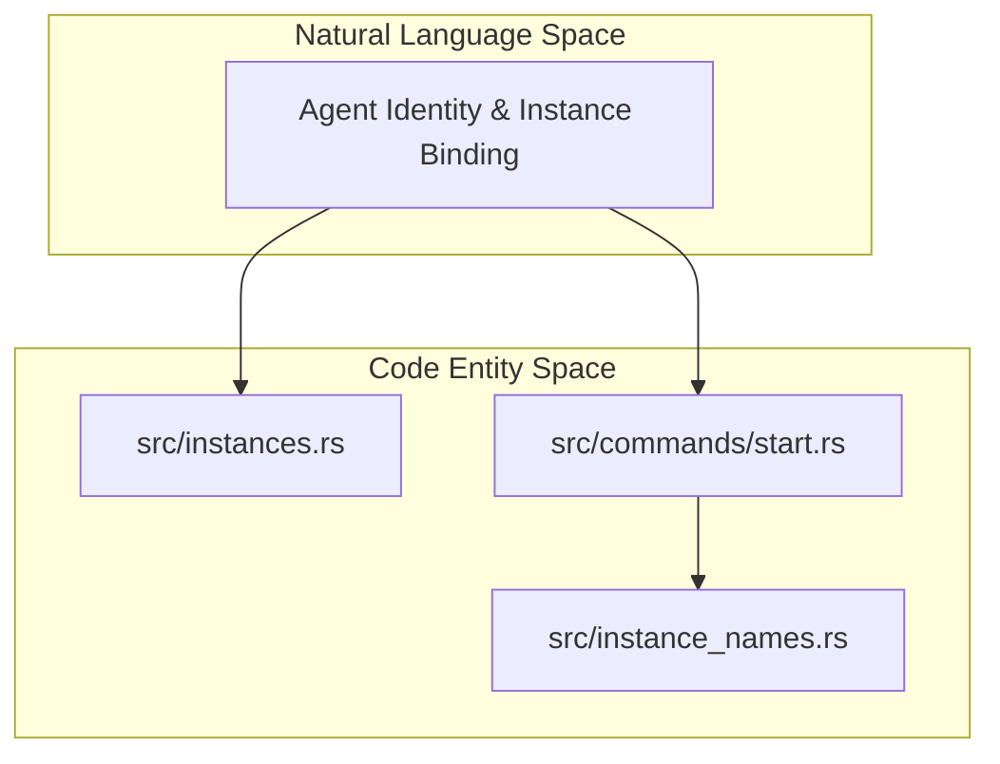
Sources: [src/instances.rs:1-18](), [src/commands/start.rs:1-10](), [src/instance_names.rs:8-12]()

---

## Events, Messages and Notifications

Communication between agents is mediated through messages with specific scopes (`MessageScope::Broadcast`, `MessageScope::Mentions`) and intents (`MessageIntent::Request`, `MessageIntent::Inform`, `MessageIntent::Ack`) [src/messages.rs:14-55](). Events are queried and filtered through command handlers [src/commands/events.rs:1-10]().

For deep dives into event types, message envelopes, waterlines, and local wake/notify mechanisms, see [Events, Messages and Notifications](#3.2).

Diagram: Message Routing & Event Space
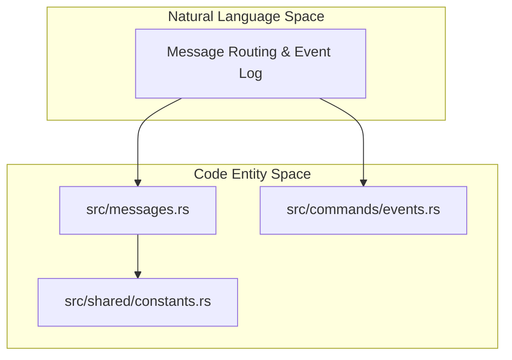
Sources: [src/messages.rs:14-79](), [src/commands/events.rs:1-15](), [src/shared/constants.rs:50-61]()

---

## Status States and Lifecycle

Instances progress through explicit status states defined in `src/shared/constants.rs` and managed via lifecycle routines [src/shared/constants.rs:62-67]().

| State | Meaning | Code Symbol / Reference |
|-------|---------|-------------------------|
| `launching` | Process spawned, waiting for tool readiness | `ST_LAUNCHING` [src/shared/constants.rs:66-66]() |
| `listening` | Idle and ready to receive messages via PTY injection | `ST_LISTENING` [src/shared/constants.rs:63-63]() |
| `active` | Actively processing a prompt or tool call | `ST_ACTIVE` [src/shared/constants.rs:62-62]() |
| `blocked` | Waiting for external/human intervention | `ST_BLOCKED` [src/shared/constants.rs:64-64]() |
| `inactive` | Heartbeat timeout exceeded or process exited | `ST_INACTIVE` [src/shared/constants.rs:65-65]() |

For further details on state machines and lifecycle management, see [Instances, Names and Identity](#3.1).

Sources: [src/shared/constants.rs:62-77](), [src/instances.rs:1-25]()

---

# Page: Instances, Names and Identity

# Instances, Names and Identity

<details>
<summary>Relevant source files</summary>

The following files were used as context for generating this wiki page:

- [src/db/instances.rs](src/db/instances.rs)
- [src/instance_binding.rs](src/instance_binding.rs)
- [src/instance_lifecycle.rs](src/instance_lifecycle.rs)
- [src/pidtrack.rs](src/pidtrack.rs)
- [src/shared/nested.rs](src/shared/nested.rs)
- [src/shared/tool_detection.rs](src/shared/tool_detection.rs)

</details>


This page details the core mechanics of instance records, automated name generation, process and session bindings, identity resolution, and nested-agent environment scrubbing in `hcom`.

---

## 1. Instance Records and Data Model

Every AI agent participating in `hcom` is backed by an instance record (`InstanceRow`) stored in the SQLite database (`src/db/instances.rs`). Instances maintain their operational state, binding metadata, lifecycle timestamps, and context pointers.

The `InstanceRow` struct encapsulates instance metadata such as `name`, `session_id`, `parent_session_id`, `parent_name`, `agent_id`, `tag`, `status`, `directory`, `tool`, `pid`, and JSON-encoded `launch_context` [src/db/instances.rs:18-52](). 

```mermaid
graph TD
    subcode ["Code Entity Space"]
    IR["InstanceRow struct"]
    IC["INSTANCE_COLUMNS constant"]
    LCV["launch_context_value method"]
    PID["pid_identity method"]
    
    IC -->|selects columns for| IR
    IR --> LCV
    IR --> PID
    
    subtext ["Natural Language Space"]
    N1["Database Row Representation"] -->|mapped by| IR
    N2["Active Column Query Set"] -->|mapped by| IC
    N3["Launch Context Inspection"] -->|mapped by| LCV
    N4["Process Ownership Verification"] -->|mapped by| PID
```
*Diagram 1: Instance Data Model Bridge (Natural Language Space to Code Entity Space)*

Sources: `[src/db/instances.rs:18-160]()`

---

## 2. Name Generation and Allocation Strategy

To avoid tedious configuration and prevent namespace collisions across terminals, `hcom` automatically assigns memorable, human-friendly names to agents using a structured 4-letter CVCV (consonant-vowel-consonant-vowel) pattern (`src/instance_names.rs`).

### Name Pool and Scoring
- **Consonants & Vowels**: Restricted to phonetic sets `bdfghklmnprstvz` and `aeiou` [src/instance_names.rs:11-12]().
- **Gold Names**: A curated set of high-recognition, natural-sounding names that receive score boosts [src/instance_names.rs:15-42]().
- **Banned Names**: CLI commands and system words are explicitly excluded via `banned_names()` [src/instance_names.rs:44-51]().
- **Scoring (`score_name`)**: Evaluates candidate strings based on gold status, friendly flow letters, vowel-consonant spacing, and distinctive characters [src/instance_names.rs:53-95]().

### Allocation Tiers
`allocate_name()` resolves collisions using a multi-tier fallback strategy:
1. **Weighted Sampling + Similarity**: Picks from top-scoring windows while rejecting names with a Hamming distance $\le 2$ from active instances (`is_too_similar()`) [src/instance_names.rs:136-153]().
2. **Greedy + Similarity**: Falls back to deterministic selection.
3. **Greedy without Similarity**: Last-resort allocation ignoring similarity constraints if saturated [src/instance_names.rs:158-164]().

```mermaid
graph TD
    subcode ["Code Entity Space"]
    AN["allocate_name function"]
    SNP["build_name_pool function"]
    SCR["score_name function"]
    SIM["is_too_similar function"]
    
    SNP -->|generates candidates| SCR
    SCR -->|ranked pool| AN
    AN -->|checks Hamming distance| SIM
    SIM -->|collision guard| AN
    
    subtext ["Natural Language Space"]
    T1["Phonetic CVCV Pattern Generation"] -->|executed by| SNP
    T2["Gold Name Priority Boost"] -->|evaluated by| SCR
    T3["Collision Avoidance Engine"] -->|enforced by| SIM
    T4["Multi-Tiered Name Allocation"] -->|managed by| AN
```
*Diagram 2: Name Allocation Subsystem Bridge*

Sources: `[src/instance_names.rs:11-164]()`

---

## 3. Process and Session Bindings & Launch Context

`hcom` implements binding architectures (`process` $\rightarrow$ `session` $\rightarrow$ `adhoc`) to associate terminal shell processes and AI tool sessions with persistent instance records (`src/instance_binding.rs`).

- **Launch Context Capture**:
  - `persist_terminal_launch_context()` stores terminal identifiers, `pane_id`, and effective presets without clobbering existing launch state [src/instance_binding.rs:25-88]().
  - `capture_and_store_launch_context()` inspects git branches, `TERM_PROGRAM`, TTYs, and tool-specific environment variables under a single write lock [src/instance_binding.rs:90-142]().

When hooks execute at startup, they perform the identity handshake by invoking binding functions to claim or recover their active instance slot [src/instance_binding.rs:1-88]().

Sources: `[src/instance_binding.rs:1-142]()`

---

## 4. Identity Resolution and Display Names

Commands that target instances (`send`, `stop`, `kill`, `list`) rely on `src/identity.rs` to resolve inputs (such as shorthand names, full tag-prefixed names like `team-luna`, or explicit `"self"` keywords) into authoritative base names.

### Key Resolution Functions
- `resolve_identity(...)`: Resolves the caller's active sender identity based on context flags, environment variables, or process bindings [src/identity.rs:1-10]().
- `get_full_name(data: &InstanceRow)`: Formats the full display name as `{tag}-{name}` if a tag is present, or simply `{name}` [src/db/instances.rs:1-160]().
- `resolve_display_name(db: &HcomDb, input_name: &str)`: Resolves base names or compound tag-names against active instances [src/db/instances.rs:1-160]().

Sources: `[src/db/instances.rs:1-160]`, `[src/identity.rs:1-10]()`

---

## 5. Nested-Agent Scrubbing and Environment Isolation

When an AI agent launched by `hcom` spawns child shell commands, those child processes inherit environment variables like `HCOM_PROCESS_ID` and `HCOM_TOOL`. Without isolation, hooks loaded by child workers would erroneously bind to and act as the parent agent.

`src/shared/nested.rs` and `src/shared/tool_detection.rs` implement nested-agent detection and environment scrubbing:
- `detect(env: &HashMap<String, String>, hook_tool: Tool)`: Determines whether a hook execution serves an agent nested under an already-launched `hcom` process [src/shared/nested.rs:68-82]().
- `shell_only_markers(tool: Tool)`: Identifies variables set exclusively for shell execution rather than core tool hooks [src/shared/nested.rs:31-41]().
- `runs_hooks_of(parent: Tool, hook_tool: Tool, env: &HashMap<String, String>)`: Evaluates cross-tool hierarchy rules [src/shared/nested.rs:44-57]().
- `scrub_env(...)`: Strips inherited identity variables and tool-specific state variables from the child environment [src/shared/nested.rs:116-122]().
- `scrub_inherited_identity(hook_tool: Tool)`: Executes at process startup before any threads spawn, ensuring subsequent modules operate with clean, isolated child identities [src/shared/nested.rs:128-137]().

Sources: `[src/shared/nested.rs:1-137]`, `[src/shared/tool_detection.rs:1-139]()`

---

# Page: Events, Messages and Notifications

# Events, Messages and Notifications

<details>
<summary>Relevant source files</summary>

The following files were used as context for generating this wiki page:

- [src/commands/events.rs](src/commands/events.rs)
- [src/copilot_plugin/extension.mjs](src/copilot_plugin/extension.mjs)
- [src/db/notify.rs](src/db/notify.rs)
- [src/messages.rs](src/messages.rs)
- [src/notify/mod.rs](src/notify/mod.rs)
- [src/notify/wake.rs](src/notify/wake.rs)
- [src/relay/backfill.rs](src/relay/backfill.rs)
- [src/shared/constants.rs](src/shared/constants.rs)
- [src/shared/mod.rs](src/shared/mod.rs)

</details>


## Purpose and Scope
This document details the core messaging and event infrastructure in `hcom`. It covers the classification of event types (`message`, `status`, `life`), message serialization via envelopes, scopes, and intents (`[src/messages.rs:14-80]()`), cursor management and waterline tracking, and the local TCP-based notification wake mechanism (`[src/notify/mod.rs:1-90]`, `[src/notify/wake.rs:40-70]()`).

Sources: `[src/messages.rs:1-80]`, `[src/commands/events.rs:116-173]`, `[src/notify/mod.rs:1-90]`, `[src/notify/wake.rs:1-181]()`

---

## 1. Event Types and Data Structure
All system activity, agent communications, and lifecycle changes are persisted as structured events in the SQLite database `events` table. Events are broadly categorized into three types:
- **`message`**: Inter-agent text communications, carrying sender data, scopes, text content, and optional delivery metadata (`[src/commands/events.rs:136-138]()`).
- **`status`**: Agent status updates (`active`, `blocked`, `inactive`, `listening`, `launching`, `error`) tied to instance state machines (`[src/shared/constants.rs:62-77]()`).
- **`life`**: Lifecycle events marking instance creation, startup completion, forks, and termination (`[src/commands/events.rs:155-157]()`).

Sources: `[src/commands/events.rs:116-173]`, `[src/shared/constants.rs:62-77]()`

---

## 2. Message Envelopes, Scopes, and Intents
Messages are encapsulated with optional metadata to support structured agent interactions. 

### Envelopes and Fields
The `MessageEnvelope` struct captures protocol-level routing and context fields `[src/messages.rs:72-79]()`:
- `intent`: Classified via `MessageIntent` as `request`, `inform`, or `ack` (`[src/messages.rs:42-57]()`).
- `reply_to`: References a preceding message ID or relay reference (`[src/messages.rs:76]()`).
- `thread`: Optional thread identifier for conversation grouping (`[src/messages.rs:77]()`).
- `bundle_id`: Associates the message with a shared context bundle (`[src/messages.rs:78]()`).

### Scopes and Targeting
Message distribution is controlled by `MessageScope` (`[src/messages.rs:14-18]()`):
- **`Broadcast`**: Delivered to all active instances in the session/channel (`[src/messages.rs:23]()`).
- **`Mentions`**: Targeted delivery filtered by matching base instance names (`[src/messages.rs:24]()`).

Validation of message content ensures compliance with length limits (`MAX_MESSAGE_SIZE`) and eliminates disallowed control characters (`[src/messages.rs:127-151]()`).

```mermaid
graph TD
    sub:NatLang[""Natural Language / CLI Input""] -->|Parsed by| fn_parse[""MessageScope & MessageIntent""]
    fn_parse --> struct_env[""MessageEnvelope struct""]
    struct_env -->|Validated by| fn_val[""validate_message()""]
    fn_val -->|Stored in| db_ev[""events table (SQLite)""]

    classDef default fill:#fff,stroke:#000,stroke-width:1px;
```
*Figure 1: Message parsing and envelope construction mapping natural language commands to codebase entities.*

Sources: `[src/messages.rs:14-80]`, `[src/messages.rs:127-151]()`

---

## 3. Cursors, Waterlines, and Delivery
Each instance maintains a waterline cursor (`last_event_id`) stored in its instance record. This cursor tracks the highest event ID processed by the instance, preventing redelivery of past messages.

### Unread Message Retrieval
When an agent queries for unread messages, database operations fetch events where `id > last_event_id` and `type = 'message'` (`[src/commands/events.rs:177-198]()`).

### Scope Evaluation
Before delivering a message to a specific receiver, scope evaluation determines whether the receiver is permitted to read it:
1. **Self-delivery check**: Drops messages where `from == receiver`.
2. **Scope check**: 
   - If `broadcast`, returns `true`.
   - If `mentions`, extracts base names (ignoring relay suffixes like `:ABCD`) and checks membership in the message's `mentions` array.

```mermaid
graph TD
    db_fetch[""HcomDb::get_unread_messages()""] -->|Iterate events| filter_scope[""HcomDb::should_deliver_to()""]
    filter_scope -->|Check sender != receiver| check_scope{""Scope type?''}
    check_scope -->|broadcast| deliver_yes[""Deliver Message""]
    check_scope -->|mentions| check_mention[""Match base name in mentions array""]
    check_mention -->|Match found| deliver_yes
    check_mention -->|No match| deliver_no[""Skip Message""]

    classDef default fill:#fff,stroke:#000,stroke-width:1px;
```
*Figure 2: Delivery filtering flow showing how messages are routed based on scope and waterlines.*

Sources: `[src/commands/events.rs:177-198]`, `[src/messages.rs:14-94]()`

---

## 4. Local Notify and Wake Mechanism
To avoid high-overhead busy-polling, `hcom` utilizes a lightweight local TCP notification mechanism. This allows delivery loops to block efficiently on an incoming connection until a wakeup signal arrives (`[src/notify/mod.rs:1-12]()`).

### Notification Server and Wake Kinds
Each long-running agent or delivery loop binds a listener to an auto-assigned localhost port. The `WakeKind` enum categorizes the different poll loops that can be woken, such as `WakeKind::Pty`, `WakeKind::Hook`, `WakeKind::Listen`, `WakeKind::ListenFilter`, `WakeKind::EventsWait`, and `WakeKind::Plugin` (`[src/notify/mod.rs:27-46]()`). The `notify_endpoints` table maps instance names and endpoint kinds to port numbers (`[src/db/notify.rs:3-13]()`).

### Triggering Wakes (`wake` and `wake_all`)
When messages are sent or state changes occur, database triggers or dispatchers invoke wake routines (`[src/notify/wake.rs:40-74]()`):
- **`wake(db, instance, kinds)`**: Queries `notify_endpoints` for the target instance's registered ports (excluding RPC-bound `inject` endpoints) and performs a short-timeout `TcpStream::connect` (`[src/notify/wake.rs:44-47]()`).
- **`wake_all(db)`**: Broadcasts a connection ping to all registered wake endpoints system-wide (`[src/notify/wake.rs:53-74]()`).

```mermaid
graph TD
    sub:System[""External Message Send / CLI Event""] -->|Triggers| fn_wakeall[""wake::wake_all()""]
    fn_wakeall --> query_ports[""SELECT port FROM notify_endpoints""]
    query_ports --> loop_ports[""wake::wake_ports()""]
    loop_ports -->|TCP Connect-Drop| tcp_serv[""NotifyServer::wait()""]
    tcp_serv --> unblock_loop[""Agent Delivery Loop Unblocked""]

    classDef default fill:#fff,stroke:#000,stroke-width:1px;
```
*Figure 3: Code entity flow bridging high-level event triggering to the `NotifyServer` wake loop.*

Sources: `[src/notify/mod.rs:1-90]`, `[src/notify/wake.rs:40-181]`, `[src/db/notify.rs:1-56]()`

---

# Page: Architecture

# Architecture

<details>
<summary>Relevant source files</summary>

The following files were used as context for generating this wiki page:

- [src/commands/hooks.rs](src/commands/hooks.rs)
- [src/commands/start.rs](src/commands/start.rs)
- [src/commands/status.rs](src/commands/status.rs)
- [src/instance_names.rs](src/instance_names.rs)
- [src/instances.rs](src/instances.rs)
- [src/main.rs](src/main.rs)
- [src/router.rs](src/router.rs)

</details>


This page provides a high-level overview of `hcom`'s internal architecture, explaining how the major systems fit together to coordinate multi-agent communication, terminal integration, and cross-device sync. 

For deep technical details, see the child pages linked throughout this document:
- [CLI Entry Points and Command Routing](#4.1) — Explain how `main.rs` initializes the application, how `router.rs` dispatches commands to handlers, and the action resolution system
- [Database and Event Storage](#4.2) — Detail the SQLite schema, event types, subscriptions, `kv` table, and the `events_v` view for querying
- [Instance Lifecycle Management](#4.3) — Explain instance states (`pending`→`launching`→`ready`→`active`/`listening`→`stale`→`stopped`), name generation, heartbeat monitoring, `pidtrack` and cleanup logic
- [Message Routing and Delivery](#4.4) — Describe how messages flow from `send` command through database to PTY delivery, including scope resolution and gate evaluation
- [Terminal Integration and PTY Wrapper](#4.5) — Explain terminal preset system, PTY wrapper architecture, screen capture via `vt100` parsing, and injection mechanisms
- [TUI Dashboard](#4.6) — Document the `ratatui`-based interactive dashboard: app/state/input model, render modules, `DbDataSource` polling, RPC to launch/stop agents, and theming

---

## System Overview

`hcom` employs a database-centric, event-driven architecture where all messages, status updates, and lifecycle events flow through a central SQLite store managed by `HcomDb` [src/db/mod.rs:1-80](). The system bridges natural language operator intents and tool interactions with low-level process and terminal controls.

### Architecture Dataflow

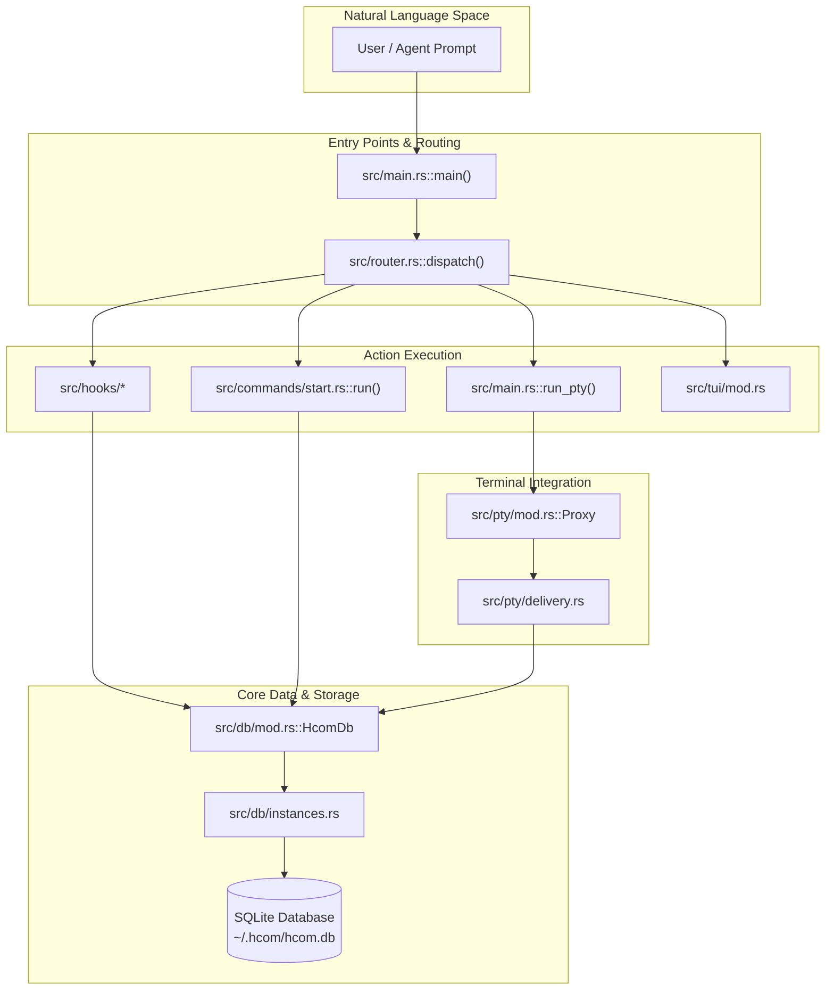

Sources: [src/main.rs:43-100](), [src/router.rs:1-182](), [src/db/mod.rs:1-80]()

### Message and Event Pipeline

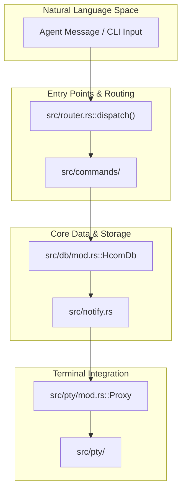

Sources: [src/router.rs:21-46](), [src/main.rs:101-194](), [src/db/mod.rs:1-80]()

---

## Architecture Subsystems

### 4.1. CLI Entry Points and Command Routing

All execution starts in `src/main.rs`, which initializes configuration and delegates raw `argv` inspection to `src/router.rs`. The command router inspects flags, identifies tool invocations or hook execution targets, and dispatches the execution flow to corresponding command handlers or PTY wrappers.

For details, see [CLI Entry Points and Command Routing](#4.1).

Sources: [src/main.rs:43-100](), [src/router.rs:1-182]()

### 4.2. Database and Event Storage

The SQLite database (`src/db/mod.rs`) is the single source of truth for `hcom`. It stores persistent records for active instances, historical and unread events, session bindings, process mappings, and key-value metadata. Query views like `events_v` simplify querying across tables.

For details, see [Database and Event Storage](#4.2).

Sources: [src/db/mod.rs:1-80]()

### 4.3. Instance Lifecycle Management

`hcom` tracks agent lifecycle stages—transitioning instances through states such as `pending`, `launching`, `ready`, `active`, `listening`, `stale`, and `stopped`. Heartbeat monitors, PID tracking (`pidtrack`), and automated cleanup routines ensure orphaned or dead agent sessions are properly reaped.

For details, see [Instance Lifecycle Management](#4.3).

Sources: [src/instances.rs:1-52](), [src/commands/start.rs:1-100]()

### 4.4. Message Routing and Delivery

Messages submitted via the `send` command are persisted to the database and routed according to target scopes (`broadcast`, direct mentions, or `@instance` identifiers). Gate evaluation mechanisms determine when an agent is ready to receive injected text payloads into its active PTY stream.

For details, see [Message Routing and Delivery](#4.4).

Sources: [src/router.rs:21-46]()

### 4.5. Terminal Integration and PTY Wrapper

The PTY subsystem wraps target agent processes inside terminal multiplexers or custom pseudoterminals. It captures screen buffers via `vt100` parsing, detects prompt readiness patterns, and injects external text or messages securely into the running terminal tool.

For details, see [Terminal Integration and PTY Wrapper](#4.5).

Sources: [src/main.rs:101-194]()

### 4.6. TUI Dashboard

The interactive terminal dashboard is built on `ratatui` and `crossterm`. It polls `DbDataSource` state to render live agent tables, transcripts, and event logs, while providing RPC mechanisms to launch, inspect, or stop agent instances from a centralized keyboard-driven interface.

For details, see [TUI Dashboard](#4.6).

Sources: [src/router.rs:155-182]()

---

# Page: CLI Entry Points and Command Routing

# CLI Entry Points and Command Routing

<details>
<summary>Relevant source files</summary>

The following files were used as context for generating this wiki page:

- [src/cli_context.rs](src/cli_context.rs)
- [src/commands/hooks.rs](src/commands/hooks.rs)
- [src/commands/listen.rs](src/commands/listen.rs)
- [src/commands/start.rs](src/commands/start.rs)
- [src/commands/status.rs](src/commands/status.rs)
- [src/instance_names.rs](src/instance_names.rs)
- [src/instances.rs](src/instances.rs)
- [src/main.rs](src/main.rs)
- [src/router.rs](src/router.rs)

</details>


This wiki page explains how the `hcom` application initializes in `src/main.rs`, how commands and hooks are routed via the action resolution system in `src/router.rs`, and how execution is dispatched to specific command handlers or the PTY wrapper.

---

## Application Initialization

The `hcom` binary begins execution in `main()` located in `src/main.rs`. The initialization sequence handles background update checks, isolates nested agent identities, initializes global configuration, sets up a safe panic hook to protect terminal UI state, and hands control over to the router.

### Startup Flow and Environment Setup

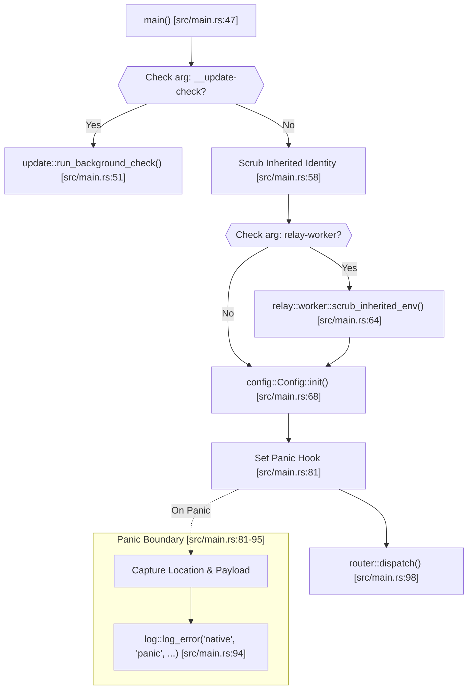
Sources: [src/main.rs:47-99]()

**Key Initialization Phases:**
- **Update Check Interceptor:** If the first argument is `__update-check`, `update::run_background_check` executes immediately in the background runner context [src/main.rs:48-54]().
- **Nested Agent Identity Scrubbing:** Agents nested under an hcom-launched agent must not inherit their parent's identity context. This runs first so downstream environment readers only view the child's identity [src/main.rs:58-61]().
- **Relay Worker Isolation:** When starting a relay worker, `relay::worker::scrub_inherited_env()` strips conflicting transmission variables [src/main.rs:63-65]().
- **Configuration Loading:** Global settings are initialized via `config::Config::init()` from environment variables and configuration files [src/main.rs:67-68]().
- **Safe Panic Handling:** A custom panic hook is registered via `panic::set_hook()` to route panic outputs into the internal logging infrastructure rather than writing to `stderr`. This prevents raw panic traces from corrupting the active terminal UI or TUI [src/main.rs:81-95]().
- **Router Handoff:** Control transfers to `router::dispatch()` to parse arguments and execute commands [src/main.rs:97-99]().

Sources: [src/main.rs:47-99]()

---

## Action Resolution System

Command routing is handled manually in `src/router.rs` rather than relying purely on top-level `clap` parsers. This is required because `hcom` supports mixed syntaxes such as bare hook names (e.g., `hcom sessionstart`), numeric multiplier launch counts (`hcom 3 claude`), and specialized subcommand structures.

### Action Resolution Mapping

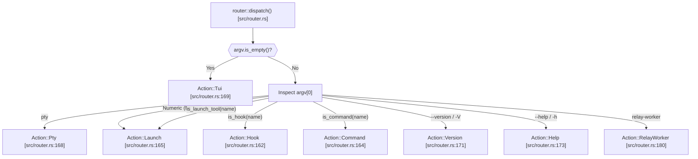
Sources: [src/router.rs:1-182]()

### Resolved Action Variants
The `Action` enum classifies every incoming execution path into distinct variants [src/main.rs:47-99](), [src/router.rs:159-182]():
- `Action::Hook`: Dispatches incoming tool hook execution (e.g., Claude, Gemini, Codex, OpenCode hooks) [src/router.rs:162]().
- `Action::Command`: Runs standard CLI commands such as `send`, `list`, `events`, `status`, etc. [src/router.rs:164]().
- `Action::Launch`: Handles tool launching with optional numeric instance counts (e.g., `hcom 2 claude`) [src/router.rs:165]().
- `Action::Pty`: Enters the pseudo-terminal (PTY) wrapper mode [src/router.rs:168]().
- `Action::Tui`: Opens the interactive terminal dashboard when run with no arguments [src/router.rs:169]().
- `Action::Version` / `Action::Help`: Prints version or usage information [src/router.rs:171-174]().
- `Action::RelayWorker`: Spawns the background MQTT relay synchronization daemon [src/router.rs:180]().

Sources: [src/router.rs:1-182]()

---

## Global Flag Extraction

Global modifiers such as `--name <agent-id>` (for agent identity specification) and `--go` (to bypass interactive prompts) are extracted prior to command-specific parsing. 

- **Extraction Functions:** The router uses helper parsers to separate global flags from command arguments [src/router.rs:184-260]().
- **`GlobalFlags` Struct:** Holds parsed global attributes (`name` and `go`) used during context building [src/router.rs:185-189]().

Sources: [src/router.rs:184-260]()

---

## Command Dispatch and PTY Integration

Once an `Action` is resolved, `router::dispatch()` executes the corresponding backend subsystem.

### Native Command Routing Table

The `COMMANDS` constant defines native commands handled by `src/commands/` modules [src/router.rs:23-42]():

| Command Name | Module / File Reference | Purpose |
|--------------|-------------------------|---------|
| `send` | `src/router.rs:24` | Deliver messages to instances or broadcasts |
| `list` | `src/router.rs:25` | Query active and registered instances |
| `events` | `src/router.rs:26` | Query the event stream with filters |
| `start` | `src/commands/start.rs:44` | Initialize participation, rebind identity, or recover orphans |
| `status` | `src/commands/status.rs` | System health overview and tool detector |
| `hooks` | `src/commands/hooks.rs` | Install, verify, or remove tool hooks |
| `listen` | `src/commands/listen.rs:153` | Block and receive messages via TCP notify support |

Sources: [src/router.rs:23-42](), [src/commands/start.rs:44](), [src/commands/listen.rs:153]()

### PTY Wrapper Execution
When `Action::Pty` is resolved, control passes to `run_pty()` in `src/main.rs`. This infrastructure wraps child processes in a Unix pseudo-terminal or Windows ConPTY proxy to intercept text, track readiness patterns, and support runtime injection.

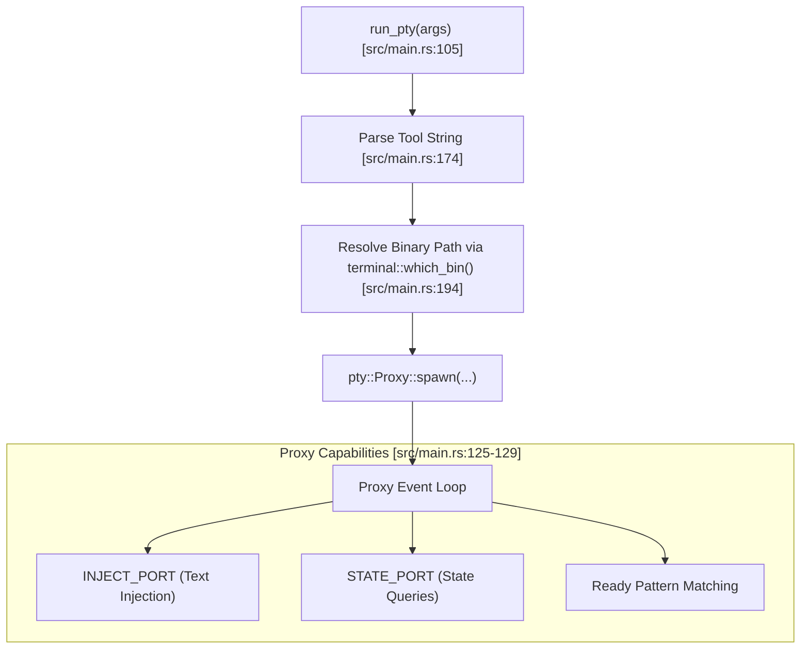
Sources: [src/main.rs:105-194]()

Sources: [src/main.rs:105-194]()

---

## Identity Resolution and Context Building

Before running commands, the CLI builds an execution context (`CommandContext`) to establish who is acting [src/cli_context.rs:28-78]().

- **Context Builder:** `build_ctx_for_command()` checks for active Claude actors or explicit `--name` flags [src/cli_context.rs:28-36]().
- **Identity Gating:** `check_identity_gate()` verifies whether a command requires an active participant registration, returning descriptive remediation instructions and usage hints if identity is missing [src/cli_context.rs:125-165]().

Sources: [src/cli_context.rs:28-165]()

---

# Page: Database and Event Storage

# Database and Event Storage

<details>
<summary>Relevant source files</summary>

The following files were used as context for generating this wiki page:

- [src/commands/list.rs](src/commands/list.rs)
- [src/commands/stop.rs](src/commands/stop.rs)
- [src/db/events.rs](src/db/events.rs)
- [src/db/kv.rs](src/db/kv.rs)
- [src/db/mod.rs](src/db/mod.rs)
- [src/db/sessions.rs](src/db/sessions.rs)
- [src/identity.rs](src/identity.rs)
- [src/paths.rs](src/paths.rs)
- [src/sys/fs.rs](src/sys/fs.rs)

</details>


## Purpose and Scope

This page details hcom's SQLite database schema, event storage architecture, and subscription system. It covers the core tables (`events`, `instances`, `kv`, `notify_endpoints`, `session_bindings`, `process_bindings`, `claude_actor_capabilities`), the event type system (message, status, life), subscription storage in `kv`, and how queries are structured against `events_v`.

For instance lifecycle management and heartbeat monitoring, see [4.3. Instance Lifecycle Management](). For message routing and delivery mechanics, see [4.4. Message Routing and Delivery]().

---

## Database Handle: `HcomDb` and Connection Management

The `HcomDb` struct defined in [src/db/mod.rs:102-106]() wraps a SQLite `Connection` and maintains database state, including the filesystem path and file inode for validation.

```rust
pub struct HcomDb {
    conn: Connection,
    db_path: std::path::PathBuf,
    db_inode: u64,
}
```

Database connections are opened via `open_connection` [src/db/mod.rs:144-167](), which enforces private file permissions via `crate::paths::ensure_private_db` [src/db/mod.rs:145-146](), configures a 5-second `busy_timeout`, enforces foreign key constraints (`PRAGMA foreign_keys=ON`), and enables Write-Ahead Logging (`PRAGMA journal_mode=WAL`) [src/db/mod.rs:163](). 

Sources: [src/db/mod.rs:102-167]()

**Diagram: Database Initialization and Connection Space**
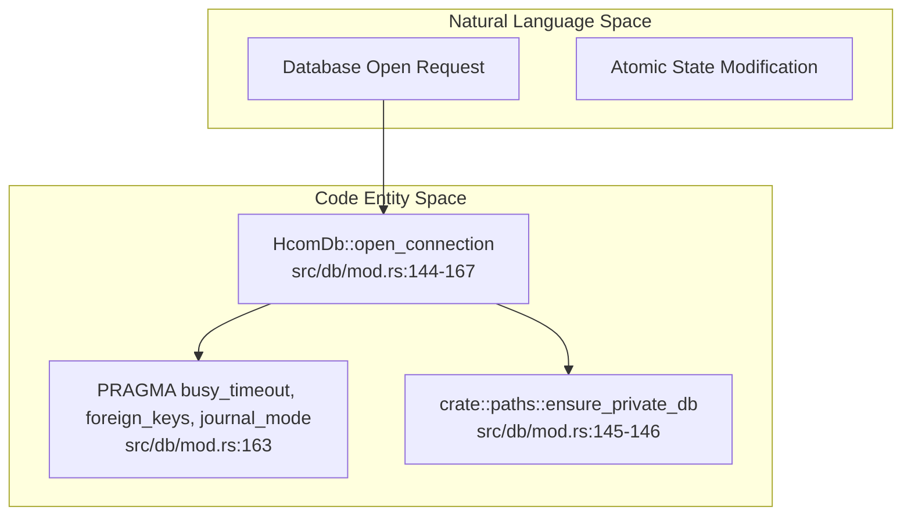

Sources: [src/db/mod.rs:144-167]()

---

## Schema Overview and Versioning

The SQLite schema version is tracked via `SCHEMA_VERSION` (currently version **20**) [src/db/mod.rs:41](). Migrations are applied sequentially via the `MIGRATIONS` array [src/db/mod.rs:43-89]().

| Table / View | Purpose |
|--------------|---------|
| `events` | Append-only log of all system events (messages, status changes, lifecycle events) |
| `instances` | Active and historical instance records (`InstanceRow`) with status, session bindings, and metadata |
| `kv` | General key-value store for configuration, subscriptions (`events_sub:`), and relay state |
| `notify_endpoints` | TCP ports for PTY delivery, screen injection, and plugin listeners |
| `session_bindings` | Maps external `session_id` to canonical `instance_name` (hook-based tools) |
| `process_bindings` | Maps OS process IDs (`process_id`) to session and instance bindings |
| `claude_actor_capabilities` | Tracks scoped tool-use permissions and capabilities for Claude actors [src/db/mod.rs:55-65]() |
| `events_v` | Virtual view supporting JSON extraction and filtering |

Recent schema expansions include:
- **Version 17**: Added `terminal_preset_requested` and `terminal_preset_effective` columns to `instances` [src/db/mod.rs:45-51]().
- **Version 18**: Added `last_seen` column to `instances` and created `claude_actor_capabilities` with expiration and session indexes [src/db/mod.rs:53-69]().
- **Version 19**: Added `events_fts_delete` trigger for FTS cleanup [src/db/mod.rs:73-78]().
- **Version 20**: Updated `terminal_preset_effective` JSON property extraction [src/db/mod.rs:80-88]().

Sources: [src/db/mod.rs:41-89]()

---

## Events Table and Event Types

The `events` table provides an append-only sequence of records. Each entry includes:
- `id`: Monotonically increasing primary key (used for per-instance read cursors: `instances.last_event_id`).
- `timestamp`: Creation timestamp.
- `type`: Category (`message`, `status`, or `life`).
- `instance`: Originating instance name.
- `data`: JSON-encoded payload.

### Event Categories
1. **Message Events (`type = 'message'`)**: Represents inter-agent communication, handled via the `Message` struct [src/db/events.rs:9-21](). Fields include `from`, `text`, `intent`, `thread`, `delivered_to`, and `relay_ref` for relay synchronization [src/db/events.rs:10-20]().
2. **Status Events (`type = 'status'`)**: Tracks state transitions (e.g., `active`, `listening`, `blocked`, `launching`, `error`, `inactive`) with contextual tool metadata.
3. **Life Events (`type = 'life'`)**: Records high-level lifecycle milestones such as initialization and shutdown (`ready`, `stopped`, `started`).

Sources: [src/db/events.rs:9-21]()

---

## Events View (`events_v`) and Delivery Mechanics

The `events_v` database view simplifies complex message and event filtering by flattening JSON attributes into standard queryable columns. 

### Subscription Gating and Request Watches
Subscriptions are stored in the `kv` table under the `events_sub:` prefix [src/db/kv.rs:103](). Functions like `should_deliver_to` evaluate whether a message event matches a receiver's scope (`broadcast` vs `mentions`) [src/db/events.rs:41-58]().

**Diagram: Subscription and Event Flow Architecture**
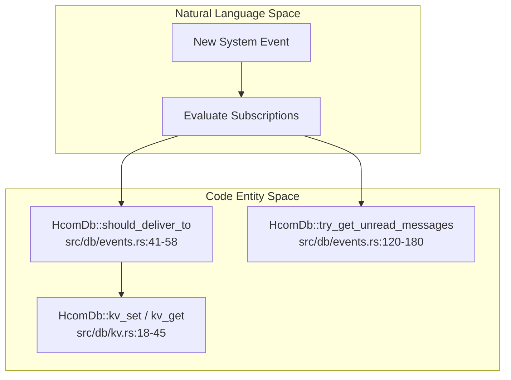

Sources: [src/db/events.rs:41-58](), [src/db/events.rs:120-180](), [src/db/kv.rs:18-45]()

---

## Notify Endpoints

The `notify_endpoints` table associates instances with communication channels and local network ports:
- `pty`: Wakes the PTY delivery loop when unread events accumulate.
- `inject`: Bidirectional endpoint supporting PTY text injection and live screen captures.
- `plugin`: Tool-specific integration endpoints.

Endpoints support migration and re-binding via `migrate_notify_endpoints` during session resume and adoption workflows [src/db/sessions.rs:158-178]().

Sources: [src/db/sessions.rs:158-178]()

---

## Session and Process Bindings

To map underlying operating system processes and tool sessions to hcom instances, the database maintains two indexing tables:
1. `session_bindings`: Maps tool-provided `session_id` strings to canonical instance names.
2. `process_bindings`: Maps OS-level `process_id` values to sessions and instances [src/db/sessions.rs:119-134]().

Sources: [src/db/sessions.rs:119-134]()

---

## Key-Value (KV) Store

The `kv` table provides structured string-to-string persistence utilized for configuration properties, relay cursors, and subscription records [src/db/kv.rs:1-71](). 

Key retrieval and mutation methods include:
- `kv_get(&self, key: &str)`: Fetches optional string values [src/db/kv.rs:18-28]().
- `kv_set(&self, key: &str, value: Option<&str>)`: Inserts or deletes key records [src/db/kv.rs:31-45]().
- `kv_prefix(&self, prefix: &str)`: Queries matching keys with automatic escaping of SQL wildcard characters (`%` and `_`) to ensure literal prefix matching [src/db/kv.rs:48-60]().
- `kv_delete_prefix(&self, prefix: &str)`: Bulk-deletes keys sharing a given prefix [src/db/kv.rs:62-70]().

Sources: [src/db/kv.rs:1-71]()

---

# Page: Instance Lifecycle Management

# Instance Lifecycle Management

<details>
<summary>Relevant source files</summary>

The following files were used as context for generating this wiki page:

- [src/core/launch_status.rs](src/core/launch_status.rs)
- [src/db/instances.rs](src/db/instances.rs)
- [src/instance_binding.rs](src/instance_binding.rs)
- [src/instance_lifecycle.rs](src/instance_lifecycle.rs)
- [src/pidtrack.rs](src/pidtrack.rs)

</details>


## Purpose and Scope
This page details the implementation of instance lifecycle management in `hcom`. It covers instance state transitions, database state tracking via `InstanceRow` [src/db/instances.rs:20-52](), name allocation, launch context capture (`persist_terminal_launch_context`, `capture_and_store_launch_context`) [src/instance_binding.rs:25-94](), process tracking (`pidtrack`) [src/pidtrack.rs:13-44](), heartbeat monitoring, wake-grace detection (`is_in_wake_grace`) [src/instance_lifecycle.rs:107-109](), and cleanup logic.

---

## Instance States and Transitions

An instance progresses through distinct phases from creation to deletion. The database row in the `instances` table serves as the single source of truth. The `get_instance_status()` function computes the current status by analyzing stored fields and heartbeat timestamps [src/instance_lifecycle.rs:157-162]().

### State Machine Diagram (Natural Language to Code Entity Space)

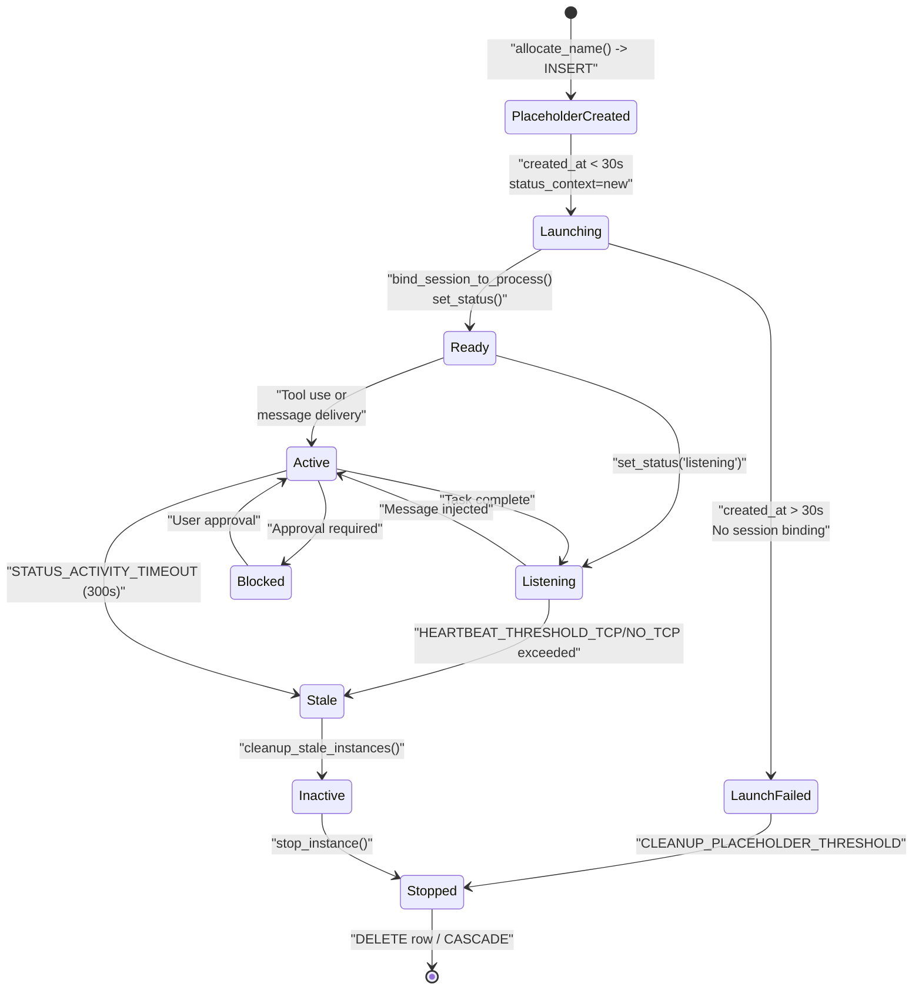
Sources: [src/instance_lifecycle.rs:25-52](), [src/db/instances.rs:20-52]()

### State Definitions and Threshold Constants

| State | Condition / Constant | Heartbeat Check | Purpose |
|-------|----------------------|-----------------|----------|
| **Launching** | `LAUNCH_PLACEHOLDER_TIMEOUT` (30s) [src/instance_lifecycle.rs:25-25]() | None | Name allocated, waiting for session binding |
| **Launch Failed** | `created_at > 30s`, no session | None | Placeholder timed out before binding |
| **Active** | `ST_ACTIVE` (`active`) [src/shared/constants.rs] | Yes (`STATUS_ACTIVITY_TIMEOUT` 300s) [src/instance_lifecycle.rs:49-49]() | Currently processing task or tool |
| **Listening** | `ST_LISTENING` (`listening`) [src/shared/constants.rs] | Yes (`HEARTBEAT_THRESHOLD_TCP` 35s) [src/instance_lifecycle.rs:29-29]() | Waiting for messages/input |
| **Blocked** | `ST_BLOCKED` (`blocked`) [src/instance_lifecycle.rs:9-9]() | Yes (300s) | Awaiting approval or permission |
| **Inactive (Stale)** | Heartbeat timeout exceeded | No | Marked for cleanup |
| **Stopped** | Row deleted from table | No | Terminal state |

Sources: [src/instance_lifecycle.rs:25-52](), [src/db/instances.rs:20-52](), [src/shared/constants.rs]()

---

## Creation and Name Generation

Instance creation involves allocating a unique name via `allocate_name()` and initializing the database record. 

### Name Allocation Architecture

```mermaid
graph TD
    Start["allocate_name()"] --> BuildPool["build_name_pool()"]
    BuildPool --> Score["score_name()<br/>(+100 Gold names)"]
    Score --> Sample["Tier 1: Weighted sampling"]
    Sample --> CheckSim["is_too_similar()"]
    CheckSim --> Reserve["INSERT INTO instances<br/>(status='pending')"]
    Reserve --> Return["Return Instance Name"]
```
Sources: [src/instance_names.rs:8-206]()

*   **Placeholder Reservation:** Placeholders are created with `session_id = NULL` [src/db/instances.rs:20-24]().
*   **Timeout & Cleanup:** If session binding does not occur within `LAUNCH_PLACEHOLDER_TIMEOUT` (30s) [src/instance_lifecycle.rs:25-25](), the launch is marked failed. `CLEANUP_PLACEHOLDER_THRESHOLD` (120s) [src/instance_lifecycle.rs:52-52]() purges unbonded placeholders.

Sources: [src/instance_lifecycle.rs:25-52](), [src/db/instances.rs:20-24](), [src/instance_names.rs:8-206]()

---

## Registration, Binding, and Pidtracking

Registration connects a tool session to an `hcom` instance identity, while `pidtrack` coordinates OS process boundaries.

### Binding Flow and Pidtrack Data Structures

```mermaid
classDiagram
    class "InstanceRow" {
        +name: String
        +session_id: Option~String~
        +status: String
        +pid: Option~i64~
        +launch_context: Option~String~
    }
    class "PidEntry" {
        +tool: String
        +names: Vec~String~
        +launched_at: f64
        +process_id: String
        +terminal_preset: String
        +pane_id: String
        +notify_port: u16
        +inject_port: u16
    }
    class "instance_binding" {
        +persist_terminal_launch_context()
        +capture_and_store_launch_context()
    }
    "InstanceRow" --> "instance_binding" : "updated by"
    "PidEntry" --> "pidtrack" : "recorded in .tmp/launched_pids.json"
```
Sources: [src/db/instances.rs:20-52](), [src/instance_binding.rs:25-142](), [src/pidtrack.rs:13-44]()

*   `persist_terminal_launch_context`: Stores terminal launch metadata (`pane_id`, `terminal_id`, effective preset) in `launch_context` without overwriting concurrent writes [src/instance_binding.rs:25-88]().
*   `capture_and_store_launch_context`: Captures environment state (git branch, TTY, env vars) and merges it into `launch_context` [src/instance_binding.rs:93-142]().
*   `pidtrack::record_pid`: Persists launched process records to `.tmp/launched_pids.json` as `PidEntry` structs for orphan detection and process cleanup [src/pidtrack.rs:13-44](), [src/pidtrack.rs:189-211]().

Sources: [src/instance_binding.rs:25-142](), [src/pidtrack.rs:13-44](), [src/pidtrack.rs:189-211]()

---

## Heartbeat Monitoring and Staleness Detection

`hcom` monitors activity to identify unresponsive instances.

### Heartbeat Thresholds and Wake Grace
*   **TCP Listener Threshold (`HEARTBEAT_THRESHOLD_TCP`):** 35s (30s hook interval + 5s buffer) [src/instance_lifecycle.rs:27-29]().
*   **Adhoc Threshold (`HEARTBEAT_THRESHOLD_NO_TCP`):** 10s [src/instance_lifecycle.rs:32-32]().
*   **Active Heartbeat Grace (`ACTIVE_HEARTBEAT_GRACE`):** 120s (4x poll interval) for instances parked in non-listening states [src/instance_lifecycle.rs:34-43]().
*   **Activity Timeout (`STATUS_ACTIVITY_TIMEOUT`):** 300s without status update [src/instance_lifecycle.rs:48-49]().
*   **Wake Grace Period (`is_in_wake_grace`, `is_in_wake_grace_publishing`):** Detects wall-clock vs monotonic-clock drift during system sleep and suppresses stale cleanup for `WAKE_GRACE_PERIOD` (60.0s) [src/instance_lifecycle.rs:54-55](), [src/instance_lifecycle.rs:107-135]().

Sources: [src/instance_lifecycle.rs:25-55](), [src/instance_lifecycle.rs:107-135]()

---

## Cleanup and Termination

Cleanup routines reclaim resources and purge expired records.

*   **Termination:** `stop_instance()` logs a `life` event and removes or deactivates the database record.
*   **Stale Remote Devices:** Remote instances are marked stale after 90s (`REMOTE_DEVICE_STALE_THRESHOLD`) without updates [src/instance_lifecycle.rs:58-58]().
*   **Recently Stopped Window:** Stopped instances remain visible in listings for 10 minutes (`RECENTLY_STOPPED_WINDOW`) [src/instance_lifecycle.rs:60-60]().
*   **Placeholder Threshold:** Unbound placeholders are removed after `CLEANUP_PLACEHOLDER_THRESHOLD` (120s) [src/instance_lifecycle.rs:51-52]().

Sources: [src/instance_lifecycle.rs:47-62](), [src/commands/stop.rs]()

---

# Page: Message Routing and Delivery

# Message Routing and Delivery

<details>
<summary>Relevant source files</summary>

The following files were used as context for generating this wiki page:

- [src/bootstrap.rs](src/bootstrap.rs)
- [src/commands/send.rs](src/commands/send.rs)
- [src/delivery.rs](src/delivery.rs)
- [src/delivery/antigravity.rs](src/delivery/antigravity.rs)
- [src/integration_spec.rs](src/integration_spec.rs)

</details>


**Purpose**: This page documents the message routing and delivery system, including scope computation, envelope metadata, database storage, gate evaluation, and the mechanisms used to inject messages into agent PTYs.

**Scope**: Covers the lifecycle of a message from the `hcom send` CLI command through database persistence in `HcomDb` to final delivery via TCP notifications, gate evaluation, and PTY injection.

---

## 1. Message Flow Overview

The flow of a message involves several distinct stages: CLI parsing via `SendArgs`, identity resolution, scope computation (`compute_scope`), envelope validation (`validate_message`), database logging, and TCP-driven PTY injection.

**Diagram: Message Lifecycle (CLI to PTY)**

```mermaid
graph TD
    subgraph "CommandSpace"
        SendCmd["hcom send [args]"]
        ParseArgs["src/commands/send.rs::SendArgs"]
        ResolveID["src/identity.rs::resolve_identity()"]
    end

    subgraph "RoutingSpace"
        ComputeScope["src/messages.rs::compute_scope()"]
        BuildEnvelope["src/messages.rs::MessageEnvelope"]
        Validate["src/messages.rs::validate_message()"]
    end

    subgraph "PersistenceSpace"
        HcomDb_Log["src/db::HcomDb::log_event()"]
        EventsTable[("Table: events")]
        NotifyTable[("Table: notify_endpoints")]
    end

    subgraph "DeliverySpace"
        TCPNotify["src/notify.rs::NotifyServer"]
        PTYDelivery["src/delivery.rs::run_delivery_loop"]
        AgentPTY["Agent Terminal PTY Injection"]
    end

    SendCmd --> ParseArgs
    ParseArgs --> ResolveID
    ResolveID --> ComputeScope
    ComputeScope --> Validate
    Validate --> HcomDb_Log
    HcomDb_Log --> EventsTable
    HcomDb_Log --> TCPNotify
    TCPNotify --> PTYDelivery
    PTYDelivery --> AgentPTY
```

Sources: [src/commands/send.rs:52-141](), [src/messages.rs:1-150](), [src/delivery.rs:1-100](), [src/identity.rs:1-230]()

---

## 2. Scope Computation and Addressing

`hcom` uses an addressing system that supports broadcast, explicit mentions, and prefix-based targeting.

### Scope Types

Messages are categorized into scopes defined by `MessageScope`:
*   `Broadcast`: Delivered to all active instances when no `@` targets are specified.
*   `Mentions`: Delivered only to instances matched by explicit `@name` or prefix patterns.

Sources: [src/messages.rs:14-27](), [src/commands/send.rs:52-68]()

### Target Resolution Logic

Target resolution supports exact base names (`@luna`), full names (`@api-luna`), prefix tags (`@api-`), remote instances (`@luna:BOXE`), and virtual identities (`bigboss`).

**Diagram: Scope Computation and Matching**

```mermaid
graph TB
    Start["src/messages.rs::compute_scope()"]
    
    Start --> CheckExplicit{"explicit_targets<br/>provided?"}
    
    CheckExplicit -->|Yes| ExplicitMode["Iterate targets from CLI"]
    CheckExplicit -->|No| ParseMode["Regex parse @mentions from text"]
    
    subgraph "MatchingLogic"
        Match["src/messages.rs::match_target()"]
        Boundary{"Underscore boundary?"}
        Boundary -->|Blocked| NoMatch["@luna does NOT match luna_sub"]
        Boundary -->|Allowed| MatchFound["Add to delivered_to list"]
    end
    
    ExplicitMode --> Match
    ParseMode --> Match
    
    MatchFound --> Result["Return ScopeResult"]
```

Sources: [src/messages.rs:1-150](), [src/commands/send.rs:17-51]()

---

## 3. Sender Identity Resolution

Before a message is logged, the sender identity is resolved via `identity::resolve_identity`.

### Identity Types

Identity is represented by `SenderIdentity` and categorized by `SenderKind`:
*   `Instance`: Sent from within an `hcom`-managed PTY session.
*   `External`: Sent via `--from` or `-b` (`bigboss`).
*   `System`: Generated by internal system events.

Sources: [src/shared/mod.rs:44](), [src/identity.rs:1-250]()

### Resolution Logic

The `SendArgs::sender_name()` method determines the effective sender name from flags or environment variables like `HCOM_PROCESS_ID`.

Sources: [src/commands/send.rs:143-153](), [src/identity.rs:1-250]()

---

## 4. Message Envelope and Bundles

Messages carry metadata (`MessageEnvelope`) and structured context (`Bundles`).

### Envelope Fields

The `MessageEnvelope` struct captures intent (`request`, `inform`, `ack`), reply-to links, and threading identifiers.

```rust
// Logic in SendArgs::build_bundle_data [src/commands/send.rs:160-212]
let mut bundle = serde_json::json!({
    "title": title,
    "description": description,
    "refs": {
        "events": events,
        "files": files,
        "transcript": transcript,
    }
});
```

Sources: [src/messages.rs:42-79](), [src/commands/send.rs:160-212]()

---

## 5. Delivery, Notification, and Gate Evaluation

Once committed to SQLite via `HcomDb::log_event`, messages are pushed to active listeners via registered TCP notify endpoints.

### Gate Evaluation (`GatesSpec`)

Delivery to a PTY is controlled by per-tool configuration guards defined in `GatesSpec` [src/integration_spec.rs:55-69]():
*   `require_idle`: Ensures the agent is not executing a tool turn.
*   `require_ready_prompt`: Verifies prompt readiness on screen.
*   `require_prompt_empty`: Blocks injection if user input is pending.
*   `block_on_user_activity`: Defers injection when human typing is detected.
*   `block_on_approval`: Pauses delivery during permission prompts.

Sources: [src/integration_spec.rs:55-69](), [src/delivery.rs:1-136]()

---

## 6. PTY Delivery, State Refresh, and Cleanup

The delivery loop handles runtime binding updates, status tracking, and teardown cleanup.

### Runtime Binding and Status Refresh

Functions such as `refresh_binding()` [src/delivery.rs:60-102]() and `refresh_status()` [src/delivery.rs:105-135]() run inside the delivery loop to detect name migrations and status modifications.

```rust
// Cleanup for Antigravity sessions when soft-stopped [src/delivery/antigravity.rs:14-58]
pub(crate) fn cleanup_antigravity_pty_exit(
    db: &mut HcomDb,
    current_name: &str,
    process_id: &str,
    owns_instance: bool,
) { ... }
```

Sources: [src/delivery.rs:47-135](), [src/delivery/antigravity.rs:14-58]()

---

## 7. Summary Table: Routing Logic

| Feature | Code Entity | File |
|---------|-------------|------|
| Addressing Logic | `messages::compute_scope` | [src/messages.rs:1-150]() |
| Message Validation | `messages::validate_message` | [src/messages.rs:127-151]() |
| Identity Resolution | `identity::resolve_identity` | [src/identity.rs:1-250]() |
| PTY Delivery Gates | `integration_spec::GatesSpec` | [src/integration_spec.rs:55-69]() |
| PTY Delivery Loop | `delivery::refresh_status` | [src/delivery.rs:105-135]() |
| Process Binding Refresh | `delivery::refresh_binding` | [src/delivery.rs:60-102]() |
| Antigravity PTY Cleanup | `antigravity::cleanup_antigravity_pty_exit` | [src/delivery/antigravity.rs:14-58]() |

Sources: [src/messages.rs:1-150](), [src/delivery.rs:47-135](), [src/identity.rs:1-250](), [src/integration_spec.rs:55-69](), [src/delivery/antigravity.rs:14-58]()

---

# Page: Terminal Integration and PTY Wrapper

# Terminal Integration and PTY Wrapper

<details>
<summary>Relevant source files</summary>

The following files were used as context for generating this wiki page:

- [src/commands/kill.rs](src/commands/kill.rs)
- [src/core/tips.rs](src/core/tips.rs)
- [src/pty/forward.rs](src/pty/forward.rs)
- [src/pty/inject.rs](src/pty/inject.rs)
- [src/pty/mod.rs](src/pty/mod.rs)
- [src/pty/screen.rs](src/pty/screen.rs)
- [src/pty/shared.rs](src/pty/shared.rs)
- [src/pty/stdout_queue.rs](src/pty/stdout_queue.rs)
- [src/pty/vt_compat.rs](src/pty/vt_compat.rs)
- [src/pty/win.rs](src/pty/win.rs)
- [src/shared/terminal_presets.rs](src/shared/terminal_presets.rs)
- [src/terminal.rs](src/terminal.rs)
- [tests/pty_backpressure.rs](tests/pty_backpressure.rs)

</details>


## Purpose and Scope

The terminal integration system in `hcom` provides the bridge between the multi-agent messaging system and the interactive AI tools (Claude, Gemini, Codex, etc.) running inside terminal environments. It consists of a terminal preset system for launching terminal emulators and a native PTY wrapper (`src/pty/mod.rs`) that manages child processes, tracks screen state via `vt100` parsing, and handles message injection.

This page details the implementation of terminal presets (`src/shared/terminal_presets.rs`), environment sanitization (`src/terminal.rs`), the PTY wrapper architecture across Unix (`src/pty/forward.rs`, `src/pty/terminal.rs`) and Windows (`src/pty/win.rs`), screen compatibility rewriting (`src/pty/vt_compat.rs`), output queueing (`src/pty/stdout_queue.rs`), and the injection server (`src/pty/inject.rs`).

Sources: [src/terminal.rs:1-9](), [src/pty/mod.rs:1-9](), [src/shared/terminal_presets.rs:1-10]()

---

## Terminal Preset System and Environment Sanitization

The preset system enables `hcom` to support various terminal emulators and multiplexers (tmux, wezterm, kitty, cmux, etc.) by defining how to open windows/panes and how to close or identify them [src/shared/terminal_presets.rs:37-53]().

```mermaid
graph TD
    subgraph "Natural Language Space"
        N1["Terminal Preset Detection"]
        N2["Environment Sanitization"]
        N3["Cross-Platform Window Opening"]
    end

    subgraph "Code Entity Space"
        T1["detect_terminal_from_env() [src/terminal.rs]"]
        T2["TERMINAL_CONTEXT_VARS [src/terminal.rs]"]
        T3["TERMINAL_PRESETS [src/shared/terminal_presets.rs]"]
        T4["PlatformArgv [src/shared/terminal_presets.rs]"]
    end

    N1 --> T1
    N1 --> T3
    N2 --> T2
    N3 --> T4
```
**Diagram: Natural Language to Code Entity: Terminal Presets** - Associates the high-level concepts of terminal preset configuration and sanitization with their respective Rust symbols.

Sources: [src/terminal.rs:174-212](), [src/shared/terminal_presets.rs:37-115]()

### Preset Resolution and Command Templates

`TERMINAL_PRESETS` maps string identifiers to `TerminalPreset` structures containing binary checks, app names for macOS bundles, and platform-specific `PlatformArgv` templates [src/shared/terminal_presets.rs:37-53](). Placeholders like `{script}`, `{process_id}`, and `{pane_id}` are substituted at runtime.

| Preset | Open Command Template | Pane ID Env | Close Command | Sources |
| :--- | :--- | :--- | :--- | :--- |
| `tmux` | `tmux split-window -h 'bash {script}'` | `TMUX_PANE` | `tmux kill-pane -t {pane_id}` | [src/shared/terminal_presets.rs:98-260]() |
| `wezterm` | `wezterm start -- bash {script}` | `WEZTERM_PANE` | `wezterm cli kill-pane --pane-id {pane_id}` | [src/shared/terminal_presets.rs:196-213]() |
| `kitty` | `kitty -o allow_remote_control=socket-only ...` | N/A | `kitten @ close-window --match id:{pane_id}` | [src/shared/terminal_presets.rs:173-194]() |
| `cmux` | `cmux new-workspace --command 'bash {script}'` | `CMUX_WORKSPACE_ID` | `cmux close-workspace --workspace {pane_id}` | [src/shared/terminal_presets.rs:160-171]() |

To prevent outer terminal identity leaks into newly launched panes, `TERMINAL_CONTEXT_VARS` strips multiplexer (`TMUX_PANE`, `ZELLIJ_PANE_ID`, `CMUX_WORKSPACE_ID`) and GPU terminal variables (`KITTY_WINDOW_ID`, `WEZTERM_PANE`) prior to launching terminal subprocesses [src/terminal.rs:177-212]().

Sources: [src/shared/terminal_presets.rs:37-115](), [src/terminal.rs:177-212]()

---

## PTY Wrapper Architecture

The PTY wrapper spawns the target AI tool within a pseudo-terminal. It is split between Unix-specific poll-driven handling and Windows ConPTY-backed proxying [src/pty/win.rs:1-11]().

```mermaid
graph TB
    subgraph "Natural Language Space"
        NL1["Process Target Abstraction"]
        NL2["Unix I/O Multiplexing Loop"]
        NL3["Windows ConPTY Proxy"]
        NL4["Shared Orchestration Logic"]
    end

    subgraph "Code Entity Space"
        PE1["PtyTarget [src/pty/mod.rs]"]
        PE2["TerminalOutput [src/pty/forward.rs]"]
        PE3["Proxy [src/pty/win.rs]"]
        PE4["run_delivery_loop() [src/delivery.rs]"]
    end

    NL1 --> PE1
    NL2 --> PE2
    NL3 --> PE3
    NL4 --> PE4
```
**Diagram: Natural Language to Code Entity: PTY Architecture** - Maps architectural requirements to their implementing types and functions.

Sources: [src/pty/mod.rs:80-116](), [src/pty/forward.rs:97-180](), [src/pty/win.rs:45-98](), [src/delivery.rs:1-25]()

### Target Abstraction and Platform Execution

- **`PtyTarget`**: Distinguishes between a known `Tool` (Claude, Codex, Gemini, etc.) and an `AdhocCommand` [src/pty/mod.rs:80-84](). It provides delivery timeout configurations and console input parameters [src/pty/mod.rs:108-115]().
- **Unix I/O Forwarding (`src/pty/forward.rs`)**: Uses `nix::poll` to manage non-blocking reads/writes across stdin, the PTY master, and the injection server. `TerminalOutput` runs a dedicated thread to stream PTY output without blocking the proxy's control loops [src/pty/forward.rs:97-150]().
- **Windows ConPTY Proxy (`src/pty/win.rs`)**: Because Windows lacks `poll` for PTY handles, `Proxy` uses portable-pty with dedicated blocking threads for reading, writing, and injection, supported by an asynchronous `StdoutQueue` [src/pty/win.rs:1-11](), [src/pty/stdout_queue.rs:1-57]().

Sources: [src/pty/mod.rs:80-116](), [src/pty/forward.rs:97-180](), [src/pty/win.rs:1-11](), [src/pty/stdout_queue.rs:1-57]()

---

## Screen Capture and VT100 Parsing

To accurately monitor agent states and provide prompt readiness gates, `hcom` maintains a virtual screen buffer using the `vt100` crate [src/pty/screen.rs:1-9]().

### `ScreenTracker` and Compatibility Rewriting

- **`ScreenTracker` (`src/pty/screen.rs`)**: Processes raw PTY bytes to maintain a character grid, check ready patterns (`is_ready`), detect approval prompts (`is_waiting_approval`, `is_codex_approval_visible`), and capture tail output [src/pty/screen.rs:14-188]().
- **`VtCompat` (`src/pty/vt_compat.rs`)**: Certain tools (like Antigravity) emit CSI sequences (such as HPA `CSI n \`` or REP `CSI n b`) that standard `vt100` parsers ignore. `VtCompat` rewrites these sequences on the fly so the parser's internal cursor tracks the real terminal precisely [src/pty/vt_compat.rs:1-16]().

```mermaid
graph LR
    subgraph "Screen Processing Pipeline"
        S1["Raw PTY Output bytes"] --> S2["VtCompat::feed() [src/pty/vt_compat.rs]"]
        S2 --> S3["vt100::Parser::process() [src/pty/screen.rs]"]
        S3 --> S4["ScreenTracker State"]
        S4 --> S5["is_ready() / is_waiting_approval()"]
    end
```
**Diagram: Screen Processing Pipeline** - Illustrates how raw escape sequences are normalized by `VtCompat` before reaching `vt100::Parser` inside `ScreenTracker`.

Sources: [src/pty/vt_compat.rs:47-76](), [src/pty/screen.rs:14-27]()

### Escape Sequence Safety and Title Filtering

To interleave terminal window title updates (OSC 1/2) without corrupting output streams, the proxy evaluates `title_write_safe` using `PendingEscape` state tracking [src/pty/mod.rs:118-156]().

| `PendingEscape` Variant | Sequence Trigger | Resolution | Sources |
| :--- | :--- | :--- | :--- |
| `PendingEscape::Csi` | `ESC [` | Final byte (`0x40`–`0x7E`) | [src/pty/mod.rs:122-125]() |
| `PendingEscape::StringSeq` | `OSC`, `DCS`, `PM`, `APC` | BEL (`0x07`) or ST (`ESC \`) | [src/pty/mod.rs:126-128]() |
| `PendingEscape::SingleShift` | `ESC N` or `ESC O` | Exactly one following byte | [src/pty/mod.rs:129-130]() |
| `PendingEscape::NfSeq` | `ESC` + intermediate bytes | Final byte (`0x30`–`0x7E`) | [src/pty/mod.rs:131-134]() |

Sources: [src/pty/mod.rs:118-156]()

---

## Injection, Delivery Loops, and Output Queueing

Message delivery and interactive terminal inspection rely on TCP injection servers and synchronized delivery threads [src/pty/inject.rs:1-8](), [src/delivery.rs:1-15]().

### TCP Injection Server

The `InjectServer` binds to a local ephemeral TCP port (`127.0.0.1:0`), allowing external CLI commands like `hcom term inject` or `hcom term` to send text or query screen states [src/pty/inject.rs:47-74]().
- **Query Processing**: Clients can send a `QUERY_PREFIX` (`0x00`) to request full screen dumps without affecting child process stdin [src/pty/inject.rs:9-11](), [src/pty/inject.rs:81-107]().
- **Backpressure Management**: Incoming payloads are bounded by `MAX_REQUEST_BYTES` (1 MiB) to prevent memory exhaustion under heavy load [src/pty/inject.rs:11-13]().

### Stdout Queueing (`StdoutQueue`)

On Windows and platforms with high-latency consoles, `StdoutQueue` spawns a dedicated writer thread that processes frames and title updates sequentially via bounded channels (`QUEUE_CHUNKS = 256`), supporting cancellation tokens (`Cutoff`) and synchronization barriers (`barrier`) [src/pty/stdout_queue.rs:1-101]().

Sources: [src/pty/inject.rs:47-74](), [src/pty/stdout_queue.rs:1-101]()

---

# Page: TUI Dashboard

# TUI Dashboard

<details>
<summary>Relevant source files</summary>

The following files were used as context for generating this wiki page:

- [src/commands/daemon.rs](src/commands/daemon.rs)
- [src/commands/reset.rs](src/commands/reset.rs)
- [src/tui/actions.rs](src/tui/actions.rs)
- [src/tui/app.rs](src/tui/app.rs)
- [src/tui/commands.rs](src/tui/commands.rs)
- [src/tui/db.rs](src/tui/db.rs)
- [src/tui/input.rs](src/tui/input.rs)
- [src/tui/mod.rs](src/tui/mod.rs)
- [src/tui/model.rs](src/tui/model.rs)
- [src/tui/render/agents.rs](src/tui/render/agents.rs)
- [src/tui/render/messages.rs](src/tui/render/messages.rs)
- [src/tui/render/mod.rs](src/tui/render/mod.rs)
- [src/tui/rpc_async.rs](src/tui/rpc_async.rs)
- [src/tui/state.rs](src/tui/state.rs)
- [src/tui/status.rs](src/tui/status.rs)
- [src/tui/theme.rs](src/tui/theme.rs)
- [src/tui/usage.rs](src/tui/usage.rs)

</details>


The `hcom` TUI dashboard is an interactive, terminal-based user interface built using the `ratatui` crate and `crossterm`. It provides a centralized control plane for observing agent statuses, managing lifecycles (launching, stopping, forking, resuming), composing messages, and inspecting cross-device synchronization via an SQLite-backed data source without requiring a persistent long-running daemon process.

---

## Application, State, and Input Model

The TUI core is structured around the `App` struct defined in `[src/tui/app.rs:18-25]()`, which coordinates state mutations, background data fetching, asynchronous RPC requests, and screen rendering. 

The application state is cleanly bifurcated into two major components in `[src/tui/state.rs:8-99]()`:
1. `DataState`: Represents the persistent domain model fetched from the database (active agents, stopped agents, remote agents, orphans, unread message counts, and relay status).
2. `UiState`: Manages volatile interaction states such as cursor positions, multi-selections (`BTreeSet`), active input modes (`InputMode`), active overlays, popups, viewport modes (`ViewMode`), and command results.

```mermaid
graph TD
    subgraph "Code Entity Space"
        App["App [src/tui/app.rs:18-25]"] --> DataState["DataState [src/tui/state.rs:8-27]"]
        App --> UiState["UiState [src/tui/state.rs:56-99]"]
        App --> DataSourceBox["Box<dyn DataSource> [src/tui/app.rs:22]"]
        App --> RpcClient["RpcClient [src/tui/rpc_async.rs:61-65]"]
        DataSourceBox --> DbDataSource["DbDataSource [src/tui/db.rs:55-66]"]
        UiState --> InputMode["InputMode [src/tui/model.rs:12-18]"]
        UiState --> ViewMode["ViewMode [src/tui/model.rs:6-9]"]
    end

    style App fill:#fff,stroke:#000,stroke-width:1px
    style DataState fill:#fff,stroke:#000,stroke-width:1px
    style UiState fill:#fff,stroke:#000,stroke-width:1px
    style DbDataSource fill:#fff,stroke:#000,stroke-width:1px
    style RpcClient fill:#fff,stroke:#000,stroke-width:1px
```
*Sources: `[src/tui/app.rs:18-25](), `[src/tui/state.rs:1-99](), `[src/tui/model.rs:1-18](), `[src/tui/db.rs:55-66]()`

Input events are processed via `App::handle_key` in `[src/tui/input.rs:11-17]()`, mapping key combinations and modifiers based on the active `InputMode` (`[src/tui/model.rs:12-18]()`):
- `InputMode::Navigate`: Arrow keys and vim shortcuts for traversing agent lists, headers, and timeline history.
- `InputMode::Compose`: Active line buffer editing for outbound messages (`[src/tui/input.rs:83-106]()`).
- `InputMode::Launch`: Form-based parameters specification for launching new tool instances.
- `InputMode::CommandOutput`: Text output inspection view for ran commands.
- `InputMode::Relay`: Popup management for multi-device synchronization tokens and status.

Sources: `[src/tui/app.rs:18-25](), `[src/tui/state.rs:8-99](), `[src/tui/model.rs:1-18](), `[src/tui/input.rs:11-106]()`

---

## Database Polling and SQLite Integration

The TUI implements the `DataSource` trait via `DbDataSource` (`[src/tui/db.rs:55-66]()`). Rather than polling on a fixed timer via brute-force table scans, `DbDataSource` optimizes update cycles by inspecting SQLite's internal `PRAGMA data_version` (`[src/tui/db.rs:183-193]()`).

```mermaid
sequenceDiagram
    participant App as "App [src/tui/app.rs]"
    participant Source as "DbDataSource [src/tui/db.rs:55]"
    participant SQLite as "hcom.db (SQLite)"

    App->>Source: "load() / poll()"
    Source->>SQLite: "PRAGMA data_version"
    SQLite-->>Source: "version_number"
    alt "version_number changed OR config.toml modified"
        Source->>SQLite: "SELECT instances, events, kv"
        SQLite-->>Source: "Row Data"
        Source->>App: "Updated DataState"
    else "No changes"
        Source-->>App: "Cached DataState (No-op)"
    end
```
*Sources: `[src/tui/db.rs:55-193](), `[src/tui/app.rs:34-40]()`

To maintain safety and performance:
- Connections are opened in read-only mode (`PRAGMA query_only=ON`) with Write-Ahead Logging (`PRAGMA journal_mode=WAL`) and a 3-second busy timeout (`PRAGMA busy_timeout=3000`) (`[src/tui/db.rs:110-121]()`).
- File-descriptor identity checks (`db_file_id`) allow `DbDataSource` to transparently detect when `hcom reset` has replaced the underlying database file, triggering an automatic reconnection (`[src/tui/db.rs:21-40]()`).

Sources: `[src/tui/db.rs:1-193]()`

---

## Render Modules

Rendering is coordinated by `render::render` (`[src/tui/render/mod.rs:125-143]()`), which delegates layout and widget construction to specialized submodules:
- `render::agents`: Manages agent list rendering, collapsible sections for remote agents, stopped processes, and orphan processes (`[src/tui/render/agents.rs:97-135]()`).
- `render::messages`: Renders message streams, agent feed timelines, and command outputs with scroll metrics (`[src/tui/render/messages.rs:32-46]()`).
- `render::launch`: Handles form inputs and validation fields for the launch overlay (`[src/tui/render/launch.rs]()`).

Sources: `[src/tui/render/mod.rs:1-143](), `[src/tui/render/agents.rs:1-135](), `[src/tui/render/messages.rs:32-46]()`

---

## Asynchronous RPC and Agent Lifecycle Actions

To prevent UI stuttering during heavy process execution (such as spawning PTY sessions or launching AI tools), actions are queued and executed via `RpcClient` and `RpcOp` (`[src/tui/rpc_async.rs:8-65]()`). 

```mermaid
graph TD
    subgraph "Code Entity Space"
        UserAction["User Key / Launch Request"] --> Enqueue["App::enqueue_rpc(RpcOp) [src/tui/app.rs:107]"]
        Enqueue --> RpcClient["RpcClient [src/tui/rpc_async.rs:61]"]
        RpcClient --> BackgroundWorker["Background Worker Thread [src/tui/rpc_async.rs:76]"]
        BackgroundWorker --> NativeCmd["commands::run_native() [src/tui/rpc_async.rs:113]"]
        NativeCmd --> DbMod["Database / PTY / Terminal Launch"]
        NativeCmd --> RpcResult["RpcResult [src/tui/rpc_async.rs:56]"]
        RpcResult --> Drain["App::drain_rpc_results() [src/tui/app.rs:114]"]
        Drain --> StateUpdate["DataState / UiState Refresh [src/tui/actions.rs:133]"]
    end

    style App fill:#fff,stroke:#000,stroke-width:1px
    style RpcClient fill:#fff,stroke:#000,stroke-width:1px
    style BackgroundWorker fill:#fff,stroke:#000,stroke-width:1px
    style NativeCmd fill:#fff,stroke:#000,stroke-width:1px
```
*Sources: `[src/tui/app.rs:105-124](), `[src/tui/rpc_async.rs:1-120](), `[src/tui/actions.rs:133-176]()`

Commands are translated into argument vectors via `build_launch_argv` (`[src/tui/rpc.rs:1-100]()`), ensuring options like `--no-run-here`, `--headless`, and tool-agnostic prompt forwarding (`--hcom-prompt`) are correctly passed to the core launcher without duplicating integration specifications.

Sources: `[src/tui/rpc_async.rs:1-202](), `[src/tui/actions.rs:133-176]()`

---

## Theming

Visual styling relies on the `Theme` struct (`[src/tui/theme.rs]()`), mapping semantic states to console styles defined in `[src/tui/model.rs:48-75]()`:
- `AgentStatus::Active` (`▶`): Active execution styling (`[src/tui/model.rs:48-75]()`).
- `AgentStatus::Listening` (`◎`): Low-latency polling state (`[src/tui/model.rs:48-75]()`).
- `AgentStatus::Blocked` (`■`): User input or permission gate block (`[src/tui/model.rs:48-75]()`).
- `AgentStatus::Inactive` (`○`): Stopped or dead instance (`[src/tui/model.rs:48-75]()`).

Sources: `[src/tui/theme.rs](), `[src/tui/model.rs:48-76]()`

---

# Page: Command Reference

# Command Reference

<details>
<summary>Relevant source files</summary>

The following files were used as context for generating this wiki page:

- [src/commands/bundle.rs](src/commands/bundle.rs)
- [src/commands/help.rs](src/commands/help.rs)
- [src/commands/transcript.rs](src/commands/transcript.rs)

</details>


This page provides a comprehensive high-level reference for the `hcom` command-line interface. The CLI is the primary entry point for human operators and AI agents alike to control the multi-agent system, route messages, query historical event streams, and manage PTY-wrapped terminal sessions [src/commands/help.rs:1-4]().

As a parent page, this section outlines the broad categories of commands available in `hcom`. For detailed command-line arguments, syntax variants, and execution flows, please refer to the child pages linked throughout.

## Command Structure and Invocation

The `hcom` binary acts as a command router that dispatches requests to native Rust handlers, hooks, or terminal launchers [src/commands/help.rs:1-5]()]. It supports launching interactive dashboards, starting multiple tool instances, or executing specific administrative commands [src/commands/help.rs:56-65]().

### Argument Syntax
Most commands follow a standard structural pattern where global flags or command-specific parameters precede an optional double-dash (`--`) separator, which denotes the beginning of raw message text or positional content [src/commands/help.rs:12-43]().

```bash
hcom <command> [positional-args] [--flags] [-- message-text]
```

| Component | Description |
|-----------|-------------|
| **Command** | The primary action (e.g., `send`, `list`, `events`) [src/commands/help.rs:56-65](). |
| **Flags** | Modifiers like `--from`, `--intent`, or `--json` [src/commands/help.rs:142](). |
| **Separator** | `--` indicates the end of flag parsing and start of raw payload text. |
| **Message** | Unquoted trailing text passed directly to the command handler. |

Sources: [src/commands/help.rs:1-65]()

## Identity and Context Resolution

When any command executes within an agent environment, `hcom` resolves the caller's identity to correctly attribute messages, track readiness states, and filter event visibility.

### Resolution Flow
The system resolves identity by evaluating environment identifiers, process bindings, and explicit flags via the core command routing system [src/commands/help.rs:1-10]().

**Title: Identity and Command Routing Flow**
```mermaid
graph TD
    subgraph "Natural Language Space"
        User[""User or Agent CLI invocation""]
    end

    subgraph "Code Entity Space"
        HelpModule[""src/commands/help.rs""]
        TranscriptArgs[""src/commands/transcript.rs:TranscriptArgs""]
        BundleArgs[""src/commands/bundle.rs:BundleArgs""]
        Router[""Command Router Dispatch""]
    end

    User --> Router
    Router --> HelpModule
    Router --> TranscriptArgs
    Router --> BundleArgs
```

Sources: [src/commands/help.rs:1-10](), [src/commands/transcript.rs:43-78](), [src/commands/bundle.rs:33-118]()

## Command Categories and Sub-Topics

The `hcom` CLI is organized into five functional categories. Below is a high-level summary of each category and links to their detailed child documentation.

### 5.1 Launch and Instance Management
Instance lifecycle commands allow operators and agents to spawn new agent processes, resume previous sessions, fork existing execution threads, and clean up inactive resources [src/commands/help.rs:56-94](). Launch commands support parameters for configuring isolated environments, background execution, and custom tag assignments [src/commands/help.rs:83-94]().

For details, see [Launch and Instance Management](#5.1).

Sources: [src/commands/help.rs:56-94]()

### 5.2 Messaging Commands
Messaging commands facilitate inter-agent communication, enabling structured message delivery across broadcast and mention scopes [src/commands/help.rs:140-151](). The `send` command supports intent qualifiers, reply chaining, and context bundles, while `list` provides visibility into active agents and their read receipts [src/commands/help.rs:195-216]().

For details, see [Messaging Commands](#5.2).

Sources: [src/commands/help.rs:140-167](), [src/commands/help.rs:195-216]()

### 5.3 Events and Query Commands
The events subsystem provides deep observability into the system state by querying messages, file system mutations, status transitions, and lifecycle events [src/commands/help.rs:56-60](). Commands like `listen` and `events sub` allow synchronous blocking or asynchronous subscriptions to specific database triggers [src/commands/help.rs:96-124]().

For details, see [Events and Query Commands](#5.3).

Sources: [src/commands/help.rs:12-43](), [src/commands/help.rs:56-124]()

### 5.4 Configuration and Management Commands
Administrative commands manage user settings, tool hooks, and system configurations via the `config` subsystem [src/commands/help.rs:1-10](). This category also covers remote synchronization via relay daemons, bundle management through `src/commands/bundle.rs` [src/commands/bundle.rs:1-5](), and automated update checks.

For details, see [Configuration and Management Commands](#5.4).

Sources: [src/commands/help.rs:1-10](), [src/commands/bundle.rs:1-5]()

### 5.5 Terminal Commands
Terminal commands provide low-level inspection and interaction with PTY-wrapped sessions [src/commands/help.rs:1-10](). Operators can capture screen states in JSON format, inject text input directly into running shells, or debug PTY logging streams.

For details, see [Terminal Commands](#5.5).

Sources: [src/commands/help.rs:1-10]()

---

# Page: Launch and Instance Management

# Launch and Instance Management

<details>
<summary>Relevant source files</summary>

The following files were used as context for generating this wiki page:

- [src/commands/kill.rs](src/commands/kill.rs)
- [src/commands/launch.rs](src/commands/launch.rs)
- [src/commands/reset_ops.rs](src/commands/reset_ops.rs)
- [src/commands/resume.rs](src/commands/resume.rs)
- [src/core/tips.rs](src/core/tips.rs)
- [src/launcher.rs](src/launcher.rs)
- [src/shared/identity.rs](src/shared/identity.rs)
- [src/shared/terminal_presets.rs](src/shared/terminal_presets.rs)
- [src/terminal.rs](src/terminal.rs)

</details>


## Purpose and Scope

Section 5.1 documents the implementation, data flow, and code structures governing hcom's command-line interface and internal execution pipeline for launching, resuming, forking, starting, stopping, killing, and resetting agent instances. It connects user-facing CLI syntax directly to internal Rust code entities such as `commands::launch::run` `[src/commands/launch.rs:23-23]()`, `commands::resume::do_resume` `[src/commands/resume.rs:110-115]()`, `launcher::launch` `[src/launcher.rs:1-12]()`, and `commands::kill::kill_tracked_instance` `[src/commands/kill.rs:130-134]()`.

Sources: `[src/commands/launch.rs:23-23]()`, `[src/commands/resume.rs:110-115]()`, `[src/launcher.rs:1-12]`, `[src/commands/kill.rs:130-134]()`

---

## Overview

Instance management commands control the complete lifecycle of AI agents across terminals and devices:
- **Launch**: Spawn new tool instances (`hcom [N] tool [args]`) via `commands::launch::run` `[src/commands/launch.rs:23-25]()`.
- **Resume**: Restore stopped sessions (`hcom r <name>`) via `commands::resume::run` `[src/commands/resume.rs:73-77]()`.
- **Fork**: Branch from existing sessions (`hcom f <name>`) via `commands::resume::do_resume` `[src/commands/resume.rs:110-115]()`.
- **Start**: Register ad-hoc instances or recover processes (`hcom start`, `--orphan`, `--as`) `[src/commands/launch.rs:1-180]()`.
- **Control**: Stop, kill, or reset instances (`hcom stop`, `hcom kill`, `hcom reset`) `[src/commands/kill.rs:19-24]()`, `[src/commands/reset_ops.rs:13-13]()`.

Sources: `[src/commands/launch.rs:23-25]`, `[src/commands/resume.rs:73-77]`, `[src/commands/kill.rs:19-24]`, `[src/commands/reset_ops.rs:13-13]()`

---

## Launch Commands

### Syntax and Count Validation

```bash
# Launch N instances of specified tool
hcom [N] claude|gemini|codex|opencode [tool-args...]

# Examples
hcom                      # Launch 1 Claude instance
hcom 3 gemini             # Launch 3 Gemini instances
hcom codex --search       # Launch 1 Codex with --search flag
```

When `N` is omitted, it defaults to 1. Count validation occurs in `commands::launch::run()`, ensuring the requested count is positive and does not exceed `max_launch_count` specified by the tool's `IntegrationSpec` `[src/commands/launch.rs:27-34]()`.

Sources: `[src/commands/launch.rs:23-34]()`

### Tool Detection, Dispatch, and Code-Entity Mapping

The launch system translates natural language tool aliases (`LaunchTool::from_str`) into canonical tool specs, computes execution backends (`LaunchBackend::resolve`), and coordinates terminal allocation `[src/launcher.rs:57-76]`, `[src/launcher.rs:171-179]()`.

Diagram: Natural Language Launch Space to Code Entity Space

```mermaid
graph TB
    CLI["User CLI Input: hcom N tool"] --> Router["router::dispatch()"]
    Router --> LaunchRun["commands::launch::run()"]
    LaunchRun --> ParseArgv["parse_launch_argv()"]
    ParseArgv --> ToolCheck["LaunchTool::from_str()"]
    ToolCheck --> ContextCheck["HcomContext::is_inside_ai_tool()"]
    
    ContextCheck -->|Active AI & no --go| Preview["print_launch_preview()"]
    ContextCheck -->|CLI or --go| RemoteCheck{"hcom_flags.device.is_some()"}
    
    RemoteCheck -->|Yes| RemoteRPC["relay::control::dispatch_remote()"]
    RemoteCheck -->|No| Prepare["prepare_launch_execution()"]
    
    Prepare --> DbOpen["HcomDb::open()"]
    DbOpen --> LauncherCall["launcher::launch()"]
    LauncherCall --> PtyWrap["pty::Proxy / terminal::launch_terminal()"]
```
Sources: `[src/commands/launch.rs:23-145]`, `[src/launcher.rs:57-76]`, `[src/launcher.rs:171-179]()`

### Launch Execution Flow

The `launcher::launch()` function coordinates database persistence, unique name generation, script staging, and terminal process creation `[src/launcher.rs:1-12]()`.

Diagram: launcher::launch() Execution Sequence

```mermaid
sequenceDiagram
    participant Cmd as "commands::launch::run"
    participant Launcher as "launcher::launch"
    participant DB as "HcomDb"
    participant Terminal as "terminal::launch_terminal"
    
    Cmd->>Launcher: "LaunchParams{tool, count, args, tag, terminal}"
    
    loop for count
        Launcher->>DB: "generate_unique_name()"
        Launcher->>DB: "INSERT INTO instances (status='pending')"
        
        alt PTY Mode
            Launcher->>Launcher: "create_runner_script()"
            Launcher->>Terminal: "launch_terminal(script_path)"
        else Headless/Native
            Launcher->>Terminal: "launch_terminal(tool_cmd, background=true)"
        end
    end
    
    Launcher->>DB: "log_event('life', 'batch_launched')"
```
Sources: `[src/commands/launch.rs:168-185]`, `[src/launcher.rs:1-19]()`

### Launch Flags

| Flag | Purpose | Code Entity / Reference |
|------|---------|-------------------------|
| `--tag <name>` | Assign tag prefix for grouping | `hcom_flags.tag` `[src/commands/launch.rs:36-36]()` |
| `--terminal <preset>` | Select terminal emulator preset | `hcom_flags.terminal` `[src/commands/launch.rs:37-37]()` |
| `--headless` | Run in background without window | `hcom_flags.headless` `[src/commands/launch.rs:38-38]()` |
| `--hcom-prompt` | Set initial automated prompt | `hcom_flags.initial_prompt` `[src/commands/launch.rs:93-93]()` |
| `--dir <path>` | Set working directory override | `hcom_flags.dir` `[src/commands/launch.rs:39-39]()` |
| `--device <id>` | Dispatch launch to remote device | `hcom_flags.device` `[src/commands/launch.rs:39-39]()` |

Sources: `[src/commands/launch.rs:36-40]`, `[src/commands/launch.rs:93-94]()`

---

## Resume and Fork Commands

### Usage and Plan Resolution

- **Resume (`hcom r <name>`)**: Loads a stopped instance snapshot and relaunches with the original session ID `[src/commands/resume.rs:1-5]()`.
- **Fork (`hcom f <name>`)**: Branches from an active or stopped session, generating a new distinct name and derivative session token `[src/commands/resume.rs:60-61]()`.

### Resume Flow and Code-Entity Mapping

Resume/fork execution resolves the target instance name, prepares a resume plan (`prepare_resume_plan`), handles remote RPC dispatch if a device suffix is present, or executes locally via `execute_prepared_resume` `[src/commands/resume.rs:110-201]()`.

Diagram: Resume & Fork Architecture and Data Flow

```mermaid
graph TD
    CLI["User CLI Input: hcom r/f <name>"] --> Parse["commands::resume::parse_resume_argv()"]
    Parse --> DoResume["commands::resume::do_resume()"]
    DoResume --> ResolveName["identity::resolve_display_name_or_stopped()"]
    ResolveName --> RemoteRoute{"relay::control::split_device_suffix()"}
    
    RemoteRoute -->|Remote Device| RemoteRPC["relay::control::dispatch_remote(RESUME)"]
    RemoteRoute -->|Local Instance| LocalPlan["resolve_name_to_plan()"]
    
    LocalPlan --> ExecResume["execute_prepared_resume()"]
    ExecResume --> Launcher["launcher::launch()"]
```
Sources: `[src/commands/resume.rs:73-198]()`

### Resume vs Fork Matrix

| Aspect | Resume (`hcom r`) | Fork (`hcom f`) |
|--------|-------------------|-----------------|
| **Instance Name** | Reuses original instance name | Generates new random CVCV name |
| **Session ID** | Retains original `session_id` | Branches into derivative session |
| **Working Directory** | Original instance CWD | Current directory (or `--dir`) `[src/commands/resume.rs:125-133]` |
| **Remote Support** | Supported via MQTT RPC | Supported with explicit `--dir` `[src/commands/resume.rs:123-132]()` |

Sources: `[src/commands/resume.rs:111-198]()`

---

## Start Command

The `start` command registers unmanaged processes or recovers orphaned PTY agent instances.

### Start Variants
1. **Bare Start**: Registers the current process into the database and binds session tokens.
2. **`--orphan <name|pid>`**: Adopts and recovers an orphaned PTY process.
3. **`--as <name>`**: Rebinds current session identity to a specified instance name.

### Subagent Detection and Task Blocking
`hcom start` detects subagent execution by evaluating parent instances through `detect_subagent()`. To avoid race conditions and state corruption, a gate blocks starts if active `running_tasks` are present.

Sources: `[src/commands/start.rs:1-198]()`

---

## Stop, Kill, and Reset Commands

### Stop and Kill Implementation

- **`hcom stop`**: Gracefully signals instances (`all`, `tag:X`, or specific names) to terminate and records stopped life events `[src/commands/stop.rs:1-21]()`.
- **`hcom kill`**: Sends `SIGTERM` to process groups via `kill_tracked_instance()` and cleans up associated terminal panes using preset close commands `[src/commands/kill.rs:130-156]()`.

### EPERM Recheck Logic

When `kill(2)` returns `EPERM` due to process ownership boundaries, `normalize_kill_result()` intercepts the error, checks if the terminal pane is already closed or if `pidtrack::is_alive(pid)` returns false, resolving the state to `AlreadyDead` when appropriate `[src/commands/kill.rs:86-128]()`.

### Reset Operations

`hcom reset` archives existing databases to `~/.hcom/archive/session-{timestamp}/`, clears WAL/SHM sidecars, cleans temporary launch scripts and old logs via `archive_and_clear_db()` and `clean_temp_files()`, and resets user configuration backups `[src/commands/reset_ops.rs:13-187]()`.

Sources: `[src/commands/stop.rs:1-21]`, `[src/commands/kill.rs:86-156]`, `[src/commands/reset_ops.rs:13-187]()`

---

## Lifecycle State Transitions

Instances transition through defined states managed via database records and `life` events.

```mermaid
stateDiagram-v2
    [*] --> Pending: "launcher::launch()"
    Pending --> Ready: "PTY/Tool startup (hook)"
    Ready --> Listening: "instance_binding::bind_session_to_process()"
    Listening --> Active: "Tool use (hook)"
    Active --> Listening: "Tool finish (hook)"
    Listening --> Stopped: "hcom stop/kill"
    Stopped --> [*]: "DELETE FROM instances"
```
Sources: `[src/commands/launch.rs:168-205]`, `[src/commands/start.rs:141-143]`, `[src/commands/kill.rs:130-156]()`

---

## Summary Matrix

| Command | Action | Name Generation | Session Scope |
|---------|--------|-----------------|---------------|
| `hcom N tool` | New Launch | Random CVCV | New Session |
| `hcom r` | Resume | Reuse Existing | Original Session |
| `hcom f` | Fork | Random CVCV | Derivative Session |
| `hcom start` | Ad-hoc/Subagent | Random / Structured | New / Parent |
| `hcom stop` | Graceful Exit | N/A | Terminated |
| `hcom kill` | Force Exit | N/A | Terminated |
| `hcom reset` | Full Reset | N/A | Cleared / Archived |

Sources: `[src/commands/launch.rs:1-20]`, `[src/commands/resume.rs:1-5]`, `[src/commands/kill.rs:1-156]`, `[src/commands/reset_ops.rs:13-58]()`

---

# Page: Messaging Commands

# Messaging Commands

<details>
<summary>Relevant source files</summary>

The following files were used as context for generating this wiki page:

- [src/bootstrap.rs](src/bootstrap.rs)
- [src/commands/list.rs](src/commands/list.rs)
- [src/commands/send.rs](src/commands/send.rs)
- [src/commands/stop.rs](src/commands/stop.rs)
- [src/db/events.rs](src/db/events.rs)
- [src/db/sessions.rs](src/db/sessions.rs)
- [src/identity.rs](src/identity.rs)

</details>


This page documents the core messaging commands: `hcom send` and `hcom list`. These commands enable communication between AI agents, human operators, and external tools, as well as the inspection of active agent instances.

For architectural details about message routing and delivery mechanisms, see section 4.4. For querying historical events, see section 5.3.

Sources: `[src/commands/send.rs:1-12]`, `[src/commands/list.rs:1-6]`

---

## Overview

The messaging system facilitates asynchronous and synchronous communication across terminal boundaries:

- **`hcom send`**: Dispatches messages to specific agents or broadcasts to all, supporting rich metadata (intents, threads) and context attachments (bundles) `[src/commands/send.rs:1-12]()`.
- **`hcom list`**: Provides a real-time view of the multi-agent ecosystem, showing instance statuses, unread message counts, and session metadata `[src/commands/list.rs:1-6]()`.

All messaging operations are backed by the central SQLite database, utilizing the `events` table for message persistence and the `instances` table for recipient discovery `[src/commands/send.rs:5-9]()`.

Sources: `[src/commands/send.rs:1-12]`, `[src/commands/list.rs:1-6]`

---

## Send Command

The `send` command is the primary interface for inter-agent communication. It handles target resolution, identity spoofing prevention, and inline context bundling.

### Basic Syntax

```bash
# Target specific agents using @prefix
hcom send @luna @nova -- Hello agents!

# Broadcast to all active agents (no @targets before --)
hcom send -- System-wide announcement

# Send with specific intent and reply tracking
hcom send @luna --intent request --reply-to 42 -- Can you analyze this?

# Shorthand for human operator (bigboss)
hcom send -b @luna -- Take a break.
```

Sources: `[src/commands/send.rs:34-41]`, `[src/commands/send.rs:60-67]`

---

### Argument Parsing and Targeting

The `send` command uses a hybrid parsing strategy to distinguish between recipients and the message body.

1. **Positionals**: Arguments starting with `@` are treated as targets via `parse_positional()` `[src/commands/send.rs:43-51]()`.
2. **Separator**: The `--` token explicitly marks the end of flags/targets and the start of the message text `[src/commands/send.rs:66-67]()`.
3. **Target Matching**:
    - `@luna`: Matches base name `[src/commands/send.rs:19]()`.
    - `@api-luna`: Matches exact full name `[src/commands/send.rs:20]()`.
    - `@api-`: Prefix match for all local agents with exact tag 'api' `[src/commands/send.rs:21]()`.
    - `@luna:BOXE`: Targets a remote agent on device `BOXE` `[src/commands/send.rs:22]()`.

Target resolution logic is implemented in matching routines that evaluate against `InstanceInfo` structures `[src/messages.rs:10-12]()`. Scope is determined by `compute_scope()` `[src/messages.rs:10-12]()`.

Sources: `[src/commands/send.rs:17-32]`, `[src/commands/send.rs:43-67]`, `[src/messages.rs:10-12]`

---

### Sender Identity Flags

| Flag | Description | Implementation |
|------|-------------|----------------|
| `--from <name>` | Explicitly set the sender name | Overrides auto-detection `[src/commands/send.rs:97-98]()` |
| `-b` | Shorthand for `--from bigboss` | Used for human-in-the-loop `[src/commands/send.rs:101-102]()` |
| (None) | Auto-detects identity | Uses `identity::resolve_identity` `[src/commands/send.rs:7]()` |

The effective sender name is resolved in `SendArgs::sender_name()` `[src/commands/send.rs:145-153]()`. If no flag is provided, `hcom` attempts to resolve the identity based on the current process environment.

Sources: `[src/commands/send.rs:95-102]`, `[src/commands/send.rs:141-153]`, `[src/bootstrap.rs:19-32]`

---

### Message Envelopes and Metadata Flags

| Flag | Description | Requirement / Format |
|------|-------------|----------------------|
| `--intent` | Message intent classification | Values: `request`, `inform`, `ack` `[src/commands/send.rs:83-85]()` |
| `--reply-to` | Track parent event reference | Format: `42` or `42:BOXE` `[src/commands/send.rs:87-89]()` |
| `--thread` | Threaded routing | Seeds recipients once, reuses thread members `[src/commands/send.rs:91-94]()` |

Sources: `[src/commands/send.rs:83-94]`, `[src/messages.rs:9-12]`

---

### Inline Bundles

`hcom send` allows attaching structured context (files, transcripts, events) without pre-creating a bundle via the `bundle` command.

| Flag | Description | Requirement |
|------|-------------|-------------|
| `--title` | The title of the attached bundle | **Required** for inline bundles `[src/commands/send.rs:113-116]()` |
| `--description` | Detailed description of the context | **Required** with `--title` `[src/commands/send.rs:118-120]()` |
| `--events` | Comma-separated IDs or ranges (e.g., `1,5-10`) | Optional `[src/commands/send.rs:121-124]()` |
| `--files` | Comma-separated file paths | Optional `[src/commands/send.rs:125-128]()` |
| `--transcript` | Range-based transcript snippets | Optional `[src/commands/send.rs:129-132]()` |
| `--extends` | Parent bundle ID to inherit from | Optional `[src/commands/send.rs:133-136]()` |

The `SendArgs::build_bundle_data()` method `[src/commands/send.rs:161-212]()` constructs a JSON payload containing these references. This data is processed and included in the message event.

Sources: `[src/commands/send.rs:109-136]`, `[src/commands/send.rs:161-212]`

---

### Implementation and Data Flow

Title: Send Command Pipeline

```mermaid
graph TD
    subgraph NaturalLanguageSpace["Natural Language Space"]
        CLIInput["CLI Arguments and Flags"]
    end

    subgraph CodeEntitySpace["Code Entity Space"]
        SendArgsStruct["SendArgs (struct)"]
        BuildBundleData["SendArgs::build_bundle_data()"]
        ResolveIdentity["identity::resolve_identity()"]
        ComputeScope["messages::compute_scope()"]
        ValidateMessage["messages::validate_message()"]
        LogEvent["HcomDb::log_event(type='message')"]
        CreateRequestWatches["subscriptions::create_request_watches()"]
    end

    CLIInput --> SendArgsStruct
    SendArgsStruct --> ResolveIdentity
    SendArgsStruct --> BuildBundleData
    BuildBundleData --> LogEvent
    ResolveIdentity --> ComputeScope
    ComputeScope --> LogEvent
    LogEvent --> ValidateMessage
    ValidateMessage --> CreateRequestWatches
```

**Data Flow Details**:
1. **Parsing**: `SendArgs` captures targets, flags, and the message body using `clap` `[src/commands/send.rs:54-141]()`.
2. **Identity**: The system resolves who is sending the message via `identity::resolve_identity()` `[src/commands/send.rs:8]()`.
3. **Scope Resolution**: `compute_scope()` determines if the message is a broadcast or mentions based on `@` targets `[src/messages.rs:10]()`.
4. **Validation**: `validate_message()` ensures the payload is within size limits `[src/messages.rs:11]()`.
5. **Persistence**: The message is written to the SQLite database as an event of type `message` `[src/db/HcomDb]()` via `log_event`.
6. **Request/Watch**: If the intent is `request`, `create_request_watches()` automatically sets up a subscription for the response `[src/commands/send.rs:7]()`.

Sources: `[src/commands/send.rs:54-141]`, `[src/messages.rs:9-12]`, `[src/commands/send.rs:6-8]`

---

## List Command

The `list` command queries the `instances` table to show which agents are currently active, listening, or recently stopped.

### Usage and Output Modes

| Command | Description |
|---------|-------------|
| `hcom list` | Standard human-readable table of active agents `[src/commands/list.rs:1-6]()` |
| `hcom list --json` | Machine-readable JSON array of instance objects `[src/commands/list.rs:111-114]()` |
| `hcom list --names` | Simple newline-separated list of active names `[src/commands/list.rs:117-119]()` |
| `hcom list --stopped` | Shows agents that have recently exited `[src/commands/list.rs:109-110]()` |
| `hcom list self` | Displays metadata for the current terminal's agent `[src/commands/list.rs:104-105]()` |

Sources: `[src/commands/list.rs:1-6]`, `[src/commands/list.rs:101-132]`

---

### Unread Message Tracking

`hcom list` calculates unread messages by querying the `events` table for messages where the recipient is mentioned but hasn't acknowledged them yet. This information is fetched via `get_unread_counts_batch()` `[src/commands/list.rs:161-205]()`, which scans the unread message tail and evaluates `json_each` array matching against `delivered_to` metadata `[src/commands/list.rs:184-204]()`.

Sources: `[src/commands/list.rs:148-205]`

---

### Instance Lifecycle Cleanup and Status

The `list` command reflects the current state of the `instances` table. Before display, the system checks for stale instances and placeholders via `cleanup_stale_placeholders` and `cleanup_stale_instances` `[src/commands/list.rs:12-15]()`.

**Status Indicators & Bindings**:
- `Bindings` struct `[src/commands/list.rs:27-31]()` tracks whether session and process bindings exist.
- `tool_label()` `[src/commands/list.rs:67-83]()` formats the agent tool label (e.g., `CLAUDE`, `CODEX*` if bindings are missing).

Sources: `[src/commands/list.rs:12-15]`, `[src/commands/list.rs:27-98]`

---

### Implementation Details

Title: List Command Data Retrieval

```mermaid
graph TD
    subgraph NaturalLanguageSpace["Natural Language Space"]
        UserListQuery["hcom list invocation"]
    end

    subgraph CodeEntitySpace["Code Entity Space"]
        CmdList["list::cmd_list()"]
        CleanupPlaceholders["instance_lifecycle::cleanup_stale_placeholders()"]
        CleanupStale["instance_lifecycle::cleanup_stale_instances()"]
        GetUnreadCounts["list::get_unread_counts_batch()"]
        DatabaseConnection["db::HcomDb"]
        GetInstanceFull["HcomDb::get_instance_full()"]
    end

    UserListQuery --> CmdList
    CmdList --> CleanupPlaceholders
    CmdList --> CleanupStale
    CmdList --> GetUnreadCounts
    GetUnreadCounts --> DatabaseConnection
    CmdList --> GetInstanceFull
    GetInstanceFull --> DatabaseConnection
```

Sources: `[src/commands/list.rs:42-65]`, `[src/commands/list.rs:161-205]`, `[src/db/mod.rs:9]`

---

# Page: Events and Query Commands

# Events and Query Commands

<details>
<summary>Relevant source files</summary>

The following files were used as context for generating this wiki page:

- [src/cli_context.rs](src/cli_context.rs)
- [src/commands/archive.rs](src/commands/archive.rs)
- [src/commands/bundle.rs](src/commands/bundle.rs)
- [src/commands/events.rs](src/commands/events.rs)
- [src/commands/help.rs](src/commands/help.rs)
- [src/commands/listen.rs](src/commands/listen.rs)
- [src/commands/transcript.rs](src/commands/transcript.rs)
- [src/messages.rs](src/messages.rs)
- [src/shared/constants.rs](src/shared/constants.rs)
- [src/shared/mod.rs](src/shared/mod.rs)

</details>


**Purpose and scope**: This technical reference details the implementation of event-driven query, subscription, listening, transcript inspection, and session archiving facilities in `hcom`. It covers argument parsing structures (`EventsArgs`, `TranscriptArgs`, `ArchiveArgs`), filter compilation (`build_sql_from_flags`), real-time blocking via `hcom listen` with `--wait`, database-backed subscriptions (`hcom events sub`), and historical log analysis (`hcom transcript`, `hcom archive`).

---

## 1. Event Stream Architecture and Types

The event stream is backed by the `events` SQLite table and flattened through the `events_v` view [src/commands/events.rs:178-185](). Events are categorized into three primary types processed by `streamline_event` [src/commands/events.rs:118-173]():

| Event Type | Description | Code Symbol / Mapping |
|------------|-------------|-----------------------|
| `message` | Agent-to-agent text exchanges | `type = 'message'` [src/commands/events.rs:136-138]() |
| `status` | State transitions and tool activities | `type = 'status'` [src/commands/events.rs:139-154]() |
| `life` | Instance lifecycle updates | `type = 'life'` [src/commands/events.rs:155-157]() |

Sources: [src/commands/events.rs:118-173](), [src/commands/events.rs:178-185]()

---

## 2. Querying Events and Filter Logic

Queries against the event stream are executed through the `hcom events` CLI command, driven by `EventsArgs` [src/commands/events.rs:27-55]() and parsed into composable filter structures [src/core/filters.rs:74]().

Title: Event Query Data Flow
```mermaid
graph TD
    User["User Command: hcom events"] --> CLI["EventsArgs struct<br/>[src/commands/events.rs:27-55]"]
    CLI --> Filters["parse_event_flags() / FilterMap<br/>[src/core/filters.rs:118-140]"]
    Filters --> Resolver["resolve_filter_names()<br/>[src/core/filters.rs:165-178]"]
    Resolver --> SqlGen["build_sql_from_flags()<br/>[src/core/filters.rs:16-32]"]
    SqlGen --> DbQuery["query_events()<br/>[src/commands/events.rs:178-185]"]
    DbQuery --> Streamline["streamline_event()<br/>[src/commands/events.rs:118-173]"]
    Streamline --> Output["JSON / Text Output"]
```
Sources: [src/commands/events.rs:27-55](), [src/commands/events.rs:118-185](), [src/core/filters.rs:16-140]()

### Filter Flag Mapping

The filtering system maps CLI flags to database columns using `FLAG_MAP` [src/core/filters.rs:15-32](). Shortcut flags like `--idle` and `--blocked` are expanded dynamically via `expand_shortcuts` [src/core/filters.rs:84-108]() before parsing.

- `--agent` $\rightarrow$ `instance` [src/core/filters.rs:16]()
- `--type` $\rightarrow$ `type` [src/core/filters.rs:17]()
- `--status` $\rightarrow$ `status` [src/core/filters.rs:18]()
- `--file` / `--cmd` $\rightarrow$ tool execution checks [src/core/filters.rs:20-21]()

Sources: [src/core/filters.rs:15-108]()

---

## 3. Blocking and Waiting (`hcom listen`)

The `hcom listen` command (`ListenArgs`) blocks execution until an event matching specified filters occurs [src/commands/listen.rs:23-40](). It supports positional and flag-based timeouts (`--timeout`) [src/commands/listen.rs:26-30](), JSON output formatting (`message_json`) [src/commands/listen.rs:91-101](), and notification wakeups via `NotifyServer` [src/commands/listen.rs:19]().

Title: Listen and Wakeup Sequence
```mermaid
sequenceDiagram
    participant User
    participant Listen as "cmd_listen<br/>[src/commands/listen.rs:153]"
    participant Identity as "identity::resolve_identity<br/>[src/identity/mod.rs]"
    participant DB as "HcomDb<br/>[src/db/mod.rs]"
    participant Notify as "NotifyServer<br/>[src/notify/mod.rs]"

    User->>Listen: hcom listen --timeout 60 --name luna
    Listen->>Identity: Resolve instance context
    Identity-->>Listen: Identity & Instance Name
    Listen->>Notify: Register TCP notification endpoint
    loop Timeout or Match
        Listen->>DB: Execute filtered query on events_v
        alt Event Found
            Listen->>User: Emit JSON / formatted text
        else No Event
            Listen->>Notify: Await socket notification or sleep
            Listen->>DB: update_heartbeat()<br/>[src/commands/listen.rs:51]
        end
    end
```
Sources: [src/commands/listen.rs:23-192](), [src/notify/mod.rs:1-50]()

---

## 4. Event Subscriptions (`hcom events sub`)

Subscriptions allow agents or external actors to register persistent interest in event patterns. Managed via `hcom events sub` (`EventsSubArgs`), subscriptions are inserted into the `kv` table as JSON blobs [src/commands/events.rs:68-94]().

- `--once`: Auto-removes the subscription after its first matching event fires [src/commands/events.rs:71-73]().
- `--for`: Registers the subscription on behalf of another named agent (`for_agent`) [src/commands/events.rs:74-76]().
- `--on-hit`: Attaches an automatic outbound message payload sent whenever the subscription trips [src/commands/events.rs:80-82]().
- `hcom events unsub <id>`: Deletes the subscription record [src/commands/events.rs:96-104]().

Sources: [src/commands/events.rs:68-104](), [src/db/subscriptions.rs:1-179]()

---

## 5. Transcript Viewing and Searching (`hcom transcript`)

The `hcom transcript` command provides direct access to agent execution logs stored on disk, supporting range slices, timeline views, and pattern searches via ripgrep (`rg`) or grep backends [src/commands/transcript.rs:43-120]().

Title: Transcript Search Architecture
```mermaid
graph TD
    User["User Command: hcom transcript search"] --> Args["TranscriptSearchArgs<br/>[src/commands/transcript.rs:82-103]"]
    Args --> SearchTool["run_search_tool()<br/>[src/commands/transcript.rs:20-40]"]
    SearchTool --> ParseMatch["parse_match_line()<br/>[src/commands/transcript.rs:172-181]"]
    ParseMatch --> Snippet["centered_snippet()<br/>[src/commands/transcript.rs:145-168]"]
    Snippet --> Output["Windowed Match Output"]
```
Sources: [src/commands/transcript.rs:20-103](), [src/commands/transcript.rs:145-181]()

### Transcript Subcommands and Options

- `hcom transcript @instance [N | N-M]` — Views specific exchange ranges [src/commands/transcript.rs:45-70]().
- `hcom transcript search "pattern"` — Searches conversation transcripts using `rg` with column tracking, falling back to literal matching (`centered_snippet`) [src/commands/transcript.rs:73-103, 145-168]().
- `hcom transcript timeline` — Displays chronological interaction history across all tracked agent instances [src/commands/transcript.rs:76, 105-120]().

Sources: [src/commands/transcript.rs:43-120](), [src/commands/transcript.rs:145-181]()

---

## 6. Archive Queries (`hcom archive`)

Archived session directories located in `~/.hcom/archive/session-{timestamp}/` contain historical `hcom.db` snapshots [src/commands/archive.rs:1-12, 37-114](). The `hcom archive` command (`ArchiveArgs`) queries these historical databases [src/commands/archive.rs:13-34]().

- `list_archives(here_filter)`: Enumerates archive directories, filtering by working directory (`--here`) and compiling event/instance counts via `query_archive_counts` [src/commands/archive.rs:37-156]().
- `query_archive_events`: Connects to an archive database and executes SQL queries against `events_v` or `events` tables [src/commands/archive.rs:183-212]().

Sources: [src/commands/archive.rs:1-212]()

---

## 7. Remote Event Queries and RPC

When executing queries with `--remote-fetch` and `--device <ID>`, `hcom events` delegates execution across network boundaries via MQTT control topics [src/commands/events.rs:49-54]().

- `send_rpc_control_ephemeral`: Packages filter queries into AEAD-encrypted control envelopes published to `{relay_id}/control` [src/relay/control.rs:155-180]().
- `wait_for_rpc_result_with_db`: Polls the local `events` table for a corresponding `type = 'rpc_result'` event, consuming and purging the rendezvous record via `delete_rpc_result` [src/relay/control.rs:208-238]().

Sources: [src/commands/events.rs:49-54](), [src/relay/control.rs:155-238]()

---

# Page: Configuration and Management Commands

# Configuration and Management Commands

<details>
<summary>Relevant source files</summary>

The following files were used as context for generating this wiki page:

- [src/commands/config.rs](src/commands/config.rs)
- [src/commands/hooks.rs](src/commands/hooks.rs)
- [src/commands/mod.rs](src/commands/mod.rs)
- [src/commands/status.rs](src/commands/status.rs)
- [src/commands/update.rs](src/commands/update.rs)
- [src/config.rs](src/config.rs)
- [src/router.rs](src/router.rs)
- [src/update.rs](src/update.rs)

</details>


This page documents commands for configuring `hcom` behavior, managing system status and tool hooks, packaging context bundles, controlling cross-device relay synchronization, and performing system updates or resets. These commands provide administrative and utility functions for the `hcom` system, implemented primarily in Rust within the command handlers and runtime modules.

**Scope:** Commands covered are `config`, `status`, `hooks`, `bundle`, `relay`, `update`, and `reset`.

---

## Configuration Management (`hcom config`)

The `config` command manages global and per-instance configuration settings via `ConfigArgs` [src/commands/config.rs:24-52](). Configuration in `hcom` follows a strict precedence hierarchy where CLI flags override environment variables, which override `config.toml` settings, which override hardcoded defaults [src/commands/config.rs:1-5]().

### Configuration Key Registry

The system maintains a centralized registry of known configuration fields (`FIELDS`) in `src/config.rs`, which defines their TOML paths, environment variable bindings, data types (`FieldKind`), and descriptions [src/config.rs:143-188]().

| Key | Scope | Type | Description |
|-----|-------|------|-------------|
| `terminal` | Global | string | Terminal preset for spawning agent panes [src/config.rs:183]() |
| `title_mode` | Global | string | Terminal title mode (`combined` \| `label` \| `off`) [src/config.rs:184]() |
| `tag` | Global/Launch | string | Group tag for launched instances [src/config.rs:185]() |
| `hints` | Global/Inst | string | Text injected with all messages [src/config.rs:186]() |
| `notes` | Global/Launch | string | One-time notes appended at bootstrap [src/config.rs:187]() |
| `subagent_timeout` | Global/Inst | integer | Timeout for Claude subagents in seconds [src/config.rs:188]() |

### Config Command Operations and Data Flow

The `config` command handles setting, getting, unsetting, resetting, and editing configuration values through functions like `config_set`, `config_get`, and `config_set_and_apply` [src/commands/config.rs:73-190]().

```mermaid
graph TD
    CA[ConfigArgs] -->|dispatches| Get[config_get]
    CA -->|dispatches| Set[config_set_and_apply]
    CA -->|dispatches| Edit[--edit]
    CA -->|dispatches| Reset[--reset]
    CA -->|dispatches| Inst[--instance -i]

    Get -->|reads env or toml| TomlPath[config_path]
    Set -->|validates via| ValArgs[validate_config_args]
    Set -->|mutates via| TomlDoc[toml_edit::DocumentMut]
    Inst -->|stores override| SqlKv[HcomDb kv table]

    subgraph "Code Entity Space"
        CA
        Get
        Set
        ValArgs
        TomlDoc
        SqlKv
    end
```
**Config Command Architecture and Data Flow**

Sources: [src/commands/config.rs:24-52](), [src/commands/config.rs:73-190]()

### Implementation Details
- **TOML Mutation**: Global settings are read and written using `toml_edit::DocumentMut` to preserve user comments and formatting [src/commands/config.rs:143-150]().
- **Argument Validation**: Configuration updates for tool arguments (such as `claude_args`) are validated using `validate_config_args` and `validate_tool_args` prior to writing [src/commands/config.rs:98-117]().
- **Per-Instance Overrides**: Instance-level keys defined in `INSTANCE_KEYS` (`tag`, `timeout`, `hints`, `subagent_timeout`) allow localized overrides stored in the SQLite database [src/commands/config.rs:54-63]().

Sources: [src/commands/config.rs:1-2615](), [src/config.rs:143-188]()

---

## System Health and Tool Hooks (`hcom status` and `hcom hooks`)

The `status` and `hooks` commands provide diagnostics on system health, tool installation states, and shell hook integration across supported AI tools [src/commands/status.rs:14-24](), [src/commands/hooks.rs:13-20]().

### Status Overview and Tool Detection

`hcom status` collects information about active/listening agents, background relays, terminal presets, and integration statuses using `get_tool_statuses` and `get_agent_counts` [src/commands/status.rs:72-123](), [src/commands/status.rs:179-203]().

```mermaid
graph TD
    StatusArgs[StatusArgs] --> GetStatus[get_tool_statuses]
    StatusArgs --> GetAgents[get_agent_counts]
    GetStatus --> CheckInst[is_tool_installed]
    GetStatus --> CheckHook[Tool::verify_hooks_installed]
    GetAgents --> SqlGroup[instances GROUP BY status]

    subgraph "Diagnostic Code Entities"
        StatusArgs
        GetStatus
        GetAgents
        CheckInst
        CheckHook
    end
```
**Status Collection Data Flow**

Sources: [src/commands/status.rs:14-123](), [src/commands/status.rs:179-203]()

### Hook Management (`hcom hooks`)

The `hooks` command manages shell hook registration and permissions through subcommands mapped via `HooksArgs` [src/commands/hooks.rs:13-20]().
- **`status` (`cmd_hooks_status`)**: Reports whether hooks are installed, outdated, unverified, or disabled for persistent tools like Claude, Gemini, and Codex [src/commands/hooks.rs:98-149]().
- **`add` / `remove`**: Installs or uninstalls hook configurations in tool settings directories while syncing permission states (`refresh_installed_hook_permissions`) [src/commands/hooks.rs:57-76]().

Sources: [src/commands/status.rs:1-760](), [src/commands/hooks.rs:1-442]()

---

## Context Bundles (`hcom bundle`)

Bundles package structured context—including event history, file references, and transcript excerpts—to share context between agents [src/commands/bundle.rs:1-220]().

### Bundle Structure and Storage
Bundles are stored as events with `type = 'bundle'`, holding a JSON payload containing metadata and references [src/commands/bundle.rs:180-220]().

```mermaid
classDiagram
    class "BundleEvent" {
        +i64 id
        +string timestamp
        +string type
        +string data
    }
    class "BundleData" {
        +string bundle_id
        +string title
        +string description
        +BundleRefs refs
    }
    class "BundleRefs" {
        +string[] events
        +string[] files
        +string[] transcript
    }
    "BundleEvent" *-- "BundleData"
    "BundleData" *-- "BundleRefs"
```
**Bundle Data Model**

Sources: [src/commands/bundle.rs:180-220]()

### Bundle Subcommands
- **`list` / `show` / `cat`**: Inspect existing bundles, metadata, and expanded file/transcript contents [src/commands/bundle.rs:98-117]().
- **`prepare` / `create`**: Automatically construct context bundles by analyzing recent transcript exchanges and file write operations [src/commands/bundle.rs:128-174]().
- **`chain`**: Trace the lineage of extended bundles [src/commands/bundle.rs:120-125]().

Sources: [src/commands/bundle.rs:1-220]()

---

## Cross-Device Relay System (`hcom relay`)

The `relay` system enables cross-device synchronization via MQTT. The `relay` command manages local device identity, broker connection settings, and daemon control [src/commands/relay.rs:1-176](), [src/relay/mod.rs:1-157]().

- **Identity Persistence**: The device UUID is stored in `~/.hcom/.tmp/device_id` [src/relay/mod.rs:155-157]().
- **Health Monitoring**: `relay::relay_health` checks heartbeat keys and process files to determine if the background worker is `Connected`, `Starting`, `Stale`, or in an `Error` state [src/commands/relay.rs:150-176]().
- **Worker Daemon**: The background relay worker manages MQTT subscriptions and local SQLite synchronization [src/relay/worker.rs:77-179]().

Sources: [src/commands/relay.rs:1-176](), [src/relay/mod.rs:1-157](), [src/relay/worker.rs:77-179]()

---

## System Updates and Resets (`hcom update` and `hcom reset`)

### System Update (`hcom update`)
The `update` command checks for and applies binary releases using shared utilities in `src/update.rs` [src/commands/update.rs:1-15](), [src/update.rs:1-211]().
- **Version Verification**: Evaluates current versus latest available versions via `fetch_update_info()` and stages updates through official package managers or platform installers [src/commands/update.rs:31-78](), [src/update.rs:144-211]().
- **Binary Validation**: After updating, `verify_updated_binary` runs the new executable with `--version` and `HCOM_UPDATE_VERIFY` to guarantee correctness before replacing the active binary [src/commands/update.rs:93-114]().

### System Reset (`hcom reset`)
The `reset` command cleans up local state depending on the specified scope [src/commands/reset.rs:1-86]().
- **Default Scope**: Archives and clears the SQLite database while stopping running instances [src/commands/reset.rs:43-59]().
- **Hooks Scope**: Removes installed tool hooks [src/commands/reset.rs:38-40]().
- **All Scope**: Stops all agents/daemons, clears the database, removes hooks, resets `config.toml`, and clears device identity [src/commands/reset.rs:62-83]().

Sources: [src/commands/update.rs:1-114](), [src/update.rs:1-211](), [src/commands/reset.rs:1-86]()

---

# Page: Terminal Commands

# Terminal Commands

<details>
<summary>Relevant source files</summary>

The following files were used as context for generating this wiki page:

- [src/commands/term.rs](src/commands/term.rs)
- [src/pty/conpty.rs](src/pty/conpty.rs)
- [src/pty/console_input.rs](src/pty/console_input.rs)
- [src/pty/trace.rs](src/pty/trace.rs)

</details>


## Purpose and Scope

The `hcom term` command provides direct access to agent terminal screens via PTY (pseudoterminal) inspection, text injection, and diagnostic logging. This subsystem bridges external user interactions and automated message delivery systems with running terminal emulators (`vt100`).

- **Screen inspection**: View terminal state via `vt100` screen parsing, supported by `ScreenTracker` and formatted through `read_instance_screen` [src/commands/term.rs:170-184]().
- **Text injection**: Programmatically feed keystrokes into agent input boxes via TCP inject ports using `inject_text_remote_result`, complete with text-rendering synchronization (`wait_for_text_rendered`) [src/commands/term.rs:94-118](), [src/commands/term.rs:128-138]().
- **Debug logging**: Trace PTY operations and screen snapshots through a flag-file mechanism (`flag_path`) monitored by `ScreenTracker` [src/commands/term.rs:28-31](), [src/pty/screen.rs:142-167]().

These operations target PTY-managed instances registered in the `notify_endpoints` SQLite table with an `inject` endpoint [src/commands/term.rs:38-46]().

Sources: [src/commands/term.rs:1-12](), [src/commands/term.rs:38-46](), [src/pty/screen.rs:142-167]()

## Command Overview

The following diagram maps high-level terminal administration operations (Natural Language Space) to their corresponding implementation modules and functions (Code Entity Space).

Title: "Terminal Command Routing and Execution Architecture"
```mermaid
graph TD
    subgraph NaturalLanguageSpace ["Natural Language Space"]
    CmdTerm["hcom term <name>"]
    CmdInject["hcom term inject <name> text"]
    CmdDebug["hcom term debug on/off"]
    end

    subgraph CodeEntitySpace ["Code Entity Space"]
    Router["src/commands/term.rs"]
    ReadScreen["read_instance_screen()"]
    QueryScreen["query_screen()"]
    InjectRemote["inject_text_remote_result()"]
    WaitRender["wait_for_text_rendered()"]
    FlagPath["flag_path()"]
    Tracker["ScreenTracker"]
    end

    CmdTerm --> Router
    Router --> ReadScreen
    ReadScreen --> QueryScreen
    QueryScreen --> Tracker

    CmdInject --> Router
    Router --> InjectRemote
    InjectRemote --> WaitRender
    InjectRemote --> QueryScreen

    CmdDebug --> Router
    Router --> FlagPath
    FlagPath --> Tracker
```

Sources: [src/commands/term.rs:13-23](), [src/commands/term.rs:28-31](), [src/commands/term.rs:94-118](), [src/commands/term.rs:170-184](), [src/pty/screen.rs:142-167]()

## Screen Inspection

### Basic Usage

```bash
hcom term <name>         # Show formatted text for a specific agent
hcom term <name> --json  # Get structured screen state for programmatic use
```

The `read_instance_screen` function resolves the inject port via `get_inject_port`, queries the target PTY server using `query_screen`, and outputs either human-readable formatted text or raw JSON (`raw_json: bool`) [src/commands/term.rs:38-46](), [src/commands/term.rs:170-184]().

### JSON Output Structure

When `--json` is specified, `query_screen` returns serialized JSON from the vt100 parser state [src/commands/term.rs:155-168]().

| Field | Description | Code Entity |
|-------|-------------|-------------|
| `lines` | Array of strings representing screen rows | `format_screen` lines [src/commands/term.rs:188-188]() |
| `size` | Terminal dimensions `[rows, cols]` | `format_screen` size [src/commands/term.rs:190-190]() |
| `cursor` | Current cursor coordinates `[row, col]` | `format_screen` cursor [src/commands/term.rs:189-189]() |
| `ready` | Boolean indicating if tool is ready for input | `ScreenTracker::is_ready()` [src/pty/screen.rs:149-151]() |
| `input_text` | Current content inside the input prompt box | `ScreenTracker::get_input_box_text()` [src/pty/screen.rs:8-8]() |

Sources: [src/commands/term.rs:38-46](), [src/commands/term.rs:155-184](), [src/pty/screen.rs:1-9]()

## Text Injection

### Command Syntax

```bash
hcom term inject <name> "git status"  # Type text without pressing Enter
hcom term inject <name> --enter       # Press Enter (\r) only
hcom term inject <name> "ls" --enter  # Type text and press Enter
```

### Injection Execution Flow

Text injection bypasses message broker queues to write directly into the PTY input stream via a TCP socket connected to the instance's injection server [src/commands/term.rs:86-92]().

1. **Port Resolution**: `get_inject_port` queries `notify_endpoints` for the port bound to `instance` with `kind = 'inject'` [src/commands/term.rs:38-46]().
2. **Text Transmission**: `inject_raw` connects to `127.0.0.1:{port}` and transmits the byte slice [src/commands/term.rs:86-92]().
3. **Render Synchronization**: If `--enter` accompanies text, `wait_for_text_rendered` polls `query_screen` until `input_text` matches the injected string, verifying that the TUI has rendered the keystrokes before dispatching the carriage return (`\r`) [src/commands/term.rs:105-110](), [src/commands/term.rs:128-138]().

Sources: [src/commands/term.rs:38-46](), [src/commands/term.rs:86-118](), [src/commands/term.rs:128-138]()

## PTY Delivery Integration

The following sequence diagram bridges external automation triggers (Natural Language Space) to the low-level TCP and PTY operations (Code Entity Space) executed during text and screen manipulation.

Title: "PTY Inspection and Injection Data Flow"
```mermaid
sequenceDiagram
    participant User as "User / CLI (--json / --enter)"
    participant TermCmd as "src/commands/term.rs"
    participant DB as "HcomDb (notify_endpoints)"
    participant Stream as "TcpStream (127.0.0.1:{port})"
    participant Tracker as "ScreenTracker (vt100)"

    User->>TermCmd: "hcom term <name> [--json|--enter]"
    TermCmd->>DB: "get_inject_port(name)"
    DB-->>TermCmd: "port: i32"
    
    alt Screen Query
        TermCmd->>Stream: "Write \\x00SCREEN\\n"
        Stream->>Tracker: "Parse state via vt100"
        Tracker-->>Stream: "JSON screen payload"
        Stream-->>TermCmd: "Bytes read"
        TermCmd-->>User: "Formatted or Raw JSON output"
    else Text Injection
        TermCmd->>Stream: "inject_raw(text)"
        Stream->>Tracker: "Write to Master PTY"
        opt With --enter
            TermCmd->>Stream: "wait_for_text_rendered()"
            Stream->>TermCmd: "Send \\r"
        end
    end
```

Sources: [src/commands/term.rs:38-46](), [src/commands/term.rs:86-92](), [src/commands/term.rs:155-168](), [src/pty/screen.rs:142-148]()

## Debug Logging

PTY debugging captures complex escape sequence interactions and screen updates. 

### Control Commands
- **`hcom term debug on`**: Creates the PTY debug trigger flag file at `hcom_dir().join(".tmp").join("pty_debug_on")` [src/commands/term.rs:28-31]().
- **`hcom term debug off`**: Deletes the flag file to halt logging [src/commands/term.rs:28-31]().

### Implementation Mechanics
`ScreenTracker` checks the existence of `debug_flag_path` during updates [src/pty/screen.rs:160-165](). When active, output chunks, terminal dimensions, and state evaluations are flushed to `{name}_{pid}.log` files located under `.tmp/logs/pty_debug/` [src/pty/screen.rs:159-167](). This assists in diagnosing prompt detection failures, missing ready patterns, and runaway ANSI escape codes.

Sources: [src/commands/term.rs:28-31](), [src/pty/screen.rs:142-167]()

---

# Page: Configuration System

# Configuration System

<details>
<summary>Relevant source files</summary>

The following files were used as context for generating this wiki page:

- [src/commands/config.rs](src/commands/config.rs)
- [src/config.rs](src/config.rs)

</details>


The configuration system manages hcom's runtime environment and user preferences through a two-layer architecture. The runtime layer (`Config`) handles startup-time environment variables [src/config.rs:24-33](), while the user-facing settings layer (`HcomConfig`) manages persistent preferences with dynamic loading, type coercion, and validation [src/commands/config.rs:57-182]().

This page provides a high-level overview of the configuration architecture. For specific configuration file structures, precedence orders, and shell environment capture, see [Configuration Files and Precedence](#6.1). For terminal preset customization and command templates, see [Terminal Presets](#6.2). For a comprehensive reference of all available settings, see [Settings Reference](#6.3).

Sources: [src/config.rs:1-6](), [src/commands/config.rs:57-182]()

---

## Two-Layer Architecture

The configuration system maintains a strict separation between process-lifetime runtime identity and per-command user preferences.

### Configuration Architecture

```mermaid
graph TB
    subgraph Startup["Startup Phase"]
        ENV_VARS["Environment Variables<br/>HCOM_DIR<br/>HCOM_INSTANCE_NAME<br/>HCOM_PROCESS_ID"]
        CONFIG_INIT["Config::init()"]
        GLOBAL_CONFIG["Global CONFIG: Mutex&lt;Option&lt;Config&gt;&gt;"]
    end
    
    subgraph Runtime["Runtime Phase - Per Command"]
        CONFIG_GET["Config::get()"]
        HCOM_LOAD["HcomConfig::load()"]
        PRECEDENCE["Precedence Chain:<br/>defaults → toml → env → CLI"]
    end
    
    subgraph Structs["Core Structures"]
        CONFIG_STRUCT["Config<br/>hcom_dir: PathBuf<br/>instance_name: Option&lt;String&gt;<br/>process_id: Option&lt;String&gt;"]
        
        HCOMCONFIG_STRUCT["HcomConfig<br/>terminal, timeout, tag<br/>claude_args, relay_*<br/>auto_approve, hints"]
    end
    
    ENV_VARS --> CONFIG_INIT
    CONFIG_INIT --> GLOBAL_CONFIG
    GLOBAL_CONFIG --> CONFIG_GET
    GLOBAL_CONFIG --> CONFIG_STRUCT
    
    PRECEDENCE --> HCOM_LOAD
    HCOM_LOAD --> HCOMCONFIG_STRUCT
    
    CONFIG_GET -.->|provides hcom_dir| HCOM_LOAD
```

Sources: [src/config.rs:17-79]()

### Config: Runtime Environment Layer

The `Config` struct is a global singleton initialized via `Config::init()` [src/config.rs:35-39]() that provides constant runtime identity and directory paths for the process lifetime.

| Field | Type | Source | Purpose |
|-------|------|--------|---------|
| `hcom_dir` | `PathBuf` | `HCOM_DIR` or `~/.hcom` [src/config.rs:26-27]() | Database and config file root location |
| `instance_name` | `Option<String>` | `HCOM_INSTANCE_NAME` [src/config.rs:28-29]() | Active agent identity binding |
| `process_id` | `Option<String>` | `HCOM_PROCESS_ID` [src/config.rs:30-31]() | PTY wrapper process binding |

Sources: [src/config.rs:24-78]()

---

## Natural Language to Code Entity Space

To bridge user-facing configuration concepts to the underlying Rust codebase, the mapping between user commands/settings and internal code structures is structured around centralized descriptors:

### Conceptual Code Mapping

```mermaid
graph LR
    subgraph NaturalLanguage["Natural Language Space"]
        NL_RUNTIME["Runtime Environment<br/>Variables"]
        NL_SETTING["User Settings &<br/>Config Key/Value"]
        NL_COMMAND["CLI Configuration<br/>Commands"]
    end
    
    subgraph CodeSpace["Code Entity Space"]
        CODE_CONFIG["Config struct<br/>src/config.rs:24"]
        CODE_FIELDS["FIELDS registry<br/>src/config.rs:182"]
        CODE_SET["config_set()<br/>src/commands/config.rs:73"]
        CODE_GET["config_get()<br/>src/commands/config.rs:176"]
    end
    
    NL_RUNTIME --> CODE_CONFIG
    NL_SETTING --> CODE_FIELDS
    NL_COMMAND --> CODE_SET
    NL_COMMAND --> CODE_GET
```

Sources: [src/config.rs:24-33](), [src/config.rs:182-188](), [src/commands/config.rs:73-79](), [src/commands/config.rs:176-190]()

---

## Configuration Files and Precedence

Settings are loaded via a defined precedence hierarchy where higher-precedence inputs override lower ones:

```
Built-in Defaults < config.toml < Environment Variables < CLI Flags
```

Special isolation rules apply to relay fields (`relay`, `relay_id`, `relay_token`, `relay_psk`, `relay_enabled`), which bypass environment variable overrides and must be configured via `config.toml` or control commands [src/config.rs:143-148](), [src/config.rs:179-188]().

For details on TOML syntax, legacy environment files, and shell environment capture, see [Configuration Files and Precedence](#6.1).

Sources: [src/config.rs:143-188](), [src/config.rs:470-577]()

---

## Terminal Presets

Terminal presets define how agent windows and panes are spawned and closed. The codebase includes built-in presets for popular terminal emulators and multiplexers (e.g., `kitty`, `wezterm`, `tmux`, `ghostty`, `cmux`) alongside support for user-defined custom presets [src/shared/terminal_presets.rs:98-212]().

For details on custom preset creation, open/close command templates, and pane ID environment variable extraction (`pane_id_env`), see [Terminal Presets](#6.2).

Sources: [src/shared/terminal_presets.rs:37-53](), [src/shared/terminal_presets.rs:98-212]()

---

## Settings Reference

The user configuration registry defines validation rules, types, and defaults for all settings. These include:
- **Timeouts & Limits**: `timeout`, `subagent_timeout` [src/commands/config.rs:66-74]()
- **Agent Launch Options**: `tag`, `hints`, tool arguments (`claude_args`, `codex_args`, etc.), and sandbox modes (`codex_sandbox_mode`) [src/commands/config.rs:58-121]()
- **Preferences**: `terminal`, `auto_approve`, `auto_subscribe`, `title_mode` [src/commands/config.rs:133-161]()
- **Relay Configuration**: `relay`, `relay_id`, `relay_token`, `relay_psk`, `relay_enabled` [src/commands/config.rs:163-181]()

For a comprehensive reference of all available fields and validation constraints, see [Settings Reference](#6.3).

Sources: [src/commands/config.rs:57-182]()

---

# Page: Configuration Files and Precedence

# Configuration Files and Precedence

<details>
<summary>Relevant source files</summary>

The following files were used as context for generating this wiki page:

- [src/commands/config.rs](src/commands/config.rs)
- [src/config.rs](src/config.rs)
- [src/runtime_env.rs](src/runtime_env.rs)
- [src/shell_env.rs](src/shell_env.rs)

</details>


This page details the hcom configuration system's file structure, loading precedence, field mappings, and special relay field handling. The configuration system maintains two distinct layers: runtime environment variables (`Config`) and user settings (`HcomConfig`), with a strict precedence hierarchy for resolving user settings [src/config.rs:1-6](). For information about specific configuration settings and their effects, see [Settings Reference](6.3). For terminal preset customization, see [Terminal Presets](6.2).

Sources: [src/config.rs:1-6]()

## Configuration Architecture

The hcom configuration system uses two separate structs to manage different categories of settings:

- **`Config`**: Runtime environment variables loaded once at startup (`HCOM_DIR`, `HCOM_INSTANCE_NAME`, `HCOM_PROCESS_ID`) — used primarily for application initialization and path resolution [src/config.rs:25-32]().
- **`HcomConfig`**: User-facing settings defined in [`FIELDS`] [src/config.rs:182-182](), with validation, loaded dynamically with precedence rules.

### Code Entity Space: Configuration Components

```mermaid
graph TB
    subgraph "Data Definitions"
        FIELDS["FIELDS (src/config.rs)"]
        CONFIG_FIELD["ConfigField Struct"]
    end

    subgraph "Core Logic (src/config.rs)"
        CONFIG_S["Config Struct"]
        HCOM_CONFIG_S["HcomConfig Struct"]
        LOAD_S["HcomConfig::load()"]
        TOML_LOAD["read_toml_values()"]
    end

    subgraph "CLI Interface (src/commands/config.rs)"
        CARGS["ConfigArgs Struct"]
        CONFIG_SET["config_set_at_path()"]
        CONFIG_GET["config_get()"]
    end

    FIELDS -.-> CONFIG_FIELD
    CONFIG_FIELD -.-> LOAD_S
    
    TOML_LOAD -->|"Parsed TOML"| LOAD_S
    LOAD_S --> HCOM_CONFIG_S
    CONFIG_SET -->|"Updates config.toml"| TOML_LOAD
    CONFIG_GET -->|"Inspects env/toml/default"| CARGS
```
Sources: [src/config.rs:25-32](), [src/config.rs:143-153](), [src/config.rs:182-182](), [src/commands/config.rs:23-52](), [src/commands/config.rs:119-159](), [src/commands/config.rs:176-190]()

### Config — Runtime Environment

The `Config` struct is a singleton initialized once at application startup via `Config::init()` or `Config::get()` [src/config.rs:35-50](). It resolves the hcom directory and captures instance/process identity from environment variables [src/config.rs:60-98]().

| Field | Environment Variable | Default | Usage |
|-------|---------------------|---------|-------|
| `hcom_dir` | `HCOM_DIR` | `~/.hcom` | Database and config file location [src/config.rs:26-27](), [src/config.rs:65-65]() |
| `instance_name` | `HCOM_INSTANCE_NAME` | `None` | Current instance identity set by launcher [src/config.rs:28-29](), [src/config.rs:87-89]() |
| `process_id` | `HCOM_PROCESS_ID` | `None` | Process binding identity set by hooks [src/config.rs:30-31](), [src/config.rs:91-91]() |

Sources: [src/config.rs:25-32](), [src/config.rs:35-50](), [src/config.rs:60-98]()

---

## Configuration Files

### config.toml

The primary configuration file resides at `~/.hcom/config.toml` (resolved via `config_path()`) [src/commands/config.rs:67-69](). It uses structured TOML tables mapped through [`FIELDS`] [src/config.rs:149-150](). Modifications are performed using `toml_edit` to preserve comments and formatting [src/commands/config.rs:71-75](), [src/commands/config.rs:143-150]().

```toml
[terminal]
active = "default"
title_mode = "combined"

[relay]
url = "mqtt://broker.example.com:1883"
id = "my-relay-id"
enabled = true

[launch]
tag = ""
subagent_timeout = 30
```

Sources: [src/commands/config.rs:67-75](), [src/commands/config.rs:143-150](), [src/config.rs:143-153]()

### config.env (Legacy)

Older installations utilized `config.env`. The presence of this file alters loading behaviors to prevent overwriting or ignoring legacy user configuration [src/config.rs:1-6]().

### shell_env.json (Cache)

Hcom resolves the user's login and interactive shell environment out-of-band via `resolved_shell_env()` [src/shell_env.rs:34-45]() to ensure nested agent launches inherit the correct `PATH` and environment variables. Results are cached in `shell_env.json` with a 6-hour TTL (`CACHE_TTL`) and version checking (`CACHE_VERSION = 3`) [src/shell_env.rs:16-21](), [src/shell_env.rs:35-44]().

Sources: [src/shell_env.rs:16-21](), [src/shell_env.rs:34-45]()

---

## Precedence Order and Precedence Resolution

Configuration values follow a strict precedence hierarchy, evaluated from lowest to highest priority:

1. **Built-in Defaults**: Hardcoded defaults defined in configuration specifications.
2. **`config.toml`**: User settings stored in the TOML configuration file [src/commands/config.rs:188-190]().
3. **`config.env` / Environment Variables**: `HCOM_*` environment variables override TOML settings [src/commands/config.rs:183-187]().
4. **CLI Flags**: Explicit command-line arguments override all file and environment settings.

### Code Entity Space: Precedence & Relay Pipeline

```mermaid
graph TD
    subgraph "Resolution Pipeline (src/commands/config.rs & src/config.rs)"
        DEF["Built-in Default"] --> TOML_VAL["toml_edit Document / read_toml_values()"]
        TOML_VAL --> ENV_VAL["std::env::var(field.env)"]
        ENV_VAL --> CLI_FLAG["CLI Arguments / ConfigArgs"]
    end

    subgraph "Special Relay Handling"
        CHECK_RELAY{"field.is_relay()"}
        SKIP_ENV["Skip Environment Override"]
        ALLOW_ENV["Check HCOM_* Env Var"]
        
        CHECK_RELAY -->|"True"| SKIP_ENV
        CHECK_RELAY -->|"False"| ALLOW_ENV
    end

    CLI_FLAG -.-> CHECK_RELAY
```
Sources: [src/commands/config.rs:176-190](), [src/config.rs:143-160]()

---

## Special Relay Field Handling

Relay configuration fields (`relay_*`, identified via `ConfigField::is_relay()`) [src/config.rs:156-160]() receive special handling:
- They are **never** read from or exported to `HCOM_*` environment variables [src/config.rs:147-148]().
- `config_get()` explicitly skips checking environment variables for any field where `field.is_relay()` is true, reading them exclusively from `config.toml` [src/commands/config.rs:176-190]().
- This isolation prevents sensitive broker credentials or preshared keys (`relay_psk`) from leaking across process boundaries via inherited environment variables.

Sources: [src/config.rs:147-160](), [src/commands/config.rs:176-190]()

---

# Page: Terminal Presets

# Terminal Presets

<details>
<summary>Relevant source files</summary>

The following files were used as context for generating this wiki page:

- [src/commands/kill.rs](src/commands/kill.rs)
- [src/core/tips.rs](src/core/tips.rs)
- [src/shared/platform.rs](src/shared/platform.rs)
- [src/shared/terminal_presets.rs](src/shared/terminal_presets.rs)
- [src/terminal.rs](src/terminal.rs)

</details>


Terminal presets define how `hcom` launches AI tool instances across various terminal emulators and multiplexers [src/terminal.rs:1-8](). Each preset specifies the command template required to open a new window, tab, or pane (`open`), an optional command to tear it down (`close`), binary paths, and environment variable bindings (`pane_id_env`) [src/shared/terminal_presets.rs:38-53]().

---

## Preset Anatomy

Terminal presets are structured using the `TerminalPreset` struct in the shared configuration module [src/shared/terminal_presets.rs:38-53](). The configuration maps platforms and execution arguments via `PlatformArgv` and `ArgvTemplate` [src/shared/terminal_presets.rs:5-19]().

| Field | Type | Required | Purpose |
|-------|------|----------|---------|
| `open` | `PlatformArgv` | Yes | Command template (argv) to spawn terminal pane/window/tab |
| `close` | `PlatformArgv` | No | Command template (argv) to close terminal pane before SIGTERM |
| `binary` | `Option<&str>` | No | Binary name for PATH checking and macOS app bundle fallback |
| `app_name` | `Option<&str>` | No | macOS `.app` bundle name (e.g., `"kitty"` → `"kitty.app"`) |
| `pane_id_env` | `Option<&str>` | No | Environment variable name containing the pane identifier |
| `platforms` | `&[&str]` | No | Supported operating systems (e.g., `"Darwin"`, `"Linux"`, `"Windows"`) |

Sources: [src/shared/terminal_presets.rs:38-53](), [src/shared/terminal_presets.rs:5-19]()

---

## Built-In Presets

Presets are hardcoded in the `TERMINAL_PRESETS` lazy static registry [src/shared/terminal_presets.rs:115](). They are divided into macOS native applications (`terminal.app`, `iterm`, `ghostty`) [src/shared/terminal_presets.rs:118-158](), cross-platform smart emulators (`kitty`, `kitty-window`, `wezterm`) [src/shared/terminal_presets.rs:173-213](), and multiplexers (`tmux`, `zellij`, `cmux`) [src/shared/terminal_presets.rs:161-170]().

### Detection Logic Flow

When `terminal.active = "default"`, the system detects the active terminal environment using `detect_terminal_from_env()` [src/terminal.rs:172-212]().

```mermaid
graph TB
    subgraph NaturalLanguageSpace["Terminal Selection and Detection"]
        Start["User launches agent with default terminal"] --> CheckEnv["detect_terminal_from_env()"]
    end

    subgraph CodeEntitySpace["Code Implementation"]
        CheckEnv -->|"Read variables"| TermProg["src/terminal.rs"]
        CheckEnv -->|"Match preset registry"| BuiltinMap["TERMINAL_PRESETS in src/shared/terminal_presets.rs"]
        CheckEnv -->|"Lookup pane env"| TomlPresets["src/config.rs"]
    end

    TermProg -->|"Match TERM_PROGRAM / KITTY_WINDOW_ID"| Resolve["Resolved TerminalPreset"]
    BuiltinMap -->|"Match preset key"| Resolve
    TomlPresets -->|"Merge user TOML configuration"| Resolve
```

**Diagram: Bridging environment detection to code entities (`detect_terminal_from_env`)**

Sources: [src/terminal.rs:172-212](), [src/shared/terminal_presets.rs:115-250]()

---

## User-Defined TOML Presets and Merging

Users can define or override terminal presets in `~/.hcom/config.toml` under `[terminal.presets.*]` [src/core/tips.rs:118-126](). Partial overrides merge with built-in presets at runtime, allowing specific attributes like `open` or `close` to be modified while preserving default settings.

```mermaid
graph TD
    subgraph NaturalLanguageSpace["User Customization"]
        UserCfg["Define custom preset in config.toml"] --> MergeProc["Runtime configuration loading"]
    end

    subgraph CodeEntitySpace["Code Entities"]
        UserCfg --> LoadToml["load_toml_presets()"]
        UserCfg --> BuiltinRegistry["TERMINAL_PRESETS"]
        LoadToml --> MergeLogic["Merge Fields"]
        BuiltinRegistry --> MergeLogic
        MergeLogic --> FinalPreset["TerminalPreset struct instance"]
    end
```

**Diagram: Preset resolution code mapping**

Sources: [src/terminal.rs:185-200](), [src/shared/terminal_presets.rs:115-250]()

---

## Command Templates and Placeholders

Command templates are represented as `ArgvTemplate` (a slice of static string slices) [src/shared/terminal_presets.rs:5-9](). Each element is processed independently without shell-splitting, avoiding injection vulnerabilities.

Supported placeholders include:
- `{script}`: Path to the generated shell script running the tool [src/shared/terminal_presets.rs:44]()
- `{pane_id}`: Terminal-specific identifier for targeting close actions [src/shared/terminal_presets.rs:46]()
- `{process_id}`: Process ID of the spawned launcher instance [src/terminal.rs:141]()

Sources: [src/shared/terminal_presets.rs:5-9](), [src/shared/terminal_presets.rs:44-48]()

---

## Environment Context Stripping

When `hcom` spawns terminal subprocesses, it strips terminal-identifying environment variables using `TERMINAL_CONTEXT_VARS` [src/terminal.rs:177-212](). This prevents outer terminal metadata (such as stale `TMUX_PANE` or `KITTY_WINDOW_ID` values) from leaking into newly spawned agent terminals.

```rust
pub(crate) const TERMINAL_CONTEXT_VARS: &[&str] = &[
    "CMUX_WORKSPACE_ID",
    "CMUX_SURFACE_ID",
    "TMUX_PANE",
    "ZELLIJ_PANE_ID",
    "KITTY_WINDOW_ID",
    "KITTY_PID",
    "KITTY_LISTEN_ON",
    "WEZTERM_PANE",
    ...
];
```

Sources: [src/terminal.rs:177-212]()

---

## Close Command Execution and Pane Cleanup

When an agent instance is killed via `hcom kill`, the system resolves the tracked instance, formats the close command using `format_close_command()` and `format_command_with_env()`, and evaluates the cleanup result [src/commands/kill.rs:130-158]().

The close action is **non-fatal**: if closing the terminal pane fails or encounters permissions errors, the system falls back to terminating the process group via `SIGTERM` [src/commands/kill.rs:145-147](). If a pane fails to close automatically, `hcom` outputs a retry command containing the required environment variables and formatted arguments [src/commands/kill.rs:55-73]().

Sources: [src/terminal.rs:36-84](), [src/commands/kill.rs:130-158]()

---

# Page: Settings Reference

# Settings Reference

<details>
<summary>Relevant source files</summary>

The following files were used as context for generating this wiki page:

- [src/commands/config.rs](src/commands/config.rs)
- [src/config.rs](src/config.rs)

</details>


This page provides a comprehensive reference for all configuration settings in the `HcomConfig` struct (`[src/config.rs:5]`). Each setting controls specific behavior of the `hcom` multi-agent communication system, from agent launch parameters and tool arguments to cross-device synchronization and sandbox restrictions.

For information about configuration file structure and precedence rules, see [6.1 Configuration Files and Precedence](). For terminal preset configuration, see [6.2 Terminal Presets]().

---

## Configuration Architecture Overview

The `hcom` configuration system maintains user settings via two distinct layers:
1. **`Config`**: Runtime environment variables (`HCOM_DIR`, `HCOM_INSTANCE_NAME`, etc.) loaded at startup (`[src/config.rs:25-32]`).
2. **`HcomConfig`**: User settings loaded from `config.toml` and environment variables, defined via the `FIELDS` registry (`[src/config.rs:5]`, `[src/config.rs:182]`).

Precedence order follows: **Defaults < `config.toml` < Environment variables < CLI flags**.

### Configuration Field Mapping

Title: Configuration Field Mapping
```mermaid
graph TB
    subgraph "Launch_Settings"
        TAG["tag (HCOM_TAG)<br/>src/config.rs"]
        HINTS["hints (HCOM_HINTS)<br/>src/config.rs"]
        NOTES["notes (HCOM_NOTES)<br/>src/config.rs"]
        SUBAGENT_TO["subagent_timeout (HCOM_SUBAGENT_TIMEOUT)<br/>src/config.rs"]
        AUTO_SUB["auto_subscribe (HCOM_AUTO_SUBSCRIBE)<br/>src/config.rs"]
        AUTO_TRUST["auto_trust_workspace (HCOM_AUTO_TRUST_WORKSPACE)<br/>src/config.rs"]
    end
    
    subgraph "Tool_Specific_Settings"
        CLAUDE_ARGS["claude_args (HCOM_CLAUDE_ARGS)<br/>src/commands/config.rs"]
        GEMINI_ARGS["gemini_args (HCOM_GEMINI_ARGS)<br/>src/commands/config.rs"]
        GEMINI_SYS["gemini_system_prompt (HCOM_GEMINI_SYSTEM_PROMPT)<br/>src/commands/config.rs"]
        CODEX_ARGS["codex_args (HCOM_CODEX_ARGS)<br/>src/commands/config.rs"]
        CODEX_SANDBOX["codex_sandbox_mode (HCOM_CODEX_SANDBOX_MODE)<br/>src/commands/config.rs"]
        CODEX_SYS["codex_system_prompt (HCOM_CODEX_SYSTEM_PROMPT)<br/>src/commands/config.rs"]
        OPENCODE_ARGS["opencode_args (HCOM_OPENCODE_ARGS)<br/>src/commands/config.rs"]
        CURSOR_ARGS["cursor_args (HCOM_CURSOR_ARGS)<br/>src/commands/config.rs"]
        KIMI_ARGS["kimi_args (HCOM_KIMI_ARGS)<br/>src/commands/config.rs"]
        COPILOT_ARGS["copilot_args (HCOM_COPILOT_ARGS)<br/>src/commands/config.rs"]
    end
    
    subgraph "Terminal_Settings"
        TERMINAL["terminal (HCOM_TERMINAL)<br/>src/shared/terminal_presets.rs"]
        TITLE_MODE["title_mode (HCOM_TITLE_MODE)<br/>src/shared/constants.rs"]
    end
    
    subgraph "Relay_Settings"
        RELAY["relay (HCOM_RELAY)<br/>src/config.rs"]
        RELAY_ID["relay_id (HCOM_RELAY_ID)<br/>src/config.rs"]
        RELAY_TOKEN["relay_token (HCOM_RELAY_TOKEN)<br/>src/config.rs"]
        RELAY_ENABLED["relay_enabled (HCOM_RELAY_ENABLED)<br/>src/config.rs"]
        RELAY_PSK["relay_psk (File Only)<br/>src/config.rs"]
    end
    
    subgraph "Preferences"
        TIMEOUT["timeout (HCOM_TIMEOUT)<br/>src/config.rs"]
        AUTO_APPROVE["auto_approve (HCOM_AUTO_APPROVE)<br/>src/commands/config.rs"]
        NAME_EXPORT["name_export (HCOM_NAME_EXPORT)<br/>src/commands/config.rs"]
    end
    
    HcomConfig["HcomConfig struct"]
    
    TAG --> HcomConfig
    HINTS --> HcomConfig
    NOTES --> HcomConfig
    SUBAGENT_TO --> HcomConfig
    AUTO_SUB --> HcomConfig
    AUTO_TRUST --> HcomConfig
    
    CLAUDE_ARGS --> HcomConfig
    GEMINI_ARGS --> HcomConfig
    GEMINI_SYS --> HcomConfig
    CODEX_ARGS --> HcomConfig
    CODEX_SANDBOX --> HcomConfig
    CODEX_SYS --> HcomConfig
    OPENCODE_ARGS --> HcomConfig
    CURSOR_ARGS --> HcomConfig
    KIMI_ARGS --> HcomConfig
    COPILOT_ARGS --> HcomConfig
    
    TERMINAL --> HcomConfig
    TITLE_MODE --> HcomConfig
    
    RELAY --> HcomConfig
    RELAY_ID --> HcomConfig
    RELAY_TOKEN --> HcomConfig
    RELAY_ENABLED --> HcomConfig
    RELAY_PSK --> HcomConfig
    
    TIMEOUT --> HcomConfig
    AUTO_APPROVE --> HcomConfig
    NAME_EXPORT --> HcomConfig
```
Sources: `[src/config.rs:123-153]()`, `[src/config.rs:156-182]()`, `[src/commands/config.rs:57-182]()`

---

## Settings by Category

### Launch Settings

Settings that control instance launch behavior, naming, and message delivery.

| Field | Env Var | TOML Path | Type | Default |
|-------|---------|-----------|------|---------|
| `tag` | `HCOM_TAG` | `launch.tag` | string | `""` |
| `hints` | `HCOM_HINTS` | `launch.hints` | string | `""` |
| `notes` | `HCOM_NOTES` | `launch.notes` | string | `""` |
| `subagent_timeout` | `HCOM_SUBAGENT_TIMEOUT` | `launch.subagent_timeout` | i64 | `30` |
| `auto_subscribe` | `HCOM_AUTO_SUBSCRIBE` | `launch.auto_subscribe` | string | `"collision"` |
| `auto_trust_workspace` | `HCOM_AUTO_TRUST_WORKSPACE` | `launch.auto_trust_workspace` | bool | `false` |

Sources: `[src/config.rs:125-130]()`, `[src/commands/config.rs:58-74]()`, `[src/commands/config.rs:143-151]()`

### Tool-Specific Settings & Sandbox Modes

Settings that customize behavior and sandbox execution constraints for individual AI tools.

| Field | Env Var | TOML Path | Type | Default |
|-------|---------|-----------|------|---------|
| `claude_args` | `HCOM_CLAUDE_ARGS` | `launch.claude.args` | string | `""` |
| `gemini_args` | `HCOM_GEMINI_ARGS` | `launch.gemini.args` | string | `""` |
| `gemini_system_prompt` | `HCOM_GEMINI_SYSTEM_PROMPT` | `launch.gemini.system_prompt` | string | `""` |
| `codex_args` | `HCOM_CODEX_ARGS` | `launch.codex.args` | string | `""` |
| `codex_sandbox_mode` | `HCOM_CODEX_SANDBOX_MODE` | `launch.codex.sandbox_mode` | string | `"workspace"` |
| `codex_system_prompt` | `HCOM_CODEX_SYSTEM_PROMPT` | `launch.codex.system_prompt` | string | `""` |
| `opencode_args` | `HCOM_OPENCODE_ARGS` | `launch.opencode.args` | string | `""` |
| `cursor_args` | `HCOM_CURSOR_ARGS` | `launch.cursor.args` | string | `""` |
| `kimi_args` | `HCOM_KIMI_ARGS` | `launch.kimi.args` | string | `""` |
| `copilot_args` | `HCOM_COPILOT_ARGS` | `launch.copilot.args` | string | `""` |

Sources: `[src/config.rs:130-142]`, `[src/commands/config.rs:76-116]()`

### Terminal Settings

Settings that control where and how agent terminal windows are spawned and titled.

| Field | Env Var | TOML Path | Type | Default |
|-------|---------|-----------|------|---------|
| `terminal` | `HCOM_TERMINAL` | `terminal.active` | string | `"default"` |
| `title_mode` | `HCOM_TITLE_MODE` | `terminal.title_mode` | string | `"combined"` |

Sources: `[src/config.rs:124]()`, `[src/config.rs:152]()`, `[src/commands/config.rs:133-136]()`, `[src/commands/config.rs:158-161]()`

### Relay Settings

Settings for MQTT-based cross-device synchronization. Most fields are **file-only** (`[src/config.rs:156-160]`) — environment variable overrides are restricted or blocked for security.

| Field | Env Var | TOML Path | Type | Default |
|-------|---------|-----------|------|---------|
| `relay` | `HCOM_RELAY` | `relay.url` | string | `""` |
| `relay_id` | `HCOM_RELAY_ID` | `relay.id` | string | `""` |
| `relay_token` | `HCOM_RELAY_TOKEN` | `relay.token` | string | `""` |
| `relay_psk` | N/A | `relay.psk` | string | `""` |
| `relay_enabled` | `HCOM_RELAY_ENABLED` | `relay.enabled` | bool | `true` |

Sources: `[src/config.rs:143-147]()`, `[src/config.rs:176-182]()`, `[src/commands/config.rs:163-181]()`

### Preferences

General system preferences for timeouts, approvals, and environment exports.

| Field | Env Var | TOML Path | Type | Default |
|-------|---------|-----------|------|---------|
| `timeout` | `HCOM_TIMEOUT` | `preferences.timeout` | i64 | `86400` |
| `auto_approve` | `HCOM_AUTO_APPROVE` | `preferences.auto_approve` | bool | `true` |
| `name_export` | `HCOM_NAME_EXPORT` | `preferences.name_export` | string | `""` |

Sources: `[src/config.rs:148-150]()`, `[src/commands/config.rs:66-69]()`, `[src/commands/config.rs:138-156]()`

---

## Detailed Settings Reference

### tag

* **Purpose:** Group label for launched instances. When set, instance names become `<tag>-<name>`.
* **Type:** `string`
* **Default:** `""` (empty)
* **Env Var:** `HCOM_TAG`
* **TOML Path:** `launch.tag`
* **Validation:** Must match regex `^[a-zA-Z0-9-]+$` (`[src/config.rs:12]`).
* **Effects:** Without tag, instances get names like `luna`, `nova`. With tag `"dev"`, instances get names like `dev-luna`. Addressing via `@dev` targets all instances bearing the "dev" tag.

Sources: `[src/config.rs:125]()`, `[src/commands/config.rs:58]`, `[src/commands/config.rs:186]()`

---

### hints

* **Purpose:** Text automatically appended to every message received by launched agents.
* **Type:** `string`
* **Default:** `""` (empty)
* **Env Var:** `HCOM_HINTS`
* **TOML Path:** `launch.hints`
* **Effects:** Appended to message content. Can be set globally or per-instance via `hcom config -i <name> hints <value>` (`[src/commands/config.rs:50-52]`).

Sources: `[src/config.rs:126]()`, `[src/commands/config.rs:59]`, `[src/commands/config.rs:188]()`

---

### terminal

* **Purpose:** Specifies where `hcom` opens new agent windows (e.g., `kitty`, `tmux`, `wezterm`).
* **Type:** `string`
* **Default:** `"default"`
* **Env Var:** `HCOM_TERMINAL`
* **TOML Path:** `terminal.active`
* **Validation:** Preset name must match regex `^[a-zA-Z0-9_]+$` (`[src/config.rs:13]`).

Sources: `[src/config.rs:124]()`, `[src/config.rs:13]()`, `[src/commands/config.rs:133-136]()`

---

### auto_approve

* **Purpose:** Controls whether tool execution permissions and hooks auto-approve incoming interactions.
* **Type:** `bool`
* **Default:** `true`
* **Env Var:** `HCOM_AUTO_APPROVE`
* **TOML Path:** `preferences.auto_approve`
* **Effects:** When modified via `config_set_and_apply`, triggers background synchronization of tool permission files (`[src/commands/config.rs:163-171]`).

Sources: `[src/config.rs:148]`, `[src/commands/config.rs:163-171]()`

---

### timeout

* **Purpose:** Global idle timeout in seconds before an instance is marked stale or terminated.
* **Type:** `i64`
* **Default:** `86400` (24 hours)
* **Env Var:** `HCOM_TIMEOUT`
* **TOML Path:** `preferences.timeout`

Sources: `[src/config.rs:149]`, `[src/commands/config.rs:57]()`

---

### claude_args

* **Purpose:** Additional command-line arguments passed to Claude Code upon launch.
* **Type:** `string`
* **Default:** `""`
* **Env Var:** `HCOM_CLAUDE_ARGS`
* **TOML Path:** `launch.claude.args`
* **Validation:** Parsed via shell tokenization (`[src/commands/config.rs:106]`) and validated against integration specifications (`[src/commands/config.rs:98-117]`).

Sources: `[src/commands/config.rs:82-117]()`

---

### codex_sandbox_mode

* **Purpose:** Controls sandbox restrictions for Codex tool executions.
* **Type:** `string` (enum: `"workspace"`, `"danger-full-access"`, etc.)
* **Default:** `"workspace"`
* **Env Var:** `HCOM_CODEX_SANDBOX_MODE`
* **TOML Path:** `launch.codex.sandbox_mode`

Sources: `[src/config.rs:135]()`, `[src/commands/config.rs:76-116]()`

---

### relay_* Settings

* **Purpose:** MQTT-based cross-device synchronization and cluster communication.
* **Security Note:** `relay_psk` is deliberately excluded from environment variable mapping (`[src/config.rs:179-182]`). The Pre-Shared Key (PSK) grants encryption and decryption authority for the entire relay group and must never cross process boundaries via environment variables. Relay fields are file-only or set via specific `hcom relay` management commands.

Sources: `[src/config.rs:143-147]()`, `[src/config.rs:176-182]()`, `[src/commands/config.rs:163-181]()`

---

## Internal Implementation Details

**Configuration Loading Lifecycle**

Title: Configuration Loading and Validation
```mermaid
graph TD
    Env["System Environment Variables (HCOM_*)<br/>src/config.rs"]
    Toml["config.toml File (FIELDS Registry)<br/>src/config.rs"]
    Default["HcomConfig Default Implementations<br/>src/config.rs"]
    
    Init["Config::init() Function<br/>src/config.rs"]
    Load["config_get / config_set<br/>src/commands/config.rs"]
    
    Env --> Init
    Init --> Load
    Toml --> Load
    Default --> Load
    
    subgraph "Data_Structures"
        Struct["HcomConfig struct<br/>src/config.rs"]
        FieldList["FIELDS array<br/>src/config.rs"]
        Validator["validate_config_args<br/>src/commands/config.rs"]
    end
    
    Load --> Struct
    FieldList --> Load
    Validator --> Load
```
Sources: `[src/config.rs:34-50]()`, `[src/config.rs:123-153]()`, `[src/commands/config.rs:98-117]()`

**Field Mapping and Validation Constraints**

| Field | Code Symbol | Validation Logic |
|-------|-------------|-----------------|
| `tag` | `RE_TAG` | `^[a-zA-Z0-9-]+$` regex match `[src/config.rs:12]()` |
| `terminal` | `RE_PRESET_NAME` | `^[a-zA-Z0-9_]+$` regex match `[src/config.rs:13]()` |
| `title_mode` | `VALID_TITLE_MODES` | `combined`, `label`, `off` `[src/shared/constants.rs:111]()` |
| `claude_args` | `validate_config_args` | Shell token splitting & spec validation `[src/commands/config.rs:98-117]()` |

Sources: `[src/config.rs:12-13]()`, `[src/commands/config.rs:98-117]()`

---

# Page: Tool Integration

# Tool Integration

<details>
<summary>Relevant source files</summary>

The following files were used as context for generating this wiki page:

- [src/delivery.rs](src/delivery.rs)
- [src/integration_spec.rs](src/integration_spec.rs)

</details>


This page explains how `hcom` integrates with AI tools (Claude Code, Gemini CLI, Codex, OpenCode, Kilo, Pi, Omp, and others) through the unified `IntegrationSpec` registry [src/integration_spec.rs:1-10](), tool hooks, and PTY wrapping. It covers the integration mechanisms and how they enable multi-agent communication without requiring native plugin APIs.

For detailed information on specific topics, see the child pages:
- Hook types, payload formats, and shared infrastructure, see [Hook System Overview](#7.1)
- Process and session identity management, see [Identity and Session Binding](#7.2)
- Claude plugin architecture and transcript lineage, see [Claude Code Integration](#7.3)
- Per-tool adapters for Codex, Gemini, OpenCode, Pi, Omp, etc., see [Codex, Gemini and Other Tool Adapters](#7.4)
- PTY delivery test suite and screen state detection, see [PTY Delivery Testing and Validation](#7.5)
- Resume/fork pipelines and foreign session adoption, see [Session Resume, Fork and Adoption](#7.6)

## Integration Registry and Architecture

`hcom` organizes per-tool metadata using a unified `IntegrationSpec` registry defined in `src/integration_spec.rs` [src/integration_spec.rs:1-7](). Each supported AI tool has an associated spec containing its CLI binary name, invocation flags, background capabilities (`BackgroundMode`) [src/integration_spec.rs:90-95](), initial prompt shape (`InitialPromptShape`) [src/integration_spec.rs:98-108](), and PTY delivery gates (`GatesSpec`) [src/integration_spec.rs:55-69]().

```mermaid
graph TB
    subgraph "Integration Registry & Adapters"
        IS["IntegrationSpec src/integration_spec.rs:1"] --> TS["Tool Variant src/tool.rs:21"]
        TS --> HS["HooksSpec src/integration_spec.rs:41"]
        TS --> GS["GatesSpec src/integration_spec.rs:55"]
        TS --> LS["LaunchSpec src/integration_spec.rs:134"]
        
        RA["PerRunAdapter src/hooks/runtime.rs:92"] -.-> TS
    end

    subgraph "Execution Planes"
        HS --> HOOKS["Hook Dispatch"]
        GS --> PTY["PTY Delivery & Wrapper"]
        LS --> LAUNCH["Launcher Backend"]
    end
```
Sources: [src/integration_spec.rs:1-158](), [src/hooks/runtime.rs:92-131]()

## Hook-Based Integration and Hook Modes

`hcom` supports two distinct hook operating modes managed via `HookMode` [src/hooks/runtime.rs:138-142]():
1. **Per-Run**: Tools like Claude, Codex, Copilot, Pi, Omp, OpenCode, and Kilo inject hcom's hooks or configuration content dynamically on every launch via a `PerRunAdapter` [src/hooks/runtime.rs:92-131](). No global state or permanent install directories are left behind in the tool's config root.
2. **Persistent**: Tools like Cursor, Gemini, Kimi, and Antigravity install hooks globally inside their respective config directories via `hcom hooks add` [src/commands/hooks.rs:113-191]().

For deep dives into payload formats (stdin JSON vs argv), shared hook helpers in `src/hooks/common.rs`, and installation verification, see [Hook System Overview](#7.1).

Sources: [src/commands/hooks.rs:113-191](), [src/hooks/runtime.rs:92-167]()

## PTY Wrapper and Delivery Gates

When an agent is launched using `hcom N <tool>`, `hcom` wraps the process in a pseudo-terminal (PTY) managed by `delivery.rs`. The PTY wrapper captures terminal output via `vt100` parsing, detects ready states and prompt markers, and injects incoming messages safely. Process bindings and status refreshes are continuously tracked (`refresh_binding`, `refresh_status`) [src/delivery.rs:60-135]().

Delivery behavior is guarded by `GatesSpec` parameters [src/integration_spec.rs:55-69](), which evaluate whether an agent is idle, ready for input, or blocked by user activity or approval prompts before transmitting messages.

```mermaid
sequenceDiagram
    participant CLI as "hcom send"
    participant DB as "HcomDb"
    participant Delivery as "PreparedDelivery"
    participant PTY as "PTY Wrapper"
    participant Agent as "AI Tool"
    
    CLI->>DB: "INSERT event (message)"
    Delivery->>PTY: "Query state (ready check)"
    PTY-->>Delivery: "{\"ready\": true}"
    Delivery->>PTY: "Inject message text"
    PTY->>Agent: "STDIN write"
```
Sources: [src/delivery.rs:60-135](), [src/integration_spec.rs:55-69]()

## Summary of Tool Integrations

The codebase maintains adapters and specs for a wide variety of tools:

- **Claude Code**: Full support for per-run injection, subagent lifecycle tracking (`HOOK_SUBAGENT_START` / `HOOK_SUBAGENT_STOP`), transcript lineage, and native print streaming. For details, see [Claude Code Integration](#7.3).
- **Codex, Gemini, OpenCode, Kilo, Pi, Omp, Kimi, Cursor, Copilot**: Tool-specific argument preprocessing, hook invocation modes, and session management. For details, see [Codex, Gemini and Other Tool Adapters](#7.4).

Sources: [src/integration_spec.rs:1-158](), [src/hooks/runtime.rs:92-131]()

## Child Pages Reference

- [Hook System Overview](#7.1) — Document hook types, payload formats, shared hook infrastructure, and installation/verification flows.
- [Identity and Session Binding](#7.2) — Explain process, session, and instance relationships, process-to-session binding flows, and actor tokens.
- [Claude Code Integration](#7.3) — Detail Claude plugin architecture, subagent lifecycle, and transcript lineage resolution.
- [Codex, Gemini and Other Tool Adapters](#7.4) — Document per-tool adapters, Codex arg preprocessing, OpenCode/Kilo TS plugins, Pi, Omp, Cursor, and Copilot.
- [PTY Delivery Testing and Validation](#7.5) — Explain the PTY delivery test suite, screen state detection, and gate blocking validation.
- [Session Resume, Fork and Adoption](#7.6) — Document resume/fork pipelines, thread-name resolution, and adoption of foreign on-disk sessions.

Sources: [src/integration_spec.rs:1-10](), [src/hooks/runtime.rs:1-16](), [src/commands/hooks.rs:1-10]()

---

# Page: Hook System Overview

# Hook System Overview

<details>
<summary>Relevant source files</summary>

The following files were used as context for generating this wiki page:

- [src/hooks/claude.rs](src/hooks/claude.rs)
- [src/hooks/common.rs](src/hooks/common.rs)
- [src/hooks/omp/plugin.rs](src/hooks/omp/plugin.rs)
- [src/hooks/runtime.rs](src/hooks/runtime.rs)
- [src/hooks/utils.rs](src/hooks/utils.rs)

</details>


## Purpose and Scope

The hook system is the core integration layer that allows `hcom` to intercept and inject messages into AI tool sessions. It provides a unified infrastructure for different AI tools (Claude, Gemini, Codex, OpenCode, Antigravity, etc.) to communicate with the `hcom` database and PTY delivery mechanisms. Hooks enable lifecycle tracking, status updates, and message polling during idle periods.

Sources: [src/hooks/common.rs:1-22](), [src/hooks/utils.rs:1-4]()

---

## Hook Architecture Overview

Hooks are configuration-based callbacks invoked by AI tools at specific lifecycle points. `hcom` provides a normalized dispatcher that routes these tool-specific invocations to shared handlers.

### Hook Dispatcher Architecture

```mermaid
graph TB
    subgraph "AI_Tool_Processes"
        Claude["dispatch_claude_hook"]
        Codex["dispatch_codex_hook"]
        OpenCode["handle_start"]
    end
    
    subgraph "Normalization_Layer_[src/hooks/utils.rs]"
        REG["HOOK_REGISTRY"]
        HI["HookInfo"]
        CAT["HookCategory"]
    end
    
    subgraph "Shared_Handlers_[src/hooks/common.rs]"
        DWP["dispatch_with_panic_guard"]
        HGC["hook_gate_check"]
    end
    
    subgraph "Data_Store_[src/db.rs]"
        DB[("HcomDb")]
    end

    Claude -- "stdin JSON" --> DWP
    Codex -- "argv" --> DWP
    OpenCode -- "argv" --> DWP
    
    DWP --> HGC
    HGC -- "Check process_id" --> DB
    
    REG --> HI
    HI --> CAT
```

Sources: [src/hooks/claude.rs:93-147](), [src/hooks/common.rs:27-44](), [src/hooks/common.rs:123-127](), [src/hooks/utils.rs:19-41]()

---

## Hook Types and Payloads

`hcom` normalizes tool-specific hook data into structured inputs. Depending on the tool and event type, hooks receive payloads either via `stdin` JSON or via command-line arguments (`argv`).

### Hook Categories and Registry

The single source of truth for hook classification is defined in [src/hooks/utils.rs:1-4](). It defines `HookCategory` [src/hooks/utils.rs:19-26]() to distinguish between input mechanisms:
- **`HookCategory::Stdin`**: Hooks that receive a JSON payload via standard input (e.g., Claude, Gemini, Antigravity).
- **`HookCategory::Argv`**: Hooks that receive parameters via command-line arguments (e.g., Codex, OpenCode).
- **`HookCategory::Blocking`**: Hooks that can block for extended periods, such as idle polling loops (`Stop` / `poll`).

### Hook Exit Codes

The hook process communicates its decision back to the host tool using standardized exit codes [src/hooks/utils.rs:8-16]():
- `EXIT_ALLOW` (`0`): Hook allowed the operation [src/hooks/utils.rs:9-10]().
- `EXIT_ERROR` (`1`): Internal hook error encountered [src/hooks/utils.rs:11-13]().
- `EXIT_BLOCK` (`2`): Hook blocked the operation or delivered a message payload [src/hooks/utils.rs:14-16]().

Sources: [src/hooks/claude.rs:32-45](), [src/hooks/utils.rs:1-118]()

---

## Shared Hook Infrastructure (`hooks/common.rs`)

The `src/hooks/common.rs` module provides robust primitives used across all tool adapters:
- **`dispatch_with_panic_guard`**: Catches panics in handler closures (`std::panic::catch_unwind`), logs errors, and returns fallback values to prevent host process crashes [src/hooks/common.rs:27-44]().
- **`hook_gate_check`**: Evaluates whether hooks should proceed or skip execution by ensuring `ctx.process_id` is present [src/hooks/common.rs:123-127]().
- **`SAFE_HCOM_COMMANDS`**: A static slice of read-only and administrative commands (`send`, `list`, `events`, `listen`, `config`, etc.) that agents can execute without requiring user approval prompts [src/hooks/common.rs:52-72]().
- **`PreparedDelivery`**: Encapsulates formatted messages and delivery state before cursors are advanced [src/hooks/common.rs:185-189]().

Sources: [src/hooks/common.rs:27-127](), [src/hooks/common.rs:185-189]()

---

## Hook Installation, Gate Checks, and Verification

Per-run tool integrations manage runtime injection via adapters defined in [src/hooks/runtime.rs:101-125]() and tool-specific files such as [src/hooks/omp/plugin.rs:8-14](). 

### Runtime Injection and Cleanup
- **`PerRunAdapter`**: Defines `prepare`, `cleanup_legacy`, and `ensure_permissions` routines [src/hooks/runtime.rs:102-116]().
- **Legacy Cleanup**: `cleanup_legacy_per_run` removes hcom-owned legacy plugin files from effective tool config dirs based on ownership markers without disrupting user extensions [src/hooks/omp/plugin.rs:82-85](), [src/hooks/omp/plugin.rs:157-161]().
- **Managed Argument Stripping**: Functions like `strip_managed_extension_args` clean replayed argument vectors so stale paths are not loaded alongside freshly injected ones [src/hooks/omp/plugin.rs:98-155]().

Sources: [src/hooks/omp/plugin.rs:8-161](), [src/hooks/runtime.rs:1-157]()

---

## Natural Language to Code Entity Space

### Polling and Delivery Logic
This diagram bridges the conceptual idle polling state with the underlying code entities in `hooks/common.rs` and `db.rs`.

```mermaid
graph LR
    subgraph "Natural_Language_Concepts"
        Idle["AgentIsWaitingForInput"]
        Signal["NewMessageArrives"]
        Wake["WakeUpHookHandler"]
    end

    subgraph "Code_Entities_[src/hooks/common.rs]"
        DWP["dispatch_with_panic_guard"]
        HGC["hook_gate_check"]
        PD["PreparedDelivery"]
    end

    subgraph "Database_[src/db.rs]"
        DB[("HcomDb")]
    end

    Idle --> HGC
    Signal --> DWP
    DWP --> HGC
    HGC --> DB
    DB -- "Message" --> PD
```

Sources: [src/hooks/common.rs:27-44](), [src/hooks/common.rs:123-127](), [src/hooks/common.rs:185-189]()

### Hook Lifecycle and Payload Processing
This diagram associates external tool events with internal payload normalization and configuration lookup utilities.

```mermaid
graph TD
    subgraph "External_Tool_Output"
        StdinJSON["StdinJsonPayload"]
        ArgvInput["ArgvParameters"]
    end

    subgraph "Normalization_[src/hooks/utils.rs]"
        HR["HOOK_REGISTRY"]
        GHI["get_hook_info"]
        GHB["get_hook_by_suffix"]
    end

    subgraph "Shared_Action_[src/hooks/common.rs]"
        LCH["load_config_hints"]
        MTC["make_tip_checker"]
    end

    StdinJSON --> GHI
    ArgvInput --> GHB
    GHI --> HR
    GHB --> HR
    HR --> LCH
    HR --> MTC
```

Sources: [src/hooks/common.rs:157-180](), [src/hooks/utils.rs:45-146]()

---

# Page: Identity and Session Binding

# Identity and Session Binding

<details>
<summary>Relevant source files</summary>

The following files were used as context for generating this wiki page:

- [src/claude_actor.rs](src/claude_actor.rs)
- [src/commands/list.rs](src/commands/list.rs)
- [src/commands/stop.rs](src/commands/stop.rs)
- [src/db/claude_actors.rs](src/db/claude_actors.rs)
- [src/db/events.rs](src/db/events.rs)
- [src/db/sessions.rs](src/db/sessions.rs)
- [src/identity.rs](src/identity.rs)
- [src/instance_binding.rs](src/instance_binding.rs)
- [src/pidtrack.rs](src/pidtrack.rs)

</details>


## Purpose and Scope

This document details the multi-tier identity architecture in `hcom`, which binds ephemeral terminal processes and AI tool sessions to persistent instance records. It covers the relationships between `process_id`, `session_id`, and `instance_name`, the execution flow of session binding, actor capability tokens (`src/claude_actor.rs`), nested-agent identity scrubbing, and instance rebind/merge scenarios [src/instance_binding.rs:1-6](), [src/identity.rs:1-2](), [src/claude_actor.rs:1-7]().

**Related pages:**
- For hook system entry points and plugin detection, see [7.1]()
- For instance lifecycle states and status tracking, see [4.3]()
- For database schema overview, see [4.2]()

---

## Three-Tier Identity Architecture

`hcom` tracks instances across restarts, crashes, and process reconnections using three distinct identifiers that map runtime execution contexts to database-backed instance rows [src/instance_binding.rs:1-5](), [src/identity.rs:1-2]():

| Identity Level | Code Representation | Scope & Persistence | Primary Role |
|---|---|---|---|
| `process_id` | `process_id` in `launch_context` or `process_bindings` table [src/instance_binding.rs:41-43](), [src/db/sessions.rs:33-36]() | PTY Wrapper Process lifetime | Maps underlying terminal process to an instance via `process_bindings`. |
| `session_id` | `session_id` field in `instances` table [src/db/claude_actors.rs:93-97]() | AI Tool Plugin session lifetime | Canonical session identity for plugin-backed tools (Claude, Pi, Omp). |
| `instance_name` | `name` field in `instances` table [src/db/claude_actors.rs:115-118]() | Survives restarts (Persistent) | Human/user-facing canonical name (e.g., `luna`, `nova`). |

### Diagram: Natural Language Space to Code Entity Space (Identity Mapping)

```mermaid
graph TB
    subgraph NaturalLanguage["Natural Language Space"]
        TermProc["Terminal Process"]
        PluginSess["AI Tool Session"]
        UserLabel["Instance Name"]
    end

    subgraph CodeSpace["Code Entity Space"]
        PersistCtx["persist_terminal_launch_context [src/instance_binding.rs:25-31]"]
        ProcBind["process_bindings [src/db/sessions.rs:33-36]"]
        SessBind["session_bindings [src/db/sessions.rs:60-64]"]
        InstRow["InstanceRow [src/db/mod.rs]"]
    end

    TermProc -->|"captures PID"| PersistCtx
    PersistCtx -->|"process_id"| ProcBind
    PluginSess -->|"session_id"| SessBind
    UserLabel -->|"name"| InstRow
    ProcBind -->|"resolves to"| InstRow
    SessBind -->|"resolves to"| InstRow
```
**Sources:** [src/instance_binding.rs:25-54](), [src/db/sessions.rs:33-64]()

---

## Process and Session Binding Flow

When an AI tool session starts via hooks, the system binds the runtime `session_id` and `process_id` to an instance record. The module `src/instance_binding.rs` owns the hook-facing identity handshake, including launch metadata capture and placeholder-to-canonical binding [src/instance_binding.rs:1-5]().

Terminal launch context is persisted via `persist_terminal_launch_context()`, which records terminal presets and process identifiers without clobbering existing launch context JSON fields [src/instance_binding.rs:25-88](). Similarly, `capture_and_store_launch_context()` snapshots the active git branch, TTY, and environment variables while preserving critical identifiers like `pane_id` and `process_id` [src/instance_binding.rs:93-142]().

### Diagram: Code Entity Flow for Session Binding and Context Persistence

```mermaid
graph TD
    HookEntry["Hook Execution [src/instance_binding.rs:3-5]"]
    PersistCtx["persist_terminal_launch_context [src/instance_binding.rs:25-31]"]
    CaptureCtx["capture_and_store_launch_context [src/instance_binding.rs:93-97]"]
    DbUpdate["HcomDb::update_instance_fields [src/instance_binding.rs:79]"]
    MigrateNotify["HcomDb::migrate_notify_endpoints [src/db/sessions.rs:151-158]"]

    HookEntry --> PersistCtx
    HookEntry --> CaptureCtx
    PersistCtx --> DbUpdate
    CaptureCtx --> DbUpdate
    DbUpdate --> MigrateNotify
```
**Sources:** [src/instance_binding.rs:25-142](), [src/db/sessions.rs:151-178]()

---

## Actor Tokens and Verified Capabilities

For tool invocations where security and precise actor attribution are critical (such as Claude Code's `PreToolUse` shell hook), `hcom` uses opaque, database-backed capability tokens [src/db/claude_actors.rs:1-15](), [src/claude_actor.rs:1-7]().

### Key Mechanisms
- **Capability Issuance**: `issue_claude_actor_capability()` generates a secure token tied to a `session_id`, `tool_use_id`, and `agent_id` with a 1-hour time-to-live (TTL) [src/db/claude_actors.rs:13-24]().
- **Environment Export**: The hook exports the token via `HCOM_CLAUDE_ACTOR` and session via `HCOM_CLAUDE_ACTOR_SESSION` [src/claude_actor.rs:13-14]().
- **Validation**: `resolve_env_actor()` validates the token against the database, ensuring that CLI commands run by the agent are strictly verified against its parent or subagent identity [src/claude_actor.rs:31-55](). If tokens are missing (e.g., human-driven `! command` runs), it gracefully falls back to ordinary resolution [src/claude_actor.rs:24-30]().

**Sources:** [src/db/claude_actors.rs:13-150](), [src/claude_actor.rs:13-72]()

---

## Nested-Agent Scrubbing and Merge/Switch Scenarios

When an agent spawns a nested subprocess that also invokes `hcom`, the nested agent must not inherit the parent's runtime identity. 

### Identity and Endpoint Migration
When instances rebind or adopt sessions, endpoint states must be cleanly transferred. `HcomDb::migrate_notify_endpoints()` performs a per-kind merge with source-wins semantics on conflict, ensuring authoritative PTY and inject ports from newly launched or rebinding processes overwrite stale records without losing target-only kinds like `plugin` [src/db/sessions.rs:151-158]().

### Rebind and Actor State Management
- **Rebinding (`--as`)**: Allows an active PTY session to adopt a different instance name. Root actor state and capabilities are transferred via `rebind_claude_root_actor_state()` [src/db/claude_actors.rs:185-196]().
- **Validation Constraints**: `ensure_explicit_matches()` ensures that explicit command-line identity flags do not conflict with a verified Claude actor token [src/claude_actor.rs:58-72]().

**Sources:** [src/db/sessions.rs:151-178](), [src/db/claude_actors.rs:185-196](), [src/claude_actor.rs:58-72]()

---

## Key Functions and Implementation Reference

| Function / Struct | File Path | Role |
|---|---|---|
| `persist_terminal_launch_context` | [src/instance_binding.rs:25-31]() | Persists late-bound terminal metadata (`pane_id`, `process_id`) without clobbering fields. |
| `capture_and_store_launch_context` | [src/instance_binding.rs:93-97]() | Captures git branch, TTY, and environment snapshot for an instance. |
| `migrate_notify_endpoints` | [src/db/sessions.rs:151-158]() | Migrates notify endpoints between instances with source-wins conflict resolution. |
| `issue_claude_actor_capability` | [src/db/claude_actors.rs:13-21]() | Issues and persists ephemeral actor capability tokens for Claude shell tool uses. |
| `resolve_env_actor` | [src/claude_actor.rs:31-34]() | Validates environment-passed capability tokens to identify the acting agent. |
| `ensure_explicit_matches` | [src/claude_actor.rs:58-62]() | Rejects explicit identities that conflict with a verified Claude actor. |

**Sources:** [src/instance_binding.rs:25-97](), [src/db/sessions.rs:151-158](), [src/db/claude_actors.rs:13-21](), [src/claude_actor.rs:31-62]()

---

# Page: Claude Code Integration

# Claude Code Integration

<details>
<summary>Relevant source files</summary>

The following files were used as context for generating this wiki page:

- [.claude-plugin/marketplace.json](.claude-plugin/marketplace.json)
- [gemini-extension.json](gemini-extension.json)
- [plugin/hcom/.claude-plugin/plugin.json](plugin/hcom/.claude-plugin/plugin.json)
- [src/claude_mod/.claude-plugin/plugin.json](src/claude_mod/.claude-plugin/plugin.json)
- [src/claude_mod/hooks/hooks.json](src/claude_mod/hooks/hooks.json)
- [src/claude_mod/hooks/register.js](src/claude_mod/hooks/register.js)
- [src/claude_mod/tests/register.test.ts](src/claude_mod/tests/register.test.ts)
- [src/delivery/grok.rs](src/delivery/grok.rs)
- [src/hooks/claude.rs](src/hooks/claude.rs)
- [src/hooks/claude_mod.rs](src/hooks/claude_mod.rs)
- [src/hooks/common.rs](src/hooks/common.rs)
- [src/hooks/cursor.rs](src/hooks/cursor.rs)
- [src/hooks/kimi/handlers.rs](src/hooks/kimi/handlers.rs)

</details>


## Purpose and Scope

This page documents `hcom`'s integration with Claude Code, Anthropic's CLI tool for agentic coding. Claude Code utilizes a Rust-based hook dispatcher, marketplace package metadata, specialized PTY handling, experimental native plugin wakes (`claude_mod`), and database-backed actor capabilities [src/hooks/claude.rs:1-4](), [.claude-plugin/marketplace.json:1-21]().

Sources: `[src/hooks/claude.rs:1-4]`, `[.claude-plugin/marketplace.json:1-21]`

---

## Plugin Architecture and Marketplace Files

Claude Code integrates via a structured plugin layout located in the repository root and plugin subdirectory. The marketplace manifest defines metadata and plugin sources `[.claude-plugin/marketplace.json:1-21]`, while the plugin-specific configuration defines authors, licensing, and keywords `[plugin/hcom/.claude-plugin/plugin.json:1-12]`.

- **Marketplace Manifest**: The `[.claude-plugin/marketplace.json]()` file exposes the plugin registry entry for `hcom`, pointing to `./plugin/hcom` as its source `[.claude-plugin/marketplace.json:1-21]`.
- **Plugin Manifest**: The `[plugin/hcom/.claude-plugin/plugin.json]()` file specifies the plugin name, version, author, homepage, and supported multi-agent keywords `[plugin/hcom/.claude-plugin/plugin.json:1-12]`.

Sources: `[.claude-plugin/marketplace.json:1-21]`, `[plugin/hcom/.claude-plugin/plugin.json:1-12]`

---

## Hook Types and Dispatch Implementation

Claude Code executes hooks at specific lifecycle events. `hcom` intercepts these via `dispatch_claude_hook` to manage instance state, track tool usage, and deliver messages [src/hooks/claude.rs:31-93]().

### Hook Execution Flow

| Hook Type | Trigger Point | `hcom` Implementation Detail |
|-----------|---------------|------------------------------|
| `sessionstart` | Claude process starts | Handled by `handle_sessionstart` to initialize the session and persist environment bindings `[src/hooks/claude.rs:32]`. |
| `userpromptsubmit` | User submits prompt | Handled by `handle_userpromptsubmit` to process prompt input and check incoming messages `[src/hooks/claude.rs:33]`. |
| `pre` / `post` | Before/after tool execution | Handled by `handle_pre` and `handle_post` to detect shell tool usage and manage actor capabilities `[src/hooks/claude.rs:34]`, `[src/hooks/claude.rs:35]`. |
| `notify` | Notification event | Handled by `handle_notify` for local notification and wake mechanisms `[src/hooks/claude.rs:37]`. |
| `permission-request` | Claude asks for tool approval | Handled by `handle_permission_request` implementing `SAFE_HCOM_COMMANDS` auto-approval `[src/hooks/claude.rs:38]`, `[src/hooks/common.rs:52-72]`. |
| `subagent-start` | Task tool spawns agent | Handled by `handle_subagent_start` to create a new child instance in the `instances` table `[src/hooks/claude.rs:40]`. |
| `subagent-stop` | Task tool agent exits | Handled by `handle_subagent_stop` to mark the subagent instance as stopped `[src/hooks/claude.rs:41]`. |

Sources: `[src/hooks/claude.rs:31-43]`, `[src/hooks/common.rs:52-72]`

### Natural Language Space to Code Entity Space: Hook Dispatch Pipeline

The following diagram bridges user interactions and natural language prompts with the internal Rust symbols handling hook dispatching.

```mermaid
graph TD
    "UserPromptInput" -->|"ExecutesClaudeCLI"| ClaudeCLIProcess["ClaudeCLIProcess"]
    ClaudeCLIProcess -->|"SendsJSONStdin"| dispatch_claude_hook["dispatch_claude_hook"]
    dispatch_claude_hook -->|"GuardsPanic"| dispatch_with_panic_guard["dispatch_with_panic_guard"]
    dispatch_with_panic_guard -->|"OpensStore"| HcomDbOpen["HcomDb::open"]
    HcomDbOpen -->|"ResolvesPayload"| HookPayloadFromClaude["HookPayload::from_claude"]
```
Sources: `[src/hooks/claude.rs:93-170]`, `[src/hooks/common.rs:27-44]`

---

## Native Claude Wakes (Claude Mod)

In addition to classic hook delivery via PTY injection, `hcom` supports experimental native Claude wakes through a JavaScript plugin module (`claude_mod`) [src/claude_mod/hooks/register.js:1-134]().

- **Polling Loop**: The `register` function sets up a clock ticker every 250ms that executes `claude-mod-poll` against the binary to check for pending message wakes [src/claude_mod/hooks/register.js:32-118]().
- **Native Wake Submission**: When a wake is detected, the mod calls `$.prompt.submit({ text: '<hcom>', asUser: true })` to wake Claude natively without injecting text into the user's terminal prompt [src/claude_mod/hooks/register.js:52-75]().
- **Health Reporting**: `report_health` in `src/hooks/claude_mod.rs` monitors mod status and updates gate statuses (`tui:mod-waiting`, `tui:mod-failed`, `tui:mod-unavailable`) [src/hooks/claude_mod.rs:103-184]().

Sources: `[src/claude_mod/hooks/register.js:1-135]`, `[src/hooks/claude_mod.rs:103-184]`

---

## Verified Actor Capabilities and Gate Checks

To ensure that shell commands executed by Claude are correctly attributed to the specific agent (root or subagent), `hcom` implements token-based capability checks and gateway validation `[src/hooks/common.rs:123-127]()`.

1. **Gate Check**: `hook_gate_check` verifies that `process_id` is present in `HcomContext` before participating in hooks, ensuring global hooks stay inert in plain tool windows [src/hooks/common.rs:123-127]().
2. **Safe Command Verification**: `is_safe_hcom_command` checks if command lines match safe read-only or messaging commands (`SAFE_HCOM_COMMANDS`) for auto-approval [src/hooks/common.rs:52-120]().

Sources: `[src/hooks/common.rs:52-127]`

---

## Session vs Process Binding and Transcript Lineage

Claude Code supports multiple tiers of identity binding to guarantee that inter-agent messages are routed correctly to the host terminal session.

- **Session Binding (Tier 2)**: Binds Claude session identifiers (`session_id`) to instance names within the database bindings table `[src/hooks/claude.rs:148-152]`.
- **Process Binding (Tier 3)**: Links OS process IDs (`process_id`) to running instances for robust local message delivery.
- **Transcript Lineage**: Tracks historical transcripts and parent-child session relationships to maintain message context across agent forks and subagent invocations.

### Natural Language Space to Code Entity Space: Binding and Lineage

```mermaid
graph LR
    "NaturalLanguagePrompt" -->|"MentionsAgent"| TranscriptMarker["TranscriptMarker"]
    TranscriptMarker -->|"ReadsLineage"| get_session_binding["get_session_binding"]
    get_session_binding -->|"BindsProcess"| HcomDbOpen["HcomDb::open"]
    HcomDbOpen -->|"PersistsStore"| session_bindings["session_bindings"]
    HcomDbOpen -->|"PersistsStore"| process_bindings["process_bindings"]
```
Sources: `[src/hooks/claude.rs:148-152]`, `[src/db/mod.rs:1-10]`

---

## Subagent Lifecycle

Claude Code's `Task` or `Agent` tools allow the primary agent to spawn sub-processes. `hcom` tracks these as hierarchical child instances.

1. **Detection**: `is_subagent_tool` identifies tool invocations matching `Agent` or `Task` `[src/hooks/claude.rs:46-48]`.
2. **Registration**: `subagent-start` triggers the creation of a child instance inheriting parent session parameters and metadata `[src/hooks/claude.rs:40]`.
3. **Revocation**: When subagents exit via `subagent-stop`, outstanding capabilities are cleaned up `[src/hooks/claude.rs:41]`.

Sources: `[src/hooks/claude.rs:39-48]`

---

# Page: Codex, Gemini and Other Tool Adapters

# Codex, Gemini and Other Tool Adapters

<details>
<summary>Relevant source files</summary>

The following files were used as context for generating this wiki page:

- [src/hooks/antigravity.rs](src/hooks/antigravity.rs)
- [src/hooks/codex.rs](src/hooks/codex.rs)
- [src/hooks/copilot.rs](src/hooks/copilot.rs)
- [src/hooks/gemini.rs](src/hooks/gemini.rs)
- [src/hooks/kimi/config.rs](src/hooks/kimi/config.rs)
- [src/hooks/kimi/mod.rs](src/hooks/kimi/mod.rs)
- [src/hooks/kimi/tests.rs](src/hooks/kimi/tests.rs)
- [src/hooks/mod.rs](src/hooks/mod.rs)
- [src/hooks/omp/mod.rs](src/hooks/omp/mod.rs)
- [src/hooks/omp/tests.rs](src/hooks/omp/tests.rs)
- [src/hooks/opencode.rs](src/hooks/opencode.rs)
- [src/hooks/pi.rs](src/hooks/pi.rs)
- [src/hooks/pi_family.rs](src/hooks/pi_family.rs)
- [src/hooks/plugin_rpc.rs](src/hooks/plugin_rpc.rs)
- [src/hooks/qoder.rs](src/hooks/qoder.rs)
- [src/omp_plugin/hcom.ts](src/omp_plugin/hcom.ts)
- [src/opencode_plugin/hcom.ts](src/opencode_plugin/hcom.ts)
- [src/pi_plugin/hcom.ts](src/pi_plugin/hcom.ts)
- [src/tools/codex_preprocessing.rs](src/tools/codex_preprocessing.rs)
- [src/tools/mod.rs](src/tools/mod.rs)
- [src/tools/opencode_preprocessing.rs](src/tools/opencode_preprocessing.rs)
- [tests/plugin_delivery.test.ts](tests/plugin_delivery.test.ts)

</details>


This page documents `hcom`'s per-tool integration adapters. Because different AI coding agents enforce different extension mechanisms (native hooks, TypeScript plugins, environment variables, or launch argument manipulation), `hcom` uses specialized adapters defined across `src/hooks/` and `src/tools/` to standardize session binding, message injection, status tracking, and command execution.

---

## 1. Codex Integration and Preprocessing

Codex integrates with `hcom` via native configuration hooks (`SessionStart`, `UserPromptSubmit`, `PreToolUse`, `PostToolUse`, `Stop`) defined in `[src/hooks/codex.rs:40-62]()`, combined with launch-time argument and sandbox preprocessing in `[src/tools/codex_preprocessing.rs:1-77]()`.

The Codex adapter parses `-c` or `--config` overrides via `merged_per_run_hooks` to inject required hook configurations dynamically per run without permanently mutating global configuration files [src/hooks/codex.rs:147-191](). 

Sandbox management and path rewriting are handled during preprocessing. The function `ensure_hcom_writable` injects `sandbox_workspace_write.writable_roots` so that `hcom` can access its database within locked-down Codex environments, while `ensure_codex_home_writable_at` probes the effective `CODEX_HOME` directory to prevent silent database initialization stalls [src/tools/codex_preprocessing.rs:17-77](), [src/tools/codex_preprocessing.rs:156-180]().

Title: Codex Launch and Preprocessing Pipeline
```mermaid
graph TD
    A["LaunchCtx" --> B["codex_preprocessing::ensure_hcom_writable"]]
    B --> C["codex_preprocessing::ensure_codex_home_writable_at"]
    C --> D["codex::merged_per_run_hooks"]
    D --> E["Codex Child Process PTY"]

    subclass A,B,C,D,E default
```
*Diagram 1: Natural Language Space to Code Entity Space — Codex Launch Pipeline*

Sources: `[src/hooks/codex.rs:40-62]`, `[src/tools/codex_preprocessing.rs:17-180]`

---

## 2. Gemini and Antigravity Adapters

Gemini and its internal variant Antigravity (`agy`) rely on persistent hook definitions and dynamic transcript tracking. The Gemini hook lifecycle (`SessionStart`, `BeforeAgent`, `BeforeTool`, `AfterTool`, `AfterAgent`, `SessionEnd`) is managed via handlers in `[src/hooks/gemini.rs:1-195]()`.

Because Gemini's internal logging service initializes asynchronously, transcript paths are not available immediately at `SessionStart`. The function `derive_gemini_transcript_path` and `try_capture_transcript_path` resolve the active session transcript by scanning the Gemini temporary directory structure for matching session prefixes [src/hooks/gemini.rs:28-47](), [src/hooks/gemini.rs:124-157]().

For Antigravity, configuration is written to `~/.gemini/config/hooks.json` via `try_setup_antigravity_hooks` [src/hooks/antigravity.rs:120-172](). Shell command wrappers (`hook_sh_cmd`) ensure environment variables such as `ANTIGRAVITY_AGENT=1` are exported correctly across platforms [src/hooks/antigravity.rs:88-110]().

Title: Gemini Transcript Resolution Pipeline
```mermaid
graph TD
    A["HookPayload" --> B["gemini::try_capture_transcript_path"]]
    B --> C["gemini::derive_gemini_transcript_path"]
    C --> D["HcomDb::update_instance_position"]

    subclass A,B,C,D default
```
*Diagram 2: Gemini Transcript Resolution Pipeline*

Sources: `[src/hooks/gemini.rs:28-157]`, `[src/hooks/antigravity.rs:88-172]`

---

## 3. OpenCode and Kilo TypeScript Plugins

OpenCode and its fork Kilo integrate with `hcom` via a managed TypeScript plugin (`[src/opencode_plugin/hcom.ts:1-180]()`) and backend RPC handlers (`[src/hooks/opencode.rs:1-181]()`).

The plugin initializes a persistent host, claims process leadership, manages TCP notify servers for instant message delivery, and polls unread batches via `readBatch` interacting with `hcom opencode-read` [src/opencode_plugin/hcom.ts:19-122]().

Launch and session start (`handle_start`) bind the session ID to the running process and register plugin notification ports [src/hooks/opencode.rs:130-181]().

Sources: `[src/hooks/opencode.rs:1-181]`, `[src/opencode_plugin/hcom.ts:1-180]`

---

## 4. OMP and Pi Ecosystem Plugins

The Pi Coding Agent (`pi`) and Oh My Pi (`omp`) use extension plugins (`[src/pi_plugin/hcom.ts:1-192]()`, `[src/omp_plugin/hcom.ts]()`) combined with backend hook runners.

The `PER_RUN` adapter publishes the plugin script to the agent's extension directory and injects `-e` / `--extension` flags into the launch argument vector [src/hooks/pi.rs:15-55]().

To prevent argument bloat and stale paths across agent restarts, `strip_managed_extension_args` iterates through stored launch arguments, removing outdated or managed `hcom.ts` references while strictly preserving user-supplied custom extensions [src/hooks/omp/tests.rs:69-128]().

Sources: `[src/hooks/pi.rs:15-62]`, `[src/pi_plugin/hcom.ts:1-192]`, `[src/omp_plugin/hcom.ts]`

---

## 5. GitHub Copilot CLI Adapter

GitHub Copilot CLI integrates via native hooks (`SessionStart`, `UserPromptSubmit`, `PreToolUse`, `PermissionRequest`, `PostToolUse`, `Notification`, etc.) and a project plugin hook manifest (`[src/hooks/copilot.rs:33-56]()`).

The `PER_RUN` adapter manages `hooks/hcom.json` installation under `COPILOT_HOME` and supports both native hook execution and an extension-based delivery mode controlled by `native_delivery_configured` and `EXTENSION_DELIVERY_ENV` [src/hooks/copilot.rs:58-96]().

Sources: `[src/hooks/copilot.rs:33-96]`

---

## 6. Kimi and Cursor Native Hooks

### Kimi Code CLI
Kimi hooks are configured in `~/.kimi-code/config.toml` under `[[hooks]]` array tables [src/hooks/kimi/mod.rs:1-5](). Because Kimi treats `SessionStart` as observation-only without injecting hook outputs into model context, user prompt submission hooks handle initial bootstrap injection [src/hooks/kimi/handlers.rs:150-176](). Transcript paths are derived by scanning session working-directory buckets for `wire.jsonl` [src/hooks/kimi/handlers.rs:27-54]().

### Cursor Agent
Cursor utilizes native hooks configured in `~/.cursor/hooks.json` [src/hooks/cursor.rs:1-75](). The module uses `merge_hcom_hooks` to safely inject `hcom` command wrappers (`cursor-sessionstart`, `cursor-pretooluse`, etc.) into existing JSON structures while preserving user hooks [src/hooks/cursor.rs:129-157]().

Sources: `[src/hooks/kimi/mod.rs:1-5]`, `[src/hooks/cursor.rs:1-157]`

---

# Page: PTY Delivery Testing and Validation

# PTY Delivery Testing and Validation

<details>
<summary>Relevant source files</summary>

The following files were used as context for generating this wiki page:

- [src/pty/screen.rs](src/pty/screen.rs)
- [src/pty/vt_compat.rs](src/pty/vt_compat.rs)
- [src/tool.rs](src/tool.rs)
- [src/tui/rpc.rs](src/tui/rpc.rs)
- [tests/send_delivery.rs](tests/send_delivery.rs)
- [tests/test_pty_delivery.rs](tests/test_pty_delivery.rs)

</details>


This page documents the comprehensive testing infrastructure used to validate PTY-based message delivery, screen state detection, and gate blocking. The test suite ensures that `hcom` can reliably inject text into real AI tool terminals across different states (ready, busy, or blocked).

---

## Overview

The PTY delivery test suite, primarily located in `tests/test_pty_delivery.rs`, performs end-to-end validation by launching real AI tool instances in a terminal session [tests/test_pty_delivery.rs:3-9](). It verifies the entire lifecycle of a message from the `send` command through the database to final PTY injection.

### Test Phases
1.  **Launch:** Spawns the tool via `hcom 1 <tool>` with `HCOM_TERMINAL` set (defaults to `tmux`) [tests/test_pty_delivery.rs:11-11]().
2.  **Ready Detection:** Polls the PTY screen for a `ready_pattern` (e.g., "? for shortcuts" for Claude) [tests/test_pty_delivery.rs:12-12]().
3.  **Delivery:** Sends a message via `send_msg` and verifies it appears in the PTY buffer and generates a delivery event [tests/test_pty_delivery.rs:13-13]().
4.  **Gate Validation:** Injects uncommitted text into the prompt and verifies that `hcom` blocks subsequent message delivery to prevent context corruption [tests/test_pty_delivery.rs:14-14]().
5.  **Recovery:** Submits the manual text and verifies that the previously blocked message is automatically delivered [tests/test_pty_delivery.rs:15-15]().

Sources: [tests/test_pty_delivery.rs:1-25](), [tests/test_pty_delivery.rs:68-81]()

---

## Screen State Detection

The validation logic relies on parsing the terminal screen to identify the prompt, the cursor position, and whether the tool is "ready" for input. This is implemented via screen tracking utilities that use a `vt100` parser [src/pty/screen.rs:1-8]() and `VtCompat` sequence rewriting [src/pty/vt_compat.rs:1-16]().

### Ready Patterns and Prompt Markers
Each supported tool has specific markers defined in the test suite to identify its state:

| Tool | Ready Pattern | Prompt Marker | Frame Marker |
| :--- | :--- | :--- | :--- |
| **Claude** | `? for shortcuts` | `❯` | `─` |
| **Codex** | `\u{203a} ` | `›` | (None) |
| **Gemini** | `Type your message` | ` > ` | (None) |
| **Antigravity** | `? for shortcuts` | `>` | `─` |
| **Cursor** | (Empty) | `→` | (None) |
| **Copilot** | `/ commands` | `❯` | (None) |

[tests/test_pty_delivery.rs:72-109]()

### Screen JSON Schema
The `hcom term <instance> --json` command exports the parsed screen state, which the test suite validates against expected fields [tests/test_pty_delivery.rs:165-166]():
*   `lines`: The raw text lines of the terminal.
*   `size`: Terminal dimensions.
*   `cursor`: Current (x, y) position.
*   `ready`: Boolean indicating if the `ready_pattern` was found [src/pty/screen.rs:4-4]().
*   `prompt_empty`: Boolean indicating if the detected prompt area contains text [src/pty/screen.rs:7-7]().
*   `input_text`: The actual text currently sitting in the prompt [src/pty/screen.rs:8-8]().

Sources: [tests/test_pty_delivery.rs:72-109](), [tests/test_pty_delivery.rs:165-166](), [src/pty/screen.rs:1-8]()

---

## Gate Blocking and Validation

A critical feature of `hcom` is the "Gate," which prevents delivering messages when the user (or another process) has already typed text into the prompt but hasn't pressed Enter.

### Blocking Logic
When a message is sent to an instance, the delivery thread checks the screen state [src/pty/screen.rs:3-9](). The test suite validates this by:
1.  Injecting text into the PTY without a newline [tests/test_pty_delivery.rs:14-14]().
2.  Checking for a `tui:prompt-has-text` (Claude/Codex/Antigravity/Cursor/Copilot) or `tui:not-ready` (Gemini) status [tests/test_pty_delivery.rs:125-138]().

### OSC Title Detection
Screen parsing tracks `OSC 0/2` terminal titles via `last_osc_title` to detect tool-specific states like `Action Required` in Codex [src/pty/screen.rs:78-120](). This sets internal waiting states, providing immediate status feedback [src/pty/screen.rs:5-5]().

### Data Flow Diagram: CLI to PTY

Title: "Message Delivery Data Flow"
```mermaid
graph TD
    subgraph "CLI Space"
        SendCmd["hcom send --intent inform"]
    end

    subgraph "Code Entity Space"
        HcomDb["HcomDb src/db/mod.rs"]
        DeliveryLoop["delivery.rs"]
        ScreenTracker["ScreenTracker src/pty/screen.rs"]
        PtyProxy["Proxy src/pty/mod.rs"]
        GateBlock["Gate Blocked Status ST_BLOCKED"]
    end

    SendCmd -->|"Insert Event"| HcomDb
    HcomDb -->|"Poll Events"| DeliveryLoop
    DeliveryLoop -->|"Check Screen"| ScreenTracker
    ScreenTracker -->|"is_prompt_empty()"| DeliveryLoop
    
    DeliveryLoop -->|"prompt_empty == true"| PtyProxy
    DeliveryLoop -->|"prompt_empty == false"| GateBlock
    
    GateBlock -->|"Wait for Prompt Clear"| DeliveryLoop
```

Sources: [tests/test_pty_delivery.rs:125-138](), [src/pty/screen.rs:7-8](), [src/pty/screen.rs:78-120]()

---

## PTY Bootstrap Injection

For tools like `opencode`, `kilo`, and `pi` that require PTY bootstrap injection, the test suite validates the flow where an initial injection triggers plugin binding [tests/test_pty_delivery.rs:18-22]().

Sources: [tests/test_pty_delivery.rs:18-22]()

---

## Test Execution and Environment

Because these tests interact with real terminal devices and environment variables, they must be run serially.

### Serial Execution Guard
The test suite uses a `OnceLock<Mutex<()>>` named `TEST_SERIAL` and a `serial_lock()` helper to ensure that parallel cargo test threads do not interfere with the `tmux` sessions or environment variables of other tests [tests/test_pty_delivery.rs:45-55]().

### Execution Command
```bash
cargo test -p hcom --test test_pty_delivery -- --ignored --nocapture --test-threads=1
```
[tests/test_pty_delivery.rs:25-27]()

Sources: [tests/test_pty_delivery.rs:25-27](), [tests/test_pty_delivery.rs:45-55]()

---

## Testing Entity Mapping

Title: "Natural Language to Code Mapping"
```mermaid
graph LR
    subgraph "Natural Language Space"
        ReadyDetection["Ready Detection"]
        GateBlocking["Gate Blocking"]
        PtyInjection["PTY Injection"]
        StatusFeedback["Status Feedback"]
    end

    subgraph "Code Entity Space"
        RP["ready_patterns tests/test_pty_delivery.rs"]
        GBC["gate_block_context tests/test_pty_delivery.rs"]
        TSL["serial_lock tests/test_pty_delivery.rs"]
        OSC["last_osc_title src/pty/screen.rs"]
        ST["ScreenTracker src/pty/screen.rs"]
    end

    ReadyDetection --> RP
    GateBlocking --> GBC
    PtyInjection --> TSL
    StatusFeedback --> OSC
    GateBlocking --> ST
```

Sources: [tests/test_pty_delivery.rs:45-114](), [src/pty/screen.rs:78-120](), [src/pty/screen.rs:1-8]()

---

# Page: Session Resume, Fork and Adoption

# Session Resume, Fork and Adoption

<details>
<summary>Relevant source files</summary>

The following files were used as context for generating this wiki page:

- [src/commands/launch.rs](src/commands/launch.rs)
- [src/commands/resume.rs](src/commands/resume.rs)
- [src/launcher.rs](src/launcher.rs)
- [src/transcript/claude.rs](src/transcript/claude.rs)
- [src/transcript/codex.rs](src/transcript/codex.rs)
- [src/transcript/copilot.rs](src/transcript/copilot.rs)
- [src/transcript/cursor.rs](src/transcript/cursor.rs)
- [src/transcript/gemini.rs](src/transcript/gemini.rs)
- [src/transcript/grok.rs](src/transcript/grok.rs)
- [src/transcript/kimi.rs](src/transcript/kimi.rs)
- [src/transcript/mod.rs](src/transcript/mod.rs)
- [src/transcript/opencode.rs](src/transcript/opencode.rs)
- [src/transcript/pi.rs](src/transcript/pi.rs)
- [src/transcript/shared.rs](src/transcript/shared.rs)

</details>


## Purpose and Scope

This page documents the internal mechanics of session management in `hcom`, specifically focusing on the resume and fork pipeline, thread and rollout lineage resolution, multi-tool transcript parsing architectures, and the adoption mechanism for foreign on-disk sessions. 

Sources: [src/commands/resume.rs:1-208](), [src/transcript/mod.rs:1-127]()

---

## 1. Resume and Fork Pipeline

The resume and fork subsystem is responsible for restoring stopped instances or branching active sessions into new execution contexts. The core entry point for these operations is `do_resume()`, which accepts an instance name or session identifier, determines whether the target is tracked locally or remotely, and dispatches a relaunch command [src/commands/resume.rs:74-208]().

### The `ResumeSource` Abstraction

Before planning a relaunch, `hcom` classifies the target using the `ResumeSource` enum [src/commands/resume.rs:26-35]():
* `ResumeSource::Instance { name }`: Resumes or forks an existing `hcom`-tracked instance (whether currently active or stopped).
* `ResumeSource::Disk { session_id, tool, cwd_hint }`: Adopts a foreign, untracked session directly from its on-disk transcript logs.

### Execution Flow

```mermaid
graph TD
    subgraph "Code Entity Space"
    A["run(argv, flags)"] --> B["parse_resume_argv()"]
    B --> C["do_resume(name, fork, extra_args, flags)"]
    C --> D{{"is_remote_instance?"}}
    D -->|Yes| E["dispatch_remote(...)"]
    D -->|No| F["resolve_name_to_plan(...)"]
    F --> G{{"is_adoption?"}}
    G -->|Yes| H["execute_prepared_resume(...)"]
    G -->|No| H
    H --> I["log_info(...)"]
    end
```
*Sources: [src/commands/resume.rs:74-208]()*

Sources: [src/commands/resume.rs:26-208]()

---

## 2. Thread-Name Resolution and Lineage

When agents are forked or resumed, maintaining transcript continuity requires resolving parent-child lineage. Certain AI tools (such as Codex) do not duplicate entire history files upon forking; instead, they reference a parent rollout and an ordinal cutoff [src/transcript/codex.rs:39-48]().

### Codex Rollout Lineage Resolution

The Codex transcript parser (`src/transcript/codex.rs`) resolves inherited context by tracing `session_meta` records recursively up to `MAX_FORK_DEPTH` [src/transcript/codex.rs:34-97]():
1. **`read_codex_rollout_entries`**: Loads the target rollout and prepends inherited entries from ancestor sessions [src/transcript/codex.rs:43-48]().
2. **`fork_reference`**: Inspects a rollout's `session_meta` payload for `forked_from_id` and `forked_from_ordinal_exclusive` fields [src/transcript/codex.rs:89-97]().
3. **`find_sibling_rollout`**: Locates parent rollouts across dated directory trees (`sessions/**/rollout-*-{id}.jsonl`) [src/transcript/codex.rs:99-107]().

Sources: [src/transcript/codex.rs:34-107]()

---

## 3. Transcript Parsing Architecture per Tool

To support resumption, forking, and querying across distinct AI agents, `hcom` decouples canonical tool identity from backend parser implementations via the `TranscriptBackend` and `TranscriptProfile` registry [src/transcript/mod.rs:33-127]().

```mermaid
graph TD
    subgraph "Natural Language & Code Mapping"
    T1["Claude Code"] -->|TranscriptProfile| B1["TranscriptBackend::ClaudeJsonl"]
    B1 --> F1["claude::parse_claude_jsonl()"]
    
    T2["OpenCode / Kilo"] -->|TranscriptProfile| B2["TranscriptBackend::OpenCodeSqlite"]
    B2 --> F2["opencode::parse_opencode_sqlite()"]
    
    T3["Codex CLI"] -->|TranscriptProfile| B3["TranscriptBackend::CodexJsonl"]
    B3 --> F3["codex::parse_codex_jsonl()"]
    
    T4["Pi Coding Agent"] -->|TranscriptProfile| B4["TranscriptBackend::PiJsonl"]
    B4 --> F4["pi::parse_pi_jsonl()"]
    
    T5["Gemini CLI"] -->|TranscriptProfile| B5["TranscriptBackend::GeminiJson"]
    B5 --> F5["gemini::parse_gemini_json()"]
    end
```
*Sources: [src/transcript/mod.rs:33-127](), [src/transcript/claude.rs:39](), [src/transcript/codex.rs:111](), [src/transcript/gemini.rs:40](), [src/transcript/opencode.rs:172](), [src/transcript/pi.rs:67]()*

### Backend Parser Overview

* **Claude (`claude::parse_claude_jsonl`)**: Parses JSONL files, filtering out meta entries, compaction summaries, and sidechains while indexing assistant tool uses [src/transcript/claude.rs:39-142]().
* **Codex (`codex::parse_codex_jsonl`)**: Reconstructs sessions from rollout files, mapping function call outputs back to call IDs across both older response formats and newer event messages [src/transcript/codex.rs:111-136]().
* **Gemini (`gemini::parse_gemini_json`)**: Handles single-object JSON message trees and JSONL fallbacks, mapping user/model turns and tool calls [src/transcript/gemini.rs:40-70]().
* **OpenCode / Kilo (`opencode::parse_opencode_sqlite`)**: Queries underlying SQLite databases (`message` and `part` tables) using `session_id` parameters [src/transcript/opencode.rs:172-184]().
* **Pi (`pi::parse_pi_jsonl`)**: Normalizes JSONL logs by mapping assistant `toolCall` arguments to subsequent `toolResult` blocks [src/transcript/pi.rs:67-124]().

Sources: [src/transcript/mod.rs:33-127](), [src/transcript/claude.rs:39-142](), [src/transcript/codex.rs:111-136](), [src/transcript/gemini.rs:40-70](), [src/transcript/opencode.rs:172-184](), [src/transcript/pi.rs:67-124]()

---

## 4. Adoption of Foreign On-Disk Sessions

When a user wishes to bring an unmanaged, on-disk session under `hcom` control without an existing database record, `hcom` performs an **adoption** workflow using `ResumeSource::Disk` [src/commands/resume.rs:29-34]().

### Adoption Data Flow

```mermaid
graph TD
    subgraph "Code Entity Space"
    X1["do_resume(session_id, ...)"] --> X2["resolve_name_to_plan()"]
    X2 --> X3["ResumeSource::Disk"]
    X3 --> X4["Detect Tool via detect_agent_type()"]
    X4 --> X5["Build LaunchParams with --resume session_id"]
    X5 --> X6["execute_prepared_resume()"]
    X6 --> X7["Log adopt_resume / adopt_fork event"]
    end
```
*Sources: [src/commands/resume.rs:29-34](), [src/commands/resume.rs:179-206]()*

1. **Discovery**: The user supplies a session ID or transcript path. `hcom` identifies the tool type using transcript path heuristics (`detect_agent_type`) [src/commands/transcript.rs:197-200]().
2. **Plan Generation**: A `PreparedResume` context is built without a prior `instances` row, mapping the foreign session ID to the tool's resume flag (e.g., `--resume <session_id>`).
3. **Execution**: The underlying process launcher starts the agent with the restored session state, registering it as a tracked instance in `HcomDb` upon startup [src/commands/resume.rs:191-207]().

Sources: [src/commands/resume.rs:26-208](), [src/commands/transcript.rs:197-200]()

---

# Page: Multi-Agent Communication

# Multi-Agent Communication

<details>
<summary>Relevant source files</summary>

The following files were used as context for generating this wiki page:

- [src/bootstrap.rs](src/bootstrap.rs)
- [src/commands/send.rs](src/commands/send.rs)

</details>


This page provides a high-level overview of the multi-agent communication system in `hcom`, covering message routing, event subscriptions, context sharing via bundles, and instance forking. For detailed technical mechanics, implementation details, and edge cases, refer to the respective child pages.

## Message Flow Architecture

Messages flow through the SQLite `events` table, which serves as the central append-only log coordinating all agent communication [src/db.rs:5-11](). The `hcom send` command, managed via `SendArgs` [src/commands/send.rs:54-60](), facilitates this by logging a message event that is subsequently picked up by delivery threads.

For details on broadcast vs mentions scope, `@instance` addressing, cross-device routing, and `delivered_to` tracking, see [Message Scopes and Delivery Logic](#8.1).

Title: "Message Flow Pipeline: Natural Language to Code Entity Space"
```mermaid
graph TB
    Sender["Agent A<br/>(hcom send)"]
    SendCmd["SendArgs struct<br/>src/commands/send.rs:54-60"]
    LogEvent["HcomDb::log_event()<br/>src/db.rs"]
    EventsTable[("events table<br/>type='message'")]
    CheckSubs["check_event_subscriptions()<br/>src/db.rs"]
    SubsTable[("kv table<br/>key='events_sub:*'")]
    SendNotif["send_sub_notification()<br/>src/db.rs"]
    NotifyTable[("notify_endpoints<br/>TCP ports")]
    DeliveryThread["run_delivery_loop()<br/>src/delivery.rs"]
    GetUnread["get_unread_messages()<br/>src/db.rs"]
    ShouldDeliver["should_deliver_message()<br/>src/messages.rs"]
    Receiver["Agent B<br/>(PTY Injection)"]
    
    Sender --> SendCmd
    SendCmd --> LogEvent
    LogEvent --> EventsTable
    LogEvent --> CheckSubs
    CheckSubs --> SubsTable
    CheckSubs --> SendNotif
    SendNotif --> EventsTable
    NotifyTable --> DeliveryThread
    DeliveryThread --> GetUnread
    GetUnread --> EventsTable
    GetUnread --> ShouldDeliver
    ShouldDeliver --> Receiver
```
Sources: [src/db.rs:5-11](), [src/commands/send.rs:54-60](), [src/messages.rs:9-12](), [src/delivery.rs:1-12]()

## Event Subscriptions

Event subscriptions enable reactive patterns where agents automatically receive notifications when specific events occur. Subscriptions are stored in the `kv` table with keys prefixed `events_sub:` [src/db/subscriptions.rs:3-6]().

For details on subscription SQL filters, `--once` vs persistent subscriptions, request-watch policy, cancellation, and collision detection, see [Event Subscriptions](#8.2).

Title: "Subscription Lifecycle: Event State to Code Entities"
```mermaid
stateDiagram-v2
    [*] --> Created: "create_filter_subscription()"
    Created --> Active: "Stored in kv table"
    Active --> Matching: "New event logged"
    Matching --> Notification: "SQL filter matches"
    Notification --> Active: "Persistent subscription"
    Notification --> Removed: "once=true flag"
    Active --> Removed: "kv_set(key, None)"
    Removed --> [*]
```
Sources: [src/db/subscriptions.rs:1-23](), [src/db.rs:1855-1900]()

## Context Transfer via Bundles

Bundles are structured context packages for inter-agent handoffs. They aggregate files, transcript ranges, and event references into a single JSON object attached to messages [src/db.rs:70]().

For details on bundle structure (`title`, `description`, `refs`), bundle prepare workflow, inline vs explicit bundles, and detail levels, see [Bundles and Context Sharing](#8.3).

Title: "Bundle Structure: CLI Flags to JSON Code Entities"
```mermaid
graph LR
    Bundle["SendArgs::build_bundle_data()<br/>src/commands/send.rs:161-213"]
    Metadata["Metadata<br/>title, description, extends"]
    Refs["refs object"]
    Events["events[]<br/>Event ID ranges"]
    Files["files[]<br/>File paths"]
    Transcript["transcript[]<br/>Range:detail pairs"]
    
    Bundle --> Metadata
    Bundle --> Refs
    Refs --> Events
    Refs --> Files
    Refs --> Transcript
```
Sources: [src/commands/send.rs:161-213](), [src/db.rs:70]()

## Instance Forking and Subagents

Forking creates derivative instances that inherit session state from a parent. Subagents are task executors spawned by tools (e.g., Claude Code's Task tool).

For details on the `fork` command, subagent detection and registration, `parent_type_N` naming, and `running_tasks` tracking, see [Instance Forking and Subagents](#8.4).

Title: "Instance Hierarchy and Subagent Tracking"
```mermaid
graph TB
    Parent["luna<br/>session_id=sess-1"]
    Fork["luna_fork_1<br/>parent_session_id=sess-1"]
    Subagent1["luna_Task_1<br/>parent_name=luna"]
    Subagent2["luna_Task_2<br/>parent_name=luna"]
    
    Parent --> Fork
    Parent --> Subagent1
    Parent --> Subagent2
```
Sources: [src/db.rs:94-126](), [src/db.rs:1576-1595](), [src/instances.rs:22-44]()

---

# Page: Message Scopes and Delivery Logic

# Message Scopes and Delivery Logic

<details>
<summary>Relevant source files</summary>

The following files were used as context for generating this wiki page:

- [src/bootstrap.rs](src/bootstrap.rs)
- [src/commands/events.rs](src/commands/events.rs)
- [src/commands/send.rs](src/commands/send.rs)
- [src/messages.rs](src/messages.rs)
- [src/shared/constants.rs](src/shared/constants.rs)
- [src/shared/mod.rs](src/shared/mod.rs)

</details>


This page details how `hcom` routes messages between agents and the human operator using message scopes, mention parsing, `@instance` addressing, and cross-device routing. It covers the core delivery matching logic that determines which instances receive each message event.

---

## Overview

Every message event processed by `hcom` contains a **scope** field that dictates its visibility and delivery rules:
- `broadcast`: Delivered to all active instances across the system except the sender [src/messages.rs:16-17]().
- `mentions`: Delivered exclusively to instances explicitly matched by `@mentions` in the message payload [src/messages.rs:17-18]().

`hcom` uses a pull-based delivery model where messages are committed as JSON objects in the SQLite `events` table, and agent PTY wrapper delivery loops poll for unread messages matching their scope and recipient criteria [src/messages.rs:16-27](). The database records targeted recipient lists in the `delivered_to` JSON array.

Sources: [src/messages.rs:13-27]()

---

## Broadcast vs. Mentions Scope

Message scopes are parsed and validated during command execution. The `MessageScope` enum defines the two valid scopes [src/messages.rs:14-18]():

```rust
pub enum MessageScope {
    Broadcast,
    Mentions,
}
```

### Broadcast Scope
When no `@mention` targets are provided in the command or message body, `compute_scope()` assigns `MessageScope::Broadcast` [src/messages.rs:16-17](). Broadcast messages act as system-wide notifications, reaching all active instances.

### Mentions Scope
When one or more `@mention` patterns are detected, `MessageScope::Mentions` is assigned [src/messages.rs:17-18](). The `MENTION_PATTERN` regex (`src/shared/constants.rs`) identifies valid target strings while ignoring email addresses, file paths, and identifiers containing underscores [src/shared/constants.rs:35-44]().

Sources: [src/messages.rs:13-27](), [src/shared/constants.rs:35-44]()

---

## Scope Resolution and `@instance` Addressing

The command pipeline translates natural language mentions into structured database entries. The diagram below maps natural language message targets to code entities in the message processing module.

### Natural Language to Code Entity Mapping: Scope Resolution
```mermaid
graph TB
    subgraph "Natural Language Space"
        NL1["'Send message to @luna and @nova'"]
        NL2["'Broadcast message to everyone'"]
    end

    subgraph "Code Entity Space"
        NL1 --> Parse1["extract_mentions() in src/shared/constants.rs"]
        NL2 --> Parse2["compute_scope() in src/messages.rs"]
        Parse1 --> Match["match_target() in src/messages.rs"]
        Match --> ScopeMentions["MessageScope::Mentions<br/>mentions = [luna, nova]"]
        Parse2 --> ScopeBroadcast["MessageScope::Broadcast<br/>mentions = []"]
    end

    ScopeMentions --> Store["HcomDb::log_event() in src/db/mod.rs"]
    ScopeBroadcast --> Store
```
Sources: [src/messages.rs:179-255](), [src/shared/constants.rs:35-44]()

### Target Matching Rules
The `match_target` function resolves recipient names against active instance records using the following precedence:
1. **Full Name Match**: Matches exact `{tag}-{name}` strings [src/messages.rs:115-121]().
2. **Base Name Match**: Matches the 4-letter CVCV instance name (e.g., `luna`) [src/messages.rs:179-203]().
3. **Tag Prefix Match**: Matches tag prefixes (e.g., `@api-` matches all instances with tag `api`) [src/messages.rs:206-218]().
4. **Underscore Blocking**: Mentions avoid matching instances containing underscores to prevent accidental wildcard delivery (e.g., `@luna` will not match `luna_worker_1`) [src/messages.rs:211-231]().

Sources: [src/messages.rs:115-231]()

---

## Delivery Matching: `should_deliver_message`

When an agent checks for unread mail via `get_unread_messages()`, each candidate message event passes through `should_deliver_message()` to determine if it belongs in the agent's PTY input stream [src/messages.rs:260-303]().

### Delivery Decision Flow
```mermaid
graph TB
    subgraph "Natural Language / CLI Input"
        Input["hcom send @luna -- 'Hello'"]
    end

    subgraph "Code Entity Space"
        Input --> Check["should_deliver_message() in src/messages.rs"]
        Check --> Sender{"envelope.from == receiver?"}
        Sender -->|Yes| Drop["Return false (Prevent loop)"]
        Sender -->|No| ScopeEval{"envelope.scope"}
        
        ScopeEval -->|Broadcast| Deliver["Return true (Deliver to PTY)"]
        ScopeEval -->|Mentions| BaseMatch["Strip device suffix: receiver.split(':')"]
        BaseMatch --> ArrayCheck["Check envelope.mentions[] contains receiver"]
        ArrayCheck -->|Match| Deliver
        ArrayCheck -->|No Match| Drop
    end
```
Sources: [src/messages.rs:260-303]()

### Evaluation Criteria Matrix

| Condition | Outcome | Implementation Detail |
|-----------|---------|---|
| `envelope.from == receiver` | Skipped | Prevents agents from processing their own outbound messages [src/messages.rs:271-273]() |
| `scope == Broadcast` | Delivered | Evaluates to true for all active instances except the sender [src/messages.rs:278-280]() |
| `scope == Mentions` | Filtered | Evaluates to true if receiver base name matches the `mentions` array [src/messages.rs:284-295]() |

Sources: [src/messages.rs:260-303]()

---

## Cross-Device Routing and Device Suffixes

In multi-device deployments coordinated via the MQTT relay, instance addresses can include a device suffix separated by a colon (`name:DEVICE_ID`) [src/messages.rs:196-203]().

- **Local Address**: `@luna` resolves to local instances matching `luna`.
- **Remote Address**: `@luna:BOXE` targets instance `luna` specifically on the remote device identifier `BOXE`.

The `match_target` implementation strips device suffixes for base name comparisons while retaining them for explicit cross-device routing [src/messages.rs:196-203](). The bootstrap prompt informs agents of remote addressing conventions via `RELAY_NOTICE` [src/bootstrap.rs:98-99]().

Sources: [src/messages.rs:179-203](), [src/bootstrap.rs:98-99]()

---

## `delivered_to` Tracking

The SQLite event ledger tracks delivery state using the `delivered_to` JSON array embedded in the event `data` column [src/db/mod.rs:60-72](). 

When a message is dispatched, the database evaluates active instances and records their names in `delivered_to`. The `events_v` database view extracts this array for efficient querying, display formatting, and unread metrics [src/db/mod.rs:354-382]().

Sources: [src/db/mod.rs:60-382]()

---

## Code Entity Map

| Concept | Code Entity | Location |
|---------|-------------|----------|
| Scope Enum | `MessageScope` | [src/messages.rs:14-18]() |
| Scope Computation | `compute_scope` | [src/messages.rs:230-255]() |
| Target Resolution | `match_target` | [src/messages.rs:179-228]() |
| Delivery Filtering | `should_deliver_message` | [src/messages.rs:260-303]() |
| Mention Extraction | `extract_mentions` | [src/shared/constants.rs:35-44]() |
| Message Validation | `validate_message` | [src/messages.rs:127-151]() |

Sources: [src/messages.rs:14-303](), [src/shared/constants.rs:35-44]()

---

# Page: Event Subscriptions

# Event Subscriptions

<details>
<summary>Relevant source files</summary>

The following files were used as context for generating this wiki page:

- [src/cli_context.rs](src/cli_context.rs)
- [src/commands/listen.rs](src/commands/listen.rs)
- [src/core/filters.rs](src/core/filters.rs)
- [src/db/reqwatch_policy.rs](src/db/reqwatch_policy.rs)
- [src/db/subscriptions.rs](src/db/subscriptions.rs)
- [src/hooks/family.rs](src/hooks/family.rs)

</details>


This page details the implementation of event subscriptions in `hcom`, covering SQL-based filtering via the `events_v` view, persistent versus one-shot (`--once`) subscription semantics, request-watch policies, cancellation logic, and collision detection.

---

## Architecture Overview

Event subscriptions provide event-driven push notifications for agent workflows. When events matching a subscription's filter are recorded, the system dispatches a notification via the `[hcom-events]` virtual sender. Subscriptions are stored as key-value pairs with the prefix `events_sub:` in the SQLite `kv` table [src/db/subscriptions.rs:3-6](). Evaluation happens synchronously when events are logged, requiring no background daemon.

### Subscription Processing Flow

**Diagram: Subscription processing and notification flow**
```mermaid
---
title: "Subscription Processing and Notification Flow"
---
flowchart TD
    subgraph NaturalLanguage["Natural Language Space"]
        Subscription["Subscription Definition"]
        Match["SQL Filter Evaluation"]
        Delivery["PTY Delivery"]
    end

    subgraph CodeSpace["Code Entity Space"]
        CLI["hcom events sub\n(src/commands/events.rs)"]
        CFS["create_filter_subscription\n(src/db/subscriptions.rs)"]
        KV["kv table\n(SQLite)"]
        View["events_v\n(src/db/mod.rs)"]
        DB["HcomDb\n(src/db/mod.rs)"]
        Stream["streamline_event\n(src/commands/events.rs)"]
    end

    Subscription -.-> CLI
    CLI -->|"1. Parse Args"| CFS
    CFS -->|"2. Persist"| KV
    EventGen["Event Logged"] --> DB
    DB -->|"3. Check Subs"| KV
    DB -->|"4. Eval SQL"| View
    View -.-> Match
    View -->|"5. Match Found"| Stream
    Stream -->|"6. Notify"| Notify["[hcom-events] Message"]
    Notify -.-> Delivery
```
Sources: [src/commands/events.rs:60-61](), [src/commands/events.rs:118-121](), [src/db/subscriptions.rs:1-22](), [src/db/subscriptions.rs:61-68]()

---

## SQL Filters and events_v View

Subscriptions evaluate queries against the `events_v` SQLite view, which flattens JSON event payloads into queryable columns [src/commands/events.rs:178-180]().

### Composable Filter Flags

The `hcom events sub` command uses `EventFilterArgs` to map CLI flags into SQL WHERE clauses [src/commands/events.rs:89-91](). Filter flags can be constructed via raw SQL strings or composable flags [src/db/subscriptions.rs:69-72]():

```bash
# Subscribe using raw SQL
hcom events sub "type = 'message' AND instance = 'luna'"

# Subscribe using composable flags
hcom events sub --agent luna --type message
```

The function `build_sql_from_flags` in `src/core/filters.rs` constructs these SQL clauses during subscription creation [src/db/subscriptions.rs:69-72]().

Sources: [src/commands/events.rs:178-185](), [src/db/subscriptions.rs:69-84](), [src/core/filters.rs:1-8]()

---

## Subscription Modes

### Persistent vs. One-shot (`--once`)

Subscriptions are stored with metadata controlling their lifecycle:
*   **Persistent**: Maintained in the `kv` table until explicitly removed. Suitable for long-running monitors.
*   **One-shot (`--once`)**: Automatically purged after the first matching event fires. This behavior is governed by the `once` boolean property in the subscription record [src/db/subscriptions.rs:117-117]().

### Subscription Management Options
*   **`--for`**: Allows an agent or coordinator to create a subscription on behalf of another instance [src/commands/events.rs:75-76]().
*   **`--on-hit`**: Attaches an automated message (`on_hit_text`) to be dispatched immediately when the subscription fires [src/commands/events.rs:81-82](), [src/db/subscriptions.rs:119-122]().

Sources: [src/commands/events.rs:69-82](), [src/db/subscriptions.rs:110-122]()

---

## Specialized Subscriptions

### Collision Detection

Collision detection tracks "write-write" conflicts where multiple agents modify the same resource within a temporal window. File-write tool contexts are defined centrally in `FILE_WRITE_CONTEXTS` [src/db/subscriptions.rs:31-31]().

**Diagram: Collision detection and self-relevance logic**
```mermaid
---
title: "Collision Detection and Self-Relevance Logic"
---
flowchart LR
    subgraph NaturalLanguage["Natural Language Space"]
        ColAlert["⚠️ COLLISION Alert"]
        FileConflict["Write-Write Conflict"]
    end

    subgraph CodeSpace["Code Entity Space"]
        S1["status_val: 'tool:apply_patch'"]
        S2["status_val: 'tool:write_file'"]
        FWC["FILE_WRITE_CONTEXTS\n(src/core/filters.rs)"]
        CSR["collision_self_relevance_sql\n(src/db/subscriptions.rs)"]
        CW["collision_window_sql\n(src/core/filters.rs)"]
    end

    FileConflict -.-> FWC
    S1 --> CSR
    S2 --> CSR
    CSR --> FWC
    FWC --> CW
    CW -->|"Match File + Time"| ColAlert
    ColAlert -.-> Notify["Notify Agents"]
```

The system appends a self-relevance predicate via `collision_self_relevance_sql` to ensure agents receive conflict notifications pertinent to their activity [src/db/subscriptions.rs:86-89](), using temporal windows calculated by `collision_window_sql` [src/core/filters.rs:59-65]().

Sources: [src/db/subscriptions.rs:86-89](), [src/core/filters.rs:59-65](), [src/db/subscriptions.rs:31-31]()

### Request-Watch Pattern

Request-watches (`reqwatch-*`) monitor whether an agent goes idle or stops without responding to an expected message [src/db/subscriptions.rs:20-22]().
1.  **Existence Check**: `reqwatch_reply_exists` verifies if a response has been registered for the specific `request_id` [src/db/subscriptions.rs:194-196]().
2.  **Policy Gating**: Tool-specific rules (such as Antigravity's idle grace period `AGY_REQWATCH_IDLE_GRACE_SEC`) defer abandonment alerts [src/db/reqwatch_policy.rs:8]().
3.  **Decision Function**: `reqwatch_notify_decision` evaluates the tool state and event type, returning a `ReqwatchNotifyDecision` of `Proceed`, `Defer`, or `Skip` [src/db/reqwatch_policy.rs:29-35]().

Sources: [src/db/subscriptions.rs:181-205](), [src/db/reqwatch_policy.rs:1-65]()

---

## Implementation Details

### Event Streamlining

To keep token overhead minimal for LLM consumption, `streamline_event` strips non-essential metadata before delivering subscription matches [src/commands/events.rs:118-121](). This removes universal bloat fields (`sender_kind`, `scope`, `delivered_to`) [src/commands/events.rs:126-128](), truncates status detail strings unless specific filters are enabled [src/commands/events.rs:141-152](), and normalizes ISO timestamps [src/commands/events.rs:163-164]().

Sources: [src/commands/events.rs:118-173]()

### Thread Membership & Cancellation

Internal delivery-only rows manage thread participation using stable IDs generated by `thread_membership_sub_id` [src/db/subscriptions.rs:17-18](), [src/db/subscriptions.rs:44-52](). When an instance stops, cleanup logic purges any associated watches and persistent subscriptions to prevent orphaned records in the `kv` store.

Sources: [src/db/subscriptions.rs:17-18](), [src/db/subscriptions.rs:44-52](), [src/db/subscriptions.rs:223-230]()

---

# Page: Bundles and Context Sharing

# Bundles and Context Sharing

<details>
<summary>Relevant source files</summary>

The following files were used as context for generating this wiki page:

- [src/commands/bundle.rs](src/commands/bundle.rs)
- [src/commands/help.rs](src/commands/help.rs)
- [src/commands/transcript.rs](src/commands/transcript.rs)
- [src/core/bundles.rs](src/core/bundles.rs)

</details>


## Purpose and Scope

Bundles are structured context packages that allow agents to share conversation history, event logs, and file metadata in a referenceable format. They solve the problem of context handoffs between agents by packaging relevant information into a single unit that can be attached to messages and retrieved later.

This page covers the bundle data model, the validation logic in `src/core/bundles.rs`, the preparation workflow, the distinction between inline and explicit bundles, and the technical implementation of detail levels (normal, full, detailed) as managed by the `hcom bundle` command suite.

Sources: `[src/commands/bundle.rs:1-5]()`, `[src/core/bundles.rs:1-5]()`

---

## Bundle Structure and Data Model

A bundle is stored as an event of type `bundle` in the SQLite database `[src/commands/bundle.rs:128-129]()`. It contains a `refs` object that points to three types of context:

| Context Type | Description | Format |
|--------------|-------------|--------|
| **Events** | Event IDs or ranges from the event log | `["123", "124-130"]` |
| **Files** | File paths in the workspace | `["src/auth.py", "tests/test_auth.py"]` |
| **Transcript** | Conversation ranges with detail levels | `[{"range": "10-15", "detail": "normal"}]` |

### Bundle Event Data Structure
The `data` column in the `events` table for a bundle follows a schema validated by `validate_bundle` `[src/core/bundles.rs:105-146]()`. It often includes a random `bundle_id` prefix generated via `generate_bundle_id` `[src/core/bundles.rs:36-40]()`.

```json
{
  "bundle_id": "bundle:abc12345",
  "title": "Auth module review",
  "description": "Implementation complete, ready for review",
  "refs": {
    "events": ["123", "124-130"],
    "files": ["src/auth.py", "tests/test_auth.py"],
    "transcript": [
      {"range": "10-15", "detail": "normal"},
      {"range": "20", "detail": "full"}
    ]
  },
  "extends": "bundle:xyz789",
  "created_by": "luna"
}
```

Sources: `[src/commands/bundle.rs:128-129]()`, `[src/core/bundles.rs:36-40]`, `[src/core/bundles.rs:105-146]()`

---

## Bundle Types: Inline vs. Explicit

Hcom supports two ways of creating bundles:

### 1. Explicit Bundles
Created via the `hcom bundle create` command `[src/commands/bundle.rs:89-118]()`. These are standalone events that can be listed, searched, and referenced by multiple messages.

### 2. Inline Bundles
Created as part of a `hcom send` command using bundle flags (e.g., `--title`, `--events`, `--files`). If these flags are present, `hcom send` automatically creates a bundle event before delivering the message.

Sources: `[src/commands/bundle.rs:89-118]()`, `[src/core/bundles.rs:1-5]()`

---

## Bundle Lifecycle and Preparation

### Preparation Workflow
The `hcom bundle prepare` command assists agents by scanning recent activity to suggest a bundle structure. It analyzes transcript exchanges and events to identify relevant context `[src/commands/bundle.rs:72-86]()`.

### Validation and Normalization
Before a bundle is persisted, it undergoes strict validation in `src/core/bundles.rs`:
- **Size Estimation:** To prevent massive context dumps, bundles are limited to an estimated 15,000 lines of output `[src/core/bundles.rs:101-102]`, `[src/core/bundles.rs:139-145]()`.
- **Transcript Normalization:** String-based transcript refs (e.g., `"3-14:normal"`) are parsed into structured objects via `parse_transcript_ref` `[src/core/bundles.rs:53-99]()`.
- **Required Fields:** Title, description, and refs are mandatory when creating a bundle `[src/core/bundles.rs:111-120]()`.

### Detail Levels
Transcript references support three levels of granularity. These are used during the expansion of a bundle via `hcom bundle cat`.

| Level | Content Included |
| :--- | :--- |
| `normal` | Standard user prompt and assistant response. |
| `full` | Complete assistant response without truncation. |
| `detailed` | Includes internal metadata, tool calls, and hidden thought blocks. |

Sources: `[src/commands/bundle.rs:72-86]`, `[src/core/bundles.rs:53-99]`, `[src/core/bundles.rs:111-120]`, `[src/core/bundles.rs:139-145]()`

---

## Technical Implementation

### Database Interaction
Bundles are queried from the `events` table using the `get_bundle_by_id` function `[src/commands/bundle.rs:124-175]()`. This function attempts a numeric lookup on the `id` column first `[src/commands/bundle.rs:126-144]()`, then falls back to a `LIKE` search on the `bundle_id` field within the JSON `data` column using the `json_extract` SQLite function `[src/commands/bundle.rs:146-175]()`.

Title: "Bundle Identification and Retrieval Flow"
```mermaid
graph TD
    Start["get_bundle_by_id"] --> IsNumeric{"IsNumericID"}
    IsNumeric -- "Yes" --> QueryID["query_row_events_id"]
    IsNumeric -- "No" --> IsPrefix{"StartsWidthBundle"}
    IsPrefix -- "No" --> AddPrefix["PrependBundlePrefix"]
    AddPrefix --> QueryLike["query_row_json_extract"]
    IsPrefix -- "Yes" --> QueryLike
    QueryID --> Return["ReturnJsonValueWithInjectedMeta"]
    QueryLike --> Return
```
Sources: `[src/commands/bundle.rs:124-175]()`

### Bundle Chaining (Lineage)
The `hcom bundle chain` command allows traversing the history of context. It recursively follows the `extends` field in the bundle JSON to find parent bundles, effectively creating a linked list of context events `[src/commands/bundle.rs:64-69]()`.

Title: "Natural Language Intent to Bundle Context Flow"
```mermaid
graph LR
    subgraph "NaturalLanguageSpace"
        User["UserRequestReviewChanges"]
    end

    subgraph "CodeEntitySpace"
        Cmd["BundleArgs"]
        Db["HcomDb"]
        Validate["validate_bundle"]
        ParseRef["parse_transcript_ref"]
        BundleEv["Event(type='bundle')"]
    end

    User --> Cmd
    Cmd --> Validate
    Validate --> ParseRef
    ParseRef --> Db
    Db --> BundleEv
```
Sources: `[src/commands/bundle.rs:33-70]`, `[src/core/bundles.rs:53-146]()`

---

## Command Reference Summary

The `BundleArgs` struct uses manual routing to support both explicit subcommands and implicit "show" behavior `[src/commands/bundle.rs:33-39]()`.

| Command | Argument Struct | Description |
| :--- | :--- | :--- |
| `hcom bundle list` | `BundleListArgs` | Lists recent bundles with metadata, supports `--json` and `--last` `[src/commands/bundle.rs:41-47]()`. |
| `hcom bundle show` | `BundleShowArgs` | Displays raw JSON metadata of a specific bundle by ID or prefix `[src/commands/bundle.rs:49-55]()`. |
| `hcom bundle cat` | `BundleCatArgs` | Expands all references (files, transcript, events) into a readable stream `[src/commands/bundle.rs:57-61]()`. |
| `hcom bundle chain` | `BundleChainArgs` | Walks the `extends` pointers to show context lineage `[src/commands/bundle.rs:63-69]()`. |
| `hcom bundle prepare` | `BundlePrepareArgs` | Scans history to suggest a new bundle for a target agent `[src/commands/bundle.rs:71-86]()`. |
| `hcom bundle create` | `BundleCreateArgs` | Persists a new bundle event with provided refs and metadata `[src/commands/bundle.rs:88-118]()`. |

Sources: `[src/commands/bundle.rs:33-118]()`

---

# Page: Instance Forking and Subagents

# Instance Forking and Subagents

<details>
<summary>Relevant source files</summary>

The following files were used as context for generating this wiki page:

- [src/commands/launch.rs](src/commands/launch.rs)
- [src/commands/resume.rs](src/commands/resume.rs)
- [src/hooks/claude.rs](src/hooks/claude.rs)
- [src/hooks/common.rs](src/hooks/common.rs)
- [src/launcher.rs](src/launcher.rs)

</details>


## Purpose and Scope
This page documents parent-child instance relationships in `hcom`. It covers the technical implementation, data structures, database schema, and execution flows for instance forking (`hcom fork`) and tool-driven subagents (such as Claude Code tasks), detailing how names, sessions, and running tasks are tracked.

Related pages: [4.3 Instance Lifecycle Management](), [4.4 Message Routing and Delivery](), [5.1 Launch and Instance Management]().

---

## Overview

`hcom` tracks parent-child relationships through specific database fields in the `instances` table and specialized CLI routing for the `fork` command.

| Mechanism | Parent-Child Link | Lifecycle | Use Case |
| :--- | :--- | :--- | :--- |
| **Forking** | Peer-to-Peer | Persistent, diverges from original | Clone session for parallel exploration |
| **Subagents** | `parent_session_id`, `parent_name`, `agent_id` | Ephemeral, tied to parent task | Delegated sub-tasks via Task tool |

**Key Distinction**: Forks create independent peer instances with new names via the `fork` command [src/commands/resume.rs:73-115](). Subagents create child instances with structured naming (`{parent}_{type}_{n}`) and automatic lifecycle management linked to the parent's `running_tasks` state [src/hooks/claude.rs:39-48]().

Sources: [src/commands/resume.rs:70-115](), [src/hooks/claude.rs:39-48]()

---

## Database Schema and Detection Logic

### instances Table Fields for Relationships

The `instances` table stores the relational metadata required to link subagents to their parents and capture the environment context of the launch.

| Field | Type | Description |
| :--- | :--- | :--- |
| `name` | TEXT PRIMARY KEY | Instance name (e.g., `luna`, `luna_task_1`). |
| `session_id` | TEXT UNIQUE | Tool-specific session ID. |
| `parent_session_id` | TEXT | Parent's session_id (NULL for root instances). |
| `parent_name` | TEXT | Parent's instance name (NULL for root instances). |
| `agent_id` | TEXT | Tool-provided agent UUID (for Task subagents). |
| `idle_since` | TEXT | Tracking for subagent cleanup/stale detection. |

### Relationship Detection

The system uses specific logic to determine relationship status and context:
*   **Subagent Identification**: Tools like Claude use the `agent_id` field to distinguish subagents from the root session [src/hooks/claude.rs:70-75]().
*   **Tool-Specific Subagents**: `hcom` recognizes specific tool names as subagent-capable, specifically "Agent" and "Task" tools in the Claude ecosystem [src/hooks/claude.rs:46-48]().
*   **Recursive Detection**: The `child_visibly_invokes_hcom` logic detects if a subagent is attempting to use `hcom` commands, allowing the system to attribute the action to the correct actor even within wrapped shell tools [src/hooks/claude.rs:66-82]().

Sources: [src/hooks/claude.rs:46-82]()

---

## Task Tool Subagents

### Subagent Architecture

When an AI tool (like Claude Code) invokes a "Task" or "Delegate" tool, it spawns a child process. `hcom` tracks these as subagents. Claude specifically triggers these via hooks like `HOOK_SUBAGENT_START` and `HOOK_SUBAGENT_STOP` [src/hooks/claude.rs:40-41]().

Title: Subagent Lifecycle Data Flow
```mermaid
graph TB
    subgraph "Parent [InstanceRow]"
        ParentRow["name: 'luna'<br/>session_id: 'abc-123'"]
    end

    subgraph "Subagent Hook Logic [claude.rs]"
        SCheck["HOOK_SUBAGENT_START<br/>is_subagent_tool()<br/>Source: src/hooks/claude.rs:46-48"]
    end

    subgraph "Child [InstanceRow]"
        Child1["name: 'luna_task_1'<br/>parent_name: 'luna'<br/>parent_session_id: 'abc-123'<br/>agent_id: 'uuid-456'"]
    end

    ParentRow -- "spawns" --> SCheck
    SCheck -- "registers" --> Child1
    Child1 -- "references" --> ParentRow
```

Sources: [src/hooks/claude.rs:40-48]()

### Lifecycle and Binding

Subagents are bound to their parent's session via `parent_session_id`. When a subagent starts, `hcom` performs a session binding that links the new process to the hierarchical tree. This binding is handled by session and process tracking mechanisms in `common.rs` and tool hook adapters [src/hooks/common.rs:1-22]().

Sources: [src/hooks/common.rs:1-22](), [src/hooks/claude.rs:40-48]()

---

## Session Forking

### Fork Command Logic

The `hcom fork <name>` command (alias `hcom f`) allows a user to clone an existing session. It is implemented by parsing arguments via `parse_resume_argv` and calling `do_resume` with the `fork` parameter set to `true` [src/commands/resume.rs:73-115]().

**Key Implementation Steps**:
1.  **Entry Point**: `src/commands/resume.rs` parses the resume/fork arguments and routes the CLI call to `do_resume` [src/commands/resume.rs:73-115]().
2.  **Logic Inheritance**: Forking leverages the same workflow as `resume`, but initializes a new session context rather than attaching to the prior session ID [src/commands/resume.rs:110-204]().

### Fork Implementation Flow

Title: Fork Execution Pipeline
```mermaid
graph TD
    Start["hcom fork 'luna'"] -- "router.rs -> resume::run()" --> ForkCmd["resume::parse_resume_argv()<br/>Source: src/commands/resume.rs:80-107"]
    ForkCmd -- "do_resume(fork: true)" --> Resolve["resume::do_resume()<br/>Source: src/commands/resume.rs:110-179"]
    
    subgraph "Tool Dispatch [launcher.rs]"
        TDispatch["launcher::launch()<br/>LaunchParams<br/>Source: src/commands/launch.rs:168-180"]
    end
    
    Resolve -- "spawns PTY" --> TDispatch
    TDispatch -- "persists" --> Env["HCOM_PROCESS_ID"]
```

Sources: [src/commands/resume.rs:73-179](), [src/commands/launch.rs:168-180]()

---

## Direct Unread Messaging

To prevent broadcasting messages from waking dormant subagents that haven't been specifically addressed, `hcom` validates direct unread state. This ensures that subagents only transition from idle to active when a message is directed specifically at them, maintaining efficient resource usage in multi-agent environments.

Sources: [src/hooks/common.rs:76-127]()

---

# Page: Cross-Device Synchronization

# Cross-Device Synchronization

<details>
<summary>Relevant source files</summary>

The following files were used as context for generating this wiki page:

- [src/commands/relay.rs](src/commands/relay.rs)
- [src/relay/client.rs](src/relay/client.rs)
- [src/relay/mod.rs](src/relay/mod.rs)
- [src/relay/pull.rs](src/relay/pull.rs)
- [src/relay/push.rs](src/relay/push.rs)
- [src/relay/worker.rs](src/relay/worker.rs)

</details>


This document provides a high-level overview of the MQTT-based relay system in `hcom`, which enables multi-device agent collaboration by synchronizing events, states, and messages across separate machines. 

The relay system operates as a background bridge between the local SQLite database (`HcomDb`) and a shared MQTT message broker, allowing agents across different hosts to communicate seamlessly.

---

## Overview and Big Picture

The cross-device synchronization subsystem allows agents running on isolated physical or virtual machines to form a collaborative mesh. By publishing local events and subscribing to remote state topics via MQTT, `hcom` unifies multi-device workflows.

Key aspects of the synchronization layer include:
- **Mesh Formation**: Devices join a common relay group using a shared authentication token [src/commands/relay.rs:55-79]().
- **Secure Communication**: All synchronized messages and state transitions are end-to-end encrypted using a Pre-Shared Key (PSK) [src/relay/mod.rs:68-91]().
- **Decentralized Coordination**: The background worker process (`relay-worker`) runs independently of active CLI sessions to ensure remote commands and status updates are reliably delivered [src/relay/worker.rs:1-8]().

For detailed configuration steps, operational commands, and remote instance addressing, see [Relay Setup and Operations](#9.2). For technical deep dives into the MQTT protocol, topic structures, crypto handling, and daemon lifecycle, see [Relay Architecture](#9.1).

Sources: [src/commands/relay.rs:55-79](), [src/relay/mod.rs:68-91](), [src/relay/worker.rs:1-8]()

---

## System Architecture and Code Entities

The relay architecture bridges user commands, SQLite storage, and network transport through well-defined Rust modules. The components collaborate to maintain consistent state across all connected devices.

```mermaid
graph TD
    subgraph "CLI & Commands"
        CMD["HcomCommand<br/>src/commands/relay.rs"]
    end

    subgraph "Relay Core Module"
        MOD["RelayConfig<br/>src/relay/mod.rs"]
        CLI_CLIENT["MqttRelay<br/>src/relay/client.rs"]
        WORKER["RelayWorker<br/>src/relay/worker.rs"]
    end

    subgraph "Data & Storage"
        DB["HcomDb<br/>src/db/mod.rs"]
    end

    CMD -->|"configures"| MOD
    WORKER -->|"spawns"| CLI_CLIENT
    CLI_CLIENT -->|"reads/writes"| DB
    MOD -->|"manages"| WORKER
```

**Figure 1: Relay Subsystem Components and Code Entities**

The entry point for relay CLI interactions is defined in `src/commands/relay.rs`, while the foundational definitions, broker URLs, and token parsers reside in `src/relay/mod.rs` [src/commands/relay.rs:1-19](), [src/relay/mod.rs:1-35](). Background execution and PID file tracking are managed by `src/relay/worker.rs` [src/relay/worker.rs:100-117]().

Sources: [src/commands/relay.rs:1-19](), [src/relay/mod.rs:1-35](), [src/relay/worker.rs:100-117]()

---

## Data Flow and Synchronization Protocol

Synchronization relies on a continuous push/pull cycle mediated by an MQTT broker. Local database events are sealed, batched, and pushed to device-specific retained topics, while remote state updates are pulled, decrypted, and imported into the local database.

```mermaid
graph TD
    subgraph "Local Node"
        PUSH["PushLoop<br/>src/relay/push.rs"]
        CRYPTO["AeadCrypto<br/>src/relay/crypto.rs"]
        PULL["PullHandler<br/>src/relay/pull.rs"]
    end

    subgraph "Transport"
        BROKER["MqttBroker<br/>rumqttc Client"]
    end

    PUSH -->|"seal()"| CRYPTO
    CRYPTO -->|"publish"| BROKER
    BROKER -->|"subscribe"| PULL
    PULL -->|"open_envelope()"| CRYPTO
```

**Figure 2: Relay Push and Pull Data Flow Entities**

The push loop (`src/relay/push.rs`) collects local events, packs them into bounded payloads, and encrypts them via `src/relay/crypto.rs` [src/relay/push.rs:1-10](), [src/relay/crypto.rs:1-15](). Conversely, incoming packets are processed, verified against replay attacks (`src/relay/replay.rs`), and applied to local SQLite records by `src/relay/pull.rs` [src/relay/pull.rs:1-10](), [src/relay/replay.rs:1-15]().

For detailed specifications on topic hierarchies, custom TLS root stores, backfill mechanics, and sync protocols, see [Relay Architecture](#9.1). For operational guidelines and RPC control handlers, see [Relay Setup and Operations](#9.2).

Sources: [src/relay/push.rs:1-10](), [src/relay/crypto.rs:1-15](), [src/relay/pull.rs:1-10](), [src/relay/replay.rs:1-15]()

---

# Page: Relay Architecture

# Relay Architecture

<details>
<summary>Relevant source files</summary>

The following files were used as context for generating this wiki page:

- [CONTRIBUTING.md](CONTRIBUTING.md)
- [scripts/msrv.sh](scripts/msrv.sh)
- [src/commands/relay.rs](src/commands/relay.rs)
- [src/notify/mod.rs](src/notify/mod.rs)
- [src/notify/wake.rs](src/notify/wake.rs)
- [src/relay/backfill.rs](src/relay/backfill.rs)
- [src/relay/broker.rs](src/relay/broker.rs)
- [src/relay/client.rs](src/relay/client.rs)
- [src/relay/crypto.rs](src/relay/crypto.rs)
- [src/relay/mod.rs](src/relay/mod.rs)
- [src/relay/pull.rs](src/relay/pull.rs)
- [src/relay/push.rs](src/relay/push.rs)
- [src/relay/replay.rs](src/relay/replay.rs)
- [src/relay/token.rs](src/relay/token.rs)
- [src/relay/worker.rs](src/relay/worker.rs)

</details>


This page details the MQTT-based relay system that synchronizes `hcom` state across multiple devices. It covers the topic layout, broker selection mechanics, cryptographic envelope and token handling, push/pull/replay code paths, and the worker daemon lifecycle.

For relay CLI commands and user-facing operations, see **9.2 Relay Setup and Operations**.

---

## Purpose and Scope

The relay system extends `hcom`'s local architecture across network boundaries via MQTT pub/sub. Each participating machine maintains a local SQLite database (`HcomDb`) and runs a standalone relay daemon (`relay-worker`) [src/relay/worker.rs:1-8]() that:
1. **Publishes state snapshots**: Batches local instances and recent event tails to a retained MQTT topic [src/relay/push.rs:1-5]().
2. **Subscribes to remote state**: Consumes remote snapshots and imports peer events into local tables [src/relay/pull.rs:1-7]().
3. **Routes control commands**: Dispatches stop/kill RPCs via a shared control topic [src/relay/control.rs:1-5]().
4. **Ensures security**: Encrypts all payloads end-to-end using an authenticated symmetric key with XChaCha20-Poly1305 [src/relay/crypto.rs:1-13]().
5. **Enforces replay protection**: Combines clock-skew validation, sequence watermarks, and an LRU nonce cache [src/relay/replay.rs:1-15]().

Sources: [src/relay/worker.rs:1-8](), [src/relay/pull.rs:1-7](), [src/relay/crypto.rs:1-13](), [src/relay/replay.rs:1-15]()

---

## MQTT Topic Structure and Broker Selection

The relay system organizes communication around three primary topic patterns prefixed by a unique `relay_id` [src/relay/mod.rs:5-8]().

### Topic Layout and Component Mapping

Title: MQTT Data Flow and Component Mapping
```mermaid
graph TB
    subgraph "MQTT Broker"
        StateTopics["State Topics<br/>{relay_id}/{device_uuid}<br/>(retained)_[src/relay/mod.rs:102]"]
        ControlTopic["Control Topic<br/>{relay_id}/control<br/>(non-retained)_[src/relay/mod.rs:106]"]
    end
    
    subgraph "Local Device"
        Worker["MqttRelay_[src/relay/client.rs:96]"]
        Db[("HcomDb_[src/db/mod.rs]")]
    end
    
    subgraph "Remote Device"
        RemoteWorker["MqttRelay_[src/relay/client.rs:96]"]
    end
    
    Db -->|"push()"| Worker
    Worker -->|"publish()<br/>(sealed with PSK)"| StateTopics
    Worker -->|"control_topic()"| ControlTopic
    
    StateTopics -->|"handle_state_message()"| RemoteWorker
    ControlTopic -->|"handle_control_message()"| RemoteWorker
    
    StateTopics -->|"handle_state_message()"| Worker
    Worker -->|"import events"| Db
```

**Topic Definitions:**
* `{relay_id}/{device_uuid}`: Retained per-device state snapshot topic (QoS 1) [src/relay/client.rs:159-177](), [src/relay/mod.rs:101-104]().
* `{relay_id}/control`: Non-retained shared control and RPC topic (QoS 1) [src/relay/mod.rs:106-109]().
* `{relay_id}/+`: Wildcard subscription pattern used by `MqttRelay` to receive all peer states and control signals [src/relay/mod.rs:111-114]().

### Broker Discovery and Probing
When initializing a relay via `hcom relay new`, `src/relay/broker.rs` tests public endpoints in parallel to pick the fastest reachable broker [src/relay/broker.rs:1-4](). The built-in defaults `DEFAULT_BROKERS` list high-availability public brokers [src/relay/mod.rs:29-33](). `test_brokers_parallel` spawns concurrent threads running `ping_mqtt_broker` to verify TCP, TLS handshakes (`relay_tls_config`), and MQTT `ConnAck` responses [src/relay/broker.rs:75-120](), [src/relay/broker.rs:122-130]().

Sources: [src/relay/mod.rs:29-114](), [src/relay/client.rs:159-177](), [src/relay/broker.rs:1-130]()

---

## Crypto and Token Handling

All application payloads are symmetrically encrypted before entering the wire.

### Key Management and Tokens
* **PSKs**: A 32-byte Pre-Shared Key (PSK) is loaded via `load_psk` after decoding base64url strings from `config.toml` (`relay_psk`) [src/relay/mod.rs:69-92]().
* **Join Tokens**: The CLI packs `relay_id`, broker address, and the PSK into a signed join token handled by `src/relay/token.rs` and parsed in `src/commands/relay.rs` [src/commands/relay.rs:48-52]().

### AEAD Envelopes
Every published packet is processed by `crypto::seal` and verified by `crypto::open` [src/relay/crypto.rs:1-13](). The envelope includes:
1. **Suite identifier** (1 byte).
2. **Extended Nonce** (24 bytes).
3. **Timestamp** (8 bytes big-endian).
4. **Ciphertext & Tag**: XChaCha20-Poly1305 payload encrypted with Associated Data (AAD) bound to the `relay_id`, topic, and message timestamp.

Sources: [src/relay/mod.rs:69-92](), [src/commands/relay.rs:48-52](), [src/relay/crypto.rs:1-13]()

---

## Push, Pull, and Replay Paths

The state synchronization cycle consists of outbound pushes and inbound pulls managed inside the `relay` worker thread.

### Push Path and Payload Shrinking
The push loop (`src/relay/push.rs`) collects local instances (excluding foreign remote origins) and unpushed events, tracking progress via the `relay_last_push_id` cursor [src/relay/push.rs:1-5](). If a serialized state exceeds the 112 KiB MQTT safety ceiling (`MAX_SEALED_PAYLOAD_BYTES`), `seal_bounded_payload` iteratively invokes `shrink_event` to truncate oversized text or drop non-essential fields up to `SHRINK_LAST_LEVEL` [src/relay/push.rs:21-70](), [src/relay/push.rs:84-106]().

### Pull Path and Inbound Processing
Incoming packets are parsed by `src/relay/pull.rs`. 
* **State Messages**: Processed by `handle_state_message`, which validates state watermarks against KV (`state_ts_watermark`), opens the cryptographic envelope via `open_envelope_for_handler`, upserts remote instances, and imports remote event streams tagged with `_relay` metadata [src/relay/pull.rs:184-211]().
* **Last Will and Testament (LWT)**: When a peer disconnects unexpectedly, an authenticated null state triggers `handle_device_gone`, purging its records from the local `instances` table and firing device leave notifications [src/relay/pull.rs:109-139]().

### Replay Guard and Backfill Gaps
`src/relay/replay.rs` implements three independent defenses:
1. **Control Freshness**: Drops control messages whose timestamps deviate beyond `MAX_SKEW_SECS` (60s) [src/relay/replay.rs:1-6](), [src/relay/replay.rs:21]().
2. **State Ordering**: Rejects incoming snapshots older than the recorded `min_accepted_ts` watermark [src/relay/replay.rs:7-8](), [src/relay/replay.rs:90-106]().
3. **Nonce LRU**: Tracks up to 8,192 recent `(sender, nonce)` tuples to block duplicate replays [src/relay/replay.rs:9-11](), [src/relay/replay.rs:22-23]().

If event gaps occur due to dropped messages or cursor jumps, `src/relay/backfill.rs` logs missing ranges (`Gap`) and coordinates catch-up RPC requests back to the peer [src/relay/backfill.rs:1-18](), [src/relay/backfill.rs:98-143]().

Sources: [src/relay/push.rs:1-106](), [src/relay/pull.rs:1-211](), [src/relay/replay.rs:1-124](), [src/relay/backfill.rs:1-143]()

---

## Worker Daemon Lifecycle and Sync Protocol

The background worker daemon (`relay-worker`) maintains continuous pub/sub connectivity [src/relay/worker.rs:1-8]().

### Daemon Architecture and Liveness

Title: Relay Worker Lifecycle and Process Supervision
```mermaid
graph TB
    subgraph "Process Supervision"
        MainEntry["run()_[src/relay/worker.rs:176]"]
        PidCheck["read_pid_file()_[src/relay/worker.rs:70]"]
        EnvScrub["scrub_inherited_env()_[src/relay/worker.rs:163]"]
    end
    
    subgraph "MQTT Execution Loop"
        Connect["MqttRelay::connect()_[src/relay/client.rs:136]"]
        Backoff["Backoff_[src/relay/client.rs:69]"]
        Heartbeat["HEARTBEAT_KEY<br/>(Refreshed ~1s)_[src/relay/mod.rs:39]"]
    end
    
    MainEntry --> EnvScrub
    EnvScrub --> PidCheck
    PidCheck --> Connect
    Connect --> Backoff
    Connect --> Heartbeat
```

* **PID File Management**: The worker records its PID in `~/.hcom/.tmp/relay.pid` [src/relay/worker.rs:46-48](). `read_pid_file` checks process liveness using `crate::pidtrack::is_alive` [src/relay/worker.rs:70-83]().
* **Heartbeat Watchdog**: The worker writes a monotonically increasing timestamp to `HEARTBEAT_KEY` in the SQLite KV store on every event-loop tick (~1s) [src/relay/mod.rs:39-44](). Readers consider heartbeats older than `HEARTBEAT_STALE_SECS` (10s) stale, allowing robust detection of wedged or crashed workers even across PID reuse [src/relay/mod.rs:46-48]().
* **Environment Scrubbing**: `scrub_inherited_env` purges spawner environment tokens (such as parent tool identities or terminal socket paths) before initialization to prevent contamination of remote agent launches [src/relay/worker.rs:134-171]().
* **Auto-Restart / Handoff**: When a new software version is installed, the exiting worker triggers an upgrade hand-off to ensure devices with no active shell sessions still maintain a live background relay daemon [src/relay/worker.rs:21-42]().

Sources: [src/relay/worker.rs:1-171](), [src/relay/mod.rs:39-48](), [src/relay/client.rs:69-145]()

---

# Page: Relay Setup and Operations

# Relay Setup and Operations

<details>
<summary>Relevant source files</summary>

The following files were used as context for generating this wiki page:

- [.github/workflows/ci.yml](.github/workflows/ci.yml)
- [src/commands/relay.rs](src/commands/relay.rs)
- [src/relay/client.rs](src/relay/client.rs)
- [src/relay/control.rs](src/relay/control.rs)
- [src/relay/mod.rs](src/relay/mod.rs)
- [src/relay/pull.rs](src/relay/pull.rs)
- [src/relay/push.rs](src/relay/push.rs)
- [src/relay/worker.rs](src/relay/worker.rs)
- [tests/support/claude_mock.rs](tests/support/claude_mock.rs)
- [tests/test_relay_roundtrip.rs](tests/test_relay_roundtrip.rs)

</details>


This page documents the operational procedures for the `hcom` MQTT relay system, including setup commands, daemon management, device identification, remote instance addressing, and remote procedure call (RPC) control. For the underlying protocol and data synchronization logic, see [Relay Architecture](9.1).

---

## Relay Lifecycle Commands

The relay system enables cross-device synchronization of instances and messages using an MQTT broker.

### Initializing a Relay Group

To start a new synchronization group, use `hcom relay new`. This generates a unique `relay_id` and selects a functional broker from a list of defaults.

```bash
# Create a new relay group with default public brokers
hcom relay new

# Create a new relay group with a specific private broker
hcom relay new --broker mqtts://my-broker.com:8883 --password my-secret-token
```

**Implementation Details**:
- `hcom relay new` tests default brokers (e.g., `broker.emqx.io`, `broker.hivemq.com`) in parallel via `test_brokers_parallel` [src/commands/relay.rs:48-53]().
- It generates a random UUID for `relay_id` and persists it to configuration [src/commands/relay.rs:315-325]().
- A **Join Token** is generated by encoding the `relay_id`, broker URL, and a 32-byte Pre-Shared Key (PSK) [src/commands/relay.rs:58-60](). The PSK ensures that only devices holding the token can decrypt and participate in the relay group [src/relay/token.rs:35-44]().

Sources: [src/commands/relay.rs:41-60](), [src/commands/relay.rs:315-325](), [src/relay/token.rs:35-44]()

### Joining an Existing Group

To connect a second device to an existing group, use the token generated by the first device.

```bash
# Join a group using a token
hcom relay connect <TOKEN>

# Join a group that requires a password/auth-token for the MQTT broker itself
hcom relay connect <TOKEN> --password <AUTH_TOKEN>
```

**Implementation Details**:
- `decode_join_token` extracts the `relay_id`, broker URL, and the PSK from the base64url-encoded string [src/commands/relay.rs:64-66]().
- The command updates `relay_id`, `relay` (broker URL), `relay_psk`, and `relay_enabled` in the user configuration [src/commands/relay.rs:350-365]().
- Modern tokens (v0x04) include the PSK; legacy tokens (v0x01/v0x02) are rejected for security as they lack the encryption key [src/relay/token.rs:8-12]().

Sources: [src/commands/relay.rs:64-66](), [src/commands/relay.rs:350-365](), [src/relay/token.rs:8-12](), [src/relay/token.rs:90-129]()

### Disabling and Stopping

```bash
# Disable relay sync without clearing configuration
hcom relay off

# Stop the background relay daemon
hcom relay daemon stop
```

The `hcom relay off` command sets `relay_enabled = false` and triggers a clear-publish to the broker to remove retained state for the current device [src/commands/relay.rs:372-385]().

Sources: [src/commands/relay.rs:372-385](), [src/commands/relay.rs:417-430]()

---

## Relay Daemon Operations

The relay system relies on a background worker (`hcom relay-worker`) to maintain a persistent MQTT connection and handle incoming events.

### Daemon Management

| Command | Action | Implementation |
| :--- | :--- | :--- |
| `hcom relay daemon start` | Starts the background process | Calls `ensure_worker(false)` [src/commands/relay.rs:400-415](). |
| `hcom relay daemon stop` | Sends `SIGTERM` / `SIGKILL` | Removes the PID file from `.tmp/relay.pid` [src/commands/relay.rs:417-430](). |
| `hcom relay daemon restart` | Stop then Start | Executes a sequence of stop and start [src/commands/relay.rs:432-436](). |
| `hcom relay daemon status` | Process Check | Checks if the PID from `.tmp/relay.pid` is alive [src/commands/relay.rs:394-398](). |

Diagram: Daemon Lifecycle Mapping to Code Entities
```mermaid
graph TD
    subgraph "CLI_Context ["src/commands/relay.rs"]"
        CMD_START["cmd_relay_daemon_start()"]
        CMD_STOP["cmd_relay_daemon_stop()"]
        CMD_STATUS["cmd_relay_daemon_status()"]
    end

    subgraph "Worker_Logic ["src/relay/worker.rs"]"
        ENSURE["maybe_auto_spawn()"]
        PID_FILE[".tmp/relay.pid"]
        HEARTBEAT["HEARTBEAT_KEY"]
        RUN["run()"]
    end

    subgraph "MQTT_Client ["src/relay/client.rs"]"
        CLIENT["MqttRelay::connect()"]
    end

    CMD_START --> ENSURE
    ENSURE -->|Spawn Process| WORKER_BIN["hcom relay-worker"]
    WORKER_BIN --> RUN
    RUN -->|Write PID| PID_FILE
    RUN -->|Tick Epoch| HEARTBEAT
    CMD_STATUS -->|Read PID| PID_FILE
    CMD_STOP -->|Kill Process| PID_FILE
```
Sources: [src/commands/relay.rs:394-436](), [src/relay/worker.rs:23-45](), [src/relay/worker.rs:107-179]()

---

## Remote RPC and Control

The relay supports remote procedure calls (RPC) over the `{relay_id}/control` topic. This allows one device to trigger actions on another (such as launching an agent remotely or killing a process).

**Implementation Details**:
- `build_control_payload` constructs a sealed RPC envelope using AEAD encryption via `crypto::seal`, embedding a `request_id` for request/response rendezvous [src/relay/control.rs:23-75]().
- `send_rpc_control_ephemeral` allows the CLI to send one-off control messages using an ephemeral client without maintaining a permanent daemon connection [src/relay/control.rs:155-180]().
- Results are retrieved from the local database via `get_rpc_result`, which filters for events of type `rpc_result` matching the given `request_id` [src/relay/control.rs:208-221]().
- `take_rpc_result` consumes the result row and removes it to prevent event accumulation [src/relay/control.rs:223-237]().

Diagram: Inbound Control Message Flow and RPC Execution
```mermaid
graph TD
    subgraph "Inbound_Processing ["src/relay/pull.rs"]"
        RECV["handle_control_message()"]
        OPEN["open_envelope_for_handler()"]
        CHECK["ReplayGuard::check()"]
    end

    subgraph "RPC_Dispatch ["src/relay/control.rs"]"
        HANDLE_EV["handle_control_events()"]
        EXEC["launcher::LaunchParams"]
    end

    subgraph "Persistence ["src/db/mod.rs"]"
        DB["HcomDb"]
        EVENTS["Table: events ('rpc_result')"]
    end

    RECV --> OPEN
    OPEN --> CHECK
    CHECK --> HANDLE_EV
    HANDLE_EV --> EXEC
    EXEC -->|Store Result| EVENTS
```
Sources: [src/relay/control.rs:23-75](), [src/relay/control.rs:155-237](), [src/relay/pull.rs:142-182]()

---

## Device Identifiers and Addressing

### Device Identity

Every installation generates a unique identity to prevent message loops and enable targeted routing.

1. **Device UUID**: A persistent unique string read via `read_device_uuid()` [src/relay/mod.rs:155-158](). It is stored in `~/.hcom/.tmp/device_id` [src/relay/mod.rs:156]().
2. **Device Short ID**: A short identifier derived via an FNV-1a hash of the UUID for display and database namespacing [src/commands/relay.rs:111-116]().

### Remote Instance Addressing

Remote instances are automatically imported into the local database with a device suffix.

| Local Name | Remote Name (Device BOKU) | Command Example |
| :--- | :--- | :--- |
| `luna` | `luna:BOKU` | `hcom send @luna:BOKU -- "hello"` |
| `nova` | `nova:BOKU` | `hcom stop nova:BOKU` |

**Target Matching Logic**:
- The `@name:DEVICE` syntax allows explicit targeting of remote instances across network boundaries.
- The `control_data` JSON structure includes `target_device` and `from_device` fields to ensure correct delivery and response routing [src/relay/control.rs:51-57]().
- Remote state is reconciled in `handle_state_message`, which updates the local `instances` table with the correct `origin_device_id` [src/relay/pull.rs:185-211]().

Sources: [src/commands/relay.rs:111-116](), [src/relay/control.rs:51-57](), [src/relay/pull.rs:185-211](), [src/relay/mod.rs:155-158]()

---

## Status and Troubleshooting

### Checking Status

The `hcom relay` command (without subcommands) provides a diagnostic overview by querying the `relay_health` derivation [src/commands/relay.rs:163-184]().

**Key Diagnostic Fields**:
- **Status**: Derived from `RelayHealth`. Possible states include `Connected`, `Starting` (PID active but awaiting connection), `Stale` (worker unresponsive), or `Error` [src/commands/relay.rs:180-190]().
- **Broker**: Displays the current broker URL and ping latency measurements [src/commands/relay.rs:44-46]().
- **Remote Devices**: List of active peer devices in the group filtered by heartbeat freshness [src/commands/relay.rs:245-275]().

### Common Troubleshooting Steps

| Issue | Resolution |
| :--- | :--- |
| **Status: waiting** | Run `hcom relay daemon start` to ensure the background worker is active [src/commands/relay.rs:400-415](). |
| **Auth Error** | Use `hcom relay connect --password <TOKEN>` if the broker requires authentication [src/commands/relay.rs:177-187](). |
| **Events not syncing** | Check if the daemon is alive and run `hcom relay daemon restart` [src/commands/relay.rs:432-436](). |
| **RPC Timeout** | Verify that the remote device is online and its relay worker is running [src/relay/control.rs:117-124](). |

Sources: [src/commands/relay.rs:44-46](), [src/commands/relay.rs:163-190](), [src/commands/relay.rs:400-436](), [src/relay/control.rs:117-124]()

---

# Page: Build and Distribution

# Build and Distribution

<details>
<summary>Relevant source files</summary>

The following files were used as context for generating this wiki page:

- [.github/build-setup.yml](.github/build-setup.yml)
- [.github/workflows/build-wheels.yml](.github/workflows/build-wheels.yml)
- [.github/workflows/publish-pypi.yml](.github/workflows/publish-pypi.yml)
- [.github/workflows/release.yml](.github/workflows/release.yml)
- [install.sh](install.sh)

</details>


This document provides a high-level overview of `hcom`'s build system, CI/CD pipelines, and distribution mechanisms. `hcom` utilizes a hybrid Rust/Python architecture, leveraging `maturin` for wheel packaging and `cargo-dist` for native binary releases.

For comprehensive technical details, see the child pages:
- [Build System and CI/CD](#10.1) — Detailed coverage of `maturin`-based wheel building, GitHub Actions workflows, multi-platform matrix, Justfile tasks, and workflow linting.
- [Installation and Update Mechanisms](#10.2) — Detailed documentation for `pip install`, `curl` installer script platform detection (including Termux), PyPI vs GitHub Releases, and the self-update path.

---

## Build System Overview

`hcom` combines Rust performance with Python integration using [maturin](https://www.maturin.rs/) to compile native extensions into Python-importable wheels. The build and distribution system relies on GitHub Actions workflows and Cargo configuration [.github/workflows/release.yml:1-150](), [.github/workflows/build-wheels.yml:1-92](), [pyproject.toml](), [Cargo.toml]().

```mermaid
graph TD
    subgraph "Source Code & Config [Code Entity Space]"
        RS["Rust Source<br/>src/**/*.rs"]
        PYPROJECT["Python Metadata<br/>pyproject.toml"]
        CARGO_TOML["Rust Metadata<br/>Cargo.toml"]
        WORKFLOWS["CI Workflows<br/>.github/workflows/*.yml"]
    end

    subgraph "Build Tooling [Code Entity Space]"
        CARGO_DIST["cargo-dist<br/>(release.yml)"]
        MATURIN_ACTION["PyO3/maturin-action<br/>(build-wheels.yml)"]
        ANDROID_SETUP["Android NDK Setup<br/>(build-setup.yml)"]
    end

    subgraph "Distribution Artifacts"
        WHEELS["Python Wheels<br/>dist/*.whl"]
        BINARIES["Native Binaries<br/>hcom executable"]
        INSTALLERS["Installer Scripts<br/>install.sh"]
    end

    RS --> CARGO_DIST
    RS --> MATURIN_ACTION
    PYPROJECT --> MATURIN_ACTION
    CARGO_TOML --> CARGO_DIST
    CARGO_TOML --> MATURIN_ACTION
    WORKFLOWS --> CARGO_DIST
    WORKFLOWS --> MATURIN_ACTION

    MATURIN_ACTION --> WHEELS
    CARGO_DIST --> BINARIES
    CARGO_DIST --> INSTALLERS
    ANDROID_SETUP -.-> WHEELS
    ANDROID_SETUP -.-> BINARIES
```

**Diagram: Build System Architecture and Tooling**

Sources: [.github/workflows/release.yml:63-83](), [.github/workflows/build-wheels.yml:44-52](), [.github/build-setup.yml:1-21]()

For details on workflow configuration, cross-compilation matrix setups, and Justfile task automation, see [Build System and CI/CD](#10.1).

---

## Platform Target Matrix

The build matrix supports multiple operating systems and architectures, including specialized cross-compilation configurations for Linux (`glibc` and `musl`), macOS (Intel and Apple Silicon), Windows, and Android (`aarch64-linux-android` via Termux) [.github/workflows/build-wheels.yml:12-38](), [.github/workflows/build-wheels.yml:59-86]().

Android builds require specialized setup of Java 17, Android SDK tools, NDK version `30.0.16248370`, and explicit linker/compiler environment variables (`CARGO_TARGET_AARCH64_LINUX_ANDROID_LINKER`, `CC_aarch64_linux_android`, `AR_aarch64_linux_android`) [.github/workflows/release.yml:130-150](), [.github/build-setup.yml:1-21]().

For complete matrix definitions and toolchain specifics, see [Build System and CI/CD](#10.1).

Sources: [.github/workflows/release.yml:130-150](), [.github/workflows/build-wheels.yml:12-92](), [.github/build-setup.yml:1-21]()

---

## CI/CD Workflows

The CI/CD pipeline automates release planning, artifact building, and publishing. Triggered by SemVer Git tags, the release workflow coordinates artifact generation across jobs such as `plan`, `build-local-artifacts`, `build-wheels`, and `publish` [.github/workflows/release.yml:43-55](), [.github/workflows/build-wheels.yml:1-92](), [.github/workflows/publish-pypi.yml:1-33]().

```mermaid
graph TD
    TAG["Git Tag<br/>push: **[0-9]+.[0-9]+.[0-9]+*"]
    PLAN["Job: plan<br/>(cargo-dist plan/host)"]
    BUILD_LOCAL["Job: build-local-artifacts<br/>(cargo-dist build)"]
    BUILD_WHEELS["Job: build-wheels<br/>(PyO3/maturin-action)"]
    PUBLISH["Job: publish<br/>(gh-action-pypi-publish)"]
    RELEASE["GitHub Release & PyPI"]

    TAG --> PLAN
    PLAN --> BUILD_LOCAL
    PLAN --> BUILD_WHEELS
    BUILD_LOCAL --> RELEASE
    BUILD_WHEELS --> PUBLISH
    PUBLISH --> RELEASE
```

**Diagram: Release Pipeline Flow**

Sources: [.github/workflows/release.yml:43-110](), [.github/workflows/build-wheels.yml:11-58](), [.github/workflows/publish-pypi.yml:15-33]()

For details on workflow steps, error handling, and linting rules, see [Build System and CI/CD](#10.1).

---

## Installation and Update Mechanisms

`hcom` supports multiple installation channels tailored to user environments:
1. **PyPI**: Installed via Python package managers like `pip install hcom` or `uv tool install hcom`.
2. **GitHub Releases & Installer Scripts**: Standalone shell installers (`install.sh`) that fetch precompiled binaries for macOS, Linux, and Termux [install.sh:4-18]().
3. **Self-Update**: Built-in update routines allowing in-place binary replacement via CLI commands.

For instructions, script logic, platform detection details, and update path implementations, see [Installation and Update Mechanisms](#10.2).

Sources: [install.sh:1-18]()

---

## Child Pages

- [Build System and CI/CD](#10.1) — Detail maturin-based wheel building, GitHub Actions workflows, multi-platform matrix, Justfile tasks, and workflow linting.
- [Installation and Update Mechanisms](#10.2) — Document pip install, curl installer script (platform detection, Termux), PyPI vs GitHub Releases, and the self-update path in `src/update.rs`.

---

# Page: Build System and CI/CD

# Build System and CI/CD

<details>
<summary>Relevant source files</summary>

The following files were used as context for generating this wiki page:

- [.github/build-setup.yml](.github/build-setup.yml)
- [.github/workflows/build-wheels.yml](.github/workflows/build-wheels.yml)
- [.github/workflows/lint-workflows.yml](.github/workflows/lint-workflows.yml)
- [.github/workflows/post-announce-compare-link.yml](.github/workflows/post-announce-compare-link.yml)
- [.github/workflows/publish-pypi.yml](.github/workflows/publish-pypi.yml)
- [.github/workflows/release.yml](.github/workflows/release.yml)
- [CHANGELOG.md](CHANGELOG.md)
- [dist-workspace.toml](dist-workspace.toml)
- [install.sh](install.sh)
- [rust-toolchain.toml](rust-toolchain.toml)
- [scripts/mock-tools.pins](scripts/mock-tools.pins)

</details>


The purpose and scope of this page is to detail the hybrid build system of `hcom`, which combines **Maturin** to package a high-performance Rust core within Python wheels and standalone binaries, alongside the multi-platform GitHub Actions workflows, workflow linting, and Android NDK toolchain configuration.

---

## Overview

`hcom` utilizes a hybrid build system centered around Maturin. The build architecture focuses on producing a standalone binary acting as the PTY wrapper and communication engine, while Python provides the distribution mechanism and CLI entry points.

**Key Build Characteristics:**
- **Maturin `bin` bindings:** Compiles Rust code into a standalone executable named `hcom`.
- **Multi-platform Matrix:** Automated GitHub Actions workflows build for wheel and binary targets [`.github/workflows/build-wheels.yml:14-37]().
- **Android NDK Integration:** Custom pipeline for `aarch64-linux-android` supporting Termux users via specialized wheel tagging and NDK linking [`.github/workflows/build-wheels.yml:72-83]().
- **Workflow Linting:** Dedicated linting workflow checking workflow syntax and expressions via `actionlint` [`.github/workflows/lint-workflows.yml:25-50]().

Sources: [._github/workflows/build-wheels.yml:1-93](), [._github/workflows/release.yml:1-46](), [._github/workflows/lint-workflows.yml:1-51]()

---

## Maturin and Wheel Configuration

The project uses Maturin to define build requirements. Unlike typical PyO3 projects creating `.so` or `.pyd` files, `hcom` focuses on binary distribution within wheels.

| Feature | Implementation | Purpose |
|:---|:---|:---|
| **Build Backend** | `maturin` | Handles Rust compilation and Python packaging via `PyO3/maturin-action` [._github/workflows/build-wheels.yml:45-51]() |
| **Targeting** | Multi-target Matrix | Supports `x86_64` and `aarch64` for Linux (GNU/MUSL), macOS, and Windows [._github/workflows/build-wheels.yml:14-37]() |
| **Optimization** | `--release` | Ensures high-performance PTY handling and message routing [._github/workflows/build-wheels.yml:48-49]() |
| **Linux Compatibility** | `manylinux` / `musllinux` | Ensures wheels run on various glibc and musl distributions [._github/workflows/build-wheels.yml:18-28]() |

Sources: [._github/workflows/build-wheels.yml:11-58]()

---

## GitHub Actions CI/CD Workflows

The repository contains a suite of workflows for release automation, wheel building, PyPI publishing, release note enrichment, and workflow validation.

### Workflow Architecture and Data Flow

The following diagram illustrates the workflow execution bridge from wheel building to PyPI publishing and release note processing.

```mermaid
graph TD
    BuildWheels["Job: build-wheels (.github/workflows/build-wheels.yml)"] --> MaturinAction["PyO3/maturin-action"]
    MaturinAction --> WheelArtifacts["Artifact: wheel-*"]
    WheelArtifacts --> PublishJob["Job: publish (.github/workflows/publish-pypi.yml)"]
    PublishJob --> PyPIAction["pypa/gh-action-pypi-publish"]
    PyPIAction --> PyPI["PyPI Registry"]
    ReleaseWorkflow["Job: plan (.github/workflows/release.yml)"] --> BuildLocal["Job: build-local-artifacts"]
    BuildLocal --> DistManifest["target/distrib/*-dist-manifest.json"]
    DistManifest --> EnrichNotes["Job: enrich-notes (.github/workflows/post-announce-compare-link.yml)"]
```
Sources: [._github/workflows/build-wheels.yml:1-58](), [._github/workflows/publish-pypi.yml:1-34](), [._github/workflows/release.yml:47-115](), [._github/workflows/post-announce-compare-link.yml:1-74]()

---

## Wheel Build and PyPI Distribution

The wheel building process is decoupled into `build-wheels.yml` and `publish-pypi.yml`, coordinating multi-platform compilation and artifact publishing.

### Android/Termux Specialized Build
Android support requires a custom pipeline rather than the standard action to accommodate NDK specifics.
- **NDK Setup:** Uses Java 17 and SDK manager to install `ndk;30.0.16248370` [._github/workflows/build-wheels.yml:66-74]().
- **Build Execution:** Maturin is manually installed and invoked with the `aarch64-linux-android` target and LLVM linker flags [._github/workflows/build-wheels.yml:76-86]().
- **Artifact Handling:** The resulting wheel is uploaded as `wheel-aarch64-linux-android` [._github/workflows/build-wheels.yml:88-92]().

Sources: [._github/workflows/build-wheels.yml:59-93](), [._github/workflows/publish-pypi.yml:1-34]()

---

## Android NDK Setup

Supporting `hcom` on Android (via Termux) requires specific environment variables bridging the Rust compiler with the Android Native Development Kit (NDK).

### Toolchain Mapping
The build system maps Rust targets to NDK LLVM binaries.

```mermaid
graph LR
    subgraph "NDKEnvironmentSpace"
        NDK_BIN["$ANDROID_HOME/ndk/30.0.16248370/toolchains/llvm/.../bin"]
        LINKER["aarch64-linux-android24-clang"]
        AR_BIN["llvm-ar"]
    end

    subgraph "RustCargoConfigSpace"
        CARGO_LINKER["CARGO_TARGET_AARCH64_LINUX_ANDROID_LINKER"]
        CC_ENV["CC_aarch64_linux_android"]
        AR_ENV["AR_aarch64_linux_android"]
    end

    NDK_BIN --> LINKER
    NDK_BIN --> AR_BIN
    LINKER --> CARGO_LINKER
    LINKER --> CC_ENV
    AR_BIN --> AR_ENV
```
Sources: [._github/build-setup.yml:1-22](), [._github/workflows/build-wheels.yml:80-85]()

---

## Workflow Linting

To prevent issues with GitHub Actions workflow syntax or logic, a dedicated workflow `lint-workflows.yml` is used [._github/workflows/lint-workflows.yml:1-2]().

### Purpose and Implementation
- **Trigger:** Runs on pushes and pull requests affecting `.github/workflows/` or via `workflow_dispatch` [._github/workflows/lint-workflows.yml:12-20]().
- **`actionlint` Installation:** Downloads a pinned version of `actionlint` and verifies it via SHA256 checksum [._github/workflows/lint-workflows.yml:35-40]().
- **Linting Execution:** Executes `actionlint` while ignoring specific `shellcheck` warnings (`SC2086`, `SC2129`, `SC2001`) that originate from `cargo-dist` generated artifacts [._github/workflows/lint-workflows.yml:45-51]().

Sources: [._github/workflows/lint-workflows.yml:1-51]()

---

# Page: Installation and Update Mechanisms

# Installation and Update Mechanisms

<details>
<summary>Relevant source files</summary>

The following files were used as context for generating this wiki page:

- [Cargo.lock](Cargo.lock)
- [Cargo.toml](Cargo.toml)
- [README.md](README.md)
- [pyproject.toml](pyproject.toml)
- [src/commands/mod.rs](src/commands/mod.rs)
- [src/commands/update.rs](src/commands/update.rs)
- [src/update.rs](src/update.rs)

</details>


## Purpose and Scope

This document describes the methods for installing `hcom`: PyPI package installation via `pip`/`uv`, direct binary installation via the `curl` installer script, and manual installation from source. It explains the platform detection logic, the dual-distribution model (PyPI vs GitHub Releases), and the self-update path implemented in `src/update.rs` and `src/commands/update.rs`.

## Installation Method Overview

`hcom` provides three primary installation paths, each serving different user needs:

| Method | Distribution | Use Case | Platforms |
|--------|-------------|----------|-----------|
| `uv tool install hcom` / `pip install hcom` | PyPI | Python users, standard Linux/macOS | Wheel targets (glibc/musl x86_64/aarch64, macOS x86_64/aarch64) |
| `curl ... hcom-installer.sh | sh` | GitHub Releases | Direct binary, all platforms | 5 binary targets including Android |
| `brew install aannoo/hcom/hcom` | Homebrew Tap | macOS users | macOS (Intel/Silicon) |

The distribution strategy leverages `maturin` for Python wheels [pyproject.toml:1-37]() and standalone release binaries.

Sources: [README.md:23-55](), [pyproject.toml:1-37]()

## Installation Flow Diagram

The following diagram maps the installation logic from the user's intent to the specific shell script logic and GitHub Release assets.

```mermaid
flowchart TB
    USER["User wants to install hcom"]

    subgraph "MethodSelection"
        PIP_CHECK["Has pip/uv and standard platform?"]
        CURL_CHECK["Has curl?"]
        BREW_CHECK["Has Homebrew?"]
    end

    subgraph "PyPI_Installation"
        PIP_CMD["pip install hcom or uv tool install hcom"]
        PYPI_DL["Download wheel from PyPI"]
        PYPI_INSTALL["Extract and install binary"]
    end

    subgraph "Curl_Installer_Logic"
        CURL_SH["hcom-installer.sh (GitHub Releases)"]
        TERMUX_CHECK{"Is Termux/Android?"}
        GITHUB_DL["Download platform binary from GitHub Releases"]
    end

    USER --> PIP_CHECK
    USER --> BREW_CHECK
    PIP_CHECK --> PIP_CMD
    PIP_CHECK --> CURL_CHECK
    CURL_CHECK --> CURL_SH

    PIP_CMD --> PYPI_DL
    PYPI_DL --> PYPI_INSTALL

    CURL_SH --> TERMUX_CHECK
    TERMUX_CHECK -->|Yes| GITHUB_DL
    TERMUX_CHECK -->|No| GITHUB_DL

    GITHUB_DL --> DONE["Installation Complete"]
    PYPI_INSTALL --> DONE
    BREW_CHECK --> DONE
```

Sources: [README.md:23-55]()

## Update Command and Versioning

The `hcom` binary versioning is specified in `Cargo.toml` (`version = "0.7.30"`) [Cargo.toml:1-11]() and `pyproject.toml` [pyproject.toml:1-8](). The application provides a built-in update command:

```bash
hcom update
```

This command triggers the update logic implemented in `src/commands/update.rs` [src/commands/update.rs:27-91]() and `src/update.rs` [src/update.rs:1-211](). The binary is built using the `release` profile with `opt-level = 3`, `lto = true`, and `strip = true` to minimize artifact size [Cargo.toml:78-83]().

### Self-Update Mechanism (`src/update.rs`)

The `hcom update` command checks for and applies updates. It uses `fetch_update_info()` from `src/update.rs` to determine if a new version is available [src/commands/update.rs:31-37]().

The update process involves:
1.  **Version Parsing**: The `parse_version` function converts version strings (e.g., "v0.7.30" or "0.7.30") into a comparable tuple `(u32, u32, u32)` [src/update.rs:16-28]().
2.  **Latest Version Fetching**: `fetch_latest_version()` attempts to get the latest release tag. It tries `fetch_release_redirect()` (checking GitHub's latest-release redirect URL) or `fetch_release_api()` (`https://api.github.com/repos/aannoo/hcom/releases/latest`) [src/update.rs:96-150](). On Windows, it can also fall back to `fetch_release_powershell()` [src/update.rs:98-101,158-168]().
3.  **Update Method Determination**: `update_method()` resolves whether to use package managers (like `pip`/`uv`/`brew`) or download a direct installer executable [src/commands/update.rs:56-75]().
4.  **Application and Staging**: 
    *   On Windows, `install_windows_update()` stages the update by downloading via `WINDOWS_UPDATE_SCRIPT` into a temporary directory before replacing the running binary [src/commands/update.rs:118-181]().
    *   On Unix systems, `install_unix_update()` executes the shell installer script [src/commands/update.rs:183-414]().
5.  **Binary Verification**: `verify_updated_binary()` spawns the updated executable with `--version` and an isolated test environment (`HCOM_DIR`, `HCOM_UPDATE_VERIFY`) to ensure the version requirement has been met successfully [src/commands/update.rs:93-114]().
6.  **Background Check**: `spawn_background_check()` handles daily, non-blocking background checks using a separate attempt timestamp file (`update_check.attempt`) to respect retry intervals (`RETRY_INTERVAL = 900` seconds, `CHECK_INTERVAL = 86400` seconds) [src/update.rs:9-80]().

### Update Mechanism Data Flow

```mermaid
graph TD
    A["cmd_update() in src/commands/update.rs"] --> B["fetch_update_info() in src/update.rs"]
    B --> C{Is update available?}
    C -- Yes --> D["update_method() evaluation"]
    C -- No --> E["Report up to date and clear flag"]

    D --> F{Platform?}
    F -- Unix --> G["install_unix_update()"]
    F -- Windows --> H["install_windows_update() using staging dir"]

    G --> I["verify_updated_binary() [--version check]"]
    H --> I

    subgraph "Background Update Check (Non-blocking)"
        J["CLI Command Execution"] --> K["claim_check() using update_check.attempt"]
        K -- Allowed --> L["spawn_background_check() spawns __update-check"]
        L --> M["fetch_latest_version() via curl redirect or REST API"]
        M --> N["write_update_cache() compares versions"]
        N --> O["atomic_write() updates flag_path()"]
    end
```

Sources: [src/commands/update.rs:27-183](), [src/update.rs:1-211]()

## Platform Specifics

### Android (Termux) and Linux/macOS
Binaries distributed via GitHub Releases and PyPI target major operating systems including Linux (glibc and musl variants), macOS (Intel and Apple Silicon), Windows, and Android via Termux. The installer scripts and Cargo build profiles adapt to platform constraints (such as handling Windows file locking by staging and renaming binaries via `install_windows_update()` [src/commands/update.rs:118-126]()).

Sources: [Cargo.toml:51-74](), [src/commands/update.rs:118-126]()

## Build Configuration Entity Mapping

The following diagram maps the build configuration entries in the codebase to their corresponding build rules and distribution artifacts.

```mermaid
graph LR
    subgraph "Codebase Configuration"
        CARGO["Cargo.toml"]
        PYPROJECT["pyproject.toml"]
        UPDATE_RS["src/update.rs"]
        UPDATE_CMD["src/commands/update.rs"]
    end

    subgraph "Core Functions & Logic"
        FETCH["fetch_update_info()"]
        PARSE["parse_version()"]
        INSTALL_WIN["install_windows_update()"]
        VERIFY["verify_updated_binary()"]
    end

    subgraph "Artifacts & Outputs"
        BINARY["hcom binary"]
        RELEASE["GitHub Release / PyPI Wheel"]
    end

    CARGO --> BINARY
    PYPROJECT --> RELEASE
    UPDATE_RS --> FETCH
    UPDATE_RS --> PARSE
    UPDATE_CMD --> INSTALL_WIN
    UPDATE_CMD --> VERIFY
    FETCH --> RELEASE
```

Sources: [Cargo.toml:1-83](), [pyproject.toml:1-37](), [src/update.rs:16-184](), [src/commands/update.rs:27-114]()

---

# Page: Database Schema Reference

# Database Schema Reference

<details>
<summary>Relevant source files</summary>

The following files were used as context for generating this wiki page:

- [src/commands/list.rs](src/commands/list.rs)
- [src/commands/stop.rs](src/commands/stop.rs)
- [src/db/events.rs](src/db/events.rs)
- [src/db/instances.rs](src/db/instances.rs)
- [src/db/kv.rs](src/db/kv.rs)
- [src/db/mod.rs](src/db/mod.rs)
- [src/db/sessions.rs](src/db/sessions.rs)
- [src/identity.rs](src/identity.rs)
- [src/instance_lifecycle.rs](src/instance_lifecycle.rs)
- [src/paths.rs](src/paths.rs)
- [src/sys/fs.rs](src/sys/fs.rs)

</details>


This page provides complete SQL-level documentation for `hcom`'s SQLite database schema. It covers all tables, columns, indexes, views, and foreign key relationships defined in the `hcom.db` database file.

For conceptual understanding of how events flow through the system and how the database fits into the overall architecture, see [Database and Event Storage](). For database access patterns and query operations, see the `HcomDb` implementation in [src/db/mod.rs]().

## Schema Version Management

The database schema is versioned using SQLite's `PRAGMA user_version`. The current schema version is **20**, defined as `SCHEMA_VERSION` constant at [src/db/mod.rs:41](). Schema compatibility is checked on every database open via `ensure_schema()` [src/db/mod.rs:178]().

**Version Mismatch Behavior:**
- **Older DB version**: Database is migrated or archived and recreated with current schema. Specific migrations are defined in `MIGRATIONS` [src/db/mod.rs:43-89]().
- **Newer DB version**: Process continues with newer schema (stale process detection) [src/db/mod.rs:98]().

The schema initialization is idempotent — calling `init_db()` multiple times is safe and skips recreation if the schema version already matches [src/db/mod.rs:256-263]().

**Sources:** [src/db/mod.rs:39-89](), [src/db/mod.rs:178-180](), [src/db/mod.rs:256-263]()

## Database Configuration

The database is opened with the following PRAGMAs at [src/db/mod.rs:162-164]():

```sql
PRAGMA busy_timeout=5000;
PRAGMA foreign_keys=ON;
PRAGMA journal_mode=WAL;
```

- **`foreign_keys=ON`**: Enables CASCADE DELETE for relationships like `session_bindings` → `instances`.
- **`journal_mode=WAL`**: Write-Ahead Logging for concurrent reads during writes.
- **`busy_timeout=5000`**: 5-second retry on lock contention.

**Sources:** [src/db/mod.rs:162-164]()

## Core Tables

### `instances` Table

The `instances` table stores all agent instance metadata. Each row represents a single agent instance, whether active, stopped, or stale.

**Schema Definition:** [src/db/mod.rs:288-323]()

| Column | Type | Constraints | Purpose |
|--------|------|-------------|---------|
| `name` | TEXT | PRIMARY KEY | Unique instance identifier (e.g., `brave-unicorn-42`) |
| `session_id` | TEXT | UNIQUE | Claude/tool session identifier; NULL for stopped instances |
| `parent_session_id` | TEXT | FK → `instances(session_id)` | Parent instance's session_id for subagent tracking |
| `parent_name` | TEXT | | Parent instance name (denormalized for query performance) |
| `agent_id` | TEXT | UNIQUE (if not NULL) | Short agent ID sent by Claude Code (e.g., `a6d9caf`) |
| `tag` | TEXT | | User-assigned tag for grouping (e.g., `api`, `frontend`) |
| `last_event_id` | INTEGER | DEFAULT 0 | Cursor position for message delivery (last read event ID) |
| `status` | TEXT | DEFAULT 'active' | Current status: `active`, `listening`, `blocked`, `inactive` |
| `status_time` | INTEGER | DEFAULT 0 | Unix timestamp of last status update |
| `status_context` | TEXT | DEFAULT '' | Status context (e.g., `tool:Write`, `tui:not-ready`) |
| `status_detail` | TEXT | DEFAULT '' | Status detail (e.g., file path for tool events) |
| `last_stop` | INTEGER | DEFAULT 0 | Heartbeat timestamp (Unix epoch seconds) |
| `last_seen` | INTEGER | DEFAULT 0 | Last time the instance was verified as live |
| `directory` | TEXT | | Working directory path |
| `created_at` | REAL | NOT NULL | Instance creation timestamp (float epoch seconds) |
| `transcript_path` | TEXT | DEFAULT '' | Path to tool transcript file for watching |
| `tcp_mode` | INTEGER | DEFAULT 0 | Boolean: 1 if TCP delivery is active, 0 if adhoc |
| `wait_timeout` | INTEGER | DEFAULT 86400 | Timeout in seconds for `hcom listen` |
| `background` | INTEGER | DEFAULT 0 | Boolean: 1 if launched with `--background` |
| `background_log_file` | TEXT | DEFAULT '' | Path to background log file |
| `name_announced` | INTEGER | DEFAULT 0 | Boolean: 1 if instance name has been announced to agent |
| `origin_device_id` | TEXT | DEFAULT '' | Device UUID where instance was created (for relay) |
| `hints` | TEXT | DEFAULT '' | Persistent instructions injected with every message |
| `subagent_timeout` | INTEGER | NULL | Subagent-specific timeout override |
| `tool` | TEXT | DEFAULT 'claude' | Tool type: `claude`, `gemini`, `codex`, `opencode` |
| `launch_args` | TEXT | DEFAULT '' | JSON array of launch command arguments |
| `idle_since` | TEXT | DEFAULT '' | ISO timestamp when instance entered listening state |
| `pid` | INTEGER | NULL | Process ID of the spawned terminal/tool |
| `launch_context` | TEXT | DEFAULT '' | JSON snapshot of launch environment |
| `terminal_preset_requested` | TEXT | DEFAULT '' | Preset name requested by user [src/db/mod.rs:46]() |
| `terminal_preset_effective` | TEXT | DEFAULT '' | Preset actually used [src/db/mod.rs:47]() |

**Indexes:** [src/db/mod.rs:331-337]()
- `idx_session_id` on `(session_id)`
- `idx_parent_session_id` on `(parent_session_id)`
- `idx_parent_name` on `(parent_name)`
- `idx_created_at` on `(created_at DESC)`
- `idx_status` on `(status)`
- `idx_agent_id_unique` unique on `(agent_id)` WHERE `agent_id IS NOT NULL`

**Sources:** [src/db/mod.rs:288-337](), [src/db/instances.rs:20-52](), [src/db/instances.rs:132-140]()

---

### `events` Table

The `events` table is the append-only event log. All messages, status updates, and lifecycle events are stored here.

**Schema Definition:** [src/db/mod.rs:268-274]()

| Column | Type | Constraints | Purpose |
|--------|------|-------------|---------|
| `id` | INTEGER | PRIMARY KEY AUTOINCREMENT | Sequential event ID |
| `timestamp` | TEXT | NOT NULL | ISO 8601 timestamp |
| `type` | TEXT | NOT NULL | Event type: `message`, `status`, `life` |
| `instance` | TEXT | NOT NULL | Instance name (or `hcom` for system events) |
| `data` | TEXT | NOT NULL | JSON payload (structure varies by event type) |

**Event Type Schemas:**

**`message` events** (defined via `Message` struct at [src/db/events.rs:9-20]()):
```json
{
  "from": "sender-instance-name",
  "text": "message content",
  "scope": "broadcast|mentions",
  "delivered_to": ["recipient1"],
  "mentions": ["@recipient1"],
  "intent": "request|ack|inform",
  "thread": "thread-id",
  "bundle_id": "bundle-uuid",
  "_relay": false
}
```

**Indexes:** [src/db/mod.rs:325-329]()
- `idx_timestamp` on `(timestamp)`
- `idx_type` on `(type)`
- `idx_instance` on `(instance)`
- `idx_type_instance` composite on `(type, instance)`

**Sources:** [src/db/mod.rs:268-274](), [src/db/events.rs:9-20](), [src/db/mod.rs:325-329]()

---

### `session_bindings` Table

Maps tool session IDs to instance names. This table enables identity resolution for tool hooks.

**Schema Definition:** [src/db/mod.rs:298-304]() (SQL in `init_db`)

| Column | Type | Constraints | Purpose |
|--------|------|-------------|---------|
| `session_id` | TEXT | PRIMARY KEY | Tool session identifier (e.g., Claude session UUID) |
| `instance_name` | TEXT | NOT NULL, FK → `instances(name)` ON DELETE CASCADE | Bound instance name |
| `created_at` | REAL | NOT NULL | Binding creation timestamp |

**Sources:** [src/db/mod.rs:298-304](), [src/db/sessions.rs:168-185]()

---

### `process_bindings` Table

Maps hcom-spawned process IDs to instance names and session IDs. Used for orphan recovery and dynamic identity resolution.

**Schema Definition:** [src/db/mod.rs:289-296]() (SQL in `init_db`)

| Column | Type | Constraints | Purpose |
|--------|------|-------------|---------|
| `process_id` | TEXT | PRIMARY KEY | Opaque process identifier |
| `session_id` | TEXT | | Tool session ID |
| `instance_name` | TEXT | | Bound instance name |
| `updated_at` | REAL | NOT NULL | Last update timestamp |

**Sources:** [src/db/mod.rs:289-296](), [src/db/sessions.rs:92-134]()

---

### `notify_endpoints` Table

Stores TCP port numbers for waking delivery loops and querying instance state. Two protocol families share this table: **Wake endpoints** (pty, hook, listen, etc.) and **Inject endpoints** (inject RPC).

**Schema Definition:** [src/db/mod.rs:277-283]() (SQL in `init_db`)

| Column | Type | Constraints | Purpose |
|--------|------|-------------|---------|
| `instance` | TEXT | PRIMARY KEY (instance, kind) | Instance name |
| `kind` | TEXT | PRIMARY KEY (instance, kind) | Endpoint type: `pty`, `inject`, `listen`, `hook`, `listen_filter`, `events_wait`, `plugin` |
| `port` | INTEGER | NOT NULL | TCP port number |
| `updated_at` | REAL | NOT NULL | Last registration timestamp |

**Sources:** [src/db/mod.rs:277-283](), [src/db/notify.rs:3-12](), [src/db/notify.rs:44-56]()

---

### `claude_actor_capabilities` Table

Stores tokens and capabilities for Claude-specific tool use actors.

**Schema Definition:** [src/db/mod.rs:55-65]() (Migration 18)

| Column | Type | Constraints | Purpose |
|--------|------|-------------|---------|
| `token` | TEXT | PRIMARY KEY | Capability token |
| `session_id` | TEXT | NOT NULL | Bound session ID |
| `tool_use_id` | TEXT | NOT NULL | Claude tool use ID |
| `agent_id` | TEXT | DEFAULT '' | Agent identifier |
| `instance_name` | TEXT | NOT NULL | Target instance name |
| `created_at` | INTEGER | NOT NULL | Creation timestamp |
| `expires_at` | INTEGER | NOT NULL | Expiry timestamp |
| `last_seen` | INTEGER | NOT NULL | Heartbeat for the actor |

**Sources:** [src/db/mod.rs:54-69]()

---

### `kv` Table

Generic key-value store for configuration, runtime state, and event subscriptions.

**Schema Definition:** [src/db/mod.rs:306-309]() (SQL in `init_db`)

| Column | Type | Constraints | Purpose |
|--------|------|-------------|---------|
| `key` | TEXT | PRIMARY KEY | Key name |
| `value` | TEXT | | Value (often JSON) |

**Key Prefixes:**
- `events_sub:*`: JSON subscription objects. Includes filter subs, SQL subs, and request watches [src/db/kv.rs:103-107]().
- `config:dev_root`: Dev root binary path [src/db/mod.rs:42]().
- `_wake_last_wall`: Used for sleep/wake detection [src/instance_lifecycle.rs:97-101]().
- `_wake_grace_until`: Deadline for wake grace period [src/instance_lifecycle.rs:113-118]().
- `device_uuid`: Local device unique identifier [src/tui/db.rs:27-29]().

**Sources:** [src/db/mod.rs:306-309](), [src/db/kv.rs:1-71](), [src/instance_lifecycle.rs:97-149](), [src/tui/db.rs:27-29]()

---

## Entity Relationship Diagram

The following diagram maps the logical entities found in the code (e.g., `InstanceRow` struct) to the physical database tables.

```mermaid
erDiagram
    "InstanceRow" ||--o{ "session_bindings" : "has"
    "InstanceRow" ||--o{ "process_bindings" : "has"
    "InstanceRow" ||--o{ "notify_endpoints" : "registers"
    "InstanceRow" ||--o{ "events" : "generates"
    
    "InstanceRow" {
        TEXT name PK
        TEXT session_id UK
        TEXT parent_session_id FK
        TEXT agent_id UK
        TEXT status
        INTEGER last_event_id
        TEXT launch_context
        TEXT terminal_preset_effective
        INTEGER last_seen
    }
    
    "events" {
        INTEGER id PK
        TEXT timestamp
        TEXT type
        TEXT instance
        TEXT data
    }
    
    "session_bindings" {
        TEXT session_id PK
        TEXT instance_name FK
    }
    
    "process_bindings" {
        TEXT process_id PK
        TEXT session_id
        TEXT instance_name
    }
    
    "notify_endpoints" {
        TEXT instance PK_FK
        TEXT kind PK
        INTEGER port
    }
    
    "claude_actor_capabilities" {
        TEXT token PK
        TEXT session_id
        TEXT tool_use_id
        TEXT instance_name
    }
```

**Sources:** [src/db/mod.rs:268-323](), [src/db/instances.rs:20-52](), [src/db/mod.rs:54-64]()

---

## Views and Virtual Tables

### `events_v` View

The `events_v` view materializes JSON fields from the `events.data` column into queryable columns. This enables efficient SQL filtering for subscriptions.

**Schema Definition:** [src/db/mod.rs:311-340]() (SQL in `init_db`)

**Key View Columns:**

| Column | JSON Path | Event Types | Purpose |
|--------|-----------|-------------|---------|
| `msg_from` | `$.from` | `message` | Message sender |
| `msg_text` | `$.text` | `message` | Message content |
| `msg_scope` | `$.scope` | `message` | `broadcast` or `mentions` |
| `msg_intent` | `$.intent` | `message` | `request`, `ack`, `inform` |
| `status_val` | `$.status` | `status` | Status value |
| `life_action` | `$.action` | `life` | Lifecycle action |

**Sources:** [src/db/mod.rs:311-340]()

---

## Database Access Patterns

### Message Delivery Flow

This diagram traces the flow from a message being sent to it being available for delivery to an instance.

```mermaid
sequenceDiagram
    participant Sender as "Sender (CLI/Agent)"
    participant DB as "HcomDb"
    participant Events as "events table"
    participant Notify as "notify_endpoints"
    participant Receiver as "PTY Delivery Loop"
    
    Sender->>DB: log_event()
    DB->>Events: INSERT INTO events
    DB->>Notify: get port for "pty"
    Notify-->>Receiver: TCP Wake signal
    Receiver->>DB: get_unread_messages(name)
    DB->>Events: SELECT WHERE id > last_event_id
    Events-->>Receiver: [Message]
```

**Key Methods:**
- **`get_unread_messages()`** [src/db/events.rs:103-108](): Fetches messages where `event.id > instance.last_event_id`.
- **`should_deliver_to()`** [src/db/events.rs:41-58](): Validates message scope and mentions, including cross-device base-name matching.
- **`has_direct_unread()`** [src/db/events.rs:67-100](): Checks for unread messages specifically mentioning the instance to wake subagents.

**Sources:** [src/db/events.rs:31-200]()

### Identity Binding Sequence

```mermaid
graph TD
    Spawn["hcom launch (router.rs)"]
    PB["INSERT process_bindings (src/db/sessions.rs)"]
    Hook["Tool Hook (sessionstart)"]
    SB["INSERT session_bindings (src/db/sessions.rs)"]
    Bind["bind_session_to_process()"]
    Update["UPDATE instances SET session_id (src/db/instances.rs)"]
    
    Spawn --> PB
    Hook --> SB
    PB --> Bind
    SB --> Bind
    Bind --> Update
```

**Key Methods:**
- **`get_process_binding()`** [src/db/sessions.rs:106-116](): Retrieves instance name from PID.
- **`migrate_notify_endpoints()`** [src/db/sessions.rs:158-185](): Merges ports when an instance is rebound or resumed.
- **`set_status()`** [src/db/instances.rs:170-185](): Updates instance status and heartbeats.

**Sources:** [src/db/sessions.rs:106-185](), [src/db/instances.rs:170-185]()

---

# Page: Development Guide

# Development Guide

<details>
<summary>Relevant source files</summary>

The following files were used as context for generating this wiki page:

- [justfile](justfile)
- [tests/cli_smoke.rs](tests/cli_smoke.rs)
- [tests/support/mod.rs](tests/support/mod.rs)
- [tests/support/pins.rs](tests/support/pins.rs)

</details>


This guide covers contributing to **hcom**, understanding its hybrid Rust/Python architecture, and extending its functionality. It provides a high-level overview of the project structure, command routing, terminal support, testing frameworks, and build systems.

---

## Project Structure

hcom is structured as a high-performance Rust application packaged as a Python wheel for distribution via PyPI, where 100% of the application logic resides in Rust `pyproject.toml` [pyproject.toml:33-36](). The entry point `src/main.rs` initializes execution and delegates to `router::dispatch()` [src/main.rs:67-67](), which resolves command-line arguments into an `Action` enum `src/router.rs` [src/router.rs:141-160]().

**Project Architecture and Routing**
```mermaid
graph TB
    subgraph "Execution Entry"
        Main["src/main.rs"] --> DispatchFn["router::dispatch()"]
    end
    
    subgraph "Action Resolution"
        DispatchFn --> ResolveAction["router::resolve_action()"]
        ResolveAction --> ActionEnum["Action enum type"]
    end
    
    subgraph "Module Handlers"
        ActionEnum -- "Action::Command" --> CmdDispatch["src/router.rs::dispatch_native_command()"]
        ActionEnum -- "Action::Hook" --> HookDispatch["src/router.rs::dispatch_hook_for_tool()"]
        ActionEnum -- "Action::Pty" --> PtyRun["src/main.rs::run_pty()"]
        ActionEnum -- "Action::Tui" --> TuiMod["src/tui/mod.rs"]
    end

    CmdDispatch --> CommandsDir["src/commands/*.rs"]
    HookDispatch --> HooksDir["src/hooks/*.rs"]

    style Main fill:none,stroke:#000,stroke-width:2px
    style DispatchFn fill:none,stroke:#000,stroke-width:2px
    style ResolveAction fill:none,stroke:#000,stroke-width:2px
    style ActionEnum fill:none,stroke:#000,stroke-width:2px
    style CmdDispatch fill:none,stroke:#000,stroke-width:2px
    style HookDispatch fill:none,stroke:#000,stroke-width:2px
    style PtyRun fill:none,stroke:#000,stroke-width:2px
    style TuiMod fill:none,stroke:#000,stroke-width:2px
    style CommandsDir fill:none,stroke:#000,stroke-width:2px
    style HooksDir fill:none,stroke:#000,stroke-width:2px
```

Sources: [pyproject.toml:33-36](), [src/main.rs:67-67](), [src/router.rs:141-160]()

For a detailed breakdown of module responsibilities across `commands/`, `hooks/`, `db/`, `pty/`, `relay/`, `tui/`, `shared/`, and `sys/`, see **[Project Structure](#12.1)**.

---

## Adding New Commands and Tool Integrations

Extending hcom with new CLI commands involves defining command tokens in `router.rs` [src/router.rs:25-45](), dispatching actions via `router::resolve_action()` [src/router.rs:141-160](), and writing command handlers within `src/commands/` using `clap` for argument parsing [Cargo.toml:17-17](). Tool integrations similarly register via the integration specifications and hook handlers.

**Command Dispatch Flow**
```mermaid
sequenceDiagram
    participant User as "User CLI"
    participant Router as "src/router.rs"
    participant Context as "src/cli_context.rs"
    participant Handler as "src/commands/status.rs"

    User->>Router: "hcom status --json"
    Router->>Router: "router::resolve_action() -> Action::Command"
    Router->>Context: "cli_context::build_ctx_for_command()"
    Context-->>Router: "CommandContext (Identity, DB)"
    Router->>Handler: "cmd_status(db, args, ctx)"
    Handler-->>User: "JSON Status Output"
```

Sources: [src/router.rs:25-45](), [src/router.rs:141-160](), [Cargo.toml:17-17]()

For a step-by-step tutorial on implementing commands and registering tools in `integration_spec.rs`, see **[Adding New Commands and Tool Integrations](#12.2)**.

---

## Extending Terminal Support

hcom interfaces with multiple terminal emulators to spawn and manage agent instances. The terminal preset system handles open/close command templates, pane ID extraction from environment variables, and binary path resolution.

For details on adding new terminal presets and pane extraction logic, see **[Extending Terminal Support](#12.3)**.

---

## Testing and CI

The testing suite relies heavily on integration tests in `tests/` (such as `tests/cli_smoke.rs`) and task management via the `Justfile` [Justfile:46-56](). Hermetic test fixtures (`Hcom::new()`) isolate environments and manage process lifecycles [tests/support/mod.rs:1-60](). Pinned real tool versions are tracked via `scripts/mock-tools.pins` and accessed through `tests/support/pins.rs` [tests/support/pins.rs:1-25]().

**Testing and Delivery Validation Pipeline**
```mermaid
graph LR
    TestEntry["tests/cli_smoke.rs"] --> Fixture["tests/support/mod.rs::Hcom::new()"]
    Fixture --> MockPins["tests/support/pins.rs::mock_tools_bin()"]
    MockPins --> JustTask["Justfile::test"]
    JustTask --> CargoTest["cargo test --locked"]
    
    style TestEntry fill:none,stroke:#000,stroke-width:2px
    style Fixture fill:none,stroke:#000,stroke-width:2px
    style MockPins fill:none,stroke:#000,stroke-width:2px
    style JustTask fill:none,stroke:#000,stroke-width:2px
    style CargoTest fill:none,stroke:#000,stroke-width:2px
```

Sources: [Justfile:46-56](), [tests/cli_smoke.rs:1-37](), [tests/support/mod.rs:1-60](), [tests/support/pins.rs:1-25]()

For comprehensive details on test suites, mocks, and CI workflows, see **[Testing and CI](#12.4)**.

---

# Page: Project Structure

# Project Structure

<details>
<summary>Relevant source files</summary>

The following files were used as context for generating this wiki page:

- [Cargo.lock](Cargo.lock)
- [Cargo.toml](Cargo.toml)
- [README.md](README.md)
- [pyproject.toml](pyproject.toml)
- [src/shared/context.rs](src/shared/context.rs)
- [src/sys/process.rs](src/sys/process.rs)

</details>


This page explains the hybrid Rust/Python architecture of `hcom`, the build system configuration, module organization, and how source files map to functional subsystems. This is a reference for developers who want to understand the codebase layout or contribute code.

---

## Hybrid Rust/Python Architecture

`hcom` is written in Rust but distributed as a Python package using **maturin**, which compiles Rust code into Python wheels containing native binaries. This approach provides:

- **Rust performance and safety** for system-level operations (PTY manipulation, terminal control, database I/O) [Cargo.toml:16-50]().
- **Python packaging ecosystem** for easy distribution (`pip install hcom`) [pyproject.toml:5-13]().
- **Native binary output** with zero Python runtime overhead; the installed `hcom` binary is pure Rust [pyproject.toml:34-37]().

The build process is configured via two root manifest files:

| File | Purpose | Key Sections |
|------|---------|--------------|
| `pyproject.toml` | Python package metadata and maturin configuration | `[project]` metadata, `[tool.maturin]` build settings [pyproject.toml:5-37]() |
| `Cargo.toml` | Rust package metadata and dependency management | `[[bin]]` entry point, `[dependencies]` crate list [Cargo.toml:1-50]() |

**Build System Flow:**

Title: "hcom Build and Distribution Pipeline"
```mermaid
graph LR
    subgraph "Source"
        ["Rust source<br/>src/**/*.rs"]
        ["Cargo.toml<br/>dependencies"]
    end
    
    subgraph "Build Configuration"
        ["pyproject.toml<br/>version, metadata"]
        ["maturin build<br/>build-backend"]
    end
    
    subgraph "Output"
        ["Python wheel<br/>hcom-X.Y.Z-*.whl"]
        ["Native binary<br/>hcom"]
    end
    
    ["Rust source<br/>src/**/*.rs"] --> ["maturin build<br/>build-backend"]
    ["Cargo.toml<br/>dependencies"] --> ["maturin build<br/>build-backend"]
    ["pyproject.toml<br/>version, metadata"] --> ["maturin build<br/>build-backend"]
    ["maturin build<br/>build-backend"] --> ["Python wheel<br/>hcom-X.Y.Z-*.whl"]
    ["Python wheel<br/>hcom-X.Y.Z-*.whl"] --> ["Native binary<br/>hcom"]
```

Sources: [pyproject.toml:1-37](), [Cargo.toml:1-74]()

---

## Package Configuration

### pyproject.toml

The `pyproject.toml` file defines the Python package structure and metadata:

```toml
[build-system]
requires = ["maturin>=1.15.0,<2.0"]
build-backend = "maturin"

[project]
name = "hcom"
version = "0.7.30"
description = "Let AI agents message, watch, and spawn each other..."
dependencies = []  # No Python runtime dependencies
```

Key fields:

- **`build-backend = "maturin"`**: Uses maturin instead of setuptools or poetry [pyproject.toml:3]().
- **`dependencies = []`**: No Python runtime dependencies; the wheel contains a standalone binary [pyproject.toml:13]().
- **`[tool.maturin]`**: Configures binary bindings mode and strip optimization [pyproject.toml:34-37]().
  - `bindings = "bin"`: Produces a native executable, not a Python extension module [pyproject.toml:35]().
  - `strip = true`: Strips debug symbols for smaller binary distribution size [pyproject.toml:37]().

Sources: [pyproject.toml:1-37]()

### Cargo.toml

The `Cargo.toml` file defines the Rust package and build targets:

```toml
[package]
name = "hcom"
version = "0.7.30"
edition = "2024"

[[bin]]
name = "hcom"
path = "src/main.rs"
```

The `[[bin]]` section declares a binary crate with entry point `src/main.rs` [Cargo.toml:12-14](). The version number must match `pyproject.toml` for release builds [pyproject.toml:7](), [Cargo.toml:3]().

**Dependencies** are organized by functional area:

| Category | Crates | Purpose |
|----------|--------|---------|
| CLI parsing | `clap` | Command-line argument parsing with derive macros [Cargo.toml:17]() |
| System/PTY | `nix`, `libc`, `vt100`, `portable-pty` | POSIX/Windows APIs, terminal control, VT100 parsing [Cargo.toml:18, 52-55, 71]() |
| Database | `rusqlite` | SQLite with bundled library support [Cargo.toml:22]() |
| Serialization | `serde`, `serde_json`, `toml`, `toml_edit` | Configuration parsing and event JSON encoding [Cargo.toml:19-20, 34-35]() |
| TUI | `ratatui`, `crossterm` | Terminal dashboard rendering and input events [Cargo.toml:29-30]() |
| MQTT relay | `rumqttc`, `rustls`, `chacha20poly1305` | Cross-device synchronization and secure transport [Cargo.toml:41-46]() |
| Utilities | `regex`, `chrono`, `uuid`, `glob`, `shell-words` | Text parsing, timestamps, unique IDs, and shell expansion [Cargo.toml:23, 27, 33, 38-39]() |

Sources: [Cargo.toml:1-74]()

---

## Directory Structure and Module Organization

The codebase follows a modular structure where each submodule corresponds to a major subsystem.

Title: "Module Dependency and Data Flow"
```mermaid
graph TB
    subgraph "Entry & Routing"
        ["main.rs<br/>Entry point"]
        ["router.rs<br/>Command dispatch"]
        ["bootstrap.rs<br/>Init logic"]
    end
    
    subgraph "State & Storage"
        ["config.rs<br/>Settings loader"]
        ["db.rs<br/>SQLite schema"]
        ["instance_lifecycle.rs<br/>Instance lifecycle"]
        ["identity.rs<br/>Naming & IDs"]
        ["paths.rs<br/>Path resolution"]
    end
    
    subgraph "Terminal & PTY"
        ["launcher.rs<br/>Terminal spawning"]
        ["pty.rs<br/>PTY Proxy"]
        ["terminal.rs<br/>Presets & logic"]
    end
    
    subgraph "Communication"
        ["messages.rs<br/>Message logic"]
        ["delivery.rs<br/>PTY delivery"]
        ["relay.rs<br/>MQTT Sync"]
    end
    
    ["main.rs<br/>Entry point"] --> ["bootstrap.rs<br/>Init logic"]
    ["main.rs<br/>Entry point"] --> ["config.rs<br/>Settings loader"]
    ["main.rs<br/>Entry point"] --> ["router.rs<br/>Command dispatch"]
    ["router.rs<br/>Command dispatch"] --> ["instance_lifecycle.rs<br/>Instance lifecycle"]
    ["router.rs<br/>Command dispatch"] --> ["messages.rs<br/>Message logic"]
    ["router.rs<br/>Command dispatch"] --> ["launcher.rs<br/>Terminal spawning"]
    ["launcher.rs<br/>Terminal spawning"] --> ["pty.rs<br/>PTY Proxy"]
    ["messages.rs<br/>Message logic"] --> ["delivery.rs<br/>PTY delivery"]
    ["delivery.rs<br/>PTY delivery"] --> ["pty.rs<br/>PTY Proxy"]
    ["relay.rs<br/>MQTT Sync"] --> ["db.rs<br/>SQLite schema"]
    ["config.rs<br/>Settings loader"] --> ["paths.rs<br/>Path resolution"]
```

Sources: [src/main.rs:1-50](), [Cargo.toml:1-15]()

---

### `commands/`

The `src/commands/` directory contains individual modules for CLI commands. Each module defines `clap` arguments and execution logic for a specific subcommand. For instance, `src/commands/start.rs` handles vanilla tool detection, identity rebinding via `--as`, and orphan recovery via `--orphan`.

Sources: [Cargo.toml:12-15]()

### `hooks/`

This directory contains the implementation of the hook system. Hooks are external programs or scripts injected into launched agent environments to intercept and record activity (e.g., Claude Code, Codex, and other tool-specific hooks). The `hooks/common.rs` module provides shared utilities for hook implementations.

Sources: [Cargo.toml:12-15]()

### `db/`

The `src/db/` module manages all interactions with the SQLite database. It defines the schema, handles migrations, and provides an API for storing and retrieving instance states, events, and control-plane data. Key sub-modules include:
- `events.rs`: Manages the append-only event log.
- `instances.rs`: Handles per-agent state, TUI display, and delivery cursors.
- `kv.rs`: Provides a key-value store for miscellaneous data.
- `notify.rs`: Manages notification endpoints.
- `sessions.rs`: Manages session bindings.
- `subscriptions.rs`: Handles event subscriptions.

Sources: [Cargo.toml:12-15]()

### `pty/`

This module is responsible for pseudoterminal (PTY) management. It provides core functionality for wrapping agent processes in a PTY, capturing output via `vt100` parsing, and injecting input. The `portable-pty` crate is utilized for cross-platform PTY support [Cargo.toml:71-72]().

Sources: [Cargo.toml:71-72]()

### `relay/`

The `src/relay/` module implements the MQTT-based cross-device synchronization system. It handles connecting to MQTT brokers, encrypting/decrypting payloads via `chacha20poly1305`, and synchronizing events and messages across multiple `hcom` instances on different hosts [Cargo.toml:41-46]().

Sources: [Cargo.toml:41-46]()

### `tui/`

This directory contains the code for the interactive Terminal User Interface (TUI) dashboard built using `ratatui` and `crossterm` [Cargo.toml:29-30](). The TUI renders running agents, status updates, and message logs.

Sources: [Cargo.toml:29-30]()

### `shared/`

The `src/shared/` module contains common types, constants, context structures (`HcomContext`), and utilities used across the entire application [src/shared/context.rs:1-115]().

Title: "Bridge - Natural Language to Code Entities"
```mermaid
graph TD
    subgraph "Natural Language Concept"
        "Human Operator"
        "System Process"
        "Agent Status"
        "Runtime Context"
        "Platform Detection"
    end

    subgraph "Code Entity: src/shared/"
        "shared::constants::SENDER"
        "shared::constants::SYSTEM_SENDER"
        "shared::constants::ST_ACTIVE"
        "shared::context::HcomContext"
        "shared::platform::is_sandboxed"
    end

    "Human Operator" --- "shared::constants::SENDER"
    "System Process" --- "shared::constants::SYSTEM_SENDER"
    "Agent Status" --- "shared::constants::ST_ACTIVE"
    "Runtime Context" --- "shared::context::HcomContext"
    "Platform Detection" --- "shared::platform::is_sandboxed"
```

Key Definitions:
- **Identities**: Defines `SENDER` ("bigboss") and `SYSTEM_SENDER` ("hcom").
- **Lifecycle States**: Standardizes status strings like `ST_ACTIVE`, `ST_LISTENING`, `ST_BLOCKED`, `ST_LAUNCHING`, and `ST_ERROR`.
- **Context**: `HcomContext` captures process IDs, launch state, PTY mode, and paths without thread-locals [src/shared/context.rs:20-72]().
- **Platform Utilities**: Provides sandboxing checks and platform helpers [src/sys/process.rs:21-43]().

Sources: [src/shared/context.rs:1-115](), [src/sys/process.rs:21-43]()

### `sys/`

The `src/sys/` module contains platform-specific system primitives, including process control (`sys/process.rs`) and filesystem operations (`sys/fs.rs`).

- `sys/process.rs`: Provides functions for process liveness checks (`is_alive`), termination (`kill`, `terminate`), and stable process incarnation identities (`identity`) [src/sys/process.rs:12-157]().
- `sys/fs.rs`: Offers filesystem utilities such as exclusive file locks and secure file creation.

Sources: [src/sys/process.rs:12-157]()

---

### Build Profiles and Optimization

`Cargo.toml` defines release optimizations to ensure minimal latency during PTY operations and TUI rendering:

```toml
[profile.release]
opt-level = 3         # Maximum optimization
lto = true            # Link-time optimization
codegen-units = 1     # Single codegen unit for better optimization
strip = true          # Strip debug symbols
```

Sources: [Cargo.toml:78-83]()

---

### Version Synchronization

Both `pyproject.toml` and `Cargo.toml` maintain identical version numbers to ensure consistent packaging:

| File | Version Field | Line |
|------|---------------|------|
| `pyproject.toml` | `version = "0.7.30"` | [pyproject.toml:7]() |
| `Cargo.toml` | `version = "0.7.30"` | [Cargo.toml:3]() |

Sources: [pyproject.toml:7](), [Cargo.toml:3]()

---

# Page: Adding New Commands and Tool Integrations

# Adding New Commands and Tool Integrations

<details>
<summary>Relevant source files</summary>

The following files were used as context for generating this wiki page:

- [src/commands/hooks.rs](src/commands/hooks.rs)
- [src/commands/status.rs](src/commands/status.rs)
- [src/delivery.rs](src/delivery.rs)
- [src/integration_spec.rs](src/integration_spec.rs)
- [src/router.rs](src/router.rs)
- [src/tools/args_common.rs](src/tools/args_common.rs)

</details>


This page provides a technical tutorial on implementing new CLI commands in `hcom` and integrating new AI tools. The system uses a hybrid approach: manual high-level routing for speed and flexibility, followed by `clap`-based parsing for individual command arguments.

## Command Routing Architecture

The `hcom` binary acts as a multi-purpose entry point. It distinguishes between AI tool hooks, internal management commands, and PTY-wrapped launch sequences.

### Dispatch Logic Flow

The routing process occurs in `src/router.rs` and follows a resolution order to handle the unconventional CLI syntax of `hcom`, such as numeric prefixes for launching multiple agents or bare hook names that map to specific AI tool integrations.

Title: Command Dispatch Flow
```mermaid
graph TD
    A["main() [src/main.rs:1-100]"] --> B["router::dispatch() [src/router.rs:1-50]"]
    B --> C["extract_global_flags() [src/router.rs:185-195]"]
    C --> D{"Is numeric prefix? (e.g. 'hcom 3')"}
    D -- "Yes" --> E["Action::Launch [src/router.rs:160-168]"]
    D -- "No" --> F{"Is known hook? [is_hook]"}
    F -- "Yes" --> G["Action::Hook [src/router.rs:160-168]"]
    F -- "No" --> H{"Is known command? [is_command]"}
    H -- "Yes" --> I["Action::Command [src/router.rs:160-168]"]
    H -- "No" --> J["Fallback: Action::Pty or Help"]
    
    I --> K["dispatch_native_command() [src/router.rs:112-154]"]
    K --> L["commands::X::run() [src/commands/status.rs:15-25]"]
```

Sources: [src/main.rs:1-100](), [src/router.rs:1-50](), [src/router.rs:112-154](), [src/router.rs:160-168](), [src/router.rs:185-195]()

### Action Resolution

The `Action` enum in `src/router.rs` represents the final intent of the CLI call after inspecting `argv`.

| Action Variant | Trigger | Responsibility |
| :--- | :--- | :--- |
| `Command` | `is_command(name)` is true | Execute a native Rust command (e.g., `send`, `list`, `start`). |
| `Hook` | `is_hook(name)` is true | Handle an AI tool lifecycle event (e.g., `sessionstart`, `poll`). |
| `Launch` | Numeric prefix or tool name | Start one or more PTY-wrapped agent instances via `launcher::launch`. |
| `Pty` | `pty` keyword | Run a command inside the `hcom` PTY wrapper logic. |
| `RelayWorker` | `relay-worker` keyword | Start the background MQTT relay daemon. |
| `Tui` | No arguments | Launch the interactive Terminal User Interface. |

Sources: [src/router.rs:17-19](), [src/router.rs:23-46](), [src/router.rs:112-154](), [src/router.rs:160-182]()

---

## Implementing a New Command

To add a new command, follow these steps:

### 1. Define the Command Module
Create a new file in `src/commands/` (e.g., `src/commands/start.rs`) and register it in `src/commands/mod.rs`.

Sources: [src/commands/mod.rs:1-35]()

### 2. Implement Clap Parsing
Use `clap::Parser` to define the command's specific arguments. While the router does high-level dispatch, individual modules use `clap` for internal argument validation and help generation.

```rust
// Example from src/commands/status.rs
#[derive(clap::Parser, Debug)]
#[command(name = "status", about = "System health overview")]
pub struct StatusArgs {
    /// JSON output
    #[arg(long)]
    pub json: bool,
    /// Show recent log entries
    #[arg(long)]
    pub logs: bool,
}
```
Sources: [src/commands/status.rs:14-24]()

### 3. Register in the Router
Add the command string to the `COMMANDS` registry in `src/router.rs` and update the dispatch logic to call your implementation.

Sources: [src/router.rs:23-46](), [src/router.rs:112-154]()

### 4. Provide Help Text
Add the usage and description entries to `src/commands/help.rs` so they appear in `hcom help`.

Sources: [src/commands/help.rs:1-137]()

---

## Data Flow: From CLI to Logic

The command execution context bridges user input (Natural Language Space) to Rust functions and SQLite operations (Code Entity Space).

Title: "Command Execution Diagram"
```mermaid
sequenceDiagram
    participant U as "User"
    participant R as "router::dispatch [src/router.rs]"
    participant C as "commands::status::run [src/commands/status.rs]"
    participant D as "HcomDb [src/db/mod.rs]"

    U->>R: "hcom status --json"
    R->>R: "extract_global_flags() [src/router.rs]"
    R->>C: "run(argv, flags)"
    C->>C: "StatusArgs::try_parse_from()"
    C->>D: "HcomDb::open()"
    D-->>C: "db_connection"
    C->>U: "JSON output"
```

Sources: [src/router.rs:160-195](), [src/commands/status.rs:14-24](), [src/db/mod.rs:1-50]()

---

## Global Flags vs. Local Flags

The router distinguishes between **Global Flags** (processed by the router to affect application state) and **Local Flags** (processed by the specific command module).

*   **Global Flags:** Defined in `GlobalFlags` (e.g., `--name`, `--go`). These are extracted early to set up routing context.
*   **Local Flags:** Everything else (e.g., `--json` for `status`). These are passed to the command's internal `clap` parser.

Sources: [src/router.rs:185-195]()

---

## Adding New Tool Integrations

Integrating a new AI tool involves defining its characteristics, hooks, and how `hcom` interacts with it. This is primarily managed through the `IntegrationSpec` in `src/integration_spec.rs`.

### 1. Define the Tool Enum Variant
Add a new variant to the `Tool` enum in `src/tool.rs`. This enum serves as the canonical identifier for each integrated tool.

Sources: [src/tool.rs:1-50]()

### 2. Create an `IntegrationSpec`
For each new tool, an `IntegrationSpec` constant must be defined in `src/integration_spec.rs`. This struct centralizes all metadata and behavioral flags for the tool, such as hook names, PTY delivery gates, launch arguments, and resume configurations.

Sources: [src/integration_spec.rs:1-158]()

### 3. Register the `IntegrationSpec`
Add your new `IntegrationSpec` constant to the registry array in `src/integration_spec.rs`.

Sources: [src/integration_spec.rs:1-1935]()

### 4. Implement Hook Handlers
If your tool uses hooks, create a new module in `src/hooks/` and implement the dispatch logic for its defined hooks. Update `router::dispatch_hook_for_tool` in `src/router.rs` to call your new hook dispatcher.

Sources: [src/router.rs:112-154]()

### 5. Update `hcom status` and `hcom hooks`
The `hcom status` command automatically inspects `integration_spec::ALL` to report installation and hook status for all released tools [src/commands/status.rs:95-123](). Similarly, `hcom hooks` uses `hook_tools()` to manage hook installation [src/commands/hooks.rs:26-32]().

Sources: [src/commands/status.rs:95-123](), [src/commands/hooks.rs:26-32]()

Title: "Tool Integration Data Flow"
```mermaid
graph TD
    A["Tool CLI Invocation"] --> B["router::dispatch() [src/router.rs]"]
    B --> C["Tool::from_str() [src/tool.rs]"]
    C --> D["IntegrationSpec Registry [src/integration_spec.rs]"]
    D --> E{"Action Resolution"}
    E -- "Action::Launch" --> F["launcher::launch() [src/launcher.rs]"]
    E -- "Action::Hook" --> G["dispatch_hook_for_tool() [src/router.rs]"]
    G --> H["Tool Hook Handler [src/hooks/mod.rs]"]
    F --> I["PTY Wrapper [src/pty.rs]"]
    I --> J["Tool Binary Process"]

    subgraph "IntegrationSpec Metadata"
        D --> G
        D --> F
        D --> I
    end
```

Sources: [src/router.rs:112-154](), [src/integration_spec.rs:1-158](), [src/tool.rs:1-50]()

---

# Page: Extending Terminal Support

# Extending Terminal Support

<details>
<summary>Relevant source files</summary>

The following files were used as context for generating this wiki page:

- [src/commands/kill.rs](src/commands/kill.rs)
- [src/core/tips.rs](src/core/tips.rs)
- [src/shared/platform.rs](src/shared/platform.rs)
- [src/shared/terminal_presets.rs](src/shared/terminal_presets.rs)
- [src/terminal.rs](src/terminal.rs)

</details>


This page provides a technical guide for extending `hcom`'s terminal integration. It covers adding new terminal presets, implementing custom open/close commands, extracting pane identifiers from the environment, and resolving binary paths across different platforms.

The terminal system is responsible for spawning new agent windows, managing their lifecycle (including clean termination and pane cleanup), and detecting the current terminal environment to enable features like "run-here" or automatic window closing.

---

## Terminal Integration Architecture

The terminal system is centered around the `TerminalPreset` struct and a centralized registry of supported terminal emulators in `src/shared/terminal_presets.rs`. When an agent is launched, `hcom` resolves the appropriate preset, generates a launcher script, and executes the terminal's spawn command.

### Data Flow: Launching a Terminal

The following diagram illustrates how `hcom` moves from user configuration to the actual spawning of a terminal process.

**Terminal Launch Process**
```mermaid
graph TD
    subgraph "Configuration & Detection"
        UserConfig["HcomConfig.terminal<br/>src/config.rs"]
        EnvDetect["detect_terminal_from_env()<br/>src/terminal.rs"]
        PresetRegistry["TERMINAL_PRESETS<br/>src/shared/terminal_presets.rs"]
    end

    subgraph "Resolution Logic"
        ResolvePreset["resolve_terminal_preset()<br/>src/terminal.rs"]
        BinaryCheck["is_binary_available()<br/>src/terminal.rs"]
        AppCheck["find_macos_app()<br/>src/terminal.rs"]
    end

    subgraph "Execution"
        GenScript["write_launcher_script()<br/>src/terminal.rs"]
        LaunchTerm["launch_terminal()<br/>src/terminal.rs"]
        CmdSpawn["std::process::Command::spawn()"]
    end

    UserConfig --> ResolvePreset
    EnvDetect --> ResolvePreset
    PresetRegistry --> ResolvePreset

    ResolvePreset --> BinaryCheck
    ResolvePreset --> AppCheck
    
    ResolvePreset --> GenScript
    GenScript --> LaunchTerm
    LaunchTerm --> CmdSpawn
```

**Sources:** [src/terminal.rs:1-217](), [src/shared/terminal_presets.rs:1-213](), [src/commands/kill.rs:1-158]()

---

## Implementing Terminal Presets

Terminal presets are defined in `src/shared/terminal_presets.rs`. Each preset specifies how to open a new window, how to close it, and how to identify the specific pane or window within that terminal's ecosystem.

### The TerminalPreset Structure

The `TerminalPreset` struct defines the capabilities and commands for a specific terminal:

| Field | Type | Description |
|-------|------|-------------|
| `binary` | `Option<&'static str>` | The CLI binary name to check in `PATH` (e.g., `"kitty"`). [src/shared/terminal_presets.rs:41-41]() |
| `app_name` | `Option<&'static str>` | The macOS `.app` bundle name (e.g., `"WezTerm"`). [src/shared/terminal_presets.rs:43-43]() |
| `open` | `PlatformArgv` | Per-platform argv template to launch a new window. Uses `{script}` and `{process_id}` placeholders. [src/shared/terminal_presets.rs:45-45]() |
| `close` | `PlatformArgv` | Per-platform argv template to close a window/pane. Uses `{pane_id}` placeholder. [src/shared/terminal_presets.rs:48-48]() |
| `pane_id_env` | `Option<&'static str>` | The environment variable the terminal sets to identify the current pane (e.g., `TMUX_PANE`). [src/shared/terminal_presets.rs:50-50]() |
| `platforms` | `&'static [&'static str]` | List of supported OS platforms (e.g., `&["Darwin", "Linux"]`). [src/shared/terminal_presets.rs:52-52]() |

**Sources:** [src/shared/terminal_presets.rs:37-53]()

### Adding a New Preset

To add support for a new terminal, append a new entry to the `TERMINAL_PRESETS` vector in `src/shared/terminal_presets.rs`. Use the `p()` helper function for concise definition.

```rust
// Example entry in src/shared/terminal_presets.rs
(
    "myterm",
    p(
        Some("myterm-cli"),           // Binary check
        Some("MyTerminal"),           // macOS App check
        argv(&["myterm-cli", "--new-window", "--", "bash", "{script}"]), // Open
        argv(&["myterm-cli", "kill", "--id", "{pane_id}"]),              // Close
        Some("MYTERM_PANE_ID"),       // ID extraction env var
        &["Darwin", "Linux"],         // Platforms
    ),
),
```

**Sources:** [src/shared/terminal_presets.rs:115-213]()

---

## Command Templates and Placeholders

The `open` and `close` commands use `ArgvTemplate`, which is an array of strings where each element can contain placeholders.

### Open Command Placeholders
- `{script}`: The absolute path to the generated bash launcher script. [src/shared/terminal_presets.rs:7-8]()
- `{process_id}`: The unique HCOM process identifier used for session binding and socket naming (e.g., in kitty listen sockets). [src/terminal.rs:141-141]()

### Close Command Placeholders
- `{pane_id}`: The terminal-specific identifier (e.g., a window ID or pane index) extracted from the environment via the variable named in `pane_id_env`. [src/shared/terminal_presets.rs:46-48]()

**Sources:** [src/shared/terminal_presets.rs:5-10](), [src/terminal.rs:141-141]()

---

## Pane ID Extraction and Detection

`hcom` uses `pane_id` to perform "clean" exits (closing the terminal window via commands like `hcom kill` instead of just killing the shell process).

### Environment Detection Logic

The terminal presets map environment variables to pane identifiers using `pane_id_env`. When an agent runs inside a terminal, `hcom` inspects these variables during startup to bind the session.

### Terminal Context Stripping

When spawning a new terminal window from an existing one, `hcom` strips "terminal context" variables to prevent the new window from inheriting the identity of the parent terminal. This is managed by the `TERMINAL_CONTEXT_VARS` list in `src/terminal.rs`.

**Terminal Context Stripping Flow**
```mermaid
graph TD
    subgraph "Spawner Process"
        ParentEnv["Parent Environment<br/>contains TMUX_PANE, KITTY_WINDOW_ID, etc."]
    end

    subgraph "Sanitization"
        StripFilter["Filter out TERMINAL_CONTEXT_VARS<br/>src/terminal.rs"]
    end

    subgraph "Child Process"
        CleanEnv["Clean Environment<br/>passed to launch subprocess"]
    end

    ParentEnv --> StripFilter
    StripFilter --> CleanEnv
```

**Sources:** [src/terminal.rs:177-212]()

---

## Binary and App Path Resolution

`hcom` implements path resolution to handle cases where a terminal is installed but not in the user's `PATH`.

### macOS App Fallbacks

For cross-platform terminals like Kitty or WezTerm on macOS, if the binary is missing from `PATH`, `hcom` searches common application directories for the `.app` bundle using `MACOS_APP_FALLBACKS`.

```rust
// Example fallback template for kitty-window
const MACOS_APP_FALLBACKS: &[(&str, ArgvTemplate)] = &[
    (
        "kitty-window",
        &[
            "open", "-n", "-a", "kitty.app", "--args",
            "-o", "allow_remote_control=socket-only",
            "--listen-on", "unix:/tmp/hcom-kitty-{process_id}",
            "bash", "{script}",
        ],
    ),
];
```

**Sources:** [src/terminal.rs:127-175]()

---

## User-Defined Custom Presets and Managed Closing

Users can define custom terminal presets in their configuration files. `hcom` determines if a terminal is "managed" (supports programmatic window closing) by checking if the preset defines a `close` command. This logic drives user tips and cleanup behavior during `hcom kill`.

**Management State Detection**
```mermaid
graph TD
    subgraph "Terminal Management Check"
        LaunchCtx["LaunchTipsContext<br/>src/core/tips.rs"]
        CheckClose["Check if TerminalPreset.close is Some<br/>src/core/tips.rs"]
        IsManaged["Set managed = 'managed'<br/>Enables hcom kill pane closing"]
    end

    LaunchCtx --> CheckClose
    CheckClose -->|Has 'close'| IsManaged
```

**Sources:** [src/core/tips.rs:108-139](), [src/commands/kill.rs:130-158]()

---

## Troubleshooting and Debugging

### Terminal Debug Mode
To inspect the commands being generated and the environment variables being set, use the terminal debug command:
`hcom term debug`

### Log Inspection
The PTY wrapper and background processes log their activity. The `LaunchResult::Background` variant provides the log file path and PID for backgrounded instances.

**Sources:** [src/terminal.rs:117-125]()

---

# Page: Testing and CI

# Testing and CI

<details>
<summary>Relevant source files</summary>

The following files were used as context for generating this wiki page:

- [SECURITY.md](SECURITY.md)
- [justfile](justfile)
- [package-lock.json](package-lock.json)
- [package.json](package.json)
- [scripts/ci-windows.ps1](scripts/ci-windows.ps1)
- [scripts/install-mock-tools.ps1](scripts/install-mock-tools.ps1)
- [scripts/install-mock-tools.sh](scripts/install-mock-tools.sh)
- [scripts/typecheck.sh](scripts/typecheck.sh)
- [tests/cli_smoke.rs](tests/cli_smoke.rs)
- [tests/plugin_types.ts](tests/plugin_types.ts)
- [tests/real_tool_claude.rs](tests/real_tool_claude.rs)
- [tests/real_tool_codex.rs](tests/real_tool_codex.rs)
- [tests/support/codex_mock.rs](tests/support/codex_mock.rs)
- [tests/support/mock_http.rs](tests/support/mock_http.rs)
- [tests/support/mod.rs](tests/support/mod.rs)
- [tests/support/pins.rs](tests/support/pins.rs)
- [tests/support/real_tool.rs](tests/support/real_tool.rs)
- [tsconfig.json](tsconfig.json)

</details>


## Purpose and Scope

This document details the testing infrastructure, verification harnesses, mock frameworks, install scripts, and continuous integration pipelines for `hcom`. The test suite ensures robust interactions across hermetic CLI environments, terminal PTY wrappers, cross-device MQTT relays, and external AI agent binaries (such as Claude Code and OpenAI Codex).

The core test systems covered include:
- **Hermetic CLI smoke tests**: Verify binary exit codes, environment isolation, and stdout/stderr shapes in temporary `HCOM_DIR` roots [tests/cli_smoke.rs:1-37]().
- **Support harness and mocks**: Provide the `Hcom` test fixture, thread-local panic diagnostics, mock HTTP transport, and OpenAI/Anthropic response codecs [tests/support/mod.rs:41-142](), [tests/support/real_tool.rs:38-121]().
- **PTY delivery integration tests**: Validate terminal multiplexing, screen parsing, prompt detection, and execution gate blocking [tests/test_pty_delivery.rs:6-55]().
- **Real-tool lifecycle runner**: Drive pinned external binaries through launch, binding, file editing, shell execution, forking, and resumption [tests/support/real_tool.rs:1-17]().
- **Relay roundtrip tests**: Validate multi-device message synchronization over MQTT [tests/test_relay_roundtrip.rs:1-16]().
- **Mock tool installation scripts**: Automate deterministic npm installation and version locking for external tools [scripts/install-mock-tools.sh:1-112](), [scripts/install-mock-tools.ps1:1-158]().
- **Typecheck and plugin tests**: Enforce TypeScript type safety against upstream SDKs and execute plugin delivery tests [scripts/typecheck.sh:1-60](), [package.json:1-29]().

Sources: [tests/cli_smoke.rs:1-37](), [tests/support/mod.rs:41-142](), [tests/support/real_tool.rs:1-17](), [tests/test_pty_delivery.rs:6-55](), [tests/test_relay_roundtrip.rs:1-16](), [scripts/install-mock-tools.sh:1-112](), [scripts/install-mock-tools.ps1:1-158](), [scripts/typecheck.sh:1-60](), [package.json:1-29]()

---

## CI Pipeline and Workflow Execution

The CI pipeline runs via GitHub Actions matrix workflows alongside local execution via `justfile` and `scripts/ci-windows.ps1`. It splits standard code checks from resource-intensive real-tool integration tests.

### CI Workflow Architecture

```mermaid
graph TD
    subgraph "Natural Language Space"
        CI_JOB["CI Pipeline Execution"]
        RUST_CHECKS["Rust Unit & Integration Checks"]
        WIN_TESTS["Windows Pre-commit Gate"]
    end

    subgraph "Code Entity Space"
        GH_CI[".github/workflows/ci.yml"]
        JUSTFILE_RECIPES["justfile"]
        PS_SCRIPT["scripts/ci-windows.ps1"]
    end

    CI_JOB --> GH_CI
    RUST_CHECKS --> JUSTFILE_RECIPES
    WIN_TESTS --> PS_SCRIPT

    GH_CI -->|"rust-tests job"| CARGO_TEST["cargo test --locked"]
    JUSTFILE_RECIPES -->|"ci recipe"| STEP_DEF["known=(dist-check typecheck fmt clippy test msrv)"]
    PS_SCRIPT -->|"Step function"| WIN_EXEC["Step fmt, clippy, test, mock-tools"]

    Sources: [.github/workflows/ci.yml:1-141](), [justfile:89-175](), [scripts/ci-windows.ps1:52-111]()
```

Sources: [.github/workflows/ci.yml:1-141](), [justfile:89-175](), [scripts/ci-windows.ps1:52-111]()

---

## Support Harness and Mocks

Integration tests rely on the `Hcom` struct defined in `tests/support/mod.rs` to provision isolated execution environments, manage process groups, and capture diagnostics upon failure.

### Test Harness and Mock Architecture

```mermaid
graph TB
    subgraph "Natural Language Space"
        FIXTURE["Hermetic Test Fixture"]
        PANIC_HOOK["Panic Diagnostics Hook"]
        HTTP_MOCK["Mock HTTP Responses"]
    end

    subgraph "Code Entity Space"
        HCOM_STRUCT["tests/support/mod.rs::Hcom"]
        ACTIVE_DIAG_LOC["tests/support/mod.rs::ACTIVE_DIAG"]
        DIAG_FUNC["tests/support/mod.rs::install_diagnostics_panic_hook"]
        MOCK_RESP["tests/support/codex_mock.rs::MockResponses"]
        TOOL_TRAIT["tests/support/real_tool.rs::ToolCase"]
    end

    FIXTURE --> HCOM_STRUCT
    PANIC_HOOK --> ACTIVE_DIAG_LOC
    ACTIVE_DIAG_LOC --> DIAG_FUNC
    HTTP_MOCK --> MOCK_RESP
    MOCK_RESP --> TOOL_TRAIT

    Sources: [tests/support/mod.rs:41-142](), [tests/support/real_tool.rs:38-121](), [tests/support/codex_mock.rs:162-180]()
```

Sources: [tests/support/mod.rs:41-142](), [tests/support/real_tool.rs:38-121](), [tests/support/codex_mock.rs:162-180]()

---

## Test Suites

### Hermetic CLI Smoke Tests
The smoke test suite (`tests/cli_smoke.rs`) invokes the compiled `hcom` binary inside temporary HCOM directories. It verifies that environment overrides (such as `HCOM_DEV_ROOT` or `TERM`) are handled correctly, PTY fallback options behave as expected, and command outputs match specifications [tests/cli_smoke.rs:1-37](). It also tests Windows ConPTY startup metadata query answers and ensures hook cleanup routines preserve foreign user hooks [tests/cli_smoke.rs:72-185]().

Sources: [tests/cli_smoke.rs:1-188]()

### PTY Delivery Integration Tests
The PTY test suite (`tests/test_pty_delivery.rs`) exercises terminal manipulation, screen state parsing (`src/pty/screen.rs`), ready pattern matching, prompt marker location, and execution gate blocking (`tui:prompt-has-text`, `tui:not-ready`) [tests/test_pty_delivery.rs:6-109]().

Sources: [tests/test_pty_delivery.rs:6-109]()

### Real-Tool Lifecycle Tests
Real-tool tests (`tests/support/real_tool.rs`, `tests/real_tool_codex.rs`, `tests/real_tool_claude.rs`) drive external AI agents against localhost mocks (`MockResponses`, `MockHttp`). They validate the complete execution lifecycle through four required proofs:
1. **Initial**: Successful file edits and shell command execution [tests/support/real_tool.rs:31]().
2. **Inbound**: Receipt of an unsolicited message while idle [tests/support/real_tool.rs:32]().
3. **Fork**: Creation of a subagent with shared transcript lineage [tests/support/real_tool.rs:33]().
4. **Resume**: Session recovery after parent termination [tests/support/real_tool.rs:34]().

Sources: [tests/support/real_tool.rs:1-121](), [tests/real_tool_codex.rs:31-168]()

### Relay Roundtrip Tests
The relay roundtrip test suite (`tests/test_relay_roundtrip.rs`) provisions two isolated `HCOM_DIR` instances communicating via a shared MQTT broker. It verifies topic synchronization, token connection handling, remote instance command execution, and state replication [tests/test_relay_roundtrip.rs:1-16]().

Sources: [tests/test_relay_roundtrip.rs:1-16]()

---

## Mock Tool Install Scripts

External tool binaries are managed via installation scripts (`scripts/install-mock-tools.sh` and `scripts/install-mock-tools.ps1`) referencing exact package versions defined in `scripts/mock-tools.pins`.

- **Platform Resolution**: The scripts inspect `uname` or PowerShell environment parameters to select correct architecture-specific native packages (e.g., `darwin-arm64`, `linux-x64`) [scripts/install-mock-tools.sh:63-94](), [scripts/install-mock-tools.ps1:49-66]().
- **Version Verification**: Installed launchers are queried via `--version` and checked against expected pins to avoid running stale binaries [scripts/install-mock-tools.sh:104-134](), [scripts/install-mock-tools.ps1:78-103]().
- **Caching**: Packages are installed into a configurable prefix (`HCOM_MOCK_TOOLS_PREFIX`) using an npm cache (`HCOM_MOCK_TOOLS_NPM_CACHE`) to accelerate CI and local executions [scripts/install-mock-tools.sh:5-154](), [scripts/install-mock-tools.ps1:8-140]().

Sources: [scripts/install-mock-tools.sh:1-112](), [scripts/install-mock-tools.ps1:1-158]()

---

## Typecheck and Plugin Validation

TypeScript integration plugins are verified for type compliance against upstream SDKs using `scripts/typecheck.sh` [scripts/typecheck.sh:1-60]().

- **Dependency Management**: Runs `npm ci --ignore-scripts` to install dependencies from `package-lock.json` without modifying it [scripts/typecheck.sh:45-56]().
- **Compiler Execution**: Invokes TypeScript compiler via `npm run typecheck` (`tsc --noEmit`) [package.json:10](), [scripts/typecheck.sh:57]().
- **Plugin Delivery Tests**: Executes experimental node test modules (`npm run test:plugins`) [package.json:11](), [scripts/typecheck.sh:58]().
- **Hermes Validation**: Executes Python-based Hermes plugin regression suites [scripts/typecheck.sh:59-60]().

Sources: [scripts/typecheck.sh:1-60](), [package.json:1-29]()

---

## Local Testing Guide

| Task | Command |
|------|---------|
| Install Mock Tools (Unix) | `bash ./scripts/install-mock-tools.sh` [scripts/install-mock-tools.sh:1-10]() |
| Install Mock Tools (Windows) | `powershell -File ./scripts/install-mock-tools.ps1` [scripts/install-mock-tools.ps1:1-24]() |
| Run Typecheck & Plugins | `bash ./scripts/typecheck.sh` [scripts/typecheck.sh:1-60]() |
| Run PTY Delivery Tests | `cargo test --test test_pty_delivery -- --ignored --nocapture --test-threads=1` [tests/test_pty_delivery.rs:24-26]() |
| Run Codex Real-Tool Tests | `cargo test --test real_tool_codex -- --ignored --nocapture --test-threads=1` [tests/real_codex_codex.rs:3-5]() |
| Run Relay Roundtrip Tests | `cargo test --test test_relay_roundtrip -- --ignored --nocapture` [tests/test_relay_roundtrip.rs:1-16]() |

Sources: [scripts/install-mock-tools.sh:1-10](), [scripts/install-mock-tools.ps1:1-24](), [scripts/typecheck.sh:1-60](), [tests/test_pty_delivery.rs:24-26](), [tests/real_tool_codex.rs:3-5](), [tests/test_relay_roundtrip.rs:1-16]()

---

# Page: Agent Skills and Workflow Patterns

# Agent Skills and Workflow Patterns

<details>
<summary>Relevant source files</summary>

The following files were used as context for generating this wiki page:

- [skills/hcom-agent-messaging/SKILL.md](skills/hcom-agent-messaging/SKILL.md)

</details>


The `skills/` directory contains pre-packaged knowledge bundles designed to teach AI agents how to interact with `hcom`. These skills provide the necessary context, CLI references, and behavioral guidelines for agents to transition from isolated entities into collaborative participants in a multi-agent ecosystem.

By loading these skills, agents learn to message peers, monitor event streams, and execute complex coordination scripts across different AI tools like Claude Code, Gemini CLI, Codex, OpenCode, Kilo Code, Cursor, and others [skills/hcom-agent-messaging/SKILL.md:2-6]().

## Overview of Agent Capabilities

When an agent is equipped with `hcom` skills, it gains the ability to break terminal isolation. The system bridges the gap between **Natural Language Space** (where the agent reasons) and **Code Entity Space** (where `hcom` commands and database events reside).

### Bridging Natural Language to Code Entities

The following diagram illustrates how an agent's high-level intent is translated into specific `hcom` code entities and actions.

**Diagram: Intent-to-Entity Mapping**
```mermaid
graph TD
    subgraph "NaturalLanguageSpace"["Natural Language Space (Agent Reasoning)"]
        A[""I need to ask the reviewer for feedback""]
        B[""Wait until the task is finished""]
        C[""Check what the other agent did""]
    end

    subgraph "CodeEntitySpace"["Code Entity Space (hcom Commands & Logic)"]
        A --> D["hcom_send_@reviewer_--intent_request"]
        B --> E["hcom_events_--wait_120_--sql_'...'"]
        C --> F["hcom_transcript_@name_--full_--detailed"]
        
        D --> G["router.rs (Command Dispatch)"]
        E --> H["events_v (SQLite View)"]
        F --> I["pty.rs (Screen Capture)"]
    end
```
Sources: [skills/hcom-agent-messaging/SKILL.md:37-47](), [skills/hcom-agent-messaging/references/patterns.md:7-26]()

---

## Agent Messaging Skill

The `hcom-agent-messaging` skill is the primary entry point for teaching an agent how to communicate. It covers the fundamental mechanics of the `send` command, the intent system, and event subscription.

### Key Messaging Concepts
*   **Targeting:** Agents use `@name` (e.g., `@luna`) for individuals or `@tag-` (e.g., `@worker-`) for group routing based on functional roles [skills/hcom-agent-messaging/references/gotchas.md:112-124]().
*   **Intents:** Communication is governed by an intent system defined in `helpers.rs`: `request` (agent always responds), `inform` (responds only if useful), and `ack` (does not respond) [skills/hcom-agent-messaging/SKILL.md:113-119]().
*   **Context Sharing:** Agents can observe each other through transcripts, file edits, and terminal screens, enabling deep context handoffs without manual copy-pasting [skills/hcom-agent-messaging/SKILL.md:37-45]().

For detailed implementation patterns and cross-tool collaboration guides, see [Agent Messaging Skill](#13.1).

Sources: [skills/hcom-agent-messaging/SKILL.md:9-47](), [skills/hcom-agent-messaging/references/gotchas.md:112-146]()

---

## Workflow Scripting and hcom run

The workflow capabilities within the `hcom-agent-messaging` skill provide the framework for building automated, multi-agent pipelines. It moves beyond simple messaging into structured orchestration using the `hcom run` command to execute scripts located in `~/.hcom/scripts/` [skills/hcom-agent-messaging/SKILL.md:133-134](). The `hcom run` command discovers both bundled scripts (like `confess`, `debate`, `fatcow`, `onidle`) and user-defined scripts, with user scripts shadowing bundled ones [src/commands/run.rs:164-170](), [src/scripts.rs:2-7]().

### Workflow Topologies
`hcom` supports several tested agent arrangements [skills/hcom-agent-messaging/SKILL.md:143-152]():

| Topology | Agents | Tools | Use case | Core Command/Entity |
| :--- | :--- | :--- | :--- | :--- |
| **Worker-Reviewer** | 2 | Claude x2 | Simple task delegation | `hcom transcript` |
| **Pipeline** | N sequential | Claude x2 | Sequential plan-then-execute | `msg_thread` |
| **Ensemble** | N+1 (judge) | Claude x4 | Diverse perspectives, best answer | `hcom events --sql` |
| **Hub-Spoke** | 1+N | | Coordinator broadcasts tasks to `@tag-` groups. | `hcom send @tag-` |
| **Reactive** | N | | Actions triggered by file edits or status changes. | `hcom events sub` |

### Scripting Requirements
To ensure scripts run reliably in headless environments, agents follow strict rules [skills/hcom-agent-messaging/SKILL.md:133-142]():
*   **`--go`**: Skips confirmation prompts to prevent script hangs (e.g., `hcom 1 claude --go`) [skills/hcom-agent-messaging/references/gotchas.md:7-19]().
*   **`--headless`**: Runs the agent as a detached background process [skills/hcom-agent-messaging/references/script-template.md:67-68]().
*   **`--thread`**: Isolates messages to a specific workflow to prevent leakage [skills/hcom-agent-messaging/references/gotchas.md:41-54]().
*   **`hcom kill`**: Used for cleanup to ensure terminal panes are closed (replaces `stop`) [skills/hcom-agent-messaging/SKILL.md:139-140]().
*   **`trap cleanup ERR INT TERM`**: Ensures launched agents are killed on script failure or signal [skills/hcom-agent-messaging/references/script-template.md:42-42]().

### Script Templates and Reference
`hcom` provides a standardized template for both Bash and Python scripts, emphasizing proper cleanup via `trap` and identity propagation using the `--name` flag [skills/hcom-agent-messaging/references/script-template.md:21-128](). The `hcom run` command also includes bundled scripts like `onidle.sh` [src/scripts/bundled/onidle.sh:1-236]() which demonstrates advanced patterns like waiting for an agent to become idle before injecting text or launching a new agent [src/scripts/bundled/onidle.sh:5-14]().

For script templates and debugging references, see [Workflow Scripting and hcom run](#13.2).

Sources: [skills/hcom-agent-messaging/SKILL.md:129-152](), [skills/hcom-agent-messaging/references/patterns.md:1-108](), [skills/hcom-agent-messaging/references/gotchas.md:7-54](), [skills/hcom-agent-messaging/references/script-template.md:1-128](), [src/commands/run.rs:164-170](), [src/scripts.rs:2-7](), [src/scripts/bundled/onidle.sh:1-236]()

---

## Technical Integration Flow

The interaction between a script and the `hcom` core is managed through a lifecycle that ensures sessions are bound correctly before communication begins, bridging Natural Language intent and script automation with SQLite event views and PTY wrappers.

**Diagram: Script Execution and Session Binding**
```mermaid
sequenceDiagram
    participant S as "WorkflowScript (NaturalLanguageSpace)"
    participant H as "hcom CLI (router.rs)"
    participant D as "SQLite (events_v)"
    participant T as "AI Tool (pty.rs)"

    S->>H: "hcom 1 claude --headless --go"
    H->>T: "Spawn PTY + Inject Hooks"
    T->>D: "sessionstart (Event)"
    Note over S,D: "Script parses Name (e.g. luna) from stdout"
    S->>H: "hcom events --wait 30 --sql '...'"
    D-->>S: "Match Found (Ready for input)"
    S->>H: "hcom send @luna --thread T1 -- 'Start Task'"
    H->>D: "Insert message into events table"
```
Sources: [skills/hcom-agent-messaging/references/gotchas.md:83-111](), [skills/hcom-agent-messaging/references/patterns.md:13-26]()

### Timing and Tool-Specific Behavior
Script authors must account for tool-specific latencies and binding behaviors [skills/hcom-agent-messaging/references/cross-tool.md:11-68]():
*   **Claude Code:** Immediate session binding on `SessionStart` hook [skills/hcom-agent-messaging/references/cross-tool.md:17-17]().
*   **Codex:** Uses `-c developer_instructions` for bootstrap injection; binding occurs on `SessionStart` [skills/hcom-agent-messaging/references/cross-tool.md:26-29](). The approval gate for Codex is PTY-driven, where `hcom` scrapes the terminal for approval prompts and publishes `pty:approval` status events [tests/real_tool_codex.rs:38-55]().
*   **Gemini CLI:** Binds on `beforeagent` hook; uses a specific system prompt file `~/.hcom/system-prompts/gemini.md` [skills/hcom-agent-messaging/references/cross-tool.md:35-37]().
*   **OpenCode / Kilo:** Uses a TCP binding ceremony via a TypeScript plugin [skills/hcom-agent-messaging/references/cross-tool.md:44-52]().
*   **Cursor:** Detects interactive approval prompts via PTY screen scrape; status appears as `blocked: approval pending` [skills/hcom-agent-messaging/references/cross-tool.md:64-64]().

Sources: [skills/hcom-agent-messaging/references/cross-tool.md:1-71](), [tests/real_tool_codex.rs:38-55]()

---

# Page: Agent Messaging Skill

# Agent Messaging Skill

<details>
<summary>Relevant source files</summary>

The following files were used as context for generating this wiki page:

- [.claude-plugin/marketplace.json](.claude-plugin/marketplace.json)
- [gemini-extension.json](gemini-extension.json)
- [plugin/hcom/.claude-plugin/plugin.json](plugin/hcom/.claude-plugin/plugin.json)
- [skills/hcom-agent-messaging/SKILL.md](skills/hcom-agent-messaging/SKILL.md)

</details>


The `hcom-agent-messaging` skill is the primary interface for AI agents to interact with the `hcom` ecosystem. It enables multi-agent collaboration by providing a standardized set of commands for messaging, observation, and lifecycle management across isolated terminal environments. This skill is designed to be loaded by agents (Claude, Gemini, Codex, etc.) to grant them the "knowledge" of how to communicate with their peers.

### Purpose and Scope
The core purpose is to break the isolation of AI agents running in separate terminals. By utilizing hooks and a shared SQLite database, agents can:
*   **Message** each other in real-time and bundle context for handoffs [skills/hcom-agent-messaging/SKILL.md:39-39]().
*   **Observe** each other through transcripts, file edits, and terminal screens [skills/hcom-agent-messaging/SKILL.md:41-41]().
*   **Subscribe** to events like status changes or file edits to react automatically [skills/hcom-agent-messaging/SKILL.md:43-44]().
*   **Spawn**, fork, resume, or kill other agents in any terminal emulator [skills/hcom-agent-messaging/SKILL.md:45-45]().

**Sources:** [skills/hcom-agent-messaging/SKILL.md:1-17]()

---

## 1. Skill Entry Point: SKILL.md

The `SKILL.md` file serves as the discovery mechanism for AI agents. It contains the metadata and high-level capabilities that an agent uses to understand its role within `hcom`.

| Capability | Command | Implementation Detail |
|------------|---------|-----------------------|
| Direct Messaging | `hcom send @name -- "msg"` | Routed via shared database [skills/hcom-agent-messaging/SKILL.md:39-39]() |
| Transcript Access | `hcom transcript @name --full` | Reads transcripts including tool I/O [skills/hcom-agent-messaging/SKILL.md:41-41]() |
| Observation | `hcom events --sql` | Queries the event stream for specific patterns [skills/hcom-agent-messaging/SKILL.md:43-43]() |
| Lifecycle Control | `hcom 1 claude --headless` | Spawns new instances via terminal presets [skills/hcom-agent-messaging/SKILL.md:45-45]() |

**Sources:** [skills/hcom-agent-messaging/SKILL.md:1-63]()

---

## 2. CLI Reference for Agents

Agents utilize a subset of the `hcom` CLI optimized for scripted interactions.

### Launching and Lifecycle
Agents scale operations by launching peers or sub-agents.
*   **Launch:** `hcom [count] <tool> --tag <TAG> --go --headless` [skills/hcom-agent-messaging/SKILL.md:21-25]().
*   **Name Capture:** Agents must parse the random 4-letter CVCV name (e.g., `luna`, `nemo`) from the launch output.
*   **Termination:** `hcom kill <name> --go`. Use `kill` instead of `stop` to close terminal panes.

### Communication
*   **Addressing:** Agents use `@name` for direct delivery or `@tag-` for group routing.
*   **Intents:** Messages use `--intent request` (must respond), `--intent inform` (FYI), or `--intent ack` (no response). These are validated against valid intents [src/core/helpers.rs:12-12]().
*   **Threading:** The `--thread <ID>` flag is mandatory for workflow isolation to prevent message leakage.

### Observation and Synchronization
*   **Wait for Events:** `hcom events --wait <SEC> --sql "<QUERY>"` blocks until a matching event occurs.
*   **Filter Logic:** Agents can filter events using flags like `--agent`, `--type`, `--status`, and `--mention` [src/core/filters.rs:15-31](). Shortcuts like `--idle` and `--blocked` are expanded to status filters [src/core/filters.rs:76-97]().
*   **Transcript Review:** `hcom transcript @name --last 5 --full --detailed` allows one agent to review another's bash output and file edits.

**Sources:** [skills/hcom-agent-messaging/SKILL.md:21-68](), [src/core/filters.rs:15-97](), [src/core/helpers.rs:12-12]()

---

## 3. Cross-Tool Collaboration Guide

`hcom` normalizes behavior across different AI tools, supporting multiple platforms as defined in plugin marketplaces [plugin/hcom/.claude-plugin/plugin.json:1-12](), [.claude-plugin/marketplace.json:1-21](), and `gemini-extension.json` [gemini-extension.json:1-5]().

### Tool Comparison Matrix
| Tool | Delivery Mechanism | Session Binding | Special Features |
|------|--------------------|-----------------|------------------|
| **Claude Code** | Hook (stdin JSON) | Instant (SessionStart) | Subagent support via Task [plugin/hcom/.claude-plugin/plugin.json:1-12]() |
| **Codex** | Hook/PTY Injection | Instant (SessionStart) | Sandbox modes (workspace, untrusted) [.claude-plugin/marketplace.json:1-21]() |
| **Gemini CLI** | Hook (stdin JSON) | On beforeagent hook | Policy auto-approval in toml [gemini-extension.json:1-5]() |
| **Cursor** | Hook/PTY Scrape | Instant (sessionStart) | HeadlessPty mode; detect approval via PTY [plugin/hcom/.claude-plugin/plugin.json:1-12]() |
| **OpenCode / Kilo** | Plugin (TypeScript) | TCP Binding Ceremony | Plugin at `$XDG_CONFIG_HOME/opencode/plugins/hcom.ts` [.claude-plugin/marketplace.json:1-21]() |

### Tool-Specific Status Extraction
`hcom` extracts specific details from tool inputs to provide human-readable status in the TUI:
*   **Bash Tools:** Extracts `command` or `CommandLine` [src/hooks/family.rs:21-28]().
*   **File Tools:** Extracts `file_path`, `notebook_path`, `TargetFile`, or `path` [src/hooks/family.rs:30-39]().
*   **Delegate Tools:** Extracts `prompt` or `task` [src/hooks/family.rs:40-47]().

**Sources:** [plugin/hcom/.claude-plugin/plugin.json:1-12](), [.claude-plugin/marketplace.json:1-21](), [gemini-extension.json:1-5](), [src/hooks/family.rs:15-50]()

---

## 4. Multi-Agent Communication Patterns

### Pattern: Worker-Reviewer Feedback Loop
This pattern uses `request` and `intent` flags to create a self-correcting loop where a reviewer validates work.

Diagram: Worker-Reviewer Protocol
```mermaid
sequenceDiagram
    participant O as "Orchestrator(Script)"
    participant W as "Worker(Instance)"
    participant R as "Reviewer(Instance)"

    O->>W: "hcom 1 claude --tag worker --go"
    O->>R: "hcom 1 claude --tag reviewer --go"
    W->>W: "PerformsTask"
    W->>R: "hcom send @reviewer- --intent inform 'ROUND 1 DONE'"
    R->>R: "Evaluates via hcom transcript"
    alt "is incorrect"
        R->>W: "hcom send @worker- --intent request 'FIX: <issue>'"
        W->>W: "CorrectsTask"
        W->>R: "hcom send @reviewer- --intent inform 'ROUND 2 DONE'"
    else "is correct"
        R->>W: "hcom send @worker- --intent inform 'APPROVED'"
    end
    W->>O: "hcom send @bigboss --intent inform 'FINAL'"
```
**Sources:** [skills/hcom-agent-messaging/SKILL.md:39-65]()

### Pattern: Ensemble Consensus
Multiple agents solve the same problem independently, and a "Judge" agent synthesizes the results via SQL queries against the `events_v` view.

Diagram: Natural Language to Code Entity - Ensemble Consensus
```mermaid
graph TD
    subgraph "NaturalLanguageSpace"
        Task["User Task: Solve X"]
        Verdict["Consensus Verdict"]
    end

    subgraph "CodeEntitySpace"
        C1["Instance: c1 (claude)]"
        C2["Instance: c2 (claude)]"
        Judge["Instance: judge (claude)]"
        DB[("SQLite: hcom.db (events_v)")]
    end

    Task --> C1
    Task --> C2
    C1 -- "hcom send @judge- --thread ens-123" --> DB
    C2 -- "hcom send @judge- --thread ens-123" --> DB
    Judge -- "hcom events --sql msg_thread=ens-123" --> DB
    DB --> Judge
    Judge --> Verdict
```
**Sources:** [skills/hcom-agent-messaging/SKILL.md:39-65]()

### Pattern: Sequential Cascade Pipeline
In this pattern, context is handed off by having the next stage read the previous stage's transcript using the `hcom transcript` command.

Diagram: Natural Language to Code Entity - Pipeline Context Handoff
```mermaid
graph LR
    subgraph "NaturalLanguageSpace"
        Plan["Project Plan"]
        Code["Implementation"]
    end

    subgraph "CodeEntitySpace"
        P["Planner (Instance)"]
        E["Executor (Instance)"]
        T["hcom transcript @planner --full"]
        DB[("hcom.db")]
    end

    P -- "Writes to terminal" --> DB
    Plan -- "Captured in" --> DB
    E -- "Executes" --> T
    T -- "Reads from" --> DB
    T -- "Provides context for" --> Code
```
**Sources:** [skills/hcom-agent-messaging/SKILL.md:39-65]()

---

## 5. Workflow Scripting

Scripts allow for complex agent topologies and automated workflows. They are stored in `~/.hcom/scripts/` and executed via `hcom run` [skills/hcom-agent-messaging/SKILL.md:143-152]().

### Scripting Key Rules
*   **Never use `sleep`**: Use `hcom events --wait` or `hcom listen` to synchronize [skills/hcom-agent-messaging/SKILL.md:59-63]().
*   **Always use `trap cleanup`**: Track launched agent names and kill them on exit to prevent orphan headless processes.
*   **Propagate Identity**: Scripts must parse the `--name` flag injected by `hcom` and forward it to internal commands so the caller can be identified.
*   **Unique Threads**: Always use a unique `--thread` for isolation.

### Topologies
| Topology | Agents | Pattern |
|----------|--------|---------|
| **Worker-Reviewer** | 2 | Reviewer reads transcript, sends feedback [skills/hcom-agent-messaging/SKILL.md:47-49](). |
| **Pipeline** | N | Sequential handoff via `hcom transcript` [skills/hcom-agent-messaging/SKILL.md:47-49](). |
| **Ensemble** | N+1 | N agents answer, 1 judge aggregates via SQL [skills/hcom-agent-messaging/SKILL.md:61-63](). |
| **Hub-Spoke** | 1+N | Coordinator broadcasts to `@tag-` [skills/hcom-agent-messaging/SKILL.md:61-63](). |
| **Reactive** | N | `hcom events sub` triggers actions on edits/status [skills/hcom-agent-messaging/SKILL.md:61-63](). |

**Sources:** [skills/hcom-agent-messaging/SKILL.md:57-155]()

---

## 6. Common Gotchas and Troubleshooting

### The "Script Hang"
**Cause:** Missing the `--go` flag. `hcom` commands like `kill` or `launch` will wait for a TTY confirmation that a headless agent cannot provide.

### Message Delivery Failures
**Diagnosis:**
1.  Check if agent is alive: `hcom list` [skills/hcom-agent-messaging/SKILL.md:83-85]().
2.  Verify message was sent: `hcom events --last 5`.
3.  Check addressing: Use `@tag-` prefixes if random names are not captured.
4.  Check for "blocked" status: If `hcom list` shows an agent as blocked, it may be waiting for user approval (detected via PTY screen scrape for Cursor or OSC9 for others). For Codex, this PTY-driven block path is critical, as it does not rely on OSC9 notifications but rather scrapes the approval prompt directly from the terminal [skills/hcom-agent-messaging/SKILL.md:71-72]().

### Workflow Isolation
**Cause:** Messages leaking between different concurrent workflows.
**Fix:** Always use a unique `--thread` ID, typically generated via `$(date +%s)`.

### SQL Matching
When using `hcom events --sql`, remember that `LIKE` is case-insensitive for ASCII. Use `GLOB` for case-sensitive matching.

**Sources:** [skills/hcom-agent-messaging/SKILL.md:71-125]()

---

# Page: Workflow Scripting and hcom run

# Workflow Scripting and hcom run

<details>
<summary>Relevant source files</summary>

The following files were used as context for generating this wiki page:

- [src/commands/run.rs](src/commands/run.rs)
- [src/scripts.rs](src/scripts.rs)
- [src/scripts/bundled/confess.sh](src/scripts/bundled/confess.sh)
- [src/scripts/bundled/debate.sh](src/scripts/bundled/debate.sh)
- [src/scripts/bundled/fatcow.sh](src/scripts/bundled/fatcow.sh)
- [src/scripts/bundled/onidle.sh](src/scripts/bundled/onidle.sh)
- [tests/bundled_scripts.rs](tests/bundled_scripts.rs)

</details>


The workflow scripting capabilities within `hcom` enable the creation of complex multi-agent automations. By leveraging the `hcom run` command, users can execute both bundled examples and custom user-defined scripts that coordinate AI agents across terminal sessions [src/commands/run.rs:1-5]().

## Purpose and Scope
This document details the architecture, execution flow, and implementation of `hcom run` and its bundled workflow scripts (`onidle`, `debate`, `fatcow`, and `confess`). It covers script discovery, shadowing mechanics, interpreter resolution, lifecycle management, and topology design patterns.

Sources: [src/commands/run.rs:1-5](), [src/scripts.rs:2-7]()

---

## The hcom run Command

The `hcom run` command serves as the execution engine for workflow scripts [src/commands/run.rs:1-5](). It parses arguments via `RunArgs` [src/commands/run.rs:79-89]() and discovers scripts from two distinct sources: the embedded binary (`scripts::SCRIPTS`) and the local filesystem (`~/.hcom/scripts/`) [src/commands/run.rs:1-5](), [src/scripts.rs:2-7]().

### Script Discovery, Shadowing, and Metadata
- **Bundled Scripts**: Compiled directly into the Rust binary via the `scripts::SCRIPTS` constant (`confess`, `debate`, `fatcow`, `onidle`) [src/scripts.rs:2-7](), [src/commands/run.rs:3-4]().
- **User Scripts**: Discovered from `scripts_dir()` (`~/.hcom/scripts/`) as `.py` or `.sh` files [src/commands/run.rs:13-14](), [src/commands/run.rs:183-198]().
- **Shadowing**: User scripts with matching names override bundled scripts, enabling local workflow customization [src/commands/run.rs:4](), [src/commands/run.rs:176-183]().
- **Metadata Extraction**: Descriptions are parsed automatically from shell comments (`extract_description_from_content`) or Python docstrings (`extract_description`) [src/commands/run.rs:116-174]().

### Interpreter Resolution
`hcom run` handles platform-specific interpreter resolution:
- **Bash**: On Windows, it invokes `resolve_git_bash` / `find_git_bash` to locate `bash.exe`, requiring Git Bash for `.sh` scripts [src/commands/run.rs:17-45]().
- **Python**: Resolves via the `PYTHON` environment variable or by probing `python`/`py` on PATH [src/commands/run.rs:46-77]().

**Diagram: Script Resolution and Execution Flow**
```mermaid
graph TD
    subgraph "Natural Language Space"
        UserCmd["User executes `hcom run <script> [args]`"]
    end

    subgraph "Code Entity Space [src/commands/run.rs]"
        UserCmd --> RunArgs["struct RunArgs [src/commands/run.rs:79-89]"]
        RunArgs --> Discover["discover_scripts() [src/commands/run.rs:177]"]
        
        Discover --> UserDir{"User script in ~/.hcom/scripts/?"}
        UserDir -- "Yes" --> ScriptUser["ScriptSource::User [src/commands/run.rs:106]"]
        UserDir -- "No" --> BundledCheck{"Bundled script in SCRIPTS?"}
        
        BundledCheck -- "Yes" --> ScriptBundled["ScriptSource::Bundled [src/commands/run.rs:104]"]
        BundledCheck -- "No" --> Err["Error: Script not found"]
        
        ScriptUser --> Interpreter["python_command() / resolve_git_bash() [src/commands/run.rs:17,46]"]
        ScriptBundled --> Interpreter
        
        Interpreter --> Spawn["std::process::Command::spawn()"]
    end
```
Sources: [src/commands/run.rs:1-198](), [src/scripts.rs:2-7]()

---

## Script Template and Lifecycle

Every `hcom` workflow script follows a standardized lifecycle to ensure reliability and prevent orphan background processes.

### Core Lifecycle Components
1. **Identity Propagation**: Scripts capture the `--name` flag and forward it to sub-commands to maintain caller context [skills/hcom-agent-messaging/references/script-template.md:44-58](), [src/scripts/bundled/fatcow.sh:91-99]().
2. **Agent Tracking**: Agent names are parsed from launch output (`Names: ...`) and stored in arrays (e.g., `LAUNCHED_NAMES`) for cleanup [skills/hcom-agent-messaging/references/script-template.md:29-34](), [src/scripts/bundled/confess.sh:22-39]().
3. **Thread Isolation**: Unique workflow IDs or timestamps isolate messages between concurrent runs [skills/hcom-agent-messaging/references/script-template.md:63-65](), [src/scripts/bundled/confess.sh:156]().
4. **Event Waiting**: Scripts use `hcom events --wait` with SQL filters to block until milestones occur [skills/hcom-agent-messaging/references/script-template.md:74-77](), [src/scripts/bundled/fatcow.sh:139]().
5. **Mandatory Cleanup**: Traps call `hcom kill` or `hcom stop` on all tracked agents if interrupted [skills/hcom-agent-messaging/references/script-template.md:35-42](), [src/scripts/bundled/confess.sh:22-30]().

### Technical Conventions
| Flag | Purpose | Source |
| :--- | :--- | :--- |
| `--go` | Bypasses interactive confirmation prompts during launch or kill. | [skills/hcom-agent-messaging/references/script-template.md:89]() |
| `--headless` | Runs the agent in a background PTY without a visible terminal window. | [skills/hcom-agent-messaging/references/script-template.md:90]() |
| `--tag X` | Enables `@X-` routing for easier addressing of specific roles. | [skills/hcom-agent-messaging/references/script-template.md:91]() |
| `--thread` | Isolates messages per workflow run. | [skills/hcom-agent-messaging/references/script-template.md:92]() |
| `--intent` | Categorizes the message (`request`, `inform`, `ack`). | [skills/hcom-agent-messaging/references/script-template.md:93]() |

Sources: [src/scripts/bundled/debate.sh:13-110](), [src/scripts/bundled/confess.sh:19-162](), [skills/hcom-agent-messaging/references/script-template.md]()

---

## Bundled Scripts and Agent Topologies

The codebase includes several tested topologies in `src/scripts/bundled/`.

### 1. `onidle.sh`: Reactive Trigger
Waits for an agent to become idle (`listening`) and injects text or launches a new agent [src/scripts/bundled/onidle.sh:1-10]().
- **Usage**: `hcom run onidle <watch-agent> <target> <text>` [src/scripts/bundled/onidle.sh:7]()
- **Logic**: Polls `hcom list <agent> status` and inspects tool launch capabilities via `is_launch_keyword` [src/scripts/bundled/onidle.sh:81-107]().

### 2. `fatcow.sh`: Persistent Oracle
Launches a persistent agent that ingests a codebase module and answers questions. Supports Live mode (tracking file changes) and Dead mode (ingests then stops, resumed via `--ask`) [src/scripts/bundled/fatcow.sh:1-18]().
- **Usage**: `hcom run fatcow --path src/tools` or `hcom run fatcow --ask fatcow.tools-luna "question"` [src/scripts/bundled/fatcow.sh:13-15]().

### 3. `debate.sh`: Adversarial (PRO/CON)
Orchestrates a structured debate between PRO and CON agents with a JUDGE moderating [src/scripts/bundled/debate.sh:1-12]().
- **Usage**: `hcom run debate "Topic" --spawn` or `hcom run debate "Topic" -w worker1,worker2` [src/scripts/bundled/debate.sh:9-10]().

### 4. `confess.sh`: Reactive (Self-Evaluation)
Executes self-evaluation based on OpenAI's confessions paper using a ConfessionReport schema, CALIBRATOR, and JUDGE [src/scripts/bundled/confess.sh:1-17]().
- **Usage**: `hcom run confess` or `hcom run confess --fork` [src/scripts/bundled/confess.sh:14-16]().

**Diagram: Bundled Script Execution Topologies**
```mermaid
graph TD
    subgraph "Natural Language Space"
        Cmd["hcom run <script> [args]"]
    end

    subgraph "Code Entity Space [src/scripts/bundled/]"
        Cmd --> OnIdle["onidle.sh [src/scripts/bundled/onidle.sh:1]"]
        Cmd --> FatCow["fatcow.sh [src/scripts/bundled/fatcow.sh:1]"]
        Cmd --> Debate["debate.sh [src/scripts/bundled/debate.sh:1]"]
        Cmd --> Confess["confess.sh [src/scripts/bundled/confess.sh:1]"]

        OnIdle --> WatchFn["status_of() / info_of() [src/scripts/bundled/onidle.sh:107,113]"]
        FatCow --> AskMode["is_active() / hcom r [src/scripts/bundled/fatcow.sh:113,173]"]
        Debate --> CleanupTrap["cleanup() / track_launch() [src/scripts/bundled/debate.sh:16,25]"]
        Confess --> TrapConfess["cleanup() / CONFESSION_SCHEMA [src/scripts/bundled/confess.sh:22,136]"]
    end
```
Sources: [src/scripts/bundled/onidle.sh:1-120](), [src/scripts/bundled/fatcow.sh:1-180](), [src/scripts/bundled/debate.sh:1-170](), [src/scripts/bundled/confess.sh:1-196]()

---

## Cross-Tool Scripting Guide & Debugging

Mixing tools requires capturing agent random names immediately from launch output:
```bash
launch_out=$(hcom 1 tool --tag worker --go 2>&1)
worker_name=$(echo "$launch_out" | grep '^Names: ' | sed 's/^Names: //' | tr -d ' ')
```
- **Orphan Agents**: Prevent by implementing `trap` handlers invoking `hcom kill` [skills/hcom-agent-messaging/references/script-template.md:35-42]().
- **SQL Timeouts**: Adjust `--wait` timeouts in `hcom events` for heavy LLM workloads [src/scripts/bundled/fatcow.sh:69]().
- **Context Loss**: Always forward `--name` flags to preserve `@caller` resolution [skills/hcom-agent-messaging/references/script-template.md:44-58]().

Sources: [src/scripts/bundled/debate.sh:16-30](), [src/commands/run.rs:262-280](), [skills/hcom-agent-messaging/references/script-template.md:35-58]()

---

# Page: Glossary

# Glossary

<details>
<summary>Relevant source files</summary>

The following files were used as context for generating this wiki page:

- [Cargo.lock](Cargo.lock)
- [Cargo.toml](Cargo.toml)
- [README.md](README.md)
- [pyproject.toml](pyproject.toml)
- [src/commands/launch.rs](src/commands/launch.rs)
- [src/commands/relay.rs](src/commands/relay.rs)
- [src/commands/resume.rs](src/commands/resume.rs)
- [src/delivery.rs](src/delivery.rs)
- [src/integration_spec.rs](src/integration_spec.rs)
- [src/launcher.rs](src/launcher.rs)
- [src/relay/client.rs](src/relay/client.rs)
- [src/relay/mod.rs](src/relay/mod.rs)
- [src/relay/pull.rs](src/relay/pull.rs)
- [src/relay/push.rs](src/relay/push.rs)
- [src/relay/worker.rs](src/relay/worker.rs)

</details>


## Purpose and Scope
This page defines codebase-specific terms, jargon, abbreviations, and domain concepts used within `hcom`. It provides a bridge between high-level multi-agent communication concepts and their concrete implementations in the Rust codebase.

Sources: [README.md:1-20](), [src/integration_spec.rs:1-12]()

## Core System Entities

### Instance
An **Instance** represents a single agent or tool participating in the `hcom` ecosystem. It is the primary unit of identity and state tracking.
*   **Implementation**: Defined as a record in the `instances` SQLite table and represented by the `InstanceRow` struct [src/db.rs:92-126]().
*   **Lifecycle States**: Managed through the `status` field (e.g., `active`, `listening`, `blocked`, `inactive`) [src/shared/constants.rs:61-66]().
*   **Identity**: Every instance has a unique `name` (often human-readable like `luna` or `api-luna`) and an optional `tag` [src/db.rs:95-100]().
*   **Remote Instances**: Instances that originated on a different device but are visible locally via relay [src/relay/control.rs:27-27]().
*   **Subagent**: An instance spawned by another agent, often detected via tool-specific hooks like `subagent-start` [src/hooks/claude.rs:39-39]().

### Session
A **Session** represents a single continuous execution run of an agent. While an `instance` (the name) can persist across restarts, a `session_id` (UUID) is unique to a specific process invocation.
*   **Binding**: The system uses `session_bindings` and `process_bindings` to map OS process IDs (PIDs) to `session_id` and `instance_name` [src/db.rs:6-7]().
*   **Identity Resolution**: Functions like `refresh_binding` use the PID to update the current instance name if it changes mid-session [src/delivery.rs:47-89]().
*   **Launch Binding**: Handled during startup to capture environment metadata and bind the process to a canonical instance name [src/hooks/claude.rs:221-222]().

### Event
The fundamental unit of data in `hcom`. Everything from a message to a status change or a lifecycle update is an event.
*   **Types**: `message`, `status`, `life`, `control`, `rpc_result` [src/commands/events.rs:133-157](), [src/relay/control.rs:66-66](), [src/relay/control.rs:213-214]().
*   **Storage**: Stored in the `events` table and queried via the `events_v` view for performance [src/commands/events.rs:184-185]().
*   **SQL Schema**: Fields include `id`, `timestamp`, `type`, `instance`, and `data` (JSON) [src/commands/events.rs:194-200]().

### Message
A specific type of `event` (`type='message'`) representing communication between agents.
*   **Scope**: Can be `broadcast` (to all) or `mentions` (targeted at specific `@name` instances) [src/hooks/common.rs:80-80]().
*   **Intent**: Metadata describing the purpose of the message (e.g., `request`, `inform`, `ack`) [src/hooks/common.rs:109-111]().
*   **Thread**: Optional identifier to group related messages into a conversation [src/hooks/common.rs:112-114]().

### Bundle
A structured package of context (files, transcripts, event history) used for handoffs between agents.
*   **Implementation**: Handled by the `bundle` command and can be created "inline" during a `send` command [src/hooks/common.rs:124-126]().

Sources: [src/db.rs:92-126](), [src/shared/constants.rs:61-66](), [src/relay/control.rs:27-66](), [src/delivery.rs:47-89](), [src/commands/events.rs:133-200](), [src/hooks/common.rs:80-126]()

## Technical Jargon & Implementation Terms

### PTY Wrapper
A pseudo-terminal (PTY) layer that `hcom` injects between the user's terminal and the AI tool. This allows `hcom` to "see" the screen, detect when the agent is ready for input, and inject text/messages directly into the tool's input buffer.
*   **Screen Parsing**: Uses the `vt100` crate to maintain a virtual representation of the agent's screen state in `ScreenTracker` [src/pty/mod.rs:55-55](), [Cargo.toml:18-18]().
*   **Injection**: Handled by `InjectServer` which listens on a local TCP port to receive text for the PTY [src/pty/mod.rs:53-53](), [src/pty/mod.rs:7-7]().
*   **Delivery Loop**: A dedicated thread that monitors the inbox and coordinates injection based on screen state [src/delivery.rs:1-10]().

### Gate / Gating
A mechanism that prevents message delivery when an agent's terminal is "busy" or has uncompleted escape sequences.
*   **Stability**: The `title_write_safe` check ensures the PTY isn't mid-escape sequence before writing status updates to the terminal title [src/pty/mod.rs:137-139]().
*   **Ready Pattern**: Injection is often gated by the appearance of a specific "ready" pattern (like a shell prompt) defined in the tool's integration spec [src/pty/mod.rs:97-98](), [src/pty/screen.rs:4-4]().

### Hook
Integration points within AI tools (Claude, Gemini, Codex, OpenCode) that call the `hcom` binary to report status or check for messages.
*   **Tool Integration**: Tools like Claude call specific hooks like `sessionstart`, `poll`, and `notify` [src/hooks/claude.rs:31-43]().
*   **Hook Gate**: A check to see if hooks should proceed based on whether the tool was launched by `hcom` or if any instances exist in the DB [src/hooks/common.rs:82-102]().

### Relay
The system for cross-device synchronization using MQTT.
*   **Relay ID**: A unique group identifier for a set of synchronized devices [src/relay/control.rs:35-35]().
*   **PSK (Pre-Shared Key)**: A 32-byte key used for end-to-end encryption of relay traffic via XChaCha20-Poly1305 [src/relay/control.rs:40-46]().
*   **Relay RPC**: Remote procedure calls over MQTT, such as launching an agent on a remote device [src/relay/control.rs:1-4]().

Sources: [src/pty/mod.rs:7-139](), [Cargo.toml:18-18](), [src/delivery.rs:1-10](), [src/pty/screen.rs:4-4](), [src/hooks/claude.rs:31-43](), [src/hooks/common.rs:82-102](), [src/relay/control.rs:1-46]()

## Architecture Diagrams

### From Natural Language Space to Code Entity Space
This diagram maps common user actions and concepts to the specific Rust modules and database entities that handle them.

Title: System Concept Mapping
```mermaid
graph TD
    subgraph "NaturalLanguageSpace"
        UserAction[""hcom send @luna hello""]
        AgentAction[""Agent reports status""]
        RelayLaunch[""hcom launch --device remote""]
        LaunchAgent[""hcom claude""]
    end

    subgraph "CodeEntitySpace"
        Router[""src/main.rs (CLI Router)""]
        SendCmd[""src/commands/mod.rs (Send implementation)""]
        HcomDb[""src/db.rs (HcomDb)""]
        InstanceRow[""src/db.rs (InstanceRow)""]
        HookClaude[""src/hooks/claude.rs (dispatch_claude_hook)""]
        RelayControl[""src/relay/control.rs (RPC handling)""]
        LaunchCmd[""src/commands/launch.rs (run)""]
    end

    UserAction --> Router
    Router --> SendCmd
    SendCmd --> HcomDb
    
    AgentAction --> HookClaude
    HookClaude --> HcomDb
    
    RelayLaunch --> RelayControl
    RelayControl --> HcomDb

    LaunchAgent --> Router
    Router --> LaunchCmd
    LaunchCmd --> InstanceRow
```
Sources: [src/main.rs:12-14](), [src/db.rs:1-7](), [src/hooks/claude.rs:102-194](), [src/relay/control.rs:155-180](), [src/commands/events.rs:1-9]()

### PTY Delivery and Screen State Logic
The flow of a message from the database into the agent's PTY, governed by screen state gates.

Title: PTY Delivery Pipeline
```mermaid
sequenceDiagram
    participant DB as "src/db.rs (HcomDb)"
    participant DL as "src/delivery.rs (refresh_status)"
    participant PTY as "src/pty/mod.rs (Proxy)"
    participant SCR as "src/pty/screen.rs (ScreenTracker)"
    participant INJ as "src/pty/inject.rs (InjectServer)"

    DL->>DB: get_status(current_name)
    DB-->>DL: Status (active/listening)
    alt Status is listening
        SCR->>SCR: is_ready() check
        DL->>INJ: Incoming Message via TCP
        INJ->>PTY: Write to PTY Master FD
        PTY->>PTY: strip_focus_events()
    else Status is blocked
        DL->>DL: Wait for Human Approval
    end
```
Sources: [src/delivery.rs:92-122](), [src/pty/mod.rs:1-32](), [src/pty/mod.rs:172-193](), [src/pty/screen.rs:4-9]()

## Terminology Reference Table

| Term | Definition | Code Pointer |
| :--- | :--- | :--- |
| **Batch ID** | A UUID grouping multiple agents launched in a single command. | [src/commands/events.rs:109-110]() |
| **Collision** | When two agents edit the same file within a 30-second window. | [README.md:112-112]() |
| **KV Store** | A key-value table in the DB for control-plane state and heartbeats. | [src/relay/control.rs:16-18]() |
| **Terminal Preset** | Configurations for specific terminal emulators (kitty, wezterm, etc.) defining how to open/close panes. | [README.md:122-128]() |
| **Running Tasks** | Tracking active sub-operations or subagents within an instance. | [src/hooks/claude.rs:39-40]() |
| **TCP Mode** | A state where an instance receives messages via TCP injection instead of hook polling. | [src/delivery.rs:70-71]() |
| **Launch Tool** | The AI agent binary being wrapped (Claude, Gemini, etc.). | [src/pty/mod.rs:69-80]() |
| **Title Write Safe** | Logic to determine if it is safe to write terminal title OSC sequences without corrupting PTY output. | [src/pty/mod.rs:120-139]() |
| **HookInvocation** | Describes how an external tool invokes `hcom` hook commands (e.g., JSON on stdin, argv-style). | [src/integration_spec.rs:30-38]() |
| **BackgroundMode** | Defines how a tool supports background or headless launches (e.g., `HeadlessPty`, `NativePrint`). | [src/integration_spec.rs:91-95]() |
| **MENTION_PATTERN** | A regular expression used to extract `@name` mentions from text, excluding email addresses or file paths. | [src/shared/constants.rs:35-36]() |
| **ST_ACTIVE**, **ST_LISTENING**, **ST_BLOCKED**, **ST_INACTIVE**, **ST_LAUNCHING**, **ST_ERROR** | Constants representing the various status states an instance can be in. | [src/shared/constants.rs:61-66]() |
| **TitleMode** | Configuration for how `hcom` manages the terminal title, either `Off`, `Label`, or `Combined`. | [src/shared/constants.rs:94-104]() |

Sources: [src/db.rs:1-126](), [src/hooks/common.rs:1-72](), [src/pty/mod.rs:1-150](), [src/relay/control.rs:1-94](), [src/delivery.rs:47-122](), [src/commands/events.rs:1-115](), [src/integration_spec.rs:30-95](), [src/shared/constants.rs:35-104]()