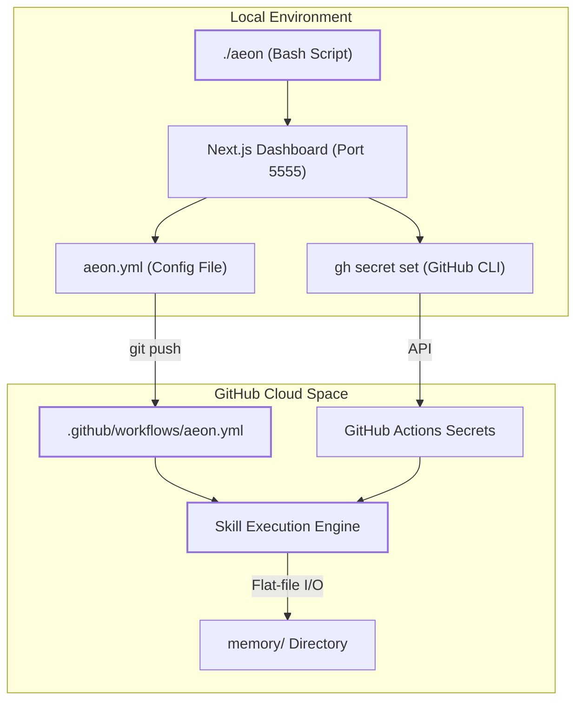
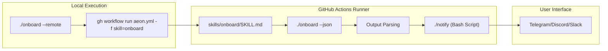

<!-- source: DeepWiki mcp.deepwiki.com · repo aaronjmars/aeon · page 1.1 Getting Started & Onboarding · fetched 2026-10-27 -->

# Getting Started & Onboarding

<details>
<summary>Relevant source files</summary>

The following files were used as context for generating this wiki page:

- [README.md](README.md)
- [aeon](aeon)
- [aeon.yml](aeon.yml)
- [dashboard/app/api/auth/route.ts](dashboard/app/api/auth/route.ts)
- [dashboard/package-lock.json](dashboard/package-lock.json)
- [dashboard/package.json](dashboard/package.json)
- [generate-skills-json](generate-skills-json)
- [onboard](onboard)
- [scripts/sync-upstream.sh](scripts/sync-upstream.sh)
- [skills/auto-workflow/SKILL.md](skills/auto-workflow/SKILL.md)
- [skills/contributor-reward/SKILL.md](skills/contributor-reward/SKILL.md)
- [skills/onboard/SKILL.md](skills/onboard/SKILL.md)
- [skills/treasury-info/SKILL.md](skills/treasury-info/SKILL.md)

</details>


This guide provides a technical walkthrough for deploying your own instance of AEON. AEON is designed as a **zero-infrastructure** autonomous agent framework that runs entirely within GitHub Actions, utilizing a flat-file memory system for persistence across ephemeral execution environments [README.md:40-43]().

## Deployment Model: Zero Infrastructure

AEON operates on a "push-to-deploy" model. The local dashboard acts as a configuration engine that commits changes to your repository, which then triggers the autonomous execution engine in GitHub Actions.

### Data Flow: Configuration to Execution

The following diagram illustrates how a user transitions from local setup to autonomous cloud execution.

**System Transition: Local Configuration to GitHub Actions Execution**

**Sources:** [aeon:1-43](), [README.md:55-68](), [aeon.yml:1-7]()

---

## Step 1: Repository Initialization

To begin, fork the AEON repository and clone it locally. AEON requires `node`, `npm`, and the GitHub CLI (`gh`) to be installed and authenticated on your machine [onboard:95-104]().

```bash
git clone https://github.com/your-username/aeon
cd aeon
./aeon
```

The `./aeon` script initializes the Next.js dashboard by installing dependencies and launching the development server on port 5555 [aeon:7-43]().

**Sources:** [README.md:55-58](), [aeon:1-43]()

---

## Step 2: Authentication & Secrets

AEON requires an LLM provider to function. You can provide either a standard API key or an OAuth token from a Claude Pro/Max subscription [README.md:99-105]().

### Authentication Logic
The dashboard uses the `gh` CLI to securely inject these secrets into your GitHub repository settings [dashboard/app/api/auth/route.ts:45-51]().

| Secret Name | Purpose | Source |
| :--- | :--- | :--- |
| `ANTHROPIC_API_KEY` | Direct API access | [console.anthropic.com](https://console.anthropic.com) |
| `CLAUDE_CODE_OAUTH_TOKEN` | Claude Pro/Max access | `claude setup-token` |
| `BANKR_LLM_KEY` | Optional gateway for cheaper Opus | [bankr.bot/api](https://bankr.bot/api) |

**Sources:** [README.md:99-118](), [dashboard/app/api/auth/route.ts:40-51]()

---

## Step 3: Skill Configuration (`aeon.yml`)

The `aeon.yml` file is the central manifest for your agent's behavior. Each skill is configured as an object within the `skills` map [aeon.yml:7-110]().

### Configuration Schema
A typical skill entry includes:
*   `enabled`: Boolean toggle for the skill [aeon.yml:3]().
*   `schedule`: A standard cron string for unattended execution [aeon.yml:9]().
*   `var`: A skill-specific parameter (e.g., a search query or a GitHub repo slug) [aeon.yml:4]().
*   `model`: Override for the default LLM (e.g., using `claude-sonnet-4-6` for cost efficiency) [aeon.yml:5]().

**Sources:** [aeon.yml:1-110]()

---

## Step 4: The Onboard Validator

The `./onboard` utility is a diagnostic tool that verifies the integrity of your fork. It checks for:
1.  **Workflow Integrity**: Ensures `.github/workflows/` contains necessary YAML files [onboard:118-125]().
2.  **Configuration**: Validates that `aeon.yml` is present and has at least one skill enabled [onboard:127-142]().
3.  **Memory Permissions**: Confirms the `memory/` directory is writable [onboard:144-159]().
4.  **Secrets**: Checks the remote repository for valid authentication keys [onboard:161-183]().

### The `onboard` Skill
Running `./onboard --remote` triggers the `onboard` skill inside GitHub Actions [onboard:12](). This skill executes the same logic in the cloud environment and sends a formatted checklist to your configured notification channel (Telegram, Slack, or Discord) [skills/onboard/SKILL.md:10-18]().

**Onboarding Logic: Local CLI to Remote Notification**

**Sources:** [onboard:1-20](), [skills/onboard/SKILL.md:19-88]()

---

## Step 5: Maintenance & Upstream Sync

As the AEON framework evolves, you can pull new skills and updates from the upstream repository.

### `generate-skills-json`
This script parses the `SKILL.md` files across the `skills/` directory to rebuild `skills.json`, which acts as the local registry for the dashboard [generate-skills-json:4-13]().

### `sync-upstream.sh`
This utility compares your local `skills.json` against the upstream version at `aaronjmars/aeon`. It identifies SHA mismatches and allows for interactive or automated updates of individual skills [scripts/sync-upstream.sh:4-10]().

**Sources:** [generate-skills-json:1-140](), [scripts/sync-upstream.sh:1-154]()

---

