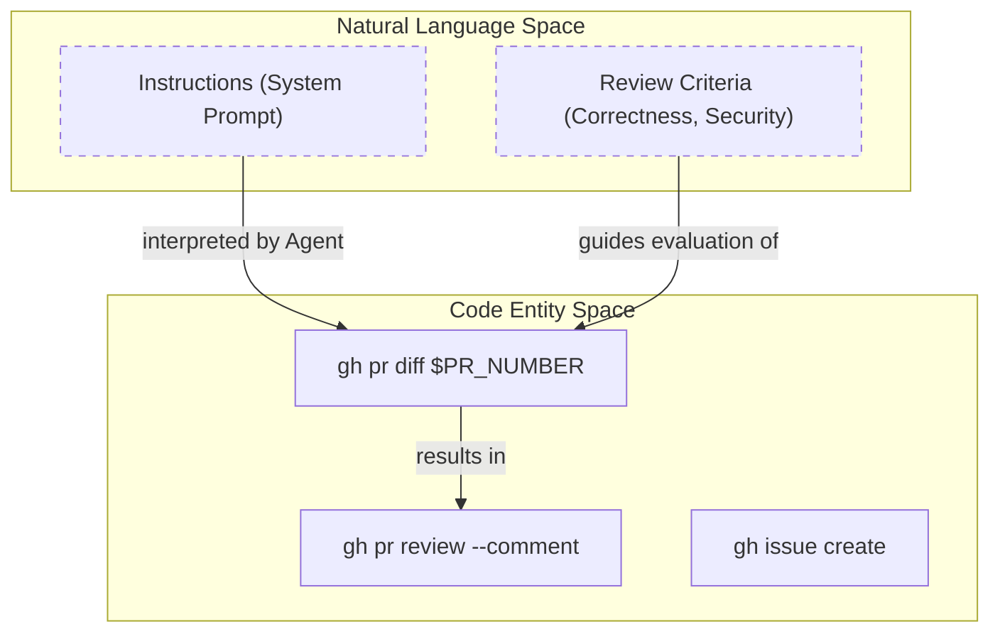
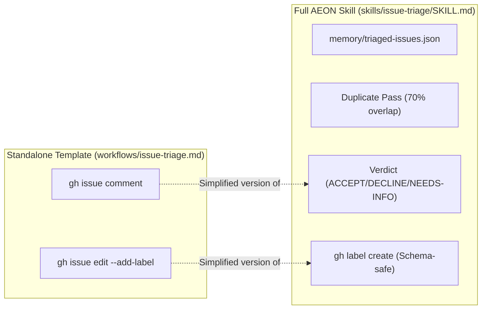

<!-- source: DeepWiki mcp.deepwiki.com · repo aaronjmars/aeon · page 10 Workflow Templates · fetched 2026-10-27 -->

# Workflow Templates

Relevant source files

The following files were used as context for generating this wiki page:

- [README.md](README.md)
- [aeon.yml](aeon.yml)
- [skills/changelog/SKILL.md](skills/changelog/SKILL.md)
- [skills/code-health/SKILL.md](skills/code-health/SKILL.md)
- [skills/contributor-reward/SKILL.md](skills/contributor-reward/SKILL.md)
- [skills/github-monitor/SKILL.md](skills/github-monitor/SKILL.md)
- [skills/issue-triage/SKILL.md](skills/issue-triage/SKILL.md)
- [skills/pr-review/SKILL.md](skills/pr-review/SKILL.md)
- [workflows/README.md](workflows/README.md)
- [workflows/changelog.md](workflows/changelog.md)
- [workflows/code-health.md](workflows/code-health.md)
- [workflows/issue-triage.md](workflows/issue-triage.md)
- [workflows/pr-review.md](workflows/pr-review.md)
- [workflows/security-digest.md](workflows/security-digest.md)

The `workflows/` directory contains standalone GitHub Agentic Workflow Markdown templates. These templates allow any repository to leverage AEON's specialized developer skills—such as automated PR reviews, issue triage, and changelog generation—without requiring a full fork of the AEON framework [README.md:1-18]().

These templates are designed for "zero-infrastructure" deployment, utilizing GitHub Actions and the GitHub CLI (`gh`) to perform autonomous tasks [README.md:40-42]().

## Overview of Standalone Workflows

Unlike the core AEON skills that run within a managed execution loop, these templates are self-contained Markdown files. They provide high-level instructions and specific `gh` CLI commands that a GitHub Agent (like Claude Code) can interpret and execute within a standard GitHub Action runner.

| Template | Purpose | Primary Trigger |
|----------|---------|-----------------|
| `issue-triage.md` | Automatically labels and acknowledges new issues. | Issue Opened [workflows/issue-triage.md:7]() |
| `pr-review.md` | Provides code review feedback on pull requests. | PR Opened/Sync [workflows/pr-review.md:7]() |
| `changelog.md` | Generates weekly summaries of recent commits. | Schedule (Monday) [workflows/changelog.md:7]() |
| `security-digest.md` | Monitors vulnerabilities in project dependencies. | Schedule (Daily) [workflows/security-digest.md:7]() |
| `code-health.md` | Audits technical debt, TODOs, and test coverage. | Schedule (Friday) [workflows/code-health.md:7]() |

**Sources:** [workflows/issue-triage.md:1-8](), [workflows/pr-review.md:1-8](), [workflows/changelog.md:1-8](), [workflows/security-digest.md:1-8](), [workflows/code-health.md:1-8]()

## From Natural Language to GitHub Actions

The templates bridge the gap between high-level human instructions and the `gh` CLI operations required to manipulate repository state.

### Template Execution Logic
The following diagram illustrates how a template like `pr-review.md` translates intent into repository actions.

**Sources:** [workflows/pr-review.md:11-34](), [workflows/issue-triage.md:11-40]()

## Template vs. Full AEON Skill

While these templates are standalone, they are lightweight versions of the full AEON skills. The full skills (located in `skills/`) include advanced features like persistent memory, deduplication across runs, and complex logic gates that are not present in the Markdown templates.

### Comparison: Issue Triage
The standalone template focuses on immediate labeling, whereas the full skill utilizes a "Decision-First" verdict system and memory of past triages.

**Sources:** [workflows/issue-triage.md:13-40](), [skills/issue-triage/SKILL.md:15-23](), [skills/issue-triage/SKILL.md:70-84](), [skills/issue-triage/SKILL.md:102-129]()

## Implementation Details

For a detailed breakdown of each template's specific logic, configuration options, and how to customize them for your project, see the child page:

- **[Available Templates & Customization](#10.1)** — Detailed guide to each workflow template: trigger configuration, criteria customization, adding project context, and the relationship between templates and their full AEON skill counterparts.

**Sources:** [README.md:74-82](), [aeon.yml:19-22](), [aeon.yml:71-73]()

---

