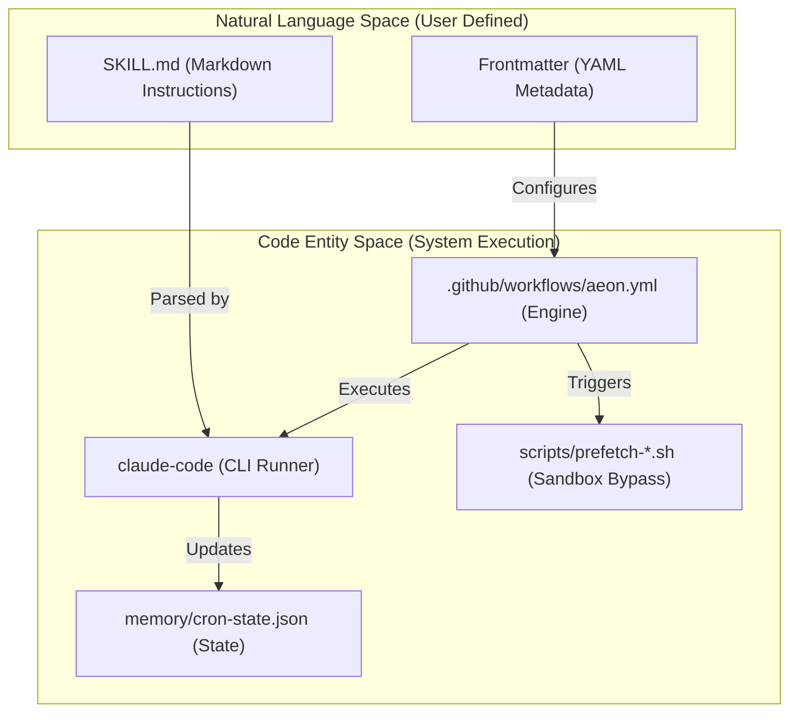
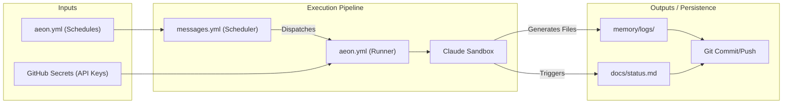

<!-- source: DeepWiki mcp.deepwiki.com · repo aaronjmars/aeon · page 11 Glossary · fetched 2026-10-27 -->

# Glossary

Relevant source files

The following files were used as context for generating this wiki page:

- [.github/workflows/aeon.yml](.github/workflows/aeon.yml)
- [.github/workflows/chain-runner.yml](.github/workflows/chain-runner.yml)
- [.github/workflows/messages.yml](.github/workflows/messages.yml)
- [.gitignore](.gitignore)
- [.outputs/.gitkeep](.outputs/.gitkeep)
- [CLAUDE.md](CLAUDE.md)
- [README.md](README.md)
- [a2a-server/.gitignore](a2a-server/.gitignore)
- [a2a-server/package.json](a2a-server/package.json)
- [a2a-server/src/index.ts](a2a-server/src/index.ts)
- [a2a-server/tsconfig.json](a2a-server/tsconfig.json)
- [add-a2a](add-a2a)
- [add-mcp](add-mcp)
- [add-skill](add-skill)
- [aeon.yml](aeon.yml)
- [dashboard/app/api/runs/[id]/logs/route.ts](dashboard/app/api/runs/[id]/logs/route.ts)
- [dashboard/app/api/secrets/route.ts](dashboard/app/api/secrets/route.ts)
- [dashboard/app/api/upload/route.ts](dashboard/app/api/upload/route.ts)
- [dashboard/app/page.tsx](dashboard/app/page.tsx)
- [dashboard/next-env.d.ts](dashboard/next-env.d.ts)
- [docs/_config.yml](docs/_config.yml)
- [docs/status.md](docs/status.md)
- [export-skill](export-skill)
- [generate-skills-json](generate-skills-json)
- [mcp-server/package.json](mcp-server/package.json)
- [mcp-server/src/index.ts](mcp-server/src/index.ts)
- [mcp-server/tsconfig.json](mcp-server/tsconfig.json)
- [memory/MEMORY.md](memory/MEMORY.md)
- [onboard](onboard)
- [scripts/postprocess-farcaster.sh](scripts/postprocess-farcaster.sh)
- [scripts/sync-upstream.sh](scripts/sync-upstream.sh)
- [skills.json](skills.json)
- [skills/article/SKILL.md](skills/article/SKILL.md)
- [skills/auto-workflow/SKILL.md](skills/auto-workflow/SKILL.md)
- [skills/contributor-reward/SKILL.md](skills/contributor-reward/SKILL.md)
- [skills/daily-routine/SKILL.md](skills/daily-routine/SKILL.md)
- [skills/defi-overview/SKILL.md](skills/defi-overview/SKILL.md)
- [skills/digest/SKILL.md](skills/digest/SKILL.md)
- [skills/distribute-tokens/SKILL.md](skills/distribute-tokens/SKILL.md)
- [skills/fetch-tweets/SKILL.md](skills/fetch-tweets/SKILL.md)
- [skills/fork-contributor-leaderboard/SKILL.md](skills/fork-contributor-leaderboard/SKILL.md)
- [skills/hacker-news-digest/SKILL.md](skills/hacker-news-digest/SKILL.md)
- [skills/heartbeat/SKILL.md](skills/heartbeat/SKILL.md)
- [skills/list-digest/SKILL.md](skills/list-digest/SKILL.md)
- [skills/morning-brief/SKILL.md](skills/morning-brief/SKILL.md)
- [skills/onboard/SKILL.md](skills/onboard/SKILL.md)
- [skills/refresh-x/SKILL.md](skills/refresh-x/SKILL.md)
- [skills/skill-analytics/SKILL.md](skills/skill-analytics/SKILL.md)
- [skills/skill-leaderboard/SKILL.md](skills/skill-leaderboard/SKILL.md)
- [skills/skill-update-check/SKILL.md](skills/skill-update-check/SKILL.md)
- [skills/star-milestone/SKILL.md](skills/star-milestone/SKILL.md)
- [skills/syndicate-article/SKILL.md](skills/syndicate-article/SKILL.md)
- [skills/treasury-info/SKILL.md](skills/treasury-info/SKILL.md)

This glossary provides technical definitions and implementation details for the core terminology, domain concepts, and architectural patterns used within the AEON framework. It serves as a reference for onboarding engineers to understand how natural language instructions in `SKILL.md` files map to the underlying GitHub Actions execution engine and state management.

## Core Framework Concepts

### Skill
The fundamental unit of autonomy in AEON. A skill is a directory under `skills/` containing a `SKILL.md` file. It defines a specific capability (e.g., `pr-review`, `token-report`) using a combination of Markdown-based instructions for the LLM and metadata in frontmatter.
*   **Implementation**: Skills are executed by the `aeon.yml` workflow using the `claude-code` CLI.
*   **Definition**: [skills.json:14-123]()
*   **Frontmatter**: Contains `name`, `description`, `schedule`, and `var`. [skills/heartbeat/SKILL.md:1-6]()

### Var
A dynamic parameter passed to a skill at runtime to focus its execution. It is defined in the skill's frontmatter and can be overridden via `aeon.yml` or the dashboard.
*   **Usage**: Accessed inside `SKILL.md` as `${var}`. [skills/heartbeat/SKILL.md:7-9]()
*   **Code Pointer**: Passed as an input to the workflow. [.github/workflows/aeon.yml:26-29]()

### Soul
The identity and personality layer of the agent. It governs the "voice" of all content-generating skills (articles, tweets, digests).
*   **Location**: Managed via `SOUL.md` and `STYLE.md` in the `soul/` directory.
*   **Logic**: Referenced by skills to ensure consistency across different communication channels.

### Chain (Skill Chaining)
A pattern where the output of one skill serves as the input or context for a subsequent skill.
*   **Implementation**: Controlled via the `chain_context_file` input in the execution workflow. [.github/workflows/aeon.yml:30-33]()

---

## Execution & State Terminology

### Execution Engine
The combination of GitHub Actions workflows that manage the lifecycle of a skill run, including environment setup, secret validation, and the final commit of generated artifacts.
*   **Main Workflow**: `.github/workflows/aeon.yml` [.github/workflows/aeon.yml:1-100]()
*   **Scheduler**: `.github/workflows/messages.yml` [.github/workflows/messages.yml:1-40]()

### Flat-File Memory
AEON's persistent state mechanism. Since GitHub Actions runners are ephemeral, state is persisted by committing JSON and Markdown files back to the repository under the `memory/` directory.
*   **Key File**: `memory/cron-state.json` tracks the health and last run time of every skill. [skills/heartbeat/SKILL.md:17-34]()
*   **Index**: `memory/MEMORY.md` serves as the high-level summary of agent knowledge. [memory/MEMORY.md:1-26]()

### Exit Taxonomy
A structured classification system used by the `skill-analytics` skill to categorize the outcome of skill runs (e.g., `success`, `failed`, `stuck`).
*   **Implementation**: The scheduler reads these statuses from `cron-state.json` to decide on retries. [.github/workflows/messages.yml:149-160]()

### Reactive Trigger
A mechanism that allows AEON to respond to external events (like a GitHub issue being labeled or a Telegram message) rather than relying solely on cron schedules.
*   **Code Pointer**: Handled via `workflow_dispatch` or `repository_dispatch` in the messaging workflow. [.github/workflows/messages.yml:17-18]()

---

## Technical Mapping Diagrams

### Diagram 1: Natural Language to Code Entity Mapping
This diagram shows how a user-defined "Skill" in Markdown is transformed into an executable process.

**Sources**: [.github/workflows/aeon.yml:119-122](), [skills/heartbeat/SKILL.md:17-34](), [.github/workflows/aeon.yml:160-180]()

### Diagram 2: Data Flow of a Skill Execution
This diagram bridges the conceptual "Skill Run" to the actual file operations and GitHub API calls.

**Sources**: [.github/workflows/messages.yml:52-96](), [.github/workflows/aeon.yml:123-158](), [skills/heartbeat/SKILL.md:71-74]()

---

## Infrastructure & Tooling

| Term | Definition | Code Pointer |
| :--- | :--- | :--- |
| **Prefetch Pattern** | Scripts that run outside the Claude sandbox to fetch data that Claude cannot access directly due to network restrictions. | [.github/workflows/aeon.yml:160-180]() |
| **Skill Registry** | The `skills.json` file, generated from all `SKILL.md` files, used by the dashboard and CLI for discovery. | [generate-skills-json:14-23]() |
| **MCP Server** | Model Context Protocol server allowing Claude Desktop to use AEON skills as tools. | [mcp-server/src/index.ts:1-20]() |
| **A2A Gateway** | Agent-to-Agent protocol server enabling AEON instances to communicate via JSON-RPC. | [a2a-server/src/index.ts:1-30]() |
| **Heartbeat** | A meta-skill that monitors the health of the entire fleet and updates the public status page. | [skills/heartbeat/SKILL.md:13-42]() |

### System Definitions Table

| Symbol / Constant | Role | Location |
| :--- | :--- | :--- |
| `BUILTIN_SECRETS` | List of standard API keys and tokens AEON recognizes. | [dashboard/app/api/secrets/route.ts:4-25]() |
| `STATE_FILE` | Path to the authoritative JSON file for skill execution history. | [.github/workflows/messages.yml:98]() |
| `SKILLS_DIR` | Root directory for all modular agent capabilities. | [generate-skills-json:15]() |
| `cron_match` | Bash function used to evaluate if a skill should run based on current time. | [.github/workflows/messages.yml:68-95]() |

**Sources**: [dashboard/app/api/secrets/route.ts:4-25](), [.github/workflows/messages.yml:68-98](), [generate-skills-json:15]()