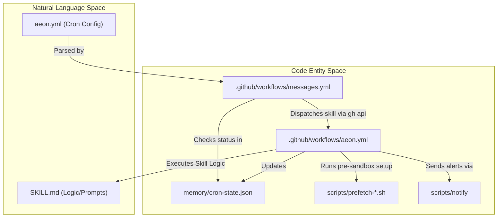
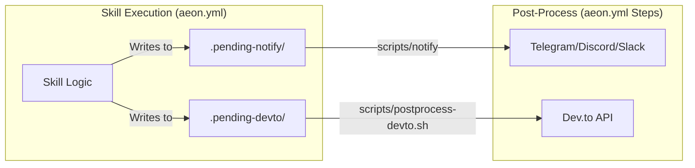

<!-- source: DeepWiki mcp.deepwiki.com · repo aaronjmars/aeon · page 2 Execution Engine & Orchestration · fetched 2026-10-27 -->

# Execution Engine & Orchestration

Relevant source files

The following files were used as context for generating this wiki page:

- [.github/workflows/aeon.yml](.github/workflows/aeon.yml)
- [.github/workflows/messages.yml](.github/workflows/messages.yml)
- [README.md](README.md)
- [aeon.yml](aeon.yml)
- [skills/contributor-reward/SKILL.md](skills/contributor-reward/SKILL.md)
- [skills/skill-analytics/SKILL.md](skills/skill-analytics/SKILL.md)

AEON operates as a "zero-infrastructure" autonomous agent by leveraging GitHub Actions as its primary execution environment. The system is designed to run unattended, using a dual-workflow architecture to handle both scheduled tasks and reactive event processing. State is persisted across ephemeral runs by committing flat-file updates back to the repository's `memory/` directory.

## System Architecture

The orchestration layer bridges the gap between natural language task definitions (Skills) and the underlying GitHub Actions infrastructure.

### Execution Flow Diagram

The following diagram illustrates how the `Messages & Scheduler` workflow triggers the `Aeon` skill execution engine.

**Workflow Dispatch & Lifecycle**

Sources: [.github/workflows/messages.yml:105-138](), [.github/workflows/aeon.yml:160-180](), [aeon.yml:7-120]()

## Core Workflows

The engine is split into two specialized GitHub Actions workflows that manage the lifecycle of every skill.

### 1. The Scheduler (`messages.yml`)
This workflow acts as the "heartbeat" of the system. It runs every 5 minutes to evaluate which skills are due for execution based on the cron expressions defined in `aeon.yml`.

*   **Cron Matching:** Implements a custom Bash-based cron matcher to support standard syntax, ranges, and steps [ .github/workflows/messages.yml:68-95]().
*   **State Awareness:** Consults `memory/cron-state.json` to avoid redundant dispatches and implement a 30-minute cooldown for retrying failed skills [.github/workflows/messages.yml:149-160]().
*   **Message Polling:** Also handles incoming messages from Telegram, Discord, or Slack to trigger skills reactively [.github/workflows/messages.yml:17-18]().

### 2. The Execution Engine (`aeon.yml`)
This is the primary worker workflow that runs the actual skill logic. It utilizes `claude-code` to interpret and execute the instructions found in a skill's `SKILL.md` file.

*   **Sandbox & Prefetch:** Because the LLM runs in a restricted sandbox, the engine executes `scripts/prefetch-*.sh` before starting the LLM to cache external data (like X/Grok API results) into `.xai-cache/` [.github/workflows/aeon.yml:160-180]().
*   **Secret Validation:** Scans `SKILL.md` for required API keys and warns if they are missing from GitHub Secrets before execution begins [.github/workflows/aeon.yml:123-158]().
*   **Commit Loop:** Automatically commits changes to `memory/`, `articles/`, and `docs/` at the end of every run, using a conflict-resolution loop to handle parallel execution [.github/workflows/aeon.yml:218-245]().

For details, see [GitHub Actions Workflows](#2.1).

## Scheduling & Chaining Logic

Skills are not just isolated scripts; they can be sequenced into pipelines.

| Feature | Mechanism |
| :--- | :--- |
| **Cron Scheduling** | Defined per-skill in `aeon.yml` using standard 5-field syntax [.github/workflows/messages.yml:163-174](). |
| **Reactive Triggers** | Skills marked `schedule: "reactive"` are skipped by the cron and only fire on specific events [.github/workflows/messages.yml:147](). |
| **Skill Chaining** | Outputs from one skill (e.g., `article`) can be passed to another (e.g., `syndicate-article`) using `chain_context_file` [.github/workflows/aeon.yml:30-33](). |

For details, see [Skill Scheduling & Chaining](#2.2).

## Notification & Post-Processing

The execution engine follows a "deferred execution" pattern for high-privilege or sandbox-restricted actions.

**Notification & Distribution Pipeline**

Sources: [.github/workflows/aeon.yml:191-205](), [skills/contributor-reward/SKILL.md:10-16]()

*   **Buffering:** Skills write notification payloads to the `.pending-notify/` directory.
*   **The `./notify` Script:** A standalone utility that reads these buffers and delivers them to configured channels (Telegram, Discord, Slack, SendGrid) [.github/workflows/aeon.yml:205-215]().
*   **Deferred APIs:** Actions that require complex API interactions (like posting to Farcaster or Replicate) are handled by `postprocess-*.sh` scripts that run after the LLM has finished its reasoning phase.

For details, see [Notification & Post-Processing Pipeline](#2.3).

## Observability & Self-Healing

The orchestration layer includes meta-skills that monitor the engine itself:
*   **`heartbeat`**: Monitors `cron-state.json` and updates the public status page at `docs/status.md` [README.md:81]().
*   **`skill-analytics`**: Generates a weekly fleet-level report on skill performance, exit taxonomies (e.g., `SKIP_UNCHANGED`), and failure streaks [skills/skill-analytics/SKILL.md:10-14]().

Sources: [README.md:12](), [skills/skill-analytics/SKILL.md:72-87]()

---

