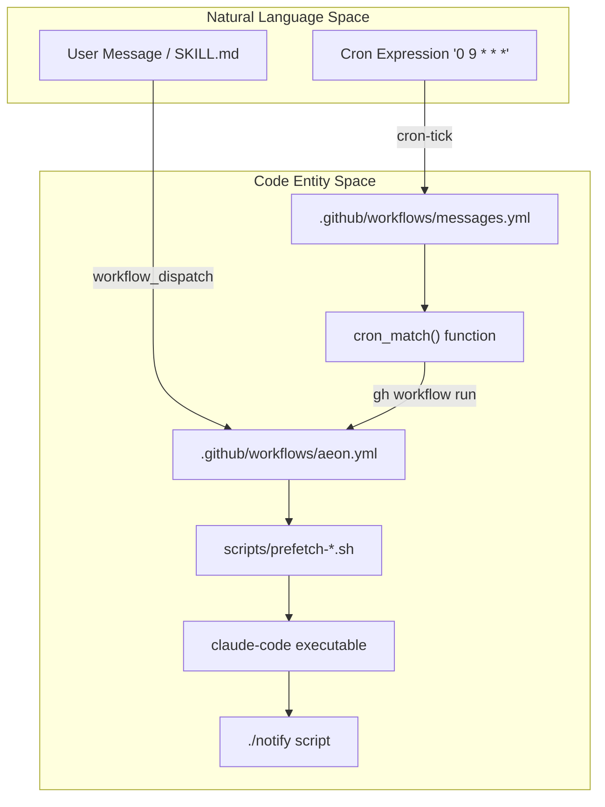
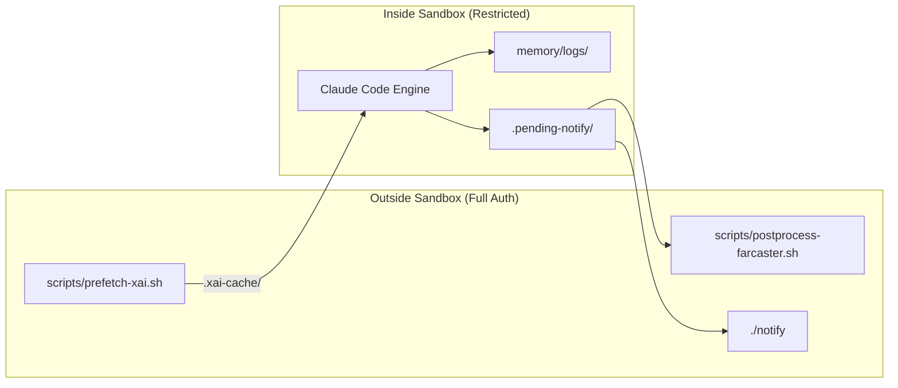

<!-- source: DeepWiki mcp.deepwiki.com · repo aaronjmars/aeon · page 2.1 GitHub Actions Workflows · fetched 2026-10-27 -->

# GitHub Actions Workflows

Relevant source files

The following files were used as context for generating this wiki page:

- [.github/workflows/aeon.yml](.github/workflows/aeon.yml)
- [.github/workflows/chain-runner.yml](.github/workflows/chain-runner.yml)
- [.github/workflows/messages.yml](.github/workflows/messages.yml)
- [.outputs/.gitkeep](.outputs/.gitkeep)
- [CLAUDE.md](CLAUDE.md)
- [skills/skill-analytics/SKILL.md](skills/skill-analytics/SKILL.md)

This page provides a deep dive into the two primary orchestration engines of AEON: the **Skill Execution Engine** (`aeon.yml`) and the **Scheduler/Message Poller** (`messages.yml`). These workflows manage the lifecycle of autonomous skills, handle secure data pre-fetching, and maintain system state through a conflict-resolution commit loop.

## 1. Skill Execution Engine (aeon.yml)

The `aeon.yml` workflow is the primary runtime for AEON skills. It provides the environment for Claude Code to execute logic defined in `SKILL.md` files.

### Trigger Types
The workflow supports three trigger mechanisms:
*   **`workflow_dispatch`**: Manual execution via the GitHub UI or API, allowing overrides for `skill`, `model`, and `var` [`.github/workflows/aeon.yml`:5-33]().
*   **`workflow_call`**: Reusable entry point for **Skill Chains** and other workflows [`.github/workflows/aeon.yml`:34-51]().
*   **`issues` (labeled `ai-build`)**: Reactive trigger that treats the issue body as a "feature" request [`.github/workflows/aeon.yml`:52-53](), [`.github/workflows/aeon.yml`:87-89]().

### Execution Lifecycle
1.  **Environment Setup**: Configures Node.js 22 and installs `@anthropic-ai/claude-code` [`.github/workflows/aeon.yml`:113-122]().
2.  **Secret Validation**: Scans the target `SKILL.md` for required environment variables (e.g., `*_API_KEY`, `*_TOKEN`) and issues warnings if they are missing from GitHub Secrets [`.github/workflows/aeon.yml`:123-158]().
3.  **Pre-fetch Phase**: Executes all `scripts/prefetch-*.sh` scripts. This allows fetching data from authenticated APIs (like X/Twitter via `prefetch-xai.sh`) outside the restricted Claude sandbox [`.github/workflows/aeon.yml`:160-181]().
4.  **The Run**: Invokes Claude Code with the skill's instructions. Claude is granted access to high-level identity via `SOUL.md` and `CLAUDE.md` [`.github/workflows/aeon.yml`:182-226]().
5.  **Post-processing**: Consumes `.pending-*` files created by Claude to perform authenticated side effects (e.g., posting to Farcaster or Dev.to) [`.github/workflows/aeon.yml`:233-254]().
6.  **Persistence**: Commits all changes (logs, memory updates, articles) back to the repository using a conflict-resolution loop [`.github/workflows/aeon.yml`:265-298]().

### Conflict-Resolution Commit Loop
To handle parallel workflow runs, the "Finalize" step uses a `git pull --rebase` strategy within a loop. If a push fails due to remote changes, the workflow retries up to 5 times [`.github/workflows/aeon.yml`:265-298]().

**Sources:** [`.github/workflows/aeon.yml`:1-298](), [`CLAUDE.md`:91-103]()

---

## 2. Scheduler & Message Poller (messages.yml)

The `messages.yml` workflow acts as the system's "heartbeat," running every 5 minutes to dispatch scheduled skills and poll for inbound communications.

### Cron Matching & Dispatch
The workflow implements a custom Bash-based cron parser that supports standard syntax (e.g., `*/5`, `1-10/2`, `0,15,30,45`) [`.github/workflows/messages.yml`:68-95]().
*   **State Awareness**: It reads `memory/cron-state.json` to track the `last_dispatch` and `last_status` of every skill [`.github/workflows/messages.yml`:149-154]().
*   **Failure Retries**: Skills that failed are automatically retried after a 30-minute cooldown [`.github/workflows/messages.yml`:155-160]().
*   **Catch-up Logic**: If GitHub Actions misses a cron window, the scheduler checks the previous hour to ensure critical skills eventually fire [`.github/workflows/messages.yml`:175-188]().

### Inbound Messaging
The workflow polls external platforms for user commands:
*   **Telegram**: Uses offset-based polling via `TELEGRAM_BOT_TOKEN` [`.github/workflows/messages.yml`:254-282]().
*   **Discord/Slack**: Uses reaction-based acknowledgement (polling for specific emojis on messages) to prevent duplicate processing [`.github/workflows/messages.yml`:284-350]().

**Sources:** [`.github/workflows/messages.yml`:1-350]()

---

## 3. System Architecture Diagrams

### From Natural Language to Code Execution
This diagram illustrates how a manual trigger or a scheduled event translates into the execution of specific code entities.

Title: AEON Execution Path

**Sources:** [`.github/workflows/aeon.yml`:5-10](), [`.github/workflows/messages.yml`:5-19](), [`.github/workflows/messages.yml`:68-70](), [`.github/workflows/aeon.yml`:119-121](), [`.github/workflows/aeon.yml`:175-180]()

### Sandbox & Side-Effect Patterns
Because the Claude Code sandbox restricts network access for security, AEON uses a "Pre/Post" pattern to interact with the outside world.

Title: Sandbox Mitigation Flow

**Sources:** [`CLAUDE.md`:91-103](), [`.github/workflows/aeon.yml`:160-181](), [`.github/workflows/aeon.yml`:233-254]()

---

## 4. Workflow Constraints & Security

### Sandbox Constraints
Claude Code operates within a sandbox that blocks environment variable expansion in outbound `curl` headers to prevent secret exfiltration [Reference: `CLAUDE.md`:97-101](). AEON bypasses this using:
1.  **Pre-fetch Scripts**: Run before the sandbox starts, caching data in local files (e.g., `.xai-cache/`) [`.github/workflows/aeon.yml`:168-180]().
2.  **WebFetch Fallback**: Uses Claude's internal `WebFetch` tool for unauthenticated public URL access [Reference: `CLAUDE.md`:95]().
3.  **Post-processing**: Claude writes JSON payloads to `.pending-{service}/` directories, which are then picked up by `postprocess-*.sh` scripts after the sandbox closes [`.github/workflows/aeon.yml`:233-254]().

### Secret Validation Logic
The `aeon.yml` workflow includes a validation step that greps `SKILL.md` for variable patterns. It distinguishes between:
*   **Mandatory Secrets**: Triggers a `::warning::` if missing [`.github/workflows/aeon.yml`:157]().
*   **Optional Secrets**: Identified by keywords like "optional" or "falls back" in the skill description; triggers a `::notice::` [`.github/workflows/aeon.yml`:148-156]().

| Secret Category | Examples | Handling |
| :--- | :--- | :--- |
| Core AI | `ANTHROPIC_API_KEY`, `BANKR_LLM_KEY` | Passed to Sandbox [`.github/workflows/aeon.yml`:186-188]() |
| Notifications | `TELEGRAM_BOT_TOKEN`, `DISCORD_WEBHOOK_URL` | Used in Post-processing [`.github/workflows/aeon.yml`:191-195]() |
| Data APIs | `XAI_API_KEY`, `ALCHEMY_API_KEY` | Used in Pre-fetch [`.github/workflows/aeon.yml`:126-128]() |

**Sources:** [`.github/workflows/aeon.yml`:123-158](), [`CLAUDE.md`:91-110]()

---

