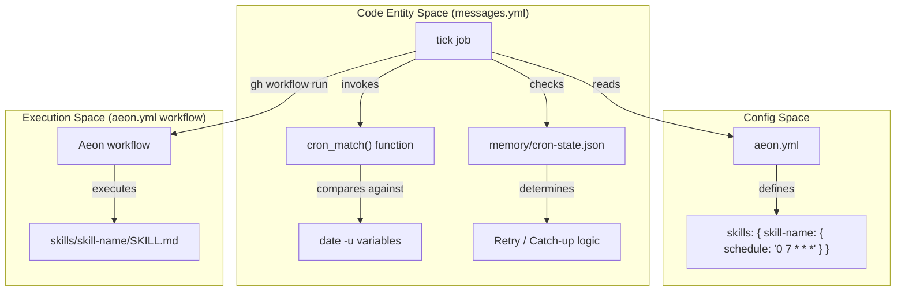
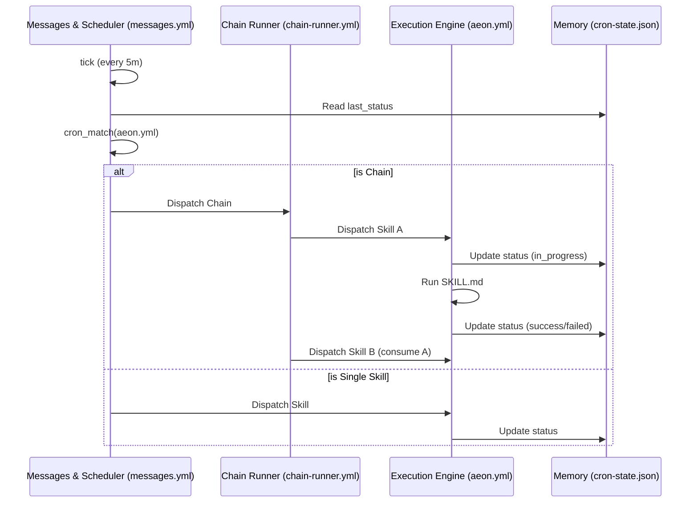

<!-- source: DeepWiki mcp.deepwiki.com · repo aaronjmars/aeon · page 2.2 Skill Scheduling & Chaining · fetched 2026-10-27 -->

# Skill Scheduling & Chaining

<details>
<summary>Relevant source files</summary>

The following files were used as context for generating this wiki page:

- [.github/workflows/aeon.yml](.github/workflows/aeon.yml)
- [.github/workflows/chain-runner.yml](.github/workflows/chain-runner.yml)
- [.github/workflows/messages.yml](.github/workflows/messages.yml)
- [.outputs/.gitkeep](.outputs/.gitkeep)
- [CLAUDE.md](CLAUDE.md)
- [README.md](README.md)
- [aeon.yml](aeon.yml)
- [skills/contributor-reward/SKILL.md](skills/contributor-reward/SKILL.md)
- [skills/skill-analytics/SKILL.md](skills/skill-analytics/SKILL.md)

</details>


AEON operates as an autonomous system by orchestrating over 90 modular skills through a sophisticated scheduling and dependency engine. Unlike interactive agents, AEON uses `aeon.yml` to define when skills run, how they react to external conditions, and how they pass data between sequential steps in a chain.

## Scheduling Architecture

The scheduling logic is primarily housed in the `Messages & Scheduler` workflow [`.github/workflows/messages.yml:1-2`](). This workflow runs on a 5-minute cron interval [`.github/workflows/messages.yml:6-6`]() to evaluate the state of the fleet.

### The Tick Cycle
When the scheduler "ticks," it performs the following sequence:
1.  **Environment Capture**: Records the current UTC time (Minute, Hour, Day, etc.) [`.github/workflows/messages.yml:56-62`]() to match against skill schedules.
2.  **State Loading**: Reads `memory/cron-state.json` to check the last run status and dispatch time for every skill [`.github/workflows/messages.yml:98-103`]() .
3.  **Config Parsing**: Scans `aeon.yml` to identify enabled skills and their associated cron strings or trigger types [`.github/workflows/messages.yml:109-138`]() .
4.  **Matching & Catch-up**:
    *   **Standard Match**: Uses `cron_match` to see if the current time fits the skill's schedule [`.github/workflows/messages.yml:68-95`]().
    *   **Retry Logic**: If a skill failed in its last attempt, it is automatically retried after a 30-minute cooldown [`.github/workflows/messages.yml:155-160`]().
    *   **Catch-up**: If GitHub Actions missed a window (e.g., due to platform delay), the scheduler checks the previous hour to ensure the skill fires [`.github/workflows/messages.yml:175-182`]().

### Scheduling Data Flow: Config to Execution
The following diagram illustrates how the `aeon.yml` configuration is transformed into active GitHub Action runs by the `Messages & Scheduler` workflow.

**Diagram: Schedule Dispatch Logic**

Sources: [`.github/workflows/messages.yml:52-185`](), [`.github/workflows/aeon.yml:4-33`]()

## Skill Chaining

Skill Chaining allows for complex multi-step workflows where the output of one or more skills serves as the context for a subsequent skill. This is configured in the `chains:` section of `aeon.yml` [`.github/workflows/chain-runner.yml:149-162`]().

### Execution Flow
Chains are managed by the `Chain Runner` [`.github/workflows/chain-runner.yml:1-2`]().
1.  **Parallel Execution**: Steps defined in a `parallel` block are dispatched simultaneously via `gh workflow run` [`.github/workflows/chain-runner.yml:46-75`]().
2.  **Output Persistence**: Each skill in the chain writes its result to `.outputs/{skill-name}.md` [`.github/workflows/chain-runner.yml:130-131`]().
3.  **Context Injection**: For steps using the `consume` keyword, the runner aggregates the specified prior outputs into a single `.outputs/.chain-context-{target}.md` file [`.github/workflows/chain-runner.yml:121-147`]().
4.  **Downstream Trigger**: The next skill is invoked with the `chain_context_file` input, allowing the LLM to read the results of its predecessors [`.github/workflows/aeon.yml:30-33`]().

### Chain Definition Example
```yaml
chains:
  research-pipeline:
    schedule: "0 14 * * *"
    on_error: fail-fast
    steps:
      - parallel: [hacker-news-digest, rss-digest]
      - skill: article
        consume: [hacker-news-digest, rss-digest]
```
Sources: [`CLAUDE.md:63-73`](), [`.github/workflows/chain-runner.yml:168-197`]()

## Reactive Triggers

Reactive triggers enable AEON to respond to events rather than time.
*   **Inbound Messages**: When a user sends a message via Telegram, Discord, or Slack, the `messages.yml` workflow is triggered via `repository_dispatch` [`.github/workflows/messages.yml:17-18`](). This allows AEON to "chat" and execute skills on demand.
*   **GitHub Events**: The system can react to repository labels (e.g., `ai-build`) to trigger the `feature` skill for autonomous coding [`.github/workflows/aeon.yml:71-89`]().
*   **Skill-to-Skill Triggers**: Skills can be configured with `schedule: "reactive"`. These do not run on a timer but are intended to be called by other skills or chains [`.github/workflows/messages.yml:147-147`]().

## Technical Implementation Details

### Key Files and Components

| Component | File Path | Role |
|:---|:---|:---|
| **Scheduler** | [`.github/workflows/messages.yml`]() | Polling, cron matching, and retries. |
| **Chain Runner** | [`.github/workflows/chain-runner.yml`]() | Sequential/Parallel step orchestration. |
| **Execution Engine** | [`.github/workflows/aeon.yml`]() | The core sandbox where `claude-code` runs skills. |
| **State Store** | `memory/cron-state.json` | Persists last run status and timestamps. |

### Lifecycle of a Scheduled Run
The transition from a cron trigger to a completed skill run involves several distinct layers of the AEON architecture.

**Diagram: Execution Lifecycle**

Sources: [`.github/workflows/messages.yml:140-185`](), [`.github/workflows/chain-runner.yml:36-118`](), [`.github/workflows/aeon.yml:182-205`]()

---

