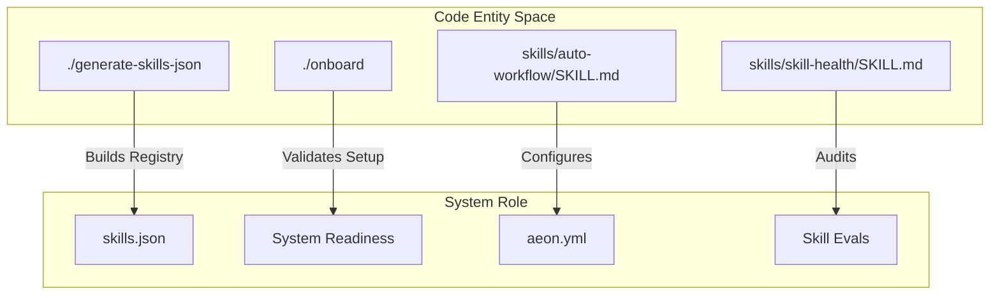

<!-- source: DeepWiki mcp.deepwiki.com · repo aaronjmars/aeon · page 3 Skills System · fetched 2026-10-27 -->

# Skills System

<details>
<summary>Relevant source files</summary>

The following files were used as context for generating this wiki page:

- [.gitignore](.gitignore)
- [add-skill](add-skill)
- [export-skill](export-skill)
- [generate-skills-json](generate-skills-json)
- [onboard](onboard)
- [scripts/postprocess-farcaster.sh](scripts/postprocess-farcaster.sh)
- [scripts/sync-upstream.sh](scripts/sync-upstream.sh)
- [skills.json](skills.json)
- [skills/auto-workflow/SKILL.md](skills/auto-workflow/SKILL.md)
- [skills/distribute-tokens/SKILL.md](skills/distribute-tokens/SKILL.md)
- [skills/onboard/SKILL.md](skills/onboard/SKILL.md)
- [skills/skill-update-check/SKILL.md](skills/skill-update-check/SKILL.md)
- [skills/star-milestone/SKILL.md](skills/star-milestone/SKILL.md)
- [skills/syndicate-article/SKILL.md](skills/syndicate-article/SKILL.md)
- [skills/treasury-info/SKILL.md](skills/treasury-info/SKILL.md)

</details>


The **Skills System** is AEON's modular execution framework, comprising over 90 specialized agents ("skills") that perform research, code auditing, market analysis, and social media management. Each skill is a self-contained unit of logic defined by a `SKILL.md` file, designed to run within the ephemeral environment of GitHub Actions.

The system is built on a "pull-based" architecture where skills are discovered via a central registry, installed into a fork using the `add-skill` utility, and managed through a versioned supply chain (`skills.lock`).

### System Overview

```mermaid
graph TD
    subgraph "Registry & Discovery"
        A["SKILL.md (Source)"] -- "Compiler" --> B["skills.json (Manifest)"]
        B -- "Marketplace" --> C["Local Dashboard"]
    end

    subgraph "Installation & Lifecycle"
        D["./add-skill"] -- "Fetches" --> A
        D -- "Validates" --> E["skill-security-scan"]
        E -- "Records" --> F["skills.lock"]
        F -- "Monitors" --> G["skill-update-check"]
    end

    subgraph "Execution Space"
        H["aeon.yml (Schedule)"] --> I["Execution Engine"]
        I --> J["Skill Logic (SKILL.md)"]
        J -- "Persistence" --> K["memory/ (Flat-file DB)"]
    end

    "A" --> J
```
**Sources:** [generate-skills-json:4-12](), [add-skill:1-16](), [skills/skill-update-check/SKILL.md:1-7]()

---

### Skill Definition and Discovery

Every skill in AEON is defined by a `SKILL.md` file containing YAML frontmatter and a structured prompt or set of shell instructions. This format allows skills to be both human-readable and machine-executable.

*   **Frontmatter**: Defines the `name`, `description`, `category`, and default `var` for the skill [skills/skill-update-check/SKILL.md:1-7]().
*   **Manifest**: The `generate-skills-json` script crawls the `skills/` directory to build `skills.json`, a comprehensive manifest used by the Dashboard and installation tools [generate-skills-json:4-12]().
*   **Categories**: Skills are grouped into five primary domains: `research`, `dev`, `crypto`, `social`, and `productivity` [generate-skills-json:25-54]().

For a deep dive into how to create and manage these files, see **[Skill Definition & Lifecycle](#3.1)**.

---

### Skill Installation and Security

AEON uses a decentralized installation model. Users can pull skills from the official repository or any compatible third-party repository.

*   **Installer**: The `./add-skill` script handles fetching, extracting, and placing skill files in the local `skills/` directory [add-skill:190-233]().
*   **Security Scanning**: Before installation, untrusted skills are passed through `skill-security-scan` to detect dangerous patterns like `eval` or environment variable exfiltration [add-skill:206-221]().
*   **Supply Chain**: The `skills.lock` file tracks the origin and commit SHA of every imported skill, ensuring that updates are intentional and audited [add-skill:235-245]().

**Entity Mapping: Installation Logic**
```mermaid
graph LR
    subgraph "Code Entity Space"
        ADD["./add-skill"]
        SCAN["./skills/skill-security-scan/scan.sh"]
        LOCK["skills.lock"]
        UPCHECK["skills/skill-update-check/SKILL.md"]
    end

    subgraph "Natural Language Space"
        "Installation" --> ADD
        "Security Audit" --> SCAN
        "Pinning Versions" --> LOCK
        "Drift Detection" --> UPCHECK
    end
```
**Sources:** [add-skill:156-182](), [skills/skill-update-check/SKILL.md:18-30]()

---

### Skill Categories

The AEON ecosystem is categorized by the type of data processed and the output generated:

| Category | Purpose | Key Skills |
| :--- | :--- | :--- |
| **Research** | Information synthesis and curation | `digest`, `deep-research`, `rss-digest` |
| **Dev** | Repository monitoring and automation | `github-monitor`, `pr-review`, `code-health` |
| **Crypto** | On-chain analysis and treasury management | `token-report`, `treasury-info`, `distribute-tokens` |
| **Social** | Content creation and engagement | `write-tweet`, `syndicate-article`, `farcaster-digest` |
| **Productivity** | Personal briefings and goal tracking | `morning-brief`, `goal-tracker`, `heartbeat` |

*   **Research & Content**: Focuses on gathering signals from X, RSS, and Hacker News to produce publication-ready articles. For details, see **[Research & Content Skills](#3.2)**.
*   **Dev & GitHub**: Monitors code health and automates maintainer workflows. For details, see **[Dev & GitHub Skills](#3.3)**.
*   **Crypto & Markets**: Interfaces with APIs like Alchemy and Bankr to monitor wallets and distribute rewards. For details, see **[Crypto & Market Skills](#3.4)**.
*   **Social & Productivity**: Manages the agent's voice and handles daily recaps. For details, see **[Social & Productivity Skills](#3.5)**.

---

### Meta-Skills and Fleet Management

AEON includes "meta-skills" that manage the system itself. These skills allow AEON to self-configure and manage other instances of AEON.

*   **Auto-Workflow**: Analyzes a URL to suggest which skills should be enabled in `aeon.yml` [skills/auto-workflow/SKILL.md:10-18]().
*   **Onboarding**: Validates the fork's configuration and secrets via the `./onboard` utility [onboard:4-15]().
*   **Fleet Management**: Skills like `fork-fleet` and `spawn-instance` allow a central AEON instance to coordinate a network of worker forks.

For details on managing multiple instances, see **[Fleet & Instance Management Skills](#3.6)**.

---

### Skill Lifecycle Management

The system provides tools for the entire lifecycle of a skill, from creation to update:

*   **Creation**: `create-skill` generates new `SKILL.md` templates from a prompt [skills.json:135-145]().
*   **Update Tracking**: `skill-update-check` compares local skills against their upstream sources in `skills.lock` to identify security regressions or new features [skills/skill-update-check/SKILL.md:12-14]().
*   **Health Monitoring**: `heartbeat` and `skill-health` track execution success rates and latency [generate-skills-json:49-51]().

**Entity Mapping: Meta-Management**

**Sources:** [generate-skills-json:4-12](), [onboard:4-15](), [skills/auto-workflow/SKILL.md:41-42]()

---

