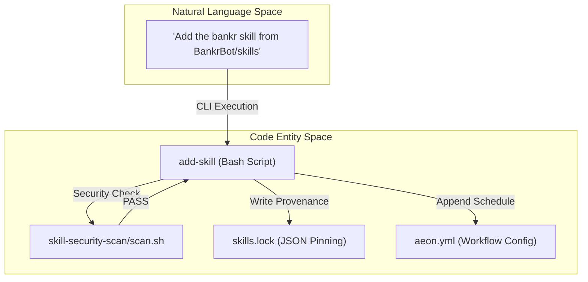
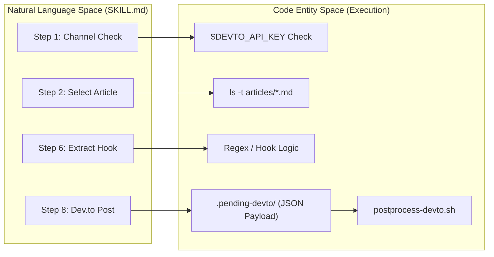

<!-- source: DeepWiki mcp.deepwiki.com · repo aaronjmars/aeon · page 3.1 Skill Definition & Lifecycle · fetched 2026-10-27 -->

# Skill Definition & Lifecycle

Relevant source files

The following files were used as context for generating this wiki page:

- [.gitignore](.gitignore)
- [add-skill](add-skill)
- [export-skill](export-skill)
- [generate-skills-json](generate-skills-json)
- [onboard](onboard)
- [scripts/postprocess-farcaster.sh](scripts/postprocess-farcaster.sh)
- [scripts/sync-upstream.sh](scripts/sync-upstream.sh)
- [skills.json](skills.json)
- [skills/auto-workflow/SKILL.md](skills/auto-workflow/SKILL.md)
- [skills/create-skill/SKILL.md](skills/create-skill/SKILL.md)
- [skills/distribute-tokens/SKILL.md](skills/distribute-tokens/SKILL.md)
- [skills/onboard/SKILL.md](skills/onboard/SKILL.md)
- [skills/search-skill/SKILL.md](skills/search-skill/SKILL.md)
- [skills/skill-update-check/SKILL.md](skills/skill-update-check/SKILL.md)
- [skills/star-milestone/SKILL.md](skills/star-milestone/SKILL.md)
- [skills/syndicate-article/SKILL.md](skills/syndicate-article/SKILL.md)
- [skills/treasury-info/SKILL.md](skills/treasury-info/SKILL.md)

AEON is a modular agentic system composed of over 90 specialized "skills." Each skill is a self-contained unit of logic defined by a Markdown-based specification. The system employs a standardized lifecycle for skill discovery, installation, execution, and supply-chain security.

## Anatomy of a SKILL.md

The `SKILL.md` file is the foundational entity of the AEON ecosystem. It serves as both the source of truth for the agent's logic and the manifest for the system's compiler.

### Frontmatter and Metadata
Each `SKILL.md` begins with a YAML frontmatter block that defines its identity and execution constraints:
*   **name**: The display name of the skill [skills/skill-update-check/SKILL.md:2-2]().
*   **description**: A single-sentence functional summary [skills/skill-update-check/SKILL.md:3-3]().
*   **var**: A default value for the skill's primary input variable [skills/skill-update-check/SKILL.md:4-4]().
*   **tags**: Categorization labels (e.g., `dev`, `crypto`, `research`) [skills/skill-update-check/SKILL.md:5-5]().
*   **cron**: The default execution schedule [skills/skill-update-check/SKILL.md:6-6]().

### Logic Gates and Variable Injection
Skills use a template-style injection for dynamic behavior. The `${var}` placeholder is used to pass runtime configuration, while `${today}` provides temporal context [skills/skill-update-check/SKILL.md:8-12](). Skills often implement "Exit Taxonomies" to handle various states (e.g., `SKILL_SKIP`, `SKILL_ERROR`, `SKILL_NO_GAP`) [skills/search-skill/SKILL.md:9-11]().

### Two-Phase Pattern: RESOLVE/EXECUTE
Complex skills, particularly those involving financial transactions or external state changes, follow a two-phase pattern to ensure idempotency and safety:
1.  **RESOLVE**: The skill validates configurations, checks balances, resolves handles (e.g., `@user` to `0x...`), and builds an execution plan [skills/distribute-tokens/SKILL.md:14-14]().
2.  **EXECUTE**: The skill performs the actions defined in the plan, persisting state after each successful step to survive mid-run crashes [skills/distribute-tokens/SKILL.md:15-15]().

**Sources:** [skills/skill-update-check/SKILL.md:1-12](), [skills/search-skill/SKILL.md:9-11](), [skills/distribute-tokens/SKILL.md:13-19]()

---

## Skill Registry and Compilation

AEON uses a centralized manifest to manage its vast library of skills.

### skills.json Registry
The `skills.json` file is a machine-readable index of all available skills in the repository. It includes metadata, categories, and the specific `add-skill` command required for installation [skills.json:1-25]().

### generate-skills-json Compiler
The `generate-skills-json` script is a build tool that crawls the `skills/` directory, parses every `SKILL.md`, and compiles the `skills.json` manifest [generate-skills-json:4-12]().

| Function | Description |
| :--- | :--- |
| `get_category()` | Maps a skill slug to one of five core categories (research, dev, crypto, social, productivity) [generate-skills-json:25-54](). |
| `get_schedule()` | Extracts the current cron schedule for a skill from `aeon.yml` [generate-skills-json:57-62](). |
| `get_skill_sha()` | Retrieves the 7-character git SHA of the last commit touching a specific skill [generate-skills-json:71-74](). |

**Sources:** [skills.json:1-25](), [generate-skills-json:4-12](), [generate-skills-json:25-74]()

---

## Skill Management Lifecycle

The lifecycle of a skill—from discovery to update—is managed by a suite of CLI tools and security protocols.

### Installation: add-skill
The `add-skill` utility allows users to install or update skills from any GitHub repository [add-skill:4-15](). It handles:
*   **Tarball Extraction**: Downloads the source repo as a tarball to avoid full git clones [add-skill:81-91]().
*   **Security Gating**: Automatically runs `skill-security-scan` on untrusted sources [add-skill:207-221]().
*   **Provenance**: Records the source repo, path, and commit SHA in `skills.lock` [add-skill:235-237]().

### Supply-Chain Pinning: skills.lock
AEON implements a supply-chain integrity model via `skills.lock`. This file tracks the exact version (commit SHA) of every imported skill, preventing "stealth" updates from upstream sources [skills/skill-update-check/SKILL.md:18-30]().

### Update Auditing: skill-update-check
The `skill-update-check` skill monitors the `skills.lock` file and compares local versions against upstream repositories [skills/skill-update-check/SKILL.md:2-3](). It classifies updates into priority tiers:
*   **CRITICAL**: Security failures or missing upstream files [skills/skill-update-check/SKILL.md:93-93]().
*   **HIGH**: Breaking changes or frontmatter modifications in enabled skills [skills/skill-update-check/SKILL.md:94-94]().
*   **MEDIUM/LOW**: Routine updates or changes to disabled skills [skills/skill-update-check/SKILL.md:95-96]().

### Packaging: export-skill
The `export-skill` script (referenced in root) allows developers to package local skills for distribution, ensuring the `SKILL.md` and any supporting scripts are bundled correctly.

**Sources:** [add-skill:4-15](), [add-skill:207-237](), [skills/skill-update-check/SKILL.md:2-30](), [skills/skill-update-check/SKILL.md:93-96]()

---

## Technical Architecture Diagrams

### From Natural Language to Code Entity (Installation)
This diagram illustrates how a natural language request to add a skill traverses through the system's management scripts.

**Sources:** [add-skill:7-15](), [add-skill:156-157](), [add-skill:235-237]()

### Skill Execution & Logic Flow
This diagram maps the internal logic of a skill (using `syndicate-article` as an example) from high-level "Steps" to specific code-level operations.

**Sources:** [skills/syndicate-article/SKILL.md:27-32](), [skills/syndicate-article/SKILL.md:38-41](), [skills/syndicate-article/SKILL.md:74-89](), [skills/syndicate-article/SKILL.md:109-133]()

---

## Meta-Skills for Lifecycle Management

AEON includes "Meta-Skills" that automate the management of other skills.

| Skill | Role | Key Functionality |
| :--- | :--- | :--- |
| `create-skill` | **Generation** | Uses LLM to write new `SKILL.md` files from a prompt [skills/create-skill/SKILL.md:3-3](). |
| `search-skill` | **Discovery** | Searches external catalogs and installs matching skills via `add-skill` [skills/search-skill/SKILL.md:3-3](). |
| `auto-workflow` | **Optimization** | Analyzes URLs to suggest which skills to enable in `aeon.yml` [skills/auto-workflow/SKILL.md:3-3](). |

**Sources:** [skills/create-skill/SKILL.md:3-3](), [skills/search-skill/SKILL.md:3-3](), [skills/auto-workflow/SKILL.md:3-3]()

---

