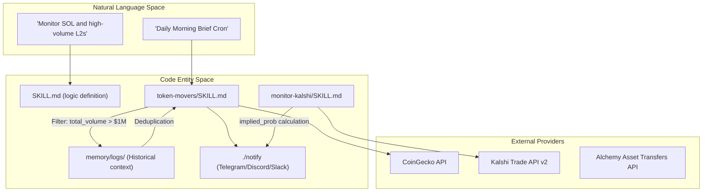
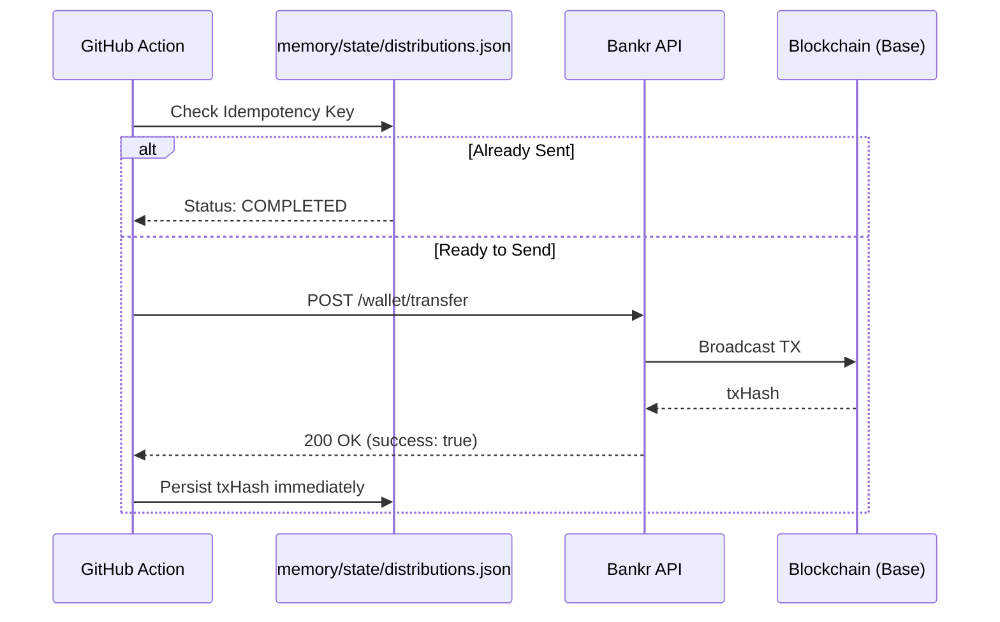

<!-- source: DeepWiki mcp.deepwiki.com · repo aaronjmars/aeon · page 3.4 Crypto & Market Skills · fetched 2026-10-27 -->

# Crypto & Market Skills

Relevant source files

The following files were used as context for generating this wiki page:

- [export-skill](export-skill)
- [skills.json](skills.json)
- [skills/action-converter/SKILL.md](skills/action-converter/SKILL.md)
- [skills/article/SKILL.md](skills/article/SKILL.md)
- [skills/deal-flow/SKILL.md](skills/deal-flow/SKILL.md)
- [skills/defi-monitor/SKILL.md](skills/defi-monitor/SKILL.md)
- [skills/distribute-tokens/SKILL.md](skills/distribute-tokens/SKILL.md)
- [skills/fork-contributor-leaderboard/SKILL.md](skills/fork-contributor-leaderboard/SKILL.md)
- [skills/hacker-news-digest/SKILL.md](skills/hacker-news-digest/SKILL.md)
- [skills/monitor-kalshi/SKILL.md](skills/monitor-kalshi/SKILL.md)
- [skills/monitor-kalshi/watchlist.md](skills/monitor-kalshi/watchlist.md)
- [skills/morning-brief/SKILL.md](skills/morning-brief/SKILL.md)
- [skills/narrative-tracker/SKILL.md](skills/narrative-tracker/SKILL.md)
- [skills/on-chain-monitor/SKILL.md](skills/on-chain-monitor/SKILL.md)
- [skills/polymarket-comments/SKILL.md](skills/polymarket-comments/SKILL.md)
- [skills/reddit-digest/SKILL.md](skills/reddit-digest/SKILL.md)
- [skills/reply-maker/SKILL.md](skills/reply-maker/SKILL.md)
- [skills/rss-digest/SKILL.md](skills/rss-digest/SKILL.md)
- [skills/skill-leaderboard/SKILL.md](skills/skill-leaderboard/SKILL.md)
- [skills/star-milestone/SKILL.md](skills/star-milestone/SKILL.md)
- [skills/startup-idea/SKILL.md](skills/startup-idea/SKILL.md)
- [skills/token-alert/SKILL.md](skills/token-alert/SKILL.md)
- [skills/token-movers/SKILL.md](skills/token-movers/SKILL.md)
- [skills/token-pick/SKILL.md](skills/token-pick/SKILL.md)
- [skills/token-report/SKILL.md](skills/token-report/SKILL.md)
- [skills/unlock-monitor/SKILL.md](skills/unlock-monitor/SKILL.md)

The **Crypto & Market Skills** category provides AEON with the ability to interface with blockchain networks, decentralized finance (DeFi) protocols, and prediction markets. These skills are designed to convert raw on-chain data and market fluctuations into actionable intelligence, ranging from automated treasury distributions to high-signal monitoring of "whale" movements and political/economic odds.

## Architecture & Data Flow

The crypto subsystem follows a "Monitor → Enrich → Notify" pattern. Skills often fetch raw data from public APIs (CoinGecko, Alchemy, Kalshi), enrich that data with historical context from AEON's flat-file memory, and apply "noise-reduction" gates before delivering a notification.

### Market Intelligence Pipeline
The following diagram illustrates how natural language requests or cron schedules translate into technical execution across market APIs and internal state.

**Market Data to Notification Flow**

Sources: [skills/token-movers/SKILL.md:1-141](), [skills/monitor-kalshi/SKILL.md:1-154](), [skills/on-chain-monitor/SKILL.md:1-151]()

---

## On-Chain Monitoring & Treasury

AEON manages on-chain state and transactions through two primary skills: `on-chain-monitor` for observation and `distribute-tokens` for execution.

### On-Chain Monitor
This skill tracks specific addresses across Ethereum, Base, Arbitrum, Optimism, and Polygon [skills/on-chain-monitor:17-31](). It uses a dual-path fetching strategy:
1.  **Alchemy (Path A):** Uses `alchemy_getAssetTransfers` for high-fidelity history [skills/on-chain-monitor:71-84]().
2.  **Etherscan v2 (Path B):** A unified fallback for over 50 chains using `chainid` [skills/on-chain-monitor:90-101]().

State is persisted in `memory/on-chain-state.json`, tracking the `last_block` to ensure contiguous monitoring without redundant alerts [skills/on-chain-state.json:44-61]().

### Token Distribution
The `distribute-tokens` skill is a robust treasury management tool that interfaces with the **Bankr Wallet API** [skills/distribute-tokens:1-5](). It implements a **two-phase resolve→execute** pattern:
*   **RESOLVE:** Validates the `memory/distributions.yml` config, checks the sender's balance, and resolves social handles (e.g., `@username`) to EVM addresses via the Bankr Agent API [skills/distribute-tokens:88-110]().
*   **EXECUTE:** Performs the actual transfer. It uses a per-recipient idempotency key (SHA256 of list, recipient, and date) to prevent double-spending even if a workflow is restarted [skills/distribute-tokens:11-15]().

**Treasury Execution Logic**

Sources: [skills/distribute-tokens/SKILL.md:7-141]()

---

## Market Analysis & Signal Detection

AEON's market skills prioritize "actionable signal" over raw data.

### Token Movers
`token-movers` filters the top 250 coins from CoinGecko but applies a strict volume floor (default $1,000,000) to ignore illiquid "rug-pulls" [skills/token-movers:41-43](). It enriches every mover with automated tags:
*   `[PUMP-RISK]`: Low-cap coins with >30% spikes [skills/token-movers:63-63]().
*   `[CAPITULATION]`: Significant price drops on 3x normal volume [skills/token-movers:62-62]().
*   `[BREAKOUT]`: Sustained multi-day growth [skills/token-movers:60-60]().

### Prediction Markets (Kalshi & Polymarket)
The `monitor-kalshi` skill tracks events (e.g., GDP, interest rates, elections) and converts contract prices into **implied probabilities** [skills/monitor-kalshi:88-88](). It calculates a `move_score` (`|chg_pp| × log10(vol_24h_usd)`) to ensure that high-liquidity moves are ranked above thin-book noise [skills/monitor-kalshi:93-93]().

---

## Meta-Crypto Skills: Leaderboards

AEON tracks its own ecosystem through "meta" skills that analyze the "fork fleet."

| Skill | Purpose | Key Metric |
| :--- | :--- | :--- |
| `skill-leaderboard` | Ranks skill popularity across active forks. | `pct_of_configured` (Adoption rate) |
| `fork-contributor-leaderboard` | Ranks developers building on AEON. | Combined score (PRs, Commits, New Skills) |

The `fork-contributor-leaderboard` uses a weighted scoring formula to incentivize upstream contributions:
*   **Merged PR:** +10 points [skills/fork-contributor-leaderboard:61-61]()
*   **New Skill Built:** +5 points [skills/fork-contributor-leaderboard:66-66]()
*   **First-time Contributor Bonus:** +5 points [skills/fork-contributor-leaderboard:62-62]()

Sources: [skills/skill-leaderboard/SKILL.md:13-118](), [skills/fork-contributor-leaderboard/SKILL.md:60-71]()

---

## Summary Table of Crypto Skills

| Slug | Category | Primary Data Source | Output Type |
| :--- | :--- | :--- | :--- |
| `token-movers` | Market | CoinGecko | Signal-enriched list |
| `on-chain-monitor` | Monitoring | Alchemy / Etherscan | Real-time TX alerts |
| `distribute-tokens` | Treasury | Bankr API | On-chain transfers |
| `monitor-kalshi` | Prediction | Kalshi API | Probabilistic shifts |
| `defi-monitor` | DeFi | Protocol APIs | Yield/Health report |
| `token-report` | Research | Multi-source | Deep-dive article |

Sources: [skills.json:9-191](), [skills/token-movers/SKILL.md:1-6]()

---

