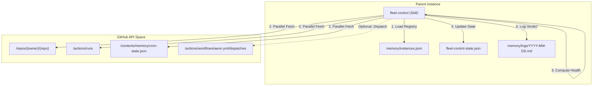
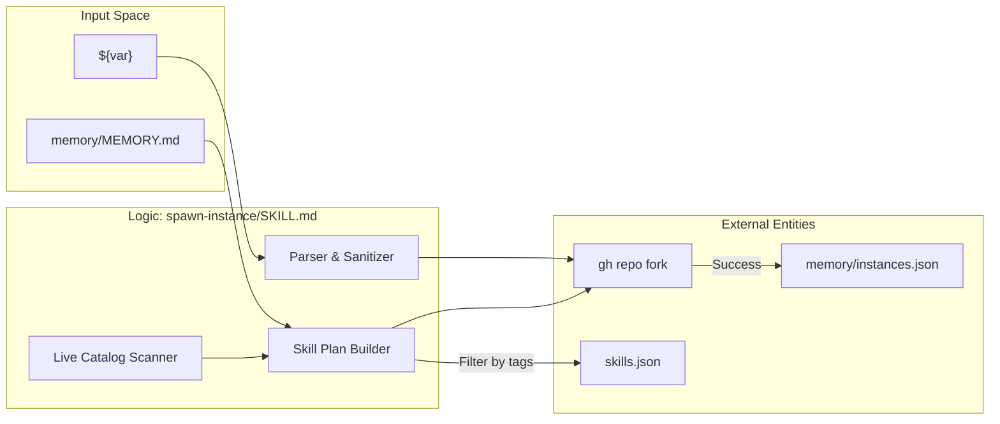

<!-- source: DeepWiki mcp.deepwiki.com · repo aaronjmars/aeon · page 3.6 Fleet & Instance Management Skills · fetched 2026-10-27 -->

# Fleet & Instance Management Skills

Relevant source files

The following files were used as context for generating this wiki page:

- [generate-skills-json](generate-skills-json)
- [onboard](onboard)
- [scripts/sync-upstream.sh](scripts/sync-upstream.sh)
- [skills/article/SKILL.md](skills/article/SKILL.md)
- [skills/auto-workflow/SKILL.md](skills/auto-workflow/SKILL.md)
- [skills/fleet-control/SKILL.md](skills/fleet-control/SKILL.md)
- [skills/fork-contributor-leaderboard/SKILL.md](skills/fork-contributor-leaderboard/SKILL.md)
- [skills/fork-fleet/SKILL.md](skills/fork-fleet/SKILL.md)
- [skills/fork-skill-digest/SKILL.md](skills/fork-skill-digest/SKILL.md)
- [skills/hacker-news-digest/SKILL.md](skills/hacker-news-digest/SKILL.md)
- [skills/morning-brief/SKILL.md](skills/morning-brief/SKILL.md)
- [skills/onboard/SKILL.md](skills/onboard/SKILL.md)
- [skills/skill-leaderboard/SKILL.md](skills/skill-leaderboard/SKILL.md)
- [skills/spawn-instance/SKILL.md](skills/spawn-instance/SKILL.md)
- [skills/treasury-info/SKILL.md](skills/treasury-info/SKILL.md)

Fleet and Instance Management skills provide the orchestration layer for the AEON ecosystem. They enable a single "parent" instance to discover, monitor, and control a distributed fleet of "child" forks. This subsystem manages the lifecycle of new instances—from automated spawning and configuration to weekly contributor and skill popularity leaderboards.

## Core Management Skills

The fleet management system is built on a set of specialized skills that interact with the GitHub API to track divergence and health across the fork network.

| Skill | Purpose | Key Logic |
|:---|:---|:---|
| `fork-fleet` | Inventory and Divergence | Detects "PROMOTE" candidates by comparing forks against upstream for new `SKILL.md` files. [skills/fork-fleet/SKILL.md:2-101]() |
| `fleet-control` | Monitoring & Dispatch | Aggregates health status (healthy, degraded, stale) and allows remote skill execution via `dispatch`. [skills/fleet-control/SKILL.md:2-140]() |
| `spawn-instance` | Provisioning | Automates the creation of a new repo, skill selection, and fleet registration. [skills/spawn-instance/SKILL.md:2-120]() |
| `auto-workflow` | Configuration | Analyzes URLs to suggest tailored `aeon.yml` schedules based on observed data signals. [skills/auto-workflow/SKILL.md:2-110]() |

### Fleet Control Data Flow
The `fleet-control` skill acts as the central command. It utilizes `memory/instances.json` as the source of truth for managed repos and `memory/state/fleet-control-state.json` for tracking health deltas.

**Fleet Monitoring and Command Diagram**

**Sources:** [skills/fleet-control/SKILL.md:14-112](), [skills/fleet-control/SKILL.md:141-150]()

## Instance Spawning & Configuration

The `spawn-instance` skill enables the "zero-infrastructure" scaling of AEON. It creates a functional clone of the parent repo, but tailors the `aeon.yml` configuration to a specific purpose provided by the operator.

### Provisioning Workflow
1.  **Var Parsing**: Accepts `name: purpose` (e.g., `crypto-bot: track DeFi`). [skills/spawn-instance/SKILL.md:39-44]()
2.  **Live Catalog Discovery**: Instead of hardcoded lists, it scans `skills/*/SKILL.md` to find matching tags. [skills/spawn-instance/SKILL.md:87-118]()
3.  **Forking**: Uses `gh repo fork` with the `--fork-name` flag. [skills/spawn-instance/SKILL.md:120-144]()
4.  **Registration**: Adds the new repo to `memory/instances.json` for future tracking by `fleet-control`. [skills/spawn-instance/SKILL.md:62-80]()

**Spawn Instance: Code Entity Mapping**

**Sources:** [skills/spawn-instance/SKILL.md:39-120](), [generate-skills-json:4-12]()

## Community & Skill Analytics

AEON manages its growth through leaderboard skills that reward contribution and identify popular configurations.

### Contributor & Skill Leaderboards
*   **`fork-contributor-leaderboard`**: Ranks developers based on a weighted formula: merged PRs (+10), first-time bonus (+5), PR reviews (+2), and fork commits (+1). [skills/fork-contributor-leaderboard/SKILL.md:60-70]()
*   **`skill-leaderboard`**: Analyzes the "Configured Fleet" (forks that have modified their `aeon.yml`) to determine which skills are actually being used. It identifies "Consensus skills" (used by >50% of the fleet) and "Sunset candidates" (used by 0%). [skills/skill-leaderboard/SKILL.md:13-120]()

### The `skills.json` Manifest
The `generate-skills-json` script is the backbone of the discovery system. It compiles metadata from all `SKILL.md` files into a single manifest.

*   **Function `get_category`**: Maps skill slugs to categories like `research`, `dev`, `crypto`, `social`, or `productivity`. [generate-skills-json:25-54]()
*   **Function `get_schedule`**: Extracts the cron schedule directly from `aeon.yml`. [generate-skills-json:57-62]()
*   **Output**: Includes `slug`, `name`, `description`, `category`, `schedule`, and `install` command. [generate-skills-json:108-125]()

**Sources:** [generate-skills-json:1-140](), [skills/fork-contributor-leaderboard/SKILL.md:1-100](), [skills/skill-leaderboard/SKILL.md:1-120]()

## Automated Workflow Engine

The `auto-workflow` skill provides an intelligent configuration engine. By analyzing a target URL (e.g., a GitHub repo or a crypto project site), it suggests which AEON skills to enable.

### Recommendation Logic
The skill uses a "Hint Table" to match observed signals to installed skills:
*   **Signal**: GitHub `owner/repo` → **Skills**: `github-monitor`, `repo-pulse`, `code-health`. [skills/auto-workflow/SKILL.md:80]()
*   **Signal**: RSS/Atom Feed → **Skills**: `rss-digest`, `digest`. [skills/auto-workflow/SKILL.md:83]()
*   **Signal**: Token Contract → **Skills**: `token-alert`, `on-chain-monitor`. [skills/auto-workflow/SKILL.md:84]()

It enforces a **Data-Verification Gate**: a skill is only recommended if the URL actually provides the required data (e.g., `fetch-tweets` is only suggested if an X handle is extracted). [skills/auto-workflow/SKILL.md:91-102]()

**Sources:** [skills/auto-workflow/SKILL.md:70-102]()

## Onboarding & Health Validation

The `onboard` script and skill provide a one-shot validation of the instance setup.

*   **Local Validator (`onboard` script)**: Checks for workflow files, `aeon.yml` structure, memory writability, and presence of secrets like `ANTHROPIC_API_KEY`. [onboard:116-183]()
*   **Remote Skill (`onboard/SKILL.md`)**: Executes the local validator within a GitHub Action and sends a formatted checklist to the operator via the `./notify` pipeline. [skills/onboard/SKILL.md:10-87]()

**Sources:** [onboard:1-200](), [skills/onboard/SKILL.md:1-130]()

---

