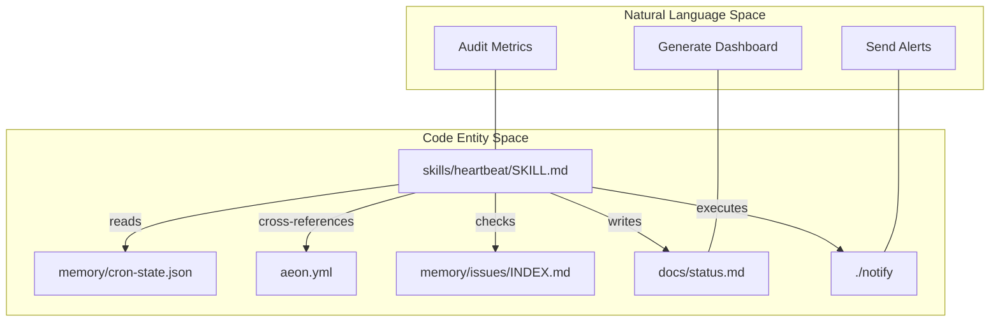
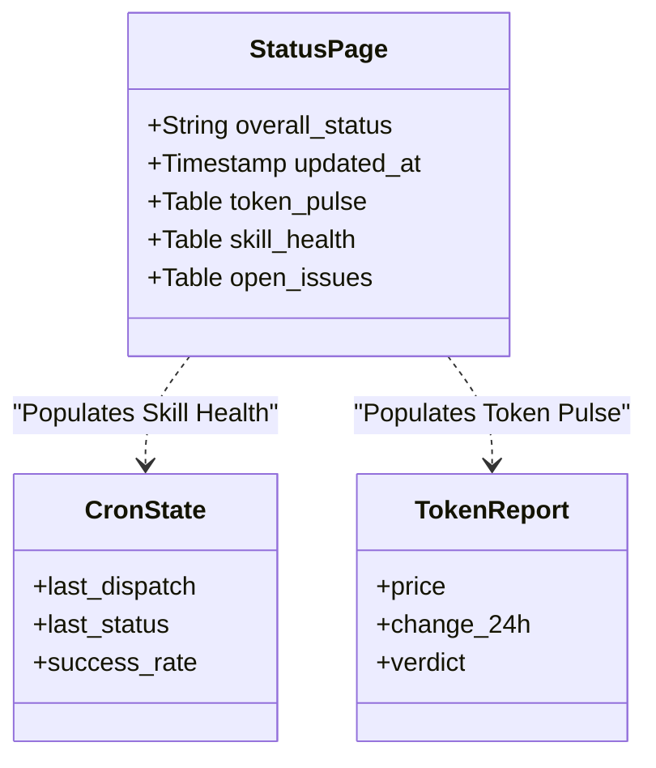

<!-- source: DeepWiki mcp.deepwiki.com · repo aaronjmars/aeon · page 4.1 Heartbeat & Health Monitoring · fetched 2026-10-27 -->

# Heartbeat & Health Monitoring

Relevant source files

The following files were used as context for generating this wiki page:

- [docs/_config.yml](docs/_config.yml)
- [docs/status.md](docs/status.md)
- [memory/cron-state.json](memory/cron-state.json)
- [memory/skill-health/.gitkeep](memory/skill-health/.gitkeep)
- [skills/heartbeat/SKILL.md](skills/heartbeat/SKILL.md)
- [skills/reflect/SKILL.md](skills/reflect/SKILL.md)
- [skills/skill-health/SKILL.md](skills/skill-health/SKILL.md)
- [skills/skill-health/tests/smoke.sh](skills/skill-health/tests/smoke.sh)

The Heartbeat system is AEON's primary observability mechanism. It provides proactive, ambient monitoring of the agent's internal state, ensuring that failed, stuck, or degraded skills are surfaced to the operator and reflected on a public status dashboard.

## Overview

Heartbeat operates as a "meta-skill" that runs on a fixed schedule (typically 3x daily) to audit the execution metrics stored in the flat-file database. It bridges the gap between raw execution data and human-readable alerts, performing three core functions:
1.  **Metric Auditing**: Analyzing `memory/cron-state.json` for performance anomalies [skills/heartbeat/SKILL.md:15-41]().
2.  **Public Reporting**: Regenerating `docs/status.md` for the Jekyll-based status page [skills/heartbeat/SKILL.md:71-133]().
3.  **Tiered Alerting**: Batching findings into priority-coded notifications [skills/heartbeat/SKILL.md:60-69]().

## Implementation & Data Flow

The heartbeat logic relies on the `memory/cron-state.json` file as the authoritative source of truth for skill execution history. This file is updated by the core execution engine after every skill run.

### Data Sources
| Source File | Role |
|:---|:---|
| `memory/cron-state.json` | Contains per-skill metrics: `last_status`, `success_rate`, `consecutive_failures`, and `last_error` [skills/heartbeat/SKILL.md:17-34](). |
| `aeon.yml` | Defines the expected fleet state, including enabled skills and their intended cron schedules [skills/heartbeat/SKILL.md:54-58](). |
| `memory/issues/INDEX.md` | Provides the current list of open issues to include in the status report [skills/heartbeat/SKILL.md:77-77](). |
| `articles/token-report-*.md` | The most recent report is parsed to provide a "Token Pulse" on the dashboard [skills/heartbeat/SKILL.md:79-79](). |

### Code Entity Space: Heartbeat Logic
The following diagram illustrates how the `heartbeat` skill interacts with system files and scripts.

**Heartbeat Execution Flow**

Sources: [skills/heartbeat/SKILL.md:13-144](), [docs/status.md:35-35]()

## Health Classification & Priority Tiers

Heartbeat classifies the fleet state into three overall statuses: `OK`, `WATCH`, and `DEGRADED` [skills/heartbeat/SKILL.md:81-85]().

### P0 — Critical Failures (DEGRADED)
The system triggers a `DEGRADED` state if any of the following P0 conditions are met:
*   **Failed Skills**: `last_status` is explicitly `"failed"` [skills/heartbeat/SKILL.md:37-37]().
*   **Stuck Skills**: `last_status` is `"dispatched"` but `last_dispatch` was >45 minutes ago, indicating a crash or hang [skills/heartbeat/SKILL.md:38-38]().
*   **API Degradation**: A skill has `consecutive_failures >= 3` [skills/heartbeat/SKILL.md:39-39]().
*   **Chronic Failures**: A skill has a `success_rate < 0.5` over at least 5 runs [skills/heartbeat/SKILL.md:40-40]().

### P1-P3 — Warnings (WATCH)
The `WATCH` state is triggered by:
*   **Stalled PRs**: Open Pull Requests older than 24 hours [skills/heartbeat/SKILL.md:45-45]().
*   **Urgent Issues**: GitHub issues with the `urgent` label [skills/heartbeat/SKILL.md:46-46]().
*   **Missing Skills**: Enabled skills in `aeon.yml` that have no entry in `cron-state.json` or haven't succeeded in >2x their schedule interval [skills/heartbeat/SKILL.md:52-58]().

## Public Status Page (`docs/status.md`)

The `heartbeat` skill regenerates the public status page at every run. This page is hosted via GitHub Pages and provides a transparent view of the agent's health to external observers.

**Status Page Composition**

Sources: [skills/heartbeat/SKILL.md:87-133](), [docs/status.md:1-35]()

### Token Pulse Integration
Heartbeat parses the latest `articles/token-report-*.md` file using regex to extract market data (Price, 24h Change, Liquidity) [skills/heartbeat/SKILL.md:150-155](). If the report is older than 24 hours, the pulse section is marked as stale rather than displaying outdated figures [skills/heartbeat/SKILL.md:147-147]().

## Skill Health & Self-Healing (Complementary System)

While `heartbeat` focuses on reporting and alerting, the `skill-health` skill (4.2) focuses on automated remediation.

*   **Heartbeat**: Surfaces that a skill is failing to `docs/status.md` and notifies the operator [skills/heartbeat/SKILL.md:73-73]().
*   **Skill Health**: Detects the same failure, files a structured issue in `memory/issues/ISS-NNN.md`, and attempts to classify the root cause (e.g., `rate-limit`, `missing-secret`) [skills/skill-health/SKILL.md:15-23](), [skills/skill-health/SKILL.md:77-103]().

### Notification Deduplication
To prevent alert fatigue, heartbeat greps `memory/logs/` for the last 48 hours. If an item has already been notified, it is skipped [skills/heartbeat/SKILL.md:62-63](). Similarly, `skill-health` uses a `memory/skill-health/last-report.json` hash to ensure it only notifies on state changes [skills/skill-health/SKILL.md:107-121]().

Sources: [skills/heartbeat/SKILL.md:1-155](), [skills/skill-health/SKILL.md:1-125](), [docs/status.md:1-36]()

---

