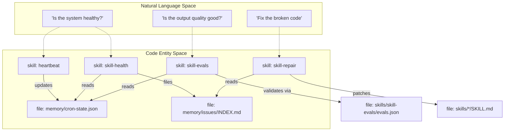
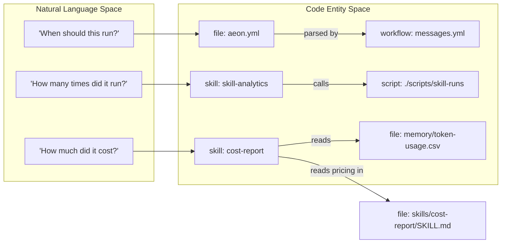

<!-- source: DeepWiki mcp.deepwiki.com · repo aaronjmars/aeon · page 4.2 Skill Evals, Analytics & Repair · fetched 2026-10-27 -->

# Skill Evals, Analytics & Repair

Relevant source files

The following files were used as context for generating this wiki page:

- [.github/workflows/aeon.yml](.github/workflows/aeon.yml)
- [.github/workflows/messages.yml](.github/workflows/messages.yml)
- [dashboard/lib/config.ts](dashboard/lib/config.ts)
- [dashboard/lib/constants.ts](dashboard/lib/constants.ts)
- [docs/skill-graph.md](docs/skill-graph.md)
- [memory/issues/INDEX.md](memory/issues/INDEX.md)
- [scripts/eval-audit](scripts/eval-audit)
- [scripts/postprocess-replicate.sh](scripts/postprocess-replicate.sh)
- [scripts/prefetch-xai.sh](scripts/prefetch-xai.sh)
- [scripts/skill-runs](scripts/skill-runs)
- [skills/agent-buzz/SKILL.md](skills/agent-buzz/SKILL.md)
- [skills/cost-report/SKILL.md](skills/cost-report/SKILL.md)
- [skills/skill-analytics/SKILL.md](skills/skill-analytics/SKILL.md)
- [skills/skill-evals/SKILL.md](skills/skill-evals/SKILL.md)
- [skills/skill-evals/evals.json](skills/skill-evals/evals.json)
- [skills/skill-graph/SKILL.md](skills/skill-graph/SKILL.md)
- [skills/skill-repair/SKILL.md](skills/skill-repair/SKILL.md)

This section covers AEON's autonomous observability and self-healing pipeline. These components transform raw execution data into quality scores, identify fleet-wide performance trends, and execute automated code patches to repair failing skills.

## Quality Scoring & Evaluation Framework

AEON uses a multi-layered evaluation strategy to ensure skill outputs remain high-quality over time. While the `heartbeat` skill monitors binary success/failure, `skill-evals` and the quality scoring pipeline look inside the artifacts to detect regressions.

### The `skill-evals` Pipeline
The `skill-evals` skill [skills/skill-evals/SKILL.md:3-5]() validates skill outputs against a manifest of assertions defined in `evals.json`. It focuses on what changed between runs rather than just providing a snapshot [skills/skill-evals/SKILL.md:14-15]().

**Data Flow:**
1.  **Input Loading**: Reads `skills/skill-evals/evals.json` for assertions and `memory/cron-state.json` for execution history [skills/skill-evals/SKILL.md:20-22]().
2.  **Coverage Audit**: Calls `./scripts/eval-audit --json` to determine which enabled skills lack evaluation specs [skills/skill-evals/SKILL.md:30-31]().
3.  **Assertion Execution**: For each skill, it finds the latest output file and checks for:
    *   **Staleness**: If mtime is older than $2 \times$ expected cadence [skills/skill-evals/SKILL.md:45-46]().
    *   **Word Count**: Validates against `min_words` [skills/skill-evals/SKILL.md:47-48]().
    *   **Patterns**: Greps for `required_patterns` and `forbidden_patterns` [skills/skill-evals/SKILL.md:49-52]().
    *   **Numeric OOB**: Extracts regex matches and validates they fall within `[min, max]` ranges [skills/skill-evals/SKILL.md:53-54]().
4.  **Issue Management**: If a skill moves from `PASS` to `FAIL`, it files a new issue in `memory/issues/ISS-{NNN}.md` [skills/skill-evals/SKILL.md:72-84](). If a previously failing skill passes, it automatically resolves the issue [skills/skill-evals/SKILL.md:91-92]().

### The `eval-audit` Utility
The `eval-audit` script [scripts/eval-audit:1-12]() is a helper tool used by `skill-evals` to map the gap between registered skills in `aeon.yml` and covered skills in `evals.json`. It can also generate stub entries for uncovered skills using the `--stubs` flag [scripts/eval-audit:187-212]().

**Sources:** [skills/skill-evals/SKILL.md:1-118](), [scripts/eval-audit:1-185]()

---

## Fleet Analytics & Exit Taxonomy

The `skill-analytics` skill [skills/skill-analytics/SKILL.md:2-3]() provides a high-level view of the entire fleet's performance, moving beyond the binary success/failure of GitHub Actions conclusions.

### Exit Taxonomy
AEON skills use a specific exit taxonomy to communicate state without failing the workflow. `skill-analytics` greps daily logs for these markers to build a distribution of run types [skills/skill-analytics/SKILL.md:56-68]():

| Marker | Meaning |
| :--- | :--- |
| `_OK` | Standard successful execution. |
| `SKIP_UNCHANGED` | Research skill found no new data; exit early to save tokens. |
| `NEW_INFO` | Research skill found and processed new data. |
| `_OK_SILENT` | Correct execution that produced no external notification. |
| `_ERROR` / `_FAILED` | Internal skill logic failure. |

### Anomaly Detection
The analytics engine classifies skills into health categories based on recent windows (default 7 days) [skills/skill-analytics/SKILL.md:20-21](). It flags `SILENT` skills (enabled cron skills that didn't fire), `ALL_FAIL` (100% failure rate), and `ALL_SKIP` (skills that only emit skip-class exits, suggesting they may be stuck) [skills/skill-analytics/SKILL.md:74-83]().

**Sources:** [skills/skill-analytics/SKILL.md:1-114](), [scripts/skill-runs:1-20]()

---

## Skill Repair & Auto-Patching

The `skill-repair` skill [skills/skill-repair/SKILL.md:2-3]() is an autonomous agent that diagnoses and fixes failing or degraded skills. It follows a structured playbook to move from error detection to a Pull Request.

### Repair Workflow
`skill-repair` executes in six phases: `PREFLIGHT → TRIAGE → DIAGNOSE → REPAIR → VERIFY → LOG` [skills/skill-repair/SKILL.md:15-17]().

1.  **Systemic Triage**: It reads `memory/cron-state.json` and `memory/issues/INDEX.md` to identify targets. It prioritizes "systemic" failures where multiple skills share the same error signature [skills/skill-repair/SKILL.md:58-68]().
2.  **Diagnosis**: It builds a dossier by reading the skill file, checking the "Regression Hunter" (git logs since the last success), and inspecting the last 5 failed GitHub Action logs via `gh run view --log-failed` [skills/skill-repair/SKILL.md:71-101]().
3.  **Playbooks**: It applies specific fixes based on the error category [skills/skill-repair/SKILL.md:113-120]():
    *   `api-change`: Fetches live API specs and updates endpoints.
    *   `rate-limit`: Adds backoff `sleep` or reduces request volume.
    *   `sandbox-limitation`: Moves blocked `curl` calls to the `prefetch` pattern.
4.  **Verification**: Before committing, it attempts to run the skill in the current environment to verify the fix.

### The Prefetch Pattern
Because the Claude sandbox blocks most outbound network requests, AEON uses a "Prefetch" pattern. The `.github/workflows/aeon.yml` workflow runs `scripts/prefetch-*.sh` scripts **outside** the sandbox [aeon.yml:160-180]().
*   **Implementation**: `scripts/prefetch-xai.sh` uses `curl` to call the X.AI API and saves the results to `.xai-cache/` [scripts/prefetch-xai.sh:26-96]().
*   **Consumption**: Skills then read the local JSON files instead of making network calls [scripts/prefetch-xai.sh:3-4]().

**Sources:** [skills/skill-repair/SKILL.md:1-125](), [scripts/prefetch-xai.sh:1-111](), [.github/workflows/aeon.yml:160-180]()

---

## Skill Graph & Dependencies

The `skill-graph` skill [skills/skill-graph/SKILL.md:2-3]() generates a visual map of the system's architecture, rendered as Mermaid diagrams in `docs/skill-graph.md`.

### Dependency Mapping Logic
The graph identifies three types of relationships [skills/skill-graph/SKILL.md:38-46]():
1.  **Explicit Edges**: Defined via `depends_on` in `SKILL.md` frontmatter.
2.  **Chain Edges**: Derived from `aeon.yml` chain configurations (`consume`, `parallel`).
3.  **Derived Edges (Shared State)**: Discovered by grepping skill files for `memory/topics/` or `memory/state/` references. If Skill A writes to a topic that Skill B reads, a `dotted` edge is created.

### Self-Healing Loop Visualization
The graph explicitly highlights the "Self-Healing Loop," showing the flow of state between the core meta-skills.

**Natural Language to Code Entity Map: Observability Loop**

Sources: [skills/skill-graph/SKILL.md:69-70](), [skills/skill-evals/SKILL.md:20-23](), [skills/skill-repair/SKILL.md:58-59]()

**Natural Language to Code Entity Map: Execution & Analytics**

Sources: [skills/skill-analytics/SKILL.md:25-27](), [skills/cost-report/SKILL.md:52-54](), [.github/workflows/messages.yml:105-138]()

---

