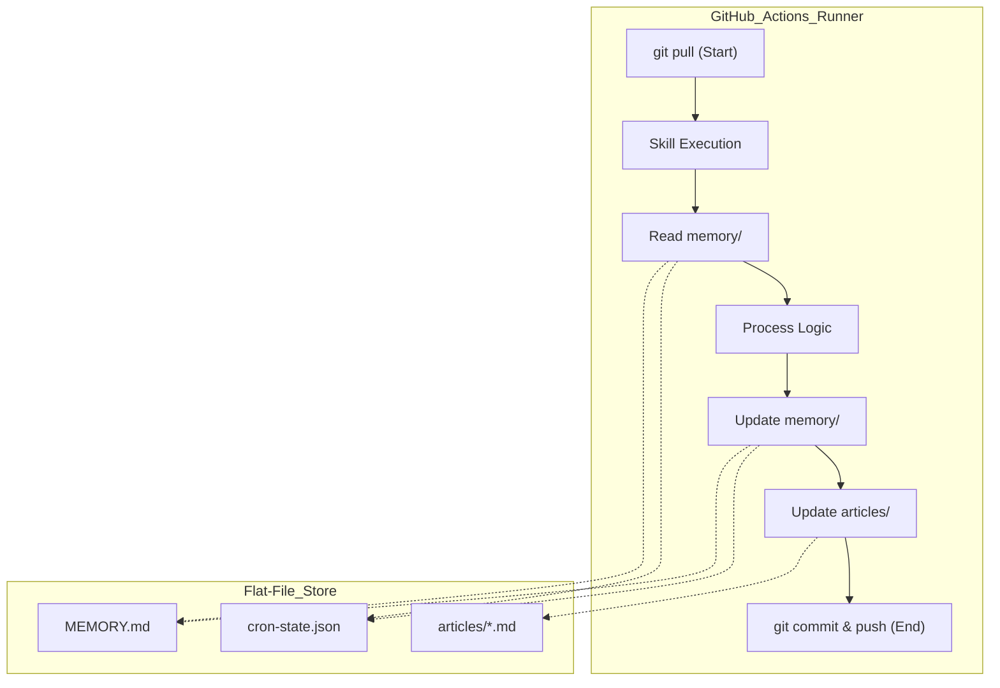

<!-- source: DeepWiki mcp.deepwiki.com · repo aaronjmars/aeon · page 5 Memory & State Management · fetched 2026-10-27 -->

# Memory & State Management

<details>
<summary>Relevant source files</summary>

The following files were used as context for generating this wiki page:

- [articles/.gitkeep](articles/.gitkeep)
- [articles/changelog-2026-03-19.md](articles/changelog-2026-03-19.md)
- [memory/MEMORY.md](memory/MEMORY.md)
- [memory/cron-state.json](memory/cron-state.json)
- [memory/logs/.gitkeep](memory/logs/.gitkeep)
- [memory/logs/2026-03-19.md](memory/logs/2026-03-19.md)
- [memory/watched-repos.md](memory/watched-repos.md)

</details>


AEON utilizes a **flat-file memory system** to maintain state across ephemeral GitHub Actions execution environments. Since every run of a skill occurs in a fresh container, AEON persists its "long-term memory," configuration, and execution metrics by committing changes directly back to the repository's `memory/` directory.

### Persistence Mechanism
The system operates on a "Commit-on-Success" model. When a skill executes, it reads from the local filesystem, performs its logic, updates the relevant files in `memory/`, and the workflow then commits these changes [memory/MEMORY.md:21-21](). This transforms a standard Git repository into a versioned, auditable database.

### Core Memory Components

The memory system is divided into several specialized sub-directories and files that track different aspects of the agent's "life" and the system's health.

| Component | File/Directory | Purpose |
| :--- | :--- | :--- |
| **Central Index** | `memory/MEMORY.md` | High-level summary of articles, digests, and lessons learned [memory/MEMORY.md:1-26](). |
| **Execution State** | `memory/cron-state.json` | Tracks the last run time and status of every scheduled skill [memory/cron-state.json:1-1](). |
| **Daily Logs** | `memory/logs/` | Append-only Markdown files detailing specific actions taken each day [memory/logs/2026-03-19.md:1-9](). |
| **Knowledge Base** | `memory/topics/` | (Detailed in child page) Granular state for specific domains or research threads. |
| **Issue Tracker** | `memory/issues/` | (Detailed in child page) Structured task management for autonomous self-improvement. |

### Memory Interaction Flow

The following diagram illustrates how the execution engine interacts with the flat-file memory system during a typical skill run.

**Memory Read/Write Lifecycle**

Sources: [memory/MEMORY.md:21-21](), [memory/logs/2026-03-19.md:1-9](), [articles/changelog-2026-03-19.md:1-12]()

---

## Memory Directory Structure (5.1)
The `memory/` directory is the source of truth for the agent's identity and history. It includes technical metrics like `token-usage.csv` and `skill-health/` scores, alongside human-readable summaries in `MEMORY.md`.

**Key Entities:**
*   **`MEMORY.md`**: Acts as the "Table of Contents" for the agent's brain, listing recent articles, skills built, and critical lessons learned [memory/MEMORY.md:7-21]().
*   **`logs/`**: Contains daily files (e.g., `2026-03-19.md`) that provide a narrative changelog of what the agent did, such as fetching commits or sending notifications [memory/logs/2026-03-19.md:1-9]().
*   **`cron-state.json`**: A machine-readable file used by the Heartbeat skill to detect if a scheduled task has failed to run within its expected window [memory/cron-state.json:1-1]().

For a full directory reference and file schemas, see **[Memory Directory Structure](#5.1)**.

---

## Issues Tracker & Reflect Skills (5.2)
AEON manages its own development and maintenance through a structured issue tracker located in `memory/issues/`. This system allows the agent to identify bugs, suggest features, and track its own progress without external tools like GitHub Issues.

**Self-Improvement Loop:**
1.  **Reflect**: Skills like `reflect` or `self-improve` analyze the `logs/` and `skill-health/` data.
2.  **Triage**: New issues are created in `memory/issues/ISS-NNN.md`.
3.  **Execute**: Development skills (e.g., `skill-repair`) attempt to resolve these issues by patching the codebase.
4.  **Close**: Upon successful verification, the agent updates the issue status to "closed."

For details on the issue lifecycle and the taxonomy of severity/categories, see **[Issues Tracker & Reflect Skills](#5.2)**.

**Memory to Code Association**
```mermaid
classDiagram
    class "Memory_Filesystem" {
        +MEMORY.md
        +cron-state.json
        +watched-repos.md
    }
    class "Skill_Logic" {
        +fetch_commits()
        +save_changelog()
        +log_action()
    }
    class "Output_Artifacts" {
        +articles/changelog-*.md
        +memory/logs/*.md
    }

    "Skill_Logic" --|> "Memory_Filesystem" : "Reads configuration from"
    "Skill_Logic" --|> "Output_Artifacts" : "Writes results to"
    "Memory_Filesystem" --|> "Output_Artifacts" : "Indexes via"
```
Sources: [memory/watched-repos.md:1-3](), [memory/logs/2026-03-19.md:4-7](), [articles/changelog-2026-03-19.md:1-7]()

---

