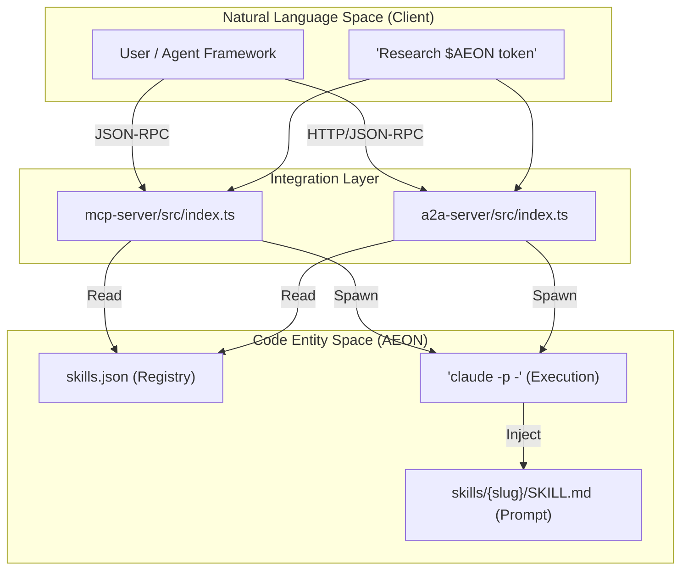
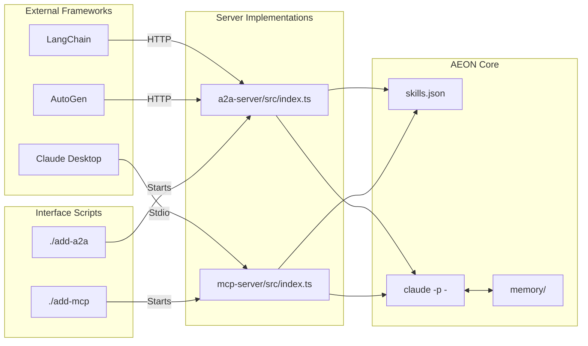

<!-- source: DeepWiki mcp.deepwiki.com · repo aaronjmars/aeon · page 7 Integration Interfaces · fetched 2026-10-27 -->

# Integration Interfaces

Relevant source files

The following files were used as context for generating this wiki page:

- [README.md](README.md)
- [a2a-server/.gitignore](a2a-server/.gitignore)
- [a2a-server/package.json](a2a-server/package.json)
- [a2a-server/src/index.ts](a2a-server/src/index.ts)
- [a2a-server/tsconfig.json](a2a-server/tsconfig.json)
- [add-a2a](add-a2a)
- [add-mcp](add-mcp)
- [aeon.yml](aeon.yml)
- [examples/README.md](examples/README.md)
- [examples/a2a/autogen_workflow.py](examples/a2a/autogen_workflow.py)
- [examples/a2a/crewai_task.py](examples/a2a/crewai_task.py)
- [examples/a2a/langchain_client.py](examples/a2a/langchain_client.py)
- [examples/a2a/openai_agents_client.py](examples/a2a/openai_agents_client.py)
- [examples/mcp/claude_desktop_config.json](examples/mcp/claude_desktop_config.json)
- [examples/mcp/test_connection.py](examples/mcp/test_connection.py)
- [mcp-server/package.json](mcp-server/package.json)
- [mcp-server/src/index.ts](mcp-server/src/index.ts)
- [mcp-server/tsconfig.json](mcp-server/tsconfig.json)
- [skills/contributor-reward/SKILL.md](skills/contributor-reward/SKILL.md)

AEON is designed to be a "headless" agentic backbone. While it primarily operates via autonomous GitHub Actions crons, it exposes its library of 90+ skills to external systems through standardized protocols. This allows interactive agents (like Claude Desktop) or complex agent frameworks (like LangChain or AutoGen) to leverage AEON's research, coding, and crypto capabilities as modular tools.

### Integration Architecture Overview

The following diagram illustrates how external interfaces bridge the gap between Natural Language requests and the execution of specific AEON skill logic.

**Protocol to Code Entity Mapping**

**Sources:** [a2a-server/src/index.ts:163-218](), [README.md:53-56]()

---

## 7.1 MCP Server (Claude Desktop & Claude Code)

The Model Context Protocol (MCP) server allows AEON to function as a set of local tools within the Anthropic ecosystem. When connected, every AEON skill is advertised as an `aeon-{slug}` tool (e.g., `aeon-deep-research`).

- **Setup:** The `./add-mcp` script handles dependency installation and TypeScript compilation.
- **Mechanism:** The server at `mcp-server/src/index.ts` dynamically reads `skills.json` and maps each entry to an MCP tool definition.
- **Execution:** When a tool is called, the server spawns a `claude-code` process, passing the content of the relevant `SKILL.md` as the system prompt.

For details, see [MCP Server (Claude Desktop & Claude Code)](#7.1).

**Sources:** [examples/mcp/test_connection.py:1-21](), [examples/mcp/claude_desktop_config.json:1-8]()

---

## 7.2 A2A Gateway (Agent-to-Agent Protocol)

The A2A Gateway implements Google's Agent-to-Agent protocol, providing a language-agnostic HTTP interface for AEON. This is the primary method for connecting AEON to frameworks like LangChain, AutoGen, and CrewAI.

- **Endpoint:** By default, the gateway listens on port `41241`.
- **Discovery:** The gateway serves an "Agent Card" at `/.well-known/agent.json` which lists all available skills and their required parameters.
- **Task Lifecycle:** It supports a `tasks/send` and `tasks/get` polling pattern, as well as SSE (Server-Sent Events) via `tasks/sendSubscribe` for long-running research tasks.

For details, see [A2A Gateway (Agent-to-Agent Protocol)](#7.2).

**Sources:** [a2a-server/src/index.ts:10-19](), [add-a2a:100-116](), [examples/a2a/langchain_client.py:27-68]()

---

## 7.3 Soul & Identity Layer

The Soul layer ensures that regardless of which interface is used (MCP, A2A, or GitHub Actions), AEON maintains a consistent voice, persona, and set of operational constraints.

- **Identity Calibration:** Files in the `soul/` directory (such as `SOUL.md` and `STYLE.md`) are injected into the context of content-generating skills to govern tone and perspective.
- **Global Governance:** `CLAUDE.md` provides top-level instructions that govern how the underlying LLM interacts with the AEON codebase itself.
- **Shared Memory:** All interfaces read from and write to the `memory/` directory, ensuring that an insight gained via an MCP tool call is available to a scheduled cron job later that day.

For details, see [Soul & Identity Layer](#7.3).

**Sources:** [README.md:43-46](), [skills/contributor-reward/SKILL.md:10-16]()

---

## System Connectivity Map

This diagram maps the high-level integration components to the specific files and scripts that implement them.

**Sources:** [add-a2a:1-19](), [examples/README.md:1-15](), [a2a-server/src/index.ts:31-35]()

---

