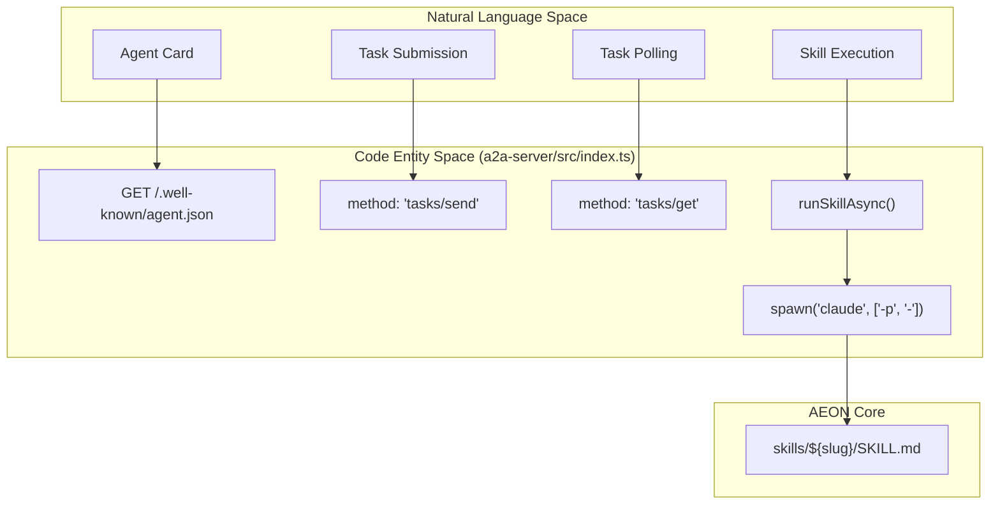
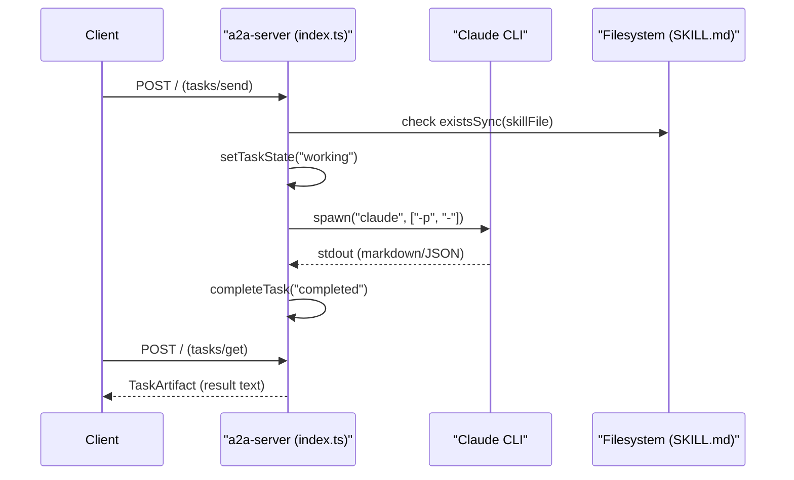

<!-- source: DeepWiki mcp.deepwiki.com · repo aaronjmars/aeon · page 7.2 A2A Gateway (Agent-to-Agent Protocol) · fetched 2026-10-27 -->

# A2A Gateway (Agent-to-Agent Protocol)

<details>
<summary>Relevant source files</summary>

The following files were used as context for generating this wiki page:

- [README.md](README.md)
- [a2a-server/.gitignore](a2a-server/.gitignore)
- [a2a-server/package.json](a2a-server/package.json)
- [a2a-server/src/index.ts](a2a-server/src/index.ts)
- [a2a-server/tsconfig.json](a2a-server/tsconfig.json)
- [add-a2a](add-a2a)
- [aeon.yml](aeon.yml)
- [examples/README.md](examples/README.md)
- [examples/a2a/autogen_workflow.py](examples/a2a/autogen_workflow.py)
- [examples/a2a/crewai_task.py](examples/a2a/crewai_task.py)
- [examples/a2a/langchain_client.py](examples/a2a/langchain_client.py)
- [examples/a2a/openai_agents_client.py](examples/a2a/openai_agents_client.py)
- [examples/mcp/claude_desktop_config.json](examples/mcp/claude_desktop_config.json)
- [examples/mcp/test_connection.py](examples/mcp/test_connection.py)
- [skills/contributor-reward/SKILL.md](skills/contributor-reward/SKILL.md)

</details>


The A2A Gateway is an HTTP/JSON-RPC server that exposes AEON's 90+ skills as callable tasks following Google's Agent-to-Agent (A2A) protocol. This interface allows external agent frameworks—such as LangChain, AutoGen, CrewAI, and the OpenAI Agents SDK—to invoke AEON skills as tools without requiring a direct Claude interface or MCP client [a2a-server/src/index.ts:5-8]().

## Overview and Setup

The gateway acts as a bridge between external "Requester" agents and AEON's "Provider" skills. It runs as a Node.js process, typically on port 41241 [a2a-server/src/index.ts:33]().

### Setup via `add-a2a`
The `./add-a2a` script automates the installation of dependencies, compilation of the TypeScript server, and execution of the gateway [add-a2a:2-10]().

| Option | Description |
| :--- | :--- |
| `--port <number>` | Runs the gateway on a custom port (default: 41241) [add-a2a:41](). |
| `--build-only` | Installs dependencies and builds `a2a-server/dist/index.js` without starting the server [add-a2a:89-92](). |
| `--print-config` | Displays the Agent Card URL and provides copy-pasteable client examples for Python/LangChain [add-a2a:120-186](). |

**Sources:** [add-a2a:1-194](), [a2a-server/src/index.ts:1-35]()

---

## Architecture and Data Flow

The gateway transforms incoming JSON-RPC requests into local `claude -p -` executions, mimicking the environment of a standard AEON GitHub Action run [examples/README.md:53-56]().

### System Component Mapping
This diagram maps the Natural Language concepts of the A2A protocol to the specific code entities in the `a2a-server`.

Title: A2A Protocol to Code Entity Mapping

**Sources:** [a2a-server/src/index.ts:10-26](), [a2a-server/src/index.ts:163-186](), [examples/README.md:53-56]()

### Task Lifecycle
Tasks move through a defined state machine: `submitted` -> `working` -> (`completed` | `failed` | `canceled`) [a2a-server/src/index.ts:53]().

1.  **Submission**: A client sends `tasks/send` with a `skillId` (e.g., `aeon-deep-research`) and an optional `var` [a2a-server/src/index.ts:140-159]().
2.  **Resolution**: The server parses the message, validates the skill exists in `skills.json`, and prepares the prompt [a2a-server/src/index.ts:163-174]().
3.  **Execution**: The server spawns a `ChildProcess` using the `claude` CLI [a2a-server/src/index.ts:183-187]().
4.  **Completion**: Output is captured from `stdout`, parsed as JSON (if possible), and stored in the `tasks` Map [a2a-server/src/index.ts:194-208]().

Title: Task Execution Flow

**Sources:** [a2a-server/src/index.ts:99-122](), [a2a-server/src/index.ts:163-218](), [a2a-server/src/index.ts:225-230]()

---

## API Endpoints

### Agent Discovery
*   **Endpoint**: `GET /.well-known/agent.json`
*   **Function**: Returns a manifest of all available skills loaded from the root `skills.json` [a2a-server/src/index.ts:11-12]().

### JSON-RPC Interface
All task management occurs via `POST /` [a2a-server/src/index.ts:12]().

| Method | Parameters | Description |
| :--- | :--- | :--- |
| `tasks/send` | `id`, `skillId`, `var`, `message` | Initiates a new skill execution [a2a-server/src/index.ts:140-159](). |
| `tasks/get` | `id` | Retrieves the current status and artifacts of a task [a2a-server/src/index.ts:12](). |
| `tasks/cancel` | `id` | Kills the underlying `_childProcess` if still running [a2a-server/src/index.ts:86](). |

### SSE Streaming
*   **Endpoint**: `POST /tasks/sendSubscribe`
*   **Function**: Provides Server-Sent Events (SSE) for real-time status updates on long-running skills [a2a-server/src/index.ts:13]().

**Sources:** [a2a-server/src/index.ts:10-19](), [a2a-server/src/index.ts:86](), [add-a2a:108-110]()

---

## Client Integration Examples

AEON provides standard patterns for wrapping skills as tools in common Python agent frameworks. All examples follow a **Submit-and-Poll** pattern due to the ephemeral nature of the CLI execution [examples/README.md:28-29]().

### Framework Implementations

| Framework | Implementation Pattern | File Reference |
| :--- | :--- | :--- |
| **LangChain** | Wraps `call_aeon` in a `Tool` object with a lambda function. | [examples/a2a/langchain_client.py:71-79]() |
| **AutoGen** | Registers `aeon_deep_research` as a tool for an `AssistantAgent`. | [examples/a2a/autogen_workflow.py:71-82]() |
| **CrewAI** | Subclasses `BaseTool` and implements the `_run` method. | [examples/a2a/crewai_task.py:57-67]() |
| **OpenAI Agents** | Uses the `@function_tool` decorator. | [examples/a2a/openai_agents_client.py:57-69]() |

### Example: LangChain Tool Wrapper
The client generates a unique `task_id` (UUID), submits it to the gateway, and enters a polling loop until the state is `completed` [examples/a2a/langchain_client.py:27-68]().

```python
# Simplified Logic from examples/a2a/langchain_client.py
def call_aeon(skill_id, var):
    task_id = str(uuid.uuid4())
    # 1. Send task
    requests.post(GATEWAY, json={"method": "tasks/send", "params": {"id": task_id, ...}})
    # 2. Poll
    for _ in range(MAX_POLLS):
        status = requests.post(GATEWAY, json={"method": "tasks/get", "params": {"id": task_id}}).json()
        if status["result"]["status"]["state"] == "completed":
            return status["result"]["artifacts"][0]["parts"][0]["text"]
        time.sleep(5)
```

**Sources:** [examples/a2a/langchain_client.py:1-86](), [examples/a2a/autogen_workflow.py:1-97](), [examples/a2a/crewai_task.py:1-89](), [examples/a2a/openai_agents_client.py:1-88]()

---

## Task Persistence and Eviction

The `a2a-server` maintains an in-memory `tasks` Map. To prevent memory leaks, it implements an eviction strategy [a2a-server/src/index.ts:99-103]():

*   **TTL**: Tasks are removed 30 minutes after completion (`TASK_TTL_MS`) [a2a-server/src/index.ts:102-109]().
*   **Hard Cap**: The server stores a maximum of 1,000 tasks (`MAX_TASKS`). If exceeded, the oldest completed tasks are dropped first [a2a-server/src/index.ts:113-121]().

**Sources:** [a2a-server/src/index.ts:99-122]()

---

