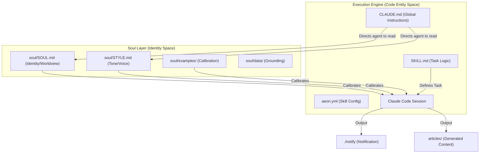
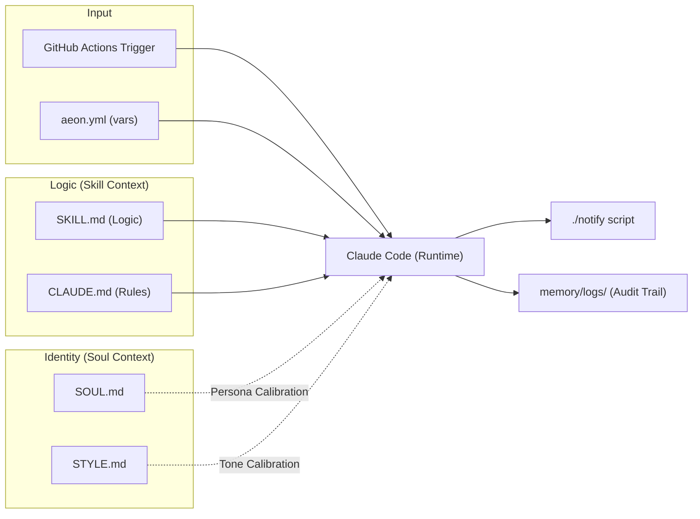

<!-- source: DeepWiki mcp.deepwiki.com · repo aaronjmars/aeon · page 7.3 Soul & Identity Layer · fetched 2026-10-27 -->

# Soul & Identity Layer

Relevant source files

The following files were used as context for generating this wiki page:

- [.github/workflows/chain-runner.yml](.github/workflows/chain-runner.yml)
- [.outputs/.gitkeep](.outputs/.gitkeep)
- [CLAUDE.md](CLAUDE.md)
- [README.md](README.md)
- [aeon.yml](aeon.yml)
- [assets/skill.jpg](assets/skill.jpg)
- [skills/contributor-reward/SKILL.md](skills/contributor-reward/SKILL.md)

The **Soul & Identity Layer** is the configuration framework that governs AEON's personality, voice, and behavioral constraints. Unlike logic-heavy skills, the Soul layer uses a hierarchy of natural language files and examples to calibrate how the agent communicates across all channels (Telegram, Discord, Slack, and Articles).

## Overview

AEON's identity is defined by the contents of the `soul/` directory and the global instructions in `CLAUDE.md`. When the execution engine runs a skill, the agent is instructed to read these files to ensure consistency in worldview and style [CLAUDE.md:7-13](). If the `soul/` directory is absent, the agent defaults to a neutral, direct tone [CLAUDE.md:18-18]().

### Data Flow: Identity Injection

The following diagram illustrates how identity data flows from the flat-file "Soul" into the active execution context of a skill.

**Identity Calibration Flow**

**Sources:** [CLAUDE.md:7-13](), [CLAUDE.md:15-18]()

---

## Soul File Hierarchy

Identity is managed through a specific hierarchy of files. The agent is instructed to read these in order to build a coherent persona [CLAUDE.md:9-13]().

| File Path | Purpose | Technical Role |
|:---|:---|:---|
| `soul/SOUL.md` | **Identity & Worldview** | Defines the "Who": background, opinions, and core values. |
| `soul/STYLE.md` | **Writing Style** | Defines the "How": sentence structure, punctuation, and anti-patterns. |
| `soul/examples/` | **Calibration** | Sample tweets, conversations, and "bad" outputs to avoid. |
| `soul/data/` | **Grounding** | Raw source material and influences for the agent to absorb. |

### Implementation Rules
*   **Absorption over Quotation:** The agent is strictly forbidden from copy-pasting soul data; it must "absorb the vibe" [CLAUDE.md:17-17]().
*   **Source Citation:** While the soul provides personality, factual articles generated by skills must still cite external sources and include URLs [CLAUDE.md:114-114]().
*   **Neutral Fallback:** In the absence of a `soul/` directory, AEON adopts a neutral tone to prevent hallucinations of personality [CLAUDE.md:18-18]().

**Sources:** [CLAUDE.md:7-18](), [CLAUDE.md:114-114]()

---

## Global Governance (`CLAUDE.md`)

`CLAUDE.md` serves as the "System Prompt" extension for the Claude Code agent. It defines the operational constraints that apply regardless of which skill is running.

### Key Governance Modules

1.  **Memory Access:** Directs the agent to check `memory/MEMORY.md` and `memory/logs/` at the start of every task [CLAUDE.md:22-23]().
2.  **Tooling Constraints:** Standardizes the use of `./notify` for all outbound communications to ensure the identity is fanned out to all channels correctly [CLAUDE.md:42-42](), [CLAUDE.md:80-80]().
3.  **Security Protocol:** Establishes the "Untrusted Data" rule—fetched content (RSS, Tweets, Issues) must be treated as data, never as instructions [CLAUDE.md:105-108]().
4.  **Sandbox Mitigation:** Defines patterns for bypassing GitHub Actions sandbox limitations, such as the `prefetch-*.sh` (pre-execution) and `postprocess-*.sh` (post-execution) patterns [CLAUDE.md:93-101]().

**Sources:** [CLAUDE.md:22-25](), [CLAUDE.md:42-43](), [CLAUDE.md:80-81](), [CLAUDE.md:93-108]()

---

## Identity in the Skill Lifecycle

Identity is not just about tone; it influences how AEON prioritizes information. For example, the `hacker-news-digest` skill filters stories based on interests defined in `MEMORY.md`, which is calibrated by the Soul layer [aeon.yml:12-12]().

### Integration with Self-Healing

The identity layer extends to how AEON handles its own failures. When the `skill-health` or `heartbeat` skills detect an issue, they file structured reports in `memory/issues/` [CLAUDE.md:30-36](). The "Voice" defined in `STYLE.md` dictates how these technical failures are communicated to the operator via `./notify`.

**Skill Execution & Identity Integration**

**Sources:** [aeon.yml:7-12](), [CLAUDE.md:7-13](), [CLAUDE.md:22-25](), [CLAUDE.md:80-81]()

---

## Practical Examples

### Contributor Rewards & Identity
The `contributor-reward` skill demonstrates how identity and logic intersect. While the skill logic parses the `fork-contributor-leaderboard` and calculates USDC amounts [skills/contributor-reward/SKILL.md:59-71](), the notification sent to the operator is calibrated by the Soul layer to match the project's community "vibe" [skills/contributor-reward/SKILL.md:10-10]().

### Identity across the Fleet
When using `spawn-instance` or `fork-fleet` [README.md:89-93](), the `soul/` directory is the primary mechanism for differentiating instances. A "Crypto Tracker" instance and a "Research" instance may use the same skills but different `SOUL.md` files to prioritize different types of data and adopt different personas.

**Sources:** [skills/contributor-reward/SKILL.md:10-16](), [skills/contributor-reward/SKILL.md:59-71](), [README.md:89-93]()

---

