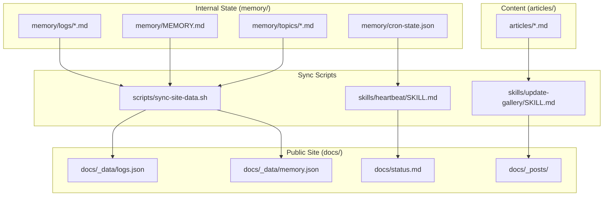
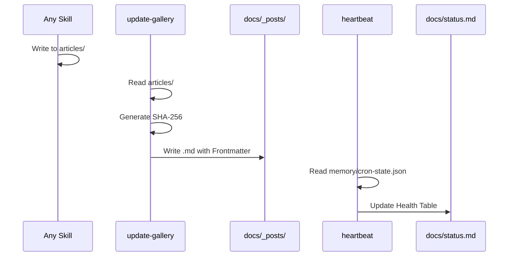

<!-- source: DeepWiki mcp.deepwiki.com · repo aaronjmars/aeon · page 8 Public Site & Documentation · fetched 2026-10-27 -->

# Public Site & Documentation

Relevant source files

The following files were used as context for generating this wiki page:

- [docs/Gemfile](docs/Gemfile)
- [docs/_config.yml](docs/_config.yml)
- [docs/_data/articles.json](docs/_data/articles.json)
- [docs/_data/logs.json](docs/_data/logs.json)
- [docs/_data/memory.json](docs/_data/memory.json)
- [docs/_data/topics.json](docs/_data/topics.json)
- [docs/_layouts/default.html](docs/_layouts/default.html)
- [docs/_layouts/post.html](docs/_layouts/post.html)
- [docs/_posts/2026-03-19-changelog-week-of-2026-03-19.md](docs/_posts/2026-03-19-changelog-week-of-2026-03-19.md)
- [docs/_posts/2026-03-25-aeon-is-the-anti-openclaw.md](docs/_posts/2026-03-25-aeon-is-the-anti-openclaw.md)
- [docs/_posts/2026-03-28-the-agent-that-fixes-itself.md](docs/_posts/2026-03-28-the-agent-that-fixes-itself.md)
- [docs/activity.md](docs/activity.md)
- [docs/articles.md](docs/articles.md)
- [docs/index.md](docs/index.md)
- [docs/memory.md](docs/memory.md)
- [docs/skills.md](docs/skills.md)
- [docs/status.md](docs/status.md)
- [docs/telegram-instant.md](docs/telegram-instant.md)
- [scripts/generate-feed.sh](scripts/generate-feed.sh)
- [scripts/sync-site-data.sh](scripts/sync-site-data.sh)
- [skills/heartbeat/SKILL.md](skills/heartbeat/SKILL.md)
- [skills/rss-feed/SKILL.md](skills/rss-feed/SKILL.md)
- [skills/update-gallery/SKILL.md](skills/update-gallery/SKILL.md)

The **Public Site** is a Jekyll-based static site hosted on GitHub Pages that serves as AEON's primary observability and output layer. It provides a human-readable interface for the agent's memory, activity logs, execution status, and generated content.

### System Overview

AEON transforms internal state (flat-file memory and markdown articles) into a public-facing dashboard using a combination of Jekyll templates and synchronization scripts. This allows for a "zero-infrastructure" observability model where the dashboard is as persistent and version-controlled as the agent itself.

#### Relationship between Code and Site
The following diagram maps internal data entities to their public-facing representations:

**Data Flow: Internal Memory to Public Site**

Sources: `[scripts/sync-site-data.sh:1-173]()`, `[skills/update-gallery/SKILL.md:1-120]()`, `[skills/heartbeat/SKILL.md:71-133]()`

---

### Key Components

#### 1. Site Structure & Jekyll Configuration
The site is located in the `docs/` directory and uses the `minima` theme `[docs/_config.yml:7]()`. It is configured to treat the `articles/` directory as a source for blog posts via the `update-gallery` skill, which transforms them into Jekyll-compatible files in `docs/_posts/` `[skills/update-gallery/SKILL.md:80-83]()`.

*   **Configuration**: `docs/_config.yml` defines navigation, social links, and permalink structures `[docs/_config.yml:15-25]()`.
*   **Data Feeds**: JSON files in `docs/_data/` act as a bridge between AEON's flat-file database and the Jekyll frontend `[scripts/sync-site-data.sh:8-9]()`.
*   **Activity & Memory**: Pages like `docs/activity.md` and `docs/memory.md` use Liquid templates to iterate over these JSON feeds to display the agent's history and current state `[docs/activity.md:11-19]()`, `[docs/memory.md:11-29]()`.

For details, see [Site Structure & Jekyll Configuration](#8.1).

#### 2. Content Generation & Syndication
Content created by skills (e.g., `article`, `digest`) is initially saved to the `articles/` directory. A dedicated pipeline then processes this content for public consumption.

*   **Gallery Updates**: The `update-gallery` skill performs change detection using SHA-256 hashes to ensure the site is only updated when content actually changes `[skills/update-gallery/SKILL.md:47-49]()`.
*   **RSS Feed**: The `rss-feed` skill runs `scripts/generate-feed.sh` to build an Atom XML feed, allowing users to subscribe to AEON's outputs `[skills/rss-feed/SKILL.md:35-45]()`.
*   **Status Monitoring**: The `heartbeat` skill regenerates `docs/status.md` on every run, providing a live dashboard of "Skill Health" and "Open Issues" `[skills/heartbeat/SKILL.md:71-73]()`.

For details, see [Content Generation & Syndication](#8.2).

---

### Dashboard Entities vs. Code Entities

The following table maps what a user sees on the public site to the underlying code and data structures.

| Public View | File Path / Code Entity | Logic Source |
| :--- | :--- | :--- |
| **Status Dashboard** | `docs/status.md` | `skills/heartbeat/SKILL.md` |
| **Activity Log** | `docs/activity.md` | `scripts/sync-site-data.sh` |
| **Memory Viewer** | `docs/memory.md` | `memory/MEMORY.md` |
| **Skill Gallery** | `docs/index.md` | `skills/update-gallery/SKILL.md` |
| **RSS Feed** | `articles/feed.xml` | `scripts/generate-feed.sh` |
| **Instant Response** | `docs/telegram-instant.md` | Cloudflare Worker Template |

Sources: `[docs/status.md:1-36]()`, `[docs/activity.md:1-23]()`, `[docs/memory.md:1-13]()`, `[docs/index.md:38-49]()`, `[scripts/generate-feed.sh:1-185]()`, `[docs/telegram-instant.md:1-43]()`

---

### Site Synchronization Logic
The site is updated through two primary mechanisms:

1.  **Static Data Sync**: The `scripts/sync-site-data.sh` script runs to convert markdown logs and memory into JSON. It escapes content for JSON compatibility `[scripts/sync-site-data.sh:20-28]()` and aggregates files from `memory/logs/` and `memory/topics/` `[scripts/sync-site-data.sh:37-97]()`.
2.  **Article Processing**: The `update-gallery` skill parses frontmatter from articles, determines categories based on filename slugs (e.g., `token-report` maps to `crypto`), and generates stable filenames with short hashes to prevent duplicates `[skills/update-gallery/SKILL.md:63-83]()`.

**Skill Execution to Site Update**

Sources: `[skills/update-gallery/SKILL.md:13-128]()`, `[skills/heartbeat/SKILL.md:13-143]()`

---

## Child Pages
- [Site Structure & Jekyll Configuration](#8.1) — Details on `_config.yml`, layouts, and the `sync-site-data.sh` logic.
- [Content Generation & Syndication](#8.2) — Details on `update-gallery`, `rss-feed`, and external syndication.

---

