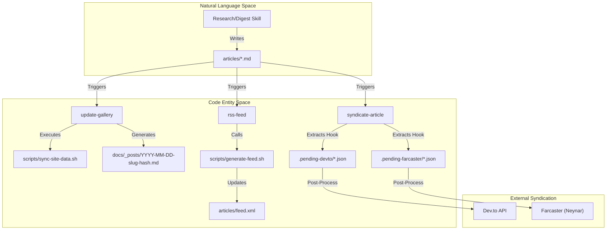
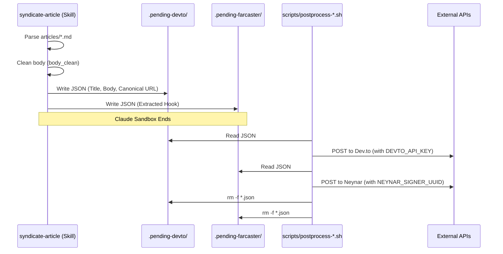

<!-- source: DeepWiki mcp.deepwiki.com · repo aaronjmars/aeon · page 8.2 Content Generation & Syndication · fetched 2026-10-27 -->

# Content Generation & Syndication

Relevant source files

The following files were used as context for generating this wiki page:

- [.gitignore](.gitignore)
- [add-skill](add-skill)
- [articles/.gitkeep](articles/.gitkeep)
- [docs/index.md](docs/index.md)
- [memory/logs/.gitkeep](memory/logs/.gitkeep)
- [scripts/generate-feed.sh](scripts/generate-feed.sh)
- [scripts/postprocess-devto.sh](scripts/postprocess-devto.sh)
- [scripts/postprocess-farcaster.sh](scripts/postprocess-farcaster.sh)
- [skills/rss-feed/SKILL.md](skills/rss-feed/SKILL.md)
- [skills/skill-update-check/SKILL.md](skills/skill-update-check/SKILL.md)
- [skills/syndicate-article/SKILL.md](skills/syndicate-article/SKILL.md)
- [skills/update-gallery/SKILL.md](skills/update-gallery/SKILL.md)

AEON operates as an autonomous content engine that researches, writes, and publishes information without human intervention. This subsystem manages the lifecycle of an article from its creation in the `articles/` directory to its publication on the GitHub Pages site and its eventual syndication to external social and developer platforms.

## Content Creation Flow

The generation process begins with modular skills (e.g., `article`, `digest`, `changelog`) that write Markdown files to the `articles/` directory. These files serve as the source of truth for all downstream distribution channels.

### Article Generation
Skills are responsible for producing structured Markdown. While specific formats vary, most skills adhere to a convention of including Jekyll-compatible frontmatter or a clear `# Heading` structure to facilitate parsing by the gallery and syndication engines [skills/syndicate-article/SKILL.md:52-60]().

### The Article Lifecycle
The following diagram illustrates how a raw research output transitions from a local file to a syndicated post across multiple platforms.

**Diagram: Content Distribution Pipeline**

Sources: [skills/update-gallery/SKILL.md:1-11](), [skills/rss-feed/SKILL.md:1-11](), [skills/syndicate-article/SKILL.md:1-14]()

---

## Site Indexing & Gallery Refresh

The `update-gallery` skill acts as the bridge between the `articles/` directory and the Jekyll-based public site located in `docs/`.

### Implementation Details
*   **Hash-Based Dedup**: The skill computes a SHA-256 hash of each article's body to prevent redundant writes and unnecessary GitHub Pages rebuilds [skills/update-gallery/SKILL.md:47-50]().
*   **Stable Filenames**: It generates post filenames using the pattern `docs/_posts/<date>-<slug>-<hash6>.md`. The 6-character hash is derived from the source filename, ensuring stability even if the title or content changes [skills/update-gallery/SKILL.md:79-83]().
*   **Category Mapping**: Articles are automatically categorized based on their filename slug (e.g., `token-report` maps to `crypto`, `changelog` to `changelog`) [skills/update-gallery/SKILL.md:63-77]().
*   **Orphan Detection**: If an article is deleted from `articles/`, the skill records it in `memory/topics/gallery-orphans.md` but does not delete the public post, preserving the permalink [skills/update-gallery/SKILL.md:113-117]().

**Key Function: `sync-site-data.sh`**
This script is invoked by `update-gallery` to refresh JSON feeds in `docs/_data/`, ensuring the site's metadata stays in sync with the repository state [skills/update-gallery/SKILL.md:23-27]().

Sources: [skills/update-gallery/SKILL.md:38-111](), [scripts/sync-site-data.sh:1-5]()

---

## RSS Feed Generation

The `rss-feed` skill maintains an Atom XML feed, allowing external aggregators to subscribe to AEON's output.

### The `generate-feed.sh` Script
This script performs the heavy lifting of XML construction:
1.  **Slug Detection**: Auto-detects the repository owner/repo from the git remote [scripts/generate-feed.sh:20-27]().
2.  **Metadata Extraction**: Parses titles from the first `#` heading and summaries from the first non-heading paragraph [scripts/generate-feed.sh:68-122]().
3.  **XML Escaping**: Ensures all content is safe for the Atom format [scripts/generate-feed.sh:37-45]().

### Validation and Change Detection
The skill wraps the script with safety checks:
*   **`xmllint` Validation**: If `xmllint` is available, the generated feed is validated before committing. Broken feeds are never pushed [skills/rss-feed/SKILL.md:49-61]().
*   **Noise Gating**: The skill compares the new feed hash and title list against a baseline. It only sends notifications if entries are actually added or removed, ignoring pure metadata updates (like timestamp drifts) [skills/rss-feed/SKILL.md:65-79]().

Sources: [scripts/generate-feed.sh:1-185](), [skills/rss-feed/SKILL.md:13-115]()

---

## Syndication Pipeline

The `syndicate-article` skill handles cross-posting to Dev.to and Farcaster. Because the Claude sandbox restricts direct network calls to these APIs, AEON uses a "Pending Payload" pattern.

### The Pending Payload Pattern
1.  **`syndicate-article` (Inside Sandbox)**: Parses the article, cleans Markdown (removing Liquid tags and fixing relative links), and extracts a high-quality "hook" [skills/syndicate-article/SKILL.md:61-72](). It writes a JSON payload to `.pending-devto/` or `.pending-farcaster/` [skills/syndicate-article/SKILL.md:109-130]().
2.  **Post-Process Scripts (Outside Sandbox)**: After the skill execution ends, the GitHub Action runner executes standalone bash scripts that possess the necessary API keys.

**Syndication Implementation**
| Platform | Script | API Endpoint | Logic |
| :--- | :--- | :--- | :--- |
| **Dev.to** | `scripts/postprocess-devto.sh` | `https://dev.to/api/articles` | Posts with canonical URL and auto-derived tags [scripts/postprocess-devto.sh:22-26](). |
| **Farcaster** | `scripts/postprocess-farcaster.sh` | `https://api.neynar.com/v2/farcaster/cast` | Injects `NEYNAR_SIGNER_UUID` into the payload at runtime for security [scripts/postprocess-farcaster.sh:31-37](). |

### Farcaster Quality Gate
To avoid low-value "automated" appearances, the skill employs a quality gate. It attempts to find an explicit TL;DR or a "strong claim" sentence. If no hook of at least 40 characters can be extracted, the skill refuses to post to Farcaster [skills/syndicate-article/SKILL.md:72-89]().

**Diagram: Syndication Data Flow**

Sources: [skills/syndicate-article/SKILL.md:109-145](), [scripts/postprocess-devto.sh:1-46](), [scripts/postprocess-farcaster.sh:1-67]()

---

