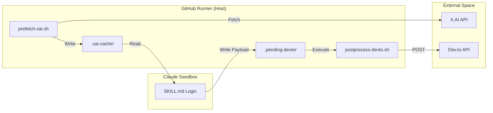
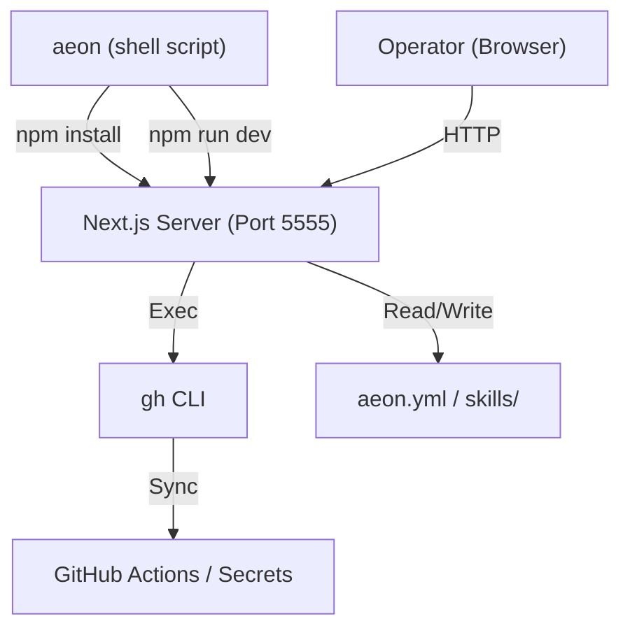

<!-- source: DeepWiki mcp.deepwiki.com · repo aaronjmars/aeon · page 9 Scripts & Utilities Reference · fetched 2026-10-27 -->

# Scripts & Utilities Reference

Relevant source files

The following files were used as context for generating this wiki page:

- [.gitignore](.gitignore)
- [add-skill](add-skill)
- [aeon](aeon)
- [dashboard/app/api/auth/route.ts](dashboard/app/api/auth/route.ts)
- [dashboard/package-lock.json](dashboard/package-lock.json)
- [dashboard/package.json](dashboard/package.json)
- [generate-skills-json](generate-skills-json)
- [memory/issues/INDEX.md](memory/issues/INDEX.md)
- [onboard](onboard)
- [scripts/eval-audit](scripts/eval-audit)
- [scripts/postprocess-devto.sh](scripts/postprocess-devto.sh)
- [scripts/postprocess-farcaster.sh](scripts/postprocess-farcaster.sh)
- [scripts/postprocess-replicate.sh](scripts/postprocess-replicate.sh)
- [scripts/prefetch-xai.sh](scripts/prefetch-xai.sh)
- [scripts/skill-runs](scripts/skill-runs)
- [scripts/sync-upstream.sh](scripts/sync-upstream.sh)
- [skills/agent-buzz/SKILL.md](skills/agent-buzz/SKILL.md)
- [skills/auto-workflow/SKILL.md](skills/auto-workflow/SKILL.md)
- [skills/onboard/SKILL.md](skills/onboard/SKILL.md)
- [skills/skill-update-check/SKILL.md](skills/skill-update-check/SKILL.md)
- [skills/syndicate-article/SKILL.md](skills/syndicate-article/SKILL.md)
- [skills/treasury-info/SKILL.md](skills/treasury-info/SKILL.md)

AEON utilizes a suite of standalone shell scripts and CLI utilities to bridge the gap between the restricted Claude sandbox environment and external APIs. These tools handle tasks ranging from pre-fetching data and post-processing social media updates to managing the lifecycle of modular skills.

### Overview of Utility Types

| Category | Primary Location | Key Tools | Purpose |
|:---|:---|:---|:---|
| **Execution Hooks** | `scripts/` | `prefetch-xai.sh`, `postprocess-*.sh` | Bypassing sandbox network restrictions via caching and deferred execution. |
| **Skill Management** | Root `/` | `add-skill`, `generate-skills-json`, `onboard` | Installation, manifest generation, and environment validation. |
| **Observability** | `scripts/` | `eval-audit`, `skill-runs` | Inspecting execution history and quality scores. |
| **Dashboard** | Root `/` | `aeon` | Local Next.js UI launcher for configuration. |
| **Maintenance** | Root `/`, `scripts/` | `sync-upstream.sh`, `generate-feed.sh` | Keeping the fork up to date and refreshing public feeds. |

---

## Prefetch & Sandbox Mitigation

The core execution engine runs Claude within a secure sandbox that restricts certain network operations. To maintain high-fidelity data access, AEON uses a **Prefetch Pattern**: data is fetched by a shell script *before* the LLM starts and stored in local caches (e.g., `.xai-cache/`). Conversely, actions requiring authenticated API writes are deferred to `.pending-*` directories and executed by post-processing scripts after the LLM exits.

*   **`prefetch-xai.sh`**: Fetches Grok/XAI search results for skills like `refresh-x`, `remix-tweets`, and `narrative-tracker` [scripts/prefetch-xai.sh:98-144]().
*   **`postprocess-farcaster.sh` / `postprocess-devto.sh`**: Consumes JSON payloads from `.pending-farcaster/` and `.pending-devto/` to publish content using environment secrets unavailable to the sandbox [skills/syndicate-article/SKILL.md:109-133]().

For details, see [Prefetch & Sandbox Mitigation Scripts](#9.1).

### Sandbox Data Flow

Sources: [scripts/prefetch-xai.sh:1-15](), [skills/syndicate-article/SKILL.md:109-133](), [.gitignore:12-21]()

---

## Skill Management CLI Tools

AEON provides tools to manage the lifecycle of skills across forks. These utilities ensure that skills remain secure, up-to-date, and correctly registered in the system manifest.

*   **`add-skill`**: The primary installer. It fetches skills from remote repositories, runs a security scan via `skill-security-scan/scan.sh`, and records provenance in `skills.lock` [add-skill:190-236]().
*   **`generate-skills-json`**: Scans the `skills/` directory to compile `skills.json`, mapping skills to categories (Research, Dev, Crypto, Social, Productivity) and extracting metadata like cron schedules from `aeon.yml` [generate-skills-json:25-62]().
*   **`onboard`**: A diagnostic tool that validates the local environment, checking for required workflows, `aeon.yml` structure, and secret configuration (e.g., `ANTHROPIC_API_KEY`) [onboard:116-175]().
*   **`skill-update-check`**: An automated skill that uses `gh api` to detect upstream drift and security regressions in imported skills [skills/skill-update-check/SKILL.md:35-48]().

For details, see [Skill Management CLI Tools](#9.2).

### Skill Lifecycle Operations
| Script | Command Example | Code Reference |
|:---|:---|:---|
| **Installer** | `./add-skill BankrBot/skills bankr` | [add-skill:7-15]() |
| **Compiler** | `./generate-skills-json --pretty` | [generate-skills-json:7-8]() |
| **Validator** | `./onboard --remote` | [onboard:10-14]() |
| **Updater** | `./sync-upstream.sh` | [onboard:123-124]() |

Sources: [add-skill:1-15](), [generate-skills-json:1-12](), [onboard:1-18](), [skills/skill-update-check/SKILL.md:1-10]()

---

## Dashboard & Local UI

The AEON dashboard is a Next.js application located in the `dashboard/` directory. It provides a visual interface for managing the system without direct file editing.

*   **`aeon` (Launcher)**: A root-level wrapper script that installs dependencies, manages the Next.js dev server PID, and finds an available port (default `5555`) to launch the UI [aeon:1-43]().
*   **Auth Integration**: The dashboard uses `gh auth status` and `gh secret list` to verify that the operator has the necessary permissions to manage the repository [dashboard/app/api/auth/route.ts:4-25]().

### Local Development Bridge

Sources: [aeon:1-43](), [dashboard/app/api/auth/route.ts:1-29](), [dashboard/package.json:5-9]()

---

## Diagnostic & Maintenance Utilities

To maintain system health, several scripts provide insight into execution history and data integrity.

*   **`skill-runs`**: Queries GitHub Actions history to display recent execution status, durations, and log links for specific skills.
*   **`eval-audit`**: Aggregates quality scores (1-5) from `memory/skill-health/` to identify underperforming skills that may require repair.
*   **`generate-feed.sh`**: Consumes the `articles/` directory to generate `feed.xml` for the GitHub Pages site, ensuring syndicated content remains in sync with the local state [skills/syndicate-article/SKILL.md:38-42]().
*   **`sync-upstream.sh`**: Facilitates merging the latest core AEON features and security patches into the local fork while preserving custom configurations.

Sources: [skills/syndicate-article/SKILL.md:38-42](), [onboard:123-124](), [generate-skills-json:4-12]()

---

