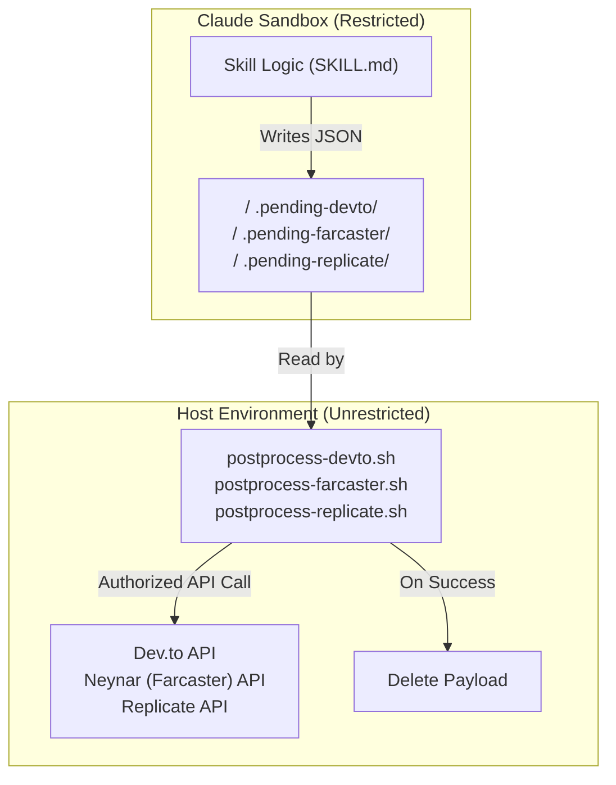
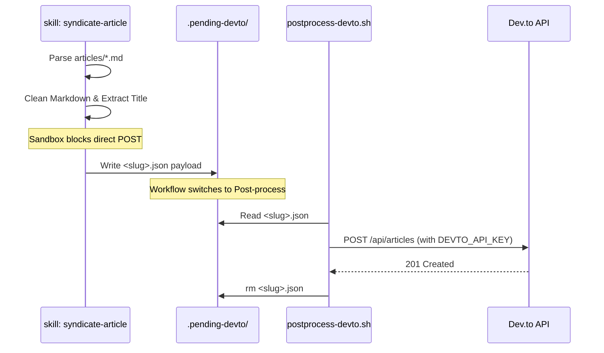

<!-- source: DeepWiki mcp.deepwiki.com · repo aaronjmars/aeon · page 9.1 Prefetch & Sandbox Mitigation Scripts · fetched 2026-10-27 -->

# Prefetch & Sandbox Mitigation Scripts

Relevant source files

The following files were used as context for generating this wiki page:

- [.gitignore](.gitignore)
- [add-skill](add-skill)
- [memory/issues/INDEX.md](memory/issues/INDEX.md)
- [scripts/eval-audit](scripts/eval-audit)
- [scripts/postprocess-devto.sh](scripts/postprocess-devto.sh)
- [scripts/postprocess-farcaster.sh](scripts/postprocess-farcaster.sh)
- [scripts/postprocess-replicate.sh](scripts/postprocess-replicate.sh)
- [scripts/prefetch-xai.sh](scripts/prefetch-xai.sh)
- [scripts/skill-runs](scripts/skill-runs)
- [skills/agent-buzz/SKILL.md](skills/agent-buzz/SKILL.md)
- [skills/skill-update-check/SKILL.md](skills/skill-update-check/SKILL.md)
- [skills/syndicate-article/SKILL.md](skills/syndicate-article/SKILL.md)

AEON operates within a restricted Claude sandbox environment during the execution of skills. This sandbox imposes strict limitations on outbound networking, specifically blocking direct `curl` or `fetch` calls to many external APIs. To maintain a high degree of autonomy and data freshness, AEON employs a **Prefetch & Post-process Pattern**. This pattern splits API interactions into three phases: pre-execution caching, sandboxed logic, and post-execution delivery.

## The Prefetch Pattern

The prefetch mechanism allows AEON to ingest real-time data from external sources before the Claude-based execution engine starts. This is primarily used for high-bandwidth or restricted APIs like X.AI (Grok).

### prefetch-xai.sh

The `scripts/prefetch-xai.sh` script is the primary entry point for caching external data. It is called by the GitHub Actions workflow prior to the skill's execution [scripts/prefetch-xai.sh:3-4](). It uses the `XAI_API_KEY` to query the Grok `x_search` tool and saves the results as JSON in the `.xai-cache/` directory [scripts/prefetch-xai.sh:26-27]().

**Key Logic:**
*   **Generic Search:** The `xai_search()` function handles the `curl` request to `https://api.x.ai/v1/responses`, including retry logic for timeouts (HTTP 429) and error logging to `memory/logs/` [scripts/prefetch-xai.sh:29-96]().
*   **Skill-Specific Logic:** The script contains a `case` block that defines specific search prompts and date ranges for different skills such as `refresh-x`, `remix-tweets`, and `narrative-tracker` [scripts/prefetch-xai.sh:98-160]().
*   **Caching:** Results are stored in `.xai-cache/<filename>.json`, which skills then read locally, bypassing the need for outbound network calls during their execution phase [scripts/prefetch-xai.sh:7-8]().

**Prefetch Data Flow**

| Step | Component | Action | File Reference |
|:---|:---|:---|:---|
| 1 | Workflow | Calls `prefetch-xai.sh <skill> <var>` | [scripts/prefetch-xai.sh:10-11]() |
| 2 | `prefetch-xai.sh` | Queries X.AI API via `curl` | [scripts/prefetch-xai.sh:53-56]() |
| 3 | `prefetch-xai.sh` | Writes JSON to `.xai-cache/` | [scripts/prefetch-xai.sh:94]() |
| 4 | Skill Execution | Reads local file from `.xai-cache/` | [scripts/prefetch-xai.sh:7]() |

**Sources:** [scripts/prefetch-xai.sh:1-160](), [.gitignore:12-13]()

---

## The Pending Payload Pattern

When a skill needs to perform a "write" action to an external API (like posting a tweet, a Farcaster cast, or a Dev.to article), it cannot do so directly from the sandbox. Instead, it writes a JSON "pending payload" to a specific hidden directory. These directories are excluded from the main repository state via `.gitignore` [.gitignore:15-20]().

### Data Entity Mapping: Natural Language to Code

The following diagram maps the conceptual "Sandbox Mitigation" process to the specific scripts and directories used in the AEON codebase.

**Sandbox Mitigation Architecture**

**Sources:** [scripts/postprocess-devto.sh:6-10](), [scripts/postprocess-farcaster.sh:9-13](), [scripts/postprocess-replicate.sh:6-11](), [.gitignore:15-20]()

---

## Post-Processing Scripts

After the skill execution workflow completes, the system runs post-processing scripts to consume any payloads generated in the `.pending-*` directories.

### postprocess-devto.sh
This script handles article syndication to Dev.to.
*   **Detection:** Checks for files in `.pending-devto/*.json` [scripts/postprocess-devto.sh:8-10]().
*   **Execution:** Iterates through payloads and performs a `POST` to `https://dev.to/api/articles` using the `api-key` header [scripts/postprocess-devto.sh:22-26]().
*   **Cleanup:** Deletes the payload upon a successful `201` response or a `422` validation error (to prevent infinite retries of bad data) [scripts/postprocess-devto.sh:31-37]().

### postprocess-farcaster.sh
Handles social posting to Farcaster via the Neynar API.
*   **Secret Injection:** Critically, this script injects the `NEYNAR_SIGNER_UUID` into the payload *at runtime*. This ensures the sensitive UUID is never written to a file on disk by the Claude sandbox [scripts/postprocess-farcaster.sh:30-31]().
*   **Execution:** Calls `https://api.neynar.com/v2/farcaster/cast` [scripts/postprocess-farcaster.sh:33-37]().
*   **Verification:** Extracts the cast hash and author to log the final Warpcast URL [scripts/postprocess-farcaster.sh:43-46]().

### postprocess-replicate.sh
Manages AI image generation tasks.
*   **Async Handling:** Since image generation is asynchronous, the script supports a "polling" mode. It first attempts a `Prefer: wait` request; if that fails or the image isn't ready, it polls the `urls.get` endpoint for up to 60 seconds [scripts/postprocess-replicate.sh:33-80]().
*   **Fallback Logic:** Includes a retry mechanism that allows the use of a fallback model if the primary model fails [scripts/postprocess-replicate.sh:45-58]().
*   **Result Persistence:** Downloads the resulting image to the path specified in the payload and writes a `.done` marker file so the calling skill can verify completion in future runs [scripts/postprocess-replicate.sh:89-93]().

**Sources:** [scripts/postprocess-devto.sh:1-46](), [scripts/postprocess-farcaster.sh:1-67](), [scripts/postprocess-replicate.sh:1-100]()

---

## Integration Example: syndicate-article

The `syndicate-article` skill demonstrates the full lifecycle of the pending payload pattern.

**Syndication Execution Flow**

**Implementation Details:**
*   **Payload Construction:** The skill builds a JSON object containing `title`, `body_markdown`, `canonical_url`, and `tags` [skills/syndicate-article/SKILL.md:115-129]().
*   **Directory Management:** It ensures the directory exists via `mkdir -p .pending-devto/` [skills/syndicate-article/SKILL.md:112]().
*   **Opt-in Logic:** The skill only generates payloads if the required environment variables (e.g., `DEVTO_API_KEY`) are detected, otherwise it logs a skip and exits [skills/syndicate-article/SKILL.md:28-31]().

**Sources:** [skills/syndicate-article/SKILL.md:1-140](), [scripts/postprocess-devto.sh:1-46]()

---

