# Page: Overview

# Overview

<details>
<summary>Relevant source files</summary>

The following files were used as context for generating this wiki page:

- [.github/workflows/chain-runner.yml](.github/workflows/chain-runner.yml)
- [.outputs/.gitkeep](.outputs/.gitkeep)
- [CLAUDE.md](CLAUDE.md)
- [README.md](README.md)
- [SHOWCASE.md](SHOWCASE.md)
- [aeon.yml](aeon.yml)
- [assets/architecture.jpg](assets/architecture.jpg)
- [assets/autonomy.jpg](assets/autonomy.jpg)
- [assets/stack.jpg](assets/stack.jpg)
- [skills/contributor-reward/SKILL.md](skills/contributor-reward/SKILL.md)

</details>


AEON is a zero-infrastructure, autonomous agent framework designed to run unattended on GitHub Actions. Unlike interactive agents that require constant approval loops, AEON is built for recurring tasks—deep research, market monitoring, PR reviews, and security scans—where the agent operates independently, scores its own output quality, and self-heals when skills fail [README.md:15-43]().

The system utilizes a modular "Skills" architecture, a flat-file memory database, and a local Next.js dashboard for configuration and management [README.md:53-67]().

### System Architecture & Logic Flow

AEON bridges the gap between high-level user intent and automated execution by mapping a desired "Soul" (personality and goals) to a fleet of modular code entities called Skills.

**The AEON Stack**
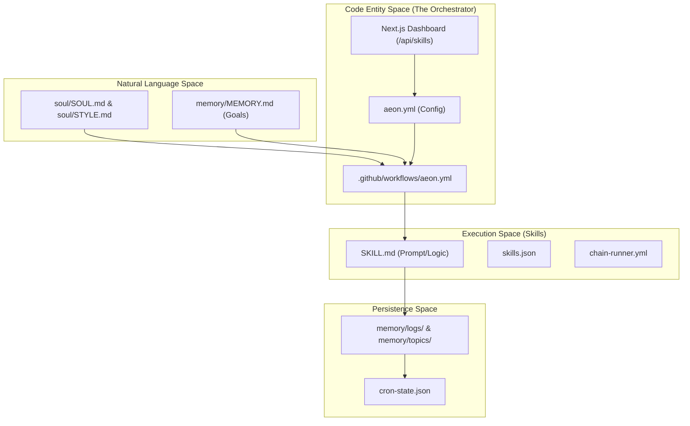
**Sources:** [README.md:70-85](), [CLAUDE.md:1-40](), [aeon.yml:1-7]().

---

### Key Components

#### 1. Skills System
AEON features over 90 specialized skills categorized into Research, Dev, Crypto, Social, and Meta-Agent functions [README.md:74-81](). Each skill is defined in a `SKILL.md` file containing its logic and prompts [skills/contributor-reward/SKILL.md:1-6]().
*   **Discovery:** Skills are tracked in `skills.json` [README.md:83]().
*   **Chaining:** Skills can be linked together where downstream steps consume the output of upstream steps via `.outputs/` [CLAUDE.md:53-73]().
*   **For details, see [Skills System](#3)**.

#### 2. Execution Engine
The engine is powered by GitHub Actions, primarily through `.github/workflows/aeon.yml`. It handles:
*   **Scheduling:** Uses cron expressions defined in `aeon.yml` [aeon.yml:9-11]().
*   **Sandbox Management:** Uses "Prefetch" and "Post-process" patterns to bypass GitHub Actions sandbox limitations for authenticated APIs [CLAUDE.md:91-102]().
*   **For details, see [Execution Engine & Orchestration](#2)**.

#### 3. Memory & State
AEON maintains state without a traditional database, using a version-controlled `memory/` directory.
*   **`MEMORY.md`**: High-level index of current goals and interests [CLAUDE.md:27-28]().
*   **`topics/`**: Detailed persistent notes [CLAUDE.md:28]().
*   **`logs/`**: Daily append-only activity records [CLAUDE.md:29]().
*   **For details, see [Memory & State Management](#5)**.

---

### Data & Execution Mapping

This diagram illustrates how a user-facing skill configuration in the Dashboard or `aeon.yml` translates into a running process in GitHub Actions and persists data back to the repository.

**Execution Mapping: Config to Action**
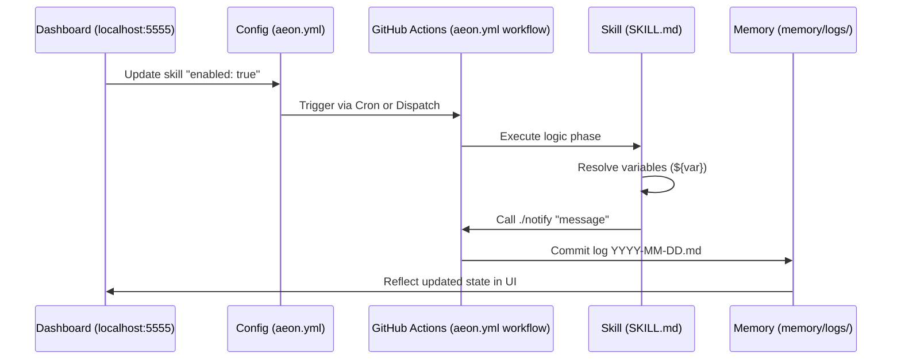
**Sources:** [README.md:53-67](), [CLAUDE.md:20-37](), [aeon.yml:1-10]().

---

### Major Subsystems

| Subsystem | Primary Files | Role |
| :--- | :--- | :--- |
| **Orchestration** | `aeon.yml`, `.github/workflows/` | Schedules and triggers skill execution. |
| **Self-Healing** | `heartbeat`, `skill-repair` | Monitors `cron-state.json` and patches failing code. |
| **Interface** | `dashboard/`, `mcp-server/` | Local management UI and Model Context Protocol server. |
| **Identity** | `soul/`, `CLAUDE.md` | Defines the agent's voice, style, and global rules. |
| **Notification** | `./notify`, `scripts/postprocess-notify.sh` | Fans out messages to Telegram, Discord, and Slack. |

**Sources:** [README.md:32-41](), [CLAUDE.md:5-19](), [CLAUDE.md:78-90](), [SHOWCASE.md:40-52]().

---

### Next Steps
*   **[Getting Started & Onboarding](#1.1)**: Learn how to fork the repo and set up your first instance.
*   **[Core Concepts & Terminology](#1.2)**: Understand the specific vocabulary used in the AEON ecosystem.

---

# Page: Getting Started & Onboarding

# Getting Started & Onboarding

<details>
<summary>Relevant source files</summary>

The following files were used as context for generating this wiki page:

- [README.md](README.md)
- [aeon](aeon)
- [aeon.yml](aeon.yml)
- [dashboard/app/api/auth/route.ts](dashboard/app/api/auth/route.ts)
- [dashboard/package-lock.json](dashboard/package-lock.json)
- [dashboard/package.json](dashboard/package.json)
- [generate-skills-json](generate-skills-json)
- [onboard](onboard)
- [scripts/sync-upstream.sh](scripts/sync-upstream.sh)
- [skills/auto-workflow/SKILL.md](skills/auto-workflow/SKILL.md)
- [skills/contributor-reward/SKILL.md](skills/contributor-reward/SKILL.md)
- [skills/onboard/SKILL.md](skills/onboard/SKILL.md)
- [skills/treasury-info/SKILL.md](skills/treasury-info/SKILL.md)

</details>


This guide provides a technical walkthrough for deploying your own instance of AEON. AEON is designed as a **zero-infrastructure** autonomous agent framework that runs entirely within GitHub Actions, utilizing a flat-file memory system for persistence across ephemeral execution environments [README.md:40-43]().

## Deployment Model: Zero Infrastructure

AEON operates on a "push-to-deploy" model. The local dashboard acts as a configuration engine that commits changes to your repository, which then triggers the autonomous execution engine in GitHub Actions.

### Data Flow: Configuration to Execution

The following diagram illustrates how a user transitions from local setup to autonomous cloud execution.

**System Transition: Local Configuration to GitHub Actions Execution**
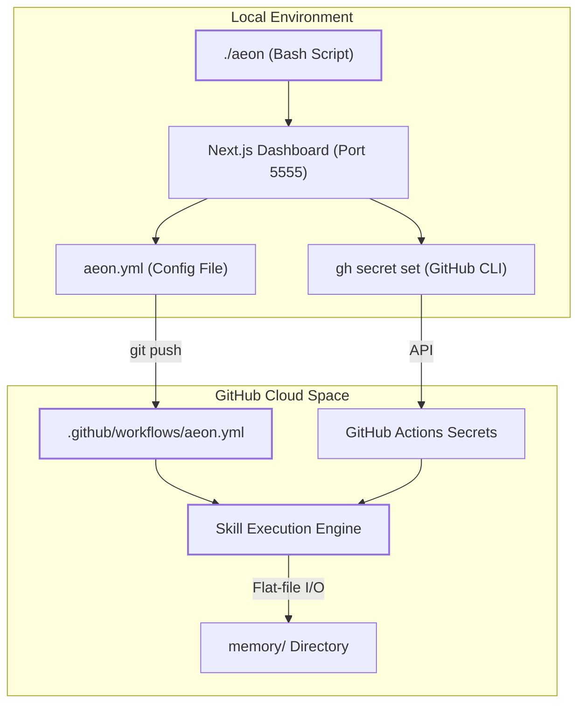
**Sources:** [aeon:1-43](), [README.md:55-68](), [aeon.yml:1-7]()

---

## Step 1: Repository Initialization

To begin, fork the AEON repository and clone it locally. AEON requires `node`, `npm`, and the GitHub CLI (`gh`) to be installed and authenticated on your machine [onboard:95-104]().

```bash
git clone https://github.com/your-username/aeon
cd aeon
./aeon
```

The `./aeon` script initializes the Next.js dashboard by installing dependencies and launching the development server on port 5555 [aeon:7-43]().

**Sources:** [README.md:55-58](), [aeon:1-43]()

---

## Step 2: Authentication & Secrets

AEON requires an LLM provider to function. You can provide either a standard API key or an OAuth token from a Claude Pro/Max subscription [README.md:99-105]().

### Authentication Logic
The dashboard uses the `gh` CLI to securely inject these secrets into your GitHub repository settings [dashboard/app/api/auth/route.ts:45-51]().

| Secret Name | Purpose | Source |
| :--- | :--- | :--- |
| `ANTHROPIC_API_KEY` | Direct API access | [console.anthropic.com](https://console.anthropic.com) |
| `CLAUDE_CODE_OAUTH_TOKEN` | Claude Pro/Max access | `claude setup-token` |
| `BANKR_LLM_KEY` | Optional gateway for cheaper Opus | [bankr.bot/api](https://bankr.bot/api) |

**Sources:** [README.md:99-118](), [dashboard/app/api/auth/route.ts:40-51]()

---

## Step 3: Skill Configuration (`aeon.yml`)

The `aeon.yml` file is the central manifest for your agent's behavior. Each skill is configured as an object within the `skills` map [aeon.yml:7-110]().

### Configuration Schema
A typical skill entry includes:
*   `enabled`: Boolean toggle for the skill [aeon.yml:3]().
*   `schedule`: A standard cron string for unattended execution [aeon.yml:9]().
*   `var`: A skill-specific parameter (e.g., a search query or a GitHub repo slug) [aeon.yml:4]().
*   `model`: Override for the default LLM (e.g., using `claude-sonnet-4-6` for cost efficiency) [aeon.yml:5]().

**Sources:** [aeon.yml:1-110]()

---

## Step 4: The Onboard Validator

The `./onboard` utility is a diagnostic tool that verifies the integrity of your fork. It checks for:
1.  **Workflow Integrity**: Ensures `.github/workflows/` contains necessary YAML files [onboard:118-125]().
2.  **Configuration**: Validates that `aeon.yml` is present and has at least one skill enabled [onboard:127-142]().
3.  **Memory Permissions**: Confirms the `memory/` directory is writable [onboard:144-159]().
4.  **Secrets**: Checks the remote repository for valid authentication keys [onboard:161-183]().

### The `onboard` Skill
Running `./onboard --remote` triggers the `onboard` skill inside GitHub Actions [onboard:12](). This skill executes the same logic in the cloud environment and sends a formatted checklist to your configured notification channel (Telegram, Slack, or Discord) [skills/onboard/SKILL.md:10-18]().

**Onboarding Logic: Local CLI to Remote Notification**
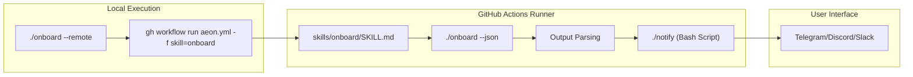
**Sources:** [onboard:1-20](), [skills/onboard/SKILL.md:19-88]()

---

## Step 5: Maintenance & Upstream Sync

As the AEON framework evolves, you can pull new skills and updates from the upstream repository.

### `generate-skills-json`
This script parses the `SKILL.md` files across the `skills/` directory to rebuild `skills.json`, which acts as the local registry for the dashboard [generate-skills-json:4-13]().

### `sync-upstream.sh`
This utility compares your local `skills.json` against the upstream version at `aaronjmars/aeon`. It identifies SHA mismatches and allows for interactive or automated updates of individual skills [scripts/sync-upstream.sh:4-10]().

**Sources:** [generate-skills-json:1-140](), [scripts/sync-upstream.sh:1-154]()

---

# Page: Core Concepts & Terminology

# Core Concepts & Terminology

<details>
<summary>Relevant source files</summary>

The following files were used as context for generating this wiki page:

- [.github/workflows/aeon.yml](.github/workflows/aeon.yml)
- [.github/workflows/chain-runner.yml](.github/workflows/chain-runner.yml)
- [.github/workflows/messages.yml](.github/workflows/messages.yml)
- [.outputs/.gitkeep](.outputs/.gitkeep)
- [CLAUDE.md](CLAUDE.md)
- [README.md](README.md)
- [aeon.yml](aeon.yml)
- [export-skill](export-skill)
- [skills.json](skills.json)
- [skills/contributor-reward/SKILL.md](skills/contributor-reward/SKILL.md)
- [skills/distribute-tokens/SKILL.md](skills/distribute-tokens/SKILL.md)
- [skills/skill-analytics/SKILL.md](skills/skill-analytics/SKILL.md)
- [skills/star-milestone/SKILL.md](skills/star-milestone/SKILL.md)

</details>


This page defines the foundational vocabulary and structural architecture of the AEON framework. AEON is an autonomous agent system designed to run unattended, self-heal, and persist state across ephemeral execution environments.

## System Architecture Overview

AEON operates as a "zero-infrastructure" agent by leveraging GitHub Actions as its compute engine and the repository itself as its persistent database [README.md:40-43](). The system is composed of modular **Skills** that are orchestrated by a central **Scheduler** and governed by a set of identity and style guidelines known as the **Soul**.

### Natural Language to Code Entity Mapping

The following diagram bridges the conceptual "Natural Language Space" used by operators to the "Code Entity Space" used by the system.

**Diagram: Entity Mapping**
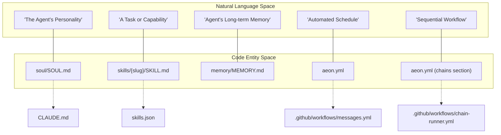
Sources: [CLAUDE.md:1-13](), [aeon.yml:7-117](), [skills.json:1-13](), [.github/workflows/messages.yml:1-18]()

---

## Core Terminology

### 1. Skills
A **Skill** is a modular unit of work. Each skill is defined by a `SKILL.md` file containing a two-phase pattern: **RESOLVE** (pre-flight checks and data gathering) and **EXECUTE** (action performance) [skills/distribute-tokens/SKILL.md:88-127]().

*   **Slug:** The unique directory name (e.g., `token-alert`).
*   **Frontmatter:** YAML metadata at the top of `SKILL.md` defining name, description, and tags [skills/star-milestone/SKILL.md:1-6]().
*   **Vars:** Parameters passed to a skill via `aeon.yml` or manual dispatch to focus its behavior (e.g., a specific repo or token) [aeon.yml:4-5](), [.github/workflows/aeon.yml:26-29]().

### 2. The Soul
The **Soul** directory contains the calibration material for AEON's voice and identity. It is read by the agent at the start of every task to ensure consistency across output channels [CLAUDE.md:5-13]().

*   **SOUL.md:** Identity, worldview, and background.
*   **STYLE.md:** Writing patterns, vocabulary, and anti-patterns.
*   **Examples:** Calibration material for social media or reporting.

### 3. Memory (Flat-File Database)
AEON uses a structured directory of Markdown and JSON files for persistence. This "flat-file database" avoids the need for an external SQL/NoSQL instance [README.md:40-43]().

| File/Path | Purpose | Implementation |
| :--- | :--- | :--- |
| `memory/MEMORY.md` | High-level index | Current goals and active topics [CLAUDE.md:27](). |
| `memory/topics/` | Domain-specific state | Detailed notes (e.g., `crypto.md`) [CLAUDE.md:28](). |
| `memory/logs/` | Append-only history | Daily logs in `YYYY-MM-DD.md` format [CLAUDE.md:29](). |
| `memory/issues/` | System health tracker | Tracks skill failures and degradations [CLAUDE.md:30-32](). |
| `cron-state.json` | Execution metrics | Tracks last run status and dispatch times [messages.yml:98-103](). |

### 4. Chains
**Chains** allow multiple skills to run in sequence or parallel as part of a single logical workflow. Outputs from upstream skills are saved to `.outputs/{skill}.md` and injected into the context of downstream skills via the `consume:` keyword [CLAUDE.md:53-73](), [chain-runner.yml:121-147]().

### 5. Reactive Triggers
Unlike standard cron schedules, **Reactive Triggers** allow AEON to respond to external events.
*   **Issue Triggers:** Responding to labels on GitHub issues (e.g., `ai-build`) [.github/workflows/aeon.yml:52-53]().
*   **Message Triggers:** Responding to incoming messages from Telegram, Discord, or Slack [.github/workflows/messages.yml:17-18]().

---

## Data Flow & Execution Lifecycle

AEON execution follows a strict lifecycle to manage the constraints of the GitHub Actions sandbox and ensure data persistence.

**Diagram: Execution Lifecycle**
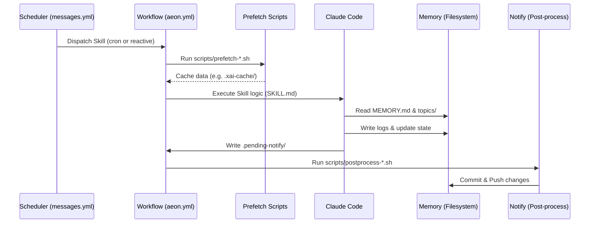
Sources: [.github/workflows/aeon.yml:160-200](), [.github/workflows/messages.yml:52-175](), [CLAUDE.md:93-102]()

---

## The Exit Taxonomy

AEON uses a standardized taxonomy for skill exit statuses, which allows the `skill-analytics` and `heartbeat` skills to differentiate between "correct silence" and "failure" [skills/skill-analytics/SKILL.md:10-14]().

| Exit Code / Marker | Meaning |
| :--- | :--- |
| `*_OK` | Standard successful completion. |
| `SKIP_UNCHANGED` | Logic ran, but no changes were needed (common in research) [skill-analytics/SKILL.md:61](). |
| `SKIP_QUIET` | Condition for action not met (e.g., no new stars) [star-milestone/SKILL.md:73](). |
| `NEW_INFO` | Successful discovery of new data without immediate action [skill-analytics/SKILL.md:62](). |
| `*_ERROR` | Hard failure (API down, auth error, etc.) [skill-analytics/SKILL.md:64](). |
| `*_PARTIAL` | Some steps succeeded, others failed (common in token distribution) [distribute-tokens/SKILL.md:139-141](). |

Sources: [skills/skill-analytics/SKILL.md:58-68](), [skills/distribute-tokens/SKILL.md:132-141](), [skills/star-milestone/SKILL.md:71-84]()

---

# Page: Execution Engine & Orchestration

# Execution Engine & Orchestration

<details>
<summary>Relevant source files</summary>

The following files were used as context for generating this wiki page:

- [.github/workflows/aeon.yml](.github/workflows/aeon.yml)
- [.github/workflows/messages.yml](.github/workflows/messages.yml)
- [README.md](README.md)
- [aeon.yml](aeon.yml)
- [skills/contributor-reward/SKILL.md](skills/contributor-reward/SKILL.md)
- [skills/skill-analytics/SKILL.md](skills/skill-analytics/SKILL.md)

</details>


AEON operates as a "zero-infrastructure" autonomous agent by leveraging GitHub Actions as its primary execution environment. The system is designed to run unattended, using a dual-workflow architecture to handle both scheduled tasks and reactive event processing. State is persisted across ephemeral runs by committing flat-file updates back to the repository's `memory/` directory.

## System Architecture

The orchestration layer bridges the gap between natural language task definitions (Skills) and the underlying GitHub Actions infrastructure.

### Execution Flow Diagram

The following diagram illustrates how the `Messages & Scheduler` workflow triggers the `Aeon` skill execution engine.

**Workflow Dispatch & Lifecycle**
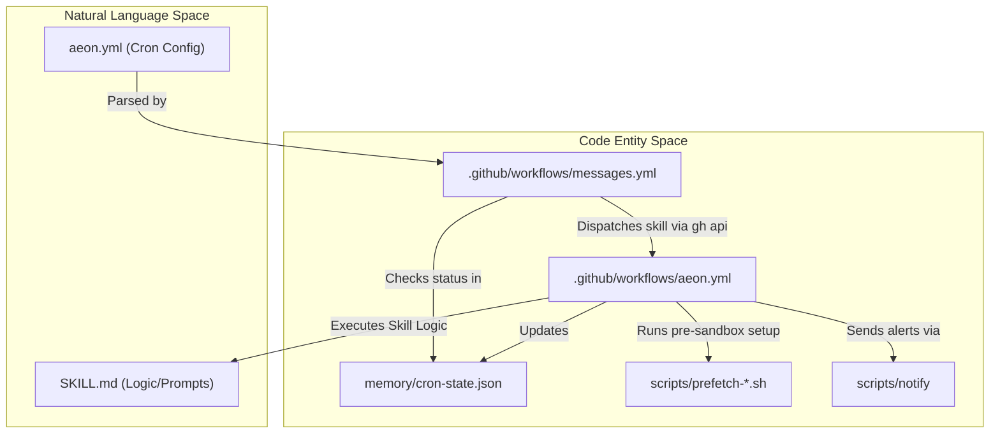
Sources: [.github/workflows/messages.yml:105-138](), [.github/workflows/aeon.yml:160-180](), [aeon.yml:7-120]()

## Core Workflows

The engine is split into two specialized GitHub Actions workflows that manage the lifecycle of every skill.

### 1. The Scheduler (`messages.yml`)
This workflow acts as the "heartbeat" of the system. It runs every 5 minutes to evaluate which skills are due for execution based on the cron expressions defined in `aeon.yml`.

*   **Cron Matching:** Implements a custom Bash-based cron matcher to support standard syntax, ranges, and steps [ .github/workflows/messages.yml:68-95]().
*   **State Awareness:** Consults `memory/cron-state.json` to avoid redundant dispatches and implement a 30-minute cooldown for retrying failed skills [.github/workflows/messages.yml:149-160]().
*   **Message Polling:** Also handles incoming messages from Telegram, Discord, or Slack to trigger skills reactively [.github/workflows/messages.yml:17-18]().

### 2. The Execution Engine (`aeon.yml`)
This is the primary worker workflow that runs the actual skill logic. It utilizes `claude-code` to interpret and execute the instructions found in a skill's `SKILL.md` file.

*   **Sandbox & Prefetch:** Because the LLM runs in a restricted sandbox, the engine executes `scripts/prefetch-*.sh` before starting the LLM to cache external data (like X/Grok API results) into `.xai-cache/` [.github/workflows/aeon.yml:160-180]().
*   **Secret Validation:** Scans `SKILL.md` for required API keys and warns if they are missing from GitHub Secrets before execution begins [.github/workflows/aeon.yml:123-158]().
*   **Commit Loop:** Automatically commits changes to `memory/`, `articles/`, and `docs/` at the end of every run, using a conflict-resolution loop to handle parallel execution [.github/workflows/aeon.yml:218-245]().

For details, see [GitHub Actions Workflows](#2.1).

## Scheduling & Chaining Logic

Skills are not just isolated scripts; they can be sequenced into pipelines.

| Feature | Mechanism |
| :--- | :--- |
| **Cron Scheduling** | Defined per-skill in `aeon.yml` using standard 5-field syntax [.github/workflows/messages.yml:163-174](). |
| **Reactive Triggers** | Skills marked `schedule: "reactive"` are skipped by the cron and only fire on specific events [.github/workflows/messages.yml:147](). |
| **Skill Chaining** | Outputs from one skill (e.g., `article`) can be passed to another (e.g., `syndicate-article`) using `chain_context_file` [.github/workflows/aeon.yml:30-33](). |

For details, see [Skill Scheduling & Chaining](#2.2).

## Notification & Post-Processing

The execution engine follows a "deferred execution" pattern for high-privilege or sandbox-restricted actions.

**Notification & Distribution Pipeline**
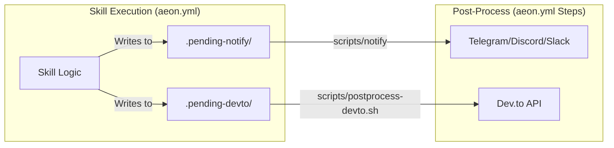
Sources: [.github/workflows/aeon.yml:191-205](), [skills/contributor-reward/SKILL.md:10-16]()

*   **Buffering:** Skills write notification payloads to the `.pending-notify/` directory.
*   **The `./notify` Script:** A standalone utility that reads these buffers and delivers them to configured channels (Telegram, Discord, Slack, SendGrid) [.github/workflows/aeon.yml:205-215]().
*   **Deferred APIs:** Actions that require complex API interactions (like posting to Farcaster or Replicate) are handled by `postprocess-*.sh` scripts that run after the LLM has finished its reasoning phase.

For details, see [Notification & Post-Processing Pipeline](#2.3).

## Observability & Self-Healing

The orchestration layer includes meta-skills that monitor the engine itself:
*   **`heartbeat`**: Monitors `cron-state.json` and updates the public status page at `docs/status.md` [README.md:81]().
*   **`skill-analytics`**: Generates a weekly fleet-level report on skill performance, exit taxonomies (e.g., `SKIP_UNCHANGED`), and failure streaks [skills/skill-analytics/SKILL.md:10-14]().

Sources: [README.md:12](), [skills/skill-analytics/SKILL.md:72-87]()

---

# Page: GitHub Actions Workflows

# GitHub Actions Workflows

<details>
<summary>Relevant source files</summary>

The following files were used as context for generating this wiki page:

- [.github/workflows/aeon.yml](.github/workflows/aeon.yml)
- [.github/workflows/chain-runner.yml](.github/workflows/chain-runner.yml)
- [.github/workflows/messages.yml](.github/workflows/messages.yml)
- [.outputs/.gitkeep](.outputs/.gitkeep)
- [CLAUDE.md](CLAUDE.md)
- [skills/skill-analytics/SKILL.md](skills/skill-analytics/SKILL.md)

</details>


This page provides a deep dive into the two primary orchestration engines of AEON: the **Skill Execution Engine** (`aeon.yml`) and the **Scheduler/Message Poller** (`messages.yml`). These workflows manage the lifecycle of autonomous skills, handle secure data pre-fetching, and maintain system state through a conflict-resolution commit loop.

## 1. Skill Execution Engine (aeon.yml)

The `aeon.yml` workflow is the primary runtime for AEON skills. It provides the environment for Claude Code to execute logic defined in `SKILL.md` files.

### Trigger Types
The workflow supports three trigger mechanisms:
*   **`workflow_dispatch`**: Manual execution via the GitHub UI or API, allowing overrides for `skill`, `model`, and `var` [`.github/workflows/aeon.yml`:5-33]().
*   **`workflow_call`**: Reusable entry point for **Skill Chains** and other workflows [`.github/workflows/aeon.yml`:34-51]().
*   **`issues` (labeled `ai-build`)**: Reactive trigger that treats the issue body as a "feature" request [`.github/workflows/aeon.yml`:52-53](), [`.github/workflows/aeon.yml`:87-89]().

### Execution Lifecycle
1.  **Environment Setup**: Configures Node.js 22 and installs `@anthropic-ai/claude-code` [`.github/workflows/aeon.yml`:113-122]().
2.  **Secret Validation**: Scans the target `SKILL.md` for required environment variables (e.g., `*_API_KEY`, `*_TOKEN`) and issues warnings if they are missing from GitHub Secrets [`.github/workflows/aeon.yml`:123-158]().
3.  **Pre-fetch Phase**: Executes all `scripts/prefetch-*.sh` scripts. This allows fetching data from authenticated APIs (like X/Twitter via `prefetch-xai.sh`) outside the restricted Claude sandbox [`.github/workflows/aeon.yml`:160-181]().
4.  **The Run**: Invokes Claude Code with the skill's instructions. Claude is granted access to high-level identity via `SOUL.md` and `CLAUDE.md` [`.github/workflows/aeon.yml`:182-226]().
5.  **Post-processing**: Consumes `.pending-*` files created by Claude to perform authenticated side effects (e.g., posting to Farcaster or Dev.to) [`.github/workflows/aeon.yml`:233-254]().
6.  **Persistence**: Commits all changes (logs, memory updates, articles) back to the repository using a conflict-resolution loop [`.github/workflows/aeon.yml`:265-298]().

### Conflict-Resolution Commit Loop
To handle parallel workflow runs, the "Finalize" step uses a `git pull --rebase` strategy within a loop. If a push fails due to remote changes, the workflow retries up to 5 times [`.github/workflows/aeon.yml`:265-298]().

**Sources:** [`.github/workflows/aeon.yml`:1-298](), [`CLAUDE.md`:91-103]()

---

## 2. Scheduler & Message Poller (messages.yml)

The `messages.yml` workflow acts as the system's "heartbeat," running every 5 minutes to dispatch scheduled skills and poll for inbound communications.

### Cron Matching & Dispatch
The workflow implements a custom Bash-based cron parser that supports standard syntax (e.g., `*/5`, `1-10/2`, `0,15,30,45`) [`.github/workflows/messages.yml`:68-95]().
*   **State Awareness**: It reads `memory/cron-state.json` to track the `last_dispatch` and `last_status` of every skill [`.github/workflows/messages.yml`:149-154]().
*   **Failure Retries**: Skills that failed are automatically retried after a 30-minute cooldown [`.github/workflows/messages.yml`:155-160]().
*   **Catch-up Logic**: If GitHub Actions misses a cron window, the scheduler checks the previous hour to ensure critical skills eventually fire [`.github/workflows/messages.yml`:175-188]().

### Inbound Messaging
The workflow polls external platforms for user commands:
*   **Telegram**: Uses offset-based polling via `TELEGRAM_BOT_TOKEN` [`.github/workflows/messages.yml`:254-282]().
*   **Discord/Slack**: Uses reaction-based acknowledgement (polling for specific emojis on messages) to prevent duplicate processing [`.github/workflows/messages.yml`:284-350]().

**Sources:** [`.github/workflows/messages.yml`:1-350]()

---

## 3. System Architecture Diagrams

### From Natural Language to Code Execution
This diagram illustrates how a manual trigger or a scheduled event translates into the execution of specific code entities.

Title: AEON Execution Path
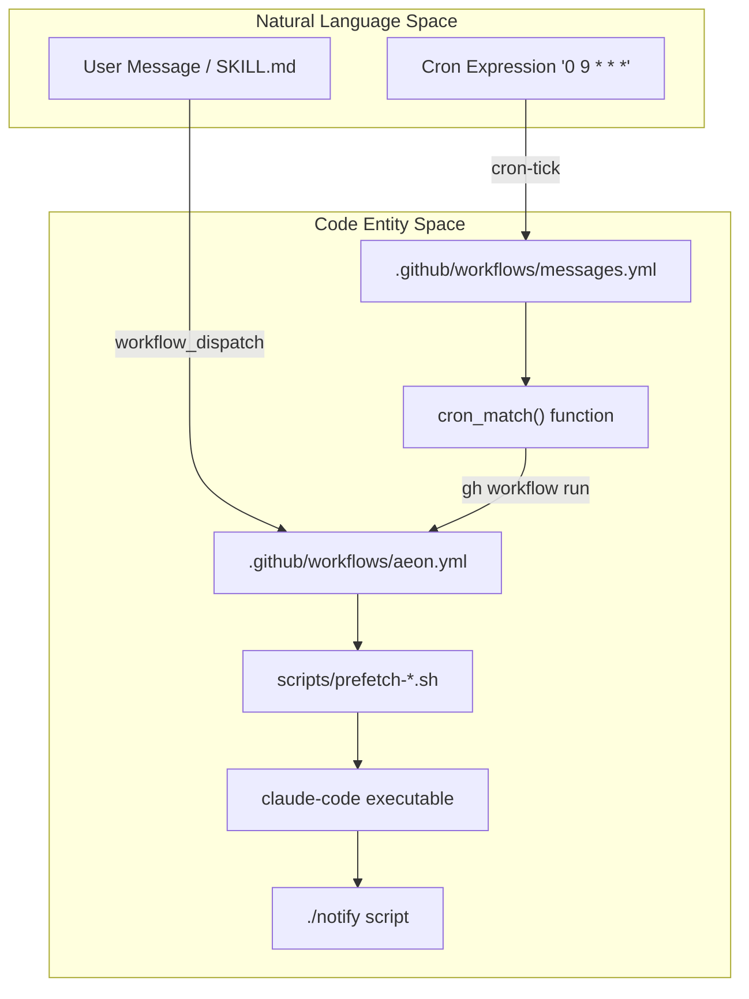
**Sources:** [`.github/workflows/aeon.yml`:5-10](), [`.github/workflows/messages.yml`:5-19](), [`.github/workflows/messages.yml`:68-70](), [`.github/workflows/aeon.yml`:119-121](), [`.github/workflows/aeon.yml`:175-180]()

### Sandbox & Side-Effect Patterns
Because the Claude Code sandbox restricts network access for security, AEON uses a "Pre/Post" pattern to interact with the outside world.

Title: Sandbox Mitigation Flow
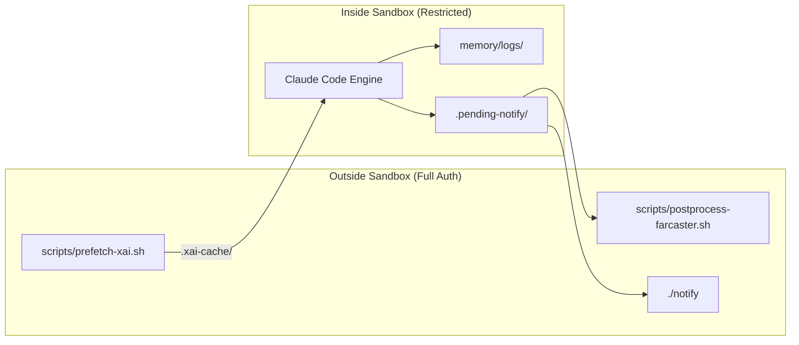
**Sources:** [`CLAUDE.md`:91-103](), [`.github/workflows/aeon.yml`:160-181](), [`.github/workflows/aeon.yml`:233-254]()

---

## 4. Workflow Constraints & Security

### Sandbox Constraints
Claude Code operates within a sandbox that blocks environment variable expansion in outbound `curl` headers to prevent secret exfiltration [Reference: `CLAUDE.md`:97-101](). AEON bypasses this using:
1.  **Pre-fetch Scripts**: Run before the sandbox starts, caching data in local files (e.g., `.xai-cache/`) [`.github/workflows/aeon.yml`:168-180]().
2.  **WebFetch Fallback**: Uses Claude's internal `WebFetch` tool for unauthenticated public URL access [Reference: `CLAUDE.md`:95]().
3.  **Post-processing**: Claude writes JSON payloads to `.pending-{service}/` directories, which are then picked up by `postprocess-*.sh` scripts after the sandbox closes [`.github/workflows/aeon.yml`:233-254]().

### Secret Validation Logic
The `aeon.yml` workflow includes a validation step that greps `SKILL.md` for variable patterns. It distinguishes between:
*   **Mandatory Secrets**: Triggers a `::warning::` if missing [`.github/workflows/aeon.yml`:157]().
*   **Optional Secrets**: Identified by keywords like "optional" or "falls back" in the skill description; triggers a `::notice::` [`.github/workflows/aeon.yml`:148-156]().

| Secret Category | Examples | Handling |
| :--- | :--- | :--- |
| Core AI | `ANTHROPIC_API_KEY`, `BANKR_LLM_KEY` | Passed to Sandbox [`.github/workflows/aeon.yml`:186-188]() |
| Notifications | `TELEGRAM_BOT_TOKEN`, `DISCORD_WEBHOOK_URL` | Used in Post-processing [`.github/workflows/aeon.yml`:191-195]() |
| Data APIs | `XAI_API_KEY`, `ALCHEMY_API_KEY` | Used in Pre-fetch [`.github/workflows/aeon.yml`:126-128]() |

**Sources:** [`.github/workflows/aeon.yml`:123-158](), [`CLAUDE.md`:91-110]()

---

# Page: Skill Scheduling & Chaining

# Skill Scheduling & Chaining

<details>
<summary>Relevant source files</summary>

The following files were used as context for generating this wiki page:

- [.github/workflows/aeon.yml](.github/workflows/aeon.yml)
- [.github/workflows/chain-runner.yml](.github/workflows/chain-runner.yml)
- [.github/workflows/messages.yml](.github/workflows/messages.yml)
- [.outputs/.gitkeep](.outputs/.gitkeep)
- [CLAUDE.md](CLAUDE.md)
- [README.md](README.md)
- [aeon.yml](aeon.yml)
- [skills/contributor-reward/SKILL.md](skills/contributor-reward/SKILL.md)
- [skills/skill-analytics/SKILL.md](skills/skill-analytics/SKILL.md)

</details>


AEON operates as an autonomous system by orchestrating over 90 modular skills through a sophisticated scheduling and dependency engine. Unlike interactive agents, AEON uses `aeon.yml` to define when skills run, how they react to external conditions, and how they pass data between sequential steps in a chain.

## Scheduling Architecture

The scheduling logic is primarily housed in the `Messages & Scheduler` workflow [`.github/workflows/messages.yml:1-2`](). This workflow runs on a 5-minute cron interval [`.github/workflows/messages.yml:6-6`]() to evaluate the state of the fleet.

### The Tick Cycle
When the scheduler "ticks," it performs the following sequence:
1.  **Environment Capture**: Records the current UTC time (Minute, Hour, Day, etc.) [`.github/workflows/messages.yml:56-62`]() to match against skill schedules.
2.  **State Loading**: Reads `memory/cron-state.json` to check the last run status and dispatch time for every skill [`.github/workflows/messages.yml:98-103`]() .
3.  **Config Parsing**: Scans `aeon.yml` to identify enabled skills and their associated cron strings or trigger types [`.github/workflows/messages.yml:109-138`]() .
4.  **Matching & Catch-up**:
    *   **Standard Match**: Uses `cron_match` to see if the current time fits the skill's schedule [`.github/workflows/messages.yml:68-95`]().
    *   **Retry Logic**: If a skill failed in its last attempt, it is automatically retried after a 30-minute cooldown [`.github/workflows/messages.yml:155-160`]().
    *   **Catch-up**: If GitHub Actions missed a window (e.g., due to platform delay), the scheduler checks the previous hour to ensure the skill fires [`.github/workflows/messages.yml:175-182`]().

### Scheduling Data Flow: Config to Execution
The following diagram illustrates how the `aeon.yml` configuration is transformed into active GitHub Action runs by the `Messages & Scheduler` workflow.

**Diagram: Schedule Dispatch Logic**
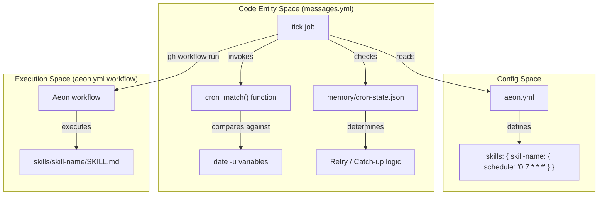
Sources: [`.github/workflows/messages.yml:52-185`](), [`.github/workflows/aeon.yml:4-33`]()

## Skill Chaining

Skill Chaining allows for complex multi-step workflows where the output of one or more skills serves as the context for a subsequent skill. This is configured in the `chains:` section of `aeon.yml` [`.github/workflows/chain-runner.yml:149-162`]().

### Execution Flow
Chains are managed by the `Chain Runner` [`.github/workflows/chain-runner.yml:1-2`]().
1.  **Parallel Execution**: Steps defined in a `parallel` block are dispatched simultaneously via `gh workflow run` [`.github/workflows/chain-runner.yml:46-75`]().
2.  **Output Persistence**: Each skill in the chain writes its result to `.outputs/{skill-name}.md` [`.github/workflows/chain-runner.yml:130-131`]().
3.  **Context Injection**: For steps using the `consume` keyword, the runner aggregates the specified prior outputs into a single `.outputs/.chain-context-{target}.md` file [`.github/workflows/chain-runner.yml:121-147`]().
4.  **Downstream Trigger**: The next skill is invoked with the `chain_context_file` input, allowing the LLM to read the results of its predecessors [`.github/workflows/aeon.yml:30-33`]().

### Chain Definition Example
```yaml
chains:
  research-pipeline:
    schedule: "0 14 * * *"
    on_error: fail-fast
    steps:
      - parallel: [hacker-news-digest, rss-digest]
      - skill: article
        consume: [hacker-news-digest, rss-digest]
```
Sources: [`CLAUDE.md:63-73`](), [`.github/workflows/chain-runner.yml:168-197`]()

## Reactive Triggers

Reactive triggers enable AEON to respond to events rather than time.
*   **Inbound Messages**: When a user sends a message via Telegram, Discord, or Slack, the `messages.yml` workflow is triggered via `repository_dispatch` [`.github/workflows/messages.yml:17-18`](). This allows AEON to "chat" and execute skills on demand.
*   **GitHub Events**: The system can react to repository labels (e.g., `ai-build`) to trigger the `feature` skill for autonomous coding [`.github/workflows/aeon.yml:71-89`]().
*   **Skill-to-Skill Triggers**: Skills can be configured with `schedule: "reactive"`. These do not run on a timer but are intended to be called by other skills or chains [`.github/workflows/messages.yml:147-147`]().

## Technical Implementation Details

### Key Files and Components

| Component | File Path | Role |
|:---|:---|:---|
| **Scheduler** | [`.github/workflows/messages.yml`]() | Polling, cron matching, and retries. |
| **Chain Runner** | [`.github/workflows/chain-runner.yml`]() | Sequential/Parallel step orchestration. |
| **Execution Engine** | [`.github/workflows/aeon.yml`]() | The core sandbox where `claude-code` runs skills. |
| **State Store** | `memory/cron-state.json` | Persists last run status and timestamps. |

### Lifecycle of a Scheduled Run
The transition from a cron trigger to a completed skill run involves several distinct layers of the AEON architecture.

**Diagram: Execution Lifecycle**
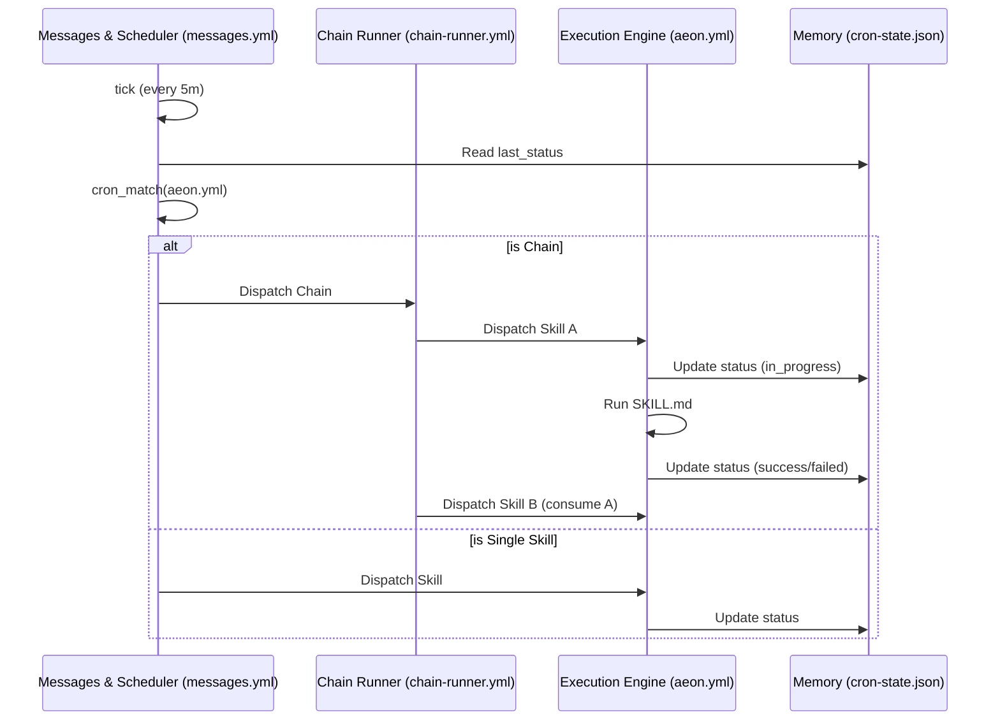
Sources: [`.github/workflows/messages.yml:140-185`](), [`.github/workflows/chain-runner.yml:36-118`](), [`.github/workflows/aeon.yml:182-205`]()

---

# Page: Notification & Post-Processing Pipeline

# Notification & Post-Processing Pipeline

<details>
<summary>Relevant source files</summary>

The following files were used as context for generating this wiki page:

- [.github/workflows/aeon.yml](.github/workflows/aeon.yml)
- [.github/workflows/messages.yml](.github/workflows/messages.yml)
- [.gitignore](.gitignore)
- [add-skill](add-skill)
- [memory/issues/INDEX.md](memory/issues/INDEX.md)
- [scripts/eval-audit](scripts/eval-audit)
- [scripts/postprocess-devto.sh](scripts/postprocess-devto.sh)
- [scripts/postprocess-farcaster.sh](scripts/postprocess-farcaster.sh)
- [scripts/postprocess-replicate.sh](scripts/postprocess-replicate.sh)
- [scripts/prefetch-xai.sh](scripts/prefetch-xai.sh)
- [scripts/skill-runs](scripts/skill-runs)
- [skills/agent-buzz/SKILL.md](skills/agent-buzz/SKILL.md)
- [skills/skill-analytics/SKILL.md](skills/skill-analytics/SKILL.md)
- [skills/skill-update-check/SKILL.md](skills/skill-update-check/SKILL.md)
- [skills/syndicate-article/SKILL.md](skills/syndicate-article/SKILL.md)

</details>


The Notification and Post-Processing pipeline is AEON's mechanism for delivering high-signal updates to users and interacting with external APIs while operating within the security constraints of the Claude Code sandbox. This system uses a deferred execution pattern to bypass network restrictions, ensuring that notifications and third-party syndications (like Dev.to or Farcaster) occur reliably after the primary AI execution phase.

## Notification Delivery Architecture

The primary notification logic resides in the `./notify` script, which serves as a unified entry point for all skills to send messages. AEON supports multiple delivery channels: Telegram, Discord, Slack, and SendGrid (Email).

### Delivery Flow
When a skill invokes `./notify`, the script checks for the presence of specific environment variables to determine which channels are active. It formats the message appropriately for each platform (e.g., handling Markdown-to-HTML conversion for Telegram or SendGrid).

| Channel | Required Secrets | Implementation Details |
| :--- | :--- | :--- |
| **Telegram** | `TELEGRAM_BOT_TOKEN`, `TELEGRAM_CHAT_ID` | Sends via Bot API. Uses `parse_mode=html`. |
| **Discord** | `DISCORD_WEBHOOK_URL` (or Bot Token/Channel ID) | Supports both Webhooks and Bot API delivery. |
| **Slack** | `SLACK_BOT_TOKEN`, `SLACK_CHANNEL_ID` | Uses `chat.postMessage` via the Slack Web API. |
| **SendGrid** | `SENDGRID_API_KEY`, `NOTIFY_EMAIL` | Sends formatted HTML emails. |

**Sources:** [.github/workflows/aeon.yml:191-199](), [.github/workflows/aeon.yml:365-375]()

## The Deferred Execution Pattern

Because the `claude-code` sandbox environment restricts certain types of outbound network requests (specifically those requiring sensitive headers or complex auth), AEON utilizes a **Pending Buffer Pattern**.

1.  **Stage (Inside Sandbox):** The skill logic identifies an action (like syndicating an article) and writes a JSON payload to a specific hidden directory (e.g., `.pending-devto/`).
2.  **Commit (Sandbox Exit):** The skill execution finishes, and any file changes are committed to the repository.
3.  **Execute (Post-Process):** The GitHub Actions workflow runs a series of `postprocess-*.sh` scripts. These scripts run in the standard runner environment (outside the sandbox), where they have full access to secrets and the `curl` utility.

### Code Entity Mapping: Sandbox to Post-Processor

The following diagram bridges the "Natural Language Space" (the intent to post) to the "Code Entity Space" (the scripts and directories that handle it).

**Diagram: Sandbox Escape via Pending Payloads**
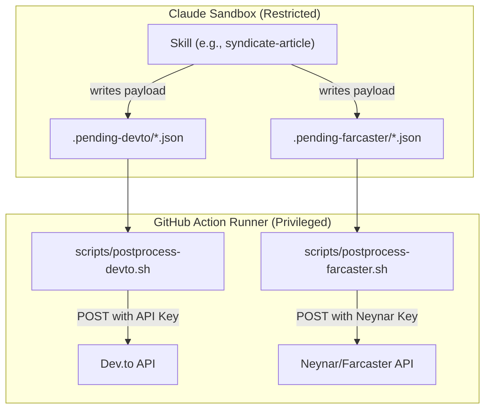
**Sources:** [skills/syndicate-article/SKILL.md:109-134](), [scripts/postprocess-devto.sh:6-26](), [scripts/postprocess-farcaster.sh:9-37]()

## Post-Processing Scripts

AEON includes several specialized post-processors that consume the `.pending-*` buffers.

### Dev.to Syndication
The `postprocess-devto.sh` script monitors the `.pending-devto/` directory. It uses the `DEVTO_API_KEY` to publish articles to the Dev Community. It handles `201 Created` responses by logging the new article URL and `422` responses by cleaning up duplicate payloads.
**Sources:** [scripts/postprocess-devto.sh:17-42]()

### Farcaster (via Neynar)
The `postprocess-farcaster.sh` script delivers "casts" to Farcaster. It is unique because it injects the `NEYNAR_SIGNER_UUID` into the JSON payload at runtime. This ensures that the sensitive Signer UUID is never written to the disk/repository, only existing in the runner's memory during the `curl` call.
**Sources:** [scripts/postprocess-farcaster.sh:25-37]()

### Replicate & AI Generation
The `postprocess-replicate.sh` script (and associated prefetchers) handles long-running AI image generation or model inference. It allows skills to request a generation, which is then executed by the privileged runner.
**Sources:** [.gitignore:16](), [.github/workflows/aeon.yml:129]()

## Prefetching Logic

While post-processing handles *outbound* data, **Prefetching** handles *inbound* data that the sandbox might block. The `scripts/prefetch-xai.sh` script runs before the AI starts.

*   **Functionality:** It calls the X.AI (Grok) API to perform searches based on the skill name and variable (`VAR`).
*   **Caching:** Results are saved to `.xai-cache/`.
*   **Skill Integration:** Skills like `refresh-x`, `remix-tweets`, and `agent-buzz` read these cached files locally rather than attempting to call the X.AI API directly during execution.

**Diagram: Data Flow for Social Skills**
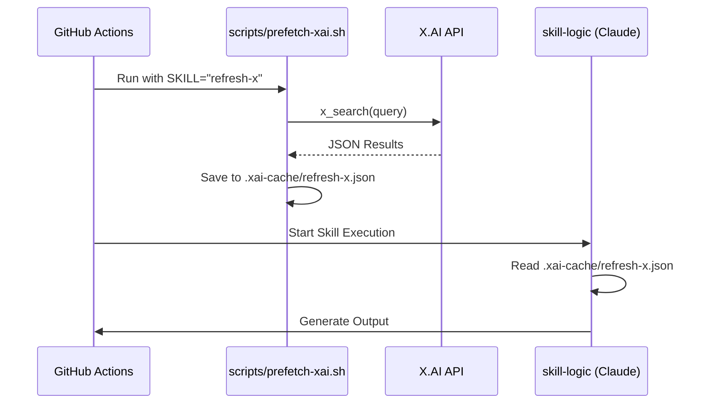
**Sources:** [scripts/prefetch-xai.sh:10-40](), [skills/agent-buzz/SKILL.md:127-133]()

## Analytics & Health Notifications

The pipeline is also used for self-observability. The `skill-analytics` and `heartbeat` skills monitor the execution logs and GitHub Actions API to detect anomalies.

*   **Exit Taxonomy:** Skills use a specific exit taxonomy (e.g., `_OK`, `_OK_SILENT`, `SKIP_UNCHANGED`, `NEW_INFO`) to signal their status.
*   **Significance Gating:** `skill-analytics` implements a significance gate. It only triggers a notification via `./notify` if an anomaly (like `🔴 SILENT` or `🔴 ALL_FAIL`) is detected. This prevents "notification fatigue" by remaining silent when the system is operating normally.

**Sources:** [skills/skill-analytics/SKILL.md:10-15](), [skills/skill-analytics/SKILL.md:72-87](), [skills/skill-analytics/SKILL.md:112-114]()

---

# Page: Skills System

# Skills System

<details>
<summary>Relevant source files</summary>

The following files were used as context for generating this wiki page:

- [.gitignore](.gitignore)
- [add-skill](add-skill)
- [export-skill](export-skill)
- [generate-skills-json](generate-skills-json)
- [onboard](onboard)
- [scripts/postprocess-farcaster.sh](scripts/postprocess-farcaster.sh)
- [scripts/sync-upstream.sh](scripts/sync-upstream.sh)
- [skills.json](skills.json)
- [skills/auto-workflow/SKILL.md](skills/auto-workflow/SKILL.md)
- [skills/distribute-tokens/SKILL.md](skills/distribute-tokens/SKILL.md)
- [skills/onboard/SKILL.md](skills/onboard/SKILL.md)
- [skills/skill-update-check/SKILL.md](skills/skill-update-check/SKILL.md)
- [skills/star-milestone/SKILL.md](skills/star-milestone/SKILL.md)
- [skills/syndicate-article/SKILL.md](skills/syndicate-article/SKILL.md)
- [skills/treasury-info/SKILL.md](skills/treasury-info/SKILL.md)

</details>


The **Skills System** is AEON's modular execution framework, comprising over 90 specialized agents ("skills") that perform research, code auditing, market analysis, and social media management. Each skill is a self-contained unit of logic defined by a `SKILL.md` file, designed to run within the ephemeral environment of GitHub Actions.

The system is built on a "pull-based" architecture where skills are discovered via a central registry, installed into a fork using the `add-skill` utility, and managed through a versioned supply chain (`skills.lock`).

### System Overview

```mermaid
graph TD
    subgraph "Registry & Discovery"
        A["SKILL.md (Source)"] -- "Compiler" --> B["skills.json (Manifest)"]
        B -- "Marketplace" --> C["Local Dashboard"]
    end

    subgraph "Installation & Lifecycle"
        D["./add-skill"] -- "Fetches" --> A
        D -- "Validates" --> E["skill-security-scan"]
        E -- "Records" --> F["skills.lock"]
        F -- "Monitors" --> G["skill-update-check"]
    end

    subgraph "Execution Space"
        H["aeon.yml (Schedule)"] --> I["Execution Engine"]
        I --> J["Skill Logic (SKILL.md)"]
        J -- "Persistence" --> K["memory/ (Flat-file DB)"]
    end

    "A" --> J
```
**Sources:** [generate-skills-json:4-12](), [add-skill:1-16](), [skills/skill-update-check/SKILL.md:1-7]()

---

### Skill Definition and Discovery

Every skill in AEON is defined by a `SKILL.md` file containing YAML frontmatter and a structured prompt or set of shell instructions. This format allows skills to be both human-readable and machine-executable.

*   **Frontmatter**: Defines the `name`, `description`, `category`, and default `var` for the skill [skills/skill-update-check/SKILL.md:1-7]().
*   **Manifest**: The `generate-skills-json` script crawls the `skills/` directory to build `skills.json`, a comprehensive manifest used by the Dashboard and installation tools [generate-skills-json:4-12]().
*   **Categories**: Skills are grouped into five primary domains: `research`, `dev`, `crypto`, `social`, and `productivity` [generate-skills-json:25-54]().

For a deep dive into how to create and manage these files, see **[Skill Definition & Lifecycle](#3.1)**.

---

### Skill Installation and Security

AEON uses a decentralized installation model. Users can pull skills from the official repository or any compatible third-party repository.

*   **Installer**: The `./add-skill` script handles fetching, extracting, and placing skill files in the local `skills/` directory [add-skill:190-233]().
*   **Security Scanning**: Before installation, untrusted skills are passed through `skill-security-scan` to detect dangerous patterns like `eval` or environment variable exfiltration [add-skill:206-221]().
*   **Supply Chain**: The `skills.lock` file tracks the origin and commit SHA of every imported skill, ensuring that updates are intentional and audited [add-skill:235-245]().

**Entity Mapping: Installation Logic**
```mermaid
graph LR
    subgraph "Code Entity Space"
        ADD["./add-skill"]
        SCAN["./skills/skill-security-scan/scan.sh"]
        LOCK["skills.lock"]
        UPCHECK["skills/skill-update-check/SKILL.md"]
    end

    subgraph "Natural Language Space"
        "Installation" --> ADD
        "Security Audit" --> SCAN
        "Pinning Versions" --> LOCK
        "Drift Detection" --> UPCHECK
    end
```
**Sources:** [add-skill:156-182](), [skills/skill-update-check/SKILL.md:18-30]()

---

### Skill Categories

The AEON ecosystem is categorized by the type of data processed and the output generated:

| Category | Purpose | Key Skills |
| :--- | :--- | :--- |
| **Research** | Information synthesis and curation | `digest`, `deep-research`, `rss-digest` |
| **Dev** | Repository monitoring and automation | `github-monitor`, `pr-review`, `code-health` |
| **Crypto** | On-chain analysis and treasury management | `token-report`, `treasury-info`, `distribute-tokens` |
| **Social** | Content creation and engagement | `write-tweet`, `syndicate-article`, `farcaster-digest` |
| **Productivity** | Personal briefings and goal tracking | `morning-brief`, `goal-tracker`, `heartbeat` |

*   **Research & Content**: Focuses on gathering signals from X, RSS, and Hacker News to produce publication-ready articles. For details, see **[Research & Content Skills](#3.2)**.
*   **Dev & GitHub**: Monitors code health and automates maintainer workflows. For details, see **[Dev & GitHub Skills](#3.3)**.
*   **Crypto & Markets**: Interfaces with APIs like Alchemy and Bankr to monitor wallets and distribute rewards. For details, see **[Crypto & Market Skills](#3.4)**.
*   **Social & Productivity**: Manages the agent's voice and handles daily recaps. For details, see **[Social & Productivity Skills](#3.5)**.

---

### Meta-Skills and Fleet Management

AEON includes "meta-skills" that manage the system itself. These skills allow AEON to self-configure and manage other instances of AEON.

*   **Auto-Workflow**: Analyzes a URL to suggest which skills should be enabled in `aeon.yml` [skills/auto-workflow/SKILL.md:10-18]().
*   **Onboarding**: Validates the fork's configuration and secrets via the `./onboard` utility [onboard:4-15]().
*   **Fleet Management**: Skills like `fork-fleet` and `spawn-instance` allow a central AEON instance to coordinate a network of worker forks.

For details on managing multiple instances, see **[Fleet & Instance Management Skills](#3.6)**.

---

### Skill Lifecycle Management

The system provides tools for the entire lifecycle of a skill, from creation to update:

*   **Creation**: `create-skill` generates new `SKILL.md` templates from a prompt [skills.json:135-145]().
*   **Update Tracking**: `skill-update-check` compares local skills against their upstream sources in `skills.lock` to identify security regressions or new features [skills/skill-update-check/SKILL.md:12-14]().
*   **Health Monitoring**: `heartbeat` and `skill-health` track execution success rates and latency [generate-skills-json:49-51]().

**Entity Mapping: Meta-Management**
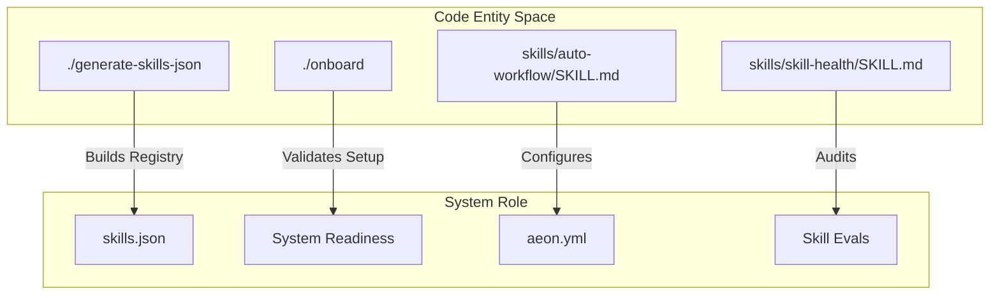
**Sources:** [generate-skills-json:4-12](), [onboard:4-15](), [skills/auto-workflow/SKILL.md:41-42]()

---

# Page: Skill Definition & Lifecycle

# Skill Definition & Lifecycle

<details>
<summary>Relevant source files</summary>

The following files were used as context for generating this wiki page:

- [.gitignore](.gitignore)
- [add-skill](add-skill)
- [export-skill](export-skill)
- [generate-skills-json](generate-skills-json)
- [onboard](onboard)
- [scripts/postprocess-farcaster.sh](scripts/postprocess-farcaster.sh)
- [scripts/sync-upstream.sh](scripts/sync-upstream.sh)
- [skills.json](skills.json)
- [skills/auto-workflow/SKILL.md](skills/auto-workflow/SKILL.md)
- [skills/create-skill/SKILL.md](skills/create-skill/SKILL.md)
- [skills/distribute-tokens/SKILL.md](skills/distribute-tokens/SKILL.md)
- [skills/onboard/SKILL.md](skills/onboard/SKILL.md)
- [skills/search-skill/SKILL.md](skills/search-skill/SKILL.md)
- [skills/skill-update-check/SKILL.md](skills/skill-update-check/SKILL.md)
- [skills/star-milestone/SKILL.md](skills/star-milestone/SKILL.md)
- [skills/syndicate-article/SKILL.md](skills/syndicate-article/SKILL.md)
- [skills/treasury-info/SKILL.md](skills/treasury-info/SKILL.md)

</details>


AEON is a modular agentic system composed of over 90 specialized "skills." Each skill is a self-contained unit of logic defined by a Markdown-based specification. The system employs a standardized lifecycle for skill discovery, installation, execution, and supply-chain security.

## Anatomy of a SKILL.md

The `SKILL.md` file is the foundational entity of the AEON ecosystem. It serves as both the source of truth for the agent's logic and the manifest for the system's compiler.

### Frontmatter and Metadata
Each `SKILL.md` begins with a YAML frontmatter block that defines its identity and execution constraints:
*   **name**: The display name of the skill [skills/skill-update-check/SKILL.md:2-2]().
*   **description**: A single-sentence functional summary [skills/skill-update-check/SKILL.md:3-3]().
*   **var**: A default value for the skill's primary input variable [skills/skill-update-check/SKILL.md:4-4]().
*   **tags**: Categorization labels (e.g., `dev`, `crypto`, `research`) [skills/skill-update-check/SKILL.md:5-5]().
*   **cron**: The default execution schedule [skills/skill-update-check/SKILL.md:6-6]().

### Logic Gates and Variable Injection
Skills use a template-style injection for dynamic behavior. The `${var}` placeholder is used to pass runtime configuration, while `${today}` provides temporal context [skills/skill-update-check/SKILL.md:8-12](). Skills often implement "Exit Taxonomies" to handle various states (e.g., `SKILL_SKIP`, `SKILL_ERROR`, `SKILL_NO_GAP`) [skills/search-skill/SKILL.md:9-11]().

### Two-Phase Pattern: RESOLVE/EXECUTE
Complex skills, particularly those involving financial transactions or external state changes, follow a two-phase pattern to ensure idempotency and safety:
1.  **RESOLVE**: The skill validates configurations, checks balances, resolves handles (e.g., `@user` to `0x...`), and builds an execution plan [skills/distribute-tokens/SKILL.md:14-14]().
2.  **EXECUTE**: The skill performs the actions defined in the plan, persisting state after each successful step to survive mid-run crashes [skills/distribute-tokens/SKILL.md:15-15]().

**Sources:** [skills/skill-update-check/SKILL.md:1-12](), [skills/search-skill/SKILL.md:9-11](), [skills/distribute-tokens/SKILL.md:13-19]()

---

## Skill Registry and Compilation

AEON uses a centralized manifest to manage its vast library of skills.

### skills.json Registry
The `skills.json` file is a machine-readable index of all available skills in the repository. It includes metadata, categories, and the specific `add-skill` command required for installation [skills.json:1-25]().

### generate-skills-json Compiler
The `generate-skills-json` script is a build tool that crawls the `skills/` directory, parses every `SKILL.md`, and compiles the `skills.json` manifest [generate-skills-json:4-12]().

| Function | Description |
| :--- | :--- |
| `get_category()` | Maps a skill slug to one of five core categories (research, dev, crypto, social, productivity) [generate-skills-json:25-54](). |
| `get_schedule()` | Extracts the current cron schedule for a skill from `aeon.yml` [generate-skills-json:57-62](). |
| `get_skill_sha()` | Retrieves the 7-character git SHA of the last commit touching a specific skill [generate-skills-json:71-74](). |

**Sources:** [skills.json:1-25](), [generate-skills-json:4-12](), [generate-skills-json:25-74]()

---

## Skill Management Lifecycle

The lifecycle of a skill—from discovery to update—is managed by a suite of CLI tools and security protocols.

### Installation: add-skill
The `add-skill` utility allows users to install or update skills from any GitHub repository [add-skill:4-15](). It handles:
*   **Tarball Extraction**: Downloads the source repo as a tarball to avoid full git clones [add-skill:81-91]().
*   **Security Gating**: Automatically runs `skill-security-scan` on untrusted sources [add-skill:207-221]().
*   **Provenance**: Records the source repo, path, and commit SHA in `skills.lock` [add-skill:235-237]().

### Supply-Chain Pinning: skills.lock
AEON implements a supply-chain integrity model via `skills.lock`. This file tracks the exact version (commit SHA) of every imported skill, preventing "stealth" updates from upstream sources [skills/skill-update-check/SKILL.md:18-30]().

### Update Auditing: skill-update-check
The `skill-update-check` skill monitors the `skills.lock` file and compares local versions against upstream repositories [skills/skill-update-check/SKILL.md:2-3](). It classifies updates into priority tiers:
*   **CRITICAL**: Security failures or missing upstream files [skills/skill-update-check/SKILL.md:93-93]().
*   **HIGH**: Breaking changes or frontmatter modifications in enabled skills [skills/skill-update-check/SKILL.md:94-94]().
*   **MEDIUM/LOW**: Routine updates or changes to disabled skills [skills/skill-update-check/SKILL.md:95-96]().

### Packaging: export-skill
The `export-skill` script (referenced in root) allows developers to package local skills for distribution, ensuring the `SKILL.md` and any supporting scripts are bundled correctly.

**Sources:** [add-skill:4-15](), [add-skill:207-237](), [skills/skill-update-check/SKILL.md:2-30](), [skills/skill-update-check/SKILL.md:93-96]()

---

## Technical Architecture Diagrams

### From Natural Language to Code Entity (Installation)
This diagram illustrates how a natural language request to add a skill traverses through the system's management scripts.

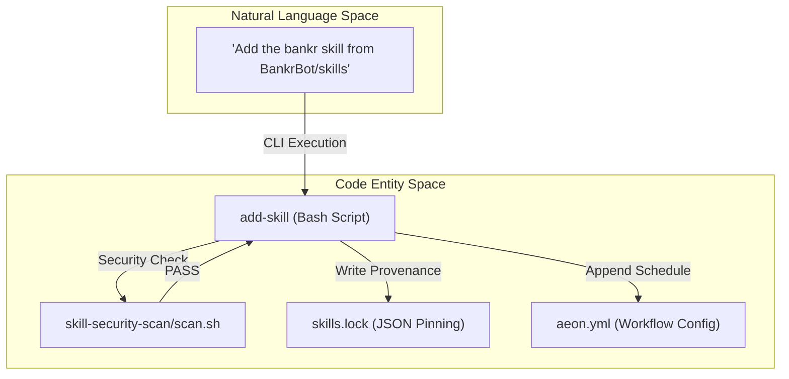
**Sources:** [add-skill:7-15](), [add-skill:156-157](), [add-skill:235-237]()

### Skill Execution & Logic Flow
This diagram maps the internal logic of a skill (using `syndicate-article` as an example) from high-level "Steps" to specific code-level operations.

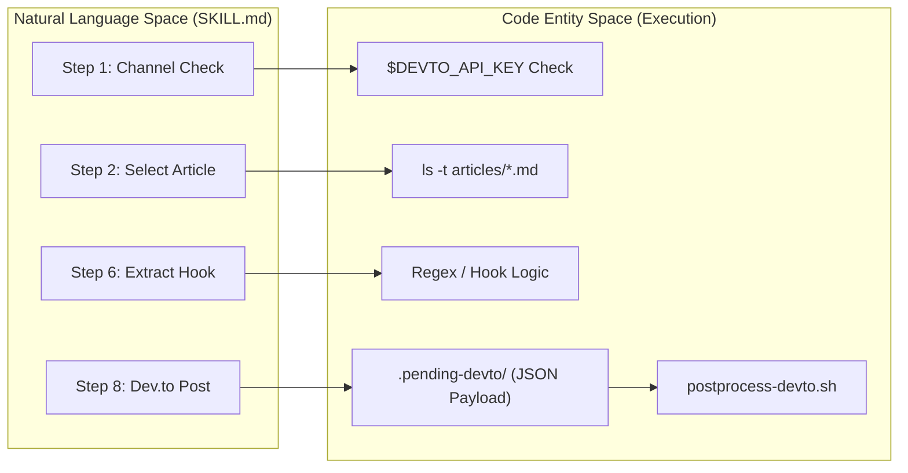
**Sources:** [skills/syndicate-article/SKILL.md:27-32](), [skills/syndicate-article/SKILL.md:38-41](), [skills/syndicate-article/SKILL.md:74-89](), [skills/syndicate-article/SKILL.md:109-133]()

---

## Meta-Skills for Lifecycle Management

AEON includes "Meta-Skills" that automate the management of other skills.

| Skill | Role | Key Functionality |
| :--- | :--- | :--- |
| `create-skill` | **Generation** | Uses LLM to write new `SKILL.md` files from a prompt [skills/create-skill/SKILL.md:3-3](). |
| `search-skill` | **Discovery** | Searches external catalogs and installs matching skills via `add-skill` [skills/search-skill/SKILL.md:3-3](). |
| `auto-workflow` | **Optimization** | Analyzes URLs to suggest which skills to enable in `aeon.yml` [skills/auto-workflow/SKILL.md:3-3](). |

**Sources:** [skills/create-skill/SKILL.md:3-3](), [skills/search-skill/SKILL.md:3-3](), [skills/auto-workflow/SKILL.md:3-3]()

---

# Page: Research & Content Skills

# Research & Content Skills

<details>
<summary>Relevant source files</summary>

The following files were used as context for generating this wiki page:

- [.gitignore](.gitignore)
- [add-skill](add-skill)
- [scripts/postprocess-farcaster.sh](scripts/postprocess-farcaster.sh)
- [skills/article/SKILL.md](skills/article/SKILL.md)
- [skills/daily-routine/SKILL.md](skills/daily-routine/SKILL.md)
- [skills/deep-research/SKILL.md](skills/deep-research/SKILL.md)
- [skills/defi-monitor/SKILL.md](skills/defi-monitor/SKILL.md)
- [skills/defi-overview/SKILL.md](skills/defi-overview/SKILL.md)
- [skills/digest/SKILL.md](skills/digest/SKILL.md)
- [skills/fetch-tweets/SKILL.md](skills/fetch-tweets/SKILL.md)
- [skills/fork-contributor-leaderboard/SKILL.md](skills/fork-contributor-leaderboard/SKILL.md)
- [skills/hacker-news-digest/SKILL.md](skills/hacker-news-digest/SKILL.md)
- [skills/list-digest/SKILL.md](skills/list-digest/SKILL.md)
- [skills/monitor-polymarket/SKILL.md](skills/monitor-polymarket/SKILL.md)
- [skills/monitor-polymarket/watchlist.md](skills/monitor-polymarket/watchlist.md)
- [skills/morning-brief/SKILL.md](skills/morning-brief/SKILL.md)
- [skills/on-chain-monitor/SKILL.md](skills/on-chain-monitor/SKILL.md)
- [skills/paper-digest/SKILL.md](skills/paper-digest/SKILL.md)
- [skills/paper-pick/SKILL.md](skills/paper-pick/SKILL.md)
- [skills/reddit-digest/SKILL.md](skills/reddit-digest/SKILL.md)
- [skills/refresh-x/SKILL.md](skills/refresh-x/SKILL.md)
- [skills/remix-tweets/SKILL.md](skills/remix-tweets/SKILL.md)
- [skills/research-brief/SKILL.md](skills/research-brief/SKILL.md)
- [skills/rss-digest/SKILL.md](skills/rss-digest/SKILL.md)
- [skills/skill-leaderboard/SKILL.md](skills/skill-leaderboard/SKILL.md)
- [skills/skill-update-check/SKILL.md](skills/skill-update-check/SKILL.md)
- [skills/syndicate-article/SKILL.md](skills/syndicate-article/SKILL.md)
- [skills/technical-explainer/SKILL.md](skills/technical-explainer/SKILL.md)
- [skills/token-alert/SKILL.md](skills/token-alert/SKILL.md)
- [skills/vibecoding-digest/SKILL.md](skills/vibecoding-digest/SKILL.md)

</details>


The **Research & Content Skills** category comprises modular agents designed to aggregate, curate, and synthesize information from diverse sources—including social media, academic repositories, and web search—into structured reports and articles. These skills leverage a two-phase execution pattern: **RESOLVE** (gathering data and mapping the landscape) and **EXECUTE** (synthesis, formatting, and delivery).

## Overview of Content Pipeline

Research skills in AEON follow a rigorous "Signal over Volume" philosophy. Instead of simple aggregation, they implement filtering logic to drop low-quality or redundant information before it reaches the user.

| Skill | Primary Data Source | Key Output |
| :--- | :--- | :--- |
| `digest` | WebSearch, Grok (X) | Daily topical briefing [skills/digest/SKILL.md:2-5]() |
| `fetch-tweets` | X/Twitter (via Grok/XAI) | Clustered sub-narratives [skills/fetch-tweets/SKILL.md:2-5]() |
| `paper-digest` | arXiv, Hugging Face | Research synthesis with "So what" insights [skills/paper-digest/SKILL.md:2-5]() |
| `reddit-digest` | Reddit JSON API | Cross-subreddit narrative detection [skills/reddit-digest/SKILL.md:2-5]() |
| `deep-research` | 30-50 Web/Academic sources | Analyst-grade reports with source tiering [skills/deep-research/SKILL.md:2-5]() |
| `syndicate-article` | Local `articles/` directory | Cross-posts to Dev.to and Farcaster [skills/syndicate-article/SKILL.md:2-5]() |

**Sources:** [skills/digest/SKILL.md](), [skills/fetch-tweets/SKILL.md](), [skills/paper-digest/SKILL.md](), [skills/reddit-digest/SKILL.md](), [skills/deep-research/SKILL.md](), [skills/syndicate-article/SKILL.md]()

---

## Data Flow: From Search to Synthesis

Research skills utilize a tiered retrieval system to bypass sandbox limitations and ensure data freshness.

### Natural Language to Code Entity Mapping
The following diagram illustrates how a research request (e.g., "Deep Research on AI Security") traverses the system components.

**Research Execution Path**
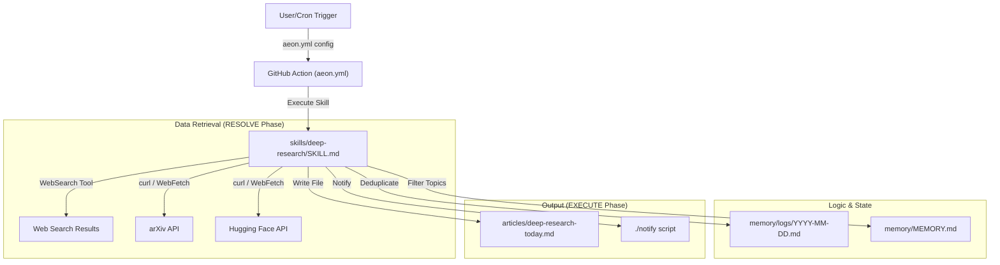
**Sources:** [skills/deep-research/SKILL.md:33-69](), [skills/paper-digest/SKILL.md:24-48](), [skills/digest/SKILL.md:15-28]()

---

## Technical Implementation Details

### 1. Source Credibility & Tiering
The `deep-research` skill implements a **CRAAP-lite** rubric to score sources on Authority, Recency, and Verifiability [skills/deep-research/SKILL.md:84-105]().
- **T1 (Tier 1):** Peer-reviewed papers, official docs (Score 8-9) [skills/deep-research/SKILL.md:98-99]().
- **T2 (Tier 2):** Reputable news, academic preprints (Score 5-7) [skills/deep-research/SKILL.md:100-101]().
- **T3 (Tier 3):** Social posts, commentary (Score ≤4) [skills/deep-research/SKILL.md:101-101]().

### 2. Narrative Detection (Reddit)
The `reddit-digest` skill identifies "cross-sub narratives"—stories appearing in multiple unrelated subreddits—using Jaccard similarity on normalized word sets of post titles [skills/reddit-digest/SKILL.md:72-76](). It calculates a `narrative_signal` score that gives a bonus for cross-community engagement [skills/reddit-digest/SKILL.md:84-90]().

### 3. X/Twitter Clustering
`fetch-tweets` clusters candidates into 2–4 sub-narratives (e.g., "price action" vs "ecosystem integration") [skills/fetch-tweets/SKILL.md:55-58](). It uses a persistent seen-file at `memory/fetch-tweets-seen.txt` to prevent duplicate notifications [skills/fetch-tweets/SKILL.md:14-18]().

**Sources:** [skills/deep-research/SKILL.md](), [skills/reddit-digest/SKILL.md](), [skills/fetch-tweets/SKILL.md]()

---

## Syndication & Distribution

Once an article is generated in the `articles/` directory, the `syndicate-article` skill manages cross-posting.

**Syndication Pipeline**
```mermaid
graph LR
    subgraph "Content Source"
        ART["articles/*.md"]
    end

    subgraph "Syndication Logic (syndicate-article)"
        PARSE["Parse Title/Body/Hook"]
        DEDUP["Check memory/logs/ for 'SYNDICATED:'"]
        CLEAN["Clean Jekyll Tags/Relative Links"]
    end

    subgraph "Deferred Execution (Post-Processing)"
        DEVTO_PENDING[".pending-devto/*.json"] -- "postprocess-devto.sh" --> DEVTO_API["Dev.to API"]
        FC_PENDING[".pending-farcaster/*.sh"] -- "postprocess-farcaster.sh" --> NEYNAR_API["Neynar/Farcaster"]
    end

    ART --> PARSE
    PARSE --> DEDUP
    DEDUP --> CLEAN
    CLEAN --> DEVTO_PENDING
    CLEAN --> FC_PENDING
```

### Key Functions in Syndication:
- **Hook Extraction:** Attempts to find an explicit TL;DR or a "strongest line" (containing numbers or concrete verbs) to use as the Farcaster cast [skills/syndicate-article/SKILL.md:72-89]().
- **Canonical URLs:** Generates SEO-friendly URLs pointing back to the GitHub Pages site [skills/syndicate-article/SKILL.md:91-96]().
- **Post-Processing:** Because the GitHub Actions sandbox may block direct API calls with auth headers, payloads are written to `.pending-*` directories for execution by separate scripts [skills/syndicate-article/SKILL.md:109-133](), [scripts/postprocess-farcaster.sh]().

**Sources:** [skills/syndicate-article/SKILL.md:44-50](), [skills/syndicate-article/SKILL.md:61-70](), [skills/syndicate-article/SKILL.md:72-89](), [skills/syndicate-article/SKILL.md:109-113]()

---

## Meta-Research: Fleet & Skill Leaderboards

The system also includes research skills that analyze the AEON ecosystem itself.

| Skill | Logic |
| :--- | :--- |
| `skill-leaderboard` | Scans forks to see which skills are `enabled: true` in `aeon.yml`, excluding untouched templates [skills/skill-leaderboard:11-16](). |
| `fork-contributor-leaderboard` | Ranks developers based on merged PRs, reviews, fork commits, and "new skills" detected in their forks [skills/fork-contributor-leaderboard:60-69](). |
| `skill-update-check` | Compares local `skills.lock` against upstream SHAs to detect drift and security regressions [skills/skill-update-check:12-14](). |

**Sources:** [skills/skill-leaderboard/SKILL.md](), [skills/fork-contributor-leaderboard/SKILL.md](), [skills/skill-update-check/SKILL.md]()

---

# Page: Dev & GitHub Skills

# Dev & GitHub Skills

<details>
<summary>Relevant source files</summary>

The following files were used as context for generating this wiki page:

- [skills/auto-merge/SKILL.md](skills/auto-merge/SKILL.md)
- [skills/changelog/SKILL.md](skills/changelog/SKILL.md)
- [skills/code-health/SKILL.md](skills/code-health/SKILL.md)
- [skills/github-issues/SKILL.md](skills/github-issues/SKILL.md)
- [skills/github-monitor/SKILL.md](skills/github-monitor/SKILL.md)
- [skills/github-releases/SKILL.md](skills/github-releases/SKILL.md)
- [skills/github-trending/SKILL.md](skills/github-trending/SKILL.md)
- [skills/issue-triage/SKILL.md](skills/issue-triage/SKILL.md)
- [skills/monitor-runners/SKILL.md](skills/monitor-runners/SKILL.md)
- [skills/pr-review/SKILL.md](skills/pr-review/SKILL.md)
- [skills/push-recap/SKILL.md](skills/push-recap/SKILL.md)
- [skills/repo-actions/SKILL.md](skills/repo-actions/SKILL.md)
- [skills/repo-article/SKILL.md](skills/repo-article/SKILL.md)
- [skills/repo-pulse/SKILL.md](skills/repo-pulse/SKILL.md)
- [workflows/README.md](workflows/README.md)
- [workflows/changelog.md](workflows/changelog.md)
- [workflows/code-health.md](workflows/code-health.md)
- [workflows/issue-triage.md](workflows/issue-triage.md)
- [workflows/pr-review.md](workflows/pr-review.md)
- [workflows/security-digest.md](workflows/security-digest.md)

</details>


The Dev & GitHub skills category encompasses a suite of autonomous agents designed to monitor repository health, triage community input, review code contributions, and synthesize development activity into human-readable intelligence. These skills leverage the `gh` CLI and GitHub GraphQL API to act as a virtual maintainer and technical writer.

## Architecture & Data Flow

Development skills follow a multi-phase pattern: state collection via GitHub APIs, classification/scoring based on repository-specific heuristics, and delivery of "decision-ready" outputs.

### High-Level Data Flow

The following diagram illustrates how raw GitHub events are transformed into structured memory and actionable notifications.

**Figure 1: GitHub Skill Data Pipeline**
```mermaid
graph TD
    subgraph "GitHub Space"
        API["GitHub API / GraphQL"]
        REPOS["Watched Repositories"]
    end

    subgraph "AEON Execution (aeon.yml)"
        direction TB
        COLL["State Collection (gh api)"]
        CLASS["Classification Engine"]
        GEN["Content Generation"]
    end

    subgraph "Memory & Output"
        WATCHED["memory/watched-repos.md"]
        LOGS["memory/logs/YYYY-MM-DD.md"]
        ART["articles/*.md"]
        NOTIFY["./notify (Telegram/Discord)"]
    end

    WATCHED -->|"Targets"| COLL
    REPOS -->|"JSON Data"| COLL
    COLL -->|"Raw State"| CLASS
    CLASS -->|"Verdicts"| GEN
    GEN -->|"Append"| LOGS
    GEN -->|"Write"| ART
    GEN -->|"Alert"| NOTIFY
```
**Sources:** [skills/github-monitor/SKILL.md:27-52](), [skills/issue-triage/SKILL.md:42-63](), [skills/push-recap/SKILL.md:23-48]()

## Core Development Skills

### GitHub Monitor & Triage
These skills reduce maintainer fatigue by filtering noise and highlighting items requiring immediate attention.

*   **`github-monitor`**: Scans for stale PRs, new issues, and releases. It classifies items into `ACT NOW` (e.g., CI failure, security labels), `REVIEW`, and `INFO` tiers [skills/github-monitor/SKILL.md:53-79]().
*   **`issue-triage`**: Implements a "decision-first" policy. For every new issue, it emits one of four verdicts: `ACCEPT`, `NEEDS-INFO`, `DUPLICATE`, or `DECLINE` [skills/issue-triage/SKILL.md:13-23](). It uses title token overlap (≥70%) for duplicate detection [skills/issue-triage/SKILL.md:78-83]().
*   **`pr-review`**: Conducts automated code reviews with severity-tagged findings (`[CRITICAL]`, `[ISSUE]`, `[NIT]`) [skills/pr-review/SKILL.md:66-70](). It posts both a consolidated summary and line-specific inline comments using `gh api repos/owner/repo/pulls/NUMBER/comments` [skills/pr-review/SKILL.md:82-92]().

### Activity Synthesis
These skills transform raw commit logs into high-level technical narratives.

*   **`push-recap`**: Performs a daily deep-dive into pushes. It classifies commits as **user-visible**, **internal**, or **infra** based on file paths [skills/push-recap/SKILL.md:49-68](). It ranks impact using a formula: `impact = (additions + deletions) × user_visible_multiplier × breadth_multiplier` [skills/push-recap/SKILL.md:71-77]().
*   **`changelog`**: Generates a weekly user-facing changelog following the "Keep a Changelog" format. It rewrites imperative dev-speak into past-tense user statements [skills/changelog/SKILL.md:13-14](), [skills/changelog/SKILL.md:93-101]().
*   **`repo-article`**: Writes thesis-driven articles about a repository. It requires a **falsifiable claim** (≤25 words) that must be disprovable by specific evidence [skills/repo-article/SKILL.md:68-78]().

### Repository Maintenance & Growth
*   **`auto-merge`**: Automatically merges PRs that pass a strict safety policy (author allowlist, size cap ≤ 500 lines, passing CI, no conflicts) [skills/auto-merge/SKILL.md:17-31]().
*   **`repo-pulse`**: Tracks growth metrics (stars, forks, releases). It includes "notable-stargazer" enrichment, flagging users with ≥100 followers [skills/repo-pulse/SKILL.md:77-83]().
*   **`github-trending`**: Curates a slate of 5-8 trending repos, filtering out "noise" like meta-lists, tutorials, and dotfiles [skills/github-trending/SKILL.md:15-18](), [skills/github-trending/SKILL.md:47-55]().

## Implementation Details

### State Collection Patterns
Skills primarily use the `gh` CLI to interact with GitHub. This bypasses many sandbox restrictions regarding outbound `curl` calls and handles authentication via the `GITHUB_TOKEN` [skills/auto-merge/SKILL.md:72-74](), [skills/pr-review/SKILL.md:130-133]().

**Figure 2: API Interaction Logic**
```mermaid
graph LR
    subgraph "Skill Logic (EXECUTE phase)"
        TR["Trigger"] --> REQ["gh api / gh search"]
        REQ --> PARSE["jq / JSON Processing"]
    end

    subgraph "GitHub CLI (gh)"
        direction TB
        AUTH["Auth via GITHUB_TOKEN"]
        GRAPH["GraphQL Query"]
        REST["REST API Call"]
    end

    REQ --> AUTH
    AUTH --> GRAPH
    AUTH --> REST
```
**Sources:** [skills/repo-actions/SKILL.md:35-78](), [skills/github-issues/SKILL.md:16-40]()

### Security & Safety Gates
Because AEON skills can act on repositories (merging PRs, labeling issues), they incorporate hard-coded safety constraints:

| Skill | Safety Mechanism | Source |
| :--- | :--- | :--- |
| `auto-merge` | Author allowlist + Size cap (500 lines) | [skills/auto-merge/SKILL.md:17-23]() |
| `pr-review` | Skip if author is a bot or `aeonframework` | [skills/pr-review/SKILL.md:31-34]() |
| `issue-triage` | Label creation try/log wrapper to prevent aborts | [skills/issue-triage/SKILL.md:122-129]() |
| `repo-article` | "Enough story?" gate (Min 3 commits/week) | [skills/repo-article/SKILL.md:60-64]() |

### Memory Integration
Development skills rely on `memory/watched-repos.md` for their target list. They persist state in `memory/logs/` to perform deduplication, ensuring that the same issue or PR isn't alerted multiple times [skills/github-monitor/SKILL.md:80-89](), [skills/github-issues/SKILL.md:11-12]().

**Sources:**
- `skills/repo-article/SKILL.md`
- `skills/repo-actions/SKILL.md`
- `skills/auto-merge/SKILL.md`
- `skills/push-recap/SKILL.md`
- `skills/github-monitor/SKILL.md`
- `skills/issue-triage/SKILL.md`
- `skills/pr-review/SKILL.md`
- `skills/repo-pulse/SKILL.md`
- `skills/github-trending/SKILL.md`
- `skills/github-issues/SKILL.md`
- `skills/changelog/SKILL.md`

---

# Page: Crypto & Market Skills

# Crypto & Market Skills

<details>
<summary>Relevant source files</summary>

The following files were used as context for generating this wiki page:

- [export-skill](export-skill)
- [skills.json](skills.json)
- [skills/action-converter/SKILL.md](skills/action-converter/SKILL.md)
- [skills/article/SKILL.md](skills/article/SKILL.md)
- [skills/deal-flow/SKILL.md](skills/deal-flow/SKILL.md)
- [skills/defi-monitor/SKILL.md](skills/defi-monitor/SKILL.md)
- [skills/distribute-tokens/SKILL.md](skills/distribute-tokens/SKILL.md)
- [skills/fork-contributor-leaderboard/SKILL.md](skills/fork-contributor-leaderboard/SKILL.md)
- [skills/hacker-news-digest/SKILL.md](skills/hacker-news-digest/SKILL.md)
- [skills/monitor-kalshi/SKILL.md](skills/monitor-kalshi/SKILL.md)
- [skills/monitor-kalshi/watchlist.md](skills/monitor-kalshi/watchlist.md)
- [skills/morning-brief/SKILL.md](skills/morning-brief/SKILL.md)
- [skills/narrative-tracker/SKILL.md](skills/narrative-tracker/SKILL.md)
- [skills/on-chain-monitor/SKILL.md](skills/on-chain-monitor/SKILL.md)
- [skills/polymarket-comments/SKILL.md](skills/polymarket-comments/SKILL.md)
- [skills/reddit-digest/SKILL.md](skills/reddit-digest/SKILL.md)
- [skills/reply-maker/SKILL.md](skills/reply-maker/SKILL.md)
- [skills/rss-digest/SKILL.md](skills/rss-digest/SKILL.md)
- [skills/skill-leaderboard/SKILL.md](skills/skill-leaderboard/SKILL.md)
- [skills/star-milestone/SKILL.md](skills/star-milestone/SKILL.md)
- [skills/startup-idea/SKILL.md](skills/startup-idea/SKILL.md)
- [skills/token-alert/SKILL.md](skills/token-alert/SKILL.md)
- [skills/token-movers/SKILL.md](skills/token-movers/SKILL.md)
- [skills/token-pick/SKILL.md](skills/token-pick/SKILL.md)
- [skills/token-report/SKILL.md](skills/token-report/SKILL.md)
- [skills/unlock-monitor/SKILL.md](skills/unlock-monitor/SKILL.md)

</details>


The **Crypto & Market Skills** category provides AEON with the ability to interface with blockchain networks, decentralized finance (DeFi) protocols, and prediction markets. These skills are designed to convert raw on-chain data and market fluctuations into actionable intelligence, ranging from automated treasury distributions to high-signal monitoring of "whale" movements and political/economic odds.

## Architecture & Data Flow

The crypto subsystem follows a "Monitor → Enrich → Notify" pattern. Skills often fetch raw data from public APIs (CoinGecko, Alchemy, Kalshi), enrich that data with historical context from AEON's flat-file memory, and apply "noise-reduction" gates before delivering a notification.

### Market Intelligence Pipeline
The following diagram illustrates how natural language requests or cron schedules translate into technical execution across market APIs and internal state.

**Market Data to Notification Flow**
```mermaid
graph TD
    subgraph "Natural Language Space"
        UserRequest["'Monitor SOL and high-volume L2s'"]
        CronTrigger["'Daily Morning Brief Cron'"]
    end

    subgraph "Code Entity Space"
        SkillMD["SKILL.md (logic definition)"]
        TokenMovers["token-movers/SKILL.md"]
        MonitorKalshi["monitor-kalshi/SKILL.md"]
        Memory["memory/logs/ (Historical context)"]
        NotifyScript["./notify (Telegram/Discord/Slack)"]
    end

    subgraph "External Providers"
        CoinGecko["CoinGecko API"]
        KalshiAPI["Kalshi Trade API v2"]
        Alchemy["Alchemy Asset Transfers API"]
    end

    UserRequest --> SkillMD
    CronTrigger --> TokenMovers
    TokenMovers --> CoinGecko
    MonitorKalshi --> KalshiAPI
    
    TokenMovers -- "Filter: total_volume > $1M" --> Memory
    Memory -- "Deduplication" --> TokenMovers
    TokenMovers --> NotifyScript
    MonitorKalshi -- "implied_prob calculation" --> NotifyScript
```
Sources: [skills/token-movers/SKILL.md:1-141](), [skills/monitor-kalshi/SKILL.md:1-154](), [skills/on-chain-monitor/SKILL.md:1-151]()

---

## On-Chain Monitoring & Treasury

AEON manages on-chain state and transactions through two primary skills: `on-chain-monitor` for observation and `distribute-tokens` for execution.

### On-Chain Monitor
This skill tracks specific addresses across Ethereum, Base, Arbitrum, Optimism, and Polygon [skills/on-chain-monitor:17-31](). It uses a dual-path fetching strategy:
1.  **Alchemy (Path A):** Uses `alchemy_getAssetTransfers` for high-fidelity history [skills/on-chain-monitor:71-84]().
2.  **Etherscan v2 (Path B):** A unified fallback for over 50 chains using `chainid` [skills/on-chain-monitor:90-101]().

State is persisted in `memory/on-chain-state.json`, tracking the `last_block` to ensure contiguous monitoring without redundant alerts [skills/on-chain-state.json:44-61]().

### Token Distribution
The `distribute-tokens` skill is a robust treasury management tool that interfaces with the **Bankr Wallet API** [skills/distribute-tokens:1-5](). It implements a **two-phase resolve→execute** pattern:
*   **RESOLVE:** Validates the `memory/distributions.yml` config, checks the sender's balance, and resolves social handles (e.g., `@username`) to EVM addresses via the Bankr Agent API [skills/distribute-tokens:88-110]().
*   **EXECUTE:** Performs the actual transfer. It uses a per-recipient idempotency key (SHA256 of list, recipient, and date) to prevent double-spending even if a workflow is restarted [skills/distribute-tokens:11-15]().

**Treasury Execution Logic**
```mermaid
sequenceDiagram
    participant GH as GitHub Action
    participant Mem as memory/state/distributions.json
    participant Bankr as Bankr API
    participant Chain as Blockchain (Base)

    GH->>Mem: Check Idempotency Key
    alt Already Sent
        Mem-->>GH: Status: COMPLETED
    else Ready to Send
        GH->>Bankr: POST /wallet/transfer
        Bankr->>Chain: Broadcast TX
        Chain-->>Bankr: txHash
        Bankr-->>GH: 200 OK (success: true)
        GH->>Mem: Persist txHash immediately
    end
```
Sources: [skills/distribute-tokens/SKILL.md:7-141]()

---

## Market Analysis & Signal Detection

AEON's market skills prioritize "actionable signal" over raw data.

### Token Movers
`token-movers` filters the top 250 coins from CoinGecko but applies a strict volume floor (default $1,000,000) to ignore illiquid "rug-pulls" [skills/token-movers:41-43](). It enriches every mover with automated tags:
*   `[PUMP-RISK]`: Low-cap coins with >30% spikes [skills/token-movers:63-63]().
*   `[CAPITULATION]`: Significant price drops on 3x normal volume [skills/token-movers:62-62]().
*   `[BREAKOUT]`: Sustained multi-day growth [skills/token-movers:60-60]().

### Prediction Markets (Kalshi & Polymarket)
The `monitor-kalshi` skill tracks events (e.g., GDP, interest rates, elections) and converts contract prices into **implied probabilities** [skills/monitor-kalshi:88-88](). It calculates a `move_score` (`|chg_pp| × log10(vol_24h_usd)`) to ensure that high-liquidity moves are ranked above thin-book noise [skills/monitor-kalshi:93-93]().

---

## Meta-Crypto Skills: Leaderboards

AEON tracks its own ecosystem through "meta" skills that analyze the "fork fleet."

| Skill | Purpose | Key Metric |
| :--- | :--- | :--- |
| `skill-leaderboard` | Ranks skill popularity across active forks. | `pct_of_configured` (Adoption rate) |
| `fork-contributor-leaderboard` | Ranks developers building on AEON. | Combined score (PRs, Commits, New Skills) |

The `fork-contributor-leaderboard` uses a weighted scoring formula to incentivize upstream contributions:
*   **Merged PR:** +10 points [skills/fork-contributor-leaderboard:61-61]()
*   **New Skill Built:** +5 points [skills/fork-contributor-leaderboard:66-66]()
*   **First-time Contributor Bonus:** +5 points [skills/fork-contributor-leaderboard:62-62]()

Sources: [skills/skill-leaderboard/SKILL.md:13-118](), [skills/fork-contributor-leaderboard/SKILL.md:60-71]()

---

## Summary Table of Crypto Skills

| Slug | Category | Primary Data Source | Output Type |
| :--- | :--- | :--- | :--- |
| `token-movers` | Market | CoinGecko | Signal-enriched list |
| `on-chain-monitor` | Monitoring | Alchemy / Etherscan | Real-time TX alerts |
| `distribute-tokens` | Treasury | Bankr API | On-chain transfers |
| `monitor-kalshi` | Prediction | Kalshi API | Probabilistic shifts |
| `defi-monitor` | DeFi | Protocol APIs | Yield/Health report |
| `token-report` | Research | Multi-source | Deep-dive article |

Sources: [skills.json:9-191](), [skills/token-movers/SKILL.md:1-6]()

---

# Page: Social & Productivity Skills

# Social & Productivity Skills

<details>
<summary>Relevant source files</summary>

The following files were used as context for generating this wiki page:

- [images/.gitkeep](images/.gitkeep)
- [scripts/postprocess-admanage-create.sh](scripts/postprocess-admanage-create.sh)
- [scripts/postprocess-admanage.sh](scripts/postprocess-admanage.sh)
- [skills/action-converter/SKILL.md](skills/action-converter/SKILL.md)
- [skills/aixbt-pulse/SKILL.md](skills/aixbt-pulse/SKILL.md)
- [skills/channel-recap/SKILL.md](skills/channel-recap/SKILL.md)
- [skills/create-campaign/SKILL.md](skills/create-campaign/SKILL.md)
- [skills/create-campaign/config.example.yaml](skills/create-campaign/config.example.yaml)
- [skills/evening-recap/SKILL.md](skills/evening-recap/SKILL.md)
- [skills/farcaster-digest/SKILL.md](skills/farcaster-digest/SKILL.md)
- [skills/goal-tracker/SKILL.md](skills/goal-tracker/SKILL.md)
- [skills/idea-capture/SKILL.md](skills/idea-capture/SKILL.md)
- [skills/polymarket-comments/SKILL.md](skills/polymarket-comments/SKILL.md)
- [skills/reply-maker/SKILL.md](skills/reply-maker/SKILL.md)
- [skills/schedule-ads/SKILL.md](skills/schedule-ads/SKILL.md)
- [skills/schedule-ads/config.example.yaml](skills/schedule-ads/config.example.yaml)
- [skills/startup-idea/SKILL.md](skills/startup-idea/SKILL.md)
- [skills/telegram-digest/SKILL.md](skills/telegram-digest/SKILL.md)
- [skills/token-movers/SKILL.md](skills/token-movers/SKILL.md)
- [skills/tool-builder/SKILL.md](skills/tool-builder/SKILL.md)
- [skills/tweet-roundup/SKILL.md](skills/tweet-roundup/SKILL.md)
- [skills/vuln-scanner/SKILL.md](skills/vuln-scanner/SKILL.md)
- [skills/weekly-review/SKILL.md](skills/weekly-review/SKILL.md)
- [skills/write-tweet/SKILL.md](skills/write-tweet/SKILL.md)

</details>


The **Social & Productivity Skills** subsystem manages AEON's external engagement and the operator's internal focus. These skills handle high-leverage content creation for X (Twitter), Farcaster, and Telegram, while also providing structured loops for personal productivity, goal tracking, and strategic planning.

## Overview of Social Engagement

AEON's social skills are designed to move beyond simple automation toward "Agentic Curation." Instead of blind posting, these skills analyze engagement metrics, cluster conversations into narratives, and apply "voice" via the `soul/` layer to ensure substantive participation.

### Data Flow: Social Content Pipeline

The social pipeline typically follows a three-stage pattern to respect the Claude sandbox limitations:
1.  **Resolve & Fetch**: Using `WebFetch` to bypass sandbox network restrictions or using `prefetch-xai.sh` to cache data.
2.  **Analyze & Draft**: Clustering posts by narrative and drafting replies/articles using the `soul/` personality.
3.  **Post-Process**: Writing payloads to `.pending-*` directories for external scripts to publish.

Title: Social Engagement Logic Flow
```mermaid
graph TD
    subgraph "Natural Language Space (LLM)"
        A["SKILL.md Definition"] --> B["Draft Content"]
        B --> C["Apply Soul/Style"]
    end

    subgraph "Code Entity Space (Execution)"
        D["WebFetch (t.me/s/...)"] -- "Raw HTML" --> A
        C -- "JSON Payload" --> E[".pending-farcaster/"]
        C -- "JSON Payload" --> F[".pending-notify/"]
        E --> G["postprocess-farcaster.sh"]
        F --> H["./notify script"]
    end

    G -- "Neynar API" --> I["Farcaster Network"]
    H -- "Bot API" --> J["Telegram/Discord"]
```
Sources: [skills/telegram-digest/SKILL.md:29-41](), [skills/farcaster-digest/SKILL.md:23-56](), [skills/reply-maker/SKILL.md:40-60]()

---

## Social Curation Skills

### Telegram Digest & Channel Recap
These skills ingest public Telegram data without requiring API keys by scraping the `t.me/s/` web preview.
*   **`telegram-digest`**: Aggregates multiple channels, clusters them by narrative, and provides a cross-channel "insight line" [skills/telegram-digest/SKILL.md:14-19]().
*   **`channel-recap`**: Focuses on a single channel to produce a 750–1500 word "Week in Review" article, ranking posts by an engagement score: `views + (reactions * 50)` [skills/channel-recap/SKILL.md:51-53]().

### Farcaster Digest
The `farcaster-digest` skill uses the Neynar API to fetch trending and semantic search results. It maintains a persistent deduplication state in `memory/state/farcaster-seen-hashes.json` to ensure the operator never sees the same cast twice [skills/farcaster-digest/SKILL.md:15-16]().
*   **Signal Scoring**: `likes + (2 * recasts) + (0.5 * replies)` [skills/farcaster-digest/SKILL.md:71-72]().
*   **Clustering**: Groups casts into 2–3 sub-narratives based on conversation topics rather than simple keywords [skills/farcaster-digest/SKILL.md:78-84]().

### Reply Maker & Write Tweet
*   **`reply-maker`**: Generates two distinct options for 5 high-leverage tweets: **Option A (Evidence Add)** and **Option B (Frame Challenge)** [skills/reply-maker/SKILL.md:80-91]().
*   **Anti-Sycophancy**: Explicitly filters out "filler" phrases like "Great point" or "Thanks for sharing" to maintain a substantive presence [skills/reply-maker/SKILL.md:94-98]().

---

## Productivity & Meta-Skills

These skills serve as the "Internal CEO" for the AEON instance, converting raw logs into actionable items.

### Action Converter
The core of AEON's productivity system. It reads all memory files, PR lists, and `cron-state.json` to extract "open loops" [skills/action-converter/SKILL.md:32-43]().
*   **Leverage Scoring**: Loops are scored on Leverage, Urgency, and Concreteness. Only those scoring ≥8 are converted into actions [skills/action-converter/SKILL.md:49-57]().
*   **Specificity Gate**: Rejects vague actions like "think about X." Every action must name a file, person, or URL [skills/action-converter/SKILL.md:63-64]().

### Goal Tracker & Weekly Review
*   **`goal-tracker`**: Monitors progress against the `MEMORY.md` "Next Priorities" section.
*   **`weekly-review`**: Runs every Sunday to consolidate `memory/logs/` into a strategic update, closing stale issues and updating the `SOUL.md` based on the week's learned experiences.

---

## Growth & Ad Management

AEON includes a sophisticated ad scheduling system that interacts with the `AdManage.ai` API.

Title: Ad Scheduling Architecture
```mermaid
graph LR
    subgraph "Configuration"
        Config["skills/schedule-ads/config.yaml"]
    end

    subgraph "Skill Execution (Claude Sandbox)"
        Skill["schedule-ads/SKILL.md"]
        Payload["JSON Launch Payload"]
    end

    subgraph "Post-Processing (Full Env)"
        Script["scripts/postprocess-admanage.sh"]
        API["AdManage API"]
    end

    Config --> Skill
    Skill -- "writes to" --> Payload
    Payload -- "read by" --> Script
    Script -- "HTTPS POST" --> API
```
Sources: [skills/schedule-ads/SKILL.md:11-13](), [skills/schedule-ads/config.example.yaml:20-31]()

### Key Safety Guardrails for Ads
| Guardrail | Implementation |
| :--- | :--- |
| **PAUSED by default** | All `POST /v1/launch` payloads are hardcoded to `status: PAUSED` [skills/schedule-ads/SKILL.md:66-71](). |
| **Spend Circuit Breaker** | `postprocess-admanage.sh` checks `GET /v1/spend/daily` and halts if `dailySpendCap` is exceeded [skills/schedule-ads/SKILL.md:29-30](). |
| **Dry Run Mode** | Payloads are written to `.pending-admanage/dryrun/` without API calls [skills/schedule-ads/SKILL.md:85-89](). |

---

## Content Generation: Startup Ideas

The `startup-idea` skill generates evidence-backed memos. It uses a "Tarpit Filter" to reject low-value ideas (e.g., generic AI wrappers) unless the operator has an "earned secret" [skills/startup-idea/SKILL.md:41-49]().

### Memo Schema Requirements
Every startup idea must include:
1.  **Pain Evidence**: 2+ permalinks to real customer complaints (Reddit, G2, etc.) [skills/startup-idea/SKILL.md:64-66]().
2.  **Kill Criteria**: A numeric, time-bound metric to stop the project (e.g., "<3 paid pilots in 60 days") [skills/startup-idea/SKILL.md:72-73]().
3.  **Wedge**: The specific first product to launch in the first 12 months [skills/startup-idea/SKILL.md:63-63]().

Sources: [skills/startup-idea/SKILL.md:58-74]()

---

# Page: Fleet & Instance Management Skills

# Fleet & Instance Management Skills

<details>
<summary>Relevant source files</summary>

The following files were used as context for generating this wiki page:

- [generate-skills-json](generate-skills-json)
- [onboard](onboard)
- [scripts/sync-upstream.sh](scripts/sync-upstream.sh)
- [skills/article/SKILL.md](skills/article/SKILL.md)
- [skills/auto-workflow/SKILL.md](skills/auto-workflow/SKILL.md)
- [skills/fleet-control/SKILL.md](skills/fleet-control/SKILL.md)
- [skills/fork-contributor-leaderboard/SKILL.md](skills/fork-contributor-leaderboard/SKILL.md)
- [skills/fork-fleet/SKILL.md](skills/fork-fleet/SKILL.md)
- [skills/fork-skill-digest/SKILL.md](skills/fork-skill-digest/SKILL.md)
- [skills/hacker-news-digest/SKILL.md](skills/hacker-news-digest/SKILL.md)
- [skills/morning-brief/SKILL.md](skills/morning-brief/SKILL.md)
- [skills/onboard/SKILL.md](skills/onboard/SKILL.md)
- [skills/skill-leaderboard/SKILL.md](skills/skill-leaderboard/SKILL.md)
- [skills/spawn-instance/SKILL.md](skills/spawn-instance/SKILL.md)
- [skills/treasury-info/SKILL.md](skills/treasury-info/SKILL.md)

</details>


Fleet and Instance Management skills provide the orchestration layer for the AEON ecosystem. They enable a single "parent" instance to discover, monitor, and control a distributed fleet of "child" forks. This subsystem manages the lifecycle of new instances—from automated spawning and configuration to weekly contributor and skill popularity leaderboards.

## Core Management Skills

The fleet management system is built on a set of specialized skills that interact with the GitHub API to track divergence and health across the fork network.

| Skill | Purpose | Key Logic |
|:---|:---|:---|
| `fork-fleet` | Inventory and Divergence | Detects "PROMOTE" candidates by comparing forks against upstream for new `SKILL.md` files. [skills/fork-fleet/SKILL.md:2-101]() |
| `fleet-control` | Monitoring & Dispatch | Aggregates health status (healthy, degraded, stale) and allows remote skill execution via `dispatch`. [skills/fleet-control/SKILL.md:2-140]() |
| `spawn-instance` | Provisioning | Automates the creation of a new repo, skill selection, and fleet registration. [skills/spawn-instance/SKILL.md:2-120]() |
| `auto-workflow` | Configuration | Analyzes URLs to suggest tailored `aeon.yml` schedules based on observed data signals. [skills/auto-workflow/SKILL.md:2-110]() |

### Fleet Control Data Flow
The `fleet-control` skill acts as the central command. It utilizes `memory/instances.json` as the source of truth for managed repos and `memory/state/fleet-control-state.json` for tracking health deltas.

**Fleet Monitoring and Command Diagram**
```mermaid
graph TD
    subgraph "Parent Instance"
        FC["fleet-control (Skill)"]
        REG["memory/instances.json"]
        STATE["fleet-control-state.json"]
        LOG["memory/logs/YYYY-MM-DD.md"]
    end

    subgraph "GitHub API Space"
        GH_REPO["/repos/{owner}/{repo}"]
        GH_RUNS["/actions/runs"]
        GH_CRON["/contents/memory/cron-state.json"]
        GH_DISPATCH["/actions/workflows/aeon.yml/dispatches"]
    end

    FC -->|1. Load Registry| REG
    FC -->|2. Parallel Fetch| GH_REPO
    FC -->|2. Parallel Fetch| GH_RUNS
    FC -->|2. Parallel Fetch| GH_CRON
    FC -->|3. Compute Health| FC
    FC -->|4. Update State| STATE
    FC -->|5. Log Verdict| LOG
    FC -.->|Optional: Dispatch| GH_DISPATCH
```
**Sources:** [skills/fleet-control/SKILL.md:14-112](), [skills/fleet-control/SKILL.md:141-150]()

## Instance Spawning & Configuration

The `spawn-instance` skill enables the "zero-infrastructure" scaling of AEON. It creates a functional clone of the parent repo, but tailors the `aeon.yml` configuration to a specific purpose provided by the operator.

### Provisioning Workflow
1.  **Var Parsing**: Accepts `name: purpose` (e.g., `crypto-bot: track DeFi`). [skills/spawn-instance/SKILL.md:39-44]()
2.  **Live Catalog Discovery**: Instead of hardcoded lists, it scans `skills/*/SKILL.md` to find matching tags. [skills/spawn-instance/SKILL.md:87-118]()
3.  **Forking**: Uses `gh repo fork` with the `--fork-name` flag. [skills/spawn-instance/SKILL.md:120-144]()
4.  **Registration**: Adds the new repo to `memory/instances.json` for future tracking by `fleet-control`. [skills/spawn-instance/SKILL.md:62-80]()

**Spawn Instance: Code Entity Mapping**
```mermaid
graph LR
    subgraph "Input Space"
        VAR["${var}"]
        MEM["memory/MEMORY.md"]
    end

    subgraph "Logic: spawn-instance/SKILL.md"
        PARSER["Parser & Sanitizer"]
        PLANNER["Skill Plan Builder"]
        CATALOG["Live Catalog Scanner"]
    end

    subgraph "External Entities"
        GH_CLI["gh repo fork"]
        INST_JSON["memory/instances.json"]
        SKILLS_JSON["skills.json"]
    end

    VAR --> PARSER
    MEM --> PLANNER
    CATALOG --> PLANNER
    PLANNER -->|Filter by tags| SKILLS_JSON
    PARSER --> GH_CLI
    PLANNER --> GH_CLI
    GH_CLI -->|Success| INST_JSON
```
**Sources:** [skills/spawn-instance/SKILL.md:39-120](), [generate-skills-json:4-12]()

## Community & Skill Analytics

AEON manages its growth through leaderboard skills that reward contribution and identify popular configurations.

### Contributor & Skill Leaderboards
*   **`fork-contributor-leaderboard`**: Ranks developers based on a weighted formula: merged PRs (+10), first-time bonus (+5), PR reviews (+2), and fork commits (+1). [skills/fork-contributor-leaderboard/SKILL.md:60-70]()
*   **`skill-leaderboard`**: Analyzes the "Configured Fleet" (forks that have modified their `aeon.yml`) to determine which skills are actually being used. It identifies "Consensus skills" (used by >50% of the fleet) and "Sunset candidates" (used by 0%). [skills/skill-leaderboard/SKILL.md:13-120]()

### The `skills.json` Manifest
The `generate-skills-json` script is the backbone of the discovery system. It compiles metadata from all `SKILL.md` files into a single manifest.

*   **Function `get_category`**: Maps skill slugs to categories like `research`, `dev`, `crypto`, `social`, or `productivity`. [generate-skills-json:25-54]()
*   **Function `get_schedule`**: Extracts the cron schedule directly from `aeon.yml`. [generate-skills-json:57-62]()
*   **Output**: Includes `slug`, `name`, `description`, `category`, `schedule`, and `install` command. [generate-skills-json:108-125]()

**Sources:** [generate-skills-json:1-140](), [skills/fork-contributor-leaderboard/SKILL.md:1-100](), [skills/skill-leaderboard/SKILL.md:1-120]()

## Automated Workflow Engine

The `auto-workflow` skill provides an intelligent configuration engine. By analyzing a target URL (e.g., a GitHub repo or a crypto project site), it suggests which AEON skills to enable.

### Recommendation Logic
The skill uses a "Hint Table" to match observed signals to installed skills:
*   **Signal**: GitHub `owner/repo` → **Skills**: `github-monitor`, `repo-pulse`, `code-health`. [skills/auto-workflow/SKILL.md:80]()
*   **Signal**: RSS/Atom Feed → **Skills**: `rss-digest`, `digest`. [skills/auto-workflow/SKILL.md:83]()
*   **Signal**: Token Contract → **Skills**: `token-alert`, `on-chain-monitor`. [skills/auto-workflow/SKILL.md:84]()

It enforces a **Data-Verification Gate**: a skill is only recommended if the URL actually provides the required data (e.g., `fetch-tweets` is only suggested if an X handle is extracted). [skills/auto-workflow/SKILL.md:91-102]()

**Sources:** [skills/auto-workflow/SKILL.md:70-102]()

## Onboarding & Health Validation

The `onboard` script and skill provide a one-shot validation of the instance setup.

*   **Local Validator (`onboard` script)**: Checks for workflow files, `aeon.yml` structure, memory writability, and presence of secrets like `ANTHROPIC_API_KEY`. [onboard:116-183]()
*   **Remote Skill (`onboard/SKILL.md`)**: Executes the local validator within a GitHub Action and sends a formatted checklist to the operator via the `./notify` pipeline. [skills/onboard/SKILL.md:10-87]()

**Sources:** [onboard:1-200](), [skills/onboard/SKILL.md:1-130]()

---

# Page: Self-Healing & Observability

# Self-Healing & Observability

<details>
<summary>Relevant source files</summary>

The following files were used as context for generating this wiki page:

- [docs/_config.yml](docs/_config.yml)
- [docs/status.md](docs/status.md)
- [memory/skill-health/.gitkeep](memory/skill-health/.gitkeep)
- [skills/heartbeat/SKILL.md](skills/heartbeat/SKILL.md)
- [skills/reflect/SKILL.md](skills/reflect/SKILL.md)
- [skills/skill-evals/SKILL.md](skills/skill-evals/SKILL.md)
- [skills/skill-evals/evals.json](skills/skill-evals/evals.json)
- [skills/skill-health/SKILL.md](skills/skill-health/SKILL.md)
- [skills/skill-repair/SKILL.md](skills/skill-repair/SKILL.md)

</details>


AEON is designed as a "zero-maintenance" system that proactively monitors its own health, audits the quality of its AI-generated outputs, and attempts to repair code or configuration when failures occur. This autonomous loop ensures that the fleet of 90+ skills remains functional even as upstream APIs change or execution environments shift.

The observability stack transitions from raw execution metrics in `memory/cron-state.json` to high-level quality evaluations and automated issue tracking.

### The Self-Healing Loop

The system operates on a continuous feedback cycle where execution data informs health assessment, which in turn triggers repair or operator notification.

```mermaid
graph TD
    subgraph "Execution Space (Code)"
        A["aeon.yml (Scheduler)"] -->|Runs| B["Skill Execution"]
        B -->|Writes| C["memory/cron-state.json"]
        B -->|Writes| D["memory/logs/*.md"]
    end

    subgraph "Observability Space (Natural Language)"
        C -->|Audit| E["skill-health (Skill)"]
        D -->|Audit| E
        E -->|File/Resolve| F["memory/issues/INDEX.md"]
        G["skill-evals (Skill)"] -->|Assertion Check| F
        F -->|Triage| H["skill-repair (Skill)"]
    end

    subgraph "Repair Space (Action)"
        H -->|Auto-Patch| I["Pull Request"]
        I -->|Merge| A
    end
```
**Sources:** [skills/heartbeat/SKILL.md:15-42](), [skills/skill-health/SKILL.md:38-57](), [skills/skill-repair/SKILL.md:15-20]()

---

### Heartbeat & Health Monitoring
The `heartbeat` skill is AEON's primary ambient check, running 3x daily to surface critical failures. It acts as the "first responder" by scanning `memory/cron-state.json` for stuck or failing skills and regenerating the public status dashboard.

*   **P0 Monitoring:** Detects "stuck" skills (dispatched >45 mins ago) and API degradation (3+ consecutive failures) [skills/heartbeat/SKILL.md:36-41]().
*   **Public Status:** Updates `docs/status.md` with a live view of skill success rates and open issues [skills/heartbeat/SKILL.md:73-80]().
*   **Tiered Alerts:** Batches findings into priority-coded notifications (🔴 FAILED, 🟡 STALLED, 🔵 MEMORY) [skills/heartbeat/SKILL.md:64-69]().

For details, see [Heartbeat & Health Monitoring](#4.1).

**Sources:** [skills/heartbeat/SKILL.md:1-152](), [docs/status.md:1-36]()

---

### Skill Evals, Analytics & Repair
Beyond simple pass/fail execution, AEON monitors the *content quality* of its outputs. This is handled by a specialized pipeline that bridges the gap between raw files and semantic correctness.

| Component | Role | Data Source |
| :--- | :--- | :--- |
| **Skill Evals** | Validates outputs against regex and numeric assertions. | `skills/skill-evals/evals.json` [skills/skill-evals/SKILL.md:18-24]() |
| **Skill Health** | Classifies skills as `CRITICAL`, `DEGRADED`, or `FLAPPING`. | `memory/cron-state.json` [skills/skill-health/SKILL.md:38-50]() |
| **Skill Repair** | Applies per-category playbooks to auto-patch bugs. | `memory/issues/INDEX.md` [skills/skill-repair/SKILL.md:111-120]() |

The `skill-repair` skill uses an **Exit Taxonomy** to report its results, ranging from `REPAIR_OK_FIXED` (PR opened) to `REPAIR_DIAGNOSED_NO_FIX` (requires human intervention, such as a missing secret) [skills/skill-repair/SKILL.md:21-32]().

For details, see [Skill Evals, Analytics & Repair](#4.2).

**Sources:** [skills/skill-evals/SKILL.md:1-135](), [skills/skill-health/SKILL.md:1-125](), [skills/skill-repair/SKILL.md:1-120]()

---

### Security & Update Management
AEON maintains supply-chain integrity through the `skills.lock` model and automated security scanning. The system monitors for "drift" between the local fork and the upstream repository, ensuring that security patches and engine improvements are triaged effectively.

*   **Integrity:** Uses `skills.lock` to pin skill versions and dependencies.
*   **Drift Detection:** `skill-update-check` identifies available improvements from upstream.
*   **Audit Loop:** `workflow-security-audit` monitors GitHub Actions permissions and secret usage.

For details, see [Security & Update Management](#4.3).

---

### Memory-State Association
The following diagram illustrates how the self-healing skills interact with specific flat-file database entities in the `memory/` directory.

```mermaid
graph LR
    subgraph "Code Entities (Files)"
        CS["memory/cron-state.json"]
        IX["memory/issues/INDEX.md"]
        EV["skills/skill-evals/evals.json"]
        SH["memory/skill-health/*.json"]
    end

    subgraph "Self-Healing Skills"
        HB["heartbeat"]
        SE["skill-evals"]
        HL["skill-health"]
        RP["skill-repair"]
    end

    HB -.->|Reads| CS
    HB -.->|Reads| IX
    SE -.->|Reads| EV
    SE -.->|Writes| IX
    HL -.->|Classifies| CS
    HL -.->|Writes| SH
    RP -.->|Triage| IX
    RP -.->|Patches| CS
```
**Sources:** [skills/heartbeat/SKILL.md:17-34](), [skills/skill-evals/SKILL.md:18-24](), [skills/skill-health/SKILL.md:17-26](), [skills/skill-repair/SKILL.md:34-46]()

---

# Page: Heartbeat & Health Monitoring

# Heartbeat & Health Monitoring

<details>
<summary>Relevant source files</summary>

The following files were used as context for generating this wiki page:

- [docs/_config.yml](docs/_config.yml)
- [docs/status.md](docs/status.md)
- [memory/cron-state.json](memory/cron-state.json)
- [memory/skill-health/.gitkeep](memory/skill-health/.gitkeep)
- [skills/heartbeat/SKILL.md](skills/heartbeat/SKILL.md)
- [skills/reflect/SKILL.md](skills/reflect/SKILL.md)
- [skills/skill-health/SKILL.md](skills/skill-health/SKILL.md)
- [skills/skill-health/tests/smoke.sh](skills/skill-health/tests/smoke.sh)

</details>


The Heartbeat system is AEON's primary observability mechanism. It provides proactive, ambient monitoring of the agent's internal state, ensuring that failed, stuck, or degraded skills are surfaced to the operator and reflected on a public status dashboard.

## Overview

Heartbeat operates as a "meta-skill" that runs on a fixed schedule (typically 3x daily) to audit the execution metrics stored in the flat-file database. It bridges the gap between raw execution data and human-readable alerts, performing three core functions:
1.  **Metric Auditing**: Analyzing `memory/cron-state.json` for performance anomalies [skills/heartbeat/SKILL.md:15-41]().
2.  **Public Reporting**: Regenerating `docs/status.md` for the Jekyll-based status page [skills/heartbeat/SKILL.md:71-133]().
3.  **Tiered Alerting**: Batching findings into priority-coded notifications [skills/heartbeat/SKILL.md:60-69]().

## Implementation & Data Flow

The heartbeat logic relies on the `memory/cron-state.json` file as the authoritative source of truth for skill execution history. This file is updated by the core execution engine after every skill run.

### Data Sources
| Source File | Role |
|:---|:---|
| `memory/cron-state.json` | Contains per-skill metrics: `last_status`, `success_rate`, `consecutive_failures`, and `last_error` [skills/heartbeat/SKILL.md:17-34](). |
| `aeon.yml` | Defines the expected fleet state, including enabled skills and their intended cron schedules [skills/heartbeat/SKILL.md:54-58](). |
| `memory/issues/INDEX.md` | Provides the current list of open issues to include in the status report [skills/heartbeat/SKILL.md:77-77](). |
| `articles/token-report-*.md` | The most recent report is parsed to provide a "Token Pulse" on the dashboard [skills/heartbeat/SKILL.md:79-79](). |

### Code Entity Space: Heartbeat Logic
The following diagram illustrates how the `heartbeat` skill interacts with system files and scripts.

**Heartbeat Execution Flow**
```mermaid
graph TD
    subgraph "Natural Language Space"
        A["Audit Metrics"]
        B["Generate Dashboard"]
        C["Send Alerts"]
    end

    subgraph "Code Entity Space"
        S1["skills/heartbeat/SKILL.md"]
        D1["memory/cron-state.json"]
        D2["aeon.yml"]
        D3["memory/issues/INDEX.md"]
        P1["docs/status.md"]
        N1["./notify"]
    end

    S1 -- "reads" --> D1
    S1 -- "cross-references" --> D2
    S1 -- "checks" --> D3
    S1 -- "writes" --> P1
    S1 -- "executes" --> N1

    A --- S1
    B --- P1
    C --- N1
```
Sources: [skills/heartbeat/SKILL.md:13-144](), [docs/status.md:35-35]()

## Health Classification & Priority Tiers

Heartbeat classifies the fleet state into three overall statuses: `OK`, `WATCH`, and `DEGRADED` [skills/heartbeat/SKILL.md:81-85]().

### P0 — Critical Failures (DEGRADED)
The system triggers a `DEGRADED` state if any of the following P0 conditions are met:
*   **Failed Skills**: `last_status` is explicitly `"failed"` [skills/heartbeat/SKILL.md:37-37]().
*   **Stuck Skills**: `last_status` is `"dispatched"` but `last_dispatch` was >45 minutes ago, indicating a crash or hang [skills/heartbeat/SKILL.md:38-38]().
*   **API Degradation**: A skill has `consecutive_failures >= 3` [skills/heartbeat/SKILL.md:39-39]().
*   **Chronic Failures**: A skill has a `success_rate < 0.5` over at least 5 runs [skills/heartbeat/SKILL.md:40-40]().

### P1-P3 — Warnings (WATCH)
The `WATCH` state is triggered by:
*   **Stalled PRs**: Open Pull Requests older than 24 hours [skills/heartbeat/SKILL.md:45-45]().
*   **Urgent Issues**: GitHub issues with the `urgent` label [skills/heartbeat/SKILL.md:46-46]().
*   **Missing Skills**: Enabled skills in `aeon.yml` that have no entry in `cron-state.json` or haven't succeeded in >2x their schedule interval [skills/heartbeat/SKILL.md:52-58]().

## Public Status Page (`docs/status.md`)

The `heartbeat` skill regenerates the public status page at every run. This page is hosted via GitHub Pages and provides a transparent view of the agent's health to external observers.

**Status Page Composition**
```mermaid
classDiagram
    class StatusPage {
        +String overall_status
        +Timestamp updated_at
        +Table token_pulse
        +Table skill_health
        +Table open_issues
    }
    class CronState {
        +last_dispatch
        +last_status
        +success_rate
    }
    class TokenReport {
        +price
        +change_24h
        +verdict
    }
    StatusPage ..> CronState : "Populates Skill Health"
    StatusPage ..> TokenReport : "Populates Token Pulse"
```
Sources: [skills/heartbeat/SKILL.md:87-133](), [docs/status.md:1-35]()

### Token Pulse Integration
Heartbeat parses the latest `articles/token-report-*.md` file using regex to extract market data (Price, 24h Change, Liquidity) [skills/heartbeat/SKILL.md:150-155](). If the report is older than 24 hours, the pulse section is marked as stale rather than displaying outdated figures [skills/heartbeat/SKILL.md:147-147]().

## Skill Health & Self-Healing (Complementary System)

While `heartbeat` focuses on reporting and alerting, the `skill-health` skill (4.2) focuses on automated remediation.

*   **Heartbeat**: Surfaces that a skill is failing to `docs/status.md` and notifies the operator [skills/heartbeat/SKILL.md:73-73]().
*   **Skill Health**: Detects the same failure, files a structured issue in `memory/issues/ISS-NNN.md`, and attempts to classify the root cause (e.g., `rate-limit`, `missing-secret`) [skills/skill-health/SKILL.md:15-23](), [skills/skill-health/SKILL.md:77-103]().

### Notification Deduplication
To prevent alert fatigue, heartbeat greps `memory/logs/` for the last 48 hours. If an item has already been notified, it is skipped [skills/heartbeat/SKILL.md:62-63](). Similarly, `skill-health` uses a `memory/skill-health/last-report.json` hash to ensure it only notifies on state changes [skills/skill-health/SKILL.md:107-121]().

Sources: [skills/heartbeat/SKILL.md:1-155](), [skills/skill-health/SKILL.md:1-125](), [docs/status.md:1-36]()

---

# Page: Skill Evals, Analytics & Repair

# Skill Evals, Analytics & Repair

<details>
<summary>Relevant source files</summary>

The following files were used as context for generating this wiki page:

- [.github/workflows/aeon.yml](.github/workflows/aeon.yml)
- [.github/workflows/messages.yml](.github/workflows/messages.yml)
- [dashboard/lib/config.ts](dashboard/lib/config.ts)
- [dashboard/lib/constants.ts](dashboard/lib/constants.ts)
- [docs/skill-graph.md](docs/skill-graph.md)
- [memory/issues/INDEX.md](memory/issues/INDEX.md)
- [scripts/eval-audit](scripts/eval-audit)
- [scripts/postprocess-replicate.sh](scripts/postprocess-replicate.sh)
- [scripts/prefetch-xai.sh](scripts/prefetch-xai.sh)
- [scripts/skill-runs](scripts/skill-runs)
- [skills/agent-buzz/SKILL.md](skills/agent-buzz/SKILL.md)
- [skills/cost-report/SKILL.md](skills/cost-report/SKILL.md)
- [skills/skill-analytics/SKILL.md](skills/skill-analytics/SKILL.md)
- [skills/skill-evals/SKILL.md](skills/skill-evals/SKILL.md)
- [skills/skill-evals/evals.json](skills/skill-evals/evals.json)
- [skills/skill-graph/SKILL.md](skills/skill-graph/SKILL.md)
- [skills/skill-repair/SKILL.md](skills/skill-repair/SKILL.md)

</details>


This section covers AEON's autonomous observability and self-healing pipeline. These components transform raw execution data into quality scores, identify fleet-wide performance trends, and execute automated code patches to repair failing skills.

## Quality Scoring & Evaluation Framework

AEON uses a multi-layered evaluation strategy to ensure skill outputs remain high-quality over time. While the `heartbeat` skill monitors binary success/failure, `skill-evals` and the quality scoring pipeline look inside the artifacts to detect regressions.

### The `skill-evals` Pipeline
The `skill-evals` skill [skills/skill-evals/SKILL.md:3-5]() validates skill outputs against a manifest of assertions defined in `evals.json`. It focuses on what changed between runs rather than just providing a snapshot [skills/skill-evals/SKILL.md:14-15]().

**Data Flow:**
1.  **Input Loading**: Reads `skills/skill-evals/evals.json` for assertions and `memory/cron-state.json` for execution history [skills/skill-evals/SKILL.md:20-22]().
2.  **Coverage Audit**: Calls `./scripts/eval-audit --json` to determine which enabled skills lack evaluation specs [skills/skill-evals/SKILL.md:30-31]().
3.  **Assertion Execution**: For each skill, it finds the latest output file and checks for:
    *   **Staleness**: If mtime is older than $2 \times$ expected cadence [skills/skill-evals/SKILL.md:45-46]().
    *   **Word Count**: Validates against `min_words` [skills/skill-evals/SKILL.md:47-48]().
    *   **Patterns**: Greps for `required_patterns` and `forbidden_patterns` [skills/skill-evals/SKILL.md:49-52]().
    *   **Numeric OOB**: Extracts regex matches and validates they fall within `[min, max]` ranges [skills/skill-evals/SKILL.md:53-54]().
4.  **Issue Management**: If a skill moves from `PASS` to `FAIL`, it files a new issue in `memory/issues/ISS-{NNN}.md` [skills/skill-evals/SKILL.md:72-84](). If a previously failing skill passes, it automatically resolves the issue [skills/skill-evals/SKILL.md:91-92]().

### The `eval-audit` Utility
The `eval-audit` script [scripts/eval-audit:1-12]() is a helper tool used by `skill-evals` to map the gap between registered skills in `aeon.yml` and covered skills in `evals.json`. It can also generate stub entries for uncovered skills using the `--stubs` flag [scripts/eval-audit:187-212]().

**Sources:** [skills/skill-evals/SKILL.md:1-118](), [scripts/eval-audit:1-185]()

---

## Fleet Analytics & Exit Taxonomy

The `skill-analytics` skill [skills/skill-analytics/SKILL.md:2-3]() provides a high-level view of the entire fleet's performance, moving beyond the binary success/failure of GitHub Actions conclusions.

### Exit Taxonomy
AEON skills use a specific exit taxonomy to communicate state without failing the workflow. `skill-analytics` greps daily logs for these markers to build a distribution of run types [skills/skill-analytics/SKILL.md:56-68]():

| Marker | Meaning |
| :--- | :--- |
| `_OK` | Standard successful execution. |
| `SKIP_UNCHANGED` | Research skill found no new data; exit early to save tokens. |
| `NEW_INFO` | Research skill found and processed new data. |
| `_OK_SILENT` | Correct execution that produced no external notification. |
| `_ERROR` / `_FAILED` | Internal skill logic failure. |

### Anomaly Detection
The analytics engine classifies skills into health categories based on recent windows (default 7 days) [skills/skill-analytics/SKILL.md:20-21](). It flags `SILENT` skills (enabled cron skills that didn't fire), `ALL_FAIL` (100% failure rate), and `ALL_SKIP` (skills that only emit skip-class exits, suggesting they may be stuck) [skills/skill-analytics/SKILL.md:74-83]().

**Sources:** [skills/skill-analytics/SKILL.md:1-114](), [scripts/skill-runs:1-20]()

---

## Skill Repair & Auto-Patching

The `skill-repair` skill [skills/skill-repair/SKILL.md:2-3]() is an autonomous agent that diagnoses and fixes failing or degraded skills. It follows a structured playbook to move from error detection to a Pull Request.

### Repair Workflow
`skill-repair` executes in six phases: `PREFLIGHT → TRIAGE → DIAGNOSE → REPAIR → VERIFY → LOG` [skills/skill-repair/SKILL.md:15-17]().

1.  **Systemic Triage**: It reads `memory/cron-state.json` and `memory/issues/INDEX.md` to identify targets. It prioritizes "systemic" failures where multiple skills share the same error signature [skills/skill-repair/SKILL.md:58-68]().
2.  **Diagnosis**: It builds a dossier by reading the skill file, checking the "Regression Hunter" (git logs since the last success), and inspecting the last 5 failed GitHub Action logs via `gh run view --log-failed` [skills/skill-repair/SKILL.md:71-101]().
3.  **Playbooks**: It applies specific fixes based on the error category [skills/skill-repair/SKILL.md:113-120]():
    *   `api-change`: Fetches live API specs and updates endpoints.
    *   `rate-limit`: Adds backoff `sleep` or reduces request volume.
    *   `sandbox-limitation`: Moves blocked `curl` calls to the `prefetch` pattern.
4.  **Verification**: Before committing, it attempts to run the skill in the current environment to verify the fix.

### The Prefetch Pattern
Because the Claude sandbox blocks most outbound network requests, AEON uses a "Prefetch" pattern. The `.github/workflows/aeon.yml` workflow runs `scripts/prefetch-*.sh` scripts **outside** the sandbox [aeon.yml:160-180]().
*   **Implementation**: `scripts/prefetch-xai.sh` uses `curl` to call the X.AI API and saves the results to `.xai-cache/` [scripts/prefetch-xai.sh:26-96]().
*   **Consumption**: Skills then read the local JSON files instead of making network calls [scripts/prefetch-xai.sh:3-4]().

**Sources:** [skills/skill-repair/SKILL.md:1-125](), [scripts/prefetch-xai.sh:1-111](), [.github/workflows/aeon.yml:160-180]()

---

## Skill Graph & Dependencies

The `skill-graph` skill [skills/skill-graph/SKILL.md:2-3]() generates a visual map of the system's architecture, rendered as Mermaid diagrams in `docs/skill-graph.md`.

### Dependency Mapping Logic
The graph identifies three types of relationships [skills/skill-graph/SKILL.md:38-46]():
1.  **Explicit Edges**: Defined via `depends_on` in `SKILL.md` frontmatter.
2.  **Chain Edges**: Derived from `aeon.yml` chain configurations (`consume`, `parallel`).
3.  **Derived Edges (Shared State)**: Discovered by grepping skill files for `memory/topics/` or `memory/state/` references. If Skill A writes to a topic that Skill B reads, a `dotted` edge is created.

### Self-Healing Loop Visualization
The graph explicitly highlights the "Self-Healing Loop," showing the flow of state between the core meta-skills.

**Natural Language to Code Entity Map: Observability Loop**

```mermaid
graph TD
    subgraph "Natural Language Space"
        Health["'Is the system healthy?'"]
        Eval["'Is the output quality good?'"]
        Repair["'Fix the broken code'"]
    end

    subgraph "Code Entity Space"
        HB["skill: heartbeat"]
        SH["skill: skill-health"]
        SE["skill: skill-evals"]
        SR["skill: skill-repair"]
        CS["file: memory/cron-state.json"]
        IS["file: memory/issues/INDEX.md"]
    end

    HB -- "updates" --> CS
    SH -- "reads" --> CS
    SH -- "files" --> IS
    SE -- "reads" --> CS
    SE -- "validates via" --> EV["file: skills/skill-evals/evals.json"]
    SR -- "reads" --> IS
    SR -- "patches" --> SK["file: skills/*/SKILL.md"]

    Health -.-> HB
    Health -.-> SH
    Eval -.-> SE
    Repair -.-> SR
```
Sources: [skills/skill-graph/SKILL.md:69-70](), [skills/skill-evals/SKILL.md:20-23](), [skills/skill-repair/SKILL.md:58-59]()

**Natural Language to Code Entity Map: Execution & Analytics**

```mermaid
graph LR
    subgraph "Natural Language Space"
        Schedule["'When should this run?'"]
        Analytics["'How many times did it run?'"]
        Cost["'How much did it cost?'"]
    end

    subgraph "Code Entity Space"
        AY["file: aeon.yml"]
        MS["workflow: messages.yml"]
        SA["skill: skill-analytics"]
        CR["skill: cost-report"]
        TU["file: memory/token-usage.csv"]
        SR_SCRIPT["script: ./scripts/skill-runs"]
    end

    Schedule --> AY
    AY -- "parsed by" --> MS
    Analytics --> SA
    SA -- "calls" --> SR_SCRIPT
    Cost --> CR
    CR -- "reads" --> TU
    CR -- "reads pricing in" --> CS_MD["file: skills/cost-report/SKILL.md"]

```
Sources: [skills/skill-analytics/SKILL.md:25-27](), [skills/cost-report/SKILL.md:52-54](), [.github/workflows/messages.yml:105-138]()

---

# Page: Security & Update Management

# Security & Update Management

<details>
<summary>Relevant source files</summary>

The following files were used as context for generating this wiki page:

- [.gitignore](.gitignore)
- [add-skill](add-skill)
- [articles/workflow-security-audit-2026-04-11.md](articles/workflow-security-audit-2026-04-11.md)
- [scripts/postprocess-farcaster.sh](scripts/postprocess-farcaster.sh)
- [skills/security-digest/SKILL.md](skills/security-digest/SKILL.md)
- [skills/security/trusted-sources.txt](skills/security/trusted-sources.txt)
- [skills/skill-security-scan/SKILL.md](skills/skill-security-scan/SKILL.md)
- [skills/skill-security-scan/scan.sh](skills/skill-security-scan/scan.sh)
- [skills/skill-update-check/SKILL.md](skills/skill-update-check/SKILL.md)
- [skills/syndicate-article/SKILL.md](skills/syndicate-article/SKILL.md)
- [skills/workflow-security-audit/SKILL.md](skills/workflow-security-audit/SKILL.md)

</details>


AEON implements a multi-layered security model designed to protect the system from supply-chain attacks, script injection, and credential exfiltration. This system combines static analysis of skill logic, integrity pinning via a lockfile, and automated auditing of the underlying GitHub Actions infrastructure.

## Supply Chain Integrity: skills.lock

The `skills.lock` file serves as the source of truth for all external skills imported into an AEON instance. It ensures that skills are pinned to specific immutable versions and tracks their provenance.

### Data Model
Each entry in `skills.lock` tracks the specific state of an imported skill [skills/skill-update-check/SKILL.md:20-30]():
- `skill_name`: Local name of the skill.
- `source_repo`: The upstream GitHub repository.
- `source_path`: The file path within that repository.
- `commit_sha`: The immutable SHA-1 hash of the version currently installed.
- `imported_at`: Timestamp of installation or last manual update.

### Implementation in add-skill
The `./add-skill` utility manages this lifecycle. When a skill is installed, the script:
1. Downloads the repository tarball [add-skill:81-91]().
2. Performs a security scan (unless the source is trusted) [add-skill:207-221]().
3. Records the provenance data into `skills.lock` [add-skill:235-237]().

**Sources:** [add-skill:1-237](), [skills/skill-update-check/SKILL.md:1-30]()

---

## Skill Security Scanning

The `skill-security-scan` system provides automated auditing of `SKILL.md` files, companion scripts, and workflows. It uses a regex-based engine to detect high-risk patterns.

### Threat Categories & Detection
The scanner classifies findings into three severity tiers based on their potential impact [skills/skill-security-scan/scan.sh:78-167]():

| Severity | Category | Example Patterns |
| :--- | :--- | :--- |
| **HIGH** | Code Execution / Exfil | `eval`, `$(...$VAR)`, `curl.*$SECRET`, `rm -rf /`, Prompt Injection |
| **MEDIUM** | Suspicious Behavior | `../../`, `/etc/passwd`, `chmod 777`, `base64 --decode` |
| **LOW** | Informational | `find /`, `fetch()`, writing outside `skills/` |

### Trusted Sources & Baselines
To reduce noise, the system supports two suppression mechanisms:
1. **Trusted Sources**: Repositories or owners listed in `skills/security/trusted-sources.txt` skip deep content analysis and only undergo format validation [skills/skill-security-scan/SKILL.md:81-82](), [skills/security/trusted-sources.txt:1-12]().
2. **Scan Baseline**: The `skills/security/scan-baseline.yml` file allows for manual suppression of specific findings (file/line/pattern) that have been human-reviewed [skills/skill-security-scan/SKILL.md:52-62]().

### Security Scan Logic Flow
The following diagram illustrates how the `scan.sh` utility processes a skill file.

**Skill Scanning Process**
```mermaid
graph TD
    subgraph "Natural Language Space"
        User["Operator / add-skill"]
        Policy["Security Policy"]
    end

    subgraph "Code Entity Space"
        SCAN["scan.sh"]
        TRUST["trusted-sources.txt"]
        BASE["scan-baseline.yml"]
        HIGH["HIGH_PATTERNS"]
        MED["MEDIUM_PATTERNS"]
    end

    User -->|Invokes| SCAN
    SCAN -->|Reads| TRUST
    SCAN -->|Reads| BASE
    
    SCAN -->|Grep| HIGH
    SCAN -->|Grep| MED
    
    SCAN -->|Check| is_trusted["is_trusted() function"]
    is_trusted -->|Skip deep scan if match| Result["Exit Code (0/1)"]
```
**Sources:** [skills/skill-security-scan/scan.sh:60-167](), [skills/skill-security-scan/SKILL.md:41-68]()

---

## Update Management & Drift Detection

The `skill-update-check` skill runs weekly to detect drift between the local `skills.lock` and the upstream source repositories [skills/skill-update-check/SKILL.md:1-12]().

### Triage & Enrichment
When drift is detected, the skill fetches comparison metadata to classify the update [skills/skill-update-check/SKILL.md:52-64]():
- **Diff Size**: Categorized from `TRIVIAL` to `MAJOR` based on additions/deletions in `SKILL.md`.
- **Breaking Keywords**: Scans commit messages for strings like `BREAKING CHANGE` or `deprecate`.
- **Frontmatter Diff**: Detects changes in keys such as `cron` or `model`.
- **New Dependencies**: Greps for new environment variables or shell tools.

### Priority Assignment
The system assigns a priority to each update to guide operator triage [skills/skill-update-check/SKILL.md:89-97]():
- **CRITICAL**: Security scan `FAIL` or `MISSING_UPSTREAM`.
- **HIGH**: Enabled skills with `WARN` verdicts or breaking changes.
- **MEDIUM**: Enabled skills with clean updates.
- **LOW**: Disabled skills with drift.

**Sources:** [skills/skill-update-check/SKILL.md:35-100]()

---

## Workflow Security Auditing

The `workflow-security-audit` skill focuses on the GitHub Actions infrastructure itself, specifically targeting script injection vulnerabilities [skills/workflow-security-audit/SKILL.md:1-10]().

### Automated Tooling
The audit utilizes industry-standard scanners [skills/workflow-security-audit/SKILL.md:22-42]():
- **zizmor**: A SARIF-capable auditor for GitHub Actions.
- **actionlint**: A syntax-level linter for workflow files.

### Critical Injection Patterns
The audit specifically checks for "toJson-into-shell" injection, where user-controlled event data is interpolated directly into a `run:` block [skills/workflow-security-audit/SKILL.md:82](). This was the cause of a critical incident in `messages.yml` where `$MESSAGE` variables allowed remote code execution [articles/workflow-security-audit-2026-04-11.md:12-21]().

### Remediation Strategy
The system promotes using environment variables as intermediaries to prevent shell interpolation [articles/workflow-security-audit-2026-04-11.md:31-39]().

**Workflow Security Audit Data Flow**
```mermaid
graph LR
    subgraph "Vulnerability Detection"
        ZIZ["zizmor"]
        ALINT["actionlint"]
        HAND["Hand-rolled Grep Checks"]
    end

    subgraph "Classification"
        DELTA["Delta Classification"]
        PRIOR["articles/workflow-security-audit-*.md"]
    end

    subgraph "Output"
        PR["Auto-fix Pull Request"]
        LOG["memory/logs/"]
    end

    ZIZ --> DELTA
    ALINT --> DELTA
    HAND --> DELTA
    PRIOR --> DELTA
    
    DELTA -->|NEW Critical/High| PR
    DELTA -->|All Findings| LOG
```
**Sources:** [skills/workflow-security-audit/SKILL.md:59-123](), [articles/workflow-security-audit-2026-04-11.md:1-160]()

---

## Security Digest & Threat Intelligence

The `security-digest` skill provides a curated feed of vulnerabilities relevant to the AEON stack [skills/security-digest/SKILL.md:1-16]().

### Data Sources & Enrichment
The skill aggregates data from three primary sources:
1. **CISA KEV**: Known Exploited Vulnerabilities [skills/security-digest/SKILL.md:20-27]().
2. **GitHub Advisory Database**: Filtered by the repo's tracked ecosystem (e.g., `npm`, `pip`) [skills/security-digest/SKILL.md:29-40]().
3. **EPSS**: FIRST.org’s Exploit Prediction Scoring System [skills/security-digest/SKILL.md:42-49]().

### Action Tiers
Findings are ranked by exploitation signal rather than raw CVSS score [skills/security-digest/SKILL.md:52-58]():
- **PATCH TODAY**: Confirmed exploitation (KEV) or EPSS ≥ 0.5.
- **PATCH THIS WEEK**: High CVSS in tracked stack or EPSS 0.1–0.5.
- **MONITOR**: Critical advisories without available fixes.

**Sources:** [skills/security-digest/SKILL.md:1-96]()

---

# Page: Memory & State Management

# Memory & State Management

<details>
<summary>Relevant source files</summary>

The following files were used as context for generating this wiki page:

- [articles/.gitkeep](articles/.gitkeep)
- [articles/changelog-2026-03-19.md](articles/changelog-2026-03-19.md)
- [memory/MEMORY.md](memory/MEMORY.md)
- [memory/cron-state.json](memory/cron-state.json)
- [memory/logs/.gitkeep](memory/logs/.gitkeep)
- [memory/logs/2026-03-19.md](memory/logs/2026-03-19.md)
- [memory/watched-repos.md](memory/watched-repos.md)

</details>


AEON utilizes a **flat-file memory system** to maintain state across ephemeral GitHub Actions execution environments. Since every run of a skill occurs in a fresh container, AEON persists its "long-term memory," configuration, and execution metrics by committing changes directly back to the repository's `memory/` directory.

### Persistence Mechanism
The system operates on a "Commit-on-Success" model. When a skill executes, it reads from the local filesystem, performs its logic, updates the relevant files in `memory/`, and the workflow then commits these changes [memory/MEMORY.md:21-21](). This transforms a standard Git repository into a versioned, auditable database.

### Core Memory Components

The memory system is divided into several specialized sub-directories and files that track different aspects of the agent's "life" and the system's health.

| Component | File/Directory | Purpose |
| :--- | :--- | :--- |
| **Central Index** | `memory/MEMORY.md` | High-level summary of articles, digests, and lessons learned [memory/MEMORY.md:1-26](). |
| **Execution State** | `memory/cron-state.json` | Tracks the last run time and status of every scheduled skill [memory/cron-state.json:1-1](). |
| **Daily Logs** | `memory/logs/` | Append-only Markdown files detailing specific actions taken each day [memory/logs/2026-03-19.md:1-9](). |
| **Knowledge Base** | `memory/topics/` | (Detailed in child page) Granular state for specific domains or research threads. |
| **Issue Tracker** | `memory/issues/` | (Detailed in child page) Structured task management for autonomous self-improvement. |

### Memory Interaction Flow

The following diagram illustrates how the execution engine interacts with the flat-file memory system during a typical skill run.

**Memory Read/Write Lifecycle**
```mermaid
graph TD
    subgraph "GitHub_Actions_Runner"
        A["git pull (Start)"] --> B["Skill Execution"]
        B --> C["Read memory/"]
        C --> D["Process Logic"]
        D --> E["Update memory/"]
        E --> F["Update articles/"]
        F --> G["git commit & push (End)"]
    end

    subgraph "Flat-File_Store"
        C -.-> H["cron-state.json"]
        C -.-> I["MEMORY.md"]
        E -.-> H
        E -.-> I
        F -.-> J["articles/*.md"]
    end
```
Sources: [memory/MEMORY.md:21-21](), [memory/logs/2026-03-19.md:1-9](), [articles/changelog-2026-03-19.md:1-12]()

---

## Memory Directory Structure (5.1)
The `memory/` directory is the source of truth for the agent's identity and history. It includes technical metrics like `token-usage.csv` and `skill-health/` scores, alongside human-readable summaries in `MEMORY.md`.

**Key Entities:**
*   **`MEMORY.md`**: Acts as the "Table of Contents" for the agent's brain, listing recent articles, skills built, and critical lessons learned [memory/MEMORY.md:7-21]().
*   **`logs/`**: Contains daily files (e.g., `2026-03-19.md`) that provide a narrative changelog of what the agent did, such as fetching commits or sending notifications [memory/logs/2026-03-19.md:1-9]().
*   **`cron-state.json`**: A machine-readable file used by the Heartbeat skill to detect if a scheduled task has failed to run within its expected window [memory/cron-state.json:1-1]().

For a full directory reference and file schemas, see **[Memory Directory Structure](#5.1)**.

---

## Issues Tracker & Reflect Skills (5.2)
AEON manages its own development and maintenance through a structured issue tracker located in `memory/issues/`. This system allows the agent to identify bugs, suggest features, and track its own progress without external tools like GitHub Issues.

**Self-Improvement Loop:**
1.  **Reflect**: Skills like `reflect` or `self-improve` analyze the `logs/` and `skill-health/` data.
2.  **Triage**: New issues are created in `memory/issues/ISS-NNN.md`.
3.  **Execute**: Development skills (e.g., `skill-repair`) attempt to resolve these issues by patching the codebase.
4.  **Close**: Upon successful verification, the agent updates the issue status to "closed."

For details on the issue lifecycle and the taxonomy of severity/categories, see **[Issues Tracker & Reflect Skills](#5.2)**.

**Memory to Code Association**
```mermaid
classDiagram
    class "Memory_Filesystem" {
        +MEMORY.md
        +cron-state.json
        +watched-repos.md
    }
    class "Skill_Logic" {
        +fetch_commits()
        +save_changelog()
        +log_action()
    }
    class "Output_Artifacts" {
        +articles/changelog-*.md
        +memory/logs/*.md
    }

    "Skill_Logic" --|> "Memory_Filesystem" : "Reads configuration from"
    "Skill_Logic" --|> "Output_Artifacts" : "Writes results to"
    "Memory_Filesystem" --|> "Output_Artifacts" : "Indexes via"
```
Sources: [memory/watched-repos.md:1-3](), [memory/logs/2026-03-19.md:4-7](), [articles/changelog-2026-03-19.md:1-7]()

---

# Page: Memory Directory Structure

# Memory Directory Structure

<details>
<summary>Relevant source files</summary>

The following files were used as context for generating this wiki page:

- [articles/.gitkeep](articles/.gitkeep)
- [articles/changelog-2026-03-19.md](articles/changelog-2026-03-19.md)
- [memory/MEMORY.md](memory/MEMORY.md)
- [memory/cron-state.json](memory/cron-state.json)
- [memory/logs/.gitkeep](memory/logs/.gitkeep)
- [memory/logs/2026-03-19.md](memory/logs/2026-03-19.md)
- [memory/topics/.gitkeep](memory/topics/.gitkeep)
- [memory/watched-repos.md](memory/watched-repos.md)

</details>


AEON utilizes a flat-file database system located in the `memory/` directory to persist state, track execution metrics, and maintain long-term context across ephemeral GitHub Actions runs. This architecture enables a "zero-infrastructure" model where the repository itself acts as the storage layer.

## Overview of Memory Architecture

The `memory/` directory is the central nervous system for AEON's state management. It transitions data from the **Natural Language Space** (summaries, lessons, and topics) to the **Code Entity Space** (JSON metrics, CSV logs, and state files).

### Data Flow and Persistence
1.  **Skill Execution**: A skill runs via `aeon.yml` and generates output.
2.  **State Update**: The skill or the orchestration logic updates files in `memory/`.
3.  **Commit Loop**: At the end of a successful run, AEON commits the changes back to the repository [memory/MEMORY.md:21-21]().

### Memory Organization Diagram

The following diagram illustrates how different components of the system interact with the `memory/` directory.

"AEON Memory Interaction Map"
```mermaid
graph TD
    subgraph "Execution Engine"
        A["aeon.yml (GitHub Action)"]
        B["messages.yml (Scheduler)"]
    end

    subgraph "Memory Directory (Flat-File DB)"
        C["memory/MEMORY.md (Index)"]
        D["memory/cron-state.json (Metrics)"]
        E["memory/logs/ (Daily Logs)"]
        F["memory/topics/ (Detail Files)"]
        G["memory/token-usage.csv (Costs)"]
        H["memory/skill-health/ (Quality)"]
    end

    subgraph "Output & Observability"
        I["docs/status.md (Public Status)"]
        J["articles/ (Generated Content)"]
    end

    A -->|Updates| D
    A -->|Appends| E
    A -->|Writes| J
    B -->|Reads/Writes| D
    C -->|Summarizes| F
    D -->|Informs| I
    H -->|Scores| I
```
**Sources:** [memory/MEMORY.md:1-26](), [memory/cron-state.json:1-1](), [memory/logs/2026-03-19.md:1-9]()

---

## Core Memory Files

### memory/MEMORY.md
This is the high-level index and "Long-term Memory" of the agent. It serves as a human-readable and agent-parsable summary of the system's history. It includes sections for:
*   **Recent Articles**: Links to files in the `articles/` directory [memory/MEMORY.md:7-10]().
*   **Recent Digests**: Tracking of information synthesis runs [memory/MEMORY.md:11-14]().
*   **Lessons Learned**: Critical insights for future runs, such as formatting constraints or commit requirements [memory/MEMORY.md:19-22]().
*   **Next Priorities**: A manual or autonomous task list for the agent [memory/MEMORY.md:23-26]().

### memory/cron-state.json
A machine-readable JSON file tracking the execution metrics of every skill. This file is critical for the `heartbeat` skill to monitor for failures or degraded performance [memory/cron-state.json:1-1](). It typically stores:
*   Last successful run timestamp.
*   Last exit code.
*   Failure counts.

### memory/logs/
This directory contains daily append-only logs in Markdown format. Each file (e.g., `2026-03-19.md`) provides a chronological record of what skills performed what actions [memory/logs/2026-03-19.md:1-9]().
*   **Example Log Entry**: A "Changelog Skill" entry detailing 51 commits fetched, grouping them into categories, and saving the result to `articles/` [memory/logs/2026-03-19.md:3-9]().

### memory/watched-repos.md
A configuration file used by skills like `github-monitor` or `changelog` to define the scope of their activity [memory/watched-repos.md:1-3]().

---

## Observability and Analytics

### Token Usage and Cost Tracking
While not explicitly detailed in the provided file snippets, the system tracks costs in `memory/token-usage.csv`. This allows the agent to self-throttle if budget limits are approached.

### Skill Health and Quality
The `memory/skill-health/` directory (referenced in the system architecture) stores quality scores (1-5) generated by the `skill-evals` framework. These scores are aggregated to inform the autonomous repair loop.

---

## Memory to Code Mapping

The following diagram bridges the natural language concepts found in `MEMORY.md` with the underlying code entities and file paths.

"Natural Language to Code Entity Mapping"
```mermaid
graph LR
    subgraph "Natural Language Space (User/Agent Facing)"
        L1["'Lessons Learned'"]
        L2["'Recent Digests'"]
        L3["'Next Priorities'"]
    end

    subgraph "Code Entity Space (System/File Facing)"
        C1["memory/MEMORY.md"]
        C2["memory/logs/YYYY-MM-DD.md"]
        C3["articles/changelog-*.md"]
        C4["memory/watched-repos.md"]
    end

    L1 -->|Persisted in| C1
    L2 -->|Links to| C3
    C2 -->|References| C4
    C3 -->|Metadata in| C1
```
**Sources:** [memory/MEMORY.md:1-26](), [memory/logs/2026-03-19.md:1-9](), [articles/changelog-2026-03-19.md:1-54]()

## Implementation Details

| File / Directory | Type | Key Function / Purpose |
| :--- | :--- | :--- |
| `memory/MEMORY.md` | Markdown | Primary index and "soul" context for the agent [memory/MEMORY.md:1-2](). |
| `memory/cron-state.json` | JSON | Persistence for the scheduler and health monitor [memory/cron-state.json:1-1](). |
| `memory/logs/` | Directory | Daily audit trail of all skill executions [memory/logs/2026-03-19.md:1-1](). |
| `memory/topics/` | Directory | Granular detail files for specific research subjects. |
| `memory/watched-repos.md`| Markdown | Input list for repository monitoring skills [memory/watched-repos.md:1-3](). |
| `articles/` | Directory | Final output of content-generating skills [articles/changelog-2026-03-19.md:1-1](). |

**Sources:** [memory/MEMORY.md:1-26](), [memory/cron-state.json:1-1](), [memory/logs/2026-03-19.md:1-9](), [memory/watched-repos.md:1-3](), [articles/changelog-2026-03-19.md:1-54]()

---

# Page: Issues Tracker & Reflect Skills

# Issues Tracker & Reflect Skills

<details>
<summary>Relevant source files</summary>

The following files were used as context for generating this wiki page:

- [.github/workflows/chain-runner.yml](.github/workflows/chain-runner.yml)
- [.outputs/.gitkeep](.outputs/.gitkeep)
- [CLAUDE.md](CLAUDE.md)
- [memory/skill-health/.gitkeep](memory/skill-health/.gitkeep)
- [skills/last30/SKILL.md](skills/last30/SKILL.md)
- [skills/reflect/SKILL.md](skills/reflect/SKILL.md)
- [skills/skill-health/SKILL.md](skills/skill-health/SKILL.md)
- [skills/weekly-shiplog/SKILL.md](skills/weekly-shiplog/SKILL.md)

</details>


AEON implements an autonomous, self-healing lifecycle for its skill ecosystem. This system relies on a structured issue tracker maintained in the flat-file memory database and a set of "Reflect" skills that perform periodic maintenance, memory consolidation, and automated issue resolution.

## 1. Structured Issues Tracker

The issue tracker resides in `memory/issues/` and provides a persistent, machine-readable record of system degradations, API failures, and quality regressions [CLAUDE.md:30-32](). Unlike ephemeral logs, issues have a defined lifecycle and taxonomy, allowing AEON to track the health of its skills over time.

### 1.1 Issue Lifecycle & Taxonomy
Issues follow a strict status and severity lifecycle to help meta-skills prioritize repairs.

| Status | Description |
| :--- | :--- |
| `open` | New issue detected and filed. |
| `investigating` | Root cause analysis in progress. |
| `fixing` | Repair skill or operator is applying a patch. |
| `resolved` | Skill health has returned to baseline. |
| `wontfix` | Permanent limitation (e.g., sandbox restriction). |

[CLAUDE.md:33-33]()

**Severity Taxonomy:**
- `critical`: 0% success rate or total skill failure [CLAUDE.md:34-34]().
- `high`: >50% failure rate [CLAUDE.md:34-34]().
- `medium`: Intermittent failures or degraded output quality [CLAUDE.md:34-34]().
- `low`: Noise or optimization suggestions [CLAUDE.md:34-34]().

**Category Taxonomy:**
Categories include `config`, `api-change`, `rate-limit`, `timeout`, `sandbox-limitation`, `permanent-limitation`, `prompt-bug`, `missing-secret`, `quality-regression`, `output-format`, `optimization`, and `unknown` [CLAUDE.md:35-35]().

### 1.2 The INDEX.md and ISS-NNN Pattern
The tracker consists of a central index and individual detail files:
- **`memory/issues/INDEX.md`**: Contains tables for Open and Resolved issues, serving as a quick-lookup for health skills to avoid filing duplicates [CLAUDE.md:31-31]().
- **`memory/issues/ISS-{NNN}.md`**: Individual files using YAML frontmatter to store metadata like `detected_at`, `affected_skills`, `root_cause`, and `fix_pr` [CLAUDE.md:32-32]().

### 1.3 Data Flow: Detection to Resolution
The system operates as a closed loop where health-monitoring skills file issues and repair/consolidation skills close them.

**Issue Tracker State Machine**
```mermaid
graph TD
    subgraph Detection["Health Skills (Detection)"]
        A["skill-health"] -- "Files/Updates" --> I["memory/issues/ISS-NNN.md"]
        B["skill-evals"] -- "Files/Updates" --> I
        C["heartbeat"] -- "Files/Updates" --> I
    end

    I -- "Read by" --> D["skill-repair"]
    I -- "Read by" --> E["reflect / self-improve"]

    subgraph Resolution["Repair Skills (Resolution)"]
        D -- "Resolves/Closes" --> I
        E -- "Consolidates/Prunes" --> I
    end

    I -- "Updates" --> J["memory/issues/INDEX.md"]
```
Sources: [CLAUDE.md:36-36](), [skills/skill-health/SKILL.md:15-15]()

---

## 2. Skill Health Monitoring (`skill-health`)

The `skill-health` skill is the primary auditor of the system. It runs periodically to classify the state of every enabled skill in `aeon.yml` [skills/skill-health/SKILL.md:22-22]().

### 2.1 Classification Logic
The skill assigns statuses based on metrics from `memory/cron-state.json` and recent logs [skills/skill-health/SKILL.md:19-20]().

| Status | Trigger Condition |
| :--- | :--- |
| **CRITICAL** | `consecutive_failures >= 3` or no success in ≥3 days [skills/skill-health/SKILL.md:44-44](). |
| **DEGRADED** | `success_rate < 0.6` or average quality score < 2.5 [skills/skill-health/SKILL.md:45-45](). |
| **FLAPPING** | ≥3 status transitions (success/fail) in 7 days [skills/skill-health/SKILL.md:46-46](). |
| **HEALTHY** | `success_rate >= 0.8` and `consecutive_failures == 0` [skills/skill-health/SKILL.md:48-48](). |

### 2.2 Issue Reconciliation
`skill-health` reconciles its findings with the issue tracker:
1. **New Failures**: If a skill is CRITICAL/FLAPPING and no open issue exists, it creates a new `ISS-NNN.md` [skills/skill-health/SKILL.md:72-80]().
2. **Recovery**: If a skill previously marked in an issue is now HEALTHY, it removes the skill from the `affected_skills` list. If the list is empty, the issue is marked `resolved` [skills/skill-health/SKILL.md:74-75]().
3. **Systemic Detection**: It groups failures by `api_host` or error signature to detect vendor-wide outages (e.g., Coingecko rate limits) [skills/skill-health/SKILL.md:60-61]().

Sources: [skills/skill-health/SKILL.md:38-57](), [skills/skill-health/SKILL.md:64-76]()

---

## 3. Reflect & Consolidation Skills

Reflection skills manage the growth of the flat-file database, ensuring that memory remains actionable rather than becoming an unmanageable log.

### 3.1 Weekly Reflect (`reflect`)
The `reflect` skill is responsible for long-term memory maintenance. It reviews activity from the last 7 days across `memory/logs/` and `articles/` [skills/reflect/SKILL.md:16-17]().

**Key Functions:**
- **Consolidation**: Identifies patterns in recent work and records key decisions [skills/reflect/SKILL.md:19-20]().
- **Pruning**: Removes stale entries from `memory/MEMORY.md` to keep it under the ~50-line limit [skills/reflect/SKILL.md:21-25]().
- **Topic Migration**: Moves detailed notes from the main index into specific files within `memory/topics/` [skills/reflect/SKILL.md:26-27]().

### 3.2 Last 30 Days (`last30`)
While `reflect` focuses on internal system state, `last30` performs external narrative reflection. It aggregates data across Reddit, X, Hacker News, and Polymarket to identify what has changed in a specific topic over a 30-day window [skills/last30/SKILL.md:2-3]().

**Implementation Pattern:**
- **Prefetch Consumption**: To bypass sandbox limitations, it reads X/Twitter data from `.xai-cache/` populated by `scripts/prefetch-xai.sh` [skills/last30/SKILL.md:100-105]().
- **Narrative Clustering**: Instead of a flat list, it clusters findings into "Narratives" and highlights disagreements between platforms (e.g., Reddit bearish vs. X bullish) [skills/last30/SKILL.md:11-12]().

### 3.3 Weekly Shiplog (`weekly-shiplog`)
This skill reflects on the codebase itself. It queries the GitHub API for commits, merged PRs, and releases over the last 7 days [skills/weekly-shiplog/SKILL.md:35-49](). It uses this data to write a "narrative of momentum," which is saved to the `articles/` directory [skills/weekly-shiplog/SKILL.md:102-109]().

**Code Entity to Natural Language Mapping**
```mermaid
graph LR
    subgraph GitHub_API["Code Entity Space (GitHub API)"]
        G1["repos/${REPO}/commits"]
        G2["repos/${REPO}/pulls"]
        G3["repos/${REPO}/releases"]
    end

    subgraph Skill_Logic["Processing (weekly-shiplog)"]
        S1["gh api"] -- "JSON" --> S2["jq filtering"]
        S2 -- "Stats" --> S3["Theme Clustering"]
    end

    subgraph Memory_Space["Natural Language Space (Memory)"]
        M1["articles/weekly-shiplog-YYYY-MM-DD.md"]
        M2["memory/logs/YYYY-MM-DD.md"]
    end

    G1 & G2 & G3 --> S1
    S3 -- "Markdown Template" --> M1
    M1 -- "Context for" --> M2
```
Sources: [skills/weekly-shiplog/SKILL.md:35-54](), [skills/weekly-shiplog/SKILL.md:106-135]()

---

## 4. Implementation Details

### 4.1 Memory File Interactions
Skills interact with the memory system using standard file I/O, but must follow the "atomic write" rule to prevent corruption during GitHub Action runner failures [skills/skill-health/SKILL.md:105-105]().

| File Path | Reader(s) | Writer(s) | Purpose |
| :--- | :--- | :--- | :--- |
| `memory/MEMORY.md` | All Skills | `reflect`, `self-improve` | High-level index and current goals. |
| `memory/issues/INDEX.md` | `skill-health`, `heartbeat` | `skill-health`, `skill-repair` | Global issue registry. |
| `memory/cron-state.json` | `skill-health`, `heartbeat` | Execution Engine | Success/Failure metrics per skill. |
| `memory/topics/*.md` | `reflect`, `last30` | `reflect` | Long-term granular memory. |

Sources: [CLAUDE.md:27-32](), [skills/skill-health/SKILL.md:19-25](), [skills/reflect/SKILL.md:24-27]()

### 4.2 Chain Execution and Context
When issues are being resolved or memory is being consolidated, AEON often uses `chain-runner.yml` to pass context between skills [CLAUDE.md:55-58]().

1. **Output Capture**: A skill's output is saved to `.outputs/{skill}.md` [.github/workflows/chain-runner.yml:130-130]().
2. **Context Injection**: Downstream skills with a `consume` definition have these outputs injected into a `.chain-context-{target}.md` file [.github/workflows/chain-runner.yml:125-136]().
3. **Execution**: The `chain-runner` dispatches the next skill via `gh workflow run aeon.yml` [.github/workflows/chain-runner.yml:55-55]().

Sources: [.github/workflows/chain-runner.yml:46-75](), [.github/workflows/chain-runner.yml:121-147]()

---

# Page: Dashboard

# Dashboard

<details>
<summary>Relevant source files</summary>

The following files were used as context for generating this wiki page:

- [aeon](aeon)
- [dashboard/app/api/auth/route.ts](dashboard/app/api/auth/route.ts)
- [dashboard/app/api/runs/[id]/logs/route.ts](dashboard/app/api/runs/[id]/logs/route.ts)
- [dashboard/app/api/secrets/route.ts](dashboard/app/api/secrets/route.ts)
- [dashboard/app/api/upload/route.ts](dashboard/app/api/upload/route.ts)
- [dashboard/app/page.tsx](dashboard/app/page.tsx)
- [dashboard/next-env.d.ts](dashboard/next-env.d.ts)
- [dashboard/package-lock.json](dashboard/package-lock.json)
- [dashboard/package.json](dashboard/package.json)

</details>


The AEON Dashboard is a local Next.js management interface that provides a unified control plane for configuring skills, managing environment secrets, monitoring execution history, and importing new capabilities. It bridges the gap between the local developer environment and the remote GitHub Actions execution engine by using the `gh` CLI to interact with repository state and secrets.

The dashboard is launched via the `aeon` script in the repository root [aeon:1-44](), which starts a Next.js development server on a local port (defaulting to `5555`).

### System Interaction Overview

The dashboard acts as a local orchestrator that manipulates the AEON system through several layers:

1.  **Skill Configuration**: Modifies `aeon.yml` and `skills.json` to enable/disable skills or update their schedules.
2.  **Secret Management**: Uses the GitHub CLI (`gh`) to securely set or delete repository secrets required by skills.
3.  **Run Monitoring**: Fetches and parses GitHub Actions workflow logs to provide real-time visibility into skill execution.
4.  **Local Sync**: Manages the git lifecycle (commit/push/pull) to keep the local dashboard in sync with the remote GitHub runner.

### Code-to-System Mapping

The following diagram illustrates how dashboard components interact with the underlying AEON file structure and external GitHub services.

**Dashboard Architecture & Data Flow**
```mermaid
graph TD
    subgraph "Local Dashboard (Next.js)"
        UI["dashboard/app/page.tsx"]
        API["dashboard/app/api/*"]
        CLI["gh CLI Wrapper"]
    end

    subgraph "AEON Repository (Local)"
        Config["aeon.yml"]
        Skills["skills/"]
        Memory["memory/"]
    end

    subgraph "GitHub (Remote)"
        GHA["GitHub Actions (aeon.yml)"]
        GHS["GitHub Secrets"]
        GHR["Workflow Runs"]
    end

    UI --> API
    API -- "Read/Write" --> Config
    API -- "Read/Write" --> Skills
    API -- "Read" --> Memory
    API -- "execSync" --> CLI
    CLI -- "gh secret set" --> GHS
    CLI -- "gh run view" --> GHR
    CLI -- "gh run run" --> GHA
    API -- "git push/pull" --> GHA
```
Sources: [dashboard/app/page.tsx:52-71](), [dashboard/app/api/secrets/route.ts:32-51](), [dashboard/app/api/runs/[id]/logs/route.ts:19-37](), [dashboard/app/api/upload/route.ts:135-149]()

### Core Functionality

#### Skill Management
The dashboard allows users to toggle skills on or off, modify their cron schedules, and update "Briefs" (skill-specific variables). These changes are staged locally and then synced to the remote repository via a git commit/push loop initiated by the **Sync** button.
*   For UI details, see [Dashboard UI Components](#6.1).
*   For API details, see [Dashboard API Routes](#6.2).

#### Secret & Auth Orchestration
AEON requires various API keys (Anthropic, Telegram, etc.) to function. The dashboard provides a centralized **SecretsPanel** to manage these. It specifically handles the `CLAUDE_CODE_OAUTH_TOKEN` and `ANTHROPIC_API_KEY` through a specialized authentication flow that can automatically extract tokens using `claude setup-token`.

**Authentication & Secret Flow**
```mermaid
graph LR
    subgraph "Auth Logic"
        AuthRoute["/api/auth"]
        SecretRoute["/api/secrets"]
    end

    subgraph "External Tooling"
        ClaudeCLI["claude setup-token"]
        GHCLI["gh secret set"]
    end

    AuthRoute -- "Extract Token" --> ClaudeCLI
    AuthRoute -- "Pipe to" --> GHCLI
    SecretRoute -- "Manage" --> GHCLI
    GHCLI -- "Update" --> GH_SECRETS["GitHub Secrets Storage"]
```
Sources: [dashboard/app/api/auth/route.ts:31-94](), [dashboard/app/api/secrets/route.ts:79-105]()

#### Run Monitoring and Logs
The dashboard polls the GitHub API for recent workflow runs. It doesn't just show status; it fetches raw logs and parses out the specific `## Summary` block generated by the Claude execution engine to provide a clean overview of what the skill actually accomplished.
*   For details on log parsing, see [Dashboard API Routes](#6.2).

#### Skill Ingestion
New skills can be added via the **ImportModal**. The system accepts file uploads, detects the skill name from frontmatter or filenames, renames `.skill` files to `SKILL.md`, and automatically injects the new skill into the `aeon.yml` configuration.
*   Sources: [dashboard/app/api/upload/route.ts:109-158]()

### Component Navigation

| Page | Description | Key Files |
| :--- | :--- | :--- |
| **[Dashboard UI Components](#6.1)** | Details the React architecture, including the `LeftSidebar` for skill navigation and `SpecNode` for JSON rendering. | `dashboard/components/*` |
| **[Dashboard API Routes](#6.2)** | Technical reference for the Next.js API layer that wraps `execSync` calls to `gh` and `git`. | `dashboard/app/api/*` |

Sources: [dashboard/app/page.tsx:10-17](), [dashboard/app/api/upload/route.ts:1-5](), [dashboard/app/api/runs/[id]/logs/route.ts:1-5]()

---

# Page: Dashboard UI Components

# Dashboard UI Components

<details>
<summary>Relevant source files</summary>

The following files were used as context for generating this wiki page:

- [dashboard/app/api/runs/[id]/logs/route.ts](dashboard/app/api/runs/[id]/logs/route.ts)
- [dashboard/app/api/secrets/route.ts](dashboard/app/api/secrets/route.ts)
- [dashboard/app/api/upload/route.ts](dashboard/app/api/upload/route.ts)
- [dashboard/app/page.tsx](dashboard/app/page.tsx)
- [dashboard/components/AuthModal.tsx](dashboard/components/AuthModal.tsx)
- [dashboard/components/ErrorScreen.tsx](dashboard/components/ErrorScreen.tsx)
- [dashboard/components/HQOverview.tsx](dashboard/components/HQOverview.tsx)
- [dashboard/components/ImportModal.tsx](dashboard/components/ImportModal.tsx)
- [dashboard/components/LeftSidebar.tsx](dashboard/components/LeftSidebar.tsx)
- [dashboard/components/LoadingScreen.tsx](dashboard/components/LoadingScreen.tsx)
- [dashboard/components/RightPanel.tsx](dashboard/components/RightPanel.tsx)
- [dashboard/components/ScheduleEditor.tsx](dashboard/components/ScheduleEditor.tsx)
- [dashboard/components/SecretsPanel.tsx](dashboard/components/SecretsPanel.tsx)
- [dashboard/components/SkillDetail.tsx](dashboard/components/SkillDetail.tsx)
- [dashboard/components/SpecNode.tsx](dashboard/components/SpecNode.tsx)
- [dashboard/components/TopBar.tsx](dashboard/components/TopBar.tsx)
- [dashboard/next-env.d.ts](dashboard/next-env.d.ts)

</details>


The AEON Dashboard is a Next.js-based management interface designed for configuring skills, managing secrets, and observing execution history. It follows a modular React component architecture that communicates with a local API layer to interact with the AEON repository and the GitHub CLI.

## Component Architecture Overview

The dashboard UI is structured as a single-page application (SPA) centered around `dashboard/app/page.tsx`. It manages state for skills, runs, secrets, and analytics, distributing this data to specialized sub-components.

### Implementation Diagram: Component Tree and Data Flow

This diagram maps the high-level React components to their primary data responsibilities and the API routes they consume.

```mermaid
graph TD
    subgraph "Dashboard (app/page.tsx)"
        TopBar["TopBar (Sync/Status)"]
        LeftSidebar["LeftSidebar (Skill List)"]
        MainContent{View Switcher}
        RightPanel["RightPanel (Activity/Analytics)"]
    end

    subgraph "Main Content Views"
        HQOverview["HQOverview (Stats)"]
        SkillDetail["SkillDetail (Config)"]
        SecretsPanel["SecretsPanel (Keys)"]
    end

    subgraph "API Routes"
        API_Skills["/api/skills"]
        API_Runs["/api/runs"]
        API_Secrets["/api/secrets"]
        API_Sync["/api/sync"]
    end

    %% Data Flow
    TopBar -->|POST| API_Sync
    LeftSidebar -->|GET| API_Skills
    SkillDetail -->|PATCH| API_Skills
    SkillDetail -->|POST| API_Skills
    SecretsPanel -->|GET/POST/DELETE| API_Secrets
    RightPanel -->|GET| API_Runs
    RightPanel -->|GET| API_Outputs["/api/outputs"]

    %% File Pointers
    style TopBar stroke-dasharray: 5 5
    style LeftSidebar stroke-dasharray: 5 5
```

**Sources:** [dashboard/app/page.tsx:1-18](), [dashboard/app/page.tsx:51-60](), [dashboard/app/page.tsx:20-21]()

---

## Primary Components

### LeftSidebar (Skill List)
The `LeftSidebar` serves as the primary navigation and status monitor for the skill roster. It categorizes skills into "Departments" based on their tags (e.g., Research, Dev, Crypto) [dashboard/components/LeftSidebar.tsx:24-25]().

*   **Skill Search:** Real-time filtering of skills by name [dashboard/components/LeftSidebar.tsx:58-62]().
*   **Status Indicators:** Uses `getSkillStatus` to render colored dots representing the current state (On Duty, Working, Error, Off Duty) [dashboard/components/LeftSidebar.tsx:73-86]().
*   **Department Grouping:** Renders skills under department headers with associated colors defined in `DEPARTMENTS` [dashboard/components/LeftSidebar.tsx:60-71]().

**Sources:** [dashboard/components/LeftSidebar.tsx:1-98]()

### TopBar (Sync & Global Status)
The `TopBar` manages the repository-level state and authentication.
*   **Sync Logic:** Displays if the local repo `hasChanges` and provides a button to trigger `syncToGithub` (git commit/push) [dashboard/app/page.tsx:34-35](), [dashboard/app/page.tsx:69]().
*   **Auth Status:** Displays the status of Claude Code authentication and allows triggering the `AuthModal` [dashboard/app/page.tsx:45-47]().

**Sources:** [dashboard/app/page.tsx:69-71](), [dashboard/components/TopBar.tsx]()

### SkillDetail (Per-Skill Configuration)
The `SkillDetail` component is the primary interface for modifying a specific skill's behavior.
*   **Execution Control:** Contains buttons to toggle a skill's `enabled` state or manually trigger a run via `runSkill` [dashboard/components/SkillDetail.tsx:56-63]().
*   **Schedule Editor:** An inline `ScheduleEditor` that allows users to switch between "Interval" (every X hours/minutes) and "Time" (at specific HH:MM) modes, which then serializes into a Cron expression [dashboard/components/ScheduleEditor.tsx:8-16](), [dashboard/components/ScheduleEditor.tsx:63]().
*   **Assignment Brief:** Edits the `var` field of a skill, allowing users to provide specific context (e.g., "focus on Bitcoin") [dashboard/components/SkillDetail.tsx:79-87]().
*   **Model Override:** A dropdown to set a specific LLM model for the skill, overriding the global default [dashboard/components/SkillDetail.tsx:90-96]().

**Sources:** [dashboard/components/SkillDetail.tsx:1-108](), [dashboard/components/ScheduleEditor.tsx:1-70]()

### SecretsPanel
The `SecretsPanel` manages environment variables stored as GitHub Actions Secrets. It interacts with the `gh` CLI via the `/api/secrets` route [dashboard/app/api/secrets/route.ts:41-51]().
*   **Built-in Groups:** Organizes secrets into Core, Telegram, Discord, Slack, Email, and Skill Keys [dashboard/app/api/secrets/route.ts:4-25]().
*   **Security:** Masked inputs for setting new values; once set, values are not retrievable from the UI, only deletable [dashboard/components/SecretsPanel.tsx:42-54]().

**Sources:** [dashboard/components/SecretsPanel.tsx:1-67](), [dashboard/app/api/secrets/route.ts:1-126]()

---

## Specialized Systems

### SpecNode JSON-Render System
The `SpecNode` component is a recursive renderer used in the `RightPanel` (Activity Feed) to display structured output from skills. It allows skills to output a "Spec" (a JSON tree of elements) which is then rendered into a rich UI.
*   **Data Flow:** Skill outputs saved in `memory/` are fetched via `/api/outputs` [dashboard/app/page.tsx:60]().
*   **Rendering:** If an output contains a `spec.root` and `spec.elements`, the `RightPanel` passes these to `SpecNode` for rendering [dashboard/components/RightPanel.tsx:64]().

**Sources:** [dashboard/components/RightPanel.tsx:64](), [dashboard/components/SpecNode.tsx]()

### ImportModal & Skill Ingestion
The `ImportModal` facilitates adding new skills to the AEON instance. It sends file contents to `/api/upload`.
*   **Name Derivation:** The system automatically extracts the skill name from `SKILL.md` frontmatter or the filename [dashboard/app/api/upload/route.ts:40-88]().
*   **Secret Detection:** The backend scans the uploaded content for common secret patterns (e.g., `*_API_KEY`) and alerts the user to configure them [dashboard/app/api/upload/route.ts:5-16]().

**Sources:** [dashboard/app/api/upload/route.ts:90-163](), [dashboard/components/ImportModal.tsx]()

### Log Retrieval and Parsing
The `RightPanel` fetches and processes GitHub Action logs to provide immediate feedback on skill execution.
*   **Step Filtering:** The API route `/api/runs/[id]/logs` parses the raw `gh run view --log` output to isolate the "Run" step, removing GitHub Actions timestamps and ANSI escape codes [dashboard/app/api/runs/[id]/logs/route.ts:49-76]().
*   **Summary Extraction:** It specifically looks for a `## Summary` Markdown block to display as a high-level recap before showing the full logs [dashboard/app/api/runs/[id]/logs/route.ts:68-87]().

**Sources:** [dashboard/app/api/runs/[id]/logs/route.ts:1-108](), [dashboard/components/RightPanel.tsx:32-35]()

---

## Code Entity Mapping

This diagram bridges the visual UI elements to their corresponding TypeScript interfaces and API endpoints.

```mermaid
classDiagram
    class DashboardState {
        +Skill[] skills
        +Run[] runs
        +Secret[] secrets
        +string model
        +fetchData()
        +runSkill(name)
    }

    class SkillInterface {
        +string name
        +boolean enabled
        +string schedule
        +string var
        +string model
        +string[] tags
    }

    class RunInterface {
        +string id
        +string status
        +string conclusion
        +string workflow
        +string created_at
    }

    DashboardState "1" *-- "many" SkillInterface : manages
    DashboardState "1" *-- "many" RunInterface : displays
    
    DashboardState ..> API_Skills : "PATCH /api/skills"
    DashboardState ..> API_Runs : "GET /api/runs"
    DashboardState ..> API_Logs : "GET /api/runs/[id]/logs"

    class API_Skills {
        <<route>>
        GET() list skills
        PATCH() update config
        DELETE() remove skill
    }

    class API_Logs {
        <<route>>
        GET(id) parse summary
    }
```

**Sources:** [dashboard/app/page.tsx:23-42](), [dashboard/app/api/runs/[id]/logs/route.ts:95-102](), [dashboard/app/page.tsx:62-68]()

---

# Page: Dashboard API Routes

# Dashboard API Routes

<details>
<summary>Relevant source files</summary>

The following files were used as context for generating this wiki page:

- [dashboard/.env.example](dashboard/.env.example)
- [dashboard/.gitignore](dashboard/.gitignore)
- [dashboard/app/api/analytics/route.ts](dashboard/app/api/analytics/route.ts)
- [dashboard/app/api/memory/issues/[id]/route.ts](dashboard/app/api/memory/issues/[id]/route.ts)
- [dashboard/app/api/memory/issues/route.ts](dashboard/app/api/memory/issues/route.ts)
- [dashboard/app/api/memory/logs/route.ts](dashboard/app/api/memory/logs/route.ts)
- [dashboard/app/api/memory/route.ts](dashboard/app/api/memory/route.ts)
- [dashboard/app/api/memory/search/route.ts](dashboard/app/api/memory/search/route.ts)
- [dashboard/app/api/memory/topics/[slug]/route.ts](dashboard/app/api/memory/topics/[slug]/route.ts)
- [dashboard/app/api/memory/topics/route.ts](dashboard/app/api/memory/topics/route.ts)
- [dashboard/app/api/runs/[id]/logs/route.ts](dashboard/app/api/runs/[id]/logs/route.ts)
- [dashboard/app/api/runs/route.ts](dashboard/app/api/runs/route.ts)
- [dashboard/app/api/secrets/route.ts](dashboard/app/api/secrets/route.ts)
- [dashboard/app/api/skills/[name]/run/route.ts](dashboard/app/api/skills/[name]/run/route.ts)
- [dashboard/app/api/skills/route.ts](dashboard/app/api/skills/route.ts)
- [dashboard/app/api/sync/route.ts](dashboard/app/api/sync/route.ts)
- [dashboard/app/api/upload/route.ts](dashboard/app/api/upload/route.ts)
- [dashboard/app/globals.css](dashboard/app/globals.css)
- [dashboard/app/page.tsx](dashboard/app/page.tsx)
- [dashboard/lib/config.ts](dashboard/lib/config.ts)
- [dashboard/lib/constants.ts](dashboard/lib/constants.ts)
- [dashboard/lib/github.ts](dashboard/lib/github.ts)
- [dashboard/lib/memory.ts](dashboard/lib/memory.ts)
- [dashboard/lib/types.ts](dashboard/lib/types.ts)
- [dashboard/lib/utils.ts](dashboard/lib/utils.ts)
- [dashboard/next-env.d.ts](dashboard/next-env.d.ts)
- [dashboard/postcss.config.mjs](dashboard/postcss.config.mjs)
- [skills/cost-report/SKILL.md](skills/cost-report/SKILL.md)

</details>


The AEON Dashboard is powered by a set of Next.js API routes that provide a management interface for the underlying agentic system. These routes bridge the gap between the local management environment and the remote GitHub repository, facilitating skill configuration, secret management, and execution monitoring.

The API follows a dual-mode execution strategy: it detects if it is running in a "Local" environment (direct filesystem access) or a "Remote" environment (GitHub API) based on the presence of `GITHUB_TOKEN` and `GITHUB_REPO` environment variables [dashboard/lib/github.ts:9-11]().

## Skill Management (`/api/skills`)

The `/api/skills` route is the primary endpoint for managing the lifecycle and configuration of AEON skills. It interacts with the `aeon.yml` configuration file and the `skills/` directory.

### Implementation Details
*   **GET**: Aggregates skill data by reading the `skills/` directory and parsing `aeon.yml` [dashboard/app/api/skills/route.ts:49-88](). It extracts frontmatter (description and tags) from each skill's `SKILL.md` [dashboard/app/api/skills/route.ts:25-47]().
*   **PATCH**: Updates skill-specific configurations (enabled status, cron schedule, input variables, or model overrides) or global settings (default model, JSON-render channel) [dashboard/app/api/skills/route.ts:90-127]().
*   **DELETE**: Removes a skill by deleting its directory from the `skills/` folder and stripping its entry from `aeon.yml` [dashboard/app/api/skills/route.ts:129-151]().

### Data Flow: Skill Configuration Update
The diagram below illustrates how a configuration change in the UI propagates to the configuration file.

**Skill Configuration Flow**
```mermaid
graph TD
    subgraph "Natural Language Space"
        "User Interface"["Dashboard UI: SkillDetail"]
    end

    subgraph "Code Entity Space"
        "UI_Action"["updateSkill() / toggleSkill()"]
        "API_Route"["/api/skills (PATCH)"]
        "Lib_Config"["dashboard/lib/config.ts"]
        "Lib_GH"["dashboard/lib/github.ts"]
        "Config_File"["aeon.yml"]
    end

    "User Interface" -- "User edits Schedule/Var" --> "UI_Action"
    "UI_Action" -- "Fetch Request" --> "API_Route"
    "API_Route" -- "updateSkillInConfig()" --> "Lib_Config"
    "Lib_Config" -- "YAML parsing/manipulation" --> "API_Route"
    "API_Route" -- "updateFile()" --> "Lib_GH"
    "Lib_GH" -- "FS.writeFile or GH API PUT" --> "Config_File"
```
Sources: [dashboard/app/page.tsx:62-68](), [dashboard/app/api/skills/route.ts:90-127](), [dashboard/lib/config.ts:69-103](), [dashboard/lib/github.ts:47-65]()

## Execution Control (`/api/skills/[name]/run`)

This route allows users to manually trigger a skill execution. It leverages the GitHub CLI (`gh`) to dispatch a `workflow_dispatch` event to the `aeon.yml` workflow [dashboard/app/api/skills/[name]/run/route.ts:32-36]().

*   **POST**: Accepts a skill name and optional `var` and `model` overrides. It sanitizes inputs to prevent command injection before executing the `gh workflow run` command [dashboard/app/api/skills/[name]/run/route.ts:15-36]().

Sources: [dashboard/app/api/skills/[name]/run/route.ts:7-43]()

## Secret Management (`/api/secrets`)

AEON manages sensitive credentials (API keys, tokens) using GitHub Secrets. The dashboard provides a CRUD interface for these secrets by wrapping the GitHub CLI.

| Feature | Implementation |
| :--- | :--- |
| **Authentication Check** | Calls `gh auth status` to ensure the CLI is logged in [dashboard/app/api/secrets/route.ts:32-39](). |
| **Listing** | Merges `BUILTIN_SECRETS` with custom secrets found via `gh secret list` [dashboard/app/api/secrets/route.ts:64-74](). |
| **Setting** | Executes `gh secret set {name} -b "{value}"` [dashboard/app/api/secrets/route.ts:96-99](). |
| **Deleting** | Executes `gh secret delete {name}` [dashboard/app/api/secrets/route.ts:119](). |

Sources: [dashboard/app/api/secrets/route.ts:1-125]()

## Run History and Logs (`/api/runs`)

These routes provide visibility into the execution history of the AEON system by fetching data from GitHub Actions.

*   **`/api/runs` (GET)**: Fetches the last 20 workflow runs using `gh run list --json ...` [dashboard/app/api/runs/route.ts:9-21]().
*   **`/api/runs/[id]/logs` (GET)**: 
    1.  Fetches run status via `gh run view [id] --json status,conclusion...` [dashboard/app/api/runs/[id]/logs/route.ts:20-24]().
    2.  Retrieves logs using `--log-failed` or `--log` [dashboard/app/api/runs/[id]/logs/route.ts:29-37]().
    3.  Parses the raw logs to extract specific steps like "Run" or "Collect and dispatch messages" [dashboard/app/api/runs/[id]/logs/route.ts:49-63]().
    4.  Extracts the `## Summary` block generated by Claude for a concise status view [dashboard/app/api/runs/[id]/logs/route.ts:68-87]().

Sources: [dashboard/app/api/runs/route.ts:7-26](), [dashboard/app/api/runs/[id]/logs/route.ts:7-107]()

## Skill Ingestion (`/api/upload`)

The upload route handles the ingestion of new skills into the system. It supports both single `.skill` files and complex multi-file skill directories.

**Skill Ingestion Process**
```mermaid
graph TD
    subgraph "Natural Language Space"
        "Input"["Uploaded Files (.skill or SKILL.md)"]
    end

    subgraph "Code Entity Space"
        "Route"["/api/upload (POST)"]
        "Derive"["deriveSkillName()"]
        "SecretDetect"["detectSecretsFromContent()"]
        "Lib_GH"["createFile()"]
        "Lib_Config"["addSkillToConfig()"]
    end

    "Input" --> "Route"
    "Route" -- "Extract name" --> "Derive"
    "Route" -- "Scan for ${VAR}" --> "SecretDetect"
    "Route" -- "Write to skills/name/" --> "Lib_GH"
    "Route" -- "Register in aeon.yml" --> "Lib_Config"
```

### Key Logic:
*   **Name Derivation**: Prioritizes `SKILL.md` or `.skill` filenames, then falls back to frontmatter `name` fields [dashboard/app/api/upload/route.ts:40-88]().
*   **Secret Detection**: Uses regex `/\$\{?([A-Z][A-Z0-9_]{2,})\}?/g` to identify required environment variables (e.g., `*_API_KEY`) so the UI can prompt the user to set them [dashboard/app/api/upload/route.ts:5-16]().
*   **Config Integration**: Automatically adds the new skill to `aeon.yml` before the `heartbeat` skill to maintain the execution order [dashboard/lib/config.ts:144-180]().

Sources: [dashboard/app/api/upload/route.ts:1-163](), [dashboard/lib/config.ts:144-180]()

## Git Synchronization (`/api/sync`)

Since the dashboard often operates on a local clone, the `/api/sync` route manages the synchronization between the local filesystem and the remote GitHub repository.

*   **GET**: Checks `git status` for local changes and `git rev-list` to see how many commits the local branch is behind `origin/main` [dashboard/app/api/sync/route.ts:11-27]().
*   **POST**: Performs a standard Git workflow: `git add -A` -> `git commit -m "..."` -> `git push` [dashboard/app/api/sync/route.ts:29-59]().

Sources: [dashboard/app/api/sync/route.ts:1-60]()

## Memory Access (`/api/memory/*`)

The memory routes provide a window into AEON's flat-file database.
*   **`/api/memory`**: Lists files in the `memory/` directory.
*   **`/api/memory/logs`**: Accesses daily append-only execution logs.
*   **`/api/memory/topics`**: Accesses structured topic data used for long-term context.
*   **`/api/memory/issues`**: Manages the system's internal task/issue tracker.

Sources: [dashboard/lib/memory.ts](), [dashboard/app/api/memory/route.ts]() (referenced via file cluster)

---

# Page: Integration Interfaces

# Integration Interfaces

<details>
<summary>Relevant source files</summary>

The following files were used as context for generating this wiki page:

- [README.md](README.md)
- [a2a-server/.gitignore](a2a-server/.gitignore)
- [a2a-server/package.json](a2a-server/package.json)
- [a2a-server/src/index.ts](a2a-server/src/index.ts)
- [a2a-server/tsconfig.json](a2a-server/tsconfig.json)
- [add-a2a](add-a2a)
- [add-mcp](add-mcp)
- [aeon.yml](aeon.yml)
- [examples/README.md](examples/README.md)
- [examples/a2a/autogen_workflow.py](examples/a2a/autogen_workflow.py)
- [examples/a2a/crewai_task.py](examples/a2a/crewai_task.py)
- [examples/a2a/langchain_client.py](examples/a2a/langchain_client.py)
- [examples/a2a/openai_agents_client.py](examples/a2a/openai_agents_client.py)
- [examples/mcp/claude_desktop_config.json](examples/mcp/claude_desktop_config.json)
- [examples/mcp/test_connection.py](examples/mcp/test_connection.py)
- [mcp-server/package.json](mcp-server/package.json)
- [mcp-server/src/index.ts](mcp-server/src/index.ts)
- [mcp-server/tsconfig.json](mcp-server/tsconfig.json)
- [skills/contributor-reward/SKILL.md](skills/contributor-reward/SKILL.md)

</details>


AEON is designed to be a "headless" agentic backbone. While it primarily operates via autonomous GitHub Actions crons, it exposes its library of 90+ skills to external systems through standardized protocols. This allows interactive agents (like Claude Desktop) or complex agent frameworks (like LangChain or AutoGen) to leverage AEON's research, coding, and crypto capabilities as modular tools.

### Integration Architecture Overview

The following diagram illustrates how external interfaces bridge the gap between Natural Language requests and the execution of specific AEON skill logic.

**Protocol to Code Entity Mapping**

```mermaid
graph TD
    subgraph "Natural Language Space (Client)"
        User["User / Agent Framework"]
        Prompt["'Research $AEON token'"]
    end

    subgraph "Integration Layer"
        MCP["mcp-server/src/index.ts"]
        A2A["a2a-server/src/index.ts"]
    end

    subgraph "Code Entity Space (AEON)"
        Manifest["skills.json (Registry)"]
        SkillFile["skills/{slug}/SKILL.md (Prompt)"]
        ClaudeCLI["'claude -p -' (Execution)"]
    end

    User -->|JSON-RPC| MCP
    User -->|HTTP/JSON-RPC| A2A
    Prompt --> A2A
    Prompt --> MCP

    MCP -->|Read| Manifest
    A2A -->|Read| Manifest
    
    MCP -->|Spawn| ClaudeCLI
    A2A -->|Spawn| ClaudeCLI
    
    ClaudeCLI -->|Inject| SkillFile
```
**Sources:** [a2a-server/src/index.ts:163-218](), [README.md:53-56]()

---

## 7.1 MCP Server (Claude Desktop & Claude Code)

The Model Context Protocol (MCP) server allows AEON to function as a set of local tools within the Anthropic ecosystem. When connected, every AEON skill is advertised as an `aeon-{slug}` tool (e.g., `aeon-deep-research`).

- **Setup:** The `./add-mcp` script handles dependency installation and TypeScript compilation.
- **Mechanism:** The server at `mcp-server/src/index.ts` dynamically reads `skills.json` and maps each entry to an MCP tool definition.
- **Execution:** When a tool is called, the server spawns a `claude-code` process, passing the content of the relevant `SKILL.md` as the system prompt.

For details, see [MCP Server (Claude Desktop & Claude Code)](#7.1).

**Sources:** [examples/mcp/test_connection.py:1-21](), [examples/mcp/claude_desktop_config.json:1-8]()

---

## 7.2 A2A Gateway (Agent-to-Agent Protocol)

The A2A Gateway implements Google's Agent-to-Agent protocol, providing a language-agnostic HTTP interface for AEON. This is the primary method for connecting AEON to frameworks like LangChain, AutoGen, and CrewAI.

- **Endpoint:** By default, the gateway listens on port `41241`.
- **Discovery:** The gateway serves an "Agent Card" at `/.well-known/agent.json` which lists all available skills and their required parameters.
- **Task Lifecycle:** It supports a `tasks/send` and `tasks/get` polling pattern, as well as SSE (Server-Sent Events) via `tasks/sendSubscribe` for long-running research tasks.

For details, see [A2A Gateway (Agent-to-Agent Protocol)](#7.2).

**Sources:** [a2a-server/src/index.ts:10-19](), [add-a2a:100-116](), [examples/a2a/langchain_client.py:27-68]()

---

## 7.3 Soul & Identity Layer

The Soul layer ensures that regardless of which interface is used (MCP, A2A, or GitHub Actions), AEON maintains a consistent voice, persona, and set of operational constraints.

- **Identity Calibration:** Files in the `soul/` directory (such as `SOUL.md` and `STYLE.md`) are injected into the context of content-generating skills to govern tone and perspective.
- **Global Governance:** `CLAUDE.md` provides top-level instructions that govern how the underlying LLM interacts with the AEON codebase itself.
- **Shared Memory:** All interfaces read from and write to the `memory/` directory, ensuring that an insight gained via an MCP tool call is available to a scheduled cron job later that day.

For details, see [Soul & Identity Layer](#7.3).

**Sources:** [README.md:43-46](), [skills/contributor-reward/SKILL.md:10-16]()

---

## System Connectivity Map

This diagram maps the high-level integration components to the specific files and scripts that implement them.

```mermaid
graph LR
    subgraph "External Frameworks"
        LC["LangChain"]
        AG["AutoGen"]
        CD["Claude Desktop"]
    end

    subgraph "Interface Scripts"
        S_A2A["./add-a2a"]
        S_MCP["./add-mcp"]
    end

    subgraph "Server Implementations"
        I_A2A["a2a-server/src/index.ts"]
        I_MCP["mcp-server/src/index.ts"]
    end

    subgraph "AEON Core"
        REG["skills.json"]
        MEM["memory/"]
        EXEC["claude -p -"]
    end

    LC -->|HTTP| I_A2A
    AG -->|HTTP| I_A2A
    CD -->|Stdio| I_MCP

    S_A2A -->|Starts| I_A2A
    S_MCP -->|Starts| I_MCP

    I_A2A --> REG
    I_MCP --> REG
    
    I_A2A --> EXEC
    I_MCP --> EXEC
    
    EXEC <--> MEM
```

**Sources:** [add-a2a:1-19](), [examples/README.md:1-15](), [a2a-server/src/index.ts:31-35]()

---

# Page: MCP Server (Claude Desktop & Claude Code)

# MCP Server (Claude Desktop & Claude Code)

<details>
<summary>Relevant source files</summary>

The following files were used as context for generating this wiki page:

- [README.md](README.md)
- [add-mcp](add-mcp)
- [aeon.yml](aeon.yml)
- [examples/README.md](examples/README.md)
- [examples/a2a/autogen_workflow.py](examples/a2a/autogen_workflow.py)
- [examples/a2a/crewai_task.py](examples/a2a/crewai_task.py)
- [examples/a2a/langchain_client.py](examples/a2a/langchain_client.py)
- [examples/a2a/openai_agents_client.py](examples/a2a/openai_agents_client.py)
- [examples/mcp/claude_desktop_config.json](examples/mcp/claude_desktop_config.json)
- [examples/mcp/test_connection.py](examples/mcp/test_connection.py)
- [mcp-server/package.json](mcp-server/package.json)
- [mcp-server/src/index.ts](mcp-server/src/index.ts)
- [mcp-server/tsconfig.json](mcp-server/tsconfig.json)
- [skills/contributor-reward/SKILL.md](skills/contributor-reward/SKILL.md)

</details>


The Model Context Protocol (MCP) server is the integration layer that allows interactive agents—specifically **Claude Desktop** and **Claude Code**—to invoke any of AEON's 90+ skills as native tools. By exposing skills via MCP, AEON bridges the gap between its autonomous, scheduled execution model and the interactive workflows of human-in-the-loop agents.

### Purpose and Scope
The MCP server implementation transforms every entry in the AEON skill registry into a JSON-RPC tool definition. When an agent calls a tool (e.g., `aeon-token-report`), the server spawns a local execution process using the same prompt logic and environment as the GitHub Actions runner, ensuring behavioral parity across all execution environments [examples/README.md:53-56]().

---

## Architecture & Data Flow

The MCP server operates as a `stdio` server. It reads the local `skills.json` registry to advertise capabilities and executes skills by piping prompts to the Claude CLI.

### Skill-to-Tool Mapping
The server follows a strict naming convention: a skill with the slug `deep-research` becomes the MCP tool `aeon-deep-research`.

**Tool Advertisement Flow**
1. The server reads `skills.json` at the repo root [examples/mcp/test_connection.py:33-41]().
2. For each skill, it creates an MCP `Tool` object.
3. The `description` field from the skill's frontmatter is used as the tool's documentation for the LLM.
4. The tool accepts a single optional argument: `var`.

### Execution Pipeline
When a tool is invoked, the server executes the skill using the following flow:

**MCP Execution Sequence**
```mermaid
sequenceDiagram
    participant C as Claude (Desktop/Code)
    participant M as MCP Server (index.ts)
    participant S as SKILL.md
    participant P as Process (claude -p -)

    C->>M: call_tool("aeon-fetch-tweets", {var: "AI agents"})
    M->>M: resolve_skill_path("fetch-tweets")
    M->>S: read_prompt_logic()
    M->>P: spawn("claude", ["-p", "-"])
    S-->>P: pipe prompt content
    P-->>P: Execute RESOLVE/EXECUTE logic
    P->>M: stdout (Markdown result)
    M->>C: return {content: [{type: "text", text: "..."}]}
```
Sources: [mcp-server/src/index.ts](), [examples/README.md:53-56]()

---

## Implementation Details

### Server Core (`mcp-server/src/index.ts`)
The server is built using the `@modelcontextprotocol/sdk` [mcp-server/package.json:15-17](). It implements two primary handlers:

1.  **`list_tools`**: Iterates through the skill registry and converts metadata into MCP tool definitions.
2.  **`call_tool`**: The execution bridge. It prepares the environment, handles the `var` input, and manages the lifecycle of the underlying `claude` process.

### Configuration and Build
The server is written in TypeScript and compiled to a single entry point at `mcp-server/dist/index.js` [mcp-server/package.json:6-13]().

| File | Role |
| :--- | :--- |
| `mcp-server/tsconfig.json` | Configures `NodeNext` module resolution and `ES2022` target [mcp-server/tsconfig.json:3-5](). |
| `mcp-server/package.json` | Defines dependencies and the `aeon-mcp` binary [mcp-server/package.json:7-9](). |
| `add-mcp` | Setup script that automates compilation and Claude Code integration. |

Sources: [mcp-server/package.json:1-26](), [mcp-server/tsconfig.json:1-17]()

---

## Setup and Verification

### The `add-mcp` Script
The `add-mcp` script is the primary entry point for users. It performs the following:
1.  Installs dependencies in the `mcp-server/` directory.
2.  Compiles the TypeScript source into the `dist/` folder.
3.  (Optional) Configures Claude Code to recognize the new MCP server.

### Verification Flow (`test_connection.py`)
To ensure the MCP server is functioning correctly without launching a full UI, AEON provides a Python-based sanity checker [examples/mcp/test_connection.py:1-21]().

**Verification Process**
```mermaid
graph TD
    subgraph "Verification Logic (test_connection.py)"
        ROOT["repo_root()"] --> BUILD_CHECK{"Check dist/index.js"}
        BUILD_CHECK -- "Missing" --> ERR["./add-mcp --build-only"]
        BUILD_CHECK -- "Exists" --> SESSION["Initialize ClientSession"]
        SESSION --> LIST["session.list_tools()"]
        LIST --> CALL["session.call_tool('aeon-cost-report')"]
        CALL --> SUCCESS["Round-trip Success"]
    end

    subgraph "Code Entities"
        SKILLS_JSON["skills.json"]
        MCP_SDK["mcp.ClientSession"]
        STDIO["StdioServerParameters"]
    end

    ROOT -.-> SKILLS_JSON
    SESSION -.-> MCP_SDK
    SESSION -.-> STDIO
```
Sources: [examples/mcp/test_connection.py:22-80](), [examples/README.md:32-40]()

---

## Integration with Claude

### Claude Desktop
For Claude Desktop, the server must be added to the global configuration file. AEON provides a template for this configuration [examples/mcp/claude_desktop_config.json:1-8]().

**Sample Configuration:**
```json
{
  "mcpServers": {
    "aeon": {
      "command": "node",
      "args": ["/ABSOLUTE/PATH/TO/aeon/mcp-server/dist/index.js"]
    }
  }
}
```
Sources: [examples/mcp/claude_desktop_config.json:1-8](), [examples/README.md:40-41]()

### Claude Code
Claude Code integration is handled via the `claude mcp add` command. Running `./add-mcp` without the `--build-only` flag will attempt to register the server automatically with the local Claude Code instance.

### Security and Environment
Skills executed via MCP require the same environment variables (e.g., `ANTHROPIC_API_KEY`, `XAI_API_KEY`) as the standard AEON workflows [examples/README.md:51-52](). These should be present in the shell environment where Claude Desktop or Claude Code is launched.

Sources: [README.md:97-109](), [examples/README.md:42-52]()

---

# Page: A2A Gateway (Agent-to-Agent Protocol)

# A2A Gateway (Agent-to-Agent Protocol)

<details>
<summary>Relevant source files</summary>

The following files were used as context for generating this wiki page:

- [README.md](README.md)
- [a2a-server/.gitignore](a2a-server/.gitignore)
- [a2a-server/package.json](a2a-server/package.json)
- [a2a-server/src/index.ts](a2a-server/src/index.ts)
- [a2a-server/tsconfig.json](a2a-server/tsconfig.json)
- [add-a2a](add-a2a)
- [aeon.yml](aeon.yml)
- [examples/README.md](examples/README.md)
- [examples/a2a/autogen_workflow.py](examples/a2a/autogen_workflow.py)
- [examples/a2a/crewai_task.py](examples/a2a/crewai_task.py)
- [examples/a2a/langchain_client.py](examples/a2a/langchain_client.py)
- [examples/a2a/openai_agents_client.py](examples/a2a/openai_agents_client.py)
- [examples/mcp/claude_desktop_config.json](examples/mcp/claude_desktop_config.json)
- [examples/mcp/test_connection.py](examples/mcp/test_connection.py)
- [skills/contributor-reward/SKILL.md](skills/contributor-reward/SKILL.md)

</details>


The A2A Gateway is an HTTP/JSON-RPC server that exposes AEON's 90+ skills as callable tasks following Google's Agent-to-Agent (A2A) protocol. This interface allows external agent frameworks—such as LangChain, AutoGen, CrewAI, and the OpenAI Agents SDK—to invoke AEON skills as tools without requiring a direct Claude interface or MCP client [a2a-server/src/index.ts:5-8]().

## Overview and Setup

The gateway acts as a bridge between external "Requester" agents and AEON's "Provider" skills. It runs as a Node.js process, typically on port 41241 [a2a-server/src/index.ts:33]().

### Setup via `add-a2a`
The `./add-a2a` script automates the installation of dependencies, compilation of the TypeScript server, and execution of the gateway [add-a2a:2-10]().

| Option | Description |
| :--- | :--- |
| `--port <number>` | Runs the gateway on a custom port (default: 41241) [add-a2a:41](). |
| `--build-only` | Installs dependencies and builds `a2a-server/dist/index.js` without starting the server [add-a2a:89-92](). |
| `--print-config` | Displays the Agent Card URL and provides copy-pasteable client examples for Python/LangChain [add-a2a:120-186](). |

**Sources:** [add-a2a:1-194](), [a2a-server/src/index.ts:1-35]()

---

## Architecture and Data Flow

The gateway transforms incoming JSON-RPC requests into local `claude -p -` executions, mimicking the environment of a standard AEON GitHub Action run [examples/README.md:53-56]().

### System Component Mapping
This diagram maps the Natural Language concepts of the A2A protocol to the specific code entities in the `a2a-server`.

Title: A2A Protocol to Code Entity Mapping
```mermaid
graph TD
    subgraph "Natural Language Space"
        A["Agent Card"]
        B["Task Submission"]
        C["Task Polling"]
        D["Skill Execution"]
    end

    subgraph "Code Entity Space (a2a-server/src/index.ts)"
        A --> E["GET /.well-known/agent.json"]
        B --> F["method: 'tasks/send'"]
        C --> G["method: 'tasks/get'"]
        D --> H["runSkillAsync()"]
        H --> I["spawn('claude', ['-p', '-'])"]
    end

    subgraph "AEON Core"
        I --> J["skills/${slug}/SKILL.md"]
    end
```
**Sources:** [a2a-server/src/index.ts:10-26](), [a2a-server/src/index.ts:163-186](), [examples/README.md:53-56]()

### Task Lifecycle
Tasks move through a defined state machine: `submitted` -> `working` -> (`completed` | `failed` | `canceled`) [a2a-server/src/index.ts:53]().

1.  **Submission**: A client sends `tasks/send` with a `skillId` (e.g., `aeon-deep-research`) and an optional `var` [a2a-server/src/index.ts:140-159]().
2.  **Resolution**: The server parses the message, validates the skill exists in `skills.json`, and prepares the prompt [a2a-server/src/index.ts:163-174]().
3.  **Execution**: The server spawns a `ChildProcess` using the `claude` CLI [a2a-server/src/index.ts:183-187]().
4.  **Completion**: Output is captured from `stdout`, parsed as JSON (if possible), and stored in the `tasks` Map [a2a-server/src/index.ts:194-208]().

Title: Task Execution Flow
```mermaid
sequenceDiagram
    participant Client
    participant Gateway as "a2a-server (index.ts)"
    participant Claude as "Claude CLI"
    participant FS as "Filesystem (SKILL.md)"

    Client->>Gateway: POST / (tasks/send)
    Gateway->>FS: check existsSync(skillFile)
    Gateway->>Gateway: setTaskState("working")
    Gateway->>Claude: spawn("claude", ["-p", "-"])
    Claude-->>Gateway: stdout (markdown/JSON)
    Gateway->>Gateway: completeTask("completed")
    Client->>Gateway: POST / (tasks/get)
    Gateway-->>Client: TaskArtifact (result text)
```
**Sources:** [a2a-server/src/index.ts:99-122](), [a2a-server/src/index.ts:163-218](), [a2a-server/src/index.ts:225-230]()

---

## API Endpoints

### Agent Discovery
*   **Endpoint**: `GET /.well-known/agent.json`
*   **Function**: Returns a manifest of all available skills loaded from the root `skills.json` [a2a-server/src/index.ts:11-12]().

### JSON-RPC Interface
All task management occurs via `POST /` [a2a-server/src/index.ts:12]().

| Method | Parameters | Description |
| :--- | :--- | :--- |
| `tasks/send` | `id`, `skillId`, `var`, `message` | Initiates a new skill execution [a2a-server/src/index.ts:140-159](). |
| `tasks/get` | `id` | Retrieves the current status and artifacts of a task [a2a-server/src/index.ts:12](). |
| `tasks/cancel` | `id` | Kills the underlying `_childProcess` if still running [a2a-server/src/index.ts:86](). |

### SSE Streaming
*   **Endpoint**: `POST /tasks/sendSubscribe`
*   **Function**: Provides Server-Sent Events (SSE) for real-time status updates on long-running skills [a2a-server/src/index.ts:13]().

**Sources:** [a2a-server/src/index.ts:10-19](), [a2a-server/src/index.ts:86](), [add-a2a:108-110]()

---

## Client Integration Examples

AEON provides standard patterns for wrapping skills as tools in common Python agent frameworks. All examples follow a **Submit-and-Poll** pattern due to the ephemeral nature of the CLI execution [examples/README.md:28-29]().

### Framework Implementations

| Framework | Implementation Pattern | File Reference |
| :--- | :--- | :--- |
| **LangChain** | Wraps `call_aeon` in a `Tool` object with a lambda function. | [examples/a2a/langchain_client.py:71-79]() |
| **AutoGen** | Registers `aeon_deep_research` as a tool for an `AssistantAgent`. | [examples/a2a/autogen_workflow.py:71-82]() |
| **CrewAI** | Subclasses `BaseTool` and implements the `_run` method. | [examples/a2a/crewai_task.py:57-67]() |
| **OpenAI Agents** | Uses the `@function_tool` decorator. | [examples/a2a/openai_agents_client.py:57-69]() |

### Example: LangChain Tool Wrapper
The client generates a unique `task_id` (UUID), submits it to the gateway, and enters a polling loop until the state is `completed` [examples/a2a/langchain_client.py:27-68]().

```python
# Simplified Logic from examples/a2a/langchain_client.py
def call_aeon(skill_id, var):
    task_id = str(uuid.uuid4())
    # 1. Send task
    requests.post(GATEWAY, json={"method": "tasks/send", "params": {"id": task_id, ...}})
    # 2. Poll
    for _ in range(MAX_POLLS):
        status = requests.post(GATEWAY, json={"method": "tasks/get", "params": {"id": task_id}}).json()
        if status["result"]["status"]["state"] == "completed":
            return status["result"]["artifacts"][0]["parts"][0]["text"]
        time.sleep(5)
```

**Sources:** [examples/a2a/langchain_client.py:1-86](), [examples/a2a/autogen_workflow.py:1-97](), [examples/a2a/crewai_task.py:1-89](), [examples/a2a/openai_agents_client.py:1-88]()

---

## Task Persistence and Eviction

The `a2a-server` maintains an in-memory `tasks` Map. To prevent memory leaks, it implements an eviction strategy [a2a-server/src/index.ts:99-103]():

*   **TTL**: Tasks are removed 30 minutes after completion (`TASK_TTL_MS`) [a2a-server/src/index.ts:102-109]().
*   **Hard Cap**: The server stores a maximum of 1,000 tasks (`MAX_TASKS`). If exceeded, the oldest completed tasks are dropped first [a2a-server/src/index.ts:113-121]().

**Sources:** [a2a-server/src/index.ts:99-122]()

---

# Page: Soul & Identity Layer

# Soul & Identity Layer

<details>
<summary>Relevant source files</summary>

The following files were used as context for generating this wiki page:

- [.github/workflows/chain-runner.yml](.github/workflows/chain-runner.yml)
- [.outputs/.gitkeep](.outputs/.gitkeep)
- [CLAUDE.md](CLAUDE.md)
- [README.md](README.md)
- [aeon.yml](aeon.yml)
- [assets/skill.jpg](assets/skill.jpg)
- [skills/contributor-reward/SKILL.md](skills/contributor-reward/SKILL.md)

</details>


The **Soul & Identity Layer** is the configuration framework that governs AEON's personality, voice, and behavioral constraints. Unlike logic-heavy skills, the Soul layer uses a hierarchy of natural language files and examples to calibrate how the agent communicates across all channels (Telegram, Discord, Slack, and Articles).

## Overview

AEON's identity is defined by the contents of the `soul/` directory and the global instructions in `CLAUDE.md`. When the execution engine runs a skill, the agent is instructed to read these files to ensure consistency in worldview and style [CLAUDE.md:7-13](). If the `soul/` directory is absent, the agent defaults to a neutral, direct tone [CLAUDE.md:18-18]().

### Data Flow: Identity Injection

The following diagram illustrates how identity data flows from the flat-file "Soul" into the active execution context of a skill.

**Identity Calibration Flow**
```mermaid
graph TD
    subgraph "Soul Layer (Identity Space)"
        SOUL["soul/SOUL.md (Identity/Worldview)"]
        STYLE["soul/STYLE.md (Tone/Voice)"]
        EXAMPLES["soul/examples/ (Calibration)"]
        DATA["soul/data/ (Grounding)"]
    end

    subgraph "Execution Engine (Code Entity Space)"
        CLAUDE_MD["CLAUDE.md (Global Instructions)"]
        AEON_YML["aeon.yml (Skill Config)"]
        SKILL_MD["SKILL.md (Task Logic)"]
        
        EXEC["Claude Code Session"]
    end

    CLAUDE_MD -->|"Directs agent to read"| SOUL
    CLAUDE_MD -->|"Directs agent to read"| STYLE
    
    SOUL -->|"Calibrates"| EXEC
    STYLE -->|"Calibrates"| EXEC
    EXAMPLES -->|"Calibrates"| EXEC
    SKILL_MD -->|"Defines Task"| EXEC
    
    EXEC -->|"Output"| NOTIFY["./notify (Notification)"]
    EXEC -->|"Output"| ARTICLE["articles/ (Generated Content)"]
```
**Sources:** [CLAUDE.md:7-13](), [CLAUDE.md:15-18]()

---

## Soul File Hierarchy

Identity is managed through a specific hierarchy of files. The agent is instructed to read these in order to build a coherent persona [CLAUDE.md:9-13]().

| File Path | Purpose | Technical Role |
|:---|:---|:---|
| `soul/SOUL.md` | **Identity & Worldview** | Defines the "Who": background, opinions, and core values. |
| `soul/STYLE.md` | **Writing Style** | Defines the "How": sentence structure, punctuation, and anti-patterns. |
| `soul/examples/` | **Calibration** | Sample tweets, conversations, and "bad" outputs to avoid. |
| `soul/data/` | **Grounding** | Raw source material and influences for the agent to absorb. |

### Implementation Rules
*   **Absorption over Quotation:** The agent is strictly forbidden from copy-pasting soul data; it must "absorb the vibe" [CLAUDE.md:17-17]().
*   **Source Citation:** While the soul provides personality, factual articles generated by skills must still cite external sources and include URLs [CLAUDE.md:114-114]().
*   **Neutral Fallback:** In the absence of a `soul/` directory, AEON adopts a neutral tone to prevent hallucinations of personality [CLAUDE.md:18-18]().

**Sources:** [CLAUDE.md:7-18](), [CLAUDE.md:114-114]()

---

## Global Governance (`CLAUDE.md`)

`CLAUDE.md` serves as the "System Prompt" extension for the Claude Code agent. It defines the operational constraints that apply regardless of which skill is running.

### Key Governance Modules

1.  **Memory Access:** Directs the agent to check `memory/MEMORY.md` and `memory/logs/` at the start of every task [CLAUDE.md:22-23]().
2.  **Tooling Constraints:** Standardizes the use of `./notify` for all outbound communications to ensure the identity is fanned out to all channels correctly [CLAUDE.md:42-42](), [CLAUDE.md:80-80]().
3.  **Security Protocol:** Establishes the "Untrusted Data" rule—fetched content (RSS, Tweets, Issues) must be treated as data, never as instructions [CLAUDE.md:105-108]().
4.  **Sandbox Mitigation:** Defines patterns for bypassing GitHub Actions sandbox limitations, such as the `prefetch-*.sh` (pre-execution) and `postprocess-*.sh` (post-execution) patterns [CLAUDE.md:93-101]().

**Sources:** [CLAUDE.md:22-25](), [CLAUDE.md:42-43](), [CLAUDE.md:80-81](), [CLAUDE.md:93-108]()

---

## Identity in the Skill Lifecycle

Identity is not just about tone; it influences how AEON prioritizes information. For example, the `hacker-news-digest` skill filters stories based on interests defined in `MEMORY.md`, which is calibrated by the Soul layer [aeon.yml:12-12]().

### Integration with Self-Healing

The identity layer extends to how AEON handles its own failures. When the `skill-health` or `heartbeat` skills detect an issue, they file structured reports in `memory/issues/` [CLAUDE.md:30-36](). The "Voice" defined in `STYLE.md` dictates how these technical failures are communicated to the operator via `./notify`.

**Skill Execution & Identity Integration**
```mermaid
graph LR
    subgraph "Input"
        TRIGGER["GitHub Actions Trigger"]
        VARS["aeon.yml (vars)"]
    end

    subgraph "Logic (Skill Context)"
        direction TB
        S_MD["SKILL.md (Logic)"]
        C_MD["CLAUDE.md (Rules)"]
    end

    subgraph "Identity (Soul Context)"
        direction TB
        SOUL["SOUL.md"]
        STYLE["STYLE.md"]
    end

    TRIGGER --> CLAUDE_CODE["Claude Code (Runtime)"]
    VARS --> CLAUDE_CODE
    S_MD --> CLAUDE_CODE
    C_MD --> CLAUDE_CODE
    SOUL -.->|Persona Calibration| CLAUDE_CODE
    STYLE -.->|Tone Calibration| CLAUDE_CODE

    CLAUDE_CODE --> NOTIFY["./notify script"]
    CLAUDE_CODE --> MEMORY["memory/logs/ (Audit Trail)"]
```
**Sources:** [aeon.yml:7-12](), [CLAUDE.md:7-13](), [CLAUDE.md:22-25](), [CLAUDE.md:80-81]()

---

## Practical Examples

### Contributor Rewards & Identity
The `contributor-reward` skill demonstrates how identity and logic intersect. While the skill logic parses the `fork-contributor-leaderboard` and calculates USDC amounts [skills/contributor-reward/SKILL.md:59-71](), the notification sent to the operator is calibrated by the Soul layer to match the project's community "vibe" [skills/contributor-reward/SKILL.md:10-10]().

### Identity across the Fleet
When using `spawn-instance` or `fork-fleet` [README.md:89-93](), the `soul/` directory is the primary mechanism for differentiating instances. A "Crypto Tracker" instance and a "Research" instance may use the same skills but different `SOUL.md` files to prioritize different types of data and adopt different personas.

**Sources:** [skills/contributor-reward/SKILL.md:10-16](), [skills/contributor-reward/SKILL.md:59-71](), [README.md:89-93]()

---

# Page: Public Site & Documentation

# Public Site & Documentation

<details>
<summary>Relevant source files</summary>

The following files were used as context for generating this wiki page:

- [docs/Gemfile](docs/Gemfile)
- [docs/_config.yml](docs/_config.yml)
- [docs/_data/articles.json](docs/_data/articles.json)
- [docs/_data/logs.json](docs/_data/logs.json)
- [docs/_data/memory.json](docs/_data/memory.json)
- [docs/_data/topics.json](docs/_data/topics.json)
- [docs/_layouts/default.html](docs/_layouts/default.html)
- [docs/_layouts/post.html](docs/_layouts/post.html)
- [docs/_posts/2026-03-19-changelog-week-of-2026-03-19.md](docs/_posts/2026-03-19-changelog-week-of-2026-03-19.md)
- [docs/_posts/2026-03-25-aeon-is-the-anti-openclaw.md](docs/_posts/2026-03-25-aeon-is-the-anti-openclaw.md)
- [docs/_posts/2026-03-28-the-agent-that-fixes-itself.md](docs/_posts/2026-03-28-the-agent-that-fixes-itself.md)
- [docs/activity.md](docs/activity.md)
- [docs/articles.md](docs/articles.md)
- [docs/index.md](docs/index.md)
- [docs/memory.md](docs/memory.md)
- [docs/skills.md](docs/skills.md)
- [docs/status.md](docs/status.md)
- [docs/telegram-instant.md](docs/telegram-instant.md)
- [scripts/generate-feed.sh](scripts/generate-feed.sh)
- [scripts/sync-site-data.sh](scripts/sync-site-data.sh)
- [skills/heartbeat/SKILL.md](skills/heartbeat/SKILL.md)
- [skills/rss-feed/SKILL.md](skills/rss-feed/SKILL.md)
- [skills/update-gallery/SKILL.md](skills/update-gallery/SKILL.md)

</details>


The **Public Site** is a Jekyll-based static site hosted on GitHub Pages that serves as AEON's primary observability and output layer. It provides a human-readable interface for the agent's memory, activity logs, execution status, and generated content.

### System Overview

AEON transforms internal state (flat-file memory and markdown articles) into a public-facing dashboard using a combination of Jekyll templates and synchronization scripts. This allows for a "zero-infrastructure" observability model where the dashboard is as persistent and version-controlled as the agent itself.

#### Relationship between Code and Site
The following diagram maps internal data entities to their public-facing representations:

**Data Flow: Internal Memory to Public Site**
```mermaid
graph TD
    subgraph "Internal State (memory/)"
        A["memory/logs/*.md"]
        B["memory/MEMORY.md"]
        C["memory/topics/*.md"]
        D["memory/cron-state.json"]
    end

    subgraph "Content (articles/)"
        E["articles/*.md"]
    end

    subgraph "Sync Scripts"
        F["scripts/sync-site-data.sh"]
        G["skills/update-gallery/SKILL.md"]
        H["skills/heartbeat/SKILL.md"]
    end

    subgraph "Public Site (docs/)"
        I["docs/_data/logs.json"]
        J["docs/_data/memory.json"]
        K["docs/_posts/"]
        L["docs/status.md"]
    end

    A --> F
    B --> F
    C --> F
    F --> I
    F --> J
    E --> G
    G --> K
    D --> H
    H --> L
```
Sources: `[scripts/sync-site-data.sh:1-173]()`, `[skills/update-gallery/SKILL.md:1-120]()`, `[skills/heartbeat/SKILL.md:71-133]()`

---

### Key Components

#### 1. Site Structure & Jekyll Configuration
The site is located in the `docs/` directory and uses the `minima` theme `[docs/_config.yml:7]()`. It is configured to treat the `articles/` directory as a source for blog posts via the `update-gallery` skill, which transforms them into Jekyll-compatible files in `docs/_posts/` `[skills/update-gallery/SKILL.md:80-83]()`.

*   **Configuration**: `docs/_config.yml` defines navigation, social links, and permalink structures `[docs/_config.yml:15-25]()`.
*   **Data Feeds**: JSON files in `docs/_data/` act as a bridge between AEON's flat-file database and the Jekyll frontend `[scripts/sync-site-data.sh:8-9]()`.
*   **Activity & Memory**: Pages like `docs/activity.md` and `docs/memory.md` use Liquid templates to iterate over these JSON feeds to display the agent's history and current state `[docs/activity.md:11-19]()`, `[docs/memory.md:11-29]()`.

For details, see [Site Structure & Jekyll Configuration](#8.1).

#### 2. Content Generation & Syndication
Content created by skills (e.g., `article`, `digest`) is initially saved to the `articles/` directory. A dedicated pipeline then processes this content for public consumption.

*   **Gallery Updates**: The `update-gallery` skill performs change detection using SHA-256 hashes to ensure the site is only updated when content actually changes `[skills/update-gallery/SKILL.md:47-49]()`.
*   **RSS Feed**: The `rss-feed` skill runs `scripts/generate-feed.sh` to build an Atom XML feed, allowing users to subscribe to AEON's outputs `[skills/rss-feed/SKILL.md:35-45]()`.
*   **Status Monitoring**: The `heartbeat` skill regenerates `docs/status.md` on every run, providing a live dashboard of "Skill Health" and "Open Issues" `[skills/heartbeat/SKILL.md:71-73]()`.

For details, see [Content Generation & Syndication](#8.2).

---

### Dashboard Entities vs. Code Entities

The following table maps what a user sees on the public site to the underlying code and data structures.

| Public View | File Path / Code Entity | Logic Source |
| :--- | :--- | :--- |
| **Status Dashboard** | `docs/status.md` | `skills/heartbeat/SKILL.md` |
| **Activity Log** | `docs/activity.md` | `scripts/sync-site-data.sh` |
| **Memory Viewer** | `docs/memory.md` | `memory/MEMORY.md` |
| **Skill Gallery** | `docs/index.md` | `skills/update-gallery/SKILL.md` |
| **RSS Feed** | `articles/feed.xml` | `scripts/generate-feed.sh` |
| **Instant Response** | `docs/telegram-instant.md` | Cloudflare Worker Template |

Sources: `[docs/status.md:1-36]()`, `[docs/activity.md:1-23]()`, `[docs/memory.md:1-13]()`, `[docs/index.md:38-49]()`, `[scripts/generate-feed.sh:1-185]()`, `[docs/telegram-instant.md:1-43]()`

---

### Site Synchronization Logic
The site is updated through two primary mechanisms:

1.  **Static Data Sync**: The `scripts/sync-site-data.sh` script runs to convert markdown logs and memory into JSON. It escapes content for JSON compatibility `[scripts/sync-site-data.sh:20-28]()` and aggregates files from `memory/logs/` and `memory/topics/` `[scripts/sync-site-data.sh:37-97]()`.
2.  **Article Processing**: The `update-gallery` skill parses frontmatter from articles, determines categories based on filename slugs (e.g., `token-report` maps to `crypto`), and generates stable filenames with short hashes to prevent duplicates `[skills/update-gallery/SKILL.md:63-83]()`.

**Skill Execution to Site Update**
```mermaid
sequenceDiagram
    participant S as Any Skill
    participant U as update-gallery
    participant D as docs/_posts/
    participant H as heartbeat
    participant P as docs/status.md

    S->>S: Write to articles/
    U->>U: Read articles/
    U->>U: Generate SHA-256
    U->>D: Write .md with Frontmatter
    H->>H: Read memory/cron-state.json
    H->>P: Update Health Table
```
Sources: `[skills/update-gallery/SKILL.md:13-128]()`, `[skills/heartbeat/SKILL.md:13-143]()`

---

## Child Pages
- [Site Structure & Jekyll Configuration](#8.1) — Details on `_config.yml`, layouts, and the `sync-site-data.sh` logic.
- [Content Generation & Syndication](#8.2) — Details on `update-gallery`, `rss-feed`, and external syndication.

---

# Page: Site Structure & Jekyll Configuration

# Site Structure & Jekyll Configuration

<details>
<summary>Relevant source files</summary>

The following files were used as context for generating this wiki page:

- [docs/Gemfile](docs/Gemfile)
- [docs/_config.yml](docs/_config.yml)
- [docs/_data/articles.json](docs/_data/articles.json)
- [docs/_data/logs.json](docs/_data/logs.json)
- [docs/_data/memory.json](docs/_data/memory.json)
- [docs/_data/topics.json](docs/_data/topics.json)
- [docs/_layouts/default.html](docs/_layouts/default.html)
- [docs/_layouts/post.html](docs/_layouts/post.html)
- [docs/_posts/2026-03-19-changelog-week-of-2026-03-19.md](docs/_posts/2026-03-19-changelog-week-of-2026-03-19.md)
- [docs/_posts/2026-03-25-aeon-is-the-anti-openclaw.md](docs/_posts/2026-03-25-aeon-is-the-anti-openclaw.md)
- [docs/_posts/2026-03-28-the-agent-that-fixes-itself.md](docs/_posts/2026-03-28-the-agent-that-fixes-itself.md)
- [docs/activity.md](docs/activity.md)
- [docs/articles.md](docs/articles.md)
- [docs/memory.md](docs/memory.md)
- [docs/skills.md](docs/skills.md)
- [docs/status.md](docs/status.md)
- [scripts/sync-site-data.sh](scripts/sync-site-data.sh)
- [skills/heartbeat/SKILL.md](skills/heartbeat/SKILL.md)

</details>


The AEON public site is a Jekyll-based documentation and output gallery hosted via GitHub Pages. It serves as the primary observability layer for the agent's autonomous activities, providing a human-readable interface for logs, memory, generated articles, and system health status.

## Jekyll Configuration

The site is configured in `docs/_config.yml` and uses the `minima` theme [docs/_config.yml:7](). It is structured to treat the `articles/` directory (mirrored into `_posts/`) as a collection of blog entries [docs/_config.yml:28-30]().

### Navigation & Routing
The site navigation is defined in the `header_pages` list, mapping markdown files in the `docs/` root to the top navigation bar [docs/_config.yml:16-22]().

| Page | Permalink | Purpose |
| :--- | :--- | :--- |
| `index.md` | `/` | Skill gallery and introduction. |
| `articles.md` | `/articles/` | Chronological list of generated research and digests. |
| `activity.md` | `/activity/` | Daily logs of skill executions. |
| `memory.md` | `/memory/` | Live snapshot of the agent's long-term memory and topics. |
| `skills.md` | `/skills/` | Documentation of all available modular skills. |
| `status.md` | `/status/` | Real-time health dashboard for the skill fleet. |

**Sources:** [docs/_config.yml:1-53](), [docs/status.md:1-5](), [docs/activity.md:1-5](), [docs/memory.md:1-5](), [docs/articles.md:1-5](), [docs/skills.md:1-5]()

---

## Data Synchronization Pipeline

The site relies on a "Static Data Feed" pattern where the agent's flat-file database (located in `memory/` and `articles/`) is transformed into JSON feeds within `docs/_data/`. This is handled by the `sync-site-data.sh` script.

### `sync-site-data.sh` Execution Logic
This script is typically invoked during the post-processing phase of an agent run. It performs the following transformations:

1.  **Activity Logs**: Iterates through `memory/logs/*.md`, escapes content for JSON, and creates a reverse-chronological array in `docs/_data/logs.json` [scripts/sync-site-data.sh:33-55]().
2.  **Memory Index**: Reads `memory/MEMORY.md` and wraps it into a single JSON object in `docs/_data/memory.json` [scripts/sync-site-data.sh:60-70]().
3.  **Topics**: Collects all files from `memory/topics/*.md` into `docs/_data/topics.json` [scripts/sync-site-data.sh:75-97]().
4.  **Article Metadata**: Scans the `articles/` directory to extract titles (from H1 tags), dates (from filenames), and summaries (first 200 characters) to populate `docs/_data/articles.json` [scripts/sync-site-data.sh:102-160]().

### Data Flow Diagram
The following diagram illustrates how raw agent state is promoted to the public site.

"Site Data Flow: From Memory to Jekyll"
```mermaid
graph TD
    subgraph "Raw State (Flat Files)"
        M["memory/MEMORY.md"]
        L["memory/logs/*.md"]
        T["memory/topics/*.md"]
        A["articles/*.md"]
    end

    subgraph "Processing Script"
        S["sync-site-data.sh"]
    end

    subgraph "Jekyll Data Feeds (_data/)"
        MJ["memory.json"]
        LJ["logs.json"]
        TJ["topics.json"]
        AJ["articles.json"]
    end

    subgraph "Jekyll Liquid Templates"
        MP["memory.md"]
        LP["activity.md"]
        AP["articles.md"]
    end

    M --> S
    L --> S
    T --> S
    A --> S

    S --> MJ
    S --> LJ
    S --> TJ
    S --> AJ

    MJ --> MP
    LJ --> LP
    TJ --> MP
    AJ --> AP
```
**Sources:** [scripts/sync-site-data.sh:1-173](), [docs/activity.md:11-19](), [docs/memory.md:11-30]()

---

## The Status Dashboard (`status.md`)

The `docs/status.md` page is a specialized, auto-generated dashboard managed by the `heartbeat` skill [skills/heartbeat/SKILL.md:73](). Unlike other pages that use the `_data` sync pattern, `heartbeat` overwrites `docs/status.md` directly with fresh markdown and Jekyll frontmatter [skills/heartbeat/SKILL.md:89-142]().

### Health Monitoring Logic
The dashboard visualizes state from `memory/cron-state.json`, applying specific status icons based on execution metrics:
*   **✅ success**: Last run succeeded [skills/heartbeat/SKILL.md:140]().
*   **❌ failed**: `last_status` is "failed" [skills/heartbeat/SKILL.md:140]().
*   **⏳ dispatched**: Dispatched within the last 45 minutes [skills/heartbeat/SKILL.md:140]().
*   **🕸 stuck**: Dispatched > 45 minutes ago but never finished [skills/heartbeat/SKILL.md:140]().

### System Status Mapping
The "Overall Status" indicator on the page is derived from tiered health checks:

| Status | Trigger Criteria |
| :--- | :--- |
| `🔴 DEGRADED` | Any P0 flag: Stuck skills, `consecutive_failures >= 3`, or Heartbeat itself stale > 36h [skills/heartbeat/SKILL.md:83](). |
| `🟡 WATCH` | Any P1-P3 flag: Stalled PRs, urgent issues, or skills > 2x their schedule interval old [skills/heartbeat/SKILL.md:84-85](). |
| `🟢 OK` | No health flags active [skills/heartbeat/SKILL.md:85](). |

"Code Entity Mapping: Heartbeat to Status Dashboard"
```mermaid
graph TD
    subgraph "Logic: skills/heartbeat/SKILL.md"
        H1["Check cron-state.json"]
        H2["Check memory/issues/INDEX.md"]
        H3["Check token-report-*.md"]
        H4["Generate docs/status.md"]
    end

    subgraph "Output: docs/status.md"
        S1["Overall Status: 🔴/🟡/🟢"]
        S2["Token Pulse Table"]
        S3["Skill Health Table"]
        S4["Open Issues Table"]
    end

    H1 --> S3
    H2 --> S4
    H3 --> S2
    H1 & H2 --> S1
    H4 -.-> S1 & S2 & S3 & S4
```
**Sources:** [skills/heartbeat/SKILL.md:15-58](), [skills/heartbeat/SKILL.md:81-87](), [docs/status.md:1-36]()

---

## Templates and Styling

The site uses standard Jekyll layouts located in `docs/_layouts/`. 

*   **`default.html`**: The primary wrapper containing the HTML head, navigation header, and footer.
*   **`post.html`**: Specialized layout for articles, including date formatting and author attribution [docs/_config.yml:33-38]().

### CSS and Component Styling
Most pages include inline `<style>` blocks to handle component-specific layout without requiring a massive global CSS file:
*   **Activity Logs**: Uses a `border-left` timeline design for `.log-entry` [docs/activity.md:25-31]().
*   **Memory Topics**: Uses the HTML `<details>` and `<summary>` elements for collapsible topic browsing [docs/memory.md:22-30]().
*   **Article Cards**: The `articles.md` page uses a `.card-grid` layout to display research snippets [docs/articles.md:11-20]().

**Sources:** [docs/activity.md:24-58](), [docs/memory.md:32-79](), [docs/articles.md:11-20]()

---

# Page: Content Generation & Syndication

# Content Generation & Syndication

<details>
<summary>Relevant source files</summary>

The following files were used as context for generating this wiki page:

- [.gitignore](.gitignore)
- [add-skill](add-skill)
- [articles/.gitkeep](articles/.gitkeep)
- [docs/index.md](docs/index.md)
- [memory/logs/.gitkeep](memory/logs/.gitkeep)
- [scripts/generate-feed.sh](scripts/generate-feed.sh)
- [scripts/postprocess-devto.sh](scripts/postprocess-devto.sh)
- [scripts/postprocess-farcaster.sh](scripts/postprocess-farcaster.sh)
- [skills/rss-feed/SKILL.md](skills/rss-feed/SKILL.md)
- [skills/skill-update-check/SKILL.md](skills/skill-update-check/SKILL.md)
- [skills/syndicate-article/SKILL.md](skills/syndicate-article/SKILL.md)
- [skills/update-gallery/SKILL.md](skills/update-gallery/SKILL.md)

</details>


AEON operates as an autonomous content engine that researches, writes, and publishes information without human intervention. This subsystem manages the lifecycle of an article from its creation in the `articles/` directory to its publication on the GitHub Pages site and its eventual syndication to external social and developer platforms.

## Content Creation Flow

The generation process begins with modular skills (e.g., `article`, `digest`, `changelog`) that write Markdown files to the `articles/` directory. These files serve as the source of truth for all downstream distribution channels.

### Article Generation
Skills are responsible for producing structured Markdown. While specific formats vary, most skills adhere to a convention of including Jekyll-compatible frontmatter or a clear `# Heading` structure to facilitate parsing by the gallery and syndication engines [skills/syndicate-article/SKILL.md:52-60]().

### The Article Lifecycle
The following diagram illustrates how a raw research output transitions from a local file to a syndicated post across multiple platforms.

**Diagram: Content Distribution Pipeline**
```mermaid
graph TD
    subgraph "Natural Language Space"
        A["Research/Digest Skill"] -- "Writes" --> B["articles/*.md"]
    end

    subgraph "Code Entity Space"
        B -- "Triggers" --> C["update-gallery"]
        C -- "Executes" --> D["scripts/sync-site-data.sh"]
        C -- "Generates" --> E["docs/_posts/YYYY-MM-DD-slug-hash.md"]
        
        B -- "Triggers" --> F["rss-feed"]
        F -- "Calls" --> G["scripts/generate-feed.sh"]
        G -- "Updates" --> H["articles/feed.xml"]

        B -- "Triggers" --> I["syndicate-article"]
        I -- "Extracts Hook" --> J[".pending-devto/*.json"]
        I -- "Extracts Hook" --> K[".pending-farcaster/*.json"]
    end

    subgraph "External Syndication"
        J -- "Post-Process" --> L["Dev.to API"]
        K -- "Post-Process" --> M["Farcaster (Neynar)"]
    end
```
Sources: [skills/update-gallery/SKILL.md:1-11](), [skills/rss-feed/SKILL.md:1-11](), [skills/syndicate-article/SKILL.md:1-14]()

---

## Site Indexing & Gallery Refresh

The `update-gallery` skill acts as the bridge between the `articles/` directory and the Jekyll-based public site located in `docs/`.

### Implementation Details
*   **Hash-Based Dedup**: The skill computes a SHA-256 hash of each article's body to prevent redundant writes and unnecessary GitHub Pages rebuilds [skills/update-gallery/SKILL.md:47-50]().
*   **Stable Filenames**: It generates post filenames using the pattern `docs/_posts/<date>-<slug>-<hash6>.md`. The 6-character hash is derived from the source filename, ensuring stability even if the title or content changes [skills/update-gallery/SKILL.md:79-83]().
*   **Category Mapping**: Articles are automatically categorized based on their filename slug (e.g., `token-report` maps to `crypto`, `changelog` to `changelog`) [skills/update-gallery/SKILL.md:63-77]().
*   **Orphan Detection**: If an article is deleted from `articles/`, the skill records it in `memory/topics/gallery-orphans.md` but does not delete the public post, preserving the permalink [skills/update-gallery/SKILL.md:113-117]().

**Key Function: `sync-site-data.sh`**
This script is invoked by `update-gallery` to refresh JSON feeds in `docs/_data/`, ensuring the site's metadata stays in sync with the repository state [skills/update-gallery/SKILL.md:23-27]().

Sources: [skills/update-gallery/SKILL.md:38-111](), [scripts/sync-site-data.sh:1-5]()

---

## RSS Feed Generation

The `rss-feed` skill maintains an Atom XML feed, allowing external aggregators to subscribe to AEON's output.

### The `generate-feed.sh` Script
This script performs the heavy lifting of XML construction:
1.  **Slug Detection**: Auto-detects the repository owner/repo from the git remote [scripts/generate-feed.sh:20-27]().
2.  **Metadata Extraction**: Parses titles from the first `#` heading and summaries from the first non-heading paragraph [scripts/generate-feed.sh:68-122]().
3.  **XML Escaping**: Ensures all content is safe for the Atom format [scripts/generate-feed.sh:37-45]().

### Validation and Change Detection
The skill wraps the script with safety checks:
*   **`xmllint` Validation**: If `xmllint` is available, the generated feed is validated before committing. Broken feeds are never pushed [skills/rss-feed/SKILL.md:49-61]().
*   **Noise Gating**: The skill compares the new feed hash and title list against a baseline. It only sends notifications if entries are actually added or removed, ignoring pure metadata updates (like timestamp drifts) [skills/rss-feed/SKILL.md:65-79]().

Sources: [scripts/generate-feed.sh:1-185](), [skills/rss-feed/SKILL.md:13-115]()

---

## Syndication Pipeline

The `syndicate-article` skill handles cross-posting to Dev.to and Farcaster. Because the Claude sandbox restricts direct network calls to these APIs, AEON uses a "Pending Payload" pattern.

### The Pending Payload Pattern
1.  **`syndicate-article` (Inside Sandbox)**: Parses the article, cleans Markdown (removing Liquid tags and fixing relative links), and extracts a high-quality "hook" [skills/syndicate-article/SKILL.md:61-72](). It writes a JSON payload to `.pending-devto/` or `.pending-farcaster/` [skills/syndicate-article/SKILL.md:109-130]().
2.  **Post-Process Scripts (Outside Sandbox)**: After the skill execution ends, the GitHub Action runner executes standalone bash scripts that possess the necessary API keys.

**Syndication Implementation**
| Platform | Script | API Endpoint | Logic |
| :--- | :--- | :--- | :--- |
| **Dev.to** | `scripts/postprocess-devto.sh` | `https://dev.to/api/articles` | Posts with canonical URL and auto-derived tags [scripts/postprocess-devto.sh:22-26](). |
| **Farcaster** | `scripts/postprocess-farcaster.sh` | `https://api.neynar.com/v2/farcaster/cast` | Injects `NEYNAR_SIGNER_UUID` into the payload at runtime for security [scripts/postprocess-farcaster.sh:31-37](). |

### Farcaster Quality Gate
To avoid low-value "automated" appearances, the skill employs a quality gate. It attempts to find an explicit TL;DR or a "strong claim" sentence. If no hook of at least 40 characters can be extracted, the skill refuses to post to Farcaster [skills/syndicate-article/SKILL.md:72-89]().

**Diagram: Syndication Data Flow**
```mermaid
sequenceDiagram
    participant S as syndicate-article (Skill)
    participant D as .pending-devto/
    participant F as .pending-farcaster/
    participant P as scripts/postprocess-*.sh
    participant API as External APIs

    S->>S: Parse articles/*.md
    S->>S: Clean body (body_clean)
    S->>D: Write JSON (Title, Body, Canonical URL)
    S->>F: Write JSON (Extracted Hook)
    Note over S,F: Claude Sandbox Ends
    P->>D: Read JSON
    P->>API: POST to Dev.to (with DEVTO_API_KEY)
    P->>F: Read JSON
    P->>API: POST to Neynar (with NEYNAR_SIGNER_UUID)
    P->>D: rm -f *.json
    P->>F: rm -f *.json
```
Sources: [skills/syndicate-article/SKILL.md:109-145](), [scripts/postprocess-devto.sh:1-46](), [scripts/postprocess-farcaster.sh:1-67]()

---

# Page: Scripts & Utilities Reference

# Scripts & Utilities Reference

<details>
<summary>Relevant source files</summary>

The following files were used as context for generating this wiki page:

- [.gitignore](.gitignore)
- [add-skill](add-skill)
- [aeon](aeon)
- [dashboard/app/api/auth/route.ts](dashboard/app/api/auth/route.ts)
- [dashboard/package-lock.json](dashboard/package-lock.json)
- [dashboard/package.json](dashboard/package.json)
- [generate-skills-json](generate-skills-json)
- [memory/issues/INDEX.md](memory/issues/INDEX.md)
- [onboard](onboard)
- [scripts/eval-audit](scripts/eval-audit)
- [scripts/postprocess-devto.sh](scripts/postprocess-devto.sh)
- [scripts/postprocess-farcaster.sh](scripts/postprocess-farcaster.sh)
- [scripts/postprocess-replicate.sh](scripts/postprocess-replicate.sh)
- [scripts/prefetch-xai.sh](scripts/prefetch-xai.sh)
- [scripts/skill-runs](scripts/skill-runs)
- [scripts/sync-upstream.sh](scripts/sync-upstream.sh)
- [skills/agent-buzz/SKILL.md](skills/agent-buzz/SKILL.md)
- [skills/auto-workflow/SKILL.md](skills/auto-workflow/SKILL.md)
- [skills/onboard/SKILL.md](skills/onboard/SKILL.md)
- [skills/skill-update-check/SKILL.md](skills/skill-update-check/SKILL.md)
- [skills/syndicate-article/SKILL.md](skills/syndicate-article/SKILL.md)
- [skills/treasury-info/SKILL.md](skills/treasury-info/SKILL.md)

</details>


AEON utilizes a suite of standalone shell scripts and CLI utilities to bridge the gap between the restricted Claude sandbox environment and external APIs. These tools handle tasks ranging from pre-fetching data and post-processing social media updates to managing the lifecycle of modular skills.

### Overview of Utility Types

| Category | Primary Location | Key Tools | Purpose |
|:---|:---|:---|:---|
| **Execution Hooks** | `scripts/` | `prefetch-xai.sh`, `postprocess-*.sh` | Bypassing sandbox network restrictions via caching and deferred execution. |
| **Skill Management** | Root `/` | `add-skill`, `generate-skills-json`, `onboard` | Installation, manifest generation, and environment validation. |
| **Observability** | `scripts/` | `eval-audit`, `skill-runs` | Inspecting execution history and quality scores. |
| **Dashboard** | Root `/` | `aeon` | Local Next.js UI launcher for configuration. |
| **Maintenance** | Root `/`, `scripts/` | `sync-upstream.sh`, `generate-feed.sh` | Keeping the fork up to date and refreshing public feeds. |

---

## Prefetch & Sandbox Mitigation

The core execution engine runs Claude within a secure sandbox that restricts certain network operations. To maintain high-fidelity data access, AEON uses a **Prefetch Pattern**: data is fetched by a shell script *before* the LLM starts and stored in local caches (e.g., `.xai-cache/`). Conversely, actions requiring authenticated API writes are deferred to `.pending-*` directories and executed by post-processing scripts after the LLM exits.

*   **`prefetch-xai.sh`**: Fetches Grok/XAI search results for skills like `refresh-x`, `remix-tweets`, and `narrative-tracker` [scripts/prefetch-xai.sh:98-144]().
*   **`postprocess-farcaster.sh` / `postprocess-devto.sh`**: Consumes JSON payloads from `.pending-farcaster/` and `.pending-devto/` to publish content using environment secrets unavailable to the sandbox [skills/syndicate-article/SKILL.md:109-133]().

For details, see [Prefetch & Sandbox Mitigation Scripts](#9.1).

### Sandbox Data Flow
```mermaid
graph LR
    subgraph "External Space"
        XAI["X.AI API"]
        DevTo["Dev.to API"]
    end

    subgraph "GitHub Runner (Host)"
        PF["prefetch-xai.sh"]
        PP["postprocess-devto.sh"]
        Cache[".xai-cache/"]
        Pending[".pending-devto/"]
    end

    subgraph "Claude Sandbox"
        Skill["SKILL.md Logic"]
    end

    PF -->|Fetch| XAI
    PF -->|Write| Cache
    Cache -->|Read| Skill
    Skill -->|Write Payload| Pending
    Pending -->|Execute| PP
    PP -->|POST| DevTo
```
Sources: [scripts/prefetch-xai.sh:1-15](), [skills/syndicate-article/SKILL.md:109-133](), [.gitignore:12-21]()

---

## Skill Management CLI Tools

AEON provides tools to manage the lifecycle of skills across forks. These utilities ensure that skills remain secure, up-to-date, and correctly registered in the system manifest.

*   **`add-skill`**: The primary installer. It fetches skills from remote repositories, runs a security scan via `skill-security-scan/scan.sh`, and records provenance in `skills.lock` [add-skill:190-236]().
*   **`generate-skills-json`**: Scans the `skills/` directory to compile `skills.json`, mapping skills to categories (Research, Dev, Crypto, Social, Productivity) and extracting metadata like cron schedules from `aeon.yml` [generate-skills-json:25-62]().
*   **`onboard`**: A diagnostic tool that validates the local environment, checking for required workflows, `aeon.yml` structure, and secret configuration (e.g., `ANTHROPIC_API_KEY`) [onboard:116-175]().
*   **`skill-update-check`**: An automated skill that uses `gh api` to detect upstream drift and security regressions in imported skills [skills/skill-update-check/SKILL.md:35-48]().

For details, see [Skill Management CLI Tools](#9.2).

### Skill Lifecycle Operations
| Script | Command Example | Code Reference |
|:---|:---|:---|
| **Installer** | `./add-skill BankrBot/skills bankr` | [add-skill:7-15]() |
| **Compiler** | `./generate-skills-json --pretty` | [generate-skills-json:7-8]() |
| **Validator** | `./onboard --remote` | [onboard:10-14]() |
| **Updater** | `./sync-upstream.sh` | [onboard:123-124]() |

Sources: [add-skill:1-15](), [generate-skills-json:1-12](), [onboard:1-18](), [skills/skill-update-check/SKILL.md:1-10]()

---

## Dashboard & Local UI

The AEON dashboard is a Next.js application located in the `dashboard/` directory. It provides a visual interface for managing the system without direct file editing.

*   **`aeon` (Launcher)**: A root-level wrapper script that installs dependencies, manages the Next.js dev server PID, and finds an available port (default `5555`) to launch the UI [aeon:1-43]().
*   **Auth Integration**: The dashboard uses `gh auth status` and `gh secret list` to verify that the operator has the necessary permissions to manage the repository [dashboard/app/api/auth/route.ts:4-25]().

### Local Development Bridge
```mermaid
graph TD
    User["Operator (Browser)"]
    Launcher["aeon (shell script)"]
    NextJS["Next.js Server (Port 5555)"]
    GH_CLI["gh CLI"]
    Files["aeon.yml / skills/"]

    Launcher -->|npm install| NextJS
    Launcher -->|npm run dev| NextJS
    User -->|HTTP| NextJS
    NextJS -->|Exec| GH_CLI
    NextJS -->|Read/Write| Files
    GH_CLI -->|Sync| GitHub["GitHub Actions / Secrets"]
```
Sources: [aeon:1-43](), [dashboard/app/api/auth/route.ts:1-29](), [dashboard/package.json:5-9]()

---

## Diagnostic & Maintenance Utilities

To maintain system health, several scripts provide insight into execution history and data integrity.

*   **`skill-runs`**: Queries GitHub Actions history to display recent execution status, durations, and log links for specific skills.
*   **`eval-audit`**: Aggregates quality scores (1-5) from `memory/skill-health/` to identify underperforming skills that may require repair.
*   **`generate-feed.sh`**: Consumes the `articles/` directory to generate `feed.xml` for the GitHub Pages site, ensuring syndicated content remains in sync with the local state [skills/syndicate-article/SKILL.md:38-42]().
*   **`sync-upstream.sh`**: Facilitates merging the latest core AEON features and security patches into the local fork while preserving custom configurations.

Sources: [skills/syndicate-article/SKILL.md:38-42](), [onboard:123-124](), [generate-skills-json:4-12]()

---

# Page: Prefetch & Sandbox Mitigation Scripts

# Prefetch & Sandbox Mitigation Scripts

<details>
<summary>Relevant source files</summary>

The following files were used as context for generating this wiki page:

- [.gitignore](.gitignore)
- [add-skill](add-skill)
- [memory/issues/INDEX.md](memory/issues/INDEX.md)
- [scripts/eval-audit](scripts/eval-audit)
- [scripts/postprocess-devto.sh](scripts/postprocess-devto.sh)
- [scripts/postprocess-farcaster.sh](scripts/postprocess-farcaster.sh)
- [scripts/postprocess-replicate.sh](scripts/postprocess-replicate.sh)
- [scripts/prefetch-xai.sh](scripts/prefetch-xai.sh)
- [scripts/skill-runs](scripts/skill-runs)
- [skills/agent-buzz/SKILL.md](skills/agent-buzz/SKILL.md)
- [skills/skill-update-check/SKILL.md](skills/skill-update-check/SKILL.md)
- [skills/syndicate-article/SKILL.md](skills/syndicate-article/SKILL.md)

</details>


AEON operates within a restricted Claude sandbox environment during the execution of skills. This sandbox imposes strict limitations on outbound networking, specifically blocking direct `curl` or `fetch` calls to many external APIs. To maintain a high degree of autonomy and data freshness, AEON employs a **Prefetch & Post-process Pattern**. This pattern splits API interactions into three phases: pre-execution caching, sandboxed logic, and post-execution delivery.

## The Prefetch Pattern

The prefetch mechanism allows AEON to ingest real-time data from external sources before the Claude-based execution engine starts. This is primarily used for high-bandwidth or restricted APIs like X.AI (Grok).

### prefetch-xai.sh

The `scripts/prefetch-xai.sh` script is the primary entry point for caching external data. It is called by the GitHub Actions workflow prior to the skill's execution [scripts/prefetch-xai.sh:3-4](). It uses the `XAI_API_KEY` to query the Grok `x_search` tool and saves the results as JSON in the `.xai-cache/` directory [scripts/prefetch-xai.sh:26-27]().

**Key Logic:**
*   **Generic Search:** The `xai_search()` function handles the `curl` request to `https://api.x.ai/v1/responses`, including retry logic for timeouts (HTTP 429) and error logging to `memory/logs/` [scripts/prefetch-xai.sh:29-96]().
*   **Skill-Specific Logic:** The script contains a `case` block that defines specific search prompts and date ranges for different skills such as `refresh-x`, `remix-tweets`, and `narrative-tracker` [scripts/prefetch-xai.sh:98-160]().
*   **Caching:** Results are stored in `.xai-cache/<filename>.json`, which skills then read locally, bypassing the need for outbound network calls during their execution phase [scripts/prefetch-xai.sh:7-8]().

**Prefetch Data Flow**

| Step | Component | Action | File Reference |
|:---|:---|:---|:---|
| 1 | Workflow | Calls `prefetch-xai.sh <skill> <var>` | [scripts/prefetch-xai.sh:10-11]() |
| 2 | `prefetch-xai.sh` | Queries X.AI API via `curl` | [scripts/prefetch-xai.sh:53-56]() |
| 3 | `prefetch-xai.sh` | Writes JSON to `.xai-cache/` | [scripts/prefetch-xai.sh:94]() |
| 4 | Skill Execution | Reads local file from `.xai-cache/` | [scripts/prefetch-xai.sh:7]() |

**Sources:** [scripts/prefetch-xai.sh:1-160](), [.gitignore:12-13]()

---

## The Pending Payload Pattern

When a skill needs to perform a "write" action to an external API (like posting a tweet, a Farcaster cast, or a Dev.to article), it cannot do so directly from the sandbox. Instead, it writes a JSON "pending payload" to a specific hidden directory. These directories are excluded from the main repository state via `.gitignore` [.gitignore:15-20]().

### Data Entity Mapping: Natural Language to Code

The following diagram maps the conceptual "Sandbox Mitigation" process to the specific scripts and directories used in the AEON codebase.

**Sandbox Mitigation Architecture**

```mermaid
graph TD
    subgraph "Claude Sandbox (Restricted)"
        A["Skill Logic (SKILL.md)"] -- "Writes JSON" --> B[".pending-* directories"]
    end

    subgraph "Host Environment (Unrestricted)"
        B -- "Read by" --> C["Post-process Scripts"]
        C -- "Authorized API Call" --> D["External APIs"]
        C -- "On Success" --> E["Delete Payload"]
    end

    B["/ .pending-devto/ <br/> / .pending-farcaster/ <br/> / .pending-replicate/"]
    C["postprocess-devto.sh <br/> postprocess-farcaster.sh <br/> postprocess-replicate.sh"]
    D["Dev.to API <br/> Neynar (Farcaster) API <br/> Replicate API"]

```
**Sources:** [scripts/postprocess-devto.sh:6-10](), [scripts/postprocess-farcaster.sh:9-13](), [scripts/postprocess-replicate.sh:6-11](), [.gitignore:15-20]()

---

## Post-Processing Scripts

After the skill execution workflow completes, the system runs post-processing scripts to consume any payloads generated in the `.pending-*` directories.

### postprocess-devto.sh
This script handles article syndication to Dev.to.
*   **Detection:** Checks for files in `.pending-devto/*.json` [scripts/postprocess-devto.sh:8-10]().
*   **Execution:** Iterates through payloads and performs a `POST` to `https://dev.to/api/articles` using the `api-key` header [scripts/postprocess-devto.sh:22-26]().
*   **Cleanup:** Deletes the payload upon a successful `201` response or a `422` validation error (to prevent infinite retries of bad data) [scripts/postprocess-devto.sh:31-37]().

### postprocess-farcaster.sh
Handles social posting to Farcaster via the Neynar API.
*   **Secret Injection:** Critically, this script injects the `NEYNAR_SIGNER_UUID` into the payload *at runtime*. This ensures the sensitive UUID is never written to a file on disk by the Claude sandbox [scripts/postprocess-farcaster.sh:30-31]().
*   **Execution:** Calls `https://api.neynar.com/v2/farcaster/cast` [scripts/postprocess-farcaster.sh:33-37]().
*   **Verification:** Extracts the cast hash and author to log the final Warpcast URL [scripts/postprocess-farcaster.sh:43-46]().

### postprocess-replicate.sh
Manages AI image generation tasks.
*   **Async Handling:** Since image generation is asynchronous, the script supports a "polling" mode. It first attempts a `Prefer: wait` request; if that fails or the image isn't ready, it polls the `urls.get` endpoint for up to 60 seconds [scripts/postprocess-replicate.sh:33-80]().
*   **Fallback Logic:** Includes a retry mechanism that allows the use of a fallback model if the primary model fails [scripts/postprocess-replicate.sh:45-58]().
*   **Result Persistence:** Downloads the resulting image to the path specified in the payload and writes a `.done` marker file so the calling skill can verify completion in future runs [scripts/postprocess-replicate.sh:89-93]().

**Sources:** [scripts/postprocess-devto.sh:1-46](), [scripts/postprocess-farcaster.sh:1-67](), [scripts/postprocess-replicate.sh:1-100]()

---

## Integration Example: syndicate-article

The `syndicate-article` skill demonstrates the full lifecycle of the pending payload pattern.

**Syndication Execution Flow**

```mermaid
sequenceDiagram
    participant S as skill: syndicate-article
    participant D as .pending-devto/
    participant P as postprocess-devto.sh
    participant API as Dev.to API

    S->>S: Parse articles/*.md
    S->>S: Clean Markdown & Extract Title
    Note over S: Sandbox blocks direct POST
    S->>D: Write <slug>.json payload
    Note over D: Workflow switches to Post-process
    P->>D: Read <slug>.json
    P->>API: POST /api/articles (with DEVTO_API_KEY)
    API-->>P: 201 Created
    P->>D: rm <slug>.json
```

**Implementation Details:**
*   **Payload Construction:** The skill builds a JSON object containing `title`, `body_markdown`, `canonical_url`, and `tags` [skills/syndicate-article/SKILL.md:115-129]().
*   **Directory Management:** It ensures the directory exists via `mkdir -p .pending-devto/` [skills/syndicate-article/SKILL.md:112]().
*   **Opt-in Logic:** The skill only generates payloads if the required environment variables (e.g., `DEVTO_API_KEY`) are detected, otherwise it logs a skip and exits [skills/syndicate-article/SKILL.md:28-31]().

**Sources:** [skills/syndicate-article/SKILL.md:1-140](), [scripts/postprocess-devto.sh:1-46]()

---

# Page: Skill Management CLI Tools

# Skill Management CLI Tools

<details>
<summary>Relevant source files</summary>

The following files were used as context for generating this wiki page:

- [.gitignore](.gitignore)
- [add-skill](add-skill)
- [export-skill](export-skill)
- [generate-skills-json](generate-skills-json)
- [memory/issues/INDEX.md](memory/issues/INDEX.md)
- [onboard](onboard)
- [scripts/eval-audit](scripts/eval-audit)
- [scripts/postprocess-farcaster.sh](scripts/postprocess-farcaster.sh)
- [scripts/postprocess-replicate.sh](scripts/postprocess-replicate.sh)
- [scripts/prefetch-xai.sh](scripts/prefetch-xai.sh)
- [scripts/skill-runs](scripts/skill-runs)
- [scripts/sync-upstream.sh](scripts/sync-upstream.sh)
- [skills.json](skills.json)
- [skills/agent-buzz/SKILL.md](skills/agent-buzz/SKILL.md)
- [skills/auto-workflow/SKILL.md](skills/auto-workflow/SKILL.md)
- [skills/distribute-tokens/SKILL.md](skills/distribute-tokens/SKILL.md)
- [skills/onboard/SKILL.md](skills/onboard/SKILL.md)
- [skills/skill-update-check/SKILL.md](skills/skill-update-check/SKILL.md)
- [skills/star-milestone/SKILL.md](skills/star-milestone/SKILL.md)
- [skills/syndicate-article/SKILL.md](skills/syndicate-article/SKILL.md)
- [skills/treasury-info/SKILL.md](skills/treasury-info/SKILL.md)

</details>


AEON provides a suite of CLI tools and diagnostic scripts to manage the lifecycle of skills—from installation and manifest generation to upstream synchronization and quality auditing. These tools allow operators to interact with the system's "Natural Language Space" (the `SKILL.md` files) and "Code Entity Space" (the `aeon.yml` config and `skills.json` registry) through a standard terminal interface.

## Core Installation & Management Tools

### `add-skill`
The primary entry point for extending an AEON instance. It fetches skills from remote GitHub repositories, performs security validation, and updates the local registry.

*   **Implementation**: A Bash script that downloads repository tarballs to a temporary directory [add-skill:19-20](), extracts them, and identifies skill directories containing a `SKILL.md` file [add-skill:100-109]().
*   **Security Gate**: Before installation, it checks if the source is in `skills/security/trusted-sources.txt` [add-skill:168-182](). If untrusted, it invokes the `skill-security-scan` [add-skill:207-221]().
*   **Provenance**: Upon successful installation, it records the skill's origin (repo, path, branch, and commit SHA) in `skills.lock` [add-skill:235-245]().

### `generate-skills-json`
Compiles the `skills.json` manifest, which serves as the authoritative registry for the dashboard and the `add-skill` tool.

*   **Data Aggregation**: It iterates through all directories in `skills/` [generate-skills-json:90](), parsing YAML frontmatter (name, description, var) from each `SKILL.md` [generate-skills-json:97-99]().
*   **Metadata Enrichment**: It cross-references `aeon.yml` to find the current schedule [generate-skills-json:57-62]() and uses `git log` to determine the last updated date and SHA for each skill [generate-skills-json:71-80]().
*   **Classification**: Skills are mapped to categories (research, dev, crypto, social, productivity) based on their slug [generate-skills-json:25-54]().

### `export-skill`
Packagers a local skill directory into a portable format for distribution or backup, ensuring all associated logic and frontmatter are preserved.

**Skill Management Data Flow**
```mermaid
graph TD
    subgraph "Remote Space"
        R["Remote GitHub Repo"]
    end

    subgraph "CLI Tools"
        AS["add-skill"]
        GSJ["generate-skills-json"]
        SS["skill-security-scan"]
    end

    subgraph "Local Filesystem"
        SL["skills.lock"]
        SJ["skills.json"]
        AY["aeon.yml"]
        SD["skills/{slug}/SKILL.md"]
    end

    R -- "tarball" --> AS
    AS -- "invokes" --> SS
    SS -- "validates" --> SD
    AS -- "records provenance" --> SL
    SD -- "frontmatter" --> GSJ
    AY -- "schedule" --> GSJ
    GSJ -- "updates" --> SJ
```
Sources: [add-skill:1-245](), [generate-skills-json:1-140](), [skills.json:1-12]()

---

## Maintenance & Synchronization

### `sync-upstream.sh`
Used to keep the AEON core and default skills updated with the main `aaronjmars/aeon` repository. It manages the complexity of merging upstream changes while preserving local configuration in `aeon.yml` and `memory/`.

### `skill-update-check`
An automated maintenance skill that monitors `skills.lock` to detect drift between local versions and their upstream sources [skills/skill-update-check/SKILL.md:3-4]().

*   **Drift Detection**: Uses the GitHub API to compare the `commit_sha` in `skills.lock` with the latest upstream commit [skills/skill-update-check/SKILL.md:37-41]().
*   **Triage**: Classifies updates by `diff_size` (Trivial to Major) and scans for `breaking_keywords` in commit messages [skills/skill-update-check/SKILL.md:58-61]().
*   **Priority Logic**: Assigns `CRITICAL` priority if security regressions are found or if the upstream file is missing [skills/skill-update-check/SKILL.md:89-96]().

Sources: [skills/skill-update-check/SKILL.md:1-100]()

---

## Diagnostics & Observability

### `skill-runs`
A diagnostic script used to inspect the execution history of skills. It parses `memory/cron-state.json` and daily logs to provide a summary of recent successes, failures, and execution durations.

### `eval-audit`
A quality-focused diagnostic tool that aggregates scores from the `skill-evals` framework. It allows developers to see the performance of the Claude-based "Natural Language" logic over time.

*   **Implementation**: It reads quality scores (1-5) and "Haiku-based" critiques stored in `memory/skill-health/`.
*   **Purpose**: Identifies skills that are technically "passing" (exit code 0) but producing low-quality or hallucinated output.

**Diagnostic Mapping: Logic to Logs**
```mermaid
graph LR
    subgraph "Natural Language Logic"
        SM["SKILL.md (Instructions)"]
    end

    subgraph "Execution Entity"
        AY["aeon.yml (Schedule/Vars)"]
        GA["GitHub Actions (Runner)"]
    end

    subgraph "Diagnostic Space"
        SR["skill-runs"]
        EA["eval-audit"]
    end

    subgraph "Persistence (Memory)"
        CS["cron-state.json"]
        ML["memory/logs/YYYY-MM-DD.md"]
        SH["memory/skill-health/"]
    end

    SM --> GA
    AY --> GA
    GA -- "exit code/metrics" --> CS
    GA -- "raw output" --> ML
    GA -- "quality scores" --> SH

    CS --> SR
    ML --> SR
    SH --> EA
```
Sources: [skills/skill-update-check/SKILL.md:18-21](), [onboard:118-125]()

---

## Initialization & Validation

### `onboard`
A validation utility to ensure a new fork is configured correctly. It checks both local environment and remote GitHub settings.

*   **Local Checks**: Verifies the existence of core workflows (`aeon.yml`, `messages.yml`) and checks if the `memory/` directory is writable [onboard:118-151]().
*   **Remote Checks**: If `gh` is authenticated, it verifies that essential secrets like `ANTHROPIC_API_KEY` and notification tokens (Telegram, Discord, etc.) are present in the GitHub repository [onboard:163-205]().

### `auto-workflow`
A meta-skill that assists in the initial configuration of a target. By analyzing a URL (e.g., a GitHub repo or X account), it suggests which skills to enable in `aeon.yml` [skills/auto-workflow/SKILL.md:3-4]().

*   **Signal Extraction**: Uses `WebFetch` to find RSS feeds, X handles, and GitHub links [skills/auto-workflow/SKILL.md:51-64]().
*   **Verification**: It only recommends skills if the required data (e.g., a valid RSS feed) is actually present on the target [skills/auto-workflow/SKILL.md:91-101]().

Sources: [onboard:1-185](), [skills/auto-workflow/SKILL.md:1-120]()

---

# Page: Workflow Templates

# Workflow Templates

<details>
<summary>Relevant source files</summary>

The following files were used as context for generating this wiki page:

- [README.md](README.md)
- [aeon.yml](aeon.yml)
- [skills/changelog/SKILL.md](skills/changelog/SKILL.md)
- [skills/code-health/SKILL.md](skills/code-health/SKILL.md)
- [skills/contributor-reward/SKILL.md](skills/contributor-reward/SKILL.md)
- [skills/github-monitor/SKILL.md](skills/github-monitor/SKILL.md)
- [skills/issue-triage/SKILL.md](skills/issue-triage/SKILL.md)
- [skills/pr-review/SKILL.md](skills/pr-review/SKILL.md)
- [workflows/README.md](workflows/README.md)
- [workflows/changelog.md](workflows/changelog.md)
- [workflows/code-health.md](workflows/code-health.md)
- [workflows/issue-triage.md](workflows/issue-triage.md)
- [workflows/pr-review.md](workflows/pr-review.md)
- [workflows/security-digest.md](workflows/security-digest.md)

</details>


The `workflows/` directory contains standalone GitHub Agentic Workflow Markdown templates. These templates allow any repository to leverage AEON's specialized developer skills—such as automated PR reviews, issue triage, and changelog generation—without requiring a full fork of the AEON framework [README.md:1-18]().

These templates are designed for "zero-infrastructure" deployment, utilizing GitHub Actions and the GitHub CLI (`gh`) to perform autonomous tasks [README.md:40-42]().

## Overview of Standalone Workflows

Unlike the core AEON skills that run within a managed execution loop, these templates are self-contained Markdown files. They provide high-level instructions and specific `gh` CLI commands that a GitHub Agent (like Claude Code) can interpret and execute within a standard GitHub Action runner.

| Template | Purpose | Primary Trigger |
|----------|---------|-----------------|
| `issue-triage.md` | Automatically labels and acknowledges new issues. | Issue Opened [workflows/issue-triage.md:7]() |
| `pr-review.md` | Provides code review feedback on pull requests. | PR Opened/Sync [workflows/pr-review.md:7]() |
| `changelog.md` | Generates weekly summaries of recent commits. | Schedule (Monday) [workflows/changelog.md:7]() |
| `security-digest.md` | Monitors vulnerabilities in project dependencies. | Schedule (Daily) [workflows/security-digest.md:7]() |
| `code-health.md` | Audits technical debt, TODOs, and test coverage. | Schedule (Friday) [workflows/code-health.md:7]() |

**Sources:** [workflows/issue-triage.md:1-8](), [workflows/pr-review.md:1-8](), [workflows/changelog.md:1-8](), [workflows/security-digest.md:1-8](), [workflows/code-health.md:1-8]()

## From Natural Language to GitHub Actions

The templates bridge the gap between high-level human instructions and the `gh` CLI operations required to manipulate repository state.

### Template Execution Logic
The following diagram illustrates how a template like `pr-review.md` translates intent into repository actions.

```mermaid
graph TD
    subgraph "Natural Language Space"
        A["Instructions (System Prompt)"]
        B["Review Criteria (Correctness, Security)"]
    end

    subgraph "Code Entity Space"
        C["gh pr diff $PR_NUMBER"]
        D["gh pr review --comment"]
        E["gh issue create"]
    end

    A -->|"interpreted by Agent"| C
    B -->|"guides evaluation of"| C
    C -->|"results in"| D
    
    style A stroke-dasharray: 5 5
    style B stroke-dasharray: 5 5
```
**Sources:** [workflows/pr-review.md:11-34](), [workflows/issue-triage.md:11-40]()

## Template vs. Full AEON Skill

While these templates are standalone, they are lightweight versions of the full AEON skills. The full skills (located in `skills/`) include advanced features like persistent memory, deduplication across runs, and complex logic gates that are not present in the Markdown templates.

### Comparison: Issue Triage
The standalone template focuses on immediate labeling, whereas the full skill utilizes a "Decision-First" verdict system and memory of past triages.

```mermaid
graph LR
    subgraph "Standalone Template (workflows/issue-triage.md)"
        T1["gh issue edit --add-label"]
        T2["gh issue comment"]
    end

    subgraph "Full AEON Skill (skills/issue-triage/SKILL.md)"
        S1["memory/triaged-issues.json"]
        S2["Duplicate Pass (70% overlap)"]
        S3["Verdict (ACCEPT/DECLINE/NEEDS-INFO)"]
        S4["gh label create (Schema-safe)"]
    end

    T1 -.->|"Simplified version of"| S4
    T2 -.->|"Simplified version of"| S3
```
**Sources:** [workflows/issue-triage.md:13-40](), [skills/issue-triage/SKILL.md:15-23](), [skills/issue-triage/SKILL.md:70-84](), [skills/issue-triage/SKILL.md:102-129]()

## Implementation Details

For a detailed breakdown of each template's specific logic, configuration options, and how to customize them for your project, see the child page:

- **[Available Templates & Customization](#10.1)** — Detailed guide to each workflow template: trigger configuration, criteria customization, adding project context, and the relationship between templates and their full AEON skill counterparts.

**Sources:** [README.md:74-82](), [aeon.yml:19-22](), [aeon.yml:71-73]()

---

# Page: Available Templates & Customization

# Available Templates & Customization

<details>
<summary>Relevant source files</summary>

The following files were used as context for generating this wiki page:

- [skills/auto-merge/SKILL.md](skills/auto-merge/SKILL.md)
- [skills/changelog/SKILL.md](skills/changelog/SKILL.md)
- [skills/code-health/SKILL.md](skills/code-health/SKILL.md)
- [skills/github-monitor/SKILL.md](skills/github-monitor/SKILL.md)
- [skills/issue-triage/SKILL.md](skills/issue-triage/SKILL.md)
- [skills/pr-review/SKILL.md](skills/pr-review/SKILL.md)
- [workflows/README.md](workflows/README.md)
- [workflows/changelog.md](workflows/changelog.md)
- [workflows/code-health.md](workflows/code-health.md)
- [workflows/issue-triage.md](workflows/issue-triage.md)
- [workflows/pr-review.md](workflows/pr-review.md)
- [workflows/security-digest.md](workflows/security-digest.md)

</details>


AEON provides a set of standalone GitHub Agentic Workflow templates in the `workflows/` directory [workflows/README.md:1-7](). These Markdown-based templates allow any repository to leverage AEON's logic for issue triage, PR review, and code health without requiring a full fork of the AEON system [workflows/README.md:5-6]().

## Overview of Workflow Templates

Each template is a portable `.md` file designed for the GitHub Agentic Workflows technical preview [workflows/README.md:3-5](). They wrap the core logic of AEON skills into a format that can be executed by agent engines like Claude Code or Copilot CLI [workflows/README.md:26-28]().

### Available Templates Mapping

| Template | Core AEON Skill Equivalent | Purpose |
| :--- | :--- | :--- |
| `issue-triage.md` | `skills/issue-triage` | Auto-labeling and prioritization of new issues [workflows/issue-triage.md:1-3]() |
| `pr-review.md` | `skills/pr-review` | Automated code review with severity-tagged findings [workflows/pr-review.md:1-3]() |
| `changelog.md` | `skills/changelog` | Weekly user-facing changelog generation [workflows/changelog.md:1-3]() |
| `security-digest.md` | `skills/security-scan` | Monitoring GitHub Advisory DB for vulnerabilities [workflows/security-digest.md:1-3]() |
| `code-health.md` | `skills/code-health` | Audit of TODOs, dead code, and test gaps [workflows/code-health.md:1-3]() |

Sources: [workflows/README.md:7-16](), [workflows/issue-triage.md:1-3](), [workflows/pr-review.md:1-3](), [workflows/changelog.md:1-3](), [workflows/security-digest.md:1-3](), [workflows/code-health.md:1-3]()

## Technical Implementation & Data Flow

The templates operate by providing structured instructions to an LLM-based agent. Unlike full AEON skills which use a `RESOLVE/EXECUTE` pattern and persist state in `memory/`, these templates are stateless and rely on the `gh` CLI for real-time data [workflows/README.md:38-41]().

### From Natural Language to Code Execution

The following diagram illustrates how the `pr-review.md` template bridges natural language instructions to specific GitHub CLI commands and code entities.

**Diagram: PR Review Template Logic Flow**
```mermaid
graph TD
    subgraph "Natural Language Space (pr-review.md)"
        Trigger["Trigger: Pull Request Opened/Sync"]
        Criteria["Review Criteria: Correctness, Security, Breaking Changes"]
        Step1["Step 1: Fetch Diff"]
        Step2["Step 2: Read Description"]
        Step3["Step 3: Post Findings"]
    end

    subgraph "Code Entity Space (GitHub CLI & API)"
        GH_DIFF["gh pr diff $PR_NUMBER"]
        GH_VIEW["gh pr view $PR_NUMBER --json body"]
        GH_REVIEW["gh pr review $PR_NUMBER --comment --body"]
    end

    Trigger --> Step1
    Step1 -.-> GH_DIFF
    Step2 -.-> GH_VIEW
    Step3 -.-> GH_REVIEW
    Criteria --> Step3
```
Sources: [workflows/pr-review.md:5-33]()

## Customization Guide

Templates are designed to be modified directly in the repository where they are deployed [workflows/README.md:32-37]().

### 1. Trigger Configuration
The `## Trigger` section in each file defines when the agent wakes up.
*   **Event-based:** `issue-triage.md` triggers on `opened` [workflows/issue-triage.md:7]().
*   **Schedule-based:** `changelog.md` defaults to Mondays at 9:00 AM UTC [workflows/changelog.md:7]().

### 2. Criteria & Logic Customization
Users can adjust the "Instructions" section to change how the agent evaluates data. For example, in `issue-triage.md`, the `Primary labels` list can be expanded to include project-specific labels like `area/frontend` or `needs-repro` [workflows/issue-triage.md:17-21]().

### 3. Project Context
To improve accuracy, users should add a `## Context` section to the templates describing:
*   Coding standards (e.g., "We prefer functional components over classes").
*   Security requirements (e.g., "All API routes must use the `withAuth` middleware").
*   Dependency management (e.g., "Do not update `peerDependencies`").

Sources: [workflows/README.md:30-37](), [workflows/issue-triage.md:9-21]()

## Comparison: Templates vs. Full Skills

While templates are portable, they lack the advanced orchestration features of the full AEON Skill system.

**Diagram: Template vs. Skill Execution Architecture**
```mermaid
graph LR
    subgraph "Template Execution"
        MD[".github/workflows/*.md"] --> Agent["GitHub Agent Engine"]
        Agent --> GH_CLI["gh CLI (Direct)"]
    end

    subgraph "Full AEON Skill Execution"
        SKILL["skills/*/SKILL.md"] --> RESOLVE["./aeon resolve (Context Gathering)"]
        RESOLVE --> MEMORY["memory/ (Flat-file DB)"]
        MEMORY --> EXECUTE["./aeon execute (Action)"]
        EXECUTE --> NOTIFY["./notify (Telegram/Discord)"]
        EXECUTE --> LOGS["memory/logs/ (Audit Trail)"]
    end
```

### Key Functional Differences

| Feature | Workflow Template | Full AEON Skill |
| :--- | :--- | :--- |
| **State** | Stateless | Persistent (`memory/`) [skills/issue-triage/SKILL.md:39-40]() |
| **Multi-Repo** | Single repo only | Multi-repo via `watched-repos.md` [skills/github-monitor/SKILL.md:9-19]() |
| **Notifications** | GitHub Comments/Issues | Telegram, Discord, Slack, Email [skills/auto-merge/SKILL.md:55-61]() |
| **Audit Log** | GitHub Action Logs | Daily Markdown logs in `memory/logs/` [skills/pr-review/SKILL.md:121-128]() |
| **Complexity** | Simple (10-50 lines) | Advanced (Logic gates, safety policies) [skills/auto-merge/SKILL.md:17-31]() |

Sources: [workflows/README.md:38-41](), [skills/issue-triage/SKILL.md:39-40](), [skills/github-monitor/SKILL.md:9-19](), [skills/auto-merge/SKILL.md:17-31](), [skills/pr-review/SKILL.md:121-128]()

---

# Page: Glossary

# Glossary

<details>
<summary>Relevant source files</summary>

The following files were used as context for generating this wiki page:

- [.github/workflows/aeon.yml](.github/workflows/aeon.yml)
- [.github/workflows/chain-runner.yml](.github/workflows/chain-runner.yml)
- [.github/workflows/messages.yml](.github/workflows/messages.yml)
- [.gitignore](.gitignore)
- [.outputs/.gitkeep](.outputs/.gitkeep)
- [CLAUDE.md](CLAUDE.md)
- [README.md](README.md)
- [a2a-server/.gitignore](a2a-server/.gitignore)
- [a2a-server/package.json](a2a-server/package.json)
- [a2a-server/src/index.ts](a2a-server/src/index.ts)
- [a2a-server/tsconfig.json](a2a-server/tsconfig.json)
- [add-a2a](add-a2a)
- [add-mcp](add-mcp)
- [add-skill](add-skill)
- [aeon.yml](aeon.yml)
- [dashboard/app/api/runs/[id]/logs/route.ts](dashboard/app/api/runs/[id]/logs/route.ts)
- [dashboard/app/api/secrets/route.ts](dashboard/app/api/secrets/route.ts)
- [dashboard/app/api/upload/route.ts](dashboard/app/api/upload/route.ts)
- [dashboard/app/page.tsx](dashboard/app/page.tsx)
- [dashboard/next-env.d.ts](dashboard/next-env.d.ts)
- [docs/_config.yml](docs/_config.yml)
- [docs/status.md](docs/status.md)
- [export-skill](export-skill)
- [generate-skills-json](generate-skills-json)
- [mcp-server/package.json](mcp-server/package.json)
- [mcp-server/src/index.ts](mcp-server/src/index.ts)
- [mcp-server/tsconfig.json](mcp-server/tsconfig.json)
- [memory/MEMORY.md](memory/MEMORY.md)
- [onboard](onboard)
- [scripts/postprocess-farcaster.sh](scripts/postprocess-farcaster.sh)
- [scripts/sync-upstream.sh](scripts/sync-upstream.sh)
- [skills.json](skills.json)
- [skills/article/SKILL.md](skills/article/SKILL.md)
- [skills/auto-workflow/SKILL.md](skills/auto-workflow/SKILL.md)
- [skills/contributor-reward/SKILL.md](skills/contributor-reward/SKILL.md)
- [skills/daily-routine/SKILL.md](skills/daily-routine/SKILL.md)
- [skills/defi-overview/SKILL.md](skills/defi-overview/SKILL.md)
- [skills/digest/SKILL.md](skills/digest/SKILL.md)
- [skills/distribute-tokens/SKILL.md](skills/distribute-tokens/SKILL.md)
- [skills/fetch-tweets/SKILL.md](skills/fetch-tweets/SKILL.md)
- [skills/fork-contributor-leaderboard/SKILL.md](skills/fork-contributor-leaderboard/SKILL.md)
- [skills/hacker-news-digest/SKILL.md](skills/hacker-news-digest/SKILL.md)
- [skills/heartbeat/SKILL.md](skills/heartbeat/SKILL.md)
- [skills/list-digest/SKILL.md](skills/list-digest/SKILL.md)
- [skills/morning-brief/SKILL.md](skills/morning-brief/SKILL.md)
- [skills/onboard/SKILL.md](skills/onboard/SKILL.md)
- [skills/refresh-x/SKILL.md](skills/refresh-x/SKILL.md)
- [skills/skill-analytics/SKILL.md](skills/skill-analytics/SKILL.md)
- [skills/skill-leaderboard/SKILL.md](skills/skill-leaderboard/SKILL.md)
- [skills/skill-update-check/SKILL.md](skills/skill-update-check/SKILL.md)
- [skills/star-milestone/SKILL.md](skills/star-milestone/SKILL.md)
- [skills/syndicate-article/SKILL.md](skills/syndicate-article/SKILL.md)
- [skills/treasury-info/SKILL.md](skills/treasury-info/SKILL.md)

</details>


This glossary provides technical definitions and implementation details for the core terminology, domain concepts, and architectural patterns used within the AEON framework. It serves as a reference for onboarding engineers to understand how natural language instructions in `SKILL.md` files map to the underlying GitHub Actions execution engine and state management.

## Core Framework Concepts

### Skill
The fundamental unit of autonomy in AEON. A skill is a directory under `skills/` containing a `SKILL.md` file. It defines a specific capability (e.g., `pr-review`, `token-report`) using a combination of Markdown-based instructions for the LLM and metadata in frontmatter.
*   **Implementation**: Skills are executed by the `aeon.yml` workflow using the `claude-code` CLI.
*   **Definition**: [skills.json:14-123]()
*   **Frontmatter**: Contains `name`, `description`, `schedule`, and `var`. [skills/heartbeat/SKILL.md:1-6]()

### Var
A dynamic parameter passed to a skill at runtime to focus its execution. It is defined in the skill's frontmatter and can be overridden via `aeon.yml` or the dashboard.
*   **Usage**: Accessed inside `SKILL.md` as `${var}`. [skills/heartbeat/SKILL.md:7-9]()
*   **Code Pointer**: Passed as an input to the workflow. [.github/workflows/aeon.yml:26-29]()

### Soul
The identity and personality layer of the agent. It governs the "voice" of all content-generating skills (articles, tweets, digests).
*   **Location**: Managed via `SOUL.md` and `STYLE.md` in the `soul/` directory.
*   **Logic**: Referenced by skills to ensure consistency across different communication channels.

### Chain (Skill Chaining)
A pattern where the output of one skill serves as the input or context for a subsequent skill.
*   **Implementation**: Controlled via the `chain_context_file` input in the execution workflow. [.github/workflows/aeon.yml:30-33]()

---

## Execution & State Terminology

### Execution Engine
The combination of GitHub Actions workflows that manage the lifecycle of a skill run, including environment setup, secret validation, and the final commit of generated artifacts.
*   **Main Workflow**: `.github/workflows/aeon.yml` [.github/workflows/aeon.yml:1-100]()
*   **Scheduler**: `.github/workflows/messages.yml` [.github/workflows/messages.yml:1-40]()

### Flat-File Memory
AEON's persistent state mechanism. Since GitHub Actions runners are ephemeral, state is persisted by committing JSON and Markdown files back to the repository under the `memory/` directory.
*   **Key File**: `memory/cron-state.json` tracks the health and last run time of every skill. [skills/heartbeat/SKILL.md:17-34]()
*   **Index**: `memory/MEMORY.md` serves as the high-level summary of agent knowledge. [memory/MEMORY.md:1-26]()

### Exit Taxonomy
A structured classification system used by the `skill-analytics` skill to categorize the outcome of skill runs (e.g., `success`, `failed`, `stuck`).
*   **Implementation**: The scheduler reads these statuses from `cron-state.json` to decide on retries. [.github/workflows/messages.yml:149-160]()

### Reactive Trigger
A mechanism that allows AEON to respond to external events (like a GitHub issue being labeled or a Telegram message) rather than relying solely on cron schedules.
*   **Code Pointer**: Handled via `workflow_dispatch` or `repository_dispatch` in the messaging workflow. [.github/workflows/messages.yml:17-18]()

---

## Technical Mapping Diagrams

### Diagram 1: Natural Language to Code Entity Mapping
This diagram shows how a user-defined "Skill" in Markdown is transformed into an executable process.

```mermaid
graph TD
    subgraph "Natural Language Space (User Defined)"
        A["SKILL.md (Markdown Instructions)"]
        B["Frontmatter (YAML Metadata)"]
    end

    subgraph "Code Entity Space (System Execution)"
        C[".github/workflows/aeon.yml (Engine)"]
        D["claude-code (CLI Runner)"]
        E["memory/cron-state.json (State)"]
        F["scripts/prefetch-*.sh (Sandbox Bypass)"]
    end

    A -->|"Parsed by"| D
    B -->|"Configures"| C
    C -->|"Triggers"| F
    C -->|"Executes"| D
    D -->|"Updates"| E
```
**Sources**: [.github/workflows/aeon.yml:119-122](), [skills/heartbeat/SKILL.md:17-34](), [.github/workflows/aeon.yml:160-180]()

### Diagram 2: Data Flow of a Skill Execution
This diagram bridges the conceptual "Skill Run" to the actual file operations and GitHub API calls.

```mermaid
flowchart LR
    subgraph "Inputs"
        direction TB
        G["aeon.yml (Schedules)"]
        H["GitHub Secrets (API Keys)"]
    end

    subgraph "Execution Pipeline"
        I["messages.yml (Scheduler)"]
        J["aeon.yml (Runner)"]
        K["Claude Sandbox"]
    end

    subgraph "Outputs / Persistence"
        L["memory/logs/"]
        M["docs/status.md"]
        N["Git Commit/Push"]
    end

    G --> I
    I -->|"Dispatches"| J
    H --> J
    J --> K
    K -->|"Generates Files"| L
    K -->|"Triggers"| M
    L & M --> N
```
**Sources**: [.github/workflows/messages.yml:52-96](), [.github/workflows/aeon.yml:123-158](), [skills/heartbeat/SKILL.md:71-74]()

---

## Infrastructure & Tooling

| Term | Definition | Code Pointer |
| :--- | :--- | :--- |
| **Prefetch Pattern** | Scripts that run outside the Claude sandbox to fetch data that Claude cannot access directly due to network restrictions. | [.github/workflows/aeon.yml:160-180]() |
| **Skill Registry** | The `skills.json` file, generated from all `SKILL.md` files, used by the dashboard and CLI for discovery. | [generate-skills-json:14-23]() |
| **MCP Server** | Model Context Protocol server allowing Claude Desktop to use AEON skills as tools. | [mcp-server/src/index.ts:1-20]() |
| **A2A Gateway** | Agent-to-Agent protocol server enabling AEON instances to communicate via JSON-RPC. | [a2a-server/src/index.ts:1-30]() |
| **Heartbeat** | A meta-skill that monitors the health of the entire fleet and updates the public status page. | [skills/heartbeat/SKILL.md:13-42]() |

### System Definitions Table

| Symbol / Constant | Role | Location |
| :--- | :--- | :--- |
| `BUILTIN_SECRETS` | List of standard API keys and tokens AEON recognizes. | [dashboard/app/api/secrets/route.ts:4-25]() |
| `STATE_FILE` | Path to the authoritative JSON file for skill execution history. | [.github/workflows/messages.yml:98]() |
| `SKILLS_DIR` | Root directory for all modular agent capabilities. | [generate-skills-json:15]() |
| `cron_match` | Bash function used to evaluate if a skill should run based on current time. | [.github/workflows/messages.yml:68-95]() |

**Sources**: [dashboard/app/api/secrets/route.ts:4-25](), [.github/workflows/messages.yml:68-98](), [generate-skills-json:15]()