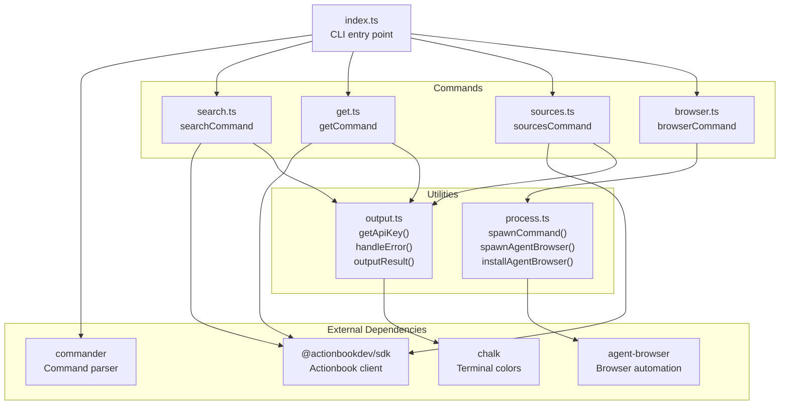
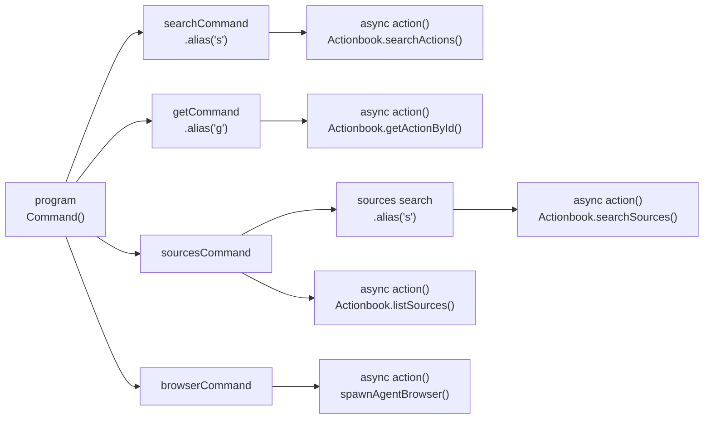
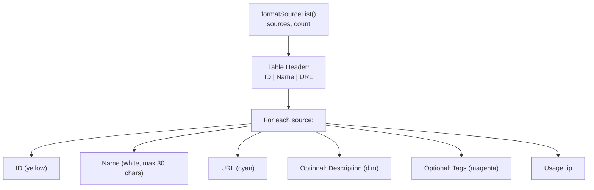
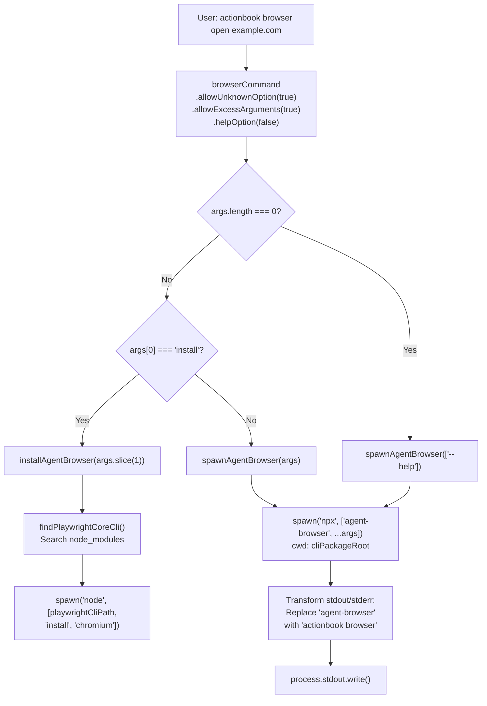
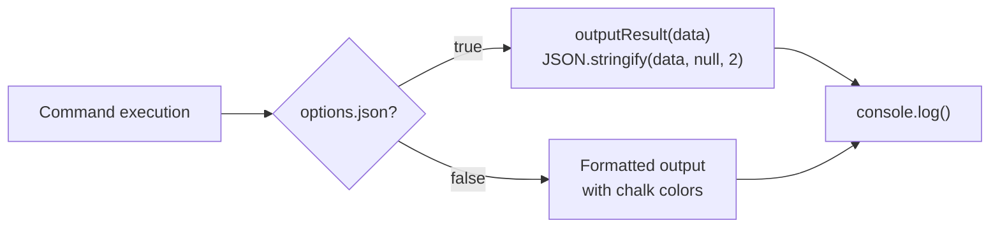
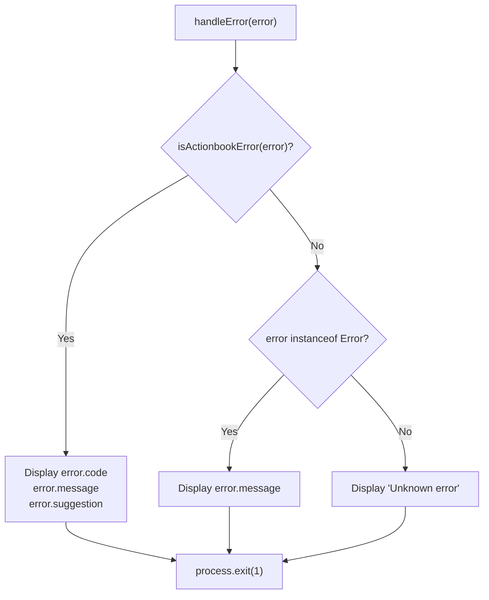
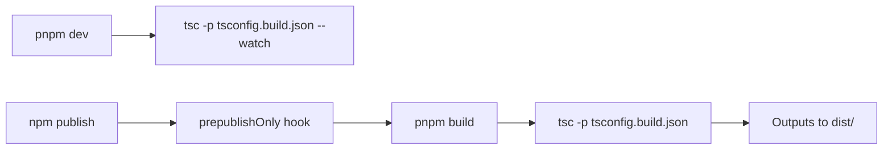

<!-- source: DeepWiki mcp.deepwiki.com · repo actionbook/actionbook · page 2.1 CLI (Command Line Interface) · fetched 2026-10-27 -->

# CLI (Command Line Interface)

<details>
<summary>Relevant source files</summary>

The following files were used as context for generating this wiki page:

- [LICENSE](LICENSE)
- [packages/cli/README.md](packages/cli/README.md)
- [packages/cli/package.json](packages/cli/package.json)
- [packages/cli/src/commands/browser.ts](packages/cli/src/commands/browser.ts)
- [packages/cli/src/commands/get.ts](packages/cli/src/commands/get.ts)
- [packages/cli/src/commands/search.ts](packages/cli/src/commands/search.ts)
- [packages/cli/src/commands/sources.ts](packages/cli/src/commands/sources.ts)
- [packages/cli/src/index.ts](packages/cli/src/index.ts)
- [packages/cli/src/output.ts](packages/cli/src/output.ts)
- [packages/cli/src/utils/process.ts](packages/cli/src/utils/process.ts)
- [packages/cli/tsconfig.build.json](packages/cli/tsconfig.build.json)
- [packages/cli/tsconfig.json](packages/cli/tsconfig.json)
- [packages/js-sdk/package.json](packages/js-sdk/package.json)
- [packages/mcp/package.json](packages/mcp/package.json)

</details>


## Purpose and Scope

The CLI package (`@actionbookdev/cli`) provides a command-line interface for interacting with Actionbook's action manual database and browser automation capabilities. It serves as the primary tool for developers to search for verified website selectors, retrieve action details, manage sources, and execute browser automation commands.

This document covers the CLI's architecture, commands, and implementation. For programmatic access to the same functionality, see [JavaScript SDK](#2.3). For AI agent integration, see [MCP Server](#2.2). For details on the underlying browser automation commands, see [Browser Automation Commands](#2.1.1).

## Package Architecture

The CLI is published as `@actionbookdev/cli` and consists of a thin command-line wrapper around the core SDK with additional browser automation integration.

**Package Structure:**



Sources: [packages/cli/src/index.ts:1-29](), [packages/cli/package.json:1-57]()

### Key Components

| Component | File | Purpose |
|-----------|------|---------|
| `index.ts` | [packages/cli/src/index.ts]() | Main entry point, command registration |
| `searchCommand` | [packages/cli/src/commands/search.ts]() | Search for action manuals |
| `getCommand` | [packages/cli/src/commands/get.ts]() | Retrieve action details by ID |
| `sourcesCommand` | [packages/cli/src/commands/sources.ts]() | List and search website sources |
| `browserCommand` | [packages/cli/src/commands/browser.ts]() | Forward commands to agent-browser |
| Output utilities | [packages/cli/src/output.ts]() | API key resolution, error handling, JSON output |
| Process utilities | [packages/cli/src/utils/process.ts]() | Command spawning, agent-browser integration |

Sources: [packages/cli/src/index.ts:1-29]()

## Installation and Setup

### Installation Methods

The CLI can be installed globally or used via npx:

```bash
# Global installation
npm install -g @actionbookdev/cli

# Use without installation
npx @actionbookdev/cli search "query"
```

The package is configured as a binary with the command name `actionbook` [packages/cli/package.json:9-11]().

### Authentication

The CLI requires an API key for accessing the Actionbook API. Authentication is handled through the `getApiKey()` function [packages/cli/src/output.ts:7-9](), which supports two methods:

1. **Environment variable** (recommended):
```bash
export ACTIONBOOK_API_KEY=your_api_key
```

2. **Command-line option**:
```bash
actionbook --api-key your_api_key search "query"
```

The global `--api-key` option is registered on the root program [packages/cli/src/index.ts:21]().

Sources: [packages/cli/src/output.ts:7-9](), [packages/cli/src/index.ts:16-22]()

## Command Architecture

### Command Registration Flow



Sources: [packages/cli/src/index.ts:23-26]()

## Search Command

The `search` command searches the action manual database using hybrid, vector, or full-text search.

### Command Definition

```bash
actionbook search <query> [options]
# Alias: actionbook s
```

**Command Implementation:** [packages/cli/src/commands/search.ts:7-58]()

### Options

| Option | Type | Default | Description |
|--------|------|---------|-------------|
| `-t, --type <type>` | `'vector' \| 'fulltext' \| 'hybrid'` | `'hybrid'` | Search algorithm |
| `-l, --limit <number>` | `1-100` | `5` | Maximum results |
| `-s, --source-ids <ids>` | `string` | - | Comma-separated source IDs |
| `--min-score <score>` | `0-1` | - | Minimum similarity threshold |
| `-j, --json` | `boolean` | `false` | Output raw JSON |

### Implementation Details

**Client Initialization:**
```typescript
const apiKey = getApiKey(options)
const client = new Actionbook({ apiKey })
```
[packages/cli/src/commands/search.ts:18-19]()

**API Call:**
```typescript
const result = await client.searchActions({
  query,
  type: options.type as SearchType,
  limit: parseInt(options.limit, 10),
  sourceIds: options.sourceIds,
  minScore: options.minScore ? parseFloat(options.minScore) : undefined,
})
```
[packages/cli/src/commands/search.ts:21-27]()

**Output Formatting:**
- JSON mode: Calls `outputResult(result)` [packages/cli/src/commands/search.ts:30]()
- Formatted mode: Displays numbered results with score and truncated content [packages/cli/src/commands/search.ts:32-53]()

Sources: [packages/cli/src/commands/search.ts:1-64]()

## Get Command

The `get` command retrieves complete action details including metadata, content, and UI element selectors.

### Command Definition

```bash
actionbook get <id> [options]
# Alias: actionbook g
```

**Command Implementation:** [packages/cli/src/commands/get.ts:6-71]()

### Action ID Format

The command accepts flexible ID formats with fuzzy matching:
- Full URL: `https://www.airbnb.com/search`
- URL without protocol: `airbnb.com/search`
- Domain only: `releases.rs`

The ID is passed directly to `client.getActionById(id)` [packages/cli/src/commands/get.ts:16]().

### Formatted Output Structure

The formatted output displays:

1. **Heading/Title** [packages/cli/src/commands/get.ts:22]()
2. **Metadata section** showing:
   - Action ID
   - Document title
   - Document URL
   - Chunk index
   - Token count
   [packages/cli/src/commands/get.ts:24-31]()

3. **Content section** with full chunk text [packages/cli/src/commands/get.ts:33-36]()

4. **UI Elements section** (if present) parsing `result.elements` JSON and displaying:
   - Element name
   - CSS selector
   - XPath selector
   - Description
   - Element type
   - Allowed methods
   [packages/cli/src/commands/get.ts:38-66]()

Sources: [packages/cli/src/commands/get.ts:1-71]()

## Sources Command

The `sources` command manages website source queries with both listing and search capabilities.

### Base Command

```bash
actionbook sources [options]
```

**Options:**
- `-l, --limit <number>`: Maximum results (default: 50)
- `-j, --json`: Output raw JSON

**Implementation:** [packages/cli/src/commands/sources.ts:7-28]()

### Search Subcommand

```bash
actionbook sources search <query> [options]
# Alias: actionbook sources s
```

**Options:**
- `-l, --limit <number>`: Maximum results (default: 10)
- `-j, --json`: Output raw JSON

**Implementation:** [packages/cli/src/commands/sources.ts:31-62]()

### Source List Formatting

**Formatted Output Structure:**



**Column Width Calculation:**
- ID: Maximum source ID length, minimum 2 [packages/cli/src/commands/sources.ts:73]()
- Name: Maximum name length, capped at 30 [packages/cli/src/commands/sources.ts:74]()
- URL: No truncation

The `truncate()` helper function shortens strings with ellipsis [packages/cli/src/commands/sources.ts:114-117]().

Sources: [packages/cli/src/commands/sources.ts:1-118]()

## Browser Command

The `browser` command forwards all arguments to the `agent-browser` CLI, providing a unified interface for browser automation.

### Architecture



Sources: [packages/cli/src/commands/browser.ts:1-31](), [packages/cli/src/utils/process.ts:55-103]()

### Command Configuration

The command uses special Commander.js settings to forward all arguments:

```typescript
.allowUnknownOption(true)  // Allow any flags
.allowExcessArguments(true) // Allow any positional args
.helpOption(false)         // Don't intercept -h/--help
```
[packages/cli/src/commands/browser.ts:7-9]()

### Agent Browser Execution

**Function:** `spawnAgentBrowser(args: string[])`  
**File:** [packages/cli/src/utils/process.ts:55-103]()

**Execution Details:**
1. Determines CLI package root by traversing from current file [packages/cli/src/utils/process.ts:58-59]()
2. Spawns `npx agent-browser` with inherited stdin, piped stdout/stderr [packages/cli/src/utils/process.ts:61-66]()
3. Sets `cwd` to CLI package directory to ensure `agent-browser` is resolved from CLI's `node_modules` [packages/cli/src/utils/process.ts:65]()
4. Transforms output streams to replace "agent-browser" with "actionbook browser" for brand consistency [packages/cli/src/utils/process.ts:71-82]()

### Installation Command

**Function:** `installAgentBrowser(installArgs: string[])`  
**File:** [packages/cli/src/utils/process.ts:172-230]()

The `actionbook browser install` command downloads Chromium binaries using Playwright's CLI.

**Installation Flow:**

| Step | Implementation |
|------|----------------|
| 1. Locate playwright-core CLI | `findPlaywrightCoreCli()` searches multiple node_modules structures |
| 2. Check pnpm structure | Looks for `node_modules/.pnpm/playwright-core@*/node_modules/playwright-core/cli.js` |
| 3. Check npm flat structure | Looks for `node_modules/playwright-core/cli.js` |
| 4. Check npm nested | Looks for `node_modules/agent-browser/node_modules/playwright-core/cli.js` |
| 5. Execute install | Spawns `node [playwrightCliPath] install chromium [--with-deps]` |

**Node Modules Search:** [packages/cli/src/utils/process.ts:126-165]()

**Install Execution:** [packages/cli/src/utils/process.ts:188-219]()

### Error Handling

If `agent-browser` is not found (ENOENT error), the CLI displays installation instructions via `showAgentBrowserInstallation()` [packages/cli/src/utils/process.ts:108-120]():

```
agent-browser is not installed or not in PATH.

agent-browser is a fast browser automation CLI for AI agents.
To install it, run:

  npm install -g agent-browser

Learn more: https://github.com/vercel-labs/agent-browser
```

Sources: [packages/cli/src/utils/process.ts:55-230](), [packages/cli/src/commands/browser.ts:1-31]()

## Output Format System

### Output Mode Selection

All commands support two output modes controlled by the `-j, --json` flag:



**Output Function:** [packages/cli/src/output.ts:14-16]()

### Formatted Output Implementation

Formatted output uses the `chalk` library for terminal colors:

| Color | Usage | Example |
|-------|-------|---------|
| `chalk.cyan` | Headings, links | Section titles, URLs |
| `chalk.yellow` | IDs, warnings | Source IDs, "No results" |
| `chalk.white` | Primary text | Descriptions, content |
| `chalk.dim` | Secondary text | Separators, hints |
| `chalk.gray` | Labels | Field names |
| `chalk.red` | Errors | Error messages |
| `chalk.green` | Success | Installation complete |
| `chalk.magenta` | Tags | Source tags |

**Examples:**
- Search results heading: `chalk.bold.cyan()` [packages/cli/src/commands/search.ts:37]()
- Element names: `chalk.yellow()` [packages/cli/src/commands/get.ts:45]()
- Separators: `chalk.dim('─'.repeat(50))` [packages/cli/src/commands/get.ts:25]()

Sources: [packages/cli/src/output.ts:1-34](), [packages/cli/src/commands/search.ts:32-53]()

## Error Handling System

### Error Handler Function

**Function:** `handleError(error: unknown)`  
**File:** [packages/cli/src/output.ts:21-34]()

**Error Type Detection:**



### SDK Error Format

The `isActionbookError()` type guard [packages/cli/src/output.ts:22]() checks for errors from `@actionbookdev/sdk` with the structure:

```typescript
{
  code: string,
  message: string,
  suggestion?: string
}
```

When an SDK error is detected, the output includes:
1. Red error code [packages/cli/src/output.ts:23]()
2. White error message [packages/cli/src/output.ts:24]()
3. Yellow suggestion if present [packages/cli/src/output.ts:25-27]()

### Exit Code Handling

The CLI uses standard POSIX exit codes:

| Code | Meaning | Source |
|------|---------|--------|
| 0 | Success | Normal completion |
| 1 | General error | Handled errors, failed operations |
| 127 | Command not found | ENOENT from spawn [packages/cli/src/utils/process.ts:41]() |
| 128 + N | Signal termination | e.g., 130 for SIGINT (Ctrl+C) [packages/cli/src/utils/process.ts:29]() |

Sources: [packages/cli/src/output.ts:21-34](), [packages/cli/src/utils/process.ts:25-47]()

## Dependencies

### Direct Dependencies

| Package | Version | Purpose |
|---------|---------|---------|
| `@actionbookdev/sdk` | workspace:* | Core API client for search/get operations |
| `agent-browser` | ^0.8.3 | Browser automation CLI (forwarded by browser command) |
| `chalk` | ^5.3.0 | Terminal color formatting |
| `commander` | ^12.1.0 | Command-line parsing and routing |

**Dependency Declaration:** [packages/cli/package.json:26-30]()

### Build and Development Dependencies

| Package | Version | Purpose |
|---------|---------|---------|
| `typescript` | ^5.6.3 | Type checking and compilation |
| `vitest` | ^1.6.0 | Testing framework |
| `rimraf` | ^5.0.5 | Cross-platform file deletion for clean task |
| `@types/node` | ^20.14.0 | Node.js type definitions |

**Dev Dependencies:** [packages/cli/package.json:32-36]()

### TypeScript Configuration

**Compiler Options:**
- Target: ES2022
- Module system: NodeNext (ESM)
- Output directory: `./dist`
- Root directory: `./src`

**Full Configuration:** [packages/cli/tsconfig.json:1-21]()

Sources: [packages/cli/package.json:26-36](), [packages/cli/tsconfig.json:1-21]()

## Build and Publishing

### Build Scripts



**Scripts Definition:** [packages/cli/package.json:18-24]()

### Package Distribution

**Published Files:**
- Only the `dist/` directory is included [packages/cli/package.json:12-14]()

**Binary Configuration:**
- Command name: `actionbook`
- Entry point: `dist/index.js`
- Shebang: `#!/usr/bin/env node` [packages/cli/src/index.ts:1]()

**NPM Configuration:**
- Scope: `@actionbookdev`
- Access: public [packages/cli/package.json:15-17]()
- Registry: npmjs.com
- Version: 0.2.3 [packages/cli/package.json:3]()

Sources: [packages/cli/package.json:1-57](), [packages/cli/src/index.ts:1]()

---

