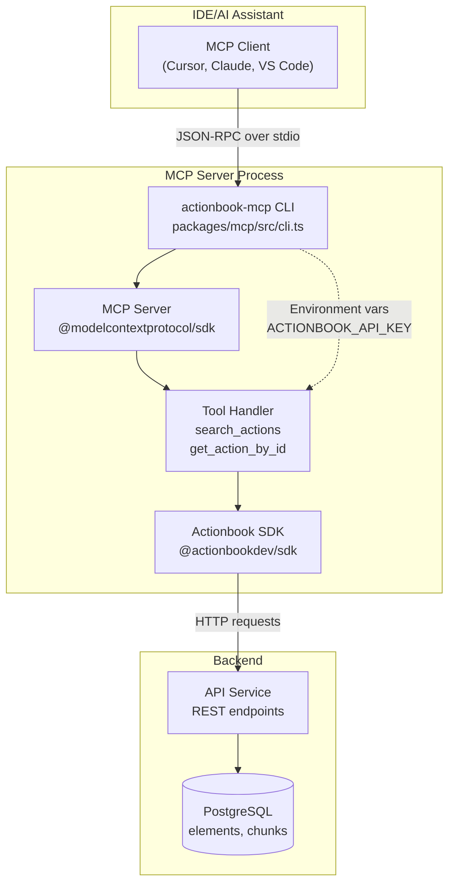
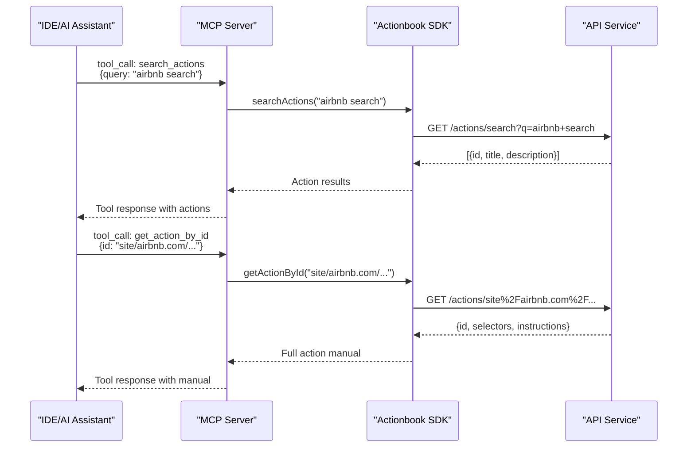

<!-- source: DeepWiki mcp.deepwiki.com · repo actionbook/actionbook · page 2.2 MCP Server · fetched 2026-10-27 -->

# MCP Server

<details>
<summary>Relevant source files</summary>

The following files were used as context for generating this wiki page:

- [.claude-plugin/marketplace.json](.claude-plugin/marketplace.json)
- [.claude-plugin/plugin.json](.claude-plugin/plugin.json)
- [LICENSE](LICENSE)
- [README.md](README.md)
- [commands/manual.md](commands/manual.md)
- [packages/cli/package.json](packages/cli/package.json)
- [packages/js-sdk/package.json](packages/js-sdk/package.json)
- [packages/mcp/package.json](packages/mcp/package.json)
- [skills/actionbook/SKILL.md](skills/actionbook/SKILL.md)

</details>


This document covers the Actionbook MCP (Model Context Protocol) Server, which enables AI IDEs and coding assistants to access Actionbook's action manuals through standardized tool calling. For command-line usage, see [CLI](#2.1). For programmatic integration in custom applications, see [JavaScript SDK](#2.3).

## Overview

The MCP Server provides a Model Context Protocol-compliant interface to Actionbook, allowing AI assistants in IDEs like Cursor, Claude Desktop, VS Code, and others to search and retrieve action manuals. The server exposes two primary tools that AI agents can call to understand and automate website interactions.

**Package**: `@actionbookdev/mcp`  
**Published Version**: 0.1.3  
**Protocol**: Model Context Protocol (MCP)  
**Execution Model**: Server runs as a subprocess managed by the IDE

The MCP Server wraps the [JavaScript SDK](#2.3) and translates between MCP's JSON-RPC protocol and Actionbook's REST API, providing a standardized interface for AI tools.

Sources: [packages/mcp/package.json:1-48](), [README.md:134-425]()

## Architecture

The MCP Server acts as a protocol adapter between MCP-compatible clients and Actionbook's API Service:



### Component Responsibilities

| Component | File/Package | Responsibility |
|-----------|-------------|----------------|
| `actionbook-mcp` CLI | [packages/mcp/src/cli.ts]() | Entry point for MCP server subprocess |
| MCP Server | `@modelcontextprotocol/sdk` | Handles JSON-RPC protocol, stdio transport |
| Tool Handler | [packages/mcp/src/index.ts]() | Implements tool schemas and execution logic |
| Actionbook SDK | `@actionbookdev/sdk` | Makes HTTP requests to API Service |

Sources: [packages/mcp/package.json:1-48](), [README.md:134-206]()

## Installation and Configuration

### NPM Package

The MCP Server is distributed as an npm package that can be executed directly via `npx`:

```bash
npx -y @actionbookdev/mcp@latest
```

The `-y` flag auto-accepts the package installation prompt. IDEs execute this command as a subprocess and communicate via stdio.

**Package Structure**:
- **Main Entry**: `dist/index.js` - MCP server implementation
- **Binary Entry**: `dist/cli.js` - Command-line wrapper (`actionbook-mcp`)
- **Dependencies**: `@actionbookdev/sdk`, `@modelcontextprotocol/sdk`, `zod`, `zod-to-json-schema`

Sources: [packages/mcp/package.json:1-48]()

### IDE Integration

The MCP Server can be configured in various MCP-compatible IDEs by adding a server configuration. The standard configuration format is:

```json
{
  "mcpServers": {
    "actionbook": {
      "command": "npx",
      "args": ["-y", "@actionbookdev/mcp@latest"]
    }
  }
}
```

#### Supported IDEs

| IDE/Client | Configuration Location | Notes |
|------------|----------------------|-------|
| **Cursor** | Settings → Cursor Settings → MCP | GUI-based configuration |
| **Claude Code** | Via `claude mcp add` command | CLI-based setup |
| **VS Code** | Settings JSON (`mcp.servers`) | Manual JSON editing |
| **Windsurf** | `~/.codeium/windsurf/mcp_config.json` | File-based config |
| **Claude Desktop** | `claude_desktop_config.json` | File-based config |
| **Cline** | Settings → MCP Servers | GUI-based configuration |
| **Zed** | Settings JSON (`context_servers`) | Uses `context_servers` key |
| **JetBrains IDEs** | Settings → Tools → AI Assistant → MCP | GUI-based configuration |
| **Amazon Q Developer CLI** | `~/.aws/amazonq/mcp.json` | File-based config |
| **Warp** | Settings → AI → Manage MCP servers | GUI with `start_on_launch` option |
| **Roo Code** | Settings → MCP Servers | GUI-based configuration |
| **Augment Code** | Settings → MCP Servers | GUI-based configuration |
| **Trae** | Settings → MCP Servers | GUI-based configuration |
| **Gemini CLI** | `~/.gemini/settings.json` | File-based config |

#### Alternative Runtime Configurations

**Using Bun**:
```json
{
  "mcpServers": {
    "actionbook": {
      "command": "bunx",
      "args": ["@actionbookdev/mcp@latest"]
    }
  }
}
```

**Using Deno**:
```json
{
  "mcpServers": {
    "actionbook": {
      "command": "deno",
      "args": ["run", "--allow-all", "npm:@actionbookdev/mcp"]
    }
  }
}
```

Sources: [README.md:134-425]()

### Environment Variables

The MCP Server supports configuration via environment variables:

| Variable | Purpose | Default |
|----------|---------|---------|
| `ACTIONBOOK_API_KEY` | API key for authentication | Not required (open beta) |
| `ACTIONBOOK_API_URL` | Custom API endpoint | `https://api.actionbook.dev` |

Some IDEs (like Warp) allow passing environment variables directly in the configuration:

```json
{
  "actionbook": {
    "command": "npx",
    "args": ["-y", "@actionbookdev/mcp@latest", "--api-key", "YOUR_API_KEY"],
    "env": {},
    "working_directory": null,
    "start_on_launch": true
  }
}
```

Sources: [README.md:298-316]()

## Available Tools

The MCP Server exposes two tools that AI assistants can call:

### Tool Execution Flow



Sources: [README.md:674-689](), [skills/actionbook/SKILL.md:50-73]()

### `search_actions`

Searches for action manuals by keyword or task description.

**Tool Schema**:
```typescript
{
  name: "search_actions",
  description: "Search for action manuals by keyword",
  inputSchema: {
    type: "object",
    properties: {
      query: {
        type: "string",
        description: "Search query to find relevant action manuals"
      }
    },
    required: ["query"]
  }
}
```

**Example Queries**:
- `"airbnb search"` - Find actions related to searching on Airbnb
- `"linkedin send message"` - Find LinkedIn messaging actions
- `"google login"` - Find Google authentication actions
- `"twitter post tweet"` - Find Twitter posting actions

**Response Format**:
```typescript
{
  results: [
    {
      id: "site/airbnb.com/page/home/element/search-button",
      title: "Search button on Airbnb homepage",
      description: "Click to open search form",
      url: "https://airbnb.com",
      score: 0.95
    }
  ]
}
```

Sources: [README.md:678-683](), [skills/actionbook/SKILL.md:54-62]()

### `get_action_by_id`

Retrieves detailed information about a specific action, including verified selectors and step-by-step instructions.

**Tool Schema**:
```typescript
{
  name: "get_action_by_id",
  description: "Retrieve a specific action manual by its ID",
  inputSchema: {
    type: "object",
    properties: {
      id: {
        type: "string",
        description: "The unique identifier of the action manual"
      }
    },
    required: ["id"]
  }
}
```

**Response Format**:
```typescript
{
  id: "site/airbnb.com/page/home/element/search-button",
  type: "button",
  title: "Search button",
  description: "Opens the search form for finding listings",
  url: "https://airbnb.com",
  selectors: {
    css: "button[data-testid='structured-search-input-search-button']",
    xpath: "//button[@data-testid='structured-search-input-search-button']",
    dataTestId: "structured-search-input-search-button",
    ariaLabel: "Search"
  },
  allowedMethods: ["click"],
  instructions: [
    "Navigate to https://airbnb.com",
    "Click the search button using the selector",
    "Wait for search form to appear"
  ]
}
```

Sources: [README.md:684-689](), [skills/actionbook/SKILL.md:65-73]()

## Usage Patterns

### Basic Workflow in AI IDEs

When an AI assistant needs to automate a website task, it follows this pattern:

1. **Search Phase**: AI calls `search_actions` with a task description
2. **Selection Phase**: AI examines search results and selects relevant actions
3. **Retrieval Phase**: AI calls `get_action_by_id` to get detailed selectors
4. **Execution Phase**: AI uses the selectors with browser automation tools

**Example Session**:

```
User: "Help me automate sending a message on LinkedIn"

AI: [Calls search_actions({query: "linkedin send message"})]
    → Receives list of LinkedIn messaging actions

AI: [Calls get_action_by_id({id: "site/linkedin.com/page/profile/element/message-button"})]
    → Receives full manual with selectors

AI: "I found the LinkedIn message button. Here's the automation code:
     await page.click('[data-testid="message-button"]')"
```

Sources: [skills/actionbook/SKILL.md:1-112]()

### Integration with Browser Automation

The MCP Server is commonly used in conjunction with the [CLI's browser commands](#2.1.1) or direct browser automation frameworks:

**Pattern 1: Using CLI Browser Commands**
```bash
# AI assistant generates these commands based on MCP tool responses
actionbook browser open linkedin.com/in/username
actionbook browser click '[data-testid="message-button"]'
actionbook browser fill 'div[role="textbox"]' 'Hello!'
actionbook browser click 'button[type="submit"]'
```

**Pattern 2: Using Playwright/Puppeteer**
```javascript
// AI assistant generates automation code using retrieved selectors
await page.click('[data-testid="message-button"]')
await page.type('div[role="textbox"]', 'Hello!')
await page.click('button[type="submit"]')
```

Sources: [skills/actionbook/SKILL.md:78-105]()

### Skill System Integration

The MCP Server is also exposed through the Actionbook skill in the skill/plugin system (see [Skills and Plugins](#2.4)). The skill provides:

- Automatic activation when users mention browser automation tasks
- Guided workflow for search → retrieve → execute pattern
- Integration with both CLI and MCP methods

**Skill Definition**:
```yaml
name: actionbook
description: Browser automation, web scraping, UI testing, AI agents
```

The skill automatically activates for queries like:
- "Send a LinkedIn message"
- "Book an Airbnb"
- "How do I post a tweet?"

Sources: [skills/actionbook/SKILL.md:1-4](), [.claude-plugin/plugin.json:1-10]()

## Command Line Interface

While the MCP Server is typically run as a subprocess by IDEs, it can also be executed directly for testing or debugging:

```bash
# Run the MCP server directly
npx @actionbookdev/mcp

# Or if installed globally
npm install -g @actionbookdev/mcp
actionbook-mcp

# With custom API key
ACTIONBOOK_API_KEY=your-key npx @actionbookdev/mcp
```

The server communicates via stdio using JSON-RPC 2.0 protocol. When run directly, it expects MCP client messages on stdin and writes responses to stdout.

**Testing Tool Calls**:

To test the MCP server locally, you can use an MCP client or send JSON-RPC messages manually:

```json
{
  "jsonrpc": "2.0",
  "method": "tools/call",
  "params": {
    "name": "search_actions",
    "arguments": {
      "query": "airbnb search"
    }
  },
  "id": 1
}
```

Sources: [packages/mcp/package.json:14-16]()

## Marketplace Distribution

The MCP Server is distributed through multiple channels:

| Channel | Purpose | Configuration |
|---------|---------|---------------|
| **NPM Registry** | Direct installation via `npx` | `@actionbookdev/mcp@latest` |
| **Claude Plugin Marketplace** | Discovery in Claude Code | [.claude-plugin/marketplace.json]() |
| **Skill System** | Integration with skill-based workflows | [.claude-plugin/plugin.json]() |

The marketplace listing includes:
- **Main plugin**: Actionbook MCP server for browser automation
- **Related plugins**: rust-learner, arxiv-viewer, actionbook-scraper (see [Skills and Plugins](#2.4))

Sources: [.claude-plugin/marketplace.json:1-32](), [.claude-plugin/plugin.json:1-10]()

## Implementation Details

### Dependencies

The MCP Server relies on a minimal set of dependencies:

| Dependency | Version | Purpose |
|------------|---------|---------|
| `@actionbookdev/sdk` | workspace:* | Core API client |
| `@modelcontextprotocol/sdk` | ^1.23.0 | MCP protocol implementation |
| `undici` | ^6.21.0 | HTTP client for API requests |
| `zod` | ^3.25.6 | Schema validation |
| `zod-to-json-schema` | ^3.22.5 | Convert Zod schemas to JSON Schema for MCP |

The SDK dependency ensures consistency between MCP, CLI, and direct SDK usage (see [JavaScript SDK](#2.3) for SDK details).

Sources: [packages/mcp/package.json:31-37]()

### Build Process

The MCP package is built from TypeScript source:

```bash
# Build command (defined in package.json)
tsc -p tsconfig.build.json

# Pre-build step ensures SDK is built first
pnpm --filter @actionbookdev/sdk build
```

**Output Structure**:
- `dist/index.js` - Main MCP server implementation
- `dist/cli.js` - Binary entry point for `actionbook-mcp`
- `dist/**/*.d.ts` - TypeScript type definitions

The build process must complete before publishing to ensure the `dist/` directory is included in the npm package.

Sources: [packages/mcp/package.json:23-29]()

---

**Related Pages**:
- [CLI (Command Line Interface)](#2.1) - Alternative interface for direct command-line usage
- [JavaScript SDK](#2.3) - Programmatic integration in custom applications
- [Skills and Plugins](#2.4) - Skill system that wraps MCP tools
- [API Service](#3.1) - Backend REST API that MCP Server communicates with

---

