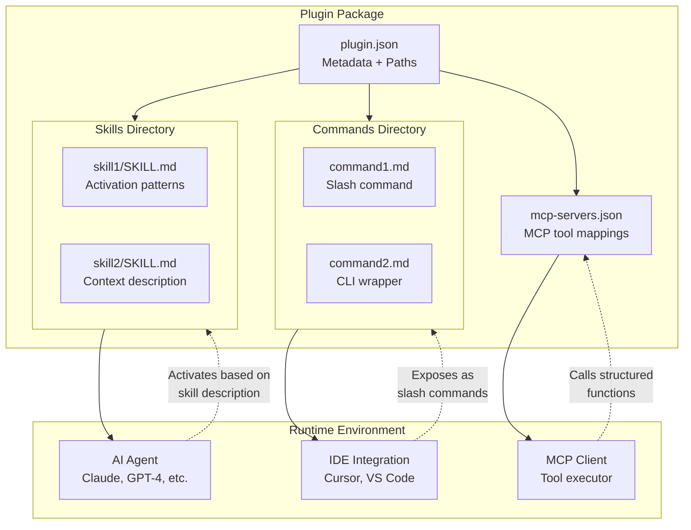
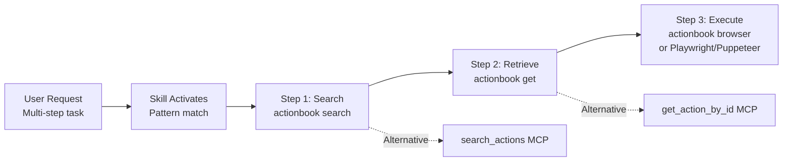
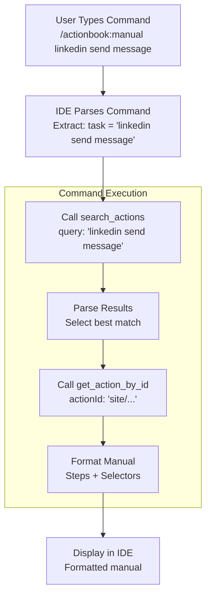
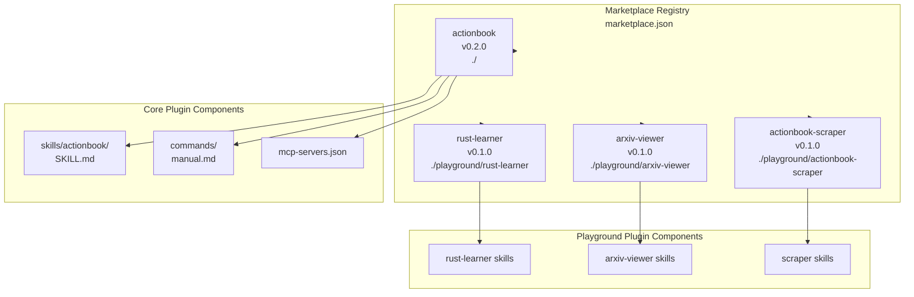
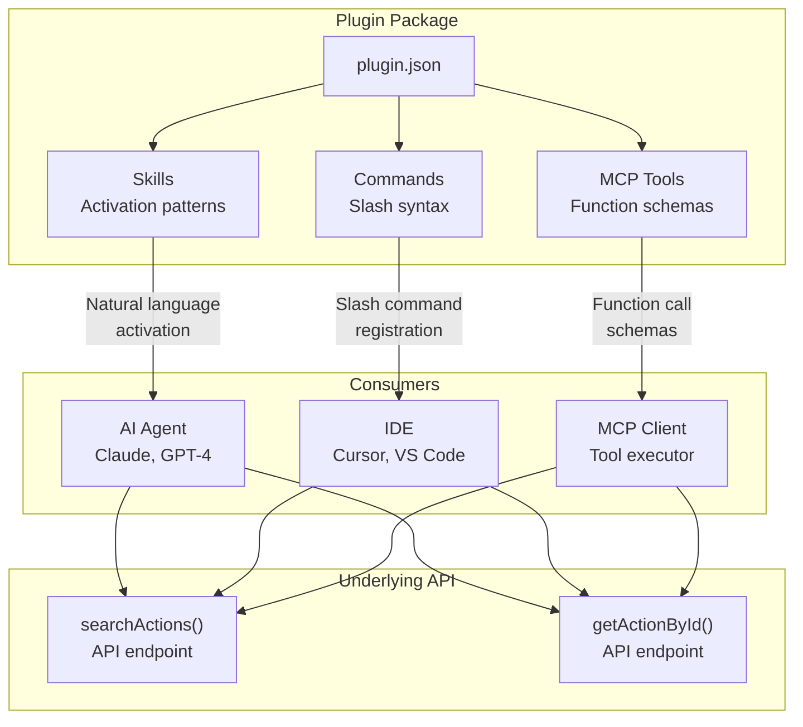

<!-- source: DeepWiki mcp.deepwiki.com · repo actionbook/actionbook · page 2.4 Skills and Plugins · fetched 2026-10-27 -->

# Skills and Plugins

<details>
<summary>Relevant source files</summary>

The following files were used as context for generating this wiki page:

- [.claude-plugin/marketplace.json](.claude-plugin/marketplace.json)
- [.claude-plugin/plugin.json](.claude-plugin/plugin.json)
- [commands/manual.md](commands/manual.md)
- [skills/actionbook/SKILL.md](skills/actionbook/SKILL.md)

</details>


This page documents Actionbook's extensible plugin system that enables AI agents and IDEs to discover and use specialized capabilities. Plugins bundle **skills** (contextual activation patterns), **commands** (slash commands), and **MCP tools** (structured function calls) into distributable packages.

For information about using the MCP Server interface, see [MCP Server](#2.2). For details on the SDK's tool definitions, see [JavaScript SDK](#2.3).

---

## Plugin Architecture

Actionbook plugins follow a standardized directory structure defined by a `plugin.json` manifest. This manifest declares the plugin's metadata and points to its capabilities: skills, commands, and MCP server configurations.

### Plugin Manifest Structure

The plugin manifest defines the core plugin metadata and paths to capability directories:

| Field | Type | Description |
|-------|------|-------------|
| `name` | string | Unique plugin identifier |
| `description` | string | Brief description of plugin capabilities |
| `author` | object | Author metadata with `name` field |
| `skills` | string | Relative path to skills directory (optional) |
| `commands` | string | Relative path to commands directory (optional) |
| `mcpServers` | string | Relative path to MCP servers config (optional) |

**Example Plugin Manifest:**

```json
{
  "name": "actionbook",
  "description": "Actionbook MCP server for up-to-date browser automation",
  "author": { "name": "Actionbook" },
  "skills": "./skills/",
  "commands": "./commands/",
  "mcpServers": "./mcp-servers.json"
}
```

Sources: [.claude-plugin/plugin.json:1-10]()

### Plugin Component Diagram



Sources: [.claude-plugin/plugin.json:1-10]()

---

## Skills

Skills are markdown-based capability declarations that help AI agents understand **when** and **how** to use a plugin. Each skill includes activation patterns and usage guidance in natural language.

### Skill Definition Format

Skills are defined in markdown files named `SKILL.md` within the skills directory. The file structure consists of:

1. **YAML Frontmatter**: Metadata including `name` and `description`
2. **Markdown Body**: Detailed usage instructions, examples, and guidelines

**Frontmatter Fields:**

| Field | Required | Description |
|-------|----------|-------------|
| `name` | Yes | Skill identifier (must match directory name) |
| `description` | Yes | Activation pattern describing when the skill should be used |

The `description` field is critical—it defines the semantic trigger conditions that cause an AI agent to activate this skill.

### Actionbook Core Skill

The primary Actionbook skill activates when users need browser automation capabilities:

```yaml
---
name: actionbook
description: This skill should be used when the user needs to automate multi-step website tasks. Activates for browser automation, web scraping, UI testing, or building AI agents. Provides complete action manuals with step-by-step instructions and verified selectors.
---
```

**Activation Triggers:**
- Multi-step website tasks ("Send a LinkedIn message")
- Website interaction queries ("How do I post a tweet?")
- Browser-based AI agent development
- E2E test writing for external websites

**What It Provides:**
1. Step-by-step instructions
2. Verified selectors (CSS/XPath)
3. Element metadata (type, allowed methods)

Sources: [skills/actionbook/SKILL.md:1-24]()

### Skill Usage Patterns

Skills guide agents through a standard workflow:



Sources: [skills/actionbook/SKILL.md:26-106]()

### Skill Guidelines

Skills provide best practices for agents:

- **Search by task**: Describe goals, not just elements (`"linkedin send message"` not `"linkedin message button"`)
- **Follow order**: Execute steps sequentially as provided
- **Trust selectors**: Actionbook selectors are verified and maintained

Sources: [skills/actionbook/SKILL.md:108-112]()

---

## Commands

Commands are slash-command interfaces that expose plugin functionality to IDEs and chat interfaces. Each command is defined by a markdown file with YAML frontmatter.

### Command Definition Format

Commands follow this structure:

**Frontmatter Fields:**

| Field | Required | Description |
|-------|----------|-------------|
| `description` | Yes | Brief command summary |
| `argument-hint` | No | Placeholder text for required arguments |

**Example Command Definition:**

```yaml
---
description: Get action manual for a website task
argument-hint: <task>
---

# /actionbook:manual

Fetches up-to-date action manuals with step-by-step instructions 
and verified selectors.

## Usage
/actionbook:manual <task>

## Examples
/actionbook:manual linkedin send message
/actionbook:manual airbnb book listing
```

Sources: [commands/manual.md:1-26]()

### Command Execution Flow



Sources: [commands/manual.md:28-36]()

---

## Plugin Marketplace

The marketplace configuration (`marketplace.json`) defines a registry of available plugins with metadata for discovery and installation.

### Marketplace Structure

| Field | Type | Description |
|-------|------|-------------|
| `name` | string | Marketplace identifier |
| `owner` | object | Marketplace owner metadata |
| `plugins` | array | List of available plugins |

**Plugin Entry Fields:**

| Field | Description |
|-------|-------------|
| `name` | Plugin identifier |
| `source` | Relative or absolute path to plugin directory |
| `description` | Plugin capabilities summary |
| `version` | Semantic version string |

Sources: [.claude-plugin/marketplace.json:1-7]()

### Available Plugins

The Actionbook marketplace includes four plugins:

#### 1. Actionbook (Core)

**Source:** `./`  
**Version:** 0.2.0  
**Purpose:** Core Actionbook functionality for browser automation with verified selectors.

#### 2. Rust Learner

**Source:** `./playground/rust-learner`  
**Version:** 0.1.0  
**Purpose:** Educational plugin demonstrating how to learn Rust language features and crate updates using Actionbook + agent-browser.

#### 3. ArXiv Viewer

**Source:** `./playground/arxiv-viewer`  
**Version:** 0.1.0  
**Purpose:** Academic paper research tool supporting:
- API queries for paper metadata
- Web scraping via Actionbook for paper discovery
- HTML paper reading via ar5iv

#### 4. Actionbook Scraper

**Source:** `./playground/actionbook-scraper`  
**Version:** 0.1.0  
**Purpose:** Web scraper code generation using verified selectors. Achieves 7.76x better data extraction accuracy compared to AI-guessed selectors.

Sources: [.claude-plugin/marketplace.json:6-31]()

### Plugin Distribution Diagram



Sources: [.claude-plugin/marketplace.json:1-32]()

---

## Integration Points

### Skills ↔ Commands ↔ MCP Tools

Plugins integrate three capability types that serve different consumption patterns:

| Capability | Consumer | Interface | Discovery Mechanism |
|------------|----------|-----------|---------------------|
| **Skills** | AI Agents | Natural language activation | Semantic pattern matching on `description` field |
| **Commands** | IDEs | Slash commands (`/plugin:command`) | Command palette registration |
| **MCP Tools** | MCP Clients | Structured function calls | Tool schema registration |



Sources: [.claude-plugin/plugin.json:1-10](), [skills/actionbook/SKILL.md:26-73](), [commands/manual.md:1-36]()

---

## Implementation References

### File Paths for Plugin System

| Component | Path |
|-----------|------|
| Core plugin manifest | `.claude-plugin/plugin.json` |
| Marketplace registry | `.claude-plugin/marketplace.json` |
| Actionbook skill | `skills/actionbook/SKILL.md` |
| Manual command | `commands/manual.md` |
| MCP server config | `.claude-plugin/mcp-servers.json` (referenced) |

### Related Documentation

- For MCP server setup and tool definitions, see [MCP Server](#2.2)
- For SDK tool schemas (`ToolDefinition`), see [Tool Definitions](#7.3)
- For CLI command reference, see [CLI](#2.1)
- For browser automation commands exposed by plugins, see [Browser Automation Commands](#2.1.1)

Sources: [.claude-plugin/plugin.json:1-10](), [.claude-plugin/marketplace.json:1-32](), [skills/actionbook/SKILL.md:1-112](), [commands/manual.md:1-36]()

---

