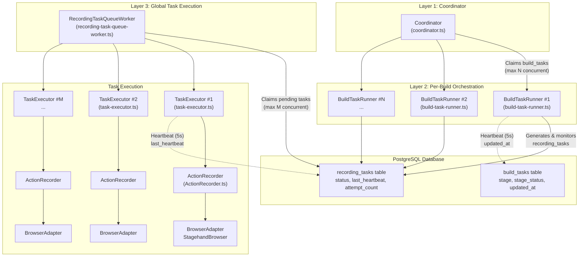
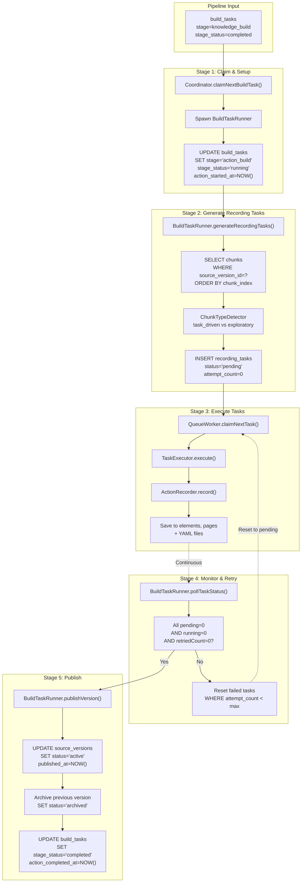
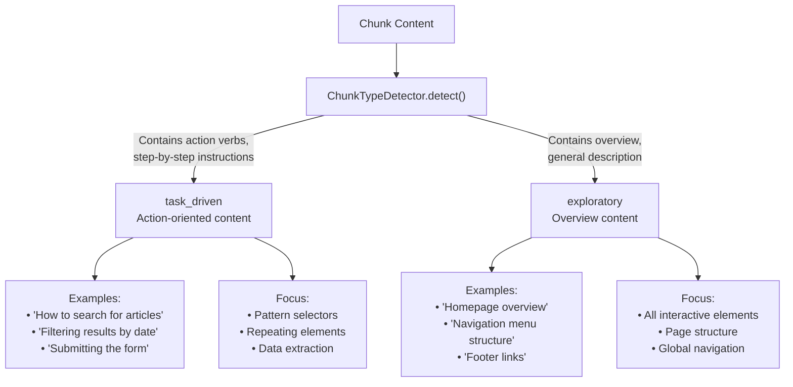
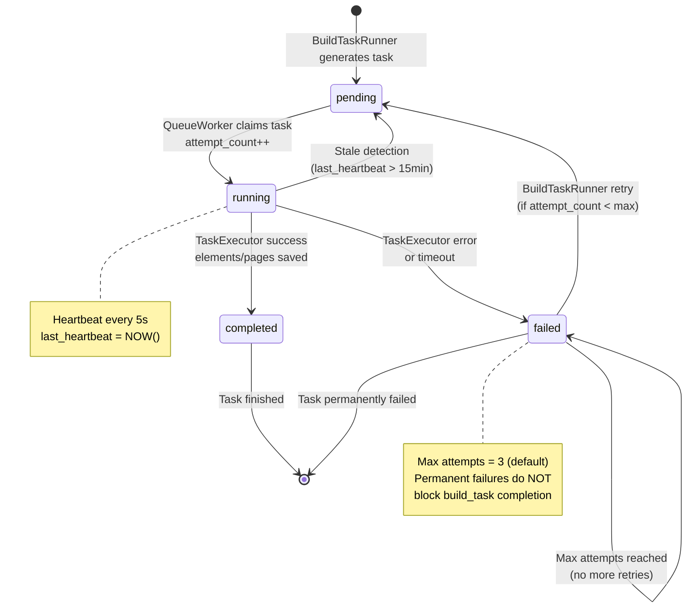
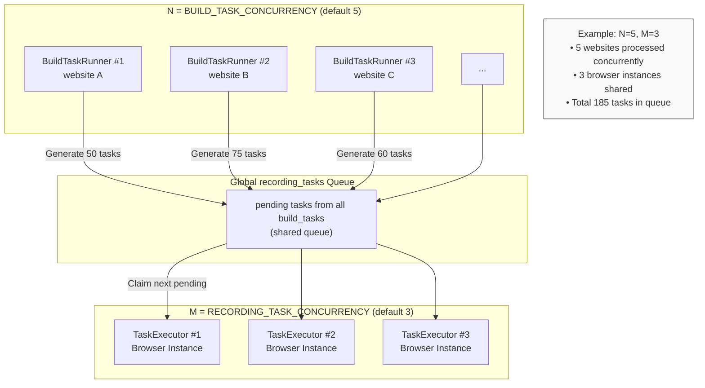
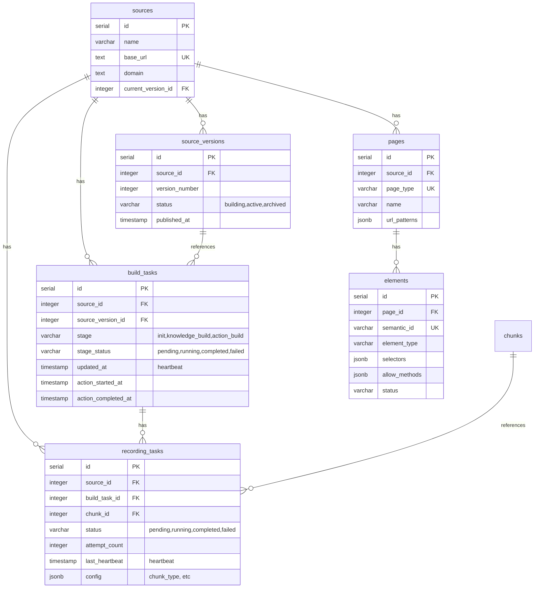
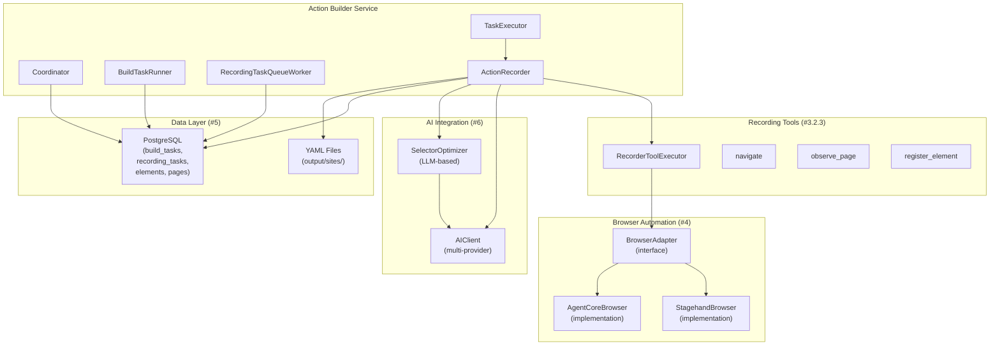

<!-- source: DeepWiki mcp.deepwiki.com · repo actionbook/actionbook · page 3.2 Action Builder Service · fetched 2026-10-27 -->

# Action Builder Service

<details>
<summary>Relevant source files</summary>

The following files were used as context for generating this wiki page:

- [services/action-builder/.env.example](services/action-builder/.env.example)
- [services/action-builder/.gitignore](services/action-builder/.gitignore)
- [services/action-builder/README.md](services/action-builder/README.md)
- [services/action-builder/package.json](services/action-builder/package.json)
- [services/action-builder/scripts/coordinator.ts](services/action-builder/scripts/coordinator.ts)
- [services/action-builder/scripts/crawl-playbook-batch.ts](services/action-builder/scripts/crawl-playbook-batch.ts)
- [services/action-builder/scripts/crawl-sites.txt.example](services/action-builder/scripts/crawl-sites.txt.example)
- [services/action-builder/scripts/import-playbook-batch.ts](services/action-builder/scripts/import-playbook-batch.ts)
- [services/action-builder/src/llm/AIClient.ts](services/action-builder/src/llm/AIClient.ts)
- [services/action-builder/src/utils/logger.ts](services/action-builder/src/utils/logger.ts)
- [services/action-builder/vitest.setup.ts](services/action-builder/vitest.setup.ts)
- [services/db/migrations/meta/0018_snapshot.json](services/db/migrations/meta/0018_snapshot.json)

</details>


The Action Builder Service is responsible for automatically discovering and recording UI capabilities of websites. It uses LLM-powered browser automation to explore web pages, identify interactive elements, extract stable CSS/XPath selectors, and persist them to both PostgreSQL database and YAML files. This service is the core of Actionbook's "recording" functionality that generates action manuals.

For information about the task execution pipeline internals, see [Task Execution Pipeline](#3.2.1). For details on how the recording process works with LLM tool loops, see [Action Recording](#3.2.2). For a complete reference of available recording tools, see [Recording Tools Reference](#3.2.3).

## Architecture Overview

The Action Builder Service implements a three-layer task orchestration architecture that enables concurrent processing of multiple websites while efficiently managing browser resources.

### Three-Layer Architecture



**Sources:** [services/action-builder/README.md:159-192](), [services/action-builder/scripts/coordinator.ts:1-82]()

### Layer Responsibilities

| Layer | Component | Concurrency | Responsibility |
|-------|-----------|-------------|----------------|
| 1 | `Coordinator` | N build_tasks | Claims `build_tasks` with `stage=knowledge_build` and `stage_status=completed`, spawns `BuildTaskRunner` instances |
| 2 | `BuildTaskRunner` | 1 per build_task | Generates `recording_tasks` for all chunks, polls status, retries failures, publishes version on completion |
| 3 | `RecordingTaskQueueWorker` | M recording_tasks | Global consumer that executes pending `recording_tasks` using `TaskExecutor` + `ActionRecorder` + `BrowserAdapter` |

**Sources:** [services/action-builder/README.md:159-192]()

### Key Design Patterns

**Separation of Orchestration and Execution**: `BuildTaskRunner` manages per-build task lifecycle (generation, monitoring, retry) but delegates actual execution to `RecordingTaskQueueWorker`. This allows efficient resource utilization where M browser instances can process tasks from N different builds concurrently.

**Database as Queue**: All state is stored in `build_tasks` and `recording_tasks` tables. No in-memory state means the system is fully stateless and recoverable after crashes.

**Heartbeat-Based Stale Detection**: Both layers use heartbeat mechanisms:
- `build_tasks.updated_at` updated every 5 seconds by `BuildTaskRunner`
- `recording_tasks.last_heartbeat` updated every 5 seconds by `TaskExecutor`

Stale tasks (no heartbeat for 15+ minutes) are automatically recovered by `Coordinator` or `RecordingTaskQueueWorker`.

**Sources:** [services/action-builder/README.md:319-335](), [services/action-builder/README.md:356-365]()

## Build Pipeline Flow

The Action Builder Service processes websites through a multi-stage pipeline that progresses from knowledge building to action building.



**Sources:** [services/action-builder/README.md:379-399]()

### Stage Details

| Stage | Duration | Key Operations | Database Updates |
|-------|----------|----------------|------------------|
| Claim & Setup | <1s | Atomic `UPDATE ... WHERE` to claim next available `build_task` | `build_tasks.stage`, `stage_status`, `action_started_at` |
| Generate Tasks | 5-30s | Query all chunks, detect type (`task_driven`/`exploratory`), bulk insert | ~50-100 rows in `recording_tasks` |
| Execute Tasks | 5-60 min | LLM tool loop, element discovery, selector extraction | `recording_tasks.status`, `elements`, `pages`, YAML files |
| Monitor & Retry | Continuous | Poll every 5s, retry failed tasks (max 3 attempts) | `recording_tasks.status`, `attempt_count` |
| Publish | <5s | Blue-Green deployment: activate new version, archive old | `source_versions.status`, `build_tasks.stage_status` |

**Sources:** [services/action-builder/README.md:379-399]()

## Task Types

The Action Builder Service uses two distinct task types with different lifecycles and purposes.

### Build Tasks vs Recording Tasks

```mermaid
graph LR
    subgraph BuildTask["build_tasks (1 per website)"]
        BT_ID["id: serial"]
        BT_Stage["stage: varchar(20)<br/>'init' → 'knowledge_build' →<br/>'action_build'"]
        BT_Status["stage_status: varchar(20)<br/>'pending' → 'running' →<br/>'completed'"]
        BT_Source["source_id: integer<br/>source_version_id: integer"]
        BT_Updated["updated_at: timestamp<br/>(heartbeat field)"]
    end
    
    subgraph RecordingTask["recording_tasks (50-100 per build_task)"]
        RT_ID["id: serial"]
        RT_BuildTask["build_task_id: integer"]
        RT_Chunk["chunk_id: integer"]
        RT_Status["status: varchar(20)<br/>'pending' → 'running' →<br/>'completed' / 'failed'"]
        RT_Attempt["attempt_count: integer<br/>(increments on retry)"]
        RT_Heartbeat["last_heartbeat: timestamp<br/>(heartbeat field)"]
        RT_Type["config.chunk_type:<br/>'task_driven' | 'exploratory'"]
    end
    
    BuildTask -->|"1:N relationship"| RecordingTask
```



**Sources:** [services/action-builder/README.md:366-377](), [services/db/migrations/meta/0018_snapshot.json:97-290](), [services/db/migrations/meta/0018_snapshot.json:1079-1268]()

### Chunk Type Detection

Recording tasks are categorized based on chunk content to optimize LLM prompts:



**Sources:** [services/action-builder/README.md:413-421]()

### Task Lifecycle State Machine



**Sources:** [services/action-builder/README.md:337-355]()

## Configuration

The Action Builder Service is configured through environment variables that control concurrency, timeouts, retry behavior, and logging.

### Environment Variables Reference

| Variable | Default | Description | Used By |
|----------|---------|-------------|---------|
| **Coordinator Settings** | | | |
| `ACTION_BUILDER_BUILD_TASK_CONCURRENCY` | `5` | Max concurrent `build_tasks` (N) | `Coordinator` |
| `ACTION_BUILDER_BUILD_TASK_POLL_INTERVAL_SECONDS` | `5` | How often to check for new `build_tasks` | `Coordinator` |
| `ACTION_BUILDER_BUILD_TASK_STALE_TIMEOUT_MINUTES` | `15` | Stale timeout for `build_tasks` (crash recovery) | `Coordinator` |
| **BuildTaskRunner Settings** | | | |
| `ACTION_BUILDER_CHECK_INTERVAL_SECONDS` | `5` | How often to poll `recording_tasks` status | `BuildTaskRunner` |
| `ACTION_BUILDER_MAX_ATTEMPTS` | `3` | Max retry attempts for failed tasks | `BuildTaskRunner` |
| **QueueWorker Settings** | | | |
| `ACTION_BUILDER_RECORDING_TASK_CONCURRENCY` | `3` | Max concurrent `recording_tasks` (M) / browser instances | `RecordingTaskQueueWorker` |
| `ACTION_BUILDER_STALE_TIMEOUT_MINUTES` | `15` | Stale timeout for `recording_tasks` | `RecordingTaskQueueWorker` |
| `ACTION_BUILDER_TASK_TIMEOUT_MINUTES` | `10` | Single task execution timeout | `TaskExecutor` |
| **Recording Settings** | | | |
| `ACTION_BUILDER_HEADLESS` | `true` | Run browser in headless mode | `BrowserAdapter` |
| `ACTION_BUILDER_MAX_TURNS` | `30` | Max LLM conversation turns per task | `ActionRecorder` |
| `OUTPUT_DIR` | `./output` | Directory for YAML output files | `YamlWriter` |
| **Logging Settings** | | | |
| `ACTION_BUILDER_QUIET` | `true` | Quiet mode: only task-level logs to console | Logger |

**Sources:** [services/action-builder/README.md:215-231](), [services/action-builder/.env.example:91-142]()

### Concurrency Model



**Sources:** [services/action-builder/README.md:159-192]()

### Logging Modes

The service supports two logging modes controlled by `ACTION_BUILDER_QUIET`:

**Quiet Mode (default):**
- Console: Only task-level logs (`[Coordinator]`, `[BuildTaskRunner]`, `[QueueWorker]`, `[Metrics]`)
- File: All logs including `[ActionRecorder]` details (browser operations, LLM calls)
- Log files: `logs/action-builder_YYYYMMDDHHmmss.log`

**Verbose Mode (`ACTION_BUILDER_QUIET=false`):**
- Console: All logs (task-level + ActionRecorder details)
- File: Same as console

**Sources:** [services/action-builder/README.md:230-254](), [services/action-builder/src/utils/logger.ts:80-107]()

## Data Storage

The Action Builder Service persists data to both PostgreSQL database (for querying and versioning) and YAML files (for human readability and Git version control).

### Database Schema



**Sources:** [services/action-builder/README.md:366-377](), [services/db/migrations/meta/0018_snapshot.json:1346-1454](), [services/db/migrations/meta/0018_snapshot.json:1269-1345](), [services/db/migrations/meta/0018_snapshot.json:97-290](), [services/db/migrations/meta/0018_snapshot.json:1079-1268](), [services/db/migrations/meta/0018_snapshot.json:874-972](), [services/db/migrations/meta/0018_snapshot.json:731-873]()

### Key Indexes

| Table | Index | Purpose |
|-------|-------|---------|
| `build_tasks` | `idx_build_tasks_stage_status` | Fast lookup: `WHERE stage=? AND stage_status=?` |
| `build_tasks` | `idx_build_tasks_source_id` | Per-source queries |
| `recording_tasks` | Composite unique: `(chunk_id, build_task_id)` | Prevent duplicate task generation |

**Sources:** [services/db/migrations/meta/0018_snapshot.json:204-256]()

## Output Format

The Action Builder Service generates dual output: database records for querying and YAML files for human readability.

### YAML File Structure

```
output/
└── sites/
    └── {domain}/
        ├── site.yaml
        └── pages/
            └── {page_type}.yaml
```

**Example: `output/sites/www.example.com/pages/search_results.yaml`**

```yaml
page_type: search_results
name: Search Results
description: Page displaying search results with filters
url_patterns:
  - "^https://www\\.example\\.com/search\\?q=.*"
wait_for: "main ul li"

elements:
  search_result_card:
    id: search_result_card
    element_type: list_item
    description: Individual search result card
    selectors:
      - type: css
        value: "main ul li"
        priority: 1
        confidence: 0.85
      - type: xpath
        value: "//main//ul/li"
        priority: 2
        confidence: 0.80
    allow_methods:
      - click
      - extract
    is_repeating: true
    
  result_title_field:
    id: result_title_field
    element_type: data_field
    description: Title of the search result
    selectors:
      - type: css
        value: "main ul li h2"
        priority: 1
        confidence: 0.90
    allow_methods:
      - extract
    data_key: title
    is_repeating: true
```

**Sources:** [services/action-builder/README.md:422-478]()

### Element Properties

| Property | Type | Description | Example |
|----------|------|-------------|---------|
| `id` | string | Semantic identifier (snake_case) | `search_button`, `user_profile_menu` |
| `element_type` | enum | Type of UI element | `button`, `data_field`, `list_item`, `navigation` |
| `description` | string | Human-readable description | `"Submit search query"` |
| `selectors` | array | Ordered list of CSS/XPath selectors | See selector structure below |
| `allow_methods` | array | Allowed interaction methods | `["click"]`, `["click", "extract"]` |
| `is_repeating` | boolean | Whether element appears multiple times | `true` for list items |
| `depends_on` | string | Element ID that must be interacted with first | `"expand_button"` |
| `visibility_condition` | string | When element becomes visible | `"after_click:expand_button"` |

**Selector Structure:**

```yaml
selectors:
  - type: css               # css, xpath, id, dataTestId, ariaLabel
    value: "button.submit"  # Actual selector string
    priority: 1             # Lower = higher priority
    confidence: 0.85        # 0.0-1.0, from SelectorOptimizer
```

**Sources:** [services/action-builder/README.md:438-478]()

## Usage Modes

The Action Builder Service supports two operational modes: automated coordinator mode for production and manual CLI mode for development/testing.

### Mode 1: Automated Coordinator (Production)

```bash
# Start coordinator with default settings
pnpm coordinator

# Development mode with auto-reload
pnpm dev

# Verbose mode (all logs to console)
pnpm coordinator:verbose
```

**Behavior:**
1. `Coordinator` starts, polls for `build_tasks` with `stage=knowledge_build` and `stage_status=completed`
2. Spawns `BuildTaskRunner` for each claimed task (max N concurrent)
3. `RecordingTaskQueueWorker` consumes `recording_tasks` globally (max M concurrent)
4. Prints metrics every 30 seconds
5. Automatically recovers stale tasks after crash/restart

**Output Example:**

```
[Coordinator] Starting with maxConcurrentBuildTasks=5
[QueueWorker] Starting with concurrency=3
[Metrics] build_tasks=0/5, recording_tasks=0/3, elapsed=0.0s

[Coordinator] Starting BuildTaskRunner #123
[BuildTaskRunner #123] Generating recording tasks...
[BuildTaskRunner #123] Generated 50 recording tasks

[QueueWorker] Starting task #2001
[QueueWorker] Starting task #2002
[QueueWorker] Starting task #2003

[Metrics] build_tasks=1/5, recording_tasks=3/3, elapsed=30.0s
  #123 [arxiv.org] tasks=15+1/50 (32.0%) elapsed=1.5min

[BuildTaskRunner #123] All recording tasks finished
[BuildTaskRunner #123] Published version 2 (Blue-Green deployment)
```

**Sources:** [services/action-builder/README.md:14-27](), [services/action-builder/README.md:255-298](), [services/action-builder/scripts/coordinator.ts:1-82]()

### Mode 2: Manual Task CLI (Development)

```bash
# View task status for all sources
pnpm task:status

# View status for specific source
pnpm task:status 1

# Create 10 tasks for source 1
pnpm task:create 1 10

# Run 2 pending tasks manually
pnpm task:run 1 2

# Clear all tasks for source 1
pnpm task:clear 1
```

**Use Cases:**
- Testing on specific chunks
- Debugging task execution
- Running small batches
- Development without full coordinator

**Sources:** [services/action-builder/README.md:29-43](), [services/action-builder/README.md:91-131]()

### Batch Operations

For processing multiple websites:

```bash
# Crawl multiple sites (requires crawl-sites.txt)
pnpm crawl:batch

# Import crawled data into database
pnpm import:batch

# Retry failed imports
pnpm import:batch -- --retry-from output/batch/import_summary_xxx.json
```

**Configuration File:** `scripts/crawl-sites.txt`

```
# One URL per line
www.example.com
docs.python.org
github.com/actionbook/actionbook
```

**Sources:** [services/action-builder/scripts/crawl-playbook-batch.ts:1-360](), [services/action-builder/scripts/import-playbook-batch.ts:1-434](), [services/action-builder/scripts/crawl-sites.txt.example:1-7]()

## Integration Points

The Action Builder Service integrates with multiple components across the system:



**Sources:** [services/action-builder/package.json:40-58]()

### Component Dependencies

| Component | Dependencies | Purpose |
|-----------|-------------|---------|
| `Coordinator` | `@actionbookdev/db` | Query/update `build_tasks` |
| `BuildTaskRunner` | `@actionbookdev/db` | Generate/monitor `recording_tasks` |
| `TaskExecutor` | `ActionRecorder` | Execute single recording task |
| `ActionRecorder` | `@actionbookdev/browser`<br/>`AIClient`<br/>`SelectorOptimizer`<br/>`RecorderToolExecutor` | LLM tool loop, browser control, element discovery |
| `RecorderToolExecutor` | `BrowserAdapter` | Tool execution (navigate, observe, register) |

**Sources:** [services/action-builder/src/llm/AIClient.ts:1-544]()

## Error Handling and Recovery

The Action Builder Service implements robust error handling at multiple levels to ensure reliability.

### Failure Recovery Matrix

| Failure Type | Detection Method | Recovery Action | Max Attempts |
|--------------|------------------|-----------------|--------------|
| Task execution error | `TaskExecutor` catches exception | Mark `failed`, auto-retry if `attempt_count < max` | 3 (default) |
| Task timeout | `TaskExecutor` monitors elapsed time | Save partial results, mark `failed`, retry | 3 (default) |
| Stale task (no heartbeat) | `QueueWorker` checks `last_heartbeat` | Reset to `pending` if `attempt_count < max` | 3 (default) |
| Stale build_task | `Coordinator` checks `updated_at` | Re-claim task with priority | No limit |
| Process crash | Restart detection | All stale tasks recovered automatically | No limit |

**Sources:** [services/action-builder/README.md:337-355](), [services/action-builder/README.md:356-365]()

### Partial Success Policy

The Action Builder Service allows **partial success**: a `build_task` completes even if some `recording_tasks` permanently fail (exhaust retry attempts). This design choice ensures that one problematic chunk doesn't block the entire website from being published.

**Completion Condition:**

```
build_task completes when:
  pending_count = 0 AND
  running_count = 0 AND
  retried_count = 0
```

Permanent failures (status=`failed`, attempt_count >= max) do NOT block completion.

**Sources:** [services/action-builder/README.md:337-355]()

### Logging and Observability

All errors are logged to both console (errors/warnings always) and file:

```
logs/action-builder_YYYYMMDDHHmmss.log
```

**LLM Metrics Logging:**

```
[LLM] ✓ | openrouter/anthropic/claude-sonnet-4 | tokens: in=1234, out=567, total=1801 | perf: latency=2345ms, tps=45.2
[LLM] ✗ rate_limit | openrouter/anthropic/claude-sonnet-4 | tokens: in=0, out=0, total=0 | perf: latency=1234ms, tps=0
```

**Sources:** [services/action-builder/src/llm/AIClient.ts:445-471](), [services/action-builder/src/utils/logger.ts:1-155]()

---

