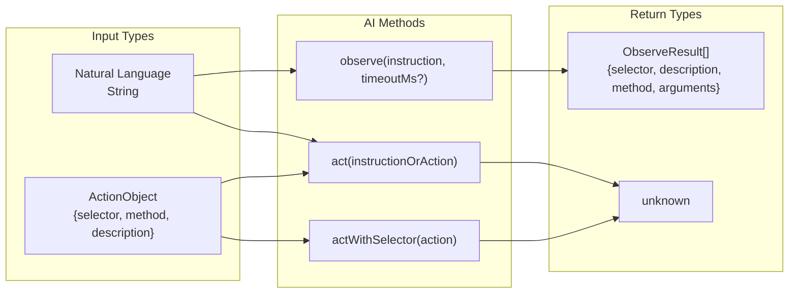
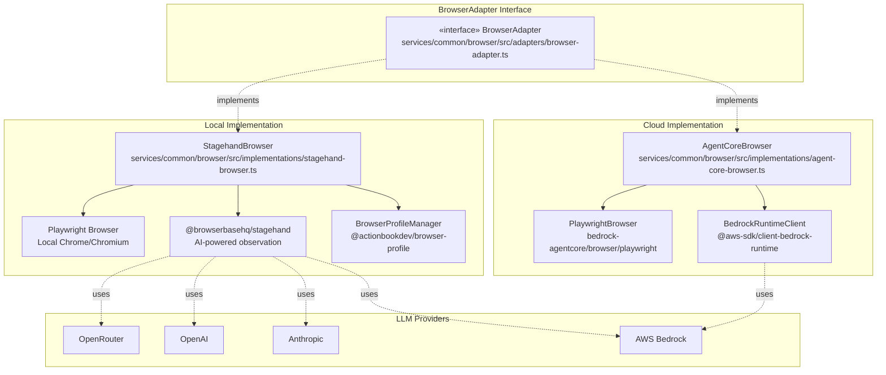
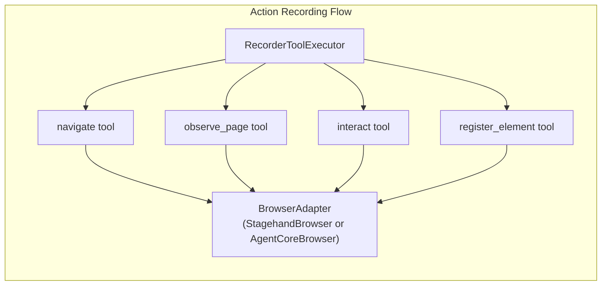

<!-- source: DeepWiki mcp.deepwiki.com · repo actionbook/actionbook · page 4.1 BrowserAdapter Interface · fetched 2026-10-27 -->

# BrowserAdapter Interface

<details>
<summary>Relevant source files</summary>

The following files were used as context for generating this wiki page:

- [services/action-builder/src/index.ts](services/action-builder/src/index.ts)
- [services/common/browser/package.json](services/common/browser/package.json)
- [services/common/browser/src/adapters/browser-adapter.ts](services/common/browser/src/adapters/browser-adapter.ts)
- [services/common/browser/src/adapters/index.ts](services/common/browser/src/adapters/index.ts)
- [services/common/browser/src/implementations/agent-core-browser.ts](services/common/browser/src/implementations/agent-core-browser.ts)
- [services/common/browser/src/implementations/stagehand-browser.ts](services/common/browser/src/implementations/stagehand-browser.ts)
- [services/common/browser/src/types/browser.ts](services/common/browser/src/types/browser.ts)
- [services/common/browser/test/e2e/stagehand-browser.e2e.test.ts](services/common/browser/test/e2e/stagehand-browser.e2e.test.ts)
- [services/common/browser/test/unit/agent-core-browser.ut.test.ts](services/common/browser/test/unit/agent-core-browser.ut.test.ts)

</details>


## Purpose and Scope

The `BrowserAdapter` interface defines a unified contract for browser automation operations across different browser implementations in Actionbook. It provides a consistent API for both basic browser control (navigation, screenshots, waiting) and AI-powered capabilities (element observation, intelligent action execution).

This interface serves as an abstraction layer that allows the action-builder and playbook-builder services to work with multiple browser implementations without coupling to specific technologies. For details on specific implementations, see [StagehandBrowser Implementation](#4.2) and [AgentCoreBrowser Implementation](#4.3). For browser profile management, see [Browser Profiles](#4.4).

**Sources:** [services/common/browser/src/adapters/browser-adapter.ts:1-254]()

---

## Interface Structure

The `BrowserAdapter` interface is organized into nine logical groups of operations:

```mermaid
graph TB
    subgraph "BrowserAdapter Interface"
        Lifecycle["Lifecycle<br/>initialize(), close()"]
        Navigation["Navigation<br/>navigate(), goBack()"]
        PageInfo["Page Information<br/>getUrl(), getTitle(), getContent()"]
        Screenshot["Screenshot<br/>screenshot()"]
        Waiting["Waiting<br/>waitForSelector(), wait(), waitForText()"]
        Scrolling["Scrolling<br/>scroll(), scrollToBottom()"]
        AI["AI Capabilities<br/>observe(), act(), actWithSelector()"]
        Inspection["Element Inspection<br/>getElementAttributesFromXPath(), getPage()"]
        Helpers["Automation Helpers<br/>autoClosePopups()"]
        Metrics["Metrics (optional)<br/>getTokenStats()"]
    end
    
    Lifecycle -.-> Navigation
    Navigation -.-> PageInfo
    PageInfo -.-> Screenshot
    Screenshot -.-> Waiting
    Waiting -.-> Scrolling
    Scrolling -.-> AI
    AI -.-> Inspection
    Inspection -.-> Helpers
    Helpers -.-> Metrics
```



**Sources:** [services/common/browser/src/adapters/browser-adapter.ts:38-254]()

---

## Lifecycle Methods

The lifecycle methods manage browser instance initialization and cleanup:

| Method | Signature | Purpose |
|--------|-----------|---------|
| `initialize()` | `Promise<void>` | Initialize the browser instance. Must be called before any other operations. |
| `close()` | `Promise<void>` | Close the browser and release resources. |

### Usage Pattern

```typescript
const browser: BrowserAdapter = new StagehandBrowser();
await browser.initialize();
// ... perform operations
await browser.close();
```

**Implementation Notes:**
- `initialize()` should be idempotent - calling it multiple times should not create additional browser instances
- `close()` should gracefully handle being called multiple times
- All other methods should throw an error if called before `initialize()`

**Sources:** [services/common/browser/src/adapters/browser-adapter.ts:43-52](), [services/common/browser/src/implementations/stagehand-browser.ts:133-174](), [services/common/browser/src/implementations/agent-core-browser.ts:93-140]()

---

## Navigation Methods

Navigation methods control browser page transitions:

| Method | Signature | Purpose |
|--------|-----------|---------|
| `navigate(url, options?)` | `Promise<void>` | Navigate to a URL with optional wait conditions and timeout |
| `goBack()` | `Promise<void>` | Navigate back in browser history |

### NavigateOptions Type

```typescript
interface NavigateOptions {
  timeout?: number;  // Timeout in milliseconds
  waitUntil?: 'load' | 'domcontentloaded' | 'networkidle';
}
```

### Behavior

The `navigate()` method accepts a `NavigateOptions` object to control navigation behavior:
- `timeout`: Maximum time to wait for navigation (default varies by implementation)
- `waitUntil`: When to consider navigation complete (default: `'domcontentloaded'`)

**Sources:** [services/common/browser/src/adapters/browser-adapter.ts:54-68](), [services/common/browser/src/types/browser.ts:59-66](), [services/common/browser/src/implementations/stagehand-browser.ts:180-204](), [services/common/browser/src/implementations/agent-core-browser.ts:146-169]()

---

## Page Information Methods

Page information methods retrieve metadata about the current page state:

| Method | Signature | Return Type | Purpose |
|--------|-----------|-------------|---------|
| `getUrl()` | synchronous | `string` | Get the current page URL |
| `getTitle()` | `Promise<string>` | `string` | Get the current page title |
| `getContent()` | `Promise<string>` | `string` | Get the page HTML content |

### Implementation Details

- `getUrl()` is synchronous and returns the URL immediately
- `getTitle()` retrieves the value of the `<title>` tag
- `getContent()` returns the entire HTML content of `document.documentElement.outerHTML`

**Sources:** [services/common/browser/src/adapters/browser-adapter.ts:70-87](), [services/common/browser/src/implementations/stagehand-browser.ts:210-220](), [services/common/browser/src/implementations/agent-core-browser.ts:175-199]()

---

## Screenshot Capabilities

The screenshot method captures visual representations of the current page:

```typescript
screenshot(options?: ScreenshotOptions): Promise<Buffer>
```

### ScreenshotOptions Type

```typescript
interface ScreenshotOptions {
  fullPage?: boolean;        // Capture full scrollable page (default: false)
  format?: 'png' | 'jpeg' | 'webp';  // Image format (default: 'png')
  quality?: number;          // JPEG/WebP quality 0-100
}
```

### Return Value

Returns a `Buffer` containing the image data in the specified format. The buffer can be:
- Written to disk
- Converted to base64 for API transmission
- Passed directly to AI vision models

### Format Support

| Format | Magic Bytes | Support |
|--------|-------------|---------|
| PNG | `89 50 4E 47` | All implementations |
| JPEG | `FF D8 FF` | All implementations |
| WebP | N/A | StagehandBrowser converts to PNG; AgentCoreBrowser converts to PNG |

**Sources:** [services/common/browser/src/adapters/browser-adapter.ts:89-98](), [services/common/browser/src/types/browser.ts:48-56](), [services/common/browser/src/implementations/stagehand-browser.ts:226-234](), [services/common/browser/src/implementations/agent-core-browser.ts:205-227]()

---

## Waiting Operations

Waiting operations synchronize automation with page state changes:

| Method | Signature | Purpose |
|--------|-----------|---------|
| `waitForSelector(selector, options?)` | `Promise<void>` | Wait for a CSS or XPath selector to appear |
| `wait(ms)` | `Promise<void>` | Wait for a specified duration |
| `waitForText(text, timeout?)` | `Promise<void>` | Wait for text to appear on the page |

### WaitForSelectorOptions Type

```typescript
interface WaitForSelectorOptions {
  timeout?: number;   // Timeout in milliseconds (default: 30000)
  visible?: boolean;  // Wait for element to be visible
  hidden?: boolean;   // Wait for element to be hidden
}
```

### State Mapping

The `visible` and `hidden` options control the element state to wait for:
- Neither set: Wait for element to be attached to DOM
- `visible: true`: Wait for element to be visible (has dimensions)
- `hidden: true`: Wait for element to be hidden or removed

**Sources:** [services/common/browser/src/adapters/browser-adapter.ts:100-122](), [services/common/browser/src/types/browser.ts:69-78](), [services/common/browser/src/implementations/stagehand-browser.ts:240-272](), [services/common/browser/src/implementations/agent-core-browser.ts:233-256]()

---

## Scrolling Operations

Scrolling operations control viewport position for lazy-loaded content and navigation:

| Method | Signature | Purpose |
|--------|-----------|---------|
| `scroll(direction, amount?)` | `Promise<void>` | Scroll up or down by specified pixels |
| `scrollToBottom(waitAfterMs?)` | `Promise<void>` | Scroll to bottom of page, useful for lazy loading |

### scroll() Parameters

```typescript
type ScrollDirection = 'up' | 'down';
```

- `direction`: Direction to scroll ('up' or 'down')
- `amount`: Number of pixels to scroll (default: 300)

### scrollToBottom() Behavior

The `scrollToBottom()` method performs iterative scrolling:
1. Scrolls to bottom of page
2. Waits for potential lazy-loaded content
3. Checks if scroll height increased
4. Repeats up to 10 times until no more content loads
5. Waits for `waitAfterMs` (default: 1000ms) after final scroll

**Sources:** [services/common/browser/src/adapters/browser-adapter.ts:124-140](), [services/common/browser/src/types/browser.ts:80-83](), [services/common/browser/src/implementations/stagehand-browser.ts:278-322](), [services/common/browser/src/implementations/agent-core-browser.ts:262-310]()

---

## AI Capabilities

### AI Capabilities Overview

The AI capabilities enable intelligent element discovery and action execution using Large Language Models:



**Sources:** [services/common/browser/src/adapters/browser-adapter.ts:142-195]()

---

### observe() Method

```typescript
observe(instruction: string, timeoutMs?: number): Promise<ObserveResult[]>
```

The `observe()` method uses AI to analyze the page and find elements matching a natural language instruction.

**Parameters:**
- `instruction`: Natural language description of what to find (e.g., "find the search button", "locate the login form")
- `timeoutMs`: Timeout in milliseconds (default: 30000)

**Return Type:**

```typescript
interface ObserveResult {
  selector?: string;      // Element selector (usually XPath)
  description?: string;   // Human-readable description
  method?: string;        // Suggested interaction method
  arguments?: unknown[];  // Suggested arguments
}
```

**Implementation Approaches:**
- **StagehandBrowser**: Uses Stagehand SDK's built-in `observe()` with LLM-powered element detection
- **AgentCoreBrowser**: Takes screenshot + calls Bedrock Claude with vision capabilities

**Sources:** [services/common/browser/src/adapters/browser-adapter.ts:146-161](), [services/common/browser/src/types/browser.ts:94-107](), [services/common/browser/src/implementations/stagehand-browser.ts:334-396](), [services/common/browser/src/implementations/agent-core-browser.ts:396-475]()

---

### act() Method

```typescript
act(instructionOrAction: string | ActionObject): Promise<unknown>
```

The `act()` method executes an action using either AI inference or a predefined selector.

**Input Modes:**

1. **Natural Language Mode** (AI inference):
```typescript
await browser.act('click the submit button');
```

2. **Selector Mode** (direct, faster):
```typescript
await browser.act({
  selector: '#submit-btn',
  method: 'click',
  description: 'Submit button'
});
```

**ActionObject Type:**

```typescript
interface ActionObject {
  selector: string;        // CSS or XPath selector
  description: string;     // Human-readable description
  method: ActionMethod;    // Interaction method
  arguments?: string[];    // Method arguments (e.g., text to type)
}

type ActionMethod = 
  | 'click' 
  | 'type' 
  | 'fill' 
  | 'select' 
  | 'hover' 
  | 'press' 
  | 'scroll' 
  | 'wait';
```

**Execution Flow:**
- String instruction → Calls `observe()` to find element → Executes action on first match
- ActionObject → Direct execution using selector (no AI inference)

**Sources:** [services/common/browser/src/adapters/browser-adapter.ts:163-184](), [services/common/browser/src/types/browser.ts:110-136](), [services/common/browser/src/implementations/stagehand-browser.ts:407-494](), [services/common/browser/src/implementations/agent-core-browser.ts:482-508]()

---

### actWithSelector() Method

```typescript
actWithSelector(action: ActionObject): Promise<unknown>
```

Convenience method for selector-based actions with clearer semantics than `act()` with `ActionObject`.

**Purpose:** Explicitly indicates direct selector-based execution without AI inference.

**Action Method Dispatch:**

| Method | Required Args | Behavior |
|--------|---------------|----------|
| `click` | None | Clicks the element |
| `type` | text (string) | Types text character by character |
| `fill` | text (string) | Fills input field (faster than type) |
| `select` | value (string) | Selects option in dropdown |
| `hover` | None | Triggers mouseover event |
| `press` | key (string) | Presses keyboard key |
| `scroll` | None | Scrolls by default amount |
| `wait` | ms (string, optional) | Waits specified milliseconds (default: 1000) |

**Sources:** [services/common/browser/src/adapters/browser-adapter.ts:186-195](), [services/common/browser/src/implementations/stagehand-browser.ts:496-502](), [services/common/browser/src/implementations/agent-core-browser.ts:510-584]()

---

## Element Inspection

Element inspection methods extract metadata for selector generation and validation:

### getElementAttributesFromXPath()

```typescript
getElementAttributesFromXPath(xpath: string): Promise<ElementAttributes | null>
```

Extracts comprehensive element metadata from an XPath selector.

**Return Type:**

```typescript
interface ElementAttributes {
  tagName: string;                    // HTML tag name (lowercase)
  id?: string;                        // Element id attribute
  className?: string;                 // Element class attribute
  dataTestId?: string;                // data-testid attribute
  ariaLabel?: string;                 // aria-label attribute
  placeholder?: string;               // placeholder attribute (inputs)
  name?: string;                      // name attribute (form elements)
  textContent?: string;               // Text content (truncated to 50-100 chars)
  cssSelector?: string;               // Generated CSS selector
  optimizedXPath?: string;            // Optimized XPath selector
  dataAttributes?: Record<string, string>; // All data-* attributes
}
```

**XPath Normalization:**
- Removes `xpath=` prefix if present
- Handles iframe elements by iterating through frames
- Filters state-related data attributes (e.g., `data-selected`, `data-active`)

**CSS Selector Generation Priority:**
1. `data-testid` attribute → `[data-testid="value"]`
2. Preferred data attributes (data-id, data-component, etc.)
3. ID attribute → `#id`
4. `aria-label` attribute → `[aria-label="value"]`
5. Fallback to tag + classes

**Sources:** [services/common/browser/src/adapters/browser-adapter.ts:197-210](), [services/common/browser/src/types/browser.ts:140-167](), [services/common/browser/src/implementations/stagehand-browser.ts:508-580](), [services/common/browser/src/implementations/agent-core-browser.ts:589-630]()

---

### getPage()

```typescript
getPage(): Promise<unknown>
```

Returns the underlying browser-specific Page instance for advanced operations.

**Return Types by Implementation:**
- **StagehandBrowser**: Returns Stagehand `Page` (limited Playwright-like API)
- **AgentCoreBrowser**: Returns Playwright `Page` (full API access)

**Usage Warning:** Prefer high-level `BrowserAdapter` methods when possible. Direct page access couples code to specific implementations.

**Sources:** [services/common/browser/src/adapters/browser-adapter.ts:212-223](), [services/common/browser/src/implementations/stagehand-browser.ts:585-587](), [services/common/browser/src/implementations/agent-core-browser.ts:636-645]()

---

## Automation Helpers

### autoClosePopups()

```typescript
autoClosePopups(): Promise<number>
```

Auto-detects and closes common popup patterns using AI:
- Cookie consent banners
- Newsletter signup modals
- Notification permission dialogs

**Process:**
1. Iterates through predefined popup instructions
2. Uses `observe()` to find popup elements
3. Executes close action if found
4. Returns count of popups closed

**Popup Instructions Used:**
```typescript
const popupInstructions = [
  'click the close button on any popup or modal',
  'click accept or dismiss on cookie consent banner',
  'click close on any overlay dialog',
];
```

**Return Value:** Number of popups successfully closed.

**Sources:** [services/common/browser/src/adapters/browser-adapter.ts:225-239](), [services/common/browser/src/implementations/stagehand-browser.ts:675-706](), [services/common/browser/src/implementations/agent-core-browser.ts:675-710]()

---

## Metrics

### getTokenStats()

```typescript
getTokenStats?(): TokenStats | undefined
```

Optional method that returns accumulated token usage statistics for AI operations.

**TokenStats Type:**

```typescript
interface TokenStats {
  input: number;   // Input tokens consumed
  output: number;  // Output tokens generated
  total: number;   // Total tokens (input + output)
}
```

**Implementation Status:**
- **StagehandBrowser**: Tracks tokens from `observe()` and `act()` calls using Stagehand's metrics API
- **AgentCoreBrowser**: Returns `undefined` (Bedrock billing is separate and tracked via AWS)

**Token Tracking (StagehandBrowser):**
- Captures deltas from Stagehand's internal metrics after each AI operation
- Accumulates input/output tokens across browser session
- Logs per-operation metrics with format: `[LLM] ✓ | stagehand/observe | tokens: in=X, out=Y, total=Z | perf: latency=Nms, inference=Nms, tps=N`

**Sources:** [services/common/browser/src/adapters/browser-adapter.ts:241-253](), [services/common/browser/src/types/browser.ts:173-183](), [services/common/browser/src/implementations/stagehand-browser.ts:712-718](), [services/common/browser/src/implementations/agent-core-browser.ts:716-718]()

---

## Implementations Overview

The `BrowserAdapter` interface has two production implementations:



### Implementation Comparison

| Feature | StagehandBrowser | AgentCoreBrowser |
|---------|------------------|------------------|
| **Execution** | Local Playwright | AWS cloud service |
| **Installation** | Requires Playwright + Chromium | No local browser needed |
| **LLM Providers** | OpenRouter, OpenAI, Anthropic, Bedrock | Bedrock only |
| **Profile Support** | Yes (persistent login state) | No |
| **Token Tracking** | Yes (via Stagehand metrics) | No (Bedrock billing separate) |
| **Proxy Support** | Yes (HTTP/HTTPS proxies) | Via AWS networking |
| **observe() Implementation** | Stagehand SDK native | Screenshot + Bedrock Claude vision |
| **act() Implementation** | Stagehand SDK native | observe() + method dispatch |
| **Session Management** | Local process | AWS session (configurable timeout) |
| **Best For** | Development, custom LLM configs | Production, scalability, no local resources |

**Sources:** [services/common/browser/src/implementations/stagehand-browser.ts:1-1127](), [services/common/browser/src/implementations/agent-core-browser.ts:1-849](), [services/common/browser/package.json:1-75]()

---

## Usage in Action Builder

The action-builder service uses `BrowserAdapter` through the `RecorderToolExecutor` class:



**Key Operations:**
- `navigate` tool → `browser.navigate(url)`
- `observe_page` tool → `browser.observe(instruction)` + element attribute extraction
- `interact` tool → `browser.act(action)` or `browser.actWithSelector(action)`
- All tools use `browser.screenshot()` for debugging and logging

**Sources:** [services/action-builder/src/index.ts:1-50]()

---

## Error Handling

### Common Error Types

**StagehandBrowser-specific:**
```typescript
class ElementNotFoundError extends Error {
  constructor(message: string, selector?: string)
}

class ActionExecutionError extends Error {
  constructor(message: string, action?: string, originalError?: Error)
}
```

**Error Scenarios:**

| Scenario | Error Type | When Thrown |
|----------|------------|-------------|
| Element not found | `ElementNotFoundError` | `observe()` returns no results, `act()` selector not found |
| Action timeout | `ActionExecutionError` | Action exceeds timeout duration |
| Navigation timeout | Native Error | `navigate()` exceeds timeout |
| Rate limit hit | Native Error | LLM provider rate limit (with auto-retry) |
| Not initialized | Native Error | Methods called before `initialize()` |

**Rate Limit Retry:**
Both implementations implement exponential backoff retry for rate limit errors:
- Max retries: 3
- Delay: `min(1000 * 2^attempt, 30000)` milliseconds
- Applies to: `observe()` and `act()` methods

**Sources:** [services/common/browser/src/implementations/stagehand-browser.ts:69-91](), [services/common/browser/src/implementations/stagehand-browser.ts:334-396](), [services/common/browser/src/implementations/stagehand-browser.ts:407-494]()

---

