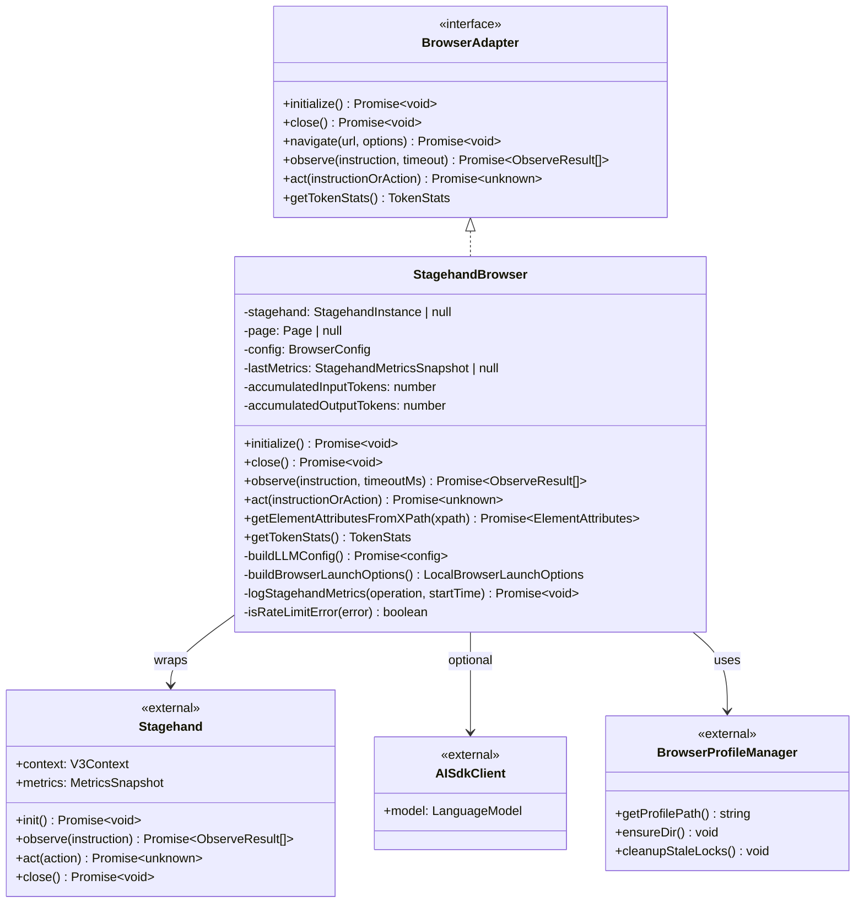
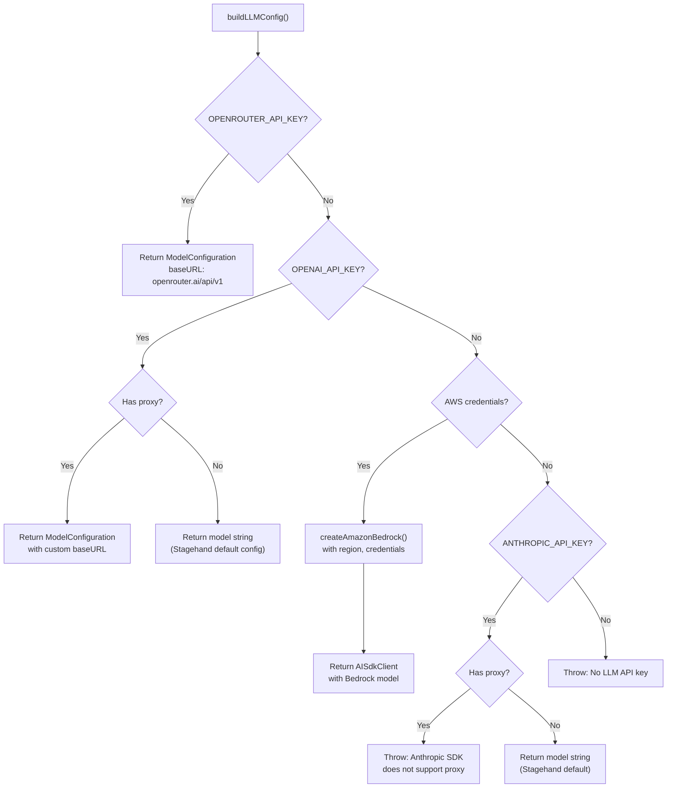
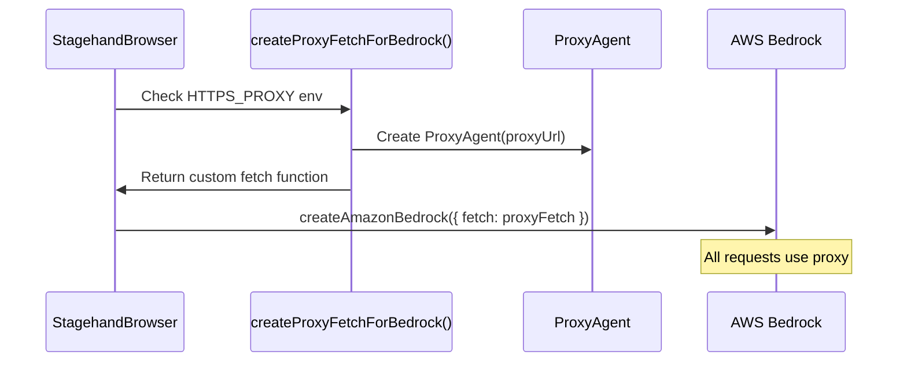
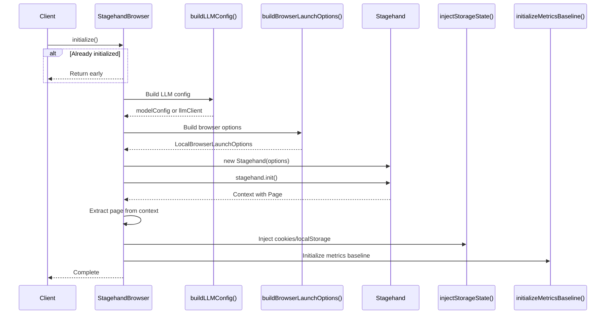
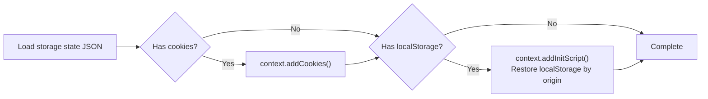
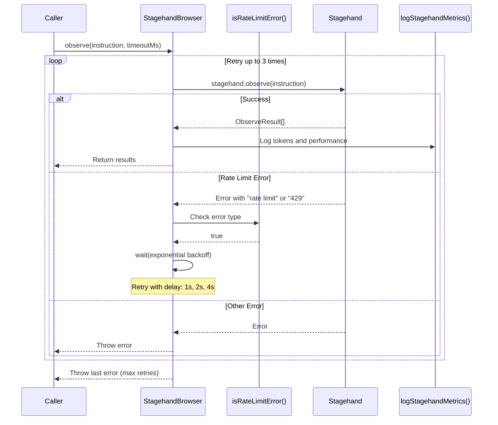
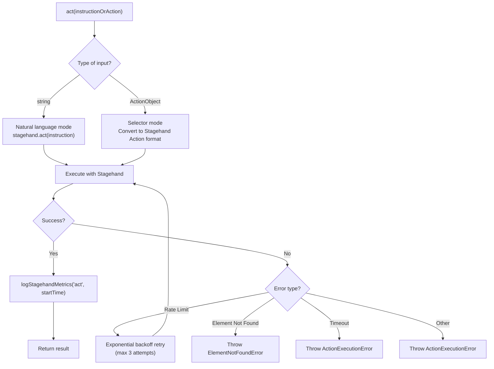
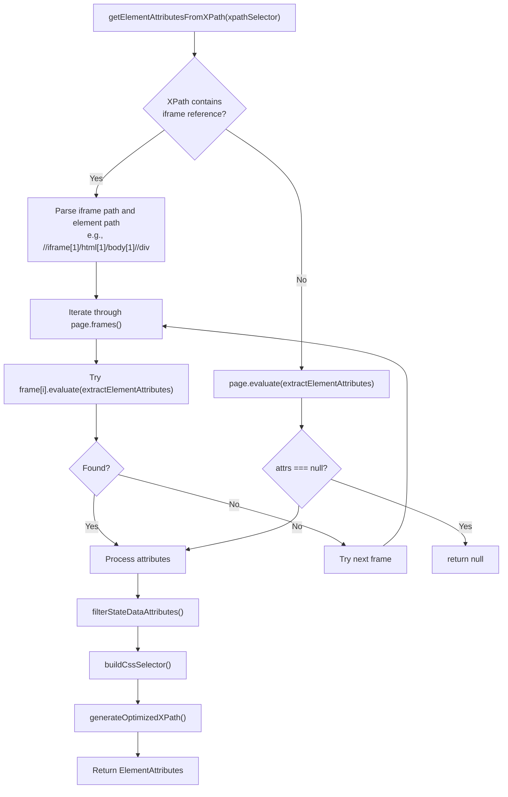
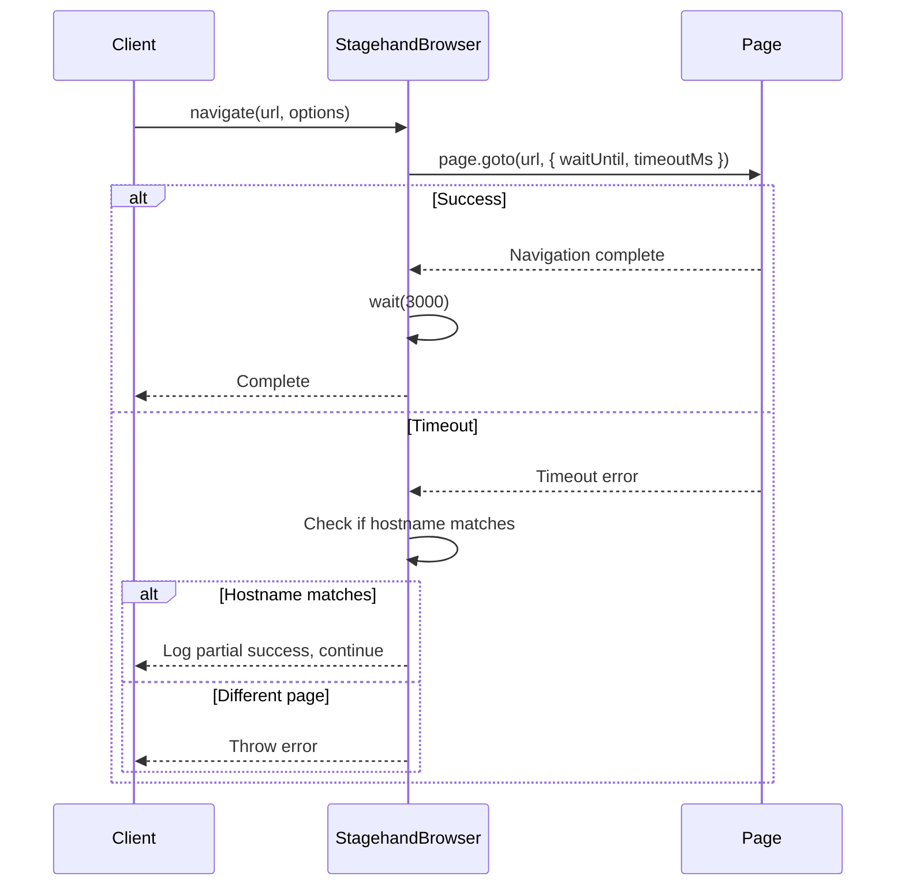

<!-- source: DeepWiki mcp.deepwiki.com · repo actionbook/actionbook · page 4.2 StagehandBrowser Implementation · fetched 2026-10-27 -->

# StagehandBrowser Implementation

<details>
<summary>Relevant source files</summary>

The following files were used as context for generating this wiki page:

- [services/action-builder/src/index.ts](services/action-builder/src/index.ts)
- [services/common/browser/package.json](services/common/browser/package.json)
- [services/common/browser/src/adapters/browser-adapter.ts](services/common/browser/src/adapters/browser-adapter.ts)
- [services/common/browser/src/adapters/index.ts](services/common/browser/src/adapters/index.ts)
- [services/common/browser/src/implementations/agent-core-browser.ts](services/common/browser/src/implementations/agent-core-browser.ts)
- [services/common/browser/src/implementations/stagehand-browser.ts](services/common/browser/src/implementations/stagehand-browser.ts)
- [services/common/browser/src/types/browser.ts](services/common/browser/src/types/browser.ts)
- [services/common/browser/test/e2e/stagehand-browser.e2e.test.ts](services/common/browser/test/e2e/stagehand-browser.e2e.test.ts)
- [services/common/browser/test/unit/agent-core-browser.ut.test.ts](services/common/browser/test/unit/agent-core-browser.ut.test.ts)

</details>


## Purpose and Scope

`StagehandBrowser` is the local Playwright-based implementation of the `BrowserAdapter` interface ([services/common/browser/src/adapters/browser-adapter.ts:1-254]()). It combines Playwright browser automation with Stagehand AI capabilities for intelligent element observation and action execution. This implementation runs browsers locally and supports multiple LLM providers for AI operations.

For the unified browser interface specification, see [BrowserAdapter Interface](#4.1). For the cloud-based AWS implementation, see [AgentCoreBrowser Implementation](#4.3). For persistent login state management, see [Browser Profiles](#4.4).

**Sources:** [services/common/browser/src/implementations/stagehand-browser.ts:1-10]()

---

## Architecture Overview

`StagehandBrowser` implements `BrowserAdapter` by wrapping the Stagehand SDK, which itself wraps Playwright. The class maintains state for the Stagehand instance, Playwright page, configuration, and accumulated token metrics.

### Class Structure



**Sources:** [services/common/browser/src/implementations/stagehand-browser.ts:112-127](), [services/common/browser/src/adapters/browser-adapter.ts:38-254]()

### Key Dependencies

| Dependency | Purpose | Configuration |
|------------|---------|---------------|
| `@browserbasehq/stagehand` | AI-powered browser automation | Peer dependency, optional |
| `playwright` | Browser engine | Peer dependency |
| `@ai-sdk/amazon-bedrock` | AWS Bedrock LLM integration | Dev dependency, loaded dynamically |
| `undici` | Proxy support for HTTP requests | Direct dependency |
| `@actionbookdev/browser-profile` | Persistent browser profiles | Workspace dependency |

**Sources:** [services/common/browser/package.json:38-62]()

---

## LLM Provider Configuration

`StagehandBrowser` supports four LLM providers through environment variables. The `buildLLMConfig()` method selects the provider based on available credentials and constructs appropriate configuration for Stagehand.

### Provider Selection Flow



**Sources:** [services/common/browser/src/implementations/stagehand-browser.ts:743-822]()

### Provider Configuration Details

| Provider | Environment Variables | Model Default | Proxy Support |
|----------|----------------------|---------------|---------------|
| OpenRouter | `OPENROUTER_API_KEY` | `gpt-4o` | Yes |
| OpenAI | `OPENAI_API_KEY`, `OPENAI_BASE_URL` | `gpt-4o` | Yes (via baseURL) |
| AWS Bedrock | `AWS_ACCESS_KEY_ID`, `AWS_SECRET_ACCESS_KEY`, `AWS_SESSION_TOKEN`, `AWS_REGION` | `anthropic.claude-3-5-sonnet-20241022-v2:0` | Yes (via undici ProxyAgent) |
| Anthropic | `ANTHROPIC_API_KEY` | `claude-sonnet-4-20250514` | No (throws error) |

Model selection can be overridden with `STAGEHAND_MODEL` environment variable.

**Sources:** [services/common/browser/src/implementations/stagehand-browser.ts:747-821]()

### Bedrock Proxy Configuration

For AWS Bedrock, proxy support is implemented using undici's `ProxyAgent`:



**Sources:** [services/common/browser/src/implementations/stagehand-browser.ts:878-894](), [services/common/browser/src/implementations/stagehand-browser.ts:780-807]()

---

## Initialization and Lifecycle

### Initialization Process

The `initialize()` method sets up the Stagehand instance, configures the browser, and prepares metrics tracking:



**Sources:** [services/common/browser/src/implementations/stagehand-browser.ts:133-165]()

### Browser Launch Options

The `buildBrowserLaunchOptions()` method configures Playwright launch settings:

| Option | Configuration | Source |
|--------|--------------|---------|
| `headless` | `config.headless` or `HEADLESS=true` env | [services/common/browser/src/implementations/stagehand-browser.ts:122-123]() |
| `proxy` | `config.proxy` or `HTTPS_PROXY`/`HTTP_PROXY` env | [services/common/browser/src/implementations/stagehand-browser.ts:123]() |
| `userDataDir` | Profile path from `BrowserProfileManager` | [services/common/browser/src/implementations/stagehand-browser.ts:835-842]() |
| `preserveUserDataDir` | `true` when using profiles | [services/common/browser/src/implementations/stagehand-browser.ts:843]() |
| `args` | Anti-detection args when using profiles | [services/common/browser/src/implementations/stagehand-browser.ts:844-847]() |

**Sources:** [services/common/browser/src/implementations/stagehand-browser.ts:824-854]()

### Storage State Injection

When `config.storageStatePath` is provided, `injectStorageState()` restores cookies and localStorage:



**Sources:** [services/common/browser/src/implementations/stagehand-browser.ts:896-937]()

### Cleanup

The `close()` method releases resources:

**Sources:** [services/common/browser/src/implementations/stagehand-browser.ts:167-174]()

---

## AI Capabilities

### observe() - Element Discovery

The `observe()` method uses Stagehand's AI to find elements matching a natural language instruction. It includes rate limit retry logic with exponential backoff.



**Sources:** [services/common/browser/src/implementations/stagehand-browser.ts:334-396](), [services/common/browser/src/implementations/stagehand-browser.ts:734-741]()

### act() - Action Execution

The `act()` method supports both natural language instructions and explicit `ActionObject` selectors. It includes the same retry logic as `observe()`.



**Sources:** [services/common/browser/src/implementations/stagehand-browser.ts:407-494]()

### Custom Error Types

| Error Class | Thrown When | Selector Captured |
|-------------|-------------|-------------------|
| `ElementNotFoundError` | "No object generated", "response did not match schema", "Could not find element" | Yes (if ActionObject) |
| `ActionExecutionError` | Timeout or other execution failures | No |

**Sources:** [services/common/browser/src/implementations/stagehand-browser.ts:69-91]()

### Token Tracking

`StagehandBrowser` accumulates token usage from both `observe()` and `act()` operations:

```mermaid
graph LR
    OM[observe() or act()] --> GetMetrics["stagehand.metrics<br/>Current snapshot"]
    GetMetrics --> CalcDelta["Calculate delta from<br/>lastMetrics snapshot"]
    CalcDelta --> AccumTokens["accumulatedInputTokens += delta.inputTokens<br/>accumulatedOutputTokens += delta.outputTokens"]
    AccumTokens --> UpdateLast["lastMetrics = current snapshot"]
    UpdateLast --> LogPerf["Log tokens, latency, TPS"]
```

**Sources:** [services/common/browser/src/implementations/stagehand-browser.ts:972-1052]()

The metrics snapshot structure:

```typescript
interface StagehandMetricsSnapshot {
  observePromptTokens: number;
  observeCompletionTokens: number;
  observeReasoningTokens: number;
  observeCachedInputTokens: number;
  observeInferenceTimeMs: number;
  actPromptTokens: number;
  actCompletionTokens: number;
  actReasoningTokens: number;
  actCachedInputTokens: number;
  actInferenceTimeMs: number;
}
```

**Sources:** [services/common/browser/src/implementations/stagehand-browser.ts:96-107]()

---

## Element Inspection

### getElementAttributesFromXPath()

This method extracts comprehensive element metadata for selector generation. It handles both regular elements and elements within iframes.



**Sources:** [services/common/browser/src/implementations/stagehand-browser.ts:508-580]()

### Iframe Handling

The implementation detects iframe references using regex pattern and accesses the iframe content via Playwright's `frames()` API:

**Pattern:** `/^(.+?\/iframe\[\d+\])\/html\[\d+\]\/body\[\d+\](.*)$/i`

**Sources:** [services/common/browser/src/implementations/stagehand-browser.ts:513-545]()

### Selector Generation

The `buildCssSelector()` method prioritizes stable attributes:

1. `data-testid` → `[data-testid="value"]`
2. Preferred data attributes (`data-id`, `data-component`, etc.) → `[data-id="value"]`
3. `id` attribute → `#id` (filtered for dynamic patterns)
4. `aria-label` → `[aria-label="value"]`
5. `name` attribute → `[name="value"]`
6. Tag + class combination (filtered for utility classes)

**Sources:** [services/common/browser/src/implementations/stagehand-browser.ts:1088-1125]()

### Attribute Extraction Script

The `extractElementAttributes` function runs in the browser context to collect element metadata:

**Sources:** [services/common/browser/src/implementations/stagehand-browser.ts:1054-1086]()

---

## Navigation and Page Control

### navigate()

Navigation includes timeout handling with partial success detection:



**Sources:** [services/common/browser/src/implementations/stagehand-browser.ts:180-197]()

### Scrolling Operations

| Method | Implementation | Use Case |
|--------|---------------|----------|
| `scroll(direction, amount)` | `page.scroll(0, 0, 0, deltaY)` | Incremental scrolling |
| `scrollToBottom(waitAfterMs)` | Loop until `scrollHeight` stabilizes, max 10 attempts | Loading lazy content |

**Sources:** [services/common/browser/src/implementations/stagehand-browser.ts:278-322]()

---

## Automation Helpers

### autoClosePopups()

Automatically detects and closes common popup patterns using AI observation:

```mermaid
flowchart LR
    Start[autoClosePopups] --> Instr1["Observe: 'click close on popup'"]
    Instr1 --> Found1{Found?}
    Found1 -->|Yes| Act1["act(element)<br/>closedCount++"]
    Found1 -->|No| Instr2["Observe: 'accept/dismiss cookie banner'"]
    
    Act1 --> Instr2
    Instr2 --> Found2{Found?}
    Found2 -->|Yes| Act2["act(element)<br/>closedCount++"]
    Found2 -->|No| Instr3["Observe: 'close overlay dialog'"]
    
    Act2 --> Instr3
    Instr3 --> Found3{Found?}
    Found3 -->|Yes| Act3["act(element)<br/>closedCount++"]
    Found3 -->|No| Return[Return closedCount]
    
    Act3 --> Return
```



**Sources:** [services/common/browser/src/implementations/stagehand-browser.ts:675-706]()

---

## Metrics and Performance Logging

### Token Statistics

The `getTokenStats()` method returns accumulated usage:

```typescript
getTokenStats(): TokenStats {
  return {
    input: this.accumulatedInputTokens,
    output: this.accumulatedOutputTokens,
    total: this.accumulatedInputTokens + this.accumulatedOutputTokens,
  };
}
```

**Sources:** [services/common/browser/src/implementations/stagehand-browser.ts:712-718]()

### Performance Logging

The `logStagehandMetrics()` method logs detailed performance data after each AI operation:

**Log Format:**
```
[LLM] ✓ | stagehand/observe | tokens: in=1234, out=567, cache_read=890, total=1801 | perf: latency=2345ms, inference=1890ms, tps=30.0
```

**Components:**
- **Tokens:** Input, output, cached (prompt caching), reasoning tokens
- **Performance:** End-to-end latency, LLM inference time, tokens per second

**Sources:** [services/common/browser/src/implementations/stagehand-browser.ts:1028-1048]()

---

## Error Handling and Retry Logic

### Rate Limit Detection

The `isRateLimitError()` method identifies rate limit errors across providers:

**Detection Patterns:**
- Error message contains "too many tokens"
- Error message contains "rate limit"
- Error message contains "429"

**Sources:** [services/common/browser/src/implementations/stagehand-browser.ts:734-741]()

### Exponential Backoff

Both `observe()` and `act()` implement retry with exponential backoff:

| Attempt | Delay | Max Delay |
|---------|-------|-----------|
| 1 (initial) | 0ms | - |
| 2 | 1000ms (2^0 * 1000) | 30000ms |
| 3 | 2000ms (2^1 * 1000) | 30000ms |
| 4 | 4000ms (2^2 * 1000) | 30000ms |

**Formula:** `Math.min(1000 * Math.pow(2, attempt), 30000)`

**Sources:** [services/common/browser/src/implementations/stagehand-browser.ts:374-376](), [services/common/browser/src/implementations/stagehand-browser.ts:446-448]()

### Error Context

`ActionExecutionError` captures the action method and original error for debugging:

**Sources:** [services/common/browser/src/implementations/stagehand-browser.ts:82-91](), [services/common/browser/src/implementations/stagehand-browser.ts:480-487]()

---

## Usage Examples

### Basic Initialization

```typescript
import { StagehandBrowser } from '@actionbookdev/browser/stagehand';

const browser = new StagehandBrowser({
  headless: true,
  proxy: 'http://proxy:8080',  // Optional
  timeout: 60000,
});

await browser.initialize();
```

### Element Discovery and Action

```typescript
// Natural language observation
const elements = await browser.observe('find the search button');
console.log(elements[0].selector); // xpath=//button[@id='search']

// Direct action with selector
await browser.act({
  selector: '#search-input',
  method: 'type',
  description: 'Search input field',
  arguments: ['actionbook'],
});

// Natural language action
await browser.act('click the search button');
```

### Token Tracking

```typescript
await browser.observe('find navigation links');
await browser.act('click the first link');

const stats = browser.getTokenStats();
console.log(`Total tokens: ${stats.total}`);
// Total tokens: 4567 (input: 3210, output: 1357)
```

**Sources:** [services/common/browser/test/e2e/stagehand-browser.e2e.test.ts:36-40](), [services/common/browser/test/e2e/stagehand-browser.e2e.test.ts:269-318]()

---

## Configuration Reference

### BrowserConfig

| Field | Type | Default | Description |
|-------|------|---------|-------------|
| `headless` | `boolean` | `process.env.HEADLESS === 'true'` | Headless browser mode |
| `proxy` | `string` | `process.env.HTTPS_PROXY \|\| process.env.HTTP_PROXY` | Proxy server URL |
| `timeout` | `number` | `60000` | Default navigation timeout (ms) |
| `storageStatePath` | `string` | `undefined` | Path to cookies/localStorage JSON |
| `profile.enabled` | `boolean` | `false` | Enable persistent profile |
| `profile.profileDir` | `string` | `'.browser-profile'` | Profile directory path |

**Sources:** [services/common/browser/src/types/browser.ts:12-28](), [services/common/browser/src/implementations/stagehand-browser.ts:120-127]()

### Environment Variables

| Variable | Purpose | Used By |
|----------|---------|---------|
| `OPENROUTER_API_KEY` | OpenRouter API key | LLM provider selection |
| `OPENAI_API_KEY` | OpenAI API key | LLM provider selection |
| `OPENAI_BASE_URL` | Custom OpenAI endpoint | OpenAI with proxy |
| `ANTHROPIC_API_KEY` | Anthropic API key | LLM provider selection |
| `AWS_ACCESS_KEY_ID` | AWS credentials | Bedrock provider |
| `AWS_SECRET_ACCESS_KEY` | AWS credentials | Bedrock provider |
| `AWS_SESSION_TOKEN` | AWS session token | Bedrock provider (optional) |
| `AWS_REGION` | AWS region | Bedrock provider |
| `AWS_BEDROCK_MODEL` | Bedrock model override | Model selection |
| `STAGEHAND_MODEL` | Model name override | Any provider |
| `HEADLESS` | Headless mode flag | Browser launch |
| `HTTPS_PROXY` / `HTTP_PROXY` | Proxy URL | Proxy configuration |

**Sources:** [services/common/browser/src/implementations/stagehand-browser.ts:747-821]()

---

## Testing

### Unit Tests

Unit tests are not extensive for `StagehandBrowser` because it primarily wraps Stagehand SDK. Most testing is done at the E2E level.

### E2E Tests

E2E tests verify real browser automation with AI operations:

**Test Coverage:**
- Lifecycle (initialize, close)
- Navigation and page information
- Screenshots (PNG, JPEG, full page)
- Waiting operations
- Scrolling
- Element inspection
- AI observation and action
- Token tracking
- History navigation
- Auto-close popups

**Sources:** [services/common/browser/test/e2e/stagehand-browser.e2e.test.ts:1-402]()

**Test Execution:**
```bash
# Requires LLM credentials
pnpm test:e2e
```

---

