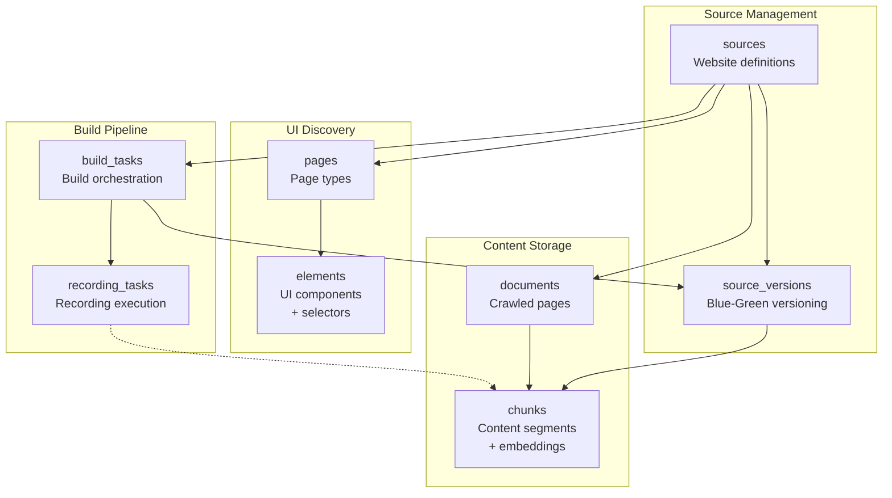
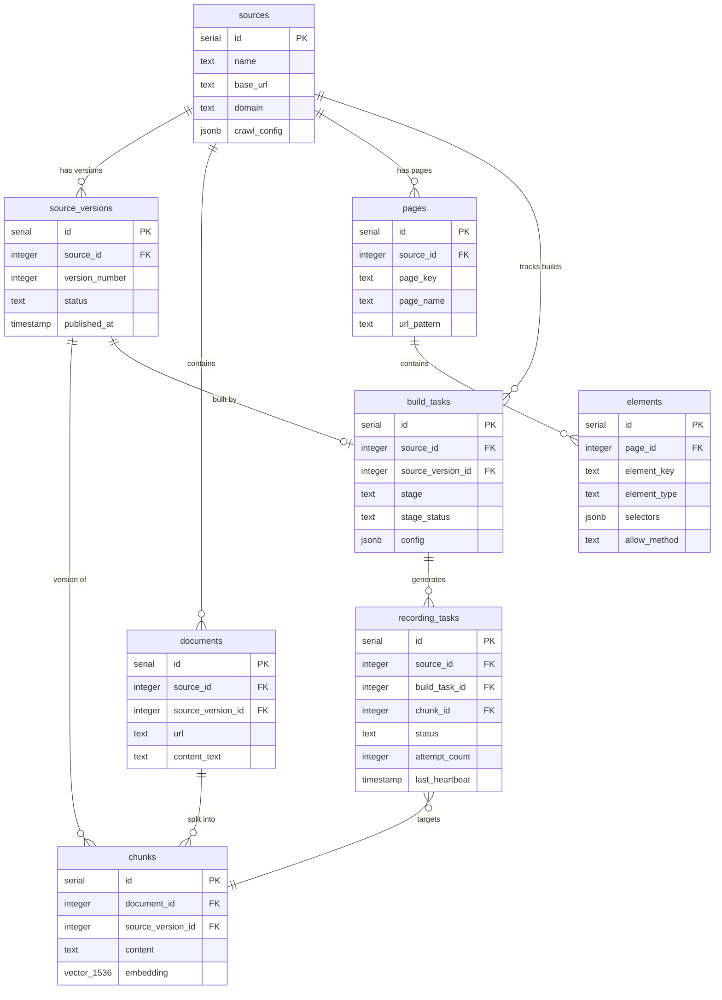
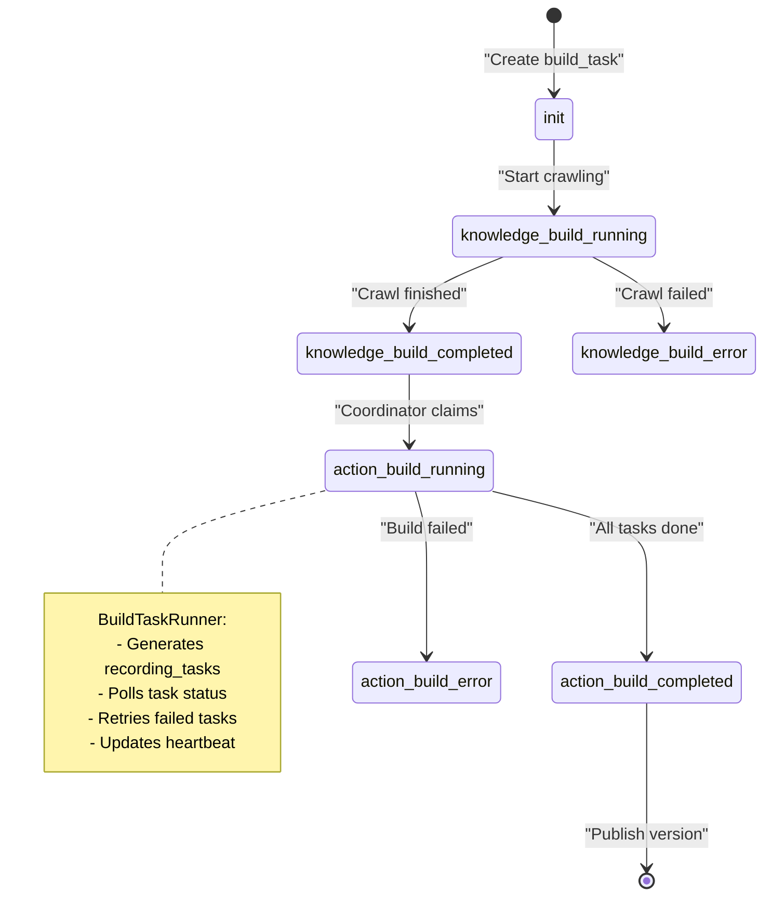
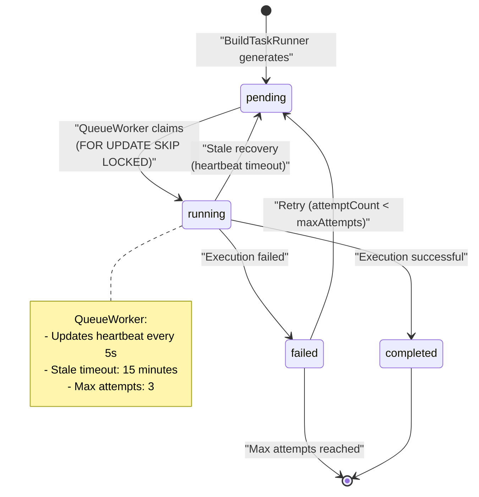
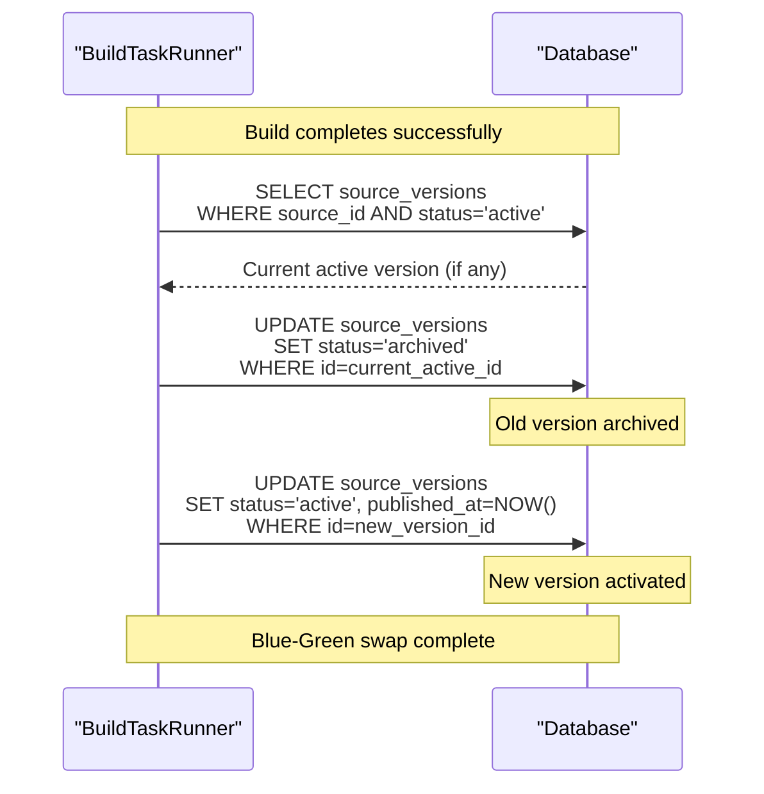

<!-- source: DeepWiki mcp.deepwiki.com · repo actionbook/actionbook · page 5.1 Database Schema · fetched 2026-10-27 -->

# Database Schema

<details>
<summary>Relevant source files</summary>

The following files were used as context for generating this wiki page:

- [services/action-builder/src/task-worker/build-task-runner.ts](services/action-builder/src/task-worker/build-task-runner.ts)
- [services/action-builder/src/task-worker/coordinator.ts](services/action-builder/src/task-worker/coordinator.ts)
- [services/action-builder/src/task-worker/recording-task-queue-worker.ts](services/action-builder/src/task-worker/recording-task-queue-worker.ts)
- [services/action-builder/test/coordinator.integration.it.test.ts](services/action-builder/test/coordinator.integration.it.test.ts)
- [services/action-builder/test/task-worker/integration/end-to-end.it.test.ts](services/action-builder/test/task-worker/integration/end-to-end.it.test.ts)
- [services/db/migrations/0019_add_vector_indexes.sql](services/db/migrations/0019_add_vector_indexes.sql)
- [services/db/migrations/0020_add_chunks_fulltext_index.sql](services/db/migrations/0020_add_chunks_fulltext_index.sql)

</details>


## Purpose and Scope

This document provides a complete reference for the Actionbook PostgreSQL database schema, including all tables, their relationships, key fields, indexes, and data lifecycle patterns. The schema supports both the knowledge building pipeline (crawling and documentation) and the action building pipeline (UI element discovery and recording).

For information about database connection management and pooling strategies, see [Database Connection Management](#5.2). For details on search implementation using these indexes, see [Search and Indexing](#5.3).

---

## Schema Overview

The Actionbook database organizes data into four functional groups: source management, content storage, UI discovery, and build pipeline tracking.

**Schema Organization Diagram**



Sources: [services/action-builder/src/task-worker/build-task-runner.ts:19](), [services/db/migrations/0019_add_vector_indexes.sql:1-22](), [services/db/migrations/0020_add_chunks_fulltext_index.sql:1-19]()

---

## Core Tables

### Source Management Tables

#### `sources` Table

The `sources` table stores website definitions and serves as the root entity for all related data.

| Field | Type | Description |
|-------|------|-------------|
| `id` | `serial PRIMARY KEY` | Unique source identifier |
| `name` | `text NOT NULL` | Human-readable name |
| `base_url` | `text NOT NULL` | Root URL of the website |
| `domain` | `text NOT NULL` | Domain name for grouping |
| `description` | `text` | Optional description |
| `category` | `text` | Site category (e.g., 'help', 'docs') |
| `crawl_config` | `jsonb` | Crawler configuration |
| `created_at` | `timestamp` | Creation timestamp |
| `updated_at` | `timestamp` | Last update timestamp |

#### `source_versions` Table

The `source_versions` table implements Blue-Green deployment by maintaining multiple versions of source data.

| Field | Type | Description |
|-------|------|-------------|
| `id` | `serial PRIMARY KEY` | Version identifier |
| `source_id` | `integer REFERENCES sources(id)` | Parent source |
| `version_number` | `integer NOT NULL` | Monotonically increasing version |
| `status` | `text NOT NULL` | `building`, `active`, or `archived` |
| `commit_message` | `text` | Version description |
| `published_at` | `timestamp` | Activation timestamp |
| `created_at` | `timestamp` | Creation timestamp |

**Version Status Lifecycle:**
- `building` → Version being constructed by build pipeline
- `active` → Currently served version (only one per source)
- `archived` → Previously active version

Sources: [services/action-builder/src/task-worker/build-task-runner.ts:394-459]()

---

### Content Storage Tables

#### `documents` Table

The `documents` table stores crawled web pages with their metadata.

| Field | Type | Description |
|-------|------|-------------|
| `id` | `serial PRIMARY KEY` | Document identifier |
| `source_id` | `integer REFERENCES sources(id)` | Parent source |
| `source_version_id` | `integer REFERENCES source_versions(id)` | Associated version |
| `url` | `text NOT NULL` | Page URL |
| `url_hash` | `text NOT NULL` | Hash for deduplication |
| `title` | `text` | Page title |
| `content_text` | `text` | Extracted text content |
| `content_html` | `text` | Raw HTML content |
| `metadata` | `jsonb` | Additional page metadata |
| `created_at` | `timestamp` | Crawl timestamp |

#### `chunks` Table

The `chunks` table segments documents into searchable pieces with embeddings for vector similarity search.

| Field | Type | Description |
|-------|------|-------------|
| `id` | `serial PRIMARY KEY` | Chunk identifier |
| `document_id` | `integer REFERENCES documents(id)` | Parent document |
| `source_version_id` | `integer REFERENCES source_versions(id)` | Version association |
| `content` | `text NOT NULL` | Chunk text content |
| `content_hash` | `text NOT NULL` | Hash for deduplication |
| `chunk_index` | `integer NOT NULL` | Position within document |
| `start_char` | `integer` | Starting character offset |
| `end_char` | `integer` | Ending character offset |
| `token_count` | `integer` | Approximate token count |
| `embedding` | `vector(1536)` | OpenAI embedding vector |
| `metadata` | `jsonb` | Additional chunk metadata |
| `created_at` | `timestamp` | Creation timestamp |

**Key Indexes:**
- `chunks_content_gin_idx`: GIN index on `to_tsvector('english', content)` for full-text search
- `chunks_embedding_hnsw_idx`: HNSW index on `embedding` for vector similarity (cosine distance)
- `chunks_document_id_idx`: B-tree index for document joins
- `chunks_source_version_id_idx`: B-tree index for version filtering

Sources: [services/db/migrations/0019_add_vector_indexes.sql:1-22](), [services/db/migrations/0020_add_chunks_fulltext_index.sql:1-19](), [services/action-builder/src/task-worker/build-task-runner.ts:156-170]()

---

### UI Discovery Tables

#### `pages` Table

The `pages` table represents discovered page types with their capabilities.

| Field | Type | Description |
|-------|------|-------------|
| `id` | `serial PRIMARY KEY` | Page identifier |
| `source_id` | `integer REFERENCES sources(id)` | Parent source |
| `page_key` | `text NOT NULL` | Unique page identifier |
| `page_name` | `text NOT NULL` | Human-readable name |
| `url_pattern` | `text` | URL matching pattern |
| `description` | `text` | Page purpose description |
| `module` | `text` | Functional module grouping |
| `metadata` | `jsonb` | Additional page metadata |
| `created_at` | `timestamp` | Discovery timestamp |
| `updated_at` | `timestamp` | Last update timestamp |

#### `elements` Table

The `elements` table stores discovered UI components with verified selectors.

| Field | Type | Description |
|-------|------|-------------|
| `id` | `serial PRIMARY KEY` | Element identifier |
| `page_id` | `integer REFERENCES pages(id)` | Parent page |
| `element_key` | `text NOT NULL` | Unique element identifier |
| `element_type` | `text NOT NULL` | Type: `button`, `input`, `link`, etc. |
| `description` | `text` | Element purpose |
| `selectors` | `jsonb NOT NULL` | Array of selector objects |
| `allow_method` | `text` | Allowed interaction: `click`, `fill`, `navigate` |
| `required_context` | `jsonb` | Prerequisites for interaction |
| `validation_rules` | `jsonb` | Input validation rules |
| `metadata` | `jsonb` | Additional element metadata |
| `confidence` | `numeric` | Selector confidence score (0-100) |
| `last_verified_at` | `timestamp` | Last verification timestamp |
| `created_at` | `timestamp` | Discovery timestamp |
| `updated_at` | `timestamp` | Last update timestamp |

**Selector Structure** (stored in `selectors` JSONB field):
```json
[
  {
    "type": "css",
    "value": "#submit-button",
    "confidence": 95,
    "priority": 1
  },
  {
    "type": "xpath",
    "value": "//button[@id='submit-button']",
    "confidence": 90,
    "priority": 2
  }
]
```

For detailed information on selector types and structure, see [Selector Types](#7.2).

Sources: [services/action-builder/src/task-worker/build-task-runner.ts:1-493]()

---

### Build Pipeline Tables

#### `build_tasks` Table

The `build_tasks` table tracks the lifecycle of build pipeline executions.

| Field | Type | Description |
|-------|------|-------------|
| `id` | `serial PRIMARY KEY` | Build task identifier |
| `source_id` | `integer REFERENCES sources(id)` | Target source |
| `source_version_id` | `integer REFERENCES source_versions(id)` | Target version |
| `source_url` | `text NOT NULL` | Source URL |
| `source_name` | `text NOT NULL` | Source name |
| `source_category` | `text` | Source category |
| `stage` | `text NOT NULL` | Current stage (see below) |
| `stage_status` | `text NOT NULL` | Stage status (see below) |
| `config` | `jsonb` | Build configuration |
| `knowledge_started_at` | `timestamp` | Knowledge build start |
| `knowledge_completed_at` | `timestamp` | Knowledge build end |
| `action_started_at` | `timestamp` | Action build start |
| `action_completed_at` | `timestamp` | Action build end |
| `created_at` | `timestamp` | Creation timestamp |
| `updated_at` | `timestamp` | Last heartbeat timestamp |

**Build Stages:**
- `init` → Initial creation
- `knowledge_build` → Crawling and documentation phase
- `action_build` → UI element discovery phase

**Stage Status Values:**
- `pending` → Waiting to start
- `running` → Currently executing
- `completed` → Finished successfully
- `error` → Failed with error

Sources: [services/action-builder/src/task-worker/build-task-runner.ts:119-148](), [services/action-builder/src/task-worker/coordinator.ts:163-206]()

#### `recording_tasks` Table

The `recording_tasks` table manages individual recording task executions within a build.

| Field | Type | Description |
|-------|------|-------------|
| `id` | `serial PRIMARY KEY` | Recording task identifier |
| `source_id` | `integer REFERENCES sources(id)` | Parent source |
| `build_task_id` | `integer REFERENCES build_tasks(id)` | Parent build task |
| `chunk_id` | `integer REFERENCES chunks(id)` | Target chunk |
| `start_url` | `text NOT NULL` | Starting URL for recording |
| `status` | `text NOT NULL` | Task status (see below) |
| `progress` | `integer DEFAULT 0` | Completion percentage (0-100) |
| `attempt_count` | `integer DEFAULT 0` | Execution attempt count |
| `config` | `jsonb` | Task configuration |
| `error_message` | `text` | Failure error message |
| `started_at` | `timestamp` | Execution start time |
| `completed_at` | `timestamp` | Execution end time |
| `last_heartbeat` | `timestamp` | Last heartbeat for stale detection |
| `duration_ms` | `integer` | Total execution time |
| `tokens_used` | `integer` | LLM tokens consumed |
| `created_at` | `timestamp` | Creation timestamp |
| `updated_at` | `timestamp` | Last update timestamp |

**Task Status Values:**
- `pending` → Waiting for execution
- `running` → Currently executing
- `completed` → Finished successfully
- `failed` → Failed (may retry if `attempt_count` < max)

**Unique Constraint:** `(chunk_id, build_task_id)` prevents duplicate tasks

Sources: [services/action-builder/src/task-worker/recording-task-queue-worker.ts:201-244](), [services/action-builder/src/task-worker/build-task-runner.ts:154-226]()

---

## Entity Relationship Diagram

**Complete Database Relationships**



Sources: [services/action-builder/src/task-worker/build-task-runner.ts:17-19](), [services/action-builder/src/task-worker/coordinator.ts:11-12]()

---

## Task Lifecycle and Status Transitions

**Build Task State Machine**



Sources: [services/action-builder/src/task-worker/coordinator.ts:163-206](), [services/action-builder/src/task-worker/build-task-runner.ts:59-114]()

**Recording Task State Machine**



Sources: [services/action-builder/src/task-worker/recording-task-queue-worker.ts:201-244](), [services/action-builder/src/task-worker/recording-task-queue-worker.ts:304-352](), [services/action-builder/src/task-worker/build-task-runner.ts:298-336]()

---

## Recording Task Configuration

The `recording_tasks.config` JSONB field stores task-specific configuration:

| Field | Type | Description |
|-------|------|-------------|
| `chunk_type` | `string` | `task_driven` or `exploratory` |
| `actionBuilderPrompt` | `string` | Optional custom prompt override |

**Task Type Differences:**
- `task_driven`: Follows specific task instructions from chunk content
- `exploratory`: General page exploration and element discovery

Sources: [services/action-builder/src/task-worker/build-task-runner.ts:178-191](), [services/action-builder/test/task-worker/integration/end-to-end.it.test.ts:133-142]()

---

## Blue-Green Version Management

**Version Publishing Flow**



**Version Status Flow:**
1. `building` → New version created by build pipeline
2. `building` → `active` → Version published, becomes current
3. `active` → `archived` → Previous version superseded
4. Only one `active` version per source at any time

Sources: [services/action-builder/src/task-worker/build-task-runner.ts:394-459]()

---

## Concurrency and Safety Mechanisms

### Atomic Task Claiming

Both `Coordinator` (for `build_tasks`) and `RecordingTaskQueueWorker` (for `recording_tasks`) use PostgreSQL's `FOR UPDATE SKIP LOCKED` to prevent duplicate execution:

```sql
UPDATE build_tasks
SET stage = 'action_build', stage_status = 'running', updated_at = NOW()
WHERE id = (
  SELECT id FROM build_tasks
  WHERE stage = 'knowledge_build' AND stage_status = 'completed'
  ORDER BY id
  LIMIT 1
  FOR UPDATE SKIP LOCKED
)
RETURNING id
```

This ensures:
- Only one worker claims each task
- No blocking on locked rows
- Race-condition-free concurrent execution

Sources: [services/action-builder/src/task-worker/coordinator.ts:163-206](), [services/action-builder/src/task-worker/recording-task-queue-worker.ts:201-244]()

### Heartbeat Monitoring

Tasks track liveness via `last_heartbeat` field:
- **BuildTaskRunner**: Updates `build_tasks.updated_at` every 5 seconds
- **TaskExecutor**: Updates `recording_tasks.last_heartbeat` every 5 seconds
- **Stale Detection**: Tasks with heartbeat older than 15 minutes are recovered

Sources: [services/action-builder/src/task-worker/build-task-runner.ts:341-372](), [services/action-builder/src/task-worker/recording-task-queue-worker.ts:287-298](), [services/action-builder/src/task-worker/recording-task-queue-worker.ts:304-352]()

### Idempotent Task Generation

`BuildTaskRunner` uses `ON CONFLICT DO UPDATE` for idempotent recording task generation:

```sql
INSERT INTO recording_tasks (source_id, build_task_id, chunk_id, ...)
VALUES (...)
ON CONFLICT (chunk_id, build_task_id)
DO UPDATE SET
  status = CASE
    WHEN recording_tasks.status IN ('pending', 'running') THEN 'pending'
    ELSE recording_tasks.status
  END
```

This allows crash recovery without duplicating completed tasks.

Sources: [services/action-builder/src/task-worker/build-task-runner.ts:195-226]()

---

## Composite Indexes for Query Performance

The schema includes several composite indexes optimized for common query patterns:

### Full-Text Search Indexes

| Index Name | Type | Definition | Purpose |
|------------|------|------------|---------|
| `chunks_content_gin_idx` | GIN | `to_tsvector('english', content)` | Full-text search on chunk content |
| `chunks_content_gin_active_idx` | Partial GIN | `to_tsvector('english', content) WHERE source_version_id IS NOT NULL` | Optimized for active versions only |

### Vector Similarity Indexes

| Index Name | Type | Definition | Purpose |
|------------|------|------------|---------|
| `chunks_embedding_hnsw_idx` | HNSW | `embedding vector_cosine_ops (m=16, ef_construction=64)` | Approximate nearest neighbor search |
| `chunks_version_embedding_idx` | B-tree | `source_version_id WHERE embedding IS NOT NULL` | Filtered vector search |

### Relationship Indexes

| Index Name | Type | Definition | Purpose |
|------------|------|------------|---------|
| `chunks_document_id_idx` | B-tree | `document_id` | Document-to-chunks joins |
| `chunks_source_version_id_idx` | B-tree | `source_version_id` | Version-filtered queries |

Sources: [services/db/migrations/0019_add_vector_indexes.sql:1-22](), [services/db/migrations/0020_add_chunks_fulltext_index.sql:1-19]()

---

## Integration Test Coverage

The database schema is validated by comprehensive integration tests:

| Test | Coverage | Location |
|------|----------|----------|
| IT-01 | Multiple concurrent build_tasks (3 × 5 recording_tasks) | [coordinator.integration.it.test.ts:100-196]() |
| IT-02 | Task failure and automatic retry logic | [coordinator.integration.it.test.ts:198-296]() |
| IT-03 | Stale task recovery after simulated crash | [coordinator.integration.it.test.ts:298-404]() |
| IT-04 | Multi-worker concurrency safety (3 workers, 10 tasks) | [coordinator.integration.it.test.ts:406-508]() |
| IT-301 | End-to-end pipeline (TaskGenerator → TaskExecutor) | [end-to-end.it.test.ts:57-150]() |

Sources: [services/action-builder/test/coordinator.integration.it.test.ts:1-509](), [services/action-builder/test/task-worker/integration/end-to-end.it.test.ts:1-223]()

---

