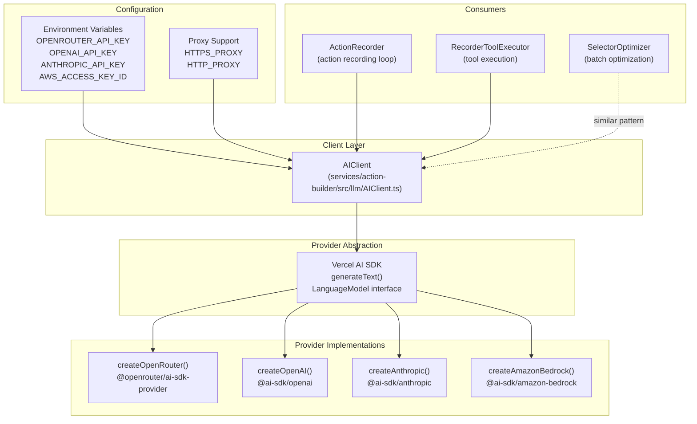
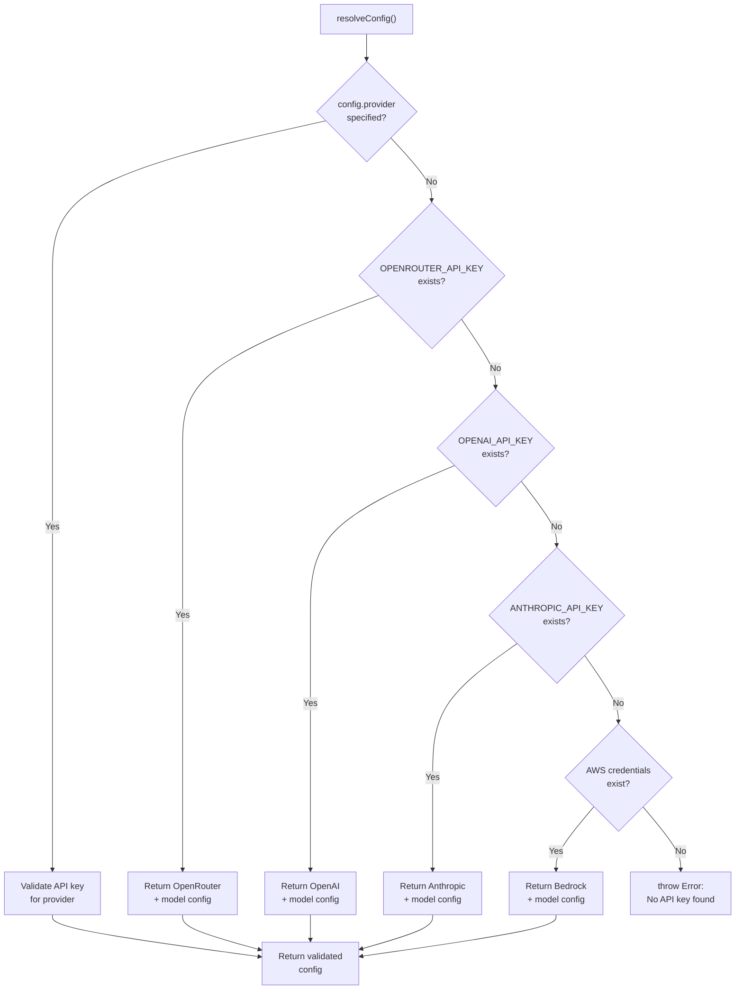
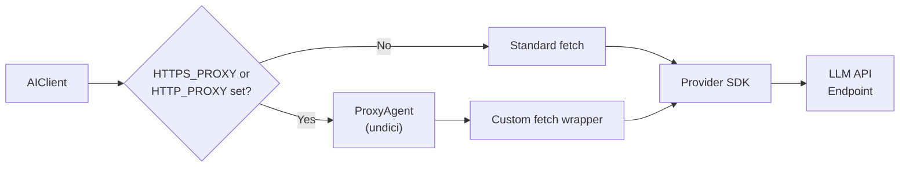
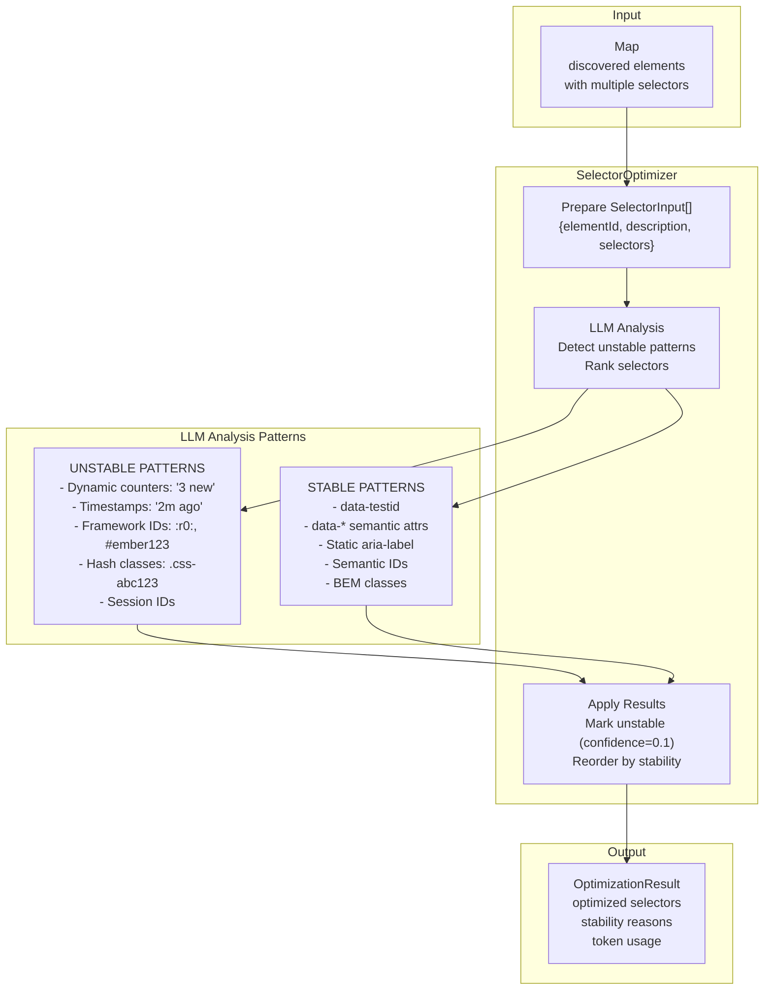
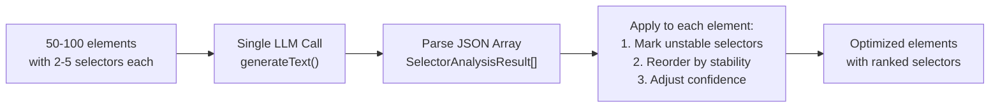
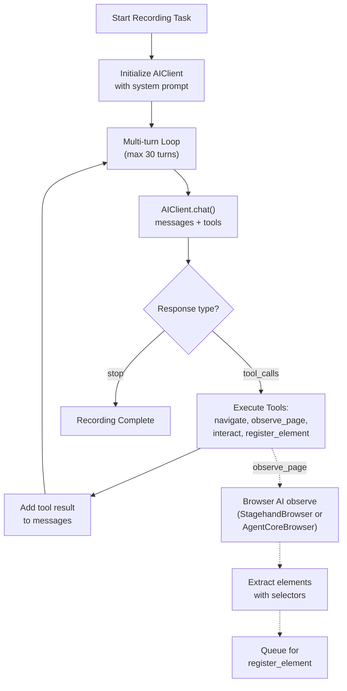

<!-- source: DeepWiki mcp.deepwiki.com · repo actionbook/actionbook · page 6 AI and LLM Integration · fetched 2026-10-27 -->

# AI and LLM Integration

<details>
<summary>Relevant source files</summary>

The following files were used as context for generating this wiki page:

- [.prettierignore](.prettierignore)
- [.prettierrc.json](.prettierrc.json)
- [CLAUDE.md](CLAUDE.md)
- [services/action-builder/.gitignore](services/action-builder/.gitignore)
- [services/action-builder/package.json](services/action-builder/package.json)
- [services/action-builder/scripts/crawl-playbook-batch.ts](services/action-builder/scripts/crawl-playbook-batch.ts)
- [services/action-builder/scripts/crawl-sites.txt.example](services/action-builder/scripts/crawl-sites.txt.example)
- [services/action-builder/scripts/import-playbook-batch.ts](services/action-builder/scripts/import-playbook-batch.ts)
- [services/action-builder/scripts/login.ts](services/action-builder/scripts/login.ts)
- [services/action-builder/src/llm/AIClient.ts](services/action-builder/src/llm/AIClient.ts)
- [services/action-builder/src/optimizer/SelectorOptimizer.ts](services/action-builder/src/optimizer/SelectorOptimizer.ts)
- [services/action-builder/src/utils/logger.ts](services/action-builder/src/utils/logger.ts)
- [services/action-builder/vitest.setup.ts](services/action-builder/vitest.setup.ts)
- [services/common/browser-profile/package.json](services/common/browser-profile/package.json)
- [services/common/browser-profile/src/BrowserProfileManager.ts](services/common/browser-profile/src/BrowserProfileManager.ts)
- [services/db/migrations/meta/0018_snapshot.json](services/db/migrations/meta/0018_snapshot.json)

</details>


This page documents the AI and Large Language Model (LLM) integration layer in Actionbook. It covers the multi-provider LLM client architecture, selector optimization using AI, and how LLMs power capability discovery throughout the system.

For browser automation details using AI-powered observation, see [Browser Automation Layer](#4). For action recording workflows that use LLM tool calling, see [Action Recording](#3.2.2). For capability discovery implementation, see [Capability Discovery](#6.3).

## Overview

Actionbook uses LLMs for three primary purposes:

1. **Action Recording** - Multi-turn LLM conversations with structured tools to discover and register UI capabilities
2. **Selector Optimization** - Batch analysis of discovered selectors to identify unstable patterns and rank selector reliability
3. **Capability Discovery** - AI-powered page observation to extract semantic element information and interactions

The system supports multiple LLM providers through a unified client interface, with automatic provider detection based on available API keys.

## Multi-Provider LLM Architecture

### AIClient Design

The `AIClient` class provides a unified interface to multiple LLM providers using the Vercel AI SDK. It handles provider auto-detection, message format conversion, proxy support, and metrics collection.



**Sources:** [services/action-builder/src/llm/AIClient.ts:1-544]()

### Provider Detection and Priority

Provider selection follows automatic detection with priority ordering:

| Priority | Provider | Environment Variable | Default Model |
|----------|----------|---------------------|---------------|
| 1 | OpenRouter | `OPENROUTER_API_KEY` | `anthropic/claude-sonnet-4` |
| 2 | OpenAI | `OPENAI_API_KEY` | `gpt-4o` |
| 3 | Anthropic | `ANTHROPIC_API_KEY` | `claude-sonnet-4-5` |
| 4 | AWS Bedrock | `AWS_ACCESS_KEY_ID` + `AWS_SECRET_ACCESS_KEY` | `anthropic.claude-3-5-sonnet-20241022-v2:0` |

The `resolveConfig()` method implements this detection logic:



**Sources:** [services/action-builder/src/llm/AIClient.ts:97-171]()

### Message Format Conversion

The `AIClient` converts between OpenAI-compatible message formats (used internally) and Vercel AI SDK formats. This abstraction allows the codebase to use a consistent interface while supporting multiple providers.

**Key Conversions:**

1. **Tool Calls** - Assistant messages with `tool_calls` are converted to AI SDK's content array format with `type: 'tool-call'`
2. **Tool Results** - Tool messages become AI SDK tool results with structured output format (`{type: 'json' | 'text', value: any}`)
3. **Tool Call ID Mapping** - Maintains a map to associate tool results with their originating tool names

**Sources:** [services/action-builder/src/llm/AIClient.ts:222-312]()

### Proxy Support

The `createProxyFetch()` function enables HTTP/HTTPS proxy support for LLM API calls. It wraps `undici`'s fetch with a `ProxyAgent`:



**Sources:** [services/action-builder/src/llm/AIClient.ts:36-54](), [services/action-builder/src/optimizer/SelectorOptimizer.ts:72-93]()

### Metrics and Observability

The `AIClient` collects comprehensive metrics for each LLM call:

**Metric Structure (`LLMMetrics` interface):**

| Field | Type | Description |
|-------|------|-------------|
| `inputTokens` | number | Prompt tokens consumed |
| `outputTokens` | number | Completion tokens generated |
| `totalTokens` | number | Sum of input + output |
| `cacheCreationInputTokens` | number? | Tokens used to populate cache (Anthropic) |
| `cacheReadInputTokens` | number? | Tokens read from cache (Anthropic) |
| `reasoningTokens` | number? | Reasoning tokens (o1/o3 models) |
| `e2eLatencyMs` | number | End-to-end request latency |
| `tps` | number | Tokens per second (output / latency) |
| `provider` | string | Provider name |
| `model` | string | Model identifier |
| `success` | boolean | Request succeeded |
| `errorType` | string? | Error classification |

**Log Format:**
```
[LLM] ✓ | openrouter/anthropic/claude-sonnet-4 | tokens: in=1234, out=567, total=1801 | perf: latency=2450ms, tps=23.1
```

**Sources:** [services/action-builder/src/llm/AIClient.ts:11-31](), [services/action-builder/src/llm/AIClient.ts:443-471]()

### Retry Logic

The client uses Vercel AI SDK's built-in retry mechanism with exponential backoff:

- **Max Retries:** 5 (configurable)
- **Total Attempts:** 6 (1 initial + 5 retries)
- **Backoff Strategy:** Exponential with jitter (handled by SDK)
- **Rate Limit Handling:** Automatic retry with longer delays

**Sources:** [services/action-builder/src/llm/AIClient.ts:354-363]()

## Selector Optimization

The `SelectorOptimizer` uses LLM analysis to improve selector reliability by identifying unstable patterns and reordering selectors by stability.



**Sources:** [services/action-builder/src/optimizer/SelectorOptimizer.ts:1-372]()

### Unstable Selector Patterns

The optimizer prompt instructs the LLM to detect these unstable patterns:

**Dynamic Content:**
- Counters/notifications: `"0 条新通知"`, `"3 new messages"`, `"(5)"`, `"+99"`
- Timestamps: `"2 minutes ago"`, `"刚刚"`, `"Yesterday"`
- User-specific: Contains usernames, IDs like `"user-12345"`
- Session tokens: Random tokens, session IDs

**Framework-Generated IDs:**
- React: `:r0:`, `:r1:`, `#react-xxx`
- Ember: `#ember123`
- Angular: `.ng-c123`
- Radix: `#radix-123`

**Hash-Based CSS Classes:**
- CSS Modules: `.styles_button__x7y8z`, `.Component_name__hash`
- styled-components: `.sc-1a2b3c`, `.sc-aBcDeF`
- Emotion: `.css-1a2b3c`, `.css-xxxxxx`
- Generic patterns: Classes ending with `_[a-z0-9]{5,}`, `__[a-z0-9]{5,}`, or `-[a-z0-9]{6,}`

**Sources:** [services/action-builder/src/optimizer/SelectorOptimizer.ts:289-299]()

### Selector Priority Ranking

When all selectors are stable, the LLM uses this priority ordering:

1. `data-testid` (most stable, designed for testing)
2. Other semantic `data-*` attributes (`data-id`, `data-component`, `data-element`)
3. `id` selector (`#id`)
4. Static `aria-label`
5. Semantic CSS class (BEM naming)
6. XPath (least preferred)

**Sources:** [services/action-builder/src/optimizer/SelectorOptimizer.ts:308-314]()

### Batch Processing

The optimizer processes all elements in a single LLM call for efficiency:



**Input Format:**
```typescript
interface SelectorInput {
  elementId: string
  description: string
  selectors: SelectorItem[]
}
```

**Output Format:**
```typescript
interface SelectorAnalysisResult {
  elementId: string
  bestSelectorIndex: number          // Index of best selector
  unstableSelectorIndices: number[]  // All unstable selectors
  reason: string                     // Explanation
  adjustedConfidence?: number        // 0.1-0.95
}
```

**Sources:** [services/action-builder/src/optimizer/SelectorOptimizer.ts:23-65](), [services/action-builder/src/optimizer/SelectorOptimizer.ts:157-278]()

### Model Configuration

The optimizer uses smaller/faster models to reduce costs:

| Provider | Default Model | Override Variable |
|----------|--------------|-------------------|
| OpenRouter | `gpt-4o-mini` | `SELECTOR_OPTIMIZER_MODEL` |
| OpenAI | `gpt-4o-mini` | `SELECTOR_OPTIMIZER_MODEL` |
| Anthropic | `claude-3-5-haiku-latest` | `SELECTOR_OPTIMIZER_MODEL` |
| Bedrock | `anthropic.claude-3-5-haiku-20241022-v1:0` | `SELECTOR_OPTIMIZER_MODEL` |

**Sources:** [services/action-builder/src/optimizer/SelectorOptimizer.ts:98-153]()

## Integration Points

### Action Recording Loop

The action recording system uses LLM-driven tool calling to discover and register UI capabilities. The `AIClient` powers the multi-turn conversation loop:



**Sources:** See [Action Recording](#3.2.2) for detailed workflow. The AIClient is used in [services/action-builder/src/recorder/ActionRecorder.ts]() for the recording loop.

### Browser Automation AI Operations

Browser adapters use LLM providers for AI-powered page observation:

**StagehandBrowser Integration:**
- Uses Stagehand SDK's built-in AI capabilities
- Supports all four providers (OpenRouter, OpenAI, Anthropic, Bedrock)
- Configuration: `STAGEHAND_PROVIDER`, `STAGEHAND_MODEL`
- Proxy support via `localBrowserLaunchOptions`

**AgentCoreBrowser Integration:**
- AWS cloud-based browser service
- Uses AWS Bedrock Claude exclusively
- Vision + inference for element detection

**Sources:** [services/common/browser/src/StagehandBrowser.ts](), [services/common/browser/src/AgentCoreBrowser.ts]()

### Capability Discovery

LLMs enable semantic understanding of UI elements during page observation:

1. **Visual Analysis** - AI models analyze screenshots to identify interactive elements
2. **Semantic Extraction** - Generate human-readable element descriptions and IDs
3. **Interaction Detection** - Infer allowed methods (click, type, etc.) from element type
4. **Relationship Mapping** - Detect navigation flows (leads_to)

**Sources:** See [Capability Discovery](#6.3) for implementation details.

## Configuration

### Environment Variables

**LLM Provider Configuration:**

| Variable | Purpose | Default |
|----------|---------|---------|
| `OPENROUTER_API_KEY` | OpenRouter API key | - |
| `OPENROUTER_MODEL` | OpenRouter model override | `anthropic/claude-sonnet-4` |
| `OPENAI_API_KEY` | OpenAI API key | - |
| `OPENAI_MODEL` | OpenAI model override | `gpt-4o` |
| `ANTHROPIC_API_KEY` | Anthropic API key | - |
| `ANTHROPIC_MODEL` | Anthropic model override | `claude-sonnet-4-5` |
| `AWS_ACCESS_KEY_ID` | AWS Bedrock access key | - |
| `AWS_SECRET_ACCESS_KEY` | AWS Bedrock secret key | - |
| `AWS_REGION` | AWS region | `us-east-1` |
| `AWS_BEDROCK_MODEL` | Bedrock model override | `anthropic.claude-3-5-sonnet-20241022-v2:0` |
| `SELECTOR_OPTIMIZER_MODEL` | Model for selector optimization | Provider-specific default |

**Proxy Configuration:**

| Variable | Purpose |
|----------|---------|
| `HTTPS_PROXY` | HTTPS proxy URL |
| `HTTP_PROXY` | HTTP proxy URL (fallback) |

**Stagehand-Specific:**

| Variable | Purpose |
|----------|---------|
| `STAGEHAND_PROVIDER` | Stagehand LLM provider (openai, anthropic, openrouter, bedrock) |
| `STAGEHAND_MODEL` | Stagehand model name |

**Sources:** [services/action-builder/src/llm/AIClient.ts:58-65](), [services/action-builder/src/optimizer/SelectorOptimizer.ts:117]()

### Explicit Provider Configuration

The `AIClient` constructor accepts an optional config object:

```typescript
interface AIClientConfig {
  provider?: 'openrouter' | 'openai' | 'anthropic' | 'bedrock'
  model?: string
  apiKey?: string
}

// Example: Force OpenAI with custom model
const client = new AIClient({
  provider: 'openai',
  model: 'gpt-4-turbo-preview',
  apiKey: process.env.CUSTOM_OPENAI_KEY
})
```

**Sources:** [services/action-builder/src/llm/AIClient.ts:56-71]()

## Error Handling and Reliability

### Error Classification

The `classifyError()` method categorizes failures for metrics:

| Error Type | Detection Pattern | Example |
|-----------|------------------|---------|
| `rate_limit` | Contains "429" or "rate limit" | HTTP 429, quota exceeded |
| `server_error` | Contains "5" and "00" | HTTP 500, 502, 503 |
| `timeout` | Contains "timeout" or "timed out" | Request timeout, connection timeout |
| `other` | All other errors | Network errors, invalid API key |

**Sources:** [services/action-builder/src/llm/AIClient.ts:422-440]()

### Retry Strategy

Failed requests are automatically retried with exponential backoff:

- **Initial Delay:** ~1 second (SDK-managed)
- **Backoff Multiplier:** 2x (SDK-managed)
- **Max Delay:** ~32 seconds (SDK-managed)
- **Jitter:** Random delay added to prevent thundering herd

**Sources:** [services/action-builder/src/llm/AIClient.ts:362]()

### Cost Optimization

**Token Usage Tracking:**
- All LLM calls log token consumption (input, output, cache hits)
- Metrics enable cost attribution per recording task
- Cache tokens (Anthropic) reduce repeated content costs

**Model Selection:**
- Action recording: Uses more capable models (Claude Sonnet, GPT-4o)
- Selector optimization: Uses smaller models (GPT-4o-mini, Haiku) for cost efficiency

**Sources:** [services/action-builder/src/llm/AIClient.ts:368-396](), [services/action-builder/src/optimizer/SelectorOptimizer.ts:118-128]()

## Dependencies

The AI integration layer relies on these npm packages:

| Package | Version | Purpose |
|---------|---------|---------|
| `ai` | ^5.0.113 | Vercel AI SDK core |
| `@ai-sdk/openai` | ^2.0.87 | OpenAI provider |
| `@ai-sdk/anthropic` | ^2.0.56 | Anthropic provider |
| `@openrouter/ai-sdk-provider` | ^1.5.4 | OpenRouter provider |
| `@ai-sdk/amazon-bedrock` | ^3.0.70 | AWS Bedrock provider |
| `openai` | ^4.77.0 | OpenAI SDK types |
| `undici` | ^6.22.0 | HTTP proxy support |
| `https-proxy-agent` | ^7.0.6 | Legacy proxy support |

**Sources:** [services/action-builder/package.json:45-56]()

---

