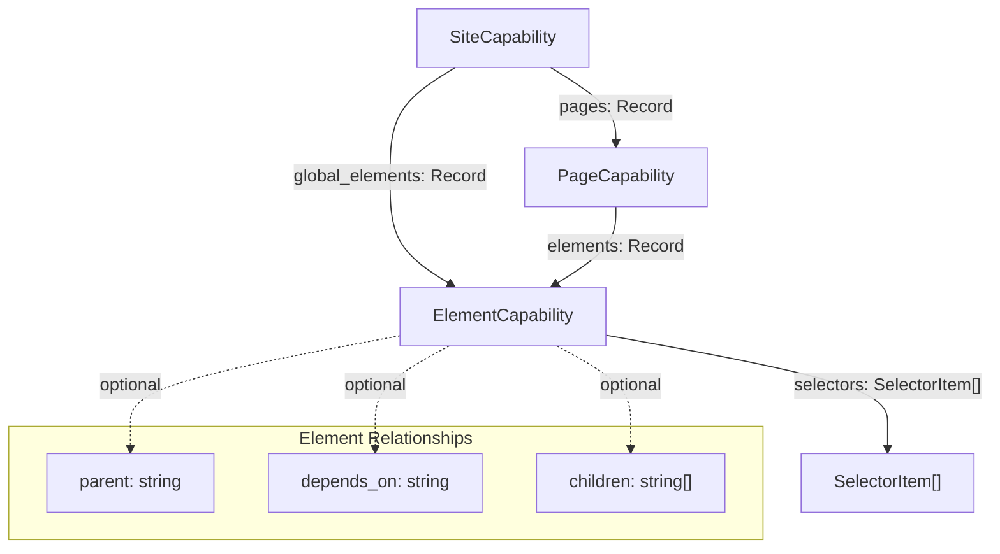
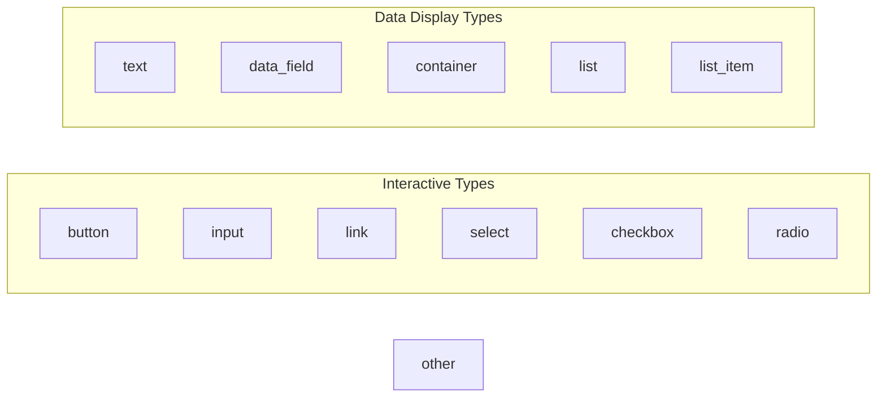
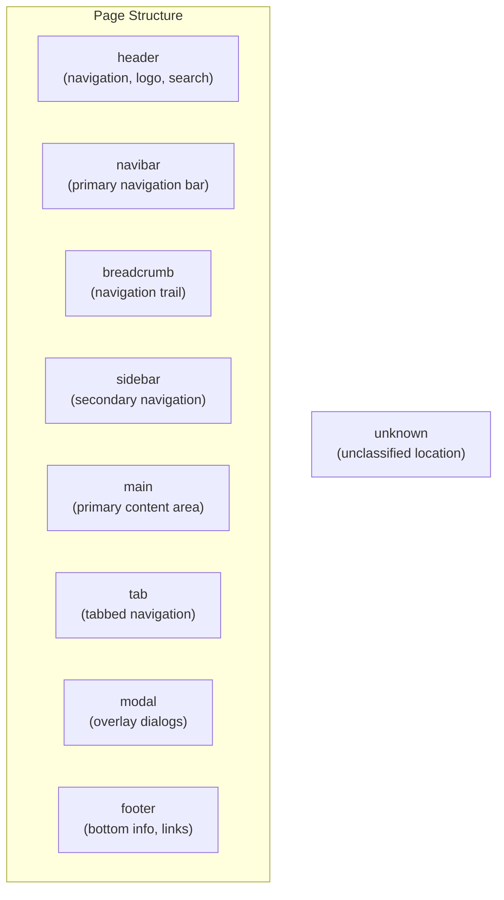
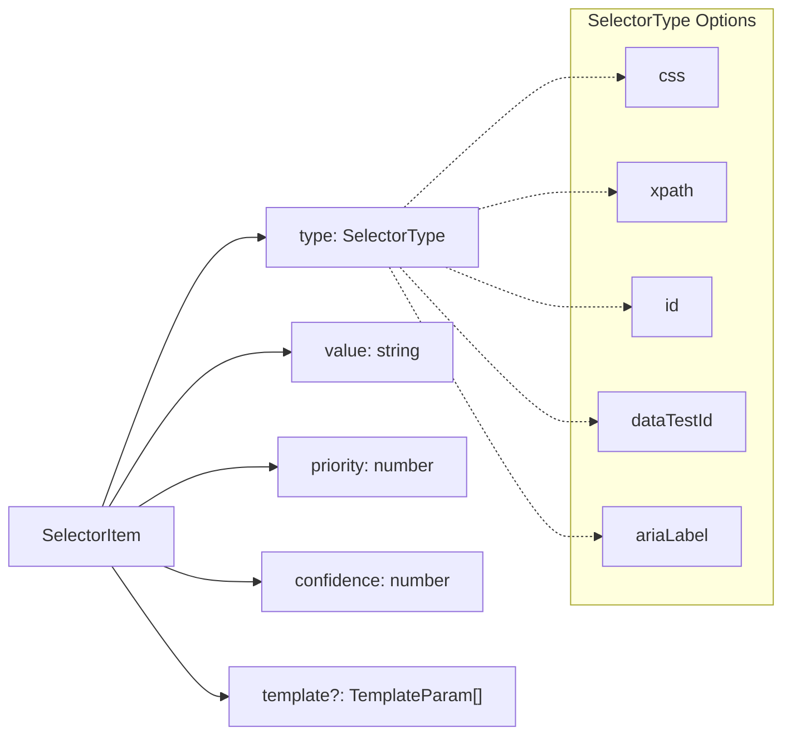
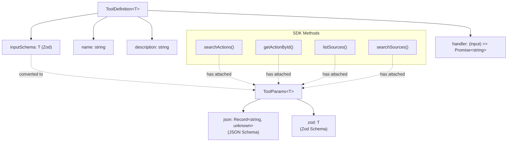
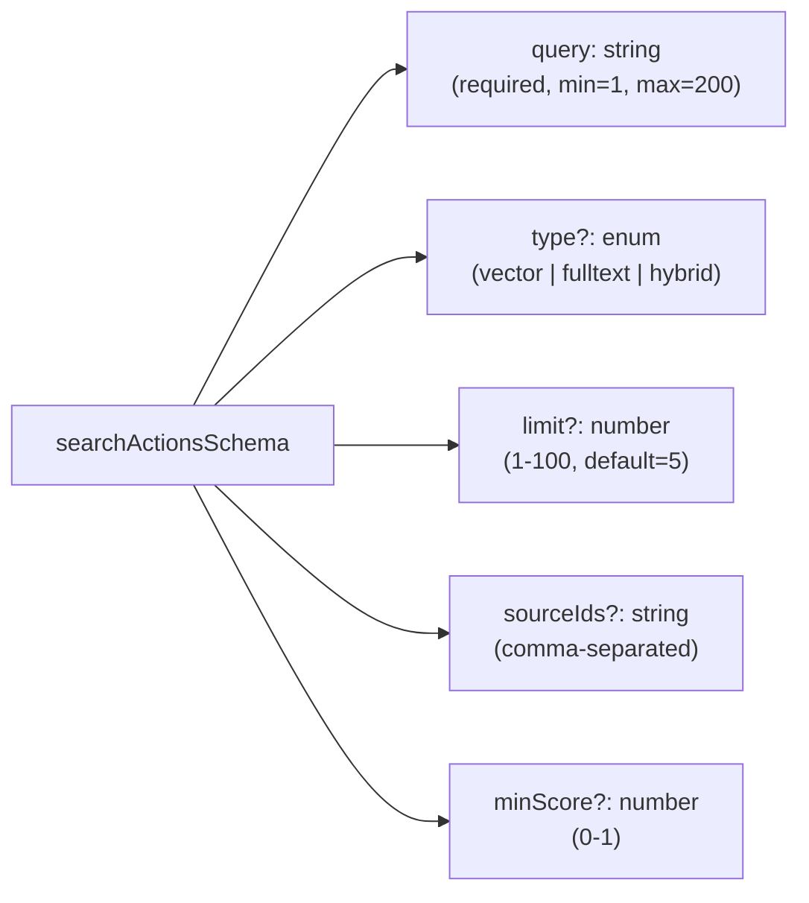
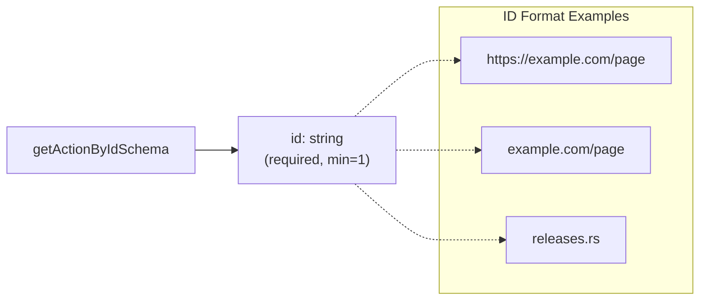
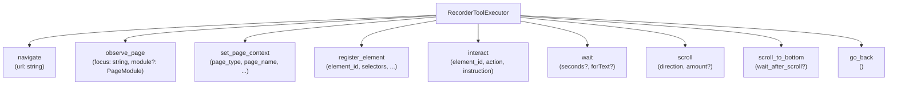
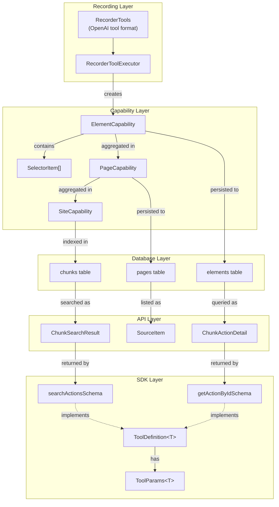

<!-- source: DeepWiki mcp.deepwiki.com · repo actionbook/actionbook · page 7 Data Models and Types · fetched 2026-10-27 -->

# Data Models and Types

<details>
<summary>Relevant source files</summary>

The following files were used as context for generating this wiki page:

- [packages/js-sdk/src/api-client.ts](packages/js-sdk/src/api-client.ts)
- [packages/js-sdk/src/client.ts](packages/js-sdk/src/client.ts)
- [packages/js-sdk/src/tool-defs.ts](packages/js-sdk/src/tool-defs.ts)
- [packages/js-sdk/src/types.ts](packages/js-sdk/src/types.ts)
- [services/action-builder/src/recorder/RecorderTools.ts](services/action-builder/src/recorder/RecorderTools.ts)
- [services/action-builder/src/types/capability.ts](services/action-builder/src/types/capability.ts)
- [services/action-builder/src/utils/index.ts](services/action-builder/src/utils/index.ts)
- [services/action-builder/src/utils/url-matcher.ts](services/action-builder/src/utils/url-matcher.ts)
- [services/action-builder/test/recorder/RecorderTools.ut.test.ts](services/action-builder/test/recorder/RecorderTools.ut.test.ts)
- [services/action-builder/test/types/capability.ut.test.ts](services/action-builder/test/types/capability.ut.test.ts)
- [services/action-builder/test/utils/url-matcher.ut.test.ts](services/action-builder/test/utils/url-matcher.ut.test.ts)

</details>


## Purpose and Scope

This document provides a comprehensive reference for the core type definitions used throughout the Actionbook system. These types form the foundation for:

- **Capability Models**: Hierarchical data structures representing website UI elements and pages
- **Selector System**: Multi-selector format with priority ordering and template support
- **Tool Definitions**: LLM-compatible tool schemas for SDK and MCP integration
- **API Types**: Request/response formats for the REST API

For information about how these types are used in the recording process, see [Action Recording](#3.2.2). For database schema details, see [Database Schema](#5.1). For tool implementation, see [Recording Tools Reference](#3.2.3).

---

## Capability Type Hierarchy

The capability system uses a three-level hierarchy to organize website UI information:

### Type Relationship Diagram



**Sources:** [services/action-builder/src/types/capability.ts:1-156]()

### SiteCapability

The root aggregate representing an entire website's capabilities.

| Field | Type | Description |
|-------|------|-------------|
| `domain` | `string` | Website domain (e.g., "example.com") |
| `name` | `string` | Human-readable site name |
| `description` | `string` | Site description |
| `version` | `string` | Version identifier for the capability set |
| `recorded_at` | `string` | ISO timestamp of when capabilities were recorded |
| `scenario` | `string` | Recording scenario description |
| `health_score` | `number?` | Optional health score (0-100) |
| `global_elements` | `Record<string, ElementCapability>` | Elements present across all pages (e.g., header, footer) |
| `pages` | `Record<string, PageCapability>` | Page-specific capabilities indexed by page_type |

**Sources:** [services/action-builder/src/types/capability.ts:143-155]()

### PageCapability

Represents a specific page type within a website (e.g., search results, product detail).

| Field | Type | Description |
|-------|------|-------------|
| `page_type` | `string` | Page type identifier (e.g., "home", "search_results") |
| `name` | `string` | Human-readable page name |
| `description` | `string` | Page description |
| `url_patterns` | `string[]` | Regex patterns for matching URLs to this page type |
| `wait_for` | `string?` | Optional selector to wait for before considering page loaded |
| `elements` | `Record<string, ElementCapability>` | Elements specific to this page type |

**Sources:** [services/action-builder/src/types/capability.ts:130-140]()

### ElementCapability

The most granular level, representing a single UI element with its selectors and interaction methods.

| Field | Type | Description |
|-------|------|-------------|
| `id` | `string` | Unique element identifier (snake_case) |
| `selectors` | `SelectorItem[]` | Multi-selector array with priority ordering |
| `description` | `string` | Human-readable element description |
| `element_type` | `ElementType` | Element classification (button, input, link, etc.) |
| `allow_methods` | `AllowMethod[]` | Permitted interaction methods |
| `arguments` | `ArgumentDef[]?` | Optional arguments for parameterized actions |
| `leads_to` | `string?` | Page type this element navigates to |
| `wait_after` | `number?` | Milliseconds to wait after interaction |
| `confidence` | `number?` | Selector confidence score (0-1) |
| `discovered_at` | `string` | ISO timestamp of discovery |

**Additional Relationship Fields:**

| Field | Type | Description |
|-------|------|-------------|
| `parent` | `string?` | Parent element ID (for hierarchical elements) |
| `depends_on` | `string?` | Element ID that must be interacted with first |
| `visibility_condition` | `string?` | Condition description for visibility |
| `is_repeating` | `boolean?` | True if element repeats in a list/table |
| `data_key` | `string?` | Data extraction key for data_field elements |
| `children` | `string[]?` | Child element IDs for containers |
| `module` | `PageModule?` | Page module location |

**Input-Specific Fields:**

| Field | Type | Description |
|-------|------|-------------|
| `input_type` | `string?` | Input type (text, email, password, etc.) |
| `input_name` | `string?` | Name attribute |
| `input_value` | `string?` | Default/current value |

**Link-Specific Fields:**

| Field | Type | Description |
|-------|------|-------------|
| `href` | `string?` | URL or pattern for link elements |

**Sources:** [services/action-builder/src/types/capability.ts:78-128]()

---

## Element Types and Enumerations

### ElementType Enum

Classification of UI elements by their semantic role:



| Type | Purpose | Typical Allow Methods |
|------|---------|----------------------|
| `button` | Clickable action trigger | click, hover |
| `input` | Text input field | type, clear |
| `link` | Navigation link | click, hover |
| `select` | Dropdown selector | select, click |
| `checkbox` | Boolean toggle | click |
| `radio` | Single-choice option | click |
| `text` | Static text for reading | extract |
| `data_field` | Extractable data value | extract |
| `container` | Groups other elements | - |
| `list` | List container | scroll |
| `list_item` | Single list entry | click, extract |
| `other` | Uncategorized element | varies |

**Sources:** [services/action-builder/src/types/capability.ts:43-59]()

### AllowMethod Enum

Permitted interaction methods for elements:

| Method | Description | Typical Element Types |
|--------|-------------|----------------------|
| `click` | Mouse click interaction | button, link, checkbox, radio |
| `type` | Keyboard text input | input |
| `clear` | Clear input value | input |
| `scroll` | Scroll element into view | list, container |
| `hover` | Mouse hover | button, link |
| `select` | Select dropdown option | select |
| `extract` | Extract text/data | text, data_field, list_item |

**Sources:** [services/action-builder/src/types/capability.ts:62-71]()

### PageModule Enum

Categorizes elements by their page layout location:



**Module Values:**
- `header`: Top navigation, logo, search bar
- `footer`: Bottom information, legal links
- `sidebar`: Side navigation or secondary content
- `navibar`: Primary navigation bar
- `main`: Primary content area
- `modal`: Overlay dialogs and popups
- `breadcrumb`: Navigation breadcrumb trail
- `tab`: Tabbed navigation interface
- `unknown`: Location not determined by LLM

**Sources:** [services/action-builder/src/types/capability.ts:28-40]()

---

## Selector System

### SelectorItem Structure

Multi-selector format with priority ordering and template support:



**SelectorItem Fields:**

| Field | Type | Description |
|-------|------|-------------|
| `type` | `SelectorType` | Selector strategy (css, xpath, id, etc.) |
| `value` | `string` | Selector value, may contain template placeholders |
| `priority` | `number` | Precedence order (1 = highest priority) |
| `confidence` | `number` | Stability confidence score (0-1) |
| `template` | `TemplateParam[]?` | Template parameter definitions if value contains placeholders |

**Sources:** [services/action-builder/src/types/capability.ts:2-6]()

### SelectorType Enum

| Type | Description | Example |
|------|-------------|---------|
| `css` | CSS selector | `.search-button` |
| `xpath` | XPath expression | `//button[@class='search']` |
| `id` | HTML id attribute | `#search-btn` |
| `dataTestId` | data-testid attribute | `[data-testid="search"]` |
| `ariaLabel` | aria-label attribute | `[aria-label="Search"]` |

**Priority Ordering Convention:**
1. Most stable/specific selectors (id, dataTestId)
2. CSS selectors (class-based)
3. XPath expressions
4. ARIA-based selectors

Lower priority numbers indicate higher precedence. The selector optimizer ([SelectorOptimizer](#6.2)) adjusts confidence scores based on LLM analysis of selector stability.

**Sources:** [services/action-builder/src/types/capability.ts:2-6]()

### Template Parameters

For selectors with dynamic values (e.g., list items), templates define parameterization:

```typescript
interface TemplateParam {
  name: string;        // Parameter name
  type: string;        // Parameter type (string, number, etc.)
  description: string; // Human-readable description
}
```

**Example:**
```javascript
{
  type: "css",
  value: ".product-item[data-id=\"{{product_id}}\"]",
  priority: 1,
  confidence: 0.85,
  template: [
    {
      name: "product_id",
      type: "string",
      description: "Product identifier"
    }
  ]
}
```

**Sources:** [services/action-builder/src/types/capability.ts:2-6]()

---

## Tool Definitions

The SDK exposes tools for LLM integration with dual schema formats (JSON Schema + Zod).

### Tool Definition Architecture



**Sources:** [packages/js-sdk/src/tool-defs.ts:1-58]()

### ToolDefinition Interface

Generic interface for defining LLM-compatible tools:

```typescript
interface ToolDefinition<T extends z.ZodTypeAny> {
  name: string;              // Tool name (snake_case)
  description: string;       // Tool description for LLM
  inputSchema: T;            // Zod schema for validation
  handler: (input: z.infer<T>) => Promise<string>;
}
```

**Sources:** [packages/js-sdk/src/tool-defs.ts:15-27]()

### ToolParams Interface

Dual-format schema for multi-framework compatibility:

```typescript
interface ToolParams<T extends z.ZodTypeAny> {
  json: Record<string, unknown>;  // JSON Schema (OpenAI, Anthropic, Gemini)
  zod: T;                         // Zod schema (Vercel AI SDK)
}
```

**Framework Compatibility:**
- **JSON Schema format**: OpenAI SDK, Anthropic SDK, Google Gemini SDK
- **Zod format**: Vercel AI SDK (`@ai-sdk/openai`, `@ai-sdk/anthropic`, etc.)

**Sources:** [packages/js-sdk/src/tool-defs.ts:5-13]()

### SDK Tool Schemas

#### searchActions Tool

Search for action manuals by keyword.



**Schema Fields:**

| Field | Type | Required | Description |
|-------|------|----------|-------------|
| `query` | `string` | Yes | Search keyword (1-200 chars) |
| `type` | `"vector" \| "fulltext" \| "hybrid"` | No | Search strategy (default: hybrid) |
| `limit` | `number` | No | Max results (1-100, default: 5) |
| `sourceIds` | `string` | No | Filter by source IDs (comma-separated) |
| `minScore` | `number` | No | Minimum similarity threshold (0-1) |

**Sources:** [packages/js-sdk/src/tool-defs.ts:64-112]()

#### getActionById Tool

Retrieve complete action details including selectors.



**Schema Fields:**

| Field | Type | Required | Description |
|-------|------|----------|-------------|
| `id` | `string` | Yes | Action ID (full URL or fuzzy match) |

**ID Format Support:**
- Full URL: `https://example.com/docs/page`
- Domain + path: `example.com/docs/page`
- Domain only: `releases.rs` (matches `https://releases.rs/`)
- With chunk: `https://example.com/page#chunk-1`

**Sources:** [packages/js-sdk/src/tool-defs.ts:118-154]()

#### listSources Tool

List all available sources (websites) in the database.

| Field | Type | Required | Description |
|-------|------|----------|-------------|
| `limit` | `number` | No | Max sources (1-200, default: 50) |

**Sources:** [packages/js-sdk/src/tool-defs.ts:160-186]()

#### searchSources Tool

Search for sources by keyword (name, description, domain, tags).

| Field | Type | Required | Description |
|-------|------|----------|-------------|
| `query` | `string` | Yes | Search keyword (1-200 chars) |
| `limit` | `number` | No | Max results (1-100, default: 10) |

**Sources:** [packages/js-sdk/src/tool-defs.ts:192-237]()

---

## Recorder Tool Definitions

Tools used by the AI recorder during element discovery and registration.

### Recorder Tool Overview



**Sources:** [services/action-builder/src/recorder/RecorderTools.ts:1-216]()

### Core Recorder Tools

#### navigate

Navigate to a URL.

| Parameter | Type | Required | Description |
|-----------|------|----------|-------------|
| `url` | `string` | Yes | Target URL |

#### observe_page

Observe the current page to discover interactive elements.

| Parameter | Type | Required | Description |
|-----------|------|----------|-------------|
| `focus` | `string` | Yes | What to focus on (e.g., "search box and submit button") |
| `module` | `PageModule \| "all"` | No | Page module to observe (default: all) |

**Module Options:** `header`, `footer`, `sidebar`, `navibar`, `main`, `modal`, `breadcrumb`, `tab`, `all`

#### set_page_context

Set the current page context metadata.

| Parameter | Type | Required | Description |
|-----------|------|----------|-------------|
| `page_type` | `string` | Yes | Page type identifier |
| `page_name` | `string` | Yes | Human-readable name |
| `page_description` | `string` | No | Optional description |
| `url_pattern` | `string` | No | Optional URL regex pattern |

#### register_element

Register a UI element capability with selectors and metadata.

| Parameter | Type | Required | Description |
|-----------|------|----------|-------------|
| `element_id` | `string` | Yes | Unique identifier (snake_case) |
| `description` | `string` | Yes | Element description |
| `element_type` | `string` | Yes | Element type classification |
| `css_selector` | `string` | No | CSS selector |
| `xpath_selector` | `string` | No | XPath selector |
| `aria_label` | `string` | No | ARIA label |
| `placeholder` | `string` | No | Placeholder text (inputs) |
| `allow_methods` | `string[]` | Yes | Allowed interaction methods |
| `leads_to` | `string` | No | Page type navigation target |
| `arguments` | `ArgumentDef[]` | No | Parameterized arguments |
| `parent` | `string` | No | Parent element ID |
| `depends_on` | `string` | No | Dependency element ID |
| `visibility_condition` | `string` | No | Visibility condition |
| `is_repeating` | `boolean` | No | List item flag |
| `data_key` | `string` | No | Data extraction key |
| `children` | `string[]` | No | Child element IDs |
| `module` | `PageModule` | No | Page module location |
| `input_type` | `string` | No | Input type (for inputs) |
| `input_name` | `string` | No | Name attribute (for inputs) |
| `input_value` | `string` | No | Default value (for inputs) |
| `href` | `string` | No | URL pattern (for links) |

**Sources:** [services/action-builder/src/recorder/RecorderTools.ts:64-134]()

#### interact

Perform an interaction on a target element (task-driven mode).

| Parameter | Type | Required | Description |
|-----------|------|----------|-------------|
| `element_id` | `string` | Yes | Unique identifier |
| `action` | `string` | Yes | Action to perform |
| `instruction` | `string` | Yes | Natural language instruction |
| `value` | `string` | No | Optional value (for type) |
| `element_description` | `string` | Yes | Element description |
| `css_selector` | `string` | No | Optional CSS selector |
| `xpath_selector` | `string` | No | Optional XPath selector |

**Sources:** [services/action-builder/src/recorder/RecorderTools.ts:136-155]()

### Navigation and Utility Tools

| Tool | Parameters | Description |
|------|-----------|-------------|
| `wait` | `seconds?: number, forText?: string` | Wait for time or text |
| `scroll` | `direction: "up"\|"down", amount?: number` | Scroll by pixels (default: 300px) |
| `scroll_to_bottom` | `wait_after_scroll?: number` | Scroll to bottom for lazy-load (default: 1000ms) |
| `go_back` | _(none)_ | Navigate back in browser history |

**Sources:** [services/action-builder/src/recorder/RecorderTools.ts:157-214]()

---

## API Response Types

### ChunkSearchResult

Response format for action search queries.

```typescript
interface ChunkSearchResult {
  success: boolean;
  query: string;
  results: Array<{
    action_id: string;    // URL-based action identifier
    content: string;      // Content preview
    score: number;        // Relevance score (0-1)
    createdAt: string;    // ISO timestamp
  }>;
  count: number;          // Number of results returned
  total: number;          // Total matching results
  hasMore: boolean;       // True if more results available
}
```

**Sources:** [packages/js-sdk/src/types.ts:6-21]()

### ChunkActionDetail

Complete action details with selectors and metadata.

```typescript
interface ChunkActionDetail {
  action_id: string;        // URL-based identifier
  content: string;          // Full action content/documentation
  elements: string | null;  // JSON-encoded ElementCapability objects
  createdAt: string;        // ISO timestamp
  documentId: number;       // Parent document ID
  documentTitle: string;    // Page title
  documentUrl: string;      // Page URL
  chunkIndex: number;       // Chunk position in document
  heading: string | null;   // Section heading
  tokenCount: number;       // Token count for content
}
```

**ParsedElements Structure:**

```typescript
interface ParsedElements {
  [key: string]: {
    css_selector?: string;
    xpath_selector?: string;
    description?: string;
    element_type?: string;
    allow_methods?: string[];
    depends_on?: string;
  };
}
```

**Sources:** [packages/js-sdk/src/types.ts:23-51]()

### SourceItem

Source (website) metadata.

```typescript
interface SourceItem {
  id: number;                      // Source ID
  name: string;                    // Source name
  baseUrl: string;                 // Base URL
  description: string | null;      // Optional description
  domain: string | null;           // Domain
  tags: string[];                  // Tag array
  healthScore: number | null;      // Health score (0-100)
  lastCrawledAt: string | null;    // Last crawl timestamp
  createdAt: string;               // Creation timestamp
}
```

**Sources:** [packages/js-sdk/src/types.ts:53-66]()

### SourceListResult and SourceSearchResult

```typescript
interface SourceListResult {
  success: boolean;
  results: SourceItem[];
  count: number;
}

interface SourceSearchResult {
  success: boolean;
  query: string;
  results: SourceItem[];
  count: number;
}
```

**Sources:** [packages/js-sdk/src/types.ts:68-85]()

---

## Type System Relationships

### Cross-System Type Flow



**Sources:** [services/action-builder/src/types/capability.ts:1-156](), [packages/js-sdk/src/tool-defs.ts:1-237](), [packages/js-sdk/src/types.ts:1-97]()

### Type Import Patterns

The codebase uses explicit type re-exports to maintain separation of concerns:

```typescript
// action-builder re-exports from db package
export type {
  SelectorType,
  SelectorItem,
  TemplateParam,
} from '@actionbookdev/db'

// action-builder re-exports from browser package
export type {
  ObserveResult,
  ActionObject,
  ActionMethod,
} from '@actionbookdev/browser'
```

This pattern ensures that capability types remain consistent across the recording layer, database layer, and SDK layer.

**Sources:** [services/action-builder/src/types/capability.ts:1-14]()

---

