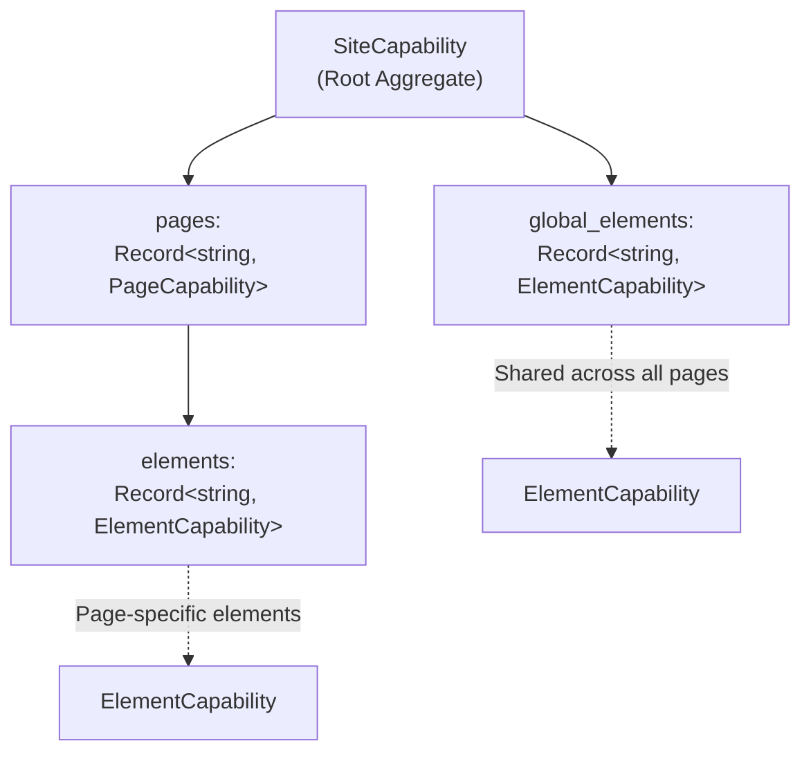
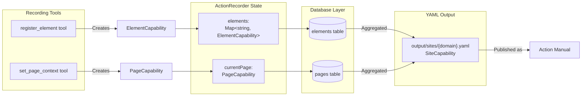
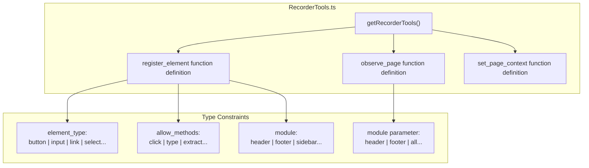
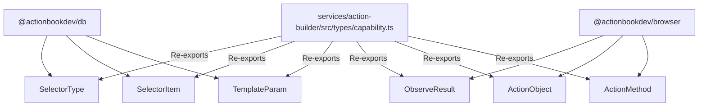

<!-- source: DeepWiki mcp.deepwiki.com · repo actionbook/actionbook · page 7.1 Capability Types · fetched 2026-10-27 -->

# Capability Types

<details>
<summary>Relevant source files</summary>

The following files were used as context for generating this wiki page:

- [services/action-builder/src/recorder/RecorderTools.ts](services/action-builder/src/recorder/RecorderTools.ts)
- [services/action-builder/src/types/capability.ts](services/action-builder/src/types/capability.ts)
- [services/action-builder/src/utils/index.ts](services/action-builder/src/utils/index.ts)
- [services/action-builder/src/utils/url-matcher.ts](services/action-builder/src/utils/url-matcher.ts)
- [services/action-builder/test/recorder/RecorderTools.ut.test.ts](services/action-builder/test/recorder/RecorderTools.ut.test.ts)
- [services/action-builder/test/types/capability.ut.test.ts](services/action-builder/test/types/capability.ut.test.ts)
- [services/action-builder/test/utils/url-matcher.ut.test.ts](services/action-builder/test/utils/url-matcher.ut.test.ts)

</details>


## Purpose and Scope

This page documents the core type definitions for representing website capabilities in Actionbook. These types form the data model for action manuals, defining the structure of UI elements, pages, and sites that are discovered and recorded during the build pipeline.

For information about the selector system used within capabilities, see [Selector Types](#7.2). For details on how capabilities are discovered and recorded, see [Action Recording](#3.2.2).

**Sources:** [services/action-builder/src/types/capability.ts:1-157]()

## Capability Hierarchy

Actionbook organizes website capabilities into a three-tier hierarchy that models the structure of websites:



**Hierarchy Levels:**

| Level | Type | Purpose | Storage Location |
|-------|------|---------|------------------|
| Site | `SiteCapability` | Root container for an entire website | YAML file per site |
| Page | `PageCapability` | Represents a page type (e.g., search, product detail) | Nested in `SiteCapability.pages` |
| Element | `ElementCapability` | Individual UI component with selectors and interaction methods | Nested in page or global elements |

**Sources:** [services/action-builder/src/types/capability.ts:143-156](), [services/action-builder/src/types/capability.ts:131-141](), [services/action-builder/src/types/capability.ts:79-128]()

## SiteCapability

The root aggregate containing all capabilities for a website.

```typescript
interface SiteCapability {
  domain: string
  name: string
  description: string
  version: string
  recorded_at: string
  scenario: string
  health_score?: number
  global_elements: Record<string, ElementCapability>
  pages: Record<string, PageCapability>
}
```

| Field | Type | Description |
|-------|------|-------------|
| `domain` | `string` | Website domain (e.g., "github.com") |
| `name` | `string` | Human-readable site name |
| `description` | `string` | Site purpose and capabilities summary |
| `version` | `string` | Version identifier for the action manual |
| `recorded_at` | `string` | ISO timestamp of recording |
| `scenario` | `string` | Recording scenario context |
| `health_score` | `number?` | Optional quality metric (0-100) |
| `global_elements` | `Record<string, ElementCapability>` | Elements available across all pages (header, footer, etc.) |
| `pages` | `Record<string, PageCapability>` | Page type definitions keyed by page_type |

**Sources:** [services/action-builder/src/types/capability.ts:143-156]()

## PageCapability

Represents a specific page type within a site (e.g., homepage, search results, product detail).

```typescript
interface PageCapability {
  page_type: string
  name: string
  description: string
  url_patterns: string[]
  wait_for?: string
  elements: Record<string, ElementCapability>
}
```

| Field | Type | Description |
|-------|------|-------------|
| `page_type` | `string` | Unique identifier for page type (e.g., "search_results") |
| `name` | `string` | Human-readable page name |
| `description` | `string` | Page purpose and content description |
| `url_patterns` | `string[]` | Regex patterns matching URLs for this page type |
| `wait_for` | `string?` | Optional selector to wait for before page is ready |
| `elements` | `Record<string, ElementCapability>` | Page-specific elements keyed by element_id |

**Sources:** [services/action-builder/src/types/capability.ts:131-141]()

## ElementCapability

The core type representing a single UI element with its selectors, interaction methods, and metadata.

### Core Fields

| Field | Type | Required | Description |
|-------|------|----------|-------------|
| `id` | `string` | ✓ | Unique snake_case identifier (e.g., "search_button") |
| `selectors` | `SelectorItem[]` | ✓ | Multi-selector array with priority ordering (see [#7.2](#7.2)) |
| `description` | `string` | ✓ | Natural language description of element's purpose |
| `element_type` | `ElementType` | ✓ | Element classification (see [Element Types](#element-types)) |
| `allow_methods` | `AllowMethod[]` | ✓ | Permitted interaction methods (see [Interaction Methods](#interaction-methods)) |
| `discovered_at` | `string` | ✓ | ISO timestamp of element discovery |
| `arguments` | `ArgumentDef[]?` | - | Optional arguments for parameterized interactions |
| `leads_to` | `string?` | - | Page type this element navigates to |
| `wait_after` | `number?` | - | Milliseconds to wait after interaction |
| `confidence` | `number?` | - | Selector stability score (0.0-1.0) |

### Structural Relationships

| Field | Type | Description |
|-------|------|-------------|
| `parent` | `string?` | Parent element ID for hierarchical relationships |
| `children` | `string[]?` | Child element IDs (for containers and lists) |
| `depends_on` | `string?` | Element ID that must be interacted with first |
| `visibility_condition` | `string?` | Condition text for element visibility |
| `is_repeating` | `boolean?` | True if element repeats in a list/table pattern |
| `data_key` | `string?` | Key name for data extraction from this element |

### Page Location

| Field | Type | Description |
|-------|------|-------------|
| `module` | `PageModule?` | Location within page structure (see [Page Modules](#page-modules)) |

### Element-Specific Attributes

**Input Elements:**

| Field | Type | Description |
|-------|------|-------------|
| `input_type` | `string?` | HTML input type (text, email, password, number, etc.) |
| `input_name` | `string?` | HTML name attribute |
| `input_value` | `string?` | Default or placeholder value |

**Link Elements:**

| Field | Type | Description |
|-------|------|-------------|
| `href` | `string?` | URL or URL pattern for the link |

**Sources:** [services/action-builder/src/types/capability.ts:79-128]()

## Type Enumerations

### Element Types

The `ElementType` enumeration classifies UI elements by their semantic role.

| Type | Category | Description | Typical Allow Methods |
|------|----------|-------------|----------------------|
| `button` | Interactive | Clickable button elements | `click`, `hover` |
| `input` | Interactive | Text input fields | `type`, `clear` |
| `link` | Interactive | Navigation links | `click` |
| `select` | Interactive | Dropdown/select elements | `select`, `click` |
| `checkbox` | Interactive | Checkbox inputs | `click` |
| `radio` | Interactive | Radio button inputs | `click` |
| `text` | Display | Static text for reading | `extract` |
| `data_field` | Display | Extractable data field | `extract` |
| `container` | Structural | Groups related elements | `scroll` |
| `list` | Structural | Container with repeating items | `scroll` |
| `list_item` | Structural | Single item in a list | `click`, `extract` |
| `other` | Generic | Unclassified element type | Varies |

**Sources:** [services/action-builder/src/types/capability.ts:47-60]()

### Interaction Methods

The `AllowMethod` enumeration defines permitted interactions with elements.

| Method | Description | Applicable Element Types |
|--------|-------------|-------------------------|
| `click` | Click the element | `button`, `link`, `checkbox`, `radio`, `select` |
| `type` | Type text into element | `input` |
| `clear` | Clear element content | `input` |
| `scroll` | Scroll element into view or scroll within | `container`, `list` |
| `hover` | Hover over element | `button`, `link` |
| `select` | Select option from dropdown | `select` |
| `extract` | Extract text/data value | `text`, `data_field`, `list_item` |

**Sources:** [services/action-builder/src/types/capability.ts:64-72]()

### Page Modules

The `PageModule` enumeration categorizes elements by their location within the page structure. This helps organize elements and enables focused observation during recording.

| Module | Description | Typical Elements |
|--------|-------------|------------------|
| `header` | Top navigation area | Logo, navigation links, search bar, user menu |
| `footer` | Bottom page area | Copyright, links, social icons |
| `sidebar` | Side panel | Filters, navigation tree, quick links |
| `navibar` | Navigation bar | Primary navigation menu, breadcrumbs |
| `main` | Primary content area | Forms, content, data displays |
| `modal` | Overlay dialogs | Popups, confirmation dialogs, forms |
| `breadcrumb` | Breadcrumb navigation | Path indicators |
| `tab` | Tab interface | Tab buttons and panels |
| `unknown` | Unclassified location | Default when location unclear |

**Usage in Recording Tools:**

The `observe_page` tool accepts a `module` parameter to focus observation on specific page areas. The `register_element` tool uses `module` to categorize discovered elements.

**Sources:** [services/action-builder/src/types/capability.ts:31-41](), [services/action-builder/src/recorder/RecorderTools.ts:32-37](), [services/action-builder/src/recorder/RecorderTools.ts:108-112]()

## ArgumentDef

Defines arguments for parameterized element interactions. Arguments enable elements to accept dynamic values (e.g., search query text, form field values).

```typescript
interface ArgumentDef {
  name: string
  type: 'string' | 'number' | 'boolean' | 'enum'
  description: string
  required?: boolean
  enum_values?: string[]
}
```

| Field | Type | Required | Description |
|-------|------|----------|-------------|
| `name` | `string` | ✓ | Argument identifier (snake_case) |
| `type` | `'string' \| 'number' \| 'boolean' \| 'enum'` | ✓ | Data type for the argument |
| `description` | `string` | ✓ | Natural language description of argument purpose |
| `required` | `boolean?` | - | Whether argument must be provided (default: false) |
| `enum_values` | `string[]?` | - | Valid values when type is 'enum' |

**Example Use Cases:**

```typescript
// Search input argument
{
  name: "query",
  type: "string",
  description: "Search query text",
  required: true
}

// Sort dropdown argument
{
  name: "sort_order",
  type: "enum",
  description: "Sort order for results",
  required: false,
  enum_values: ["newest", "oldest", "most_relevant"]
}
```

**Sources:** [services/action-builder/src/types/capability.ts:18-26]()

## Capability Type Flow

This diagram shows how capability types flow through the recording and storage systems:



**Data Flow Description:**

1. **Recording Phase:** The LLM calls `register_element` and `set_page_context` tools during action recording
2. **In-Memory State:** `ActionRecorder` accumulates `ElementCapability` and `PageCapability` objects
3. **Persistence:** Recording results are saved to `elements` and `pages` database tables
4. **Aggregation:** Build completion triggers aggregation into `SiteCapability` structure
5. **Publication:** The final `SiteCapability` is written to YAML and made available via API

**Sources:** [services/action-builder/src/recorder/RecorderTools.ts:64-135](), [services/action-builder/src/types/capability.ts:1-157]()

## Tool Definition Integration

The recording tools expose capability types through their JSON Schema parameters:



**Key Mappings:**

| Tool Parameter | Maps To Type | Validation |
|----------------|--------------|------------|
| `register_element.element_type` | `ElementType` | Enum constraint in tool schema |
| `register_element.allow_methods` | `AllowMethod[]` | Array of valid method strings |
| `register_element.module` | `PageModule` | Enum with 'unknown' default |
| `observe_page.module` | `PageModule` | Enum with 'all' option for observation |
| `register_element.arguments` | `ArgumentDef[]` | Object array matching ArgumentDef structure |

**Sources:** [services/action-builder/src/recorder/RecorderTools.ts:64-135](), [services/action-builder/src/recorder/RecorderTools.ts:19-42]()

## Type Re-exports and Dependencies

The capability types depend on and re-export types from other packages:



**Type Sources:**

| Type | Source Package | Purpose |
|------|----------------|---------|
| `SelectorType` | `@actionbookdev/db` | Selector type enumeration (css, xpath, id, etc.) |
| `SelectorItem` | `@actionbookdev/db` | Individual selector with priority and confidence |
| `TemplateParam` | `@actionbookdev/db` | Template parameter definition for dynamic selectors |
| `ObserveResult` | `@actionbookdev/browser` | Browser observation result structure |
| `ActionObject` | `@actionbookdev/browser` | Browser action definition |
| `ActionMethod` | `@actionbookdev/browser` | Browser action method type |

**Sources:** [services/action-builder/src/types/capability.ts:1-14]()

---

