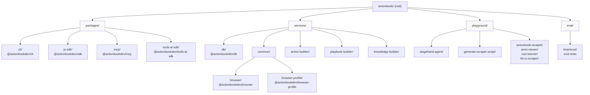
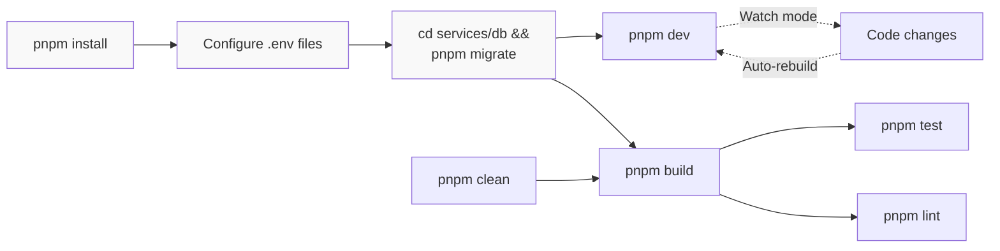

<!-- source: DeepWiki mcp.deepwiki.com · repo actionbook/actionbook · page 8 Development Guide · fetched 2026-10-27 -->

# Development Guide

<details>
<summary>Relevant source files</summary>

The following files were used as context for generating this wiki page:

- [.gitignore](.gitignore)
- [LICENSE](LICENSE)
- [README.md](README.md)
- [mcp-servers.json](mcp-servers.json)
- [package.json](package.json)
- [packages/cli/package.json](packages/cli/package.json)
- [packages/js-sdk/package.json](packages/js-sdk/package.json)
- [packages/mcp/package.json](packages/mcp/package.json)
- [pnpm-lock.yaml](pnpm-lock.yaml)
- [pnpm-workspace.yaml](pnpm-workspace.yaml)
- [services/action-builder/.nvmrc](services/action-builder/.nvmrc)
- [turbo.json](turbo.json)

</details>


This document provides an overview of the Actionbook development environment, workspace structure, and common development workflows. It is intended for contributors who want to modify or extend the Actionbook codebase.

For detailed information on specific topics, see:
- [Monorepo Structure](#8.1) - Workspace organization and package categories
- [Build System](#8.2) - Turborepo configuration and task definitions
- [Local Development Setup](#8.3) - Step-by-step environment setup
- [Testing](#8.4) - Testing strategies and running tests

## Prerequisites

The Actionbook monorepo requires the following tools:

| Tool | Minimum Version | Recommended | Purpose |
|------|----------------|-------------|---------|
| **Node.js** | 18.0.0 | 20+ | JavaScript runtime |
| **pnpm** | 10.0.0 | 10.24.0 | Package manager |
| **PostgreSQL** | 14+ | 16+ | Database (local or hosted) |
| **Git** | 2.0+ | Latest | Version control |

The project uses pnpm workspaces for monorepo management and Turborepo for build orchestration. The package manager is enforced via the `packageManager` field in [package.json:7]().

Sources: [README.md:706-709](), [package.json:7](), [services/action-builder/.nvmrc:1]()

## Workspace Organization

The monorepo is organized into multiple workspace categories defined in [pnpm-workspace.yaml:1-6](). The following diagram shows the physical directory structure:

### Monorepo Directory Structure



The workspace configuration includes:
- `packages/*` - Published npm packages (CLI, SDK, MCP)
- `services/*` and `services/*/*` - Backend services and shared libraries
- `playground/*` - Example projects and integrations
- `eval` - Evaluation and testing harness

Sources: [pnpm-workspace.yaml:1-6](), [README.md:703]()

## Development Workflow

The typical development workflow involves installing dependencies, making code changes, running tests, and building packages. The following diagram shows the relationship between common development commands:

### Development Task Flow



All workspace scripts defined in [package.json:8-14]() use Turborepo to coordinate task execution across packages. Turborepo handles dependency ordering, parallel execution, and caching as configured in [turbo.json:1-22]().

Sources: [package.json:8-14](), [turbo.json:1-22](), [README.md:712-735]()

## Quick Start

To begin development, follow these high-level steps (detailed instructions in [Local Development Setup](#8.3)):

**1. Clone the repository:**
```bash
git clone https://github.com/actionbook/actionbook.git
cd actionbook
```

**2. Install dependencies:**
```bash
pnpm install
```

This installs all dependencies for all workspace packages. The pnpm workspace protocol (`workspace:*`) is used for internal package references as seen in [packages/cli/package.json:27]() and [packages/mcp/package.json:32]().

**3. Configure environment variables:**

Copy `.env.example` to `.env` in the following packages:
- `services/db` - Database connection (required)
- `apps/api-service` - API server configuration (optional)
- `services/action-builder` - Recording service (optional)
- `services/knowledge-builder` - Crawling service (optional)

**4. Run database migrations:**
```bash
cd services/db
pnpm migrate
```

**5. Start development servers:**
```bash
# From root directory
pnpm dev
```

This starts all services in watch mode with automatic rebuilding on file changes.

Sources: [README.md:712-735](), [package.json:8-14]()

## Common Development Commands

The root package defines Turborepo tasks that orchestrate operations across the monorepo:

| Command | Description | Turbo Configuration |
|---------|-------------|---------------------|
| `pnpm install` | Install all workspace dependencies | N/A |
| `pnpm build` | Build all packages in dependency order | [turbo.json:4-7]() |
| `pnpm dev` | Start all services in watch mode | [turbo.json:8-11]() |
| `pnpm test` | Run tests across all packages | [turbo.json:12-14]() |
| `pnpm lint` | Lint all packages | [turbo.json:15-17]() |
| `pnpm clean` | Remove build artifacts | [turbo.json:18-20]() |

Individual packages can be targeted using pnpm's `--filter` flag:
```bash
pnpm --filter @actionbookdev/cli build
pnpm --filter @actionbookdev/sdk test
```

Sources: [package.json:8-14](), [turbo.json:1-22]()

## Package Dependencies

The following diagram shows the dependency relationships between published packages and internal services:

### Internal Package Dependency Graph

```mermaid
graph TB
    subgraph Published["Published Packages"]
        cli["@actionbookdev/cli"]
        mcp["@actionbookdev/mcp"]
        sdk["@actionbookdev/sdk"]
        toolsAI["@actionbookdev/tools-ai-sdk"]
    end
    
    subgraph Internal["Internal Packages"]
        db["@actionbookdev/db"]
        browser["@actionbookdev/browser"]
        browserProfile["@actionbookdev/browser-profile"]
    end
    
    subgraph Services["Services"]
        actionBuilder["services/action-builder"]
        playbookBuilder["services/playbook-builder"]
        knowledgeBuilder["services/knowledge-builder"]
    end
    
    subgraph External["External Dependencies"]
        playwright["playwright"]
        stagehand["@browserbasehq/stagehand"]
        drizzle["drizzle-orm"]
        vercelAI["ai & @ai-sdk/*"]
        agentBrowser["agent-browser"]
    end
    
    cli --> sdk
    cli --> agentBrowser
    mcp --> sdk
    toolsAI --> sdk
    
    actionBuilder --> browser
    actionBuilder --> browserProfile
    actionBuilder --> db
    actionBuilder --> mcp
    actionBuilder --> vercelAI
    
    playbookBuilder --> browser
    playbookBuilder --> browserProfile
    playbookBuilder --> db
    playbookBuilder --> vercelAI
    
    knowledgeBuilder --> browserProfile
    knowledgeBuilder --> db
    
    browser --> playwright
    browser --> stagehand
    browser --> browserProfile
    
    db --> drizzle
    
    style Published fill:#f9f9f9
    style Internal fill:#f9f9f9
    style Services fill:#f9f9f9
```



Key dependency patterns:

- **Published packages** depend only on `@actionbookdev/sdk` to maintain clean separation
- **Services** depend on internal packages (`db`, `browser`, `browser-profile`) for shared functionality
- **Internal packages** abstract external dependencies (Playwright, Stagehand, Drizzle)
- The `@actionbookdev/sdk` package has no internal dependencies, making it suitable for standalone use

The `workspace:*` protocol in package.json files (e.g., [packages/cli/package.json:27](), [packages/mcp/package.json:32]()) ensures workspace packages always use the local version during development.

Sources: [packages/cli/package.json:26-30](), [packages/mcp/package.json:31-36](), [services/action-builder/package.json:194-202]()

## Build Output and Artifacts

Build artifacts are generated according to TypeScript configurations and Turborepo output patterns:

| Package Type | Build Command | Output Directory | Configured In |
|--------------|---------------|------------------|---------------|
| Published packages | `tsc -p tsconfig.build.json` | `dist/` | [packages/cli/package.json:19]() |
| Services | `tsc` or `tsup` | `dist/` | Individual package.json |
| CLI binaries | `tsc` | `dist/index.js` | [packages/cli/package.json:10]() |

Build outputs are cached by Turborepo based on input file hashes. The cache configuration in [turbo.json:4-7]() specifies `dist/**` and `.next/**` as cacheable outputs. The `.turbo` directory (ignored via [.gitignore:61]()) stores task logs and cache metadata.

Common build artifacts that should not be committed:
- `dist/` - Compiled TypeScript output
- `node_modules/` - Dependencies
- `.turbo/` - Turborepo cache
- `*.tsbuildinfo` - TypeScript incremental build info

Sources: [turbo.json:4-7](), [.gitignore:1-75](), [packages/cli/package.json:19]()

## Environment Configuration

Services require environment variables configured in `.env` files. The repository includes `.env.example` files but not actual `.env` files (excluded via [.gitignore:26-32]()). Required configuration packages:

1. **services/db** (required)
   - Database connection string
   - Migration configuration

2. **services/action-builder** (optional)
   - LLM API keys (OpenRouter, OpenAI, Anthropic, Bedrock)
   - Browser automation settings
   - Proxy configuration

3. **services/knowledge-builder** (optional)
   - Embedding API keys
   - Crawling configuration

The development workflow requires database setup before other services can run, as shown in [README.md:726-729]().

Sources: [README.md:719-724](), [.gitignore:26-32]()

## Git Hooks

The repository uses custom git hooks via `.githooks/` directory (configured in [package.json:14]()):

```bash
git config core.hooksPath .githooks
```

This is automatically configured when running `pnpm install` via the `prepare` script. The hooks directory itself is excluded from version control via [.gitignore:66]().

Sources: [package.json:14](), [.gitignore:66]()

## Next Steps

- Review [Monorepo Structure](#8.1) for detailed workspace organization
- Follow [Local Development Setup](#8.3) for complete environment configuration
- See [Build System](#8.2) for Turborepo task configuration
- Consult [Testing](#8.4) for running and writing tests

For contribution guidelines, see the Contributing section in [README.md:737-741]().

Sources: [README.md:701-741]()

---

