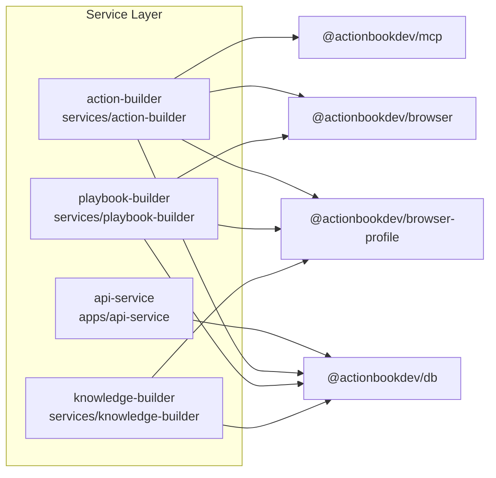

<!-- source: DeepWiki mcp.deepwiki.com · repo actionbook/actionbook · page 8.1 Monorepo Structure · fetched 2026-10-27 -->

# Monorepo Structure

<details>
<summary>Relevant source files</summary>

The following files were used as context for generating this wiki page:

- [.gitignore](.gitignore)
- [LICENSE](LICENSE)
- [mcp-servers.json](mcp-servers.json)
- [package.json](package.json)
- [packages/cli/package.json](packages/cli/package.json)
- [packages/js-sdk/package.json](packages/js-sdk/package.json)
- [packages/mcp/package.json](packages/mcp/package.json)
- [pnpm-lock.yaml](pnpm-lock.yaml)
- [pnpm-workspace.yaml](pnpm-workspace.yaml)
- [services/action-builder/.nvmrc](services/action-builder/.nvmrc)
- [turbo.json](turbo.json)

</details>


This document describes the organization of the Actionbook monorepo, including workspace configuration, package categories, dependency relationships, and directory structure. For information about the build system and task orchestration, see [Build System](#8.2). For local development setup instructions, see [Local Development Setup](#8.3).

## Workspace Organization

Actionbook uses a **pnpm workspace** monorepo managed by **Turborepo**. The workspace configuration defines six top-level package groups organized by purpose.

### Workspace Configuration

The workspace is defined in [pnpm-workspace.yaml:1-7]():

```yaml
packages:
  - packages/*
  - playground/*
  - eval
  - services/*
  - services/*/*
```

This configuration creates a flat workspace where all packages can reference each other using the `workspace:*` protocol. The root [package.json:1-24]() defines global scripts that delegate to Turborepo:

- `pnpm build` - Builds all packages in dependency order
- `pnpm dev` - Runs development mode for all packages
- `pnpm test` - Runs tests across the workspace
- `pnpm lint` - Lints all packages
- `pnpm clean` - Removes build artifacts

Sources: [pnpm-workspace.yaml:1-7](), [package.json:1-24](), [turbo.json:1-23]()

## Package Categories

The monorepo contains five distinct categories of packages, each serving a specific architectural role.

### Published Packages

Four packages are published to npm under the `@actionbookdev` scope and are intended for external consumption:

| Package | Version | Purpose | Entry Point |
|---------|---------|---------|-------------|
| `@actionbookdev/cli` | 0.2.3 | Command-line interface | `dist/index.js` |
| `@actionbookdev/sdk` | 0.2.2 | Core types and API client | `dist/index.js` |
| `@actionbookdev/mcp` | 0.1.3 | Model Context Protocol server | `dist/index.js` |
| `@actionbookdev/tools-ai-sdk` | (latest) | Vercel AI SDK integration | N/A |

All published packages have `"private": false` in their package.json and include `publishConfig.access: "public"` for npm registry publication.

**CLI Package** ([packages/cli/package.json:1-57]()):
- Binary: `actionbook` command installed to `node_modules/.bin/`
- Dependencies: `@actionbookdev/sdk`, `agent-browser`, `chalk`, `commander`
- Build: TypeScript compilation to `dist/`

**SDK Package** ([packages/js-sdk/package.json:1-41]()):
- Foundation package with **no internal dependencies**
- Core dependencies: `zod`, `zod-to-json-schema`
- Provides types, tool definitions, and API client
- Used by all other published packages

**MCP Package** ([packages/mcp/package.json:1-48]()):
- Binary: `actionbook-mcp` for IDE integration
- Dependencies: `@actionbookdev/sdk`, `@modelcontextprotocol/sdk`, `undici`
- Prebuild step: Ensures SDK is built first ([packages/mcp/package.json:24]())

**Tools AI SDK Package** ([pnpm-lock.yaml:127-150]()):
- Peer dependency on Vercel AI SDK (`ai`)
- Exports tool wrappers for LLM frameworks

Sources: [packages/cli/package.json:1-57](), [packages/js-sdk/package.json:1-41](), [packages/mcp/package.json:1-48](), [pnpm-lock.yaml:127-150]()

### Services

Four backend services implement the core platform functionality. These are **not published** to npm and run as standalone Node.js processes:



**API Service** (`apps/api-service`):
- REST API server for search and retrieval
- Dependencies: `@actionbookdev/db` only
- Exposes endpoints at `/actions/search`, `/actions/:id`, `/sources`

**Action Builder** (`services/action-builder`):
- Recording service that discovers UI capabilities
- Dependencies: `@actionbookdev/browser`, `@actionbookdev/browser-profile`, `@actionbookdev/db`, `@actionbookdev/mcp`
- External: `@browserbasehq/stagehand`, `playwright`, AI SDK packages
- Referenced in [pnpm-lock.yaml:192-269]()

**Playbook Builder** (`services/playbook-builder`):
- Documentation generation service
- Dependencies: `@actionbookdev/browser`, `@actionbookdev/browser-profile`, `@actionbookdev/db`
- External: Stagehand (older v1.14.0), Playwright, AI providers
- Referenced in [pnpm-lock.yaml:414-476]()

**Knowledge Builder** (`services/knowledge-builder`):
- Web crawling and content extraction service
- Dependencies: `@actionbookdev/browser-profile`, `@actionbookdev/db`
- External: `playwright`, `@mozilla/readability`, `cheerio`, `turndown`, `openai`
- Referenced in [pnpm-lock.yaml:354-410]()

Sources: [pnpm-lock.yaml:192-269](), [pnpm-lock.yaml:414-476](), [pnpm-lock.yaml:354-410]()

### Common Packages

Three internal packages provide shared infrastructure. These are referenced using `workspace:*` and are **not published**:

**@actionbookdev/browser** (`services/common/browser`):
- Defines `BrowserAdapter` interface
- Implements `StagehandBrowser` and `AgentCoreBrowser`
- Dependencies: `@actionbookdev/browser-profile`, Stagehand, Playwright, AWS Bedrock SDK
- Peer dependencies on Stagehand (>=1.0.0) and Playwright (>=1.40.0)
- Referenced in [pnpm-lock.yaml:271-306]()

**@actionbookdev/browser-profile** (`services/common/browser-profile`):
- Manages persistent browser profiles for login state
- Implements `BrowserProfileManager` class
- No external dependencies beyond TypeScript and build tools
- Referenced in [pnpm-lock.yaml:308-318]()

**@actionbookdev/db** (`services/db`):
- Database access layer using Drizzle ORM
- Core dependencies: `drizzle-orm`, `pg`, `@neondatabase/serverless`, `dotenv`
- Provides `getDb()` singleton and schema definitions
- Development: `drizzle-kit` for migrations
- Referenced in [pnpm-lock.yaml:320-352]()

Sources: [pnpm-lock.yaml:271-306](), [pnpm-lock.yaml:308-318](), [pnpm-lock.yaml:320-352]()

### Playground and Evaluation

Two additional workspace categories support experimentation and testing:

**Playground** (`playground/*`):
- Contains experimental and example projects
- `playground/stagehand-agent`: Example Stagehand integration with Actionbook SDK
- `playground/lib-rs-scraper`: Rust library scraper example
- Not part of core build pipeline
- Referenced in [pnpm-lock.yaml:152-191]()

**Evaluation** (`eval`):
- End-to-end testing and evaluation scripts
- Dependencies: `@actionbookdev/action-builder`, `braintrust`, `playwright`, `yaml`, `zod`
- Used for quality assurance and regression testing
- Referenced in [pnpm-lock.yaml:18-44]()

Sources: [pnpm-lock.yaml:152-191](), [pnpm-lock.yaml:18-44]()

## Dependency Graph

The following diagram shows the complete dependency relationships between internal packages. Note that `@actionbookdev/sdk` is the only published package with **no internal dependencies**, making it suitable for standalone use:

```mermaid
graph TB
    subgraph "Published Packages"
        CLI["@actionbookdev/cli"]
        SDK["@actionbookdev/sdk"]
        MCP["@actionbookdev/mcp"]
        ToolsAI["@actionbookdev/tools-ai-sdk"]
    end
    
    subgraph "Services"
        APIService["api-service"]
        ActionBuilder["action-builder"]
        PlaybookBuilder["playbook-builder"]
        KnowledgeBuilder["knowledge-builder"]
    end
    
    subgraph "Common Packages"
        Browser["@actionbookdev/browser"]
        BrowserProfile["@actionbookdev/browser-profile"]
        DB["@actionbookdev/db"]
    end
    
    subgraph "External Dependencies"
        Playwright["playwright"]
        Stagehand["@browserbasehq/stagehand"]
        DrizzleORM["drizzle-orm"]
        NeonDB["@neondatabase/serverless"]
        AISDK["ai & @ai-sdk/*"]
        AgentBrowser["agent-browser"]
    end
    
    CLI --> SDK
    CLI --> AgentBrowser
    MCP --> SDK
    ToolsAI --> SDK
    
    ActionBuilder --> Browser
    ActionBuilder --> BrowserProfile
    ActionBuilder --> DB
    ActionBuilder --> MCP
    ActionBuilder --> AISDK
    
    PlaybookBuilder --> Browser
    PlaybookBuilder --> BrowserProfile
    PlaybookBuilder --> DB
    PlaybookBuilder --> AISDK
    
    KnowledgeBuilder --> BrowserProfile
    KnowledgeBuilder --> DB
    
    APIService --> DB
    
    Browser --> BrowserProfile
    Browser --> Playwright
    Browser --> Stagehand
    
    DB --> DrizzleORM
    DB --> NeonDB
```



**Key Dependency Patterns:**

1. **SDK Independence**: `@actionbookdev/sdk` has zero workspace dependencies, only external `zod` and `zod-to-json-schema`
2. **Browser Isolation**: All browser automation flows through `@actionbookdev/browser` package
3. **Database Centralization**: All services access PostgreSQL through `@actionbookdev/db`
4. **Profile Sharing**: `@actionbookdev/browser-profile` is used by all services that need browser state persistence

Sources: [packages/cli/package.json:26-30](), [packages/js-sdk/package.json:27-29](), [packages/mcp/package.json:31-36](), [pnpm-lock.yaml:192-476]()

## File System Layout

The repository follows a structured layout optimized for logical grouping and build tooling:

```
actionbook/
├── packages/               # Published npm packages
│   ├── cli/               # @actionbookdev/cli
│   ├── js-sdk/            # @actionbookdev/sdk
│   ├── mcp/               # @actionbookdev/mcp
│   └── tools-ai-sdk/      # @actionbookdev/tools-ai-sdk
│
├── services/              # Backend services
│   ├── action-builder/    # Recording service
│   ├── playbook-builder/  # Documentation service
│   ├── knowledge-builder/ # Crawling service
│   ├── common/            # Shared packages
│   │   ├── browser/       # @actionbookdev/browser
│   │   └── browser-profile/ # @actionbookdev/browser-profile
│   └── db/                # @actionbookdev/db
│
├── apps/                  # Application services (not in workspace config)
│   └── api-service/       # REST API server
│
├── playground/            # Experimental projects
│   ├── stagehand-agent/   # Example integration
│   └── lib-rs-scraper/    # Rust scraper example
│
├── eval/                  # Evaluation and testing
│
├── output/                # Generated YAML files (gitignored)
│
├── .browser-profile/      # Persistent browser state (gitignored)
│
├── pnpm-workspace.yaml    # Workspace configuration
├── package.json           # Root package with global scripts
├── turbo.json             # Turborepo configuration
├── pnpm-lock.yaml         # Dependency lockfile
└── LICENSE                # Apache-2.0 license
```

**Important Directories:**

- **`packages/`**: User-facing packages published to npm. Each has `"private": false` and version numbers.
- **`services/`**: Backend services and shared infrastructure. Not published to npm.
- **`services/common/`**: Shared packages used by multiple services but not published externally.
- **`output/`**: Generated during builds, contains YAML action manuals ([.gitignore:68]())
- **`.browser-profile/`**: Contains Chromium user data directories with cookies and session state ([.gitignore:74]())

**Build Artifacts:**

Each TypeScript package builds to a `dist/` directory ([.gitignore:6]()), which is gitignored but included in npm packages via the `files` field in package.json. Build artifacts are coordinated by Turborepo caching ([turbo.json:4-7]()).

Sources: [pnpm-workspace.yaml:1-7](), [.gitignore:1-75](), [turbo.json:1-23]()

## Package Manager Configuration

The repository uses **pnpm 10.24.0** as specified in [package.json:7]() via the `packageManager` field. This enforces consistent dependency resolution across all contributors.

**pnpm Features Used:**

1. **Workspace Protocol**: Packages reference each other using `workspace:*` (e.g., [packages/cli/package.json:27]())
2. **Dependency Overrides**: Forces `@neondatabase/serverless` to `^0.10.4` ([package.json:20-22](), [pnpm-lock.yaml:7-8]())
3. **Nested Workspaces**: `services/*/*` pattern allows for `services/common/*` packages ([pnpm-workspace.yaml:6]())
4. **Peer Dependency Auto-install**: Enabled via [pnpm-lock.yaml:4]()

**Version Resolution:**

The lockfile ([pnpm-lock.yaml:1]()) uses lockfileVersion 9.0, which provides improved resolution and security. All workspace packages are linked using `link:` protocol in the lockfile, ensuring changes are immediately visible across packages during development.

Sources: [package.json:7](), [package.json:19-23](), [pnpm-lock.yaml:1-8](), [pnpm-workspace.yaml:1-7]()

## Development Workflow

The monorepo structure supports several development workflows:

**Building Individual Packages:**
```bash
# Build only the SDK
pnpm --filter @actionbookdev/sdk build

# Build SDK and all packages that depend on it
pnpm --filter @actionbookdev/sdk... build
```

**Running Services:**
```bash
# Run action-builder service
cd services/action-builder
pnpm dev
```

**Adding Dependencies:**
```bash
# Add to specific package
pnpm --filter @actionbookdev/cli add commander

# Add to workspace root
pnpm add -w turbo
```

**Turborepo Integration:**

The [turbo.json:1-23]() configuration defines task dependencies:
- `build` tasks run in topological order based on `dependsOn: ["^build"]`
- `dev` tasks run concurrently with caching disabled
- `test` and `lint` depend on upstream builds completing first

This ensures that changes to `@actionbookdev/sdk` trigger rebuilds of `@actionbookdev/cli`, `@actionbookdev/mcp`, and all services that depend on shared packages.

Sources: [turbo.json:1-23](), [packages/mcp/package.json:24]()

---

