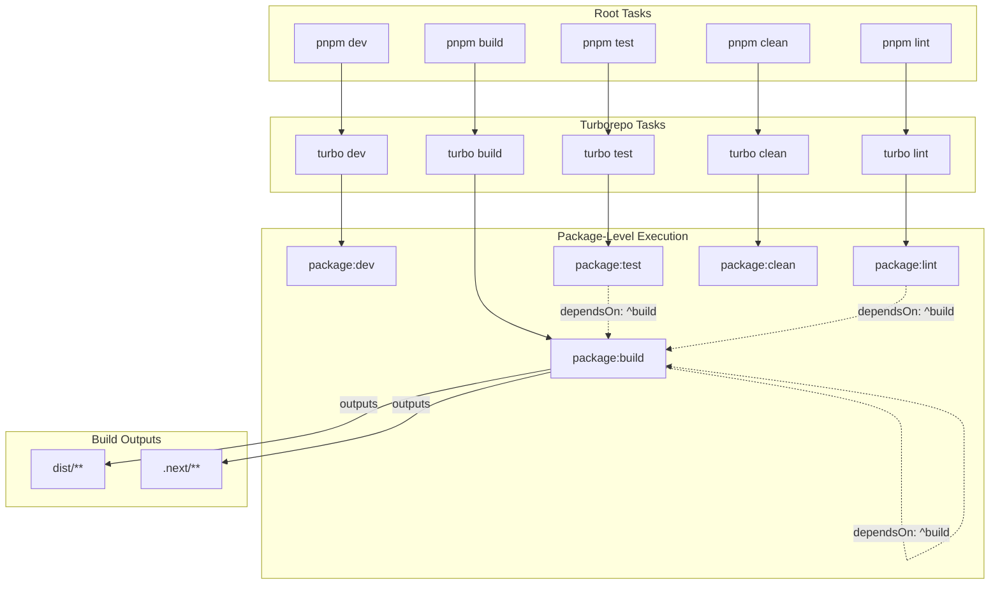
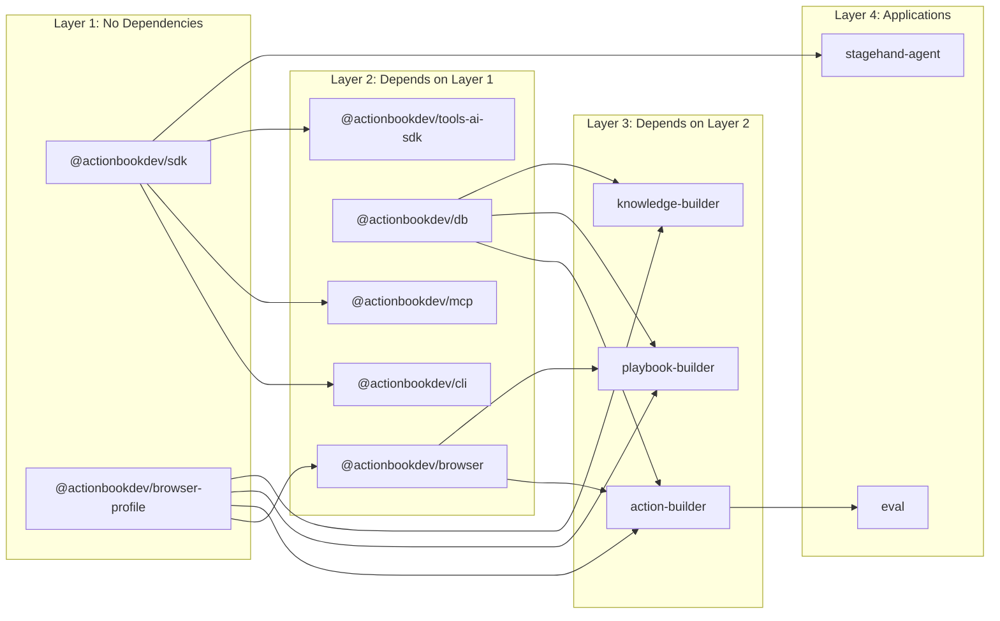
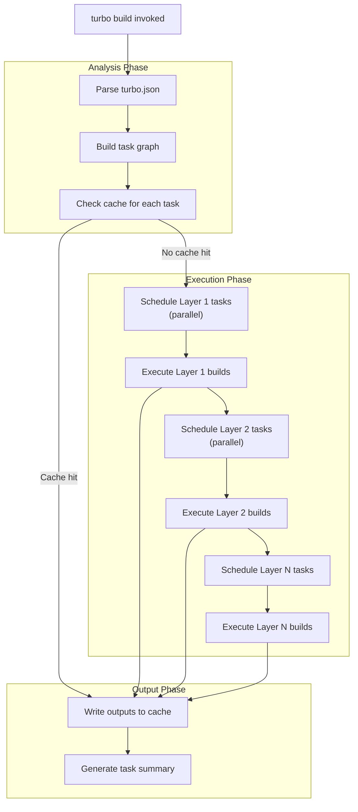

<!-- source: DeepWiki mcp.deepwiki.com · repo actionbook/actionbook · page 8.2 Build System · fetched 2026-10-27 -->

# Build System

<details>
<summary>Relevant source files</summary>

The following files were used as context for generating this wiki page:

- [.gitignore](.gitignore)
- [mcp-servers.json](mcp-servers.json)
- [package.json](package.json)
- [pnpm-lock.yaml](pnpm-lock.yaml)
- [pnpm-workspace.yaml](pnpm-workspace.yaml)
- [services/action-builder/.nvmrc](services/action-builder/.nvmrc)
- [turbo.json](turbo.json)

</details>


## Purpose and Scope

This document describes the build orchestration system used in the Actionbook monorepo. It covers the Turborepo configuration, task definitions, dependency management, caching strategy, and execution model for building, testing, and developing across multiple packages and services.

For information about the monorepo structure itself (package organization and dependencies), see [Monorepo Structure](#8.1). For local development setup procedures, see [Local Development Setup](#8.3).

**Sources:** [package.json:1-24](), [turbo.json:1-22](), [pnpm-workspace.yaml:1-7]()

## Overview

The Actionbook monorepo uses **Turborepo** as its build orchestration tool, combined with **pnpm workspaces** for package management. Turborepo provides intelligent task scheduling, caching, and parallel execution across all packages in the workspace.

The build system manages compilation, development servers, testing, and linting for:
- 4 published npm packages (`@actionbookdev/cli`, `@actionbookdev/sdk`, `@actionbookdev/mcp`, `@actionbookdev/tools-ai-sdk`)
- 3 internal packages (`@actionbookdev/browser`, `@actionbookdev/browser-profile`, `@actionbookdev/db`)
- 4 backend services (`api-service`, `action-builder`, `playbook-builder`, `knowledge-builder`)
- 2 playground projects
- 1 evaluation project

**Sources:** [package.json:1-24](), [pnpm-workspace.yaml:1-7]()

## Turborepo Configuration

### Task Dependency Graph



**Diagram: Task dependency and execution flow in Turborepo**

The `^build` syntax in Turborepo means "wait for all dependencies to finish their `build` task before starting". This ensures packages are built in topological order.

**Sources:** [turbo.json:1-22](), [package.json:8-14]()

### Task Definitions

The Turborepo configuration in `turbo.json` defines five core tasks:

| Task | Cache | Persistent | Dependencies | Outputs |
|------|-------|------------|--------------|---------|
| `build` | ✅ | ❌ | `^build` | `dist/**`, `.next/**` |
| `dev` | ❌ | ✅ | none | none |
| `test` | ✅ | ❌ | `^build` | none |
| `lint` | ✅ | ❌ | `^build` | none |
| `clean` | ❌ | ❌ | none | none |

**Key properties:**

- **`dependsOn: ["^build"]`**: The `^` prefix indicates a topological dependency. When running `test`, `lint`, or `build`, Turborepo first builds all upstream dependencies.
- **`cache: false`**: Disables caching for `dev` and `clean` tasks since they have side effects or are inherently non-cacheable.
- **`persistent: true`**: Marks `dev` as a long-running process that shouldn't block other tasks.
- **`outputs`**: Defines which directories contain build artifacts for caching.

**Sources:** [turbo.json:3-21]()

## Workspace Organization

### Workspace Package Mapping

```mermaid
graph TB
    subgraph "Workspace Globs"
        PackagesGlob["packages/*"]
        PlaygroundGlob["playground/*"]
        EvalGlob["eval"]
        ServicesGlob1["services/*"]
        ServicesGlob2["services/*/*"]
    end
    
    subgraph "Published Packages"
        CLI["packages/cli"]
        SDK["packages/js-sdk"]
        MCP["packages/mcp"]
        ToolsAI["packages/tools-ai-sdk"]
    end
    
    subgraph "Internal Common Packages"
        Browser["services/common/browser"]
        BrowserProfile["services/common/browser-profile"]
        DB["services/db"]
    end
    
    subgraph "Backend Services"
        ActionBuilder["services/action-builder"]
        PlaybookBuilder["services/playbook-builder"]
        KnowledgeBuilder["services/knowledge-builder"]
    end
    
    subgraph "Development & Testing"
        Eval["eval"]
        StagehandAgent["playground/stagehand-agent"]
        LibRsScraper["playground/lib-rs-scraper"]
    end
    
    PackagesGlob --> CLI
    PackagesGlob --> SDK
    PackagesGlob --> MCP
    PackagesGlob --> ToolsAI
    
    ServicesGlob2 --> Browser
    ServicesGlob2 --> BrowserProfile
    ServicesGlob1 --> DB
    ServicesGlob1 --> ActionBuilder
    ServicesGlob1 --> PlaybookBuilder
    ServicesGlob1 --> KnowledgeBuilder
    
    PlaygroundGlob --> StagehandAgent
    PlaygroundGlob --> LibRsScraper
    EvalGlob --> Eval
```



**Diagram: pnpm workspace structure and package resolution**

The workspace configuration uses glob patterns to include packages at multiple directory levels. The `services/*/*` pattern specifically captures nested packages like `services/common/browser`.

**Sources:** [pnpm-workspace.yaml:1-7]()

## Build Task Execution

### Topological Build Order



**Diagram: Package dependency graph determining build order**

When running `pnpm build`, Turborepo analyzes this dependency graph and builds packages in topological order. Packages in the same layer can be built in parallel. The `^build` dependency in [turbo.json:5]() enforces this ordering.

**Sources:** [pnpm-lock.yaml:10-477]()

### Task Execution Lifecycle



**Diagram: Turborepo task execution lifecycle**

**Sources:** [turbo.json:1-22]()

## Caching Strategy

### Cache Behavior by Task

Turborepo caches task outputs based on:
1. **Task inputs**: Source files, dependencies, environment variables
2. **Task definition**: The task name and configuration
3. **Dependency outputs**: Results from upstream `^build` tasks

The caching behavior is configured per task:

**Cached Tasks (default):**
- `build`: Caches `dist/**` and `.next/**` directories
- `test`: Caches test results and coverage reports
- `lint`: Caches linting results

**Non-cached Tasks:**
- `dev`: Runs development servers with live reload ([turbo.json:9]())
- `clean`: Removes build artifacts ([turbo.json:18]())

### Cache Location

Turborepo stores its cache in the `.turbo` directory at the repository root. This directory is excluded from version control via [.gitignore:61]().

**Sources:** [turbo.json:4-21](), [.gitignore:60-61]()

## Package Manager Integration

### pnpm Configuration

The monorepo uses **pnpm 10.24.0** as specified in [package.json:7]():

```
"packageManager": "pnpm@10.24.0"
```

This ensures consistent behavior across development environments. The pnpm version is enforced when running any pnpm command.

### Dependency Overrides

Global dependency overrides are configured in [package.json:19-23]():

```json
"pnpm": {
  "overrides": {
    "@neondatabase/serverless": "^0.10.4"
  }
}
```

This ensures all packages in the workspace use the specified version of `@neondatabase/serverless`, regardless of what version individual packages request.

**Sources:** [package.json:7](), [package.json:19-23]()

## Running Tasks

### Root-Level Commands

All build system commands are executed from the repository root:

| Command | Purpose | Turbo Task |
|---------|---------|------------|
| `pnpm build` | Build all packages | `turbo build` |
| `pnpm dev` | Start development servers | `turbo dev` |
| `pnpm test` | Run all tests | `turbo test` |
| `pnpm lint` | Lint all packages | `turbo lint` |
| `pnpm clean` | Clean build artifacts | `turbo clean` |

These commands are defined as npm scripts in [package.json:8-14]() and delegate to Turborepo.

### Scoped Execution

To run tasks for specific packages:

```bash
# Build only the CLI package
pnpm --filter @actionbookdev/cli build

# Run tests for action-builder service
pnpm --filter action-builder test

# Start dev server for a single package
pnpm --filter @actionbookdev/sdk dev
```

The `--filter` flag uses pnpm's workspace filtering to select packages by name or pattern.

### Parallel Execution

Turborepo automatically parallelizes tasks that don't depend on each other. For example, when running `pnpm build`:

1. **Layer 1** (parallel): `@actionbookdev/sdk`, `@actionbookdev/browser-profile` build simultaneously
2. **Layer 2** (parallel): Once Layer 1 completes, `@actionbookdev/browser`, `@actionbookdev/db`, `@actionbookdev/cli`, `@actionbookdev/mcp` build in parallel
3. **Layer 3** (parallel): Services build after their dependencies are ready

This significantly reduces total build time compared to sequential execution.

**Sources:** [package.json:8-14](), [turbo.json:1-22]()

## Build Outputs

### Output Directory Structure

Build artifacts are generated in package-specific directories:

```
packages/cli/dist/              # CLI compiled output
packages/js-sdk/dist/           # SDK compiled output
packages/mcp/dist/              # MCP server compiled output
services/action-builder/dist/   # Action builder compiled output
services/db/dist/               # Database package compiled output
```

These directories are:
- Excluded from version control ([.gitignore:6-9]())
- Specified as Turborepo outputs ([turbo.json:6]())
- Included in npm packages for publication

### TypeScript Build Info

TypeScript generates `.tsbuildinfo` files for incremental compilation. These are excluded from version control ([.gitignore:35]()) but used by both TypeScript and Turborepo to optimize rebuilds.

**Sources:** [turbo.json:6](), [.gitignore:6-9](), [.gitignore:35]()

## Package-Specific Build Tools

### Build Tool by Package Type

Different packages use different build tools based on their requirements:

| Package Type | Build Tool | Config File |
|--------------|-----------|-------------|
| Published packages (CLI, SDK, MCP) | `tsc` (TypeScript) | `tsconfig.json` |
| Internal packages (browser, db) | `tsup` | `tsup.config.ts` |
| Services (action-builder, playbook-builder) | `tsup` | `tsup.config.ts` |

**tsup** is used for internal packages and services because it provides:
- Fast esbuild-based compilation
- Automatic CJS/ESM dual output
- Minimal configuration

The published packages use raw `tsc` to maintain full control over type definitions and build output structure.

**Sources:** [pnpm-lock.yaml:298-306](), [pnpm-lock.yaml:344-346]()

## Development Mode

### Persistent Development Tasks

The `dev` task is configured with `persistent: true` in [turbo.json:10](). This means:

1. Development servers run continuously
2. They don't block other tasks from starting
3. Multiple `dev` tasks can run simultaneously
4. Hot reload and file watching work as expected

When running `pnpm dev`, Turborepo starts all development servers in parallel without waiting for them to complete, allowing developers to work on multiple packages simultaneously.

### No Caching for Development

Development tasks have `cache: false` ([turbo.json:9]()) because:
- Dev servers have side effects (ports, file watching)
- Live reload requires reading from the actual file system
- Caching would prevent detecting file changes

**Sources:** [turbo.json:8-11]()

## Git Hooks Integration

The build system integrates with Git hooks via [package.json:14]():

```json
"prepare": "git config core.hooksPath .githooks"
```

This script runs after `pnpm install` and configures Git to use hooks from the `.githooks` directory. These hooks can run build system tasks (like linting) on commit or push.

**Sources:** [package.json:14]()

---

