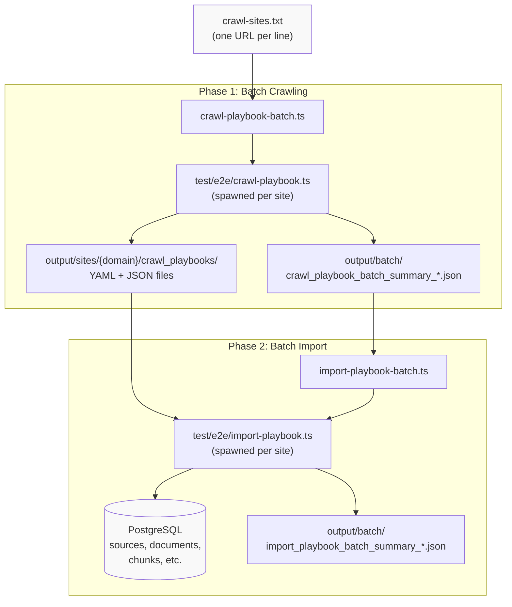
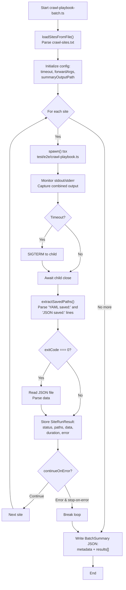
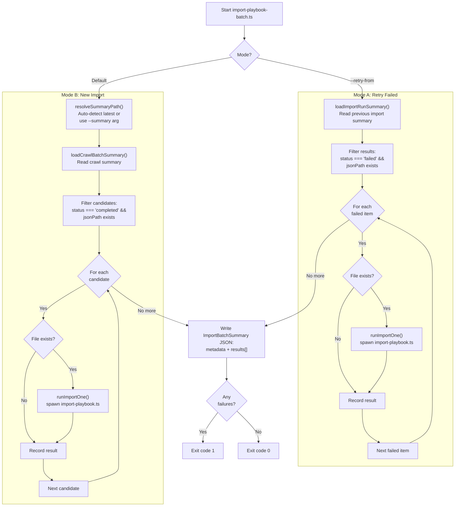
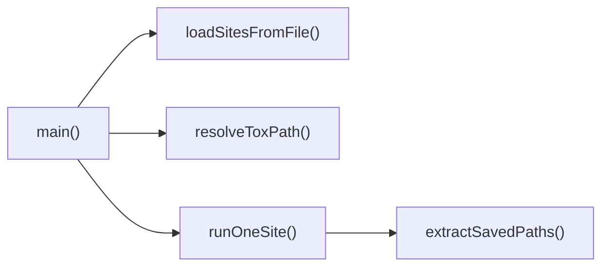
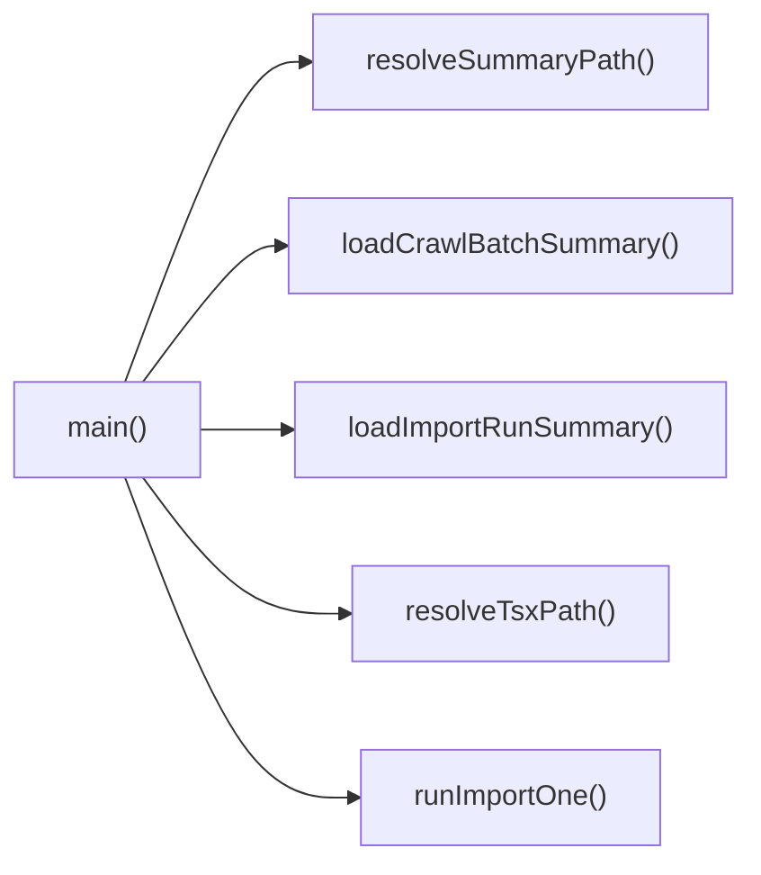
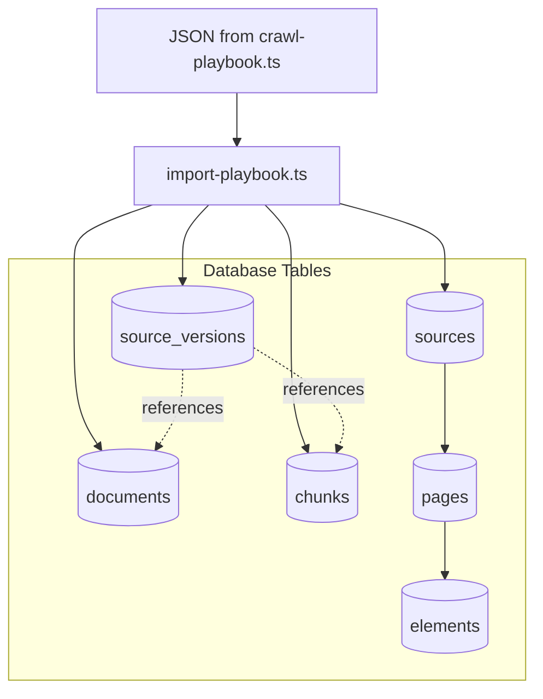

<!-- source: DeepWiki mcp.deepwiki.com · repo actionbook/actionbook · extra page Batch Crawling and Import · fetched 2026-10-27 -->

# Batch Crawling and Import

<details>
<summary>Relevant source files</summary>

The following files were used as context for generating this wiki page:

- [services/action-builder/.env.example](services/action-builder/.env.example)
- [services/action-builder/.gitignore](services/action-builder/.gitignore)
- [services/action-builder/README.md](services/action-builder/README.md)
- [services/action-builder/package.json](services/action-builder/package.json)
- [services/action-builder/scripts/coordinator.ts](services/action-builder/scripts/coordinator.ts)
- [services/action-builder/scripts/crawl-playbook-batch.ts](services/action-builder/scripts/crawl-playbook-batch.ts)
- [services/action-builder/scripts/crawl-sites.txt.example](services/action-builder/scripts/crawl-sites.txt.example)
- [services/action-builder/scripts/import-playbook-batch.ts](services/action-builder/scripts/import-playbook-batch.ts)
- [services/action-builder/src/llm/AIClient.ts](services/action-builder/src/llm/AIClient.ts)
- [services/action-builder/src/utils/logger.ts](services/action-builder/src/utils/logger.ts)
- [services/action-builder/vitest.setup.ts](services/action-builder/vitest.setup.ts)
- [services/db/migrations/meta/0018_snapshot.json](services/db/migrations/meta/0018_snapshot.json)

</details>


This page documents the batch crawling and import scripts for processing multiple websites sequentially. These utilities provide an alternative to the coordinator-based build pipeline for bulk operations on external sites.

For the coordinator-based task queue architecture that processes build tasks with parallel recording, see [3.2.1](#3.2.1). For action recording using LLM-driven browser automation, see [3.2.2](#3.2.2).

## Overview

The batch crawling system provides two sequential operations:

1. **Batch Crawling**: Crawls multiple websites in sequence using the playbook builder, generating JSON/YAML documentation for each site
2. **Batch Import**: Reads crawl results and imports them into the database, creating source records and associated data

This approach is useful for:
- Initial bulk ingestion of multiple websites
- Offline crawling operations that are later imported
- Testing and evaluation across multiple sites
- Separating crawl and import phases for resource management



**Sources**: [services/action-builder/scripts/crawl-playbook-batch.ts:1-360](), [services/action-builder/scripts/import-playbook-batch.ts:1-434]()

## Batch Crawling Workflow

### Configuration

Sites to crawl are listed in `scripts/crawl-sites.txt`, one URL per line:

```txt
# Crawl Sites Configuration
# Lines starting with # are comments
# Empty lines are ignored

www.example.com
www.anothersite.com
```

This file is gitignored by default. Copy from `scripts/crawl-sites.txt.example` to create it.

**Sources**: [services/action-builder/scripts/crawl-sites.txt.example:1-7](), [services/action-builder/.gitignore:41-42]()

### Execution Flow



**Sources**: [services/action-builder/scripts/crawl-playbook-batch.ts:225-359]()

### Command-Line Usage

```bash
# Basic usage (uses default timeout of 60 minutes per site)
pnpm crawl:batch

# Custom timeout per site
pnpm crawl:batch -- --site-timeout-minutes 30

# Forward args to crawl-playbook.ts
pnpm crawl:batch -- --max-pages 10 --max-depth 2 --concurrency 5

# Custom output directory and summary file
pnpm crawl:batch -- --output ./custom-output --summary-output ./results.json

# Stop on first error (default: continue on error)
pnpm crawl:batch -- --stop-on-error
```

**Command-line arguments:**

| Argument | Type | Default | Description |
|----------|------|---------|-------------|
| `--site-timeout-minutes` | number | `60` | Per-site execution timeout |
| `--summary-output` | string | `output/batch/crawl_playbook_batch_summary_{timestamp}.json` | Path for batch summary JSON |
| `--stop-on-error` | flag | `false` | Stop on first site failure |
| `--output` | string | `./output` | Output directory (forwarded to crawl-playbook) |
| `--max-pages` | number | - | Max pages to crawl (forwarded) |
| `--max-depth` | number | - | Max crawl depth (forwarded) |
| `--concurrency` | number | - | Concurrent crawl operations (forwarded) |
| `--timeout` | number | - | Navigation timeout (forwarded) |
| `--html-limit` | number | - | HTML character limit (forwarded) |

**Sources**: [services/action-builder/scripts/crawl-playbook-batch.ts:225-266](), [services/action-builder/package.json:21-22]()

### Output Formats

#### Per-Site Output

Each crawl produces two files in `output/sites/{domain}/crawl_playbooks/`:

```
output/
└── sites/
    └── www.example.com/
        └── crawl_playbooks/
            ├── playbook_20260108_153000.yaml
            └── playbook_20260108_153000.json
```

**Sources**: [services/action-builder/scripts/crawl-playbook-batch.ts:103-113]()

#### Batch Summary JSON

```typescript
type BatchSummary = {
  metadata: {
    createdAt: string;          // ISO timestamp
    total: number;              // Total sites processed
    completed: number;          // Successfully completed
    failed: number;             // Failed sites
    timeout: number;            // Timed out sites
    batchArgs: string[];        // Command-line arguments
  };
  results: SiteRunResult[];
};

type SiteRunResult = {
  url: string;                  // Site URL
  status: 'completed' | 'failed' | 'timeout';
  startedAt: string;            // ISO timestamp
  finishedAt: string;           // ISO timestamp
  durationMs: number;           // Execution time
  exitCode: number | null;      // Child process exit code
  signal: NodeJS.Signals | null;
  yamlPath?: string;            // Absolute path to YAML output
  jsonPath?: string;            // Absolute path to JSON output
  error?: string;               // Error message (if failed/timeout)
  data?: unknown;               // Parsed JSON data (if completed)
};
```

**Sources**: [services/action-builder/scripts/crawl-playbook-batch.ts:22-48]()

## Batch Import Workflow

### Execution Flow



**Sources**: [services/action-builder/scripts/import-playbook-batch.ts:223-428]()

### Command-Line Usage

```bash
# Import from latest crawl summary (auto-detected)
pnpm import:batch

# Import from specific crawl summary
pnpm import:batch -- --summary output/batch/crawl_playbook_batch_summary_xxx.json

# Dry run (validate without importing)
pnpm import:batch -- --dry-run

# Stop on first import failure
pnpm import:batch -- --stop-on-error

# Retry failed imports from previous run
pnpm import:batch -- --retry-from output/batch/import_playbook_batch_summary_xxx.json
```

**Command-line arguments:**

| Argument | Type | Default | Description |
|----------|------|---------|-------------|
| `--summary` | string | Latest in `output/batch/` | Path to crawl batch summary JSON |
| `--retry-from` | string | - | Path to previous import summary (retry mode) |
| `--dry-run` | flag | `false` | Validate without executing imports |
| `--stop-on-error` | flag | `false` | Stop on first import failure |

**Sources**: [services/action-builder/scripts/import-playbook-batch.ts:223-230](), [services/action-builder/package.json:22]()

### Auto-Detection Logic

When `--summary` is not specified, the system auto-detects the latest crawl summary:

```typescript
// Path resolution logic
function resolveSummaryPath(actionBuilderRoot: string, summaryArg?: string): string {
  if (summaryArg) {
    return path.isAbsolute(summaryArg) ? summaryArg : path.resolve(actionBuilderRoot, summaryArg);
  }

  const batchDir = path.resolve(actionBuilderRoot, 'output', 'batch');
  const files = fs.readdirSync(batchDir)
    .filter((f) => f.startsWith('crawl_playbook_batch_summary_') && f.endsWith('.json'))
    .map((f) => path.join(batchDir, f));

  // Sort by modification time (newest first)
  files.sort((a, b) => fs.statSync(b).mtimeMs - fs.statSync(a).mtimeMs);
  
  return files[0]; // Return most recent
}
```

**Sources**: [services/action-builder/scripts/import-playbook-batch.ts:101-128]()

### Retry Failed Imports

When imports fail, use `--retry-from` to retry only the failed entries:

```bash
# Initial import (some fail)
pnpm import:batch
# Output: import_playbook_batch_summary_20260108153000.json
#   - imported: 45
#   - failed: 5

# Retry only the 5 failed entries
pnpm import:batch -- --retry-from output/batch/import_playbook_batch_summary_20260108153000.json
```

The retry mode:
1. Loads the previous import summary
2. Filters for `status === 'failed'` entries with `jsonPath`
3. Re-executes only those imports
4. Generates a new summary with retry results

**Sources**: [services/action-builder/scripts/import-playbook-batch.ts:243-326]()

### Output Format

#### Import Batch Summary JSON

```typescript
type ImportBatchSummary = {
  metadata: {
    createdAt: string;          // ISO timestamp
    sourceSummaryPath: string;  // Path to source crawl summary
    totalCandidates: number;    // Total items eligible for import
    imported: number;           // Successfully imported
    failed: number;             // Failed imports
    skipped: number;            // Skipped (not completed/no path)
    args: string[];             // Command-line arguments
  };
  results: ImportItemResult[];
};

type ImportItemResult = {
  url: string;                  // Site URL
  status: 'imported' | 'failed' | 'skipped';
  jsonPath?: string;            // Path to input JSON
  exitCode: number | null;      // Child process exit code
  signal: NodeJS.Signals | null;
  startedAt: string;            // ISO timestamp
  finishedAt: string;           // ISO timestamp
  durationMs: number;           // Execution time
  error?: string;               // Error message (if failed)
};
```

**Sources**: [services/action-builder/scripts/import-playbook-batch.ts:54-66]()

## Script Architecture

### Key Functions

#### Crawl Batch Functions



| Function | Purpose | Location |
|----------|---------|----------|
| `loadSitesFromFile()` | Parse `crawl-sites.txt`, filter comments/empty lines | [crawl-playbook-batch.ts:54-66]() |
| `resolveToxPath()` | Locate local `tsx` binary or fallback to PATH | [crawl-playbook-batch.ts:95-101]() |
| `runOneSite()` | Spawn child process for single site, capture output | [crawl-playbook-batch.ts:115-223]() |
| `extractSavedPaths()` | Parse stdout for "YAML saved:" and "JSON saved:" lines | [crawl-playbook-batch.ts:103-113]() |

**Sources**: [services/action-builder/scripts/crawl-playbook-batch.ts:54-223]()

#### Import Batch Functions



| Function | Purpose | Location |
|----------|---------|----------|
| `resolveSummaryPath()` | Auto-detect latest crawl summary or use `--summary` arg | [import-playbook-batch.ts:101-128]() |
| `loadCrawlBatchSummary()` | Parse crawl batch summary JSON, validate structure | [import-playbook-batch.ts:130-137]() |
| `loadImportRunSummary()` | Parse import summary JSON for retry mode | [import-playbook-batch.ts:152-159]() |
| `runImportOne()` | Spawn import-playbook.ts for single entry | [import-playbook-batch.ts:161-221]() |

**Sources**: [services/action-builder/scripts/import-playbook-batch.ts:101-221]()

## Integration with Database

### Data Flow Diagram



The `import-playbook.ts` script (spawned by `import-playbook-batch.ts`) performs the following database operations:

1. Creates or updates `sources` record with base URL and metadata
2. Creates new `source_versions` record (version management)
3. Imports `documents` (crawled pages) with `source_version_id` foreign key
4. Imports `chunks` (content segments) with embeddings
5. Creates `pages` records for discovered page types
6. Imports `elements` records for discovered UI elements

**Sources**: [services/db/migrations/meta/0018_snapshot.json:96-1453]()

## Error Handling

### Crawl Failures

The batch crawler handles three failure modes:

| Status | Condition | Behavior |
|--------|-----------|----------|
| `timeout` | Execution exceeds `--site-timeout-minutes` | Child process killed with `SIGTERM`, status recorded |
| `failed` | Non-zero exit code from `crawl-playbook.ts` | Exit code and signal recorded, error message captured |
| `completed` | Exit code 0 and JSON file parseable | Data loaded, status set to `completed` |

**Stop-on-error behavior:**
- Default: Continue processing remaining sites even after failures
- With `--stop-on-error`: Break loop immediately on first non-completed status

**Sources**: [services/action-builder/scripts/crawl-playbook-batch.ts:178-223]()

### Import Failures

The batch importer handles failures with retry support:

```typescript
type ImportItemResult = {
  status: 'imported' | 'failed' | 'skipped';
  error?: string;  // Error details for failed/skipped
  // ...
};
```

**Failure scenarios:**

1. **File not found**: JSON path in crawl summary doesn't exist
   - Status: `failed`
   - Error: `"json file not found: {path}"`

2. **Import script failure**: `import-playbook.ts` exits with non-zero code
   - Status: `failed`
   - Error: `"import-playbook exited with code {code}"`

3. **Skipped entries**: Crawl status not `completed` or no `jsonPath`
   - Status: `skipped`
   - Error: `"skipped: crawl status={status}"` or `"skipped: jsonPath missing"`

**Retry logic:**
```bash
# Retry failed imports preserves attempt history
pnpm import:batch -- --retry-from output/batch/import_playbook_batch_summary_xxx.json
```

**Sources**: [services/action-builder/scripts/import-playbook-batch.ts:161-221](), [services/action-builder/scripts/import-playbook-batch.ts:243-326]()

## Comparison with Coordinator Pipeline

| Aspect | Batch Scripts | Coordinator Pipeline |
|--------|--------------|---------------------|
| **Execution Model** | Sequential (one site at a time) | Concurrent (max N build tasks, max M recordings) |
| **Target Use Case** | Bulk external site crawling | Continuous build pipeline for tracked sources |
| **Crawl vs Import** | Separate phases (can be offline) | Integrated (build_tasks → recording_tasks) |
| **Database Integration** | Manual import step required | Automatic via DbWriter |
| **Retry Mechanism** | Manual retry with `--retry-from` | Automatic retry up to `maxAttempts` |
| **Task Tracking** | JSON summary files | `build_tasks` and `recording_tasks` tables |
| **Failure Recovery** | Requires manual retry run | Automatic stale detection and recovery |
| **Resource Control** | Timeout per site | Concurrency limits + timeout per task |
| **Output Format** | YAML + JSON files | YAML files + database records |

The batch scripts are best suited for:
- Initial bulk ingestion of external sites
- One-time crawl operations
- Development and testing workflows
- Situations where crawl and import should be separated

The coordinator pipeline (see [3.2.1](#3.2.1)) is best suited for:
- Production build pipelines
- Continuous updates of tracked sources
- High-throughput parallel processing
- Automatic failure recovery

**Sources**: [services/action-builder/README.md:154-202](), [services/action-builder/scripts/crawl-playbook-batch.ts:1-360](), [services/action-builder/scripts/import-playbook-batch.ts:1-434]()

---

