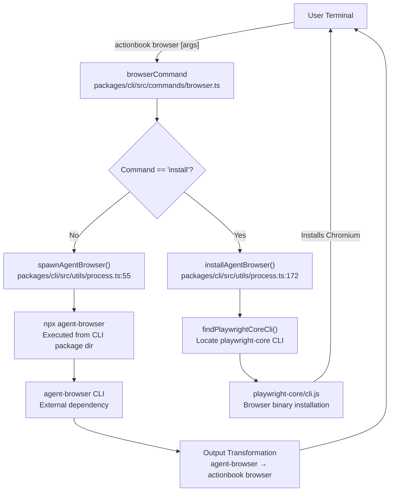
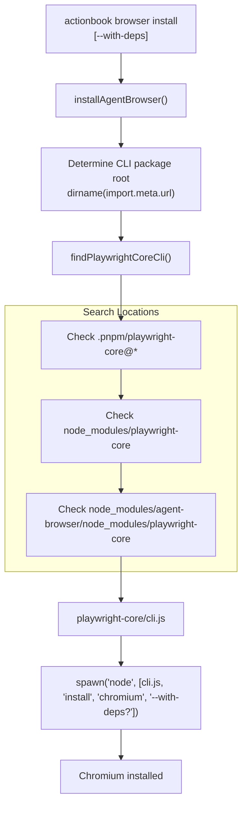
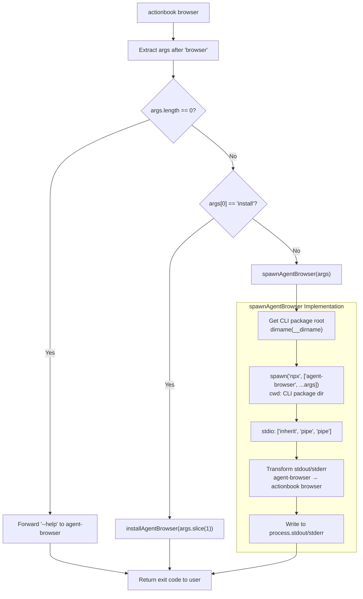

<!-- source: DeepWiki mcp.deepwiki.com · repo actionbook/actionbook · extra page Browser Automation Commands · fetched 2026-10-27 -->

# Browser Automation Commands

<details>
<summary>Relevant source files</summary>

The following files were used as context for generating this wiki page:

- [README.md](README.md)
- [packages/cli/README.md](packages/cli/README.md)
- [packages/cli/src/commands/browser.ts](packages/cli/src/commands/browser.ts)
- [packages/cli/src/commands/get.ts](packages/cli/src/commands/get.ts)
- [packages/cli/src/commands/search.ts](packages/cli/src/commands/search.ts)
- [packages/cli/src/commands/sources.ts](packages/cli/src/commands/sources.ts)
- [packages/cli/src/index.ts](packages/cli/src/index.ts)
- [packages/cli/src/output.ts](packages/cli/src/output.ts)
- [packages/cli/src/utils/process.ts](packages/cli/src/utils/process.ts)
- [packages/cli/tsconfig.build.json](packages/cli/tsconfig.build.json)
- [packages/cli/tsconfig.json](packages/cli/tsconfig.json)

</details>


## Purpose and Scope

This page documents the `actionbook browser` command suite, which provides browser automation capabilities within the Actionbook CLI. This command acts as a wrapper around the [`agent-browser`](https://github.com/vercel-labs/agent-browser) CLI tool, transparently forwarding commands while handling installation and providing consistent branding.

The browser automation commands are used for **executing** website interactions (opening pages, clicking, filling forms, etc.) using verified selectors. This is distinct from the action recording process covered in [Action Recording](#3.2.2), which is how Actionbook generates the action manuals that inform these automation tasks.

For general CLI usage beyond browser automation, see [CLI (Command Line Interface)](#2.1).

---

## Command Architecture

The browser command system implements a transparent forwarding pattern where the Actionbook CLI wraps `agent-browser` functionality while maintaining consistent user experience.



**Sources:** [packages/cli/src/commands/browser.ts:1-32](), [packages/cli/src/utils/process.ts:55-103]()

### Command Registration

The `browserCommand` is registered in the main CLI program with specific configuration to enable transparent argument forwarding:

| Configuration Option | Purpose |
|---------------------|---------|
| `allowUnknownOption(true)` | Passes through all CLI flags without validation |
| `allowExcessArguments(true)` | Forwards any number of positional arguments |
| `helpOption(false)` | Disables built-in help; forwards to agent-browser |

This configuration ensures that all arguments after `browser` are captured and forwarded to the underlying `agent-browser` process without interpretation by Commander.js.

**Sources:** [packages/cli/src/commands/browser.ts:5-11](), [packages/cli/src/index.ts:26]()

---

## Installation Process

The `actionbook browser install` command sets up the Chromium browser binaries required for automation. This is handled separately from the normal command forwarding flow.

### Installation Flow



**Sources:** [packages/cli/src/utils/process.ts:172-230](), [packages/cli/src/commands/browser.ts:22-26]()

### Playwright CLI Resolution

The `findPlaywrightCoreCli` function searches multiple node_modules structures to locate the `playwright-core/cli.js` binary:

1. **pnpm Structure**: Searches `.pnpm/playwright-core@*/node_modules/playwright-core/cli.js` for versioned installations
2. **npm Flat Structure**: Checks `node_modules/playwright-core/cli.js` for flat installations
3. **npm Nested Structure**: Checks `node_modules/agent-browser/node_modules/playwright-core/cli.js` for nested dependencies

The search checks both the CLI package directory and the workspace root (two levels up) to support both standalone and monorepo installations.

**Sources:** [packages/cli/src/utils/process.ts:126-165]()

### Installation Command Arguments

| Argument | Purpose |
|----------|---------|
| `install` | Playwright CLI install subcommand |
| `chromium` | Browser variant to install (Chrome/Chromium) |
| `--with-deps` | (Optional) Install system dependencies on Linux |

The `--with-deps` flag is only necessary on Linux systems that lack required system libraries for Chromium (e.g., libatk, libcups, etc.).

**Sources:** [packages/cli/src/utils/process.ts:188-191](), [packages/cli/README.md:126-129]()

---

## Command Execution and Forwarding

All non-install browser commands are forwarded to `agent-browser` via the `spawnAgentBrowser` function, which implements transparent process spawning with output transformation.

### Execution Flow



**Sources:** [packages/cli/src/commands/browser.ts:10-31](), [packages/cli/src/utils/process.ts:55-103]()

### Output Transformation

The `spawnAgentBrowser` function pipes stdout and stderr to apply text replacement before writing to the terminal:

```typescript
// Transform stdout
child.stdout.on('data', (data: Buffer) => {
  const output = data.toString().replace(/agent-browser/g, 'actionbook browser')
  process.stdout.write(output)
})

// Transform stderr
child.stderr.on('data', (data: Buffer) => {
  const output = data.toString().replace(/agent-browser/g, 'actionbook browser')
  process.stderr.write(output)
})
```

This ensures all help text, error messages, and command feedback display `actionbook browser` instead of `agent-browser`, maintaining consistent branding throughout the user experience.

**Sources:** [packages/cli/src/utils/process.ts:68-82]()

### Working Directory Context

The spawned `npx` process executes with `cwd: cliPackageRoot`, ensuring that `agent-browser` is resolved from the CLI package's own `node_modules` rather than the user's global or project-local packages. This guarantees version consistency between the CLI and its browser automation dependency.

**Sources:** [packages/cli/src/utils/process.ts:58-65]()

---

## Available Commands

The following table lists common `agent-browser` commands that are forwarded through `actionbook browser`. For the complete command reference, run `actionbook browser --help`.

| Command | Purpose | Example |
|---------|---------|---------|
| `open <url>` | Navigate to a URL | `actionbook browser open example.com` |
| `snapshot -i` | Get interactive elements with references | `actionbook browser snapshot -i` |
| `click <selector>` | Click an element by selector or @ref | `actionbook browser click @e1` |
| `fill <selector> <text>` | Fill an input field | `actionbook browser fill @e3 "test@example.com"` |
| `type <selector> <text>` | Type text into an element | `actionbook browser type input[name="q"] "search"` |
| `wait <selector\|ms>` | Wait for element or time | `actionbook browser wait 2000` |
| `screenshot [path]` | Take a screenshot | `actionbook browser screenshot page.png` |
| `session` | Display current session info | `actionbook browser session` |
| `close` | Close the browser | `actionbook browser close` |

**Sources:** [packages/cli/README.md:132-141](), [README.md:100-130]()

### Selector Reference Syntax

`agent-browser` provides element references (e.g., `@e1`, `@e2`) when using `snapshot -i`, which can be used in subsequent commands instead of CSS selectors. This reference-based approach simplifies automation scripts:

```bash
# Get interactive snapshot
actionbook browser snapshot -i
# Output: @e1: button "Submit"
#         @e2: input[type="email"]

# Use references in subsequent commands
actionbook browser fill @e2 "user@example.com"
actionbook browser click @e1
```

**Sources:** [packages/cli/README.md:207-218](), [README.md:127-129]()

---

## Error Handling

The command execution system implements error handling for common failure scenarios.

### Command Not Found (ENOENT)

When `npx` is not available or `agent-browser` cannot be resolved, the system detects the `ENOENT` error code and displays appropriate guidance:

```typescript
child.on('error', (error: NodeJS.ErrnoException) => {
  if (error.code === 'ENOENT') {
    console.error(chalk.red('\nnpx command not found.'))
    console.error(chalk.white('Please ensure npm 5.2+ is installed.\n'))
    resolve(127) // Standard exit code for command not found
  } else {
    console.error(chalk.red(`Failed to execute agent-browser: ${error.message}`))
    resolve(1)
  }
})
```

**Sources:** [packages/cli/src/utils/process.ts:92-101]()

### Signal Handling

Process termination signals (e.g., SIGINT from Ctrl+C) are properly converted to standard exit codes:

```typescript
child.on('close', (code, signal) => {
  if (signal) {
    // Convert signal to exit code: 128 + signal number
    resolve(128 + (signal === 'SIGINT' ? 2 : 15))
  } else {
    resolve(code ?? 1)
  }
})
```

This ensures that interrupt signals propagate correctly to the parent shell environment.

**Sources:** [packages/cli/src/utils/process.ts:84-90]()

### Installation Failure Messages

If browser installation fails, the system provides clear feedback and suggests troubleshooting:

```typescript
if (exitCode === 0) {
  console.log(chalk.green('\n✓ Browser automation setup complete!\n'))
  console.log(chalk.white('You can now use: ') + chalk.cyan('actionbook browser <command>\n'))
} else {
  console.error(chalk.red('\nBrowser setup encountered an error.'))
  console.error(chalk.white('Please check the output above for details.\n'))
}
```

**Sources:** [packages/cli/src/utils/process.ts:221-227]()

---

## Integration with Actionbook Workflow

The browser automation commands complement the action retrieval workflow:

```mermaid
graph LR
    Search["actionbook search<br/>'github login'"]
    Get["actionbook get<br/>github.com/login"]
    Extract["Extract verified<br/>selectors"]
    BrowserOpen["actionbook browser open<br/>github.com/login"]
    BrowserSnap["actionbook browser snapshot -i"]
    BrowserFill["actionbook browser fill<br/>@e1 'username'"]
    BrowserClick["actionbook browser click<br/>@e3"]
    
    Search --> Get
    Get --> Extract
    Extract --> BrowserOpen
    BrowserOpen --> BrowserSnap
    BrowserSnap --> BrowserFill
    BrowserFill --> BrowserClick
```



This workflow allows users to:
1. **Discover** relevant actions via search
2. **Retrieve** verified selectors via get
3. **Execute** automation via browser commands

The browser commands operate independently of the Actionbook API, providing general-purpose browser automation capabilities that can be used with or without Actionbook's action manuals.

**Sources:** [packages/cli/README.md:206-218](), [README.md:119-130]()

---

