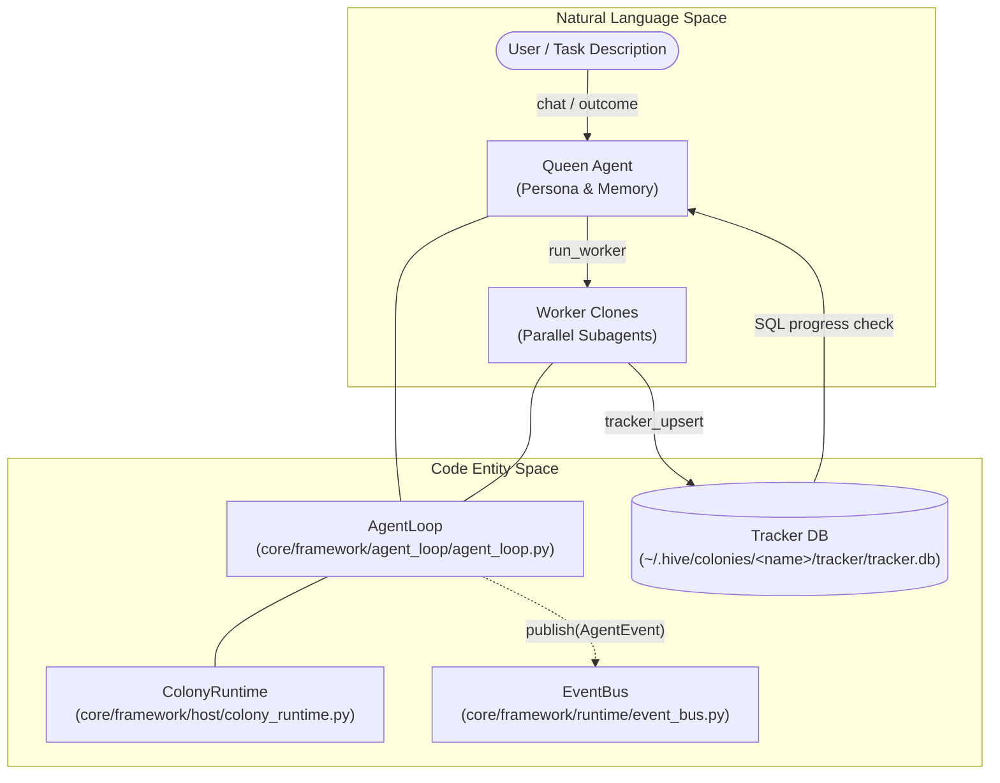
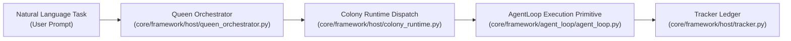

<!-- source: DeepWiki mcp.deepwiki.com · repo aden-hive/hive · page 1 Overview · fetched 2026-10-27 -->

# Overview

Relevant source files

The following files were used as context for generating this wiki page:

- [CHANGELOG.md](CHANGELOG.md)
- [CONTRIBUTING.md](CONTRIBUTING.md)
- [README.md](README.md)
- [SECURITY.md](SECURITY.md)
- [core/pyproject.toml](core/pyproject.toml)
- [docs/architecture/README.md](docs/architecture/README.md)
- [docs/configuration.md](docs/configuration.md)
- [docs/developer-guide.md](docs/developer-guide.md)
- [docs/environment-setup.md](docs/environment-setup.md)
- [docs/getting-started.md](docs/getting-started.md)
- [docs/key_concepts/colony.md](docs/key_concepts/colony.md)
- [docs/key_concepts/coordination.md](docs/key_concepts/coordination.md)
- [docs/key_concepts/goals_outcome.md](docs/key_concepts/goals_outcome.md)
- [docs/key_concepts/improvement.md](docs/key_concepts/improvement.md)
- [docs/key_concepts/queen.md](docs/key_concepts/queen.md)
- [docs/key_concepts/the_loop.md](docs/key_concepts/the_loop.md)
- [docs/key_concepts/worker_agent.md](docs/key_concepts/worker_agent.md)
- [docs/releases/v1.0.0.md](docs/releases/v1.0.0.md)
- [docs/releases/v1.0.10.md](docs/releases/v1.0.10.md)
- [docs/releases/v1.0.7.md](docs/releases/v1.0.7.md)
- [docs/releases/v1.0.9.md](docs/releases/v1.0.9.md)
- [docs/roadmap.md](docs/roadmap.md)
- [tools/pyproject.toml](tools/pyproject.toml)
- [uv.lock](uv.lock)

Hive is an open-source runtime and framework for colonies of AI agents designed to perform real business work [README.md:27-31](). Rather than requiring developers to design compiled execution graphs, Hive is built around the **Queen/Worker/Colony model** and a single execution primitive: the `AgentLoop` [docs/architecture/README.md:3-5](). 

This page provides a high-level overview of Hive's core runtime model, workspace layout, and subsystems. For deep technical details, please refer to the child pages:
- **[Key Concepts: Queen, Worker, Colony, Tracker](#1.1)** — Persistent Queen agents, bounded Worker clones, Colony directories under `HIVE_HOME`, and the shared SQLite `tracker.db`.
- **[Repository Layout and Packaging](#1.2)** — The `uv` workspace (`aden-hive` and `aden-tools`), entrypoints, frontend bundling, and build targets.
- **[Public API for Building on Hive](#1.3)** — Stable public API surface for embedding Hive primitives in external applications.

Sources: [README.md:27-31](), [docs/architecture/README.md:3-5]()

---

## Architecture and Subsystems Overview

Hive replaces traditional multi-agent workflow graphs with dynamic agent colonies coordinated through disk-backed ledgers and tool calls [docs/architecture/README.md:3-7](). 

**Diagram: Hive Top-Level Architecture and Code Mapping**

Sources: [docs/architecture/README.md:15-49](), [core/framework/agent_loop/agent_loop.py:1-50]()

---

## Colony Execution and Code Entity Mapping

The lifecycle of tasks within a colony bridges high-level user goals to concrete Python execution units and disk storage.

**Diagram: Colony Execution Flow and Code Entities**

Sources: [docs/architecture/README.md:70-105](), [core/framework/host/queen_orchestrator.py:1-40]()

---

## 1.1. Key Concepts: Queen, Worker, Colony, Tracker

Hive's domain model centers around persistent executive agents (`Queen`), dynamic task-specific instances (`Worker`), shared workspace directories (`Colony`), and atomic persistence (`Tracker`) [docs/architecture/README.md:3-62](). 

- **Queen**: A long-lived, persona-driven agent with its own task plan, conversation history, and memory files. The queen interacts directly with the user, performs an initial "pilot" execution to derive a methodology or skill, and orchestrates scaling [README.md:43-48]().
- **Worker**: A short-lived clone of the agent loop configured with a narrower tool set, strict iteration budgets (typically 3 working turns + 1 grace turn), and no direct user interaction [docs/architecture/README.md:72-79]().
- **Colony**: A self-contained directory under `HIVE_HOME` (defaulting to `~/.hive/colonies/<name>/`) holding configuration, state databases, worker specs, skills, and playbooks [docs/architecture/README.md:55-68]().
- **Tracker**: A shared SQLite database (`tracker.db`) that serves as the colony's central ledger. Workers record fine-grained progress via `tracker_upsert`, allowing the queen to query state using SQL rather than relying on bloated context windows [README.md:47-50](), [docs/architecture/README.md:101-105]().

For detailed coverage of the domain model, coordination loops, and memory systems, see [Key Concepts: Queen, Worker, Colony, Tracker](#1.1).

Sources: [README.md:43-50](), [docs/architecture/README.md:3-105]()

---

## 1.2. Repository Layout and Packaging

Hive is structured as a modern `uv` workspace comprising core runtime packages, built-in tool extensions, and a React frontend [uv.lock:16-20]().

- **`aden-hive` (`core/`)**: The core Python package housing the `AgentLoop`, runtime orchestration, storage, LLM providers, and CLI entry points (`hive`, `hive-cred`, `hive-browser`) [core/pyproject.toml:1-52]().
- **`aden-tools` (`tools/`)**: Optional extension package providing FastMCP servers, web search, browser automation (`gcu`), and enterprise integrations [uv.lock:99-131](), [tools/pyproject.toml:1-106]().
- **Frontend (`core/framework/server/frontend/`)**: React/Vite dashboard bundled into the wheel via custom hatch build hooks [core/pyproject.toml:50-61]().

For complete details on workspace setup, pyproject configurations, and build targets, see [Repository Layout and Packaging](#1.2).

Sources: [uv.lock:16-20](), [core/pyproject.toml:1-61](), [tools/pyproject.toml:1-106]()

---

## 1.3. Public API for Building on Hive

Developers can embed Hive's core execution primitives in external Python applications by depending on `aden-hive` [CHANGELOG.md:41-45](). The stable public API surface exposes core runtime classes and types directly from package entry points:

- **`AgentLoop`**: The single multi-turn streaming LLM execution primitive (`core/hive/__init__.py`) [CHANGELOG.md:41-45]().
- **Providers & Buses**: `LiteLLMProvider`, `EventBus`, and event schemas [CHANGELOG.md:41-45]().
- **Turn Context**: The `hive.turn_context` entry point protocol allowing installed packages to inject context before agent turns [CHANGELOG.md:15-16]().

For programmatic usage guidelines, embedding patterns, and type definitions, see [Public API for Building on Hive](#1.3).

Sources: [CHANGELOG.md:15-16](), [CHANGELOG.md:41-45]()

---

