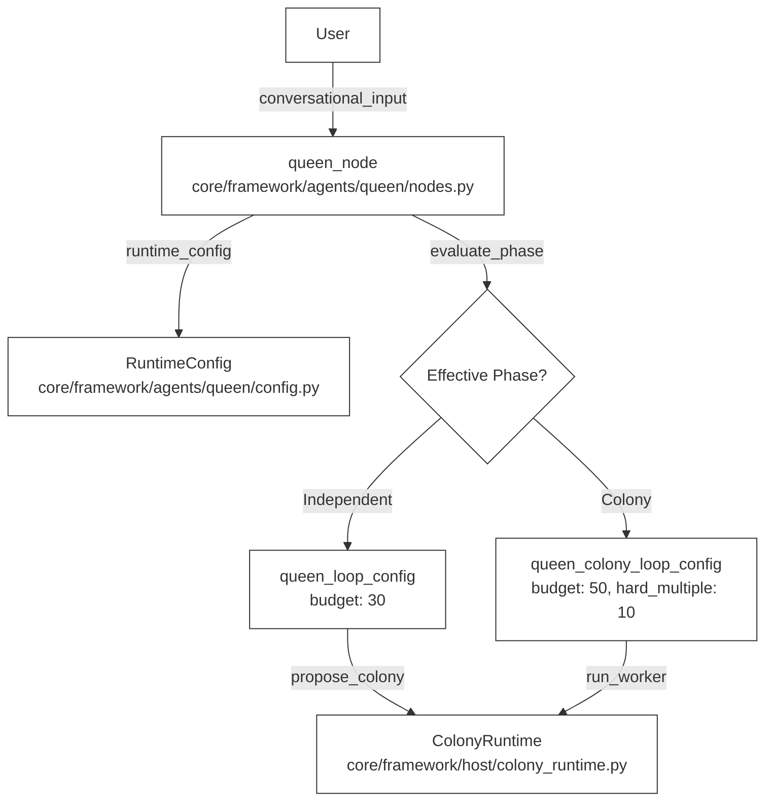
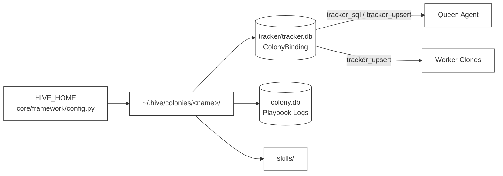

<!-- source: DeepWiki mcp.deepwiki.com · repo aden-hive/hive · page 1.1 Key Concepts: Queen, Worker, Colony, Tracker · fetched 2026-10-27 -->

# Key Concepts: Queen, Worker, Colony, Tracker

<details>
<summary>Relevant source files</summary>

The following files were used as context for generating this wiki page:

- [CONTRIBUTING.md](CONTRIBUTING.md)
- [README.md](README.md)
- [SECURITY.md](SECURITY.md)
- [core/framework/agents/queen/__init__.py](core/framework/agents/queen/__init__.py)
- [core/framework/agents/queen/agent.py](core/framework/agents/queen/agent.py)
- [core/framework/agents/queen/config.py](core/framework/agents/queen/config.py)
- [core/framework/agents/queen/tests/conftest.py](core/framework/agents/queen/tests/conftest.py)
- [docs/architecture/README.md](docs/architecture/README.md)
- [docs/configuration.md](docs/configuration.md)
- [docs/developer-guide.md](docs/developer-guide.md)
- [docs/environment-setup.md](docs/environment-setup.md)
- [docs/getting-started.md](docs/getting-started.md)
- [docs/key_concepts/colony.md](docs/key_concepts/colony.md)
- [docs/key_concepts/coordination.md](docs/key_concepts/coordination.md)
- [docs/key_concepts/goals_outcome.md](docs/key_concepts/goals_outcome.md)
- [docs/key_concepts/improvement.md](docs/key_concepts/improvement.md)
- [docs/key_concepts/queen.md](docs/key_concepts/queen.md)
- [docs/key_concepts/the_loop.md](docs/key_concepts/the_loop.md)
- [docs/key_concepts/worker_agent.md](docs/key_concepts/worker_agent.md)
- [docs/releases/v1.0.0.md](docs/releases/v1.0.0.md)
- [docs/releases/v1.0.7.md](docs/releases/v1.0.7.md)
- [docs/roadmap.md](docs/roadmap.md)

</details>


## Purpose and Scope

This document defines the core domain model of Hive (`https://github.com/aden-hive/hive`): persistent Queen agents (`core/framework/agents/queen/agent.py`), bounded Worker clones (`core/framework/host/colony_runtime.py`), Colony directory structures under `HIVE_HOME` (`docs/architecture/README.md`), the shared SQLite ledger (`tracker.db`), outcome-driven task management (`core/framework/schemas/goal.py`), and continuous improvement loops.

---

## 1. The Persistent Queen Agent

The Queen is a long-lived instance of the core execution primitive, `AgentLoop`, functioning as the primary user-facing orchestration unit [`docs/key_concepts/queen.md:3-4`](). Unlike transient workers, the Queen maintains persona identity, carries scoped markdown memory files, tracks multi-turn conversations, and builds persistent task plans (`docs/key_concepts/queen.md`).

The Queen's runtime bounds and execution thresholds are configured via `queen_loop_config` and `queen_colony_loop_config` defined in `core/framework/agents/queen/agent.py`:

```python
queen_loop_config = {
    "max_iterations": 999_999,
    "tool_call_budget": 30,
    "max_context_tokens": 180_000,
}

queen_colony_loop_config = {
    "max_iterations": 999_999,
    "tool_call_budget": 50,
    "tool_call_hard_multiple": 10,
    "max_context_tokens": 180_000,
}
```
*[core/framework/agents/queen/agent.py:20-36]()*

The Queen operates in two distinct execution phases (`docs/key_concepts/queen.md:28-34]()`):
1. **Independent Phase**: Operates as a standalone agent executing initial tasks directly.
2. **Colony Phase**: Unlocks expanded tool budgets and delegates sub-tasks by spawning parallel worker clones.

### Diagram: Queen Execution and Persona Lifecycle



Sources: `core/framework/agents/queen/agent.py`, `core/framework/agents/queen/config.py`, `docs/key_concepts/queen.md`

---

## 2. Bounded Worker Clones

Workers are short-lived, narrow instances of `AgentLoop` spawned by the Queen via `run_worker` (`docs/architecture/README.md:77-79]()`). Unlike Queens, workers are memoryless, lack persona definitions, and cannot communicate directly with the user or spawn other workers (`docs/key_concepts/queen.md:38()`, `docs/architecture/README.md:79()`).

### Execution Constraints and Lifecycles
* **Tool Allotment**: Subsets of the Queen's tool set (excluding queen-only orchestration tools).
* **Budget Limits**: Fixed working turns (typically 3 working turns plus 1 grace turn), capped tool calls per turn (30), and lifetime caps (`docs/architecture/README.md:77-78]()`).
* **Grace Turn Restrictions**: During grace iterations, workers are restricted to calling `report_to_parent`, `tracker_upsert`, and `task_update` (`docs/architecture/README.md:77-78]()`).

Sources: `core/framework/host/colony_runtime.py`, `docs/architecture/README.md`

---

## 3. Colony Directories and HIVE_HOME

A Colony represents an isolated working directory under `~/.hive/colonies/<name>/` that aggregates shared operational state, storage partitions, and execution ledgers (`docs/architecture/README.md:19-69]()`).

### Colony File Layout

| Directory / File Path | Purpose / Technical Role |
|-----------------------|--------------------------|
| `worker.json` | Worker specifications used for cloning (`docs/architecture/README.md:61()`) |
| `tracker/tracker.db` | Shared SQLite ledger for structured unit-of-work progress (`docs/architecture/README.md:62()`) |
| `colony.db` | Administrative metadata and playbook execution logs (`docs/architecture/README.md:63()`) |
| `skills/` | Colony-scoped skill definitions written by the Queen (`docs/architecture/README.md:64()`) |
| `playbooks/` | Saved executable playbook scripts (`docs/architecture/README.md:65()`) |
| `triggers.json` | Scheduled cron, interval, and webhook trigger definitions (`docs/architecture/README.md:66()`) |
| `queens/<queen>/sessions/<id>/` | Queen session transcripts, event logs, and task plans (`docs/architecture/README.md:67()`) |
| `workers/<id>/` | Individual worker state storage (`docs/architecture/README.md:68()`) |

### Diagram: Colony Storage Architecture & Code Bindings



Sources: `docs/architecture/README.md`, `core/framework/config.py`

---

## 4. The Shared SQLite Tracker (`tracker.db`)

To avoid shared memory buffers or message-passing queues, colonies synchronize via an on-disk SQLite ledger located at `tracker/tracker.db` (`docs/architecture/README.md:100-105]()`). Access is governed by immutable `ColonyBinding` objects (`core/framework/host/colony_binding.py`) that bind runtime handles directly to the correct database path.

* **Schema Definition**: The Queen executes `tracker_sql` to define custom tables and designates writable columns via `tracker_register_writable` (`docs/architecture/README.md:104-105]()`).
* **Execution Ledger**: Workers execute `tracker_upsert` to write exactly one row per unit of work, providing deterministic state tracking (`docs/architecture/README.md:100-105]()`).

Sources: `docs/architecture/README.md`, `core/framework/host/colony_binding.py`

---

## 5. Goals, Outcomes, and Coordination

Hive implements **Outcome-Driven Development (ODD)** where objectives are specified via success criteria and hard/soft constraints rather than rigid procedural code graphs (`docs/key_concepts/goals_outcome.md:5-23]()`).

### Structured Goal Schema
Structured goals are instantiated using `Goal` and evaluated via `SuccessCriterion` definitions (`core/framework/schemas/goal.py`, `docs/key_concepts/goals_outcome.md:33-68()`):

```python
Goal(
    id="deep-research",
    name="Deep Research Report",
    success_criteria=[
        SuccessCriterion(
            id="comprehensive",
            description="Report covers all major aspects",
            metric="llm_judge",
            weight=0.4
        )
    ],
    constraints=[
        Constraint(
            id="no_spam",
            description="Never send more than 3 messages",
            constraint_type="hard",
            category="safety"
        )
    ]
)
```
*[docs/key_concepts/goals_outcome.md:40-81]()*

* **Hard Constraints**: Injected into system prompts as `MUST` directives for model-level compliance (`docs/key_concepts/goals_outcome.md:91()`).
* **Soft Constraints**: Injected as `SHOULD` preferences (`docs/key_concepts/goals_outcome.md:91()`).
* **Coordination Subsystems**: Coordinated via an EventBus telemetry layer, a persistent reminder hub, and a file-backed task plan (`docs/architecture/README.md:28-44()`).

Sources: `core/framework/schemas/goal.py`, `docs/key_concepts/goals_outcome.md`, `docs/architecture/README.md`

---

## 6. Continuous Improvement Loops

The core execution model follows an iterative **"execute first, then systematize"** paradigm (`docs/key_concepts/queen.md:29-34()`):

1. **Pilot Execution**: The Queen executes the initial unit of work herself to discover edge cases and establish operational feasibility (`README.md:44-47()` generators).
2. **Skill Codification**: Successful execution workflows are codified into reusable skills via `write_skill` (`docs/roadmap.md:9()`).
3. **Mass Fan-Out**: Spawned workers inherit codified skills and process queued units of work against the shared `tracker.db` (`README.md:47-48()`).
4. **Audit and Reflection**: The Queen audits tracker states via SQL, reconciling errors and refining reflection memories (`README.md:48()`, `docs/key_concepts/queen.md:36-38()`).

Sources: `README.md`, `docs/key_concepts/queen.md`, `docs/roadmap.md`

---

