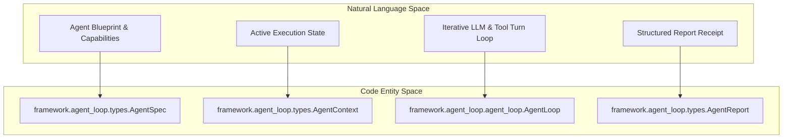
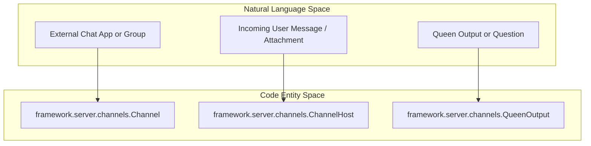

<!-- source: DeepWiki mcp.deepwiki.com · repo aden-hive/hive · page 1.3 Public API for Building on Hive · fetched 2026-10-27 -->

# Public API for Building on Hive

Relevant source files

The following files were used as context for generating this wiki page:

- [core/framework/__init__.py](core/framework/__init__.py)
- [core/framework/agent_loop/__init__.py](core/framework/agent_loop/__init__.py)
- [core/framework/agent_loop/turn_context_reminder.py](core/framework/agent_loop/turn_context_reminder.py)
- [core/framework/agent_loop/types.py](core/framework/agent_loop/types.py)
- [core/framework/host/__init__.py](core/framework/host/__init__.py)
- [core/framework/host/agent_host.py](core/framework/host/agent_host.py)
- [core/framework/host/execution_manager.py](core/framework/host/execution_manager.py)
- [core/framework/loader/agent_loader.py](core/framework/loader/agent_loader.py)
- [core/framework/pipeline/stages/skill_registry.py](core/framework/pipeline/stages/skill_registry.py)
- [core/framework/py.typed](core/framework/py.typed)
- [core/framework/server/compaction_status.py](core/framework/server/compaction_status.py)
- [core/framework/server/tests/test_turn_context.py](core/framework/server/tests/test_turn_context.py)
- [core/framework/server/turn_context.py](core/framework/server/turn_context.py)
- [core/framework/storage/session_summary.py](core/framework/storage/session_summary.py)
- [core/hive/__init__.py](core/hive/__init__.py)
- [core/hive/py.typed](core/hive/py.typed)
- [core/setup_mcp.sh](core/setup_mcp.sh)
- [core/tests/test_public_api.py](core/tests/test_public_api.py)
- [docs/building-on-hive.md](docs/building-on-hive.md)

This section documents the stable public API surface exposed by the `aden-hive` core package (`core/hive/__init__.py`) and framework packages (`core/framework/__init__.py`, `agent_loop` types, `turn_context`, and channels) for embedding Hive runtime primitives in external applications.

---

## 1. Package Architecture and Stability Contract

Hive exposes its stable public API through the top-level `hive` package. The package implements a lightweight import mechanism where individual components are imported on first use, ensuring that importing `hive` remains cheap and applications only pay initialization costs for modules they invoke [docs/building-on-hive.md:33-57] [core/hive/__init__.py:1-11].

### Semantic Versioning and Internal Isolation
* **`hive` Namespace**: Names exported from `hive` follow strict semantic versioning starting from version `1.0.1`. Breaking changes to these APIs trigger major version increments [docs/building-on-hive.md:58-60].
* **`framework` Namespace**: Everything imported directly from `framework.*` is considered an internal implementation detail and may change across any release [docs/building-on-hive.md:58-60].
* **Package Extras**: The base `aden-hive` install contains only execution primitives. Optional extras enable servers (`server`) and built-in tool ecosystems (`tools`) [docs/building-on-hive.md:6-23].

| Extra | Added Dependencies | Required For |
|---|---|---|
| `server` | `aiohttp` | `SSEResponse`, custom web endpoints, and HTTP hosting [docs/building-on-hive.md:18-20] |
| `tools` | `aden-tools` (terminal, files, browser, memory, charts) | Full worker colonies, agent runtimes, and dashboard tooling [docs/building-on-hive.md:21-22] |

Sources: `docs/building-on-hive.md:1-60`, `core/hive/__init__.py:1-121`

---

## 2. Core Execution Primitives: AgentLoop, AgentSpec, and AgentContext

The core execution primitive for individual agents is `AgentLoop`, driven by declarative configuration classes `AgentSpec` and runtime containers `AgentContext` [core/hive/__init__.py:64-72].

### Execution Flow and Reporting
An `AgentLoop` executes iterative LLM turns, dispatches tool calls, and evaluates execution termination or error states. When an `on_report` callback is provided, the agent is granted the `report_to_parent` tool, allowing it to return an `AgentReport` containing status, summaries, and structured receipts [docs/building-on-hive.md:33-54].

### Natural Language to Code Entity Mapping: Agent Execution

Title: Mapping Agent Execution Concepts to Framework Classes

Sources: `core/framework/agent_loop/types.py:21-193`, `core/hive/__init__.py:64-72`, `docs/building-on-hive.md:33-54`

---

## 3. Model Providers and Streaming Events

Hive abstracts model communication through the `LLMProvider` interface and structured streaming event protocols [core/hive/__init__.py:77-93].

### Provider Implementations
* **`LiteLLMProvider`**: Proxies requests via LiteLLM, handling provider-specific rewriting, prompt caching breakpoints, and automatic retries [core/hive/__init__.py:82].
* **`AnthropicProvider`**: Native integration for Anthropic models [core/hive/__init__.py:83].
* **`MockLLMProvider`**: Scriptable provider for testing loops without network calls [core/hive/__init__.py:84].

### Stream Events
Model generation emits discrete event types subclassing `StreamEvent`, including `TextDeltaEvent`, `ToolCallEvent`, `ReasoningStartEvent`, `ReasoningDeltaEvent`, `FinishEvent`, and `StreamErrorEvent` [core/hive/__init__.py:39-49].

Sources: `core/hive/__init__.py:35-49`, `core/hive/__init__.py:77-93`, `core/tests/test_public_api.py:64-84`

---

## 4. External Integration Channels (`hive.channels`)

Chat applications and external messaging platforms can connect to Queen agent sessions running inside `hive serve` by registering factories in the `hive.channels` entry-point group [docs/building-on-hive.md:61-80].

### Channel Host Protocol
Channels interact with the runtime via `ChannelHost` and `QueenOutput` interfaces. Each group chat or direct message thread corresponds to a unique Queen session ID managed by the host [docs/building-on-hive.md:81-116].

### Natural Language to Code Entity Mapping: Channel Integration

Title: Mapping Chat Integrations to Channel Host Entities

Sources: `docs/building-on-hive.md:61-117`, `core/hive/__init__.py:113-117`

---

## 5. Turn Context Injection (`hive.turn_context`)

Turn-context plugins allow external applications to inject dynamic context into a Queen session right before she processes a user turn. The text returned by the provider is injected as a `<system-reminder>` immediately preceding the user message [docs/building-on-hive.md:118-138].

### Turn Context Host
Packages register under the `hive.turn_context` entry-point group and receive a `TurnContextHost` reference [docs/building-on-hive.md:125-146]. The implementation provides the `context(queen_id, message)` coroutine, which evaluates active state or external stores and returns supplementary prompt text or `None` [docs/building-on-hive.md:151-153].

Sources: `docs/building-on-hive.md:118-156`, `core/hive/__init__.py:118-120`

---

