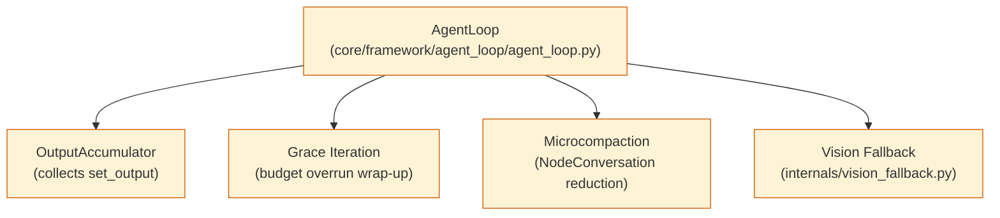

<!-- source: DeepWiki mcp.deepwiki.com · repo aden-hive/hive · page 10 Glossary · fetched 2026-10-27 -->

# Glossary

<details>
<summary>Relevant source files</summary>

The following files were used as context for generating this wiki page:

- [.claude/settings.json](.claude/settings.json)
- [CONTRIBUTING.md](CONTRIBUTING.md)
- [README.md](README.md)
- [SECURITY.md](SECURITY.md)
- [core/framework/agent_loop/agent_loop.py](core/framework/agent_loop/agent_loop.py)
- [core/framework/agent_loop/conversation.py](core/framework/agent_loop/conversation.py)
- [core/framework/agent_loop/internals/cursor_persistence.py](core/framework/agent_loop/internals/cursor_persistence.py)
- [core/framework/agent_loop/internals/types.py](core/framework/agent_loop/internals/types.py)
- [core/framework/agent_loop/internals/vision_fallback.py](core/framework/agent_loop/internals/vision_fallback.py)
- [core/framework/agents/queen/nodes/__init__.py](core/framework/agents/queen/nodes/__init__.py)
- [core/framework/agents/queen/queen_profiles.py](core/framework/agents/queen/queen_profiles.py)
- [core/framework/agents/queen/tests/test_deferred_handle_redeemers.py](core/framework/agents/queen/tests/test_deferred_handle_redeemers.py)
- [core/framework/host/colony_runtime.py](core/framework/host/colony_runtime.py)
- [core/framework/host/worker.py](core/framework/host/worker.py)
- [core/framework/server/app.py](core/framework/server/app.py)
- [core/framework/server/queen_orchestrator.py](core/framework/server/queen_orchestrator.py)
- [core/framework/server/routes_execution.py](core/framework/server/routes_execution.py)
- [core/framework/server/session_manager.py](core/framework/server/session_manager.py)
- [core/framework/skills/_default_skills/browser-automation/SKILL.md](core/framework/skills/_default_skills/browser-automation/SKILL.md)
- [core/framework/storage/conversation_store.py](core/framework/storage/conversation_store.py)
- [core/framework/tools/queen_lifecycle_tools.py](core/framework/tools/queen_lifecycle_tools.py)
- [core/tests/test_event_loop_node.py](core/tests/test_event_loop_node.py)
- [core/tests/test_node_conversation.py](core/tests/test_node_conversation.py)
- [core/tests/test_worker_started_at.py](core/tests/test_worker_started_at.py)
- [docs/configuration.md](docs/configuration.md)
- [docs/developer-guide.md](docs/developer-guide.md)
- [docs/environment-setup.md](docs/environment-setup.md)
- [docs/getting-started.md](docs/getting-started.md)
- [scripts/browser_remote.py](scripts/browser_remote.py)
- [scripts/browser_remote_ui.html](scripts/browser_remote_ui.html)
- [tools/src/aden_tools/credentials/__init__.py](tools/src/aden_tools/credentials/__init__.py)
- [tools/src/aden_tools/credentials/health_check.py](tools/src/aden_tools/credentials/health_check.py)
- [tools/src/aden_tools/tools/__init__.py](tools/src/aden_tools/tools/__init__.py)
- [tools/src/gcu/browser/__init__.py](tools/src/gcu/browser/__init__.py)
- [tools/src/gcu/browser/bridge.py](tools/src/gcu/browser/bridge.py)
- [tools/src/gcu/browser/refs.py](tools/src/gcu/browser/refs.py)
- [tools/src/gcu/browser/session.py](tools/src/gcu/browser/session.py)
- [tools/src/gcu/browser/tools/__init__.py](tools/src/gcu/browser/tools/__init__.py)
- [tools/src/gcu/browser/tools/advanced.py](tools/src/gcu/browser/tools/advanced.py)
- [tools/src/gcu/browser/tools/inspection.py](tools/src/gcu/browser/tools/inspection.py)
- [tools/src/gcu/browser/tools/interactions.py](tools/src/gcu/browser/tools/interactions.py)
- [tools/src/gcu/browser/tools/lifecycle.py](tools/src/gcu/browser/tools/lifecycle.py)
- [tools/src/gcu/browser/tools/navigation.py](tools/src/gcu/browser/tools/navigation.py)
- [tools/src/gcu/browser/tools/tabs.py](tools/src/gcu/browser/tools/tabs.py)
- [tools/tests/test_credentials.py](tools/tests/test_credentials.py)
- [tools/tests/test_health_checks.py](tools/tests/test_health_checks.py)
- [tools/tests/test_live_health_checks.py](tools/tests/test_live_health_checks.py)
- [tools/tests/test_refs.py](tools/tests/test_refs.py)
- [tools/tests/test_x_page_load_repro.py](tools/tests/test_x_page_load_repro.py)
- [tools/tests/tools/test_google_sheets_tool.py](tools/tests/tools/test_google_sheets_tool.py)

</details>


## Purpose and Scope

This page serves as the definitive technical glossary for the `aden-hive` codebase. It defines 30 codebase-specific architectural terms, runtime constructs, data structures, and tool subsystems. Each term provides code pointers, implementation mechanics, and architectural context to bridge natural language concepts to their concrete code entities.

---

## 1. Core Runtime & Execution Primitives

### AgentLoop
The single execution primitive of the Hive framework, implemented as a multi-turn LLM streaming loop with built-in tool execution, streaming deltas, and judge validation [core/framework/agent_loop/agent_loop.py:1-10](). It orchestrates streaming events from an `LLMProvider`, handles tool dispatch via `ToolRegistry`, accumulates outputs, and evaluates loop termination conditions.

* **Code Pointers**: `core/framework/agent_loop/agent_loop.py`
* **Sources**: `core/framework/agent_loop/agent_loop.py:1-10`

### Inner Turns
Execution sub-steps within an `AgentLoop` iteration where tool results are fed back into the conversation context without requiring a new user message or external trigger [core/framework/agent_loop/agent_loop.py:1-10]().
* **Sources**: `core/framework/agent_loop/agent_loop.py:1-10`

### OutputAccumulator
A stateful data structure used within `AgentLoop` to collect structured final outputs (`set_output`) emitted by agents during execution [core/tests/test_event_loop_node.py:1-16]().
* **Code Pointers**: `core/framework/agent_loop/agent_loop.py`
* **Sources**: `core/tests/test_event_loop_node.py:1-16`

### Grace Iteration
An extension phase granted to an agent when it hits its soft tool-budget or stopping condition, allowing it to wrap up execution, write final logs, or flush state cleanly before hard termination [core/framework/agent_loop/agent_loop.py:181-190]().
* **Sources**: `core/framework/agent_loop/agent_loop.py:181-190`

### Microcompaction
A phase-aware conversation compaction mechanism that summarizes older message turns in `NodeConversation` to prevent context window overflow while preserving critical operational prompts and memory blocks [core/framework/agent_loop/agent_loop.py:28-33]().
* **Sources**: `core/framework/agent_loop/agent_loop.py:28-33`

### Vision Fallback
A subagent utility that inspects inbound image attachments or tool results and automatically invokes a vision-capable fallback model or captioning routine when the primary model lacks native vision support [core/framework/agent_loop/agent_loop.py:90-94]().
* **Code Pointers**: `core/framework/agent_loop/internals/vision_fallback.py`
* **Sources**: `core/framework/agent_loop/agent_loop.py:90-94`


*Sources: `core/framework/agent_loop/agent_loop.py:1-10`, `core/framework/agent_loop/agent_loop.py:28-33`, `core/framework/agent_loop/agent_loop.py:90-94`*

---

## 2. Agents, Colonies & Orchestration

### Queen
A persistent, long-lived overseer agent defined by a role and profile, responsible for decomposing high-level user goals, managing a shared tracker, and spawning parallel worker clones [README.md:39-51]().
* **Sources**: `README.md:39-51`

### Worker
A bounded, lightweight clone of the Queen agent executing specific sliced tasks in parallel with a restricted tool surface and strict operational budgets [README.md:77-99]().
* **Sources**: `README.md:77-99`

### Colony
An isolated operational directory and runtime context containing a Queen, a shared SQLite database (`tracker.db`), worker sessions, and state checkpoints under `$HIVE_HOME/colonies/` [core/framework/server/session_manager.py:38-59]().
* **Code Pointers**: `core/framework/host/colony_runtime.py`, `core/framework/server/session_manager.py`
* **Sources**: `core/framework/server/session_manager.py:38-59`

### Independent / Colony Phase
The two operating phases defined in `QueenPhaseState`. In the **Independent Phase**, the Queen acts as a standalone agent with search tools but no workers. In the **Colony Phase**, the colony has been forked, enabling playbook execution, worker monitoring, and tracker writes [core/framework/tools/queen_lifecycle_tools.py:112-126]().
* **Code Pointers**: `core/framework/tools/queen_lifecycle_tools.py`
* **Sources**: `core/framework/tools/queen_lifecycle_tools.py:112-126`

### Pivot
A structured proposal mechanism where the Queen calls `task_create(new_colony=true)` to transition goals into a newly spawned colony via a frontend approval payload [core/framework/server/queen_orchestrator.py:28-42]().
* **Code Pointers**: `core/framework/server/queen_orchestrator.py`
* **Sources**: `core/framework/server/queen_orchestrator.py:28-42`

### Sentinel
An autopilot subsystem responsible for routing asynchronous worker escalations, delivering reminders, and managing inbound communication channels to the Queen session [core/framework/agent_loop/internals/sentinel_tool.py:1]().
* **Code Pointers**: `core/framework/agent_loop/internals/sentinel_tool.py`
* **Sources**: `core/framework/agent_loop/internals/sentinel_tool.py:1`

```mermaid
flowchart LR
    Q["Queen<br/>(QueenPhaseState)"] -->|Independent Phase| IND["Standalone Agent + MCP"]
    Q -->|Colony Phase| COL["ColonyRuntime<br/>(parallel workers)"]
    COL -->|task_create(new_colony=true)| PV["Pivot<br/>(QueenOrchestrator payload)"]
    PV --> ST["Sentinel<br/>(Escalations & Routing)"]

    style Q fill:#fff3d6,stroke:#cc5d00,color:#333
    style COL fill:#fff3d6,stroke:#cc5d00,color:#333
    style PV fill:#fff3d6,stroke:#cc5d00,color:#333
    style ST fill:#fff3d6,stroke:#cc5d00,color:#333
```
*Sources: `core/framework/tools/queen_lifecycle_tools.py:112-126`, `core/framework/server/queen_orchestrator.py:28-42`*

---

## 3. Storage, Telemetry & LLM Infrastructure

### Tracker
A shared SQLite database (`tracker.db`) located within each colony's directory that maintains structured progress, work queues, and upserted results accessible to both Queen and workers [README.md:77-99]().
* **Sources**: `README.md:77-99`

### HIVE_HOME
The root directory (`~/.hive` by default) where global configurations, credentials, agent templates, session histories, and colony databases are persisted [README.md:70]().
* **Sources**: `README.md:70`

### EventBus / AgentEvent
A pub/sub event bus implementation (`EventBus`) transmitting structured `AgentEvent` objects to track loop iterations, tool executions, text deltas, and phase transitions [core/framework/host/event_bus.py:1]().
* **Code Pointers**: `core/framework/host/event_bus.py`
* **Sources**: `core/framework/host/event_bus.py:1`

### SSE Replay
A Server-Sent Events (SSE) streaming mechanism that replays session snapshots, history logs, and global events to synchronize the frontend chat and execution pipeline [README.md:102-109]().
* **Sources**: `README.md:102-109`

### Hive LLM Proxy
An intermediary routing layer that proxies LLM requests, handles authentication tokens (`HIVE_API_KEY`), manages caching breakpoints, and bills metered integrations (such as image generation) [tools/src/aden_tools/tools/__init__.py:78-82]().
* **Sources**: `tools/src/aden_tools/tools/__init__.py:78-82`

### BYOK (Bring Your Own Key)
An operational mode allowing users to supply their own third-party API keys (Anthropic, OpenAI, Gemini, etc.) stored securely under `HIVE_HOME/credentials/` [README.md:58-60]().
* **Sources**: `README.md:58-60`

---

## 4. Evaluation & Channels

### JudgeVerdict
A structured evaluation result returned by a judge protocol, indicating whether a turn or subagent run meets acceptance criteria or requires corrective iteration [core/framework/agent_loop/internals/types.py:86-89]().
* **Code Pointers**: `core/framework/agent_loop/internals/types.py`
* **Sources**: `core/framework/agent_loop/internals/types.py:86-89`

### Judge Slot
A specialized validation hook within `AgentLoop` and `ChannelHost` that evaluates generated outputs against semantic or programmatic criteria before final emission [README.md:56-62]().
* **Code Pointers**: `core/framework/agent_loop/internals/judge_pipeline.py`
* **Sources**: `README.md:56-62`

### ChannelHost
An integration host interface responsible for routing external chat channels (Slack, Telegram, Discord, etc.) directly into Queen session pipelines [README.md:102-109]().
* **Sources**: `README.md:102-109`

---

## 5. Tools, Skills & Credentials

### FastMCP
A high-performance Model Context Protocol (MCP) server framework used to build, expose, and register modular tool sets across the `aden-tools` package [tools/src/aden_tools/tools/__init__.py:1-15]().
* **Sources**: `tools/src/aden_tools/tools/__init__.py:1-15`

### GCU / Beeline
The browser automation subsystem (`gcu.browser`) utilizing a WebSocket/CDP bridge (`BeelineBridge`) and Chrome extension integration for cross-platform browser interactions [tools/src/gcu/browser/bridge.py:1]().
* **Code Pointers**: `tools/src/gcu/browser/bridge.py`, `tools/src/gcu/browser/__init__.py`
* **Sources**: `tools/src/gcu/browser/bridge.py:1`

### Viewport Fractions
Normalized coordinate calculations used in GCU browser automation tools to interact with web elements relative to viewport dimensions [tools/src/gcu/browser/tools/interactions.py:1]().
* **Code Pointers**: `tools/src/gcu/browser/tools/interactions.py`
* **Sources**: `tools/src/gcu/browser/tools/interactions.py:1`

### CredentialSpec
A declarative specification structure defining required authentication parameters, environment variables, and metadata for external integrations [tools/src/aden_tools/credentials/__init__.py:67]().
* **Code Pointers**: `tools/src/aden_tools/credentials/base.py`
* **Sources**: `tools/src/aden_tools/credentials/__init__.py:67`

### Health Check
A diagnostic framework (`check_credential_health`) that validates integration wiring, API token validity, and connectivity status prior to agent execution [tools/src/aden_tools/credentials/__init__.py:88-91]().
* **Code Pointers**: `tools/src/aden_tools/credentials/health_check.py`
* **Sources**: `tools/src/aden_tools/credentials/__init__.py:88-91`

### Skill
A reusable markdown-based operational protocol (`SKILL.md`) that defines domain-specific methodologies, tool gating rules, and playbooks loaded into agent memory [README.md:77-99]().
* **Sources**: `README.md:77-99`

### Verified / Unverified Tools
Categorization of tool integrations in `aden-tools`. **Verified tools** are stable, core-tested integrations maintained on `main`, while **unverified tools** represent community contributions pending full review [tools/src/aden_tools/tools/__init__.py:29-37]().
* **Code Pointers**: `tools/src/aden_tools/tools/__init__.py`
* **Sources**: `tools/src/aden_tools/tools/__init__.py:29-37`

### Tool Status Pill
A frontend React component representing the real-time execution state (running, completed, or failed) of individual tool invocations in the chat transcript [README.md:102-109]().
* **Sources**: `README.md:102-109`

### uv Workspace
A multi-package Python project structure (`pyproject.toml`) managing core packages (`aden-hive`) and tool ecosystems (`aden-tools`) concurrently via `uv` [README.md:70-74]().
* **Sources**: `README.md:70-74`