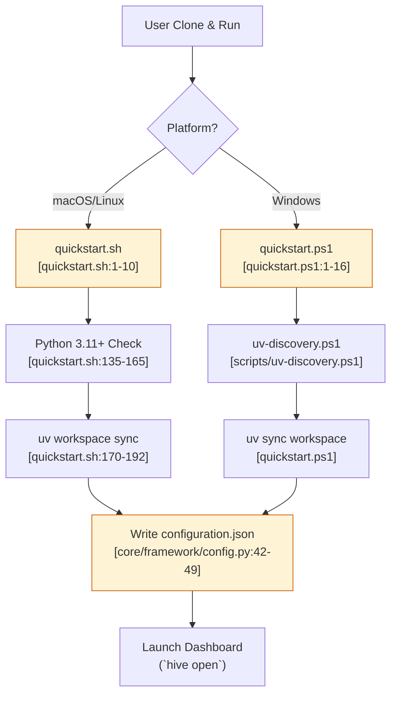
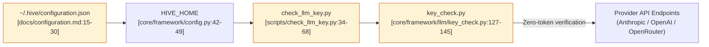

<!-- source: DeepWiki mcp.deepwiki.com · repo aden-hive/hive · page 2 Getting Started · fetched 2026-10-27 -->

# Getting Started

Relevant source files

The following files were used as context for generating this wiki page:

- [CONTRIBUTING.md](CONTRIBUTING.md)
- [README.md](README.md)
- [SECURITY.md](SECURITY.md)
- [core/framework/config.py](core/framework/config.py)
- [core/framework/llm/key_check.py](core/framework/llm/key_check.py)
- [core/tests/test_key_check_packaged.py](core/tests/test_key_check_packaged.py)
- [docs/configuration.md](docs/configuration.md)
- [docs/developer-guide.md](docs/developer-guide.md)
- [docs/environment-setup.md](docs/environment-setup.md)
- [docs/getting-started.md](docs/getting-started.md)
- [hive.ps1](hive.ps1)
- [quickstart.ps1](quickstart.ps1)
- [quickstart.sh](quickstart.sh)
- [scripts/check_llm_key.py](scripts/check_llm_key.py)
- [scripts/uv-discovery.ps1](scripts/uv-discovery.ps1)

This page guides new users through setting up the Hive environment, cloning the repository, running automated onboarding, configuring an LLM provider, and launching the dashboard with `hive open`. As a parent overview, this section introduces the primary onboarding workflows and links out to platform-specific installation guides and configuration references.

For detailed instructions, see the child pages:
- [Environment Setup (Linux and macOS)](#2.1)
- [Environment Setup (Windows)](#2.2)
- [Configuration Reference](#2.3)
- [LLM Provider Setup and Key Validation](#2.4)

Sources: [README.md:63-74](), [docs/getting-started.md:1-15]()

---

## 1. Quickstart and Installation Overview

Getting started with Hive begins by cloning the repository and running the automated onboarding script (`quickstart.sh` on Unix-based systems or `quickstart.ps1` on Windows) [README.md:64-67](). These interactive wizards check prerequisites such as Python 3.11+, automatically install the `uv` package manager if missing, set up a shared workspace virtual environment via `uv sync`, install native dependencies (such as Chromium for browser automation), and prompt for LLM credentials [quickstart.sh:119-195](), [quickstart.ps1:8-12]().

### Quickstart and Onboarding Pipeline

Sources: [quickstart.sh:1-192](), [quickstart.ps1:1-28](), [core/framework/config.py:42-49]()

---

## 2. Platform-Specific Environment Setup

Hive supports macOS, Linux, and Windows with platform-tailored onboarding routines [CONTRIBUTING.md:154-156](). 

- **Linux and macOS:** Automated via `quickstart.sh`, validating Python 3.11+, `uv`, Node.js (for frontend building), and native libraries [quickstart.sh:1-203](). For a granular walkthrough, see [Environment Setup (Linux and macOS)](#2.1).
- **Windows:** Automated via `quickstart.ps1`, `uv-discovery.ps1`, and the `hive.ps1` wrapper script [hive.ps1:1-15](). It handles registry-based environment variable loading, Windows Defender path exclusions, and secure `HIVE_CREDENTIAL_KEY` handling [quickstart.ps1:146-211](), [hive.ps1:43-77](). For complete Windows instructions, see [Environment Setup (Windows)](#2.2).

Sources: [quickstart.sh:1-203](), [quickstart.ps1:1-211](), [hive.ps1:1-77]()

---

## 3. Configuration Reference

Runtime configuration is centralized under `HIVE_HOME` (defaulting to `~/.hive/`) [core/framework/config.py:42-49](). The primary configuration file, `~/.hive/configuration.json`, stores global settings including the default LLM provider, `queen_llm`/`worker_llm` overrides, judge slots, vision fallback parameters, and key pools [docs/configuration.md:15-87](). 

### LLM Validation and Configuration Mapping

For comprehensive details on environment variables, model catalogs, capability flags, and UI provider selection, see [Configuration Reference](#2.3).

Sources: [core/framework/config.py:42-49](), [docs/configuration.md:15-90](), [scripts/check_llm_key.py:34-68](), [core/framework/llm/key_check.py:127-145]()

---

## 4. LLM Provider Setup and Key Validation

Hive supports both Bring-Your-Own-Key (BYOK) modes (for Anthropic, OpenAI, OpenRouter, Groq, Cerebras, DeepSeek) and subscription-backed modes (such as Claude Code, Codex, Kimi, and Antigravity) [README.md:56-61](), [docs/configuration.md:93-116](). 

To prevent unnecessary token expenditure during onboarding and configuration updates, Hive implements zero-token key validation routines (`scripts/check_llm_key.py` and `framework.llm.key_check`) [scripts/check_llm_key.py:1-14](), [core/framework/llm/key_check.py:1-11](). These scripts send minimal or empty probes (such as 400-triggering empty message arrays or model listing requests) to verify authentication status instantly [core/framework/llm/key_check.py:127-162](). OAuth credential discovery handles subscription-based logins automatically.

For deeper insights into provider modes, the Hive LLM proxy, and credential validation internals, see [LLM Provider Setup and Key Validation](#2.4).

Sources: [README.md:56-61](), [scripts/check_llm_key.py:1-68](), [core/framework/llm/key_check.py:1-162]()

---

